# Grow With It

**A Practical Guide to Hermes Agent, from Your First Setup to a Fleet That Learns While You Sleep**

Michael Gannotti

A free gift to the community.

Final edition, 12 November 2026. Notes run in one continuous series at the back of the book.


## Copyright
© 2026 Michael Gannotti.

**This book is a free giveaway and is not for sale.**

This is a free, independent, unofficial guide. It is not affiliated with or endorsed by Nous Research, or by any other company whose products are named in these pages. “Hermes,” “Hermes Agent,” and related marks belong to their owners and are used only to refer to those products. Features, versions, and community figures were checked on 12 November 2026 and will change. This book is not legal, financial, medical, or tax advice.

You may share this book freely as a gift, the way it was given. Please keep this notice with it, and please do not sell it.

A later appendix, Appendix E, says a little more about names, trademarks, and how the notes at the back of the book, in one continuous series, work. That appendix is not legal advice either.

---

The cover and the still-life illustrations in this edition were created with Grok. Diagrams were drawn for this book from the manuscript’s own descriptions. No official logos are used.


## A welcome, before we begin

This book is a gift. I wrote it for anyone who has wanted a careful teammate — one that can use tools, keep a notebook, and, when you are ready, keep learning after you close the lid — and who would rather be walked in kindly than sold to. You do not have to buy anything. There is no course at the end, and no upgrade waiting behind a link. If these pages help you stand up Hermes Agent this weekend, start a Wiki you will be glad you started, and finish one useful job with your own yes still on it, that is the whole point.

I already gave a sister gift, *Hand It Off*, a practical guide to Grok Bot. This book is not a remake of that one. It is its own walk, about a different product, with its own first setup and its own practice. I will name the earlier book once or twice, the way you would name a tool already on the shelf. Then we will stay with Hermes.

I run a small company called SMF Works, and a press inside it called WisdomForge. At SMF Works, a Hermes fleet does our research and development. I will tell you that story only as far as I have already said it in public, and only as a worked example, not as a shopping list. You are still the one who says yes.

If you only have a weekend, start with Part 2. That is the ways in, the Wiki, and your first real work, and Chapter 4 is the chapter I hope you will not skip. Chapters 11 and 12 are two full how-to shelves: professional uses in one, personal uses in the other. Chapter 13 is a fleet, when you are ready. Chapter 14 is safety, privacy, money, and a practice that lasts — worth a look before you give anything a lot of trust.

You can get a free copy of this book at the place I give work away. That is a place to pick up the file, not a shop. This book is not for sale there or anywhere else.

I am glad you are here. Let’s begin.

---


# Contents

- [A welcome, before we begin](#a-welcome-before-we-begin)
- [Preface](#preface)

**Part 1 — Meet Hermes**

- [Chapter 1 — What Hermes Is (and What It Isn’t)](#chapter-1--what-hermes-is-and-what-it-isnt)
- [Chapter 2 — How a Hermes Agent Works](#chapter-2--how-a-hermes-agent-works)

**Part 2 — Day One Through the First Week**

- [Chapter 3 — Get In: The Ways You Can Run Hermes](#chapter-3--get-in-the-ways-you-can-run-hermes)
- [Chapter 4 — First Setup: The Wiki You Will Be Glad You Started](#chapter-4--first-setup-the-wiki-you-will-be-glad-you-started)
- [Chapter 5 — Your First Real Work](#chapter-5--your-first-real-work)

**Part 3 — The Practice That Grows**

- [Chapter 6 — Memory, Skills, and the Loop That Learns](#chapter-6--memory-skills-and-the-loop-that-learns)
- [Chapter 7 — Talk to It from Anywhere: The Messaging Gateway](#chapter-7--talk-to-it-from-anywhere-the-messaging-gateway)
- [Chapter 8 — Work That Runs While You Sleep: Cron, Heartbeats, and Subagents](#chapter-8--work-that-runs-while-you-sleep-cron-heartbeats-and-subagents)

**Part 4 — The Commons**

- [Chapter 9 — The Catalog and the Commons: Plugins, Skills, and a Living Community](#chapter-9--the-catalog-and-the-commons-plugins-skills-and-a-living-community)
- [Chapter 10 — Making It Yours: Mentoring, Building, and Giving Back](#chapter-10--making-it-yours-mentoring-building-and-giving-back)

**Part 5 — How-Tos for Work and for Life**

- [Chapter 11 — Hermes at Work: Professional How-Tos](#chapter-11--hermes-at-work-professional-how-tos)
- [Chapter 12 — Hermes at Home: Personal How-Tos](#chapter-12--hermes-at-home-personal-how-tos)

**Part 6 — A Fleet, and a Practice That Lasts**

- [Chapter 13 — A Fleet That Learns: Many Agents, One Practice](#chapter-13--a-fleet-that-learns-many-agents-one-practice)
- [Chapter 14 — Safety, Privacy, Money, and a Practice That Lasts](#chapter-14--safety-privacy-money-and-a-practice-that-lasts)

- [Coda](#coda)

**Appendices**

- [Appendix A — Glossary](#appendix-a--glossary)
- [Appendix B — Cookbook](#appendix-b--cookbook)
- [Appendix C — Checklists](#appendix-c--checklists)
- [Appendix D — Resources](#appendix-d--resources)
- [Appendix E — Names, Trademarks, and Sources](#appendix-e--names-trademarks-and-sources)
- [A Note on Sources](#a-note-on-sources)
- [Notes](#notes)
- [Bibliography](#bibliography)


# Preface

This book is a gift. I wrote it because I wanted you to have, in plain words, what I wish someone had handed me the first week I sat down with Hermes Agent: a warm guide from a careful first setup to a practice that can grow, and, when you are ready, to a fleet that keeps learning after you close the lid — with the cautions said the way a friend would say them, and with no one asking you to buy anything at the end.

I already gave a sister gift. *Hand It Off* is a practical guide to Grok Bot, from a first task to a team that works while you sleep. This book is not a remake of that one. Hermes is a different product, with a different first hour and a different kind of notebook. If you have that earlier book on the shelf, you are welcome to it. You do not need it to use this one. I will mention it once or twice, the way you would mention a tool you already trust, and then we will stay here.

I have spent a lot of my working life as a Principal AI Solutions Engineer, and a lot of my other hours running a small company called SMF Works. Inside that company there is a press, WisdomForge, that makes teaching manuals. At SMF Works, a Hermes fleet is responsible for our research and development. I will introduce you, when the time is right, to Aiona Edge — my CIO and Chief AI Research Scientist — and to Liam, Nemo, Gabriel, and Paula. I run twenty-nine Hermes agents in all. That fleet is a worked example, for later, stated only as far as I can stand behind. It is not a requirement, and it is not a shopping list. You can have a useful life with one agent, a careful Wiki, and a habit of saying yes yourself.

I am not writing this as a vendor, and I am not writing it as an official manual. The product’s maker is Nous Research. This book is a free, independent, unofficial guide. It is not affiliated with them, and they have not endorsed it. I use the product’s name because I am talking about the product, the way you would name a tool on your desk. I do not speak for the people who made it. Their marks belong to them. I will be careful with those marks, and I will tell you, in Appendix E, how I have tried to be careful. That is not a lawyer talking. I am not a lawyer, and this book is not legal advice.

What I can offer you is practice.

## Who this is for

This book is for you if you are willing. That is the only résumé I am asking for.

Maybe this is your first weekend with an agent of any kind. You have heard a name, you have a laptop, and you would like to get something running without being made to feel late. Part 2 is for you. You can install Hermes, point it at a model, give it a folder to write in, and finish one useful job, with your approvals still tight and your secrets still out of the notebook. That is a complete start. It is enough.

Maybe you already run agents. You have a gateway, or a cron job, or a small roster, and you picked up this book because you want the practice to be cleaner — a Wiki that lasts, a skill with a “never” on it, a fleet you can actually see. You are welcome too. You can skip ahead. You will not be talked down to, and you will not be asked to start from zero for the sake of a chapter count.

A student can follow it. A solo operator can follow it. A Principal AI Solutions Engineer can follow it. Someone setting up a family helper can follow it, with a harder privacy “never” than a work vault needs, which we will get to in Chapter 12. The language is plain on purpose. If a term is official, I will give you the ordinary sentence first and the official name after.

## What “grow with it” means here

The official GitHub repository for Hermes Agent describes the product in a short line: “The agent that grows with you.”^1 That is their phrase, and it is a good one. It is not ours to wear as a slogan. Our title, *Grow With It*, is mine. I chose it because it is what I have actually watched happen, in my own shop and in the public work of a generous community: you start carefully, you keep a notebook, you learn a few habits, and the practice grows. The agent does not become wiser by magic. You give it a place to write, a procedure you trust, and, later, a schedule. You review what comes back. You still say yes.

On 11 November 2026 I published an article about that notebook. I opened it with a sentence I still mean: “The most important part of an autonomous AI agent isn’t the model. It’s the notebook.”^2 A chat window forgets. A folder of markdown can last. It can survive a model swap. It can be backed up. The popular story about agents starts with the model and treats memory as an afterthought. This book starts the other way around. We will get a model talking, yes. Then, before you hand the agent your week, we will give it a Wiki — a vault, a folder that is yours — and we will watch it read and write there once, with you in the room. That is Chapter 4, and it is the foundation the rest of the book grows from.

From there, a practice. Memory and skills, in Chapter 6. A messaging door, in Chapter 7, treated as a real door. Work that runs while you sleep, in Chapter 8: not a promise that the agent wakes up with ideas, but a scheduled job, a heartbeat, and helpers you can brief. The commons, in Chapters 9 and 10: a living catalog of plugins and skills, and an invitation to add something small if you want to, never a demand. Two full shelves of how-tos, professional and personal, in Chapters 11 and 12. And when you are ready, a fleet, in Chapter 13 — many agents, one practice, still with you as the one who says yes.

“A fleet that learns while you sleep” is the second half of the subtitle. I want to say, kindly, what that does and does not mean. It means a job you set, a notebook the job can write to, and a skill you have already watched. It does not mean the agent improves unsupervised. It does not mean work always survives a crash. It does not mean you have to buy a particular box. My own machines are a later example. A modest laptop and a careful setup are enough to start.

## How to use this book

You do not have to read it in one sitting. I would rather you didn’t, if sitting that long would make you skip the part where you actually install something.

Part 1 is a meeting. Chapter 1 tells two “Hermes” names apart — the model family and the agent — and dates where the agent is as of 12 November 2026. Chapter 2 walks one request from a door to a reply, so that install is not a leap into fog. You can read both with a cup of coffee and nothing running yet.

Part 2 is this weekend. Chapter 3 is the ways in: Desktop, the command line, native Windows, Termux, Docker, a cloud path, an editor, an API. Chapter 4 is the Wiki you will be glad you started. If you only do one careful thing in these pages besides installing, do that chapter. Chapter 5 is your first real work: one useful, reversible job, watched, edited, and filed in the vault, with a first-week “never” list you can actually remember.

Parts 3 and 4 are habits and the commons. Come back to them when the first week is behind you and you want the practice to deepen. They are not homework. They are the difference between a tool you tried once and a teammate you can trust with a schedule.

Chapters 11 and 12 are two full how-to shelves, the longest chapters in the book. Each has six step-by-step tutorials, with a purpose, a setup, a “never,” and a way to tell it worked. Take the one that matches the work in front of you. A research desk. A code-review profile. An operations helper. A content pipeline that does not publish alone. A household vault with a harder privacy line. A reminder on a messaging door. You do not have to stand up all twelve. One good setup, carefully, is better than six hurried ones.

Chapter 13 is a fleet, when you are ready. It includes my own setup, in the exact words I can stand behind — the model, the machines, twenty-nine agents, five primaries named. That is a picture of one practice, at one size. Start with two, not twenty-nine.

Chapter 14 is the chapter I want you to read before you give the agent a lot of trust: safety, privacy, money, and a practice that lasts. Local is not harmless. A plugin is code you are trusting. A bill is a habit. A quarterly review is how a practice stays yours.

The appendices are shelves, not homework. A glossary, if a word went by too fast. A cookbook of starter prompts, each with a “never.” Checklists for the first weekend and for safety. A dated list of official pages. A short note on names, trademarks, and how the notes work — including one place where two official pages disagreed, and which one we trusted.

There will be diagrams. Some are process drawings: a request’s journey, the ways into the product, the loop of a vault, a first-task loop. Some are still-lifes, for later: a notebook and an unplugged engine, a modest desk, a bound book of dated pages. They are there to make the shape of the work visible, not to decorate a slide.

## Names, and who says yes

I should say the quiet, necessary thing about names, in a human paragraph, and then we can get on with the work.

This book talks about Hermes Agent, and about Nous Research, and about other products and companies whose tools come up along the way — a model from one lab, a laptop from another, a messaging app, a note-taking program. I use those names to talk about those products. I do not speak for their makers. I am not affiliated with them, and they have not endorsed this guide. “Hermes,” “Hermes Agent,” and the other marks in these pages belong to their owners. Features will move. Versions will move. Community figures will move. Everything we checked, we checked on 12 November 2026, and I will say so when a number is dated. When this book and the live page disagree, trust the live page. I will tell you where to look.

SMF Works and WisdomForge are the thread of my own work. They are not a storefront in these pages, and they are not a reason to buy anything. This book is a free giveaway. It is not for sale.

You will notice a refrain. I will say it in the first chapter, and I will say it again in the last: you are still the one who says yes. The official docs already model this, in their own way. Dangerous commands can wait for an approval. Cron jobs, by default, are denied a dangerous step rather than waved through. A messaging door can be limited to the people you admit. I will teach that as a first-hour habit, and I will keep teaching it, because the product is capable enough that it is easy to forget. A teammate who can finish the work is a gift. A teammate who can also send, spend, delete, or publish is a teammate you walk with slowly.

I want to be honest about what this book will not do. It will not make you rich. It will not replace your staff this weekend. It will not crown Hermes the winner against every other tool. Other tools exist, and they will keep arriving. This is a practical guide to one of them, written by someone who uses it to run real work.

The product moves fast. Every version number in this book is dated 12 November 2026, and every version number will change. If a command in these pages has moved, the official docs are the authority, and Appendix D will point you at them.

I also want this book to be readable by everyone. You do not need to be an engineer. If you can write a clear note to a coworker — here is the goal, here is what “done” looks like, here is what you should never do — you already have the main skill this product asks of you. The rest is practice. Each how-to is a numbered list of actions you can actually take. I will tell you what “good” looks like, and what to do if you don’t see it. I will put the “never” in the step that needs it.

The notes live in one continuous list at the back of the book. A little marker in the text, a number, points to a source I actually opened. Official documentation is how the product works. Vendor claims stay labeled as vendor. My own fleet is a story I am offering, not a third-party case study. If you never look at a note, the book should still read cleanly. If you do look, you should be able to walk to the same page I walked to, on 12 November 2026.

I wrote this as a giveaway because I think a careful guide should not sit behind a cash register. The community that is already building this product — in official docs, in a catalog of plugins, in public posts, in a hackathon that drew nearly a thousand entries — gave a lot.^3 This is what I can give back. Take what helps. Leave the rest. Start a Wiki this weekend. Finish one small job. Watch it. Keep the yes.

I have one more thing to say before we start, and it is the simplest thing in the book. An agent with tools can do a great deal. It can also do a great deal you did not mean. The difference is almost never a secret trick. The difference is a clear first setup, a notebook you will be glad you started, a reversible first job, and a yes you have not given away. We will go slowly enough for that. We will also go far enough that, when you are ready, you can grow a practice, and even, if that is the right size, a fleet that learns while you sleep.

I am glad you opened this. Let’s start by telling the two “Hermes” names apart.


# Part 1 — Meet Hermes
# Chapter 1
## What Hermes Is (and What It Isn’t)


{width=100%}

*I01. A workshop bench: a notebook, and an engine that can be swapped.*


There is a confusion I want to clear up before we install anything, because it is the one that sends the most people down the wrong path. The word “Hermes,” on its own, means two different products. They share a maker. They share a name family. They are not the same thing. This book is about one of them, and I would like you to know which one, in plain words, before the first command.

## The name that means two things

If you arrived here from Hugging Face, or from a model card, or from a conversation about open-weight models, the Hermes you have in mind is probably a *model* — a language model you can download and run, in a line that includes Hermes 3, Hermes 4, and Hermes 4.3. That is a real product family, made by Nous Research, and it is a good one. It is not what this book is about, except for a short, careful section later in this chapter so that you are not lost.

If you arrived here from a terminal, or from a desktop app, or from a friend who said they talk to an agent on Telegram, the Hermes you have in mind is **Hermes Agent**. That is a *harness*. I will use that word a lot, and I want it to mean something ordinary. A harness is the set of tools, memory, skills, doors, and habits around a model. It is the process that can read a file, run a command (with your leave), keep a notebook, learn a procedure, talk on more than one messaging app, and, when you ask it to, run a job later. The model is the engine. The harness is what makes the engine into a teammate you can actually work with.

You do not need a Hermes-named model to run Hermes Agent. I want that sentence to land, because a lot of people assume otherwise. The agent will talk to many providers. It will talk to a model you host yourself, if you point it at an ordinary, compatible endpoint. In my own shop, the fleet runs on GLM 5.3 Flash, locally, on two NVIDIA DGX Sparks.^4 That is a different model, from a different line, on hardware I will describe later, in Chapter 13, and only in the words I can stand behind. I mention it now for one reason: the name on the engine is not the name of the practice. You can grow a careful Hermes practice on whichever supported model you choose.

So when I say “Hermes” in these pages, I almost always mean the agent. When I mean the model family, I will say so. If a sentence would be confusing without the last name, I will use “Hermes Agent,” the official product name, the way you would use a full name the first time you introduce someone at a table.

Two products. One maker. One name family. This book is the one about the harness — about getting it running, giving it a notebook, and growing a practice you can trust.

## Who makes it, and a short honest history

Nous Research makes it. That is the company behind both the model family and the agent. On their public site they describe themselves as a pioneer in open AI training and research, with a mission “to create and proliferate open access to intelligence.”^5 That is their wording, and I will leave it as theirs. Officially, they are on X as @NousResearch, and they keep a GitHub organization at github.com/NousResearch, with the agent’s own repository at github.com/NousResearch/hermes-agent.^6 I will point you at those doors again in the appendix. I will not invent a founder interview, or a conversation in a Discord room I was not in, or a scene in which I met someone in the hallway. The public record is enough, and it is honest.

The agent is open source. The license is MIT, which, in plain words, means you can run it, read it, change it, and share it, with the notice the license asks for.^7 The public repository was created on 22 July 2025.^8 On Nous’s own releases page, a product listing for “Hermes Agent” is dated 25 February 2026, and describes “an autonomous agent that lives on your server, remembers what it learns, and gets more capable the longer it runs.”^9 I am giving you those two dates as I found them, on pages I opened, and I am not going to invent a story that ties them together with a ribbon. Mid-2025, a public repo. Early 2026, a company listing. From there, a product that has moved quickly, in public, with a community that has moved with it.

I will not treat a star count as a quality score. Popularity is not the same as care, and a number on a repository is not a reason to trust a command. If you are curious, the GitHub API, on the morning of 12 November 2026, reported a very large public interest in that repository; I have put the exact figures in a note, with the date and the API as the source, which is where a figure like that belongs.^10 What matters for this book is simpler. The code is public. The docs are public. The catalog of plugins is public. You can read what you are running.

The company’s site has called Hermes Agent “the most widely used open source agent harness in the world,” and the README has called it “the only agent with a built-in learning loop.”^11 Those are vendor claims. I will label them as such, here and whenever they come back. The *features* of that loop — skills written from experience, memory the agent can keep, a search of past sessions — are documented, and we will learn them. The word “only,” and the word “most,” are marketing. This book does not need them. A free gift does not need to win a contest.

I am grateful for the work. I am also, in these pages, a neighbor with a practice, not a spokesperson. Nous Research does not endorse this guide. I do not speak for them. I use their product’s name because I am talking about their product, and then I go back to teaching you how to start.


## A harness, not a chat skin

A chat window is a place you type and a place an answer comes back. That is a useful thing. It is not what Hermes Agent is for, at least not only, and not for long, if you want a practice that lasts.

Think of a harness as the rest of the work around the answer. You send a message. It might arrive from a desktop app, or from a terminal, or, later, from a phone. The model thinks. Then, if the job needs it and if you have allowed it, the agent can use a tool: it can read a file on your machine, or run a command in a terminal, or look at a page in a browser, or write a note it will be able to find tomorrow. It can ask a helper — a *subagent*, a smaller run with a fresh context and a clear brief — to take a piece of the work. It can, with your leave, run a job at a time you set. A reply comes back. At more than one of those steps, an approval can stop the work and wait for you.

That is the idea, in plain words. The official materials describe the same shape with their own phrase, “the agent that grows with you,” which I quoted in the preface and will not keep wearing.^12 I will say it in our words. The agent can use tools. It can keep a notebook, if you give it a place. It can learn a procedure and use it again. It can talk on more than one door. It can, when you ask, run work later. The growing is a loop you set — a folder, a skill, a schedule, a human review — not a promise that the software becomes wiser by itself while you sleep.

I want you to feel the difference in your hands, not only in a definition. A chat skin wraps a model in a prettier box. A harness lets the model *do work*, inside limits you can see. The limits matter as much as the tools. The official security documentation describes a defense with several layers: who is allowed to talk to the agent, which commands need a yes, which files it may not write, and, if you want it, a container that keeps the agent’s terminal off your bare machine.^13 We will not dump that page into this chapter. We will come back to approvals in the first hour of Chapter 3, and again in Chapter 5, and at more length in Chapter 14. The point, for now, is this: “it can do work” is not the same as “it may do anything.” You are still the one who says yes.

A harness also lasts in a way a single chat does not. Sessions end. Models get swapped. The folder you started, the skill you wrote, the profile you named, the approval habit you kept — those are what you carry forward. That is the popular-story correction this book is built on. We will not start with the fanciest engine and treat memory as a feature you might turn on later. We will start with a careful first setup, and a Wiki you will be glad you started, and we will grow a practice from there.

The official README has a small table of what that looks like in practice, and I will translate it into ordinary language rather than paste it as a brochure.^12 The agent has a real terminal interface — a command-line chat, and a fuller terminal UI — with history, a way to interrupt, and a way to watch a tool as it runs. It “lives where you do,” which, in their list, means Telegram, Discord, Slack, WhatsApp, Signal, and the command line, all from a single gateway process.^33 Email is on that list too, and the Quickstart also names Home Assistant (as a plugin) and Microsoft Teams.^34 We will not set those doors up in this chapter. Chapter 7 is the careful how-to, and it will treat a messaging door as a real door, because anyone who can message the bot is, in some sense, at your desk. There is a learning loop, which we will teach as a habit plus a place to write, in Chapter 6. There is a scheduler, in Chapter 8. There is delegation: the agent can spawn helpers for parallel work, with a fresh context and a brief you (or the parent agent) must write completely, because a child starts knowing nothing except what it was told.^35 There are six built-in terminal backends — local, Docker, SSH, Modal, Daytona, and Vercel Sandbox — and plugin backends on top of those.^36 You do not need six backends on day one. You need to know they exist, so that “it runs on my laptop” is not the only picture you have, and so that “it can run in a container” is a safety option you can choose later, not a surprise.

I want to say one more kind thing about all of that capability. A long list of features can feel like a demand. It is not. The official Quickstart itself has a rule of thumb I will adopt as a first-week rule: if Hermes cannot complete a normal chat, do not add the gateway, or cron, or skills, or voice, or routing yet.^37 Get one clean conversation working first. Then a notebook. Then, when you are ready, the next layer. Growing with it is a pace, not a race.

If you have used other agents, some of this will sound familiar. Tools, memory, skills, a gateway, a schedule: those ideas are in the air, and they should be. Hermes has its own shape for each of them, and its own official pages, and we will follow those pages rather than a memory of some other product. If you are coming from OpenClaw, or from Claude Code, or from Codex CLI, or from Cursor, the official setup can offer to import what it finds. That is a documented path, for later, if you want it.^14 You do not need it on day one. You need a working chat, and then a notebook.

## The model family, then we leave it

I promised a short, careful look at the model line, so that a reader who arrived from Hugging Face is not left in a hallway. Here it is. Then we will stay with the agent for the rest of the book.

Nous Research has trained a family of open-weight models under the Hermes name. Earlier generations include Hermes 3, with a public technical report, and, before that, Hermes 2 and Hermes 2 Pro, in 2024.^15 Hermes 4 arrived in August 2025, in more than one size, including large Llama-based models and a smaller Qwen-based variant.^16 Hermes 4.3, which is the current point in that family as of the announcement I opened, was released in December 2025.^17 The official introduction describes it as based on Seed-OSS-36B-Base, post-trained on the Psyche network, with a long context, and says it “nearly matches (and in some cases exceeds) the performance of Hermes 4 70B at half the parameter cost.”^18 That last claim is Nous’s. I am giving it to you as theirs, not as a measurement I repeated in a lab. If you care about the numbers, the announcement and the model card are the place to read them. This book will not become a model cookbook.

The date is worth a small, honest pause. Some early notes for this book had Hermes 4.3 placed in October 2026. That appears to have confused the *model* with a *release of the agent* — Hermes Agent v0.22.0, “The Threshold Release,” which is dated 14 October 2026.^19 The model announcement I opened says December 2025. When a date in a guide and a date on a primary page disagree, trust the primary page. I will record that wrinkle again in Appendix E, so a careful reader can see it.

You may run Hermes Agent with a Hermes-named model if you want to. Many people do. You may also run it with a model from another provider, or with a model you serve locally. The official Quickstart is explicit: you can switch providers at any time with `hermes model`, and there is no lock-in.^20 The agent talks to hosted providers with a key, and it talks to a local OpenAI-compatible endpoint — vLLM, SGLang, Ollama, LM Studio, NVIDIA NIM, or a custom URL — if you set the base URL, the model name, and a context window of at least 64,000 tokens, which is the official minimum.^21 Smaller windows are rejected at startup. That is a practical fact for anyone running a local model, and we will come back to it in Chapter 3.

My own fleet, as I have already said, uses GLM 5.3 Flash, running locally on two NVIDIA DGX Sparks. That is not a Hermes-named model. It is also not a requirement. I will not tell you to buy a Spark. I will not tell you that a serious practice begins at a particular price of hardware. The engine is interchangeable. The notebook is not. That is the whole point of leaving the model family here, in one section, and walking back to the agent.

## Where the agent is, on 12 November 2026

Books about software have a “now,” and the “now” goes stale. I would rather date ours honestly than pretend I can freeze a timetable.

As of the morning we checked, 12 November 2026, the current stable release of Hermes Agent is **v0.23.1**. The project’s own release notes give a release date of 9 November 2026. GitHub published the tag just after midnight UTC on 10 November, which was 8:42 p.m. Eastern time on the 9th.^22 It is a patch. The notes say it rolls up a large window of work since v0.23.0 into a stable release for the GitHub release, the installers, the Microsoft Store app, Docker, and Hermes Cloud, and that the full curated notes for that window will ship with v0.24.0.^23 The Microsoft Store, here, is a distribution channel for Hermes Desktop. It is not a mention of anyone’s employer. I say that once, plainly, so the sentence can stay in the book without a cloud over it.

The user-facing fix the notes highlight is a practical one, and I mention it because it affects anyone who installs plugins. After a catalog deploy on 9 November, the published catalog file had grown larger than a two-mebibyte cap that clients would accept, so installs silently fell back to the catalog they had shipped with. New plugins could not be found. v0.23.1 raises the cap to sixteen mebibytes, so the live catalog is used again. If you stay on v0.23.0 or older, the fallback continues until you update.^24 The official update for the command-line install is `hermes update`. I reported that patch, the same week, and suggested the same command.^25 If you are installing fresh from the official script, you should land on the latest stable release, which, on our check, was this one. If a newer tag has shipped by the time you read this, trust the live releases page.

Just before that patch came **v0.23.0**, “The Hearth Release,” dated 5 November 2026 in the project’s own notes.^26 I want you to have the name, because you will see it, and because it tells you something about how the project thinks of itself. The notes open with a short image from old hymns: Hermes kept the threshold, Hestia kept the hearth, and the two were honored side by side. v0.22.0 got newcomers through the door; v0.23.0, they say, builds the fire they gather around.^27 That is their language, and it is lovely, and it is still vendor language. What the release actually shipped, in official highlights, is concrete. Your Desktop workspace can open in a browser tab, served by your own gateway, off by default. One gateway owns every conversation, and the command line, the terminal interface, Desktop, editors, messaging bots, and scheduled jobs attach as clients instead of each running their own copy of the agent. There is a rewind. There are group chats with routing. There are spend limits for paid tools. The notes also record a plugin catalog that, in that window, “grew from about 600 to over 1,050 entries,” and a contributor count of 666 in the project’s own accounting.^28 Those figures are the project’s. We will treat them that way, dated, when we get to the commons in Chapter 9. We will not use them as a quality score, and we will not collapse them with later marketplace totals that we open on a different day.

Features will move. I will say so again. A version number in this chapter is a stake in the ground on 12 November 2026, not a promise about the week you arrive. When this book and the live page disagree, trust the live page.


## What this book is, and is not

This book is a free gift. I will not get tired of saying that, because the rest of the internet is loud with things that are for sale, and I do not want these pages to be mistaken for one of them. It is an independent, unofficial guide. It is not a vendor manual. It is not a sales pitch. It is not a review that crowns a winner. It is not a cookbook of prompts you paste without thinking, and it is not a cookbook of models. It is a practical walk, in my voice, from a careful first setup to a practice that can grow, and, when you are ready, to a fleet that keeps learning while you sleep — still with you as the one who says yes.

What you will get, if you walk with me, is a sequence you can actually follow.

You will learn what the agent is, which is this chapter, and how a single request travels from a door to a reply, which is Chapter 2. You will get in, in Chapter 3, through whichever official door fits the machine in front of you, and you will complete a first “hello” that proves the install works. You will, in Chapter 4, start a Wiki — a vault, a folder of markdown that is yours — and you will watch the agent read from it and write to it once, and you will take a first backup. That chapter is the foundation. I will say so more than once, because a lot of guides skip it, and I have come to believe that skipping it is how a promising first week turns into a messy second one. You will, in Chapter 5, finish one useful job, with the vault in the loop, and a short “never” list you can remember.

Then the practice deepens. Memory and skills, and a loop that learns because you set it, not because the software promised to improve unsupervised. A messaging gateway, which is a real door, with a real “who is allowed.” Scheduled work, heartbeats, and helpers — subagents — with a default of ten at a time, from the official Delegation page we opened, taught fully in Chapter 8.^29 The commons: a catalog of plugins, a hub of skills, a living community, with figures dated and labeled, never used as a boast. A chapter on making it yours: a small skill with a “never,” a careful issue, an invitation to contribute that is not a demand.

Then two full shelves. Chapter 11 is Hermes at work: a research desk, a code-review profile, an operations helper, a content pipeline that does not publish alone, quotes and mail that never send themselves, and a defensive look at security hygiene. Chapter 12 is Hermes at home: a household vault with a harder privacy line, a reminder on a messaging door, a meal plan, a learner’s profile, a hobby on a schedule, and, if the current docs still support it, a careful word about voice. Those two chapters are the longest in the book, on purpose. This gift should be useful to a person who will never run a company, and to a person whose week is full of professional work, and I will not short either of them.

Then, when you are ready, a fleet. Chapter 13 is many agents, one practice, with my own setup as a worked example and a paper sketch you can copy at a smaller size. Chapter 14 is safety, privacy, money, and a practice that lasts — local is not harmless, a plugin is code you are trusting, a bill is a habit, a quarterly review is how you keep the practice yours. The coda is short, and it will send you back to the beginning: you can start this weekend. You are still the one who says yes. The notebook is still there.

What you will not get is a substitute for the official documentation. The docs at hermes-agent.nousresearch.com/docs are how the product works.^30 This book is a companion, written in a human voice, with a first-week order I believe in, and with the cautions said the way I would say them at a table. When a command has moved, the live page wins. When a price or a plan has moved — Nous Portal has tiers, and Hermes Cloud has a billing page, and both will change — the live page wins.^31 I will date what I checked. I will not pretend the date is permanent.

You will not get a dump of my private vault, or of Aiona’s, or of the prompts that sit behind a production agent in my shop. What I have already said in public, I may say here, attributed. What I have not said, I will not invent. Sample wording in Chapter 4 is a sample, clearly marked, for you to adapt. It is not a secret leaked from a live folder.

You will not get legal advice, or medical advice, or financial advice, or tax advice. You will not get a child’s private life used as an example. You will not get an offensive security tutorial. You will not get a promise that work always survives a crash, or that an agent “wakes up with ideas.” You will not get a hardware shopping list dressed up as a requirement. A modest laptop and a careful setup are enough to start. My Sparks, my MiniPC, and my Surface Laptop are a later picture of one practice, at one size.

You will also not get a second *Hand It Off*. I love that book, and I am glad it is out in the world as a gift. Charlie, my chief of staff Grok Bot, talks to the Hermes fleet and to an OpenClaw fleet, carefully, over a command line, and Video Studio can take a script from a Hermes agent over a webhook.^32 That is as far as I will go. I will not invent the commands or the request body. If you want the Grok Bot walk, that other book is already free. This one stays with Hermes.

I have a small hope for you, and it is not a sales close. I hope that, a month from now, you have a folder of markdown that already knows a little about your work, and a first skill you trust, and a habit of watching what the agent does before you let it do more. I hope the model you started with is not a prison, because you can swap it. I hope the notebook is something you would be glad you started. That is the gift I am trying to put in your hands.

If you are a person who learns by doing, you may feel impatient with a chapter that has not yet given you a command to run. I understand that. The commands begin in Chapter 3, and they are real ones, copied from official pages, not guessed. The reason we spent these pages on a name, a maker, a version, and a picture of a harness is practical, not ceremonial. I have watched people install the right software and then point it at the wrong idea — treating a model card as if it were the product, or treating a chat window as if it were the whole practice, or treating a version number from a social post as if it were a manual. A clear “what it is” saves a messy afternoon. If you already knew all of this, thank you for your patience. Chapter 2 is short enough, and then we get in.

One last word on tone, because I would like us to be partners in it. I am enthusiastic about this product. I use it every day. I am also going to be careful. When the company says “most” or “only,” I will tell you they said it. When a community member reports a saving, or a success rate, I will tell you they said it, and I will not promote it as a result I measured. When I do not know something — the exact serving software on my own Sparks, which I have chosen not to name; a Discord member count nobody in this project independently verified; a skill-hub total I could not find on a single opened page — I will leave it out, or I will flag it, rather than fill the gap with a sentence that sounds finished. A gift should be trustworthy. Trustworthy is a little slower. I think that is all right.

Before we install anything, I want to walk you through what happens when you ask the agent to do something. Chapter 2 is that walk: one request’s journey, in plain words, so that the first command in Chapter 3 is not a leap into fog.

## A simple picture

Here is the confusion this chapter opened, drawn so you can see it at a glance. On the left, Hermes the model. On the right, Hermes the agent. Same maker. Same name family. Different products. This book lives on the right-hand side.


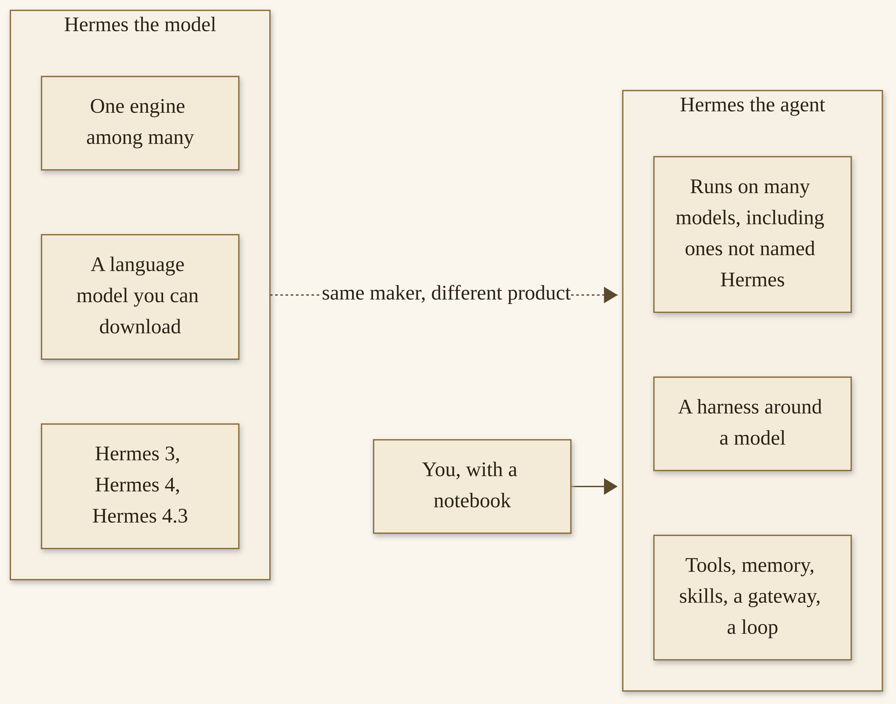{width=100%}

*Hermes the model, and Hermes the agent. The engine can be swapped. The notebook is what you keep.*


If you take only one thing from this chapter, take this. The name on the box is two names. The product we are here to learn is the harness. The model is important, and we will choose one in Chapter 3, carefully, without turning the choice into a comparison chart. Then we will give the agent a place to write, and we will grow from there. You are still the one who says yes. Let’s look at how a single request actually travels, from your message to a reply you can use. Once you can see that path, the first install is just a door, not a mystery, and the first approval is a habit you already understand.

## How to check that this chapter is still true

Books freeze a date. A living project does not. I want you to have, before we go any further, a small habit for checking that the version, the doors, and the catalog I describe are still the ones in front of you.

The official product site is [https://hermes-agent.nousresearch.com/](https://hermes-agent.nousresearch.com/). The official documentation home is at that same host, under `/docs`. The official code, the releases, and the installers live in the Nous Research GitHub organization, at [https://github.com/NousResearch](https://github.com/NousResearch), in the `hermes-agent` repository. The official public feed, where release notes, plugin news, and the hackathon statement we will read in Chapter 9 were posted, is [@NousResearch](https://x.com/NousResearch) on X.^6 I am listing these as doors, not as a reading list you have to finish tonight. If you open only one of them this week, open the releases page, or the Installation page, and compare the current stable tag to the one in this chapter.

On the morning of 12 November 2026, that tag was **v0.23.1**, a patch dated 9 November 2026 in the project’s own notes, published on GitHub just after midnight UTC on 10 November, which was 8:42 p.m. Eastern time on the 9th.^22 The release before it, **v0.23.0**, “The Hearth Release,” is dated 5 November 2026.^26 If you are reading this in a later month and those numbers have moved, you are not looking at an error in this book. You are looking at a project that is still being built. Trust the live page. Chapter 3 will say this again, at the moment of install, and I will keep saying it, because a gift book that pretended a patch number was a statue would not be a kindness.

The same habit applies to a claim you will hear around this product. The company site and the official README include vendor wording — “most widely used,” “only agent with a built-in learning loop,” and similar lines.^13 I am glad the people who make Hermes are proud of it. I use it every day. I will not repeat a superlative as if I had independently measured the world. When I quote those lines, I will label them as the company’s. When I quote a count, I will date it. When two official pages disagree — and they sometimes do, as we will see with a stale “3 concurrent subagents” on one overview page and a current “10” on the Delegation page — I will tell you which page I trusted, and I will record the disagreement in Appendix E so you can look for yourself.^29

You do not need to become a researcher to use this book. You need a willingness, when a number matters to a decision, to open the live page and see what it says today. That is the same willingness I am going to ask of you at a first approval, and at a first plugin, and at a first scheduled job. The project grows. The notebook grows. You grow with it, and you keep the right to check.


# Chapter 2
## How a Hermes Agent Works


{width=100%}

*I02. A path from a handwritten note to a finished reply, a small closed toolbox at the edge.*


Before we install anything, I want to walk you through a single request. Not a setup. Not a fleet. Just one message, from the moment it arrives to the moment a reply comes back. If you can see that path, the first command in Chapter 3 is a door you are opening, not a leap into fog.

## One request’s journey

You type a message. Maybe you typed it in Hermes Desktop, the official graphical app. Maybe you typed it in a terminal, with the classic command-line interface or with the fuller terminal UI, the TUI, which you start with `hermes --tui`.^38 Maybe, later, you typed it on a phone, into a Telegram chat, or a Slack thread, or another official messaging door. For this walk, it does not matter which door you used. The message arrives. As of v0.23.0, one gateway process owns the conversation, and the surfaces attach as clients, so a chat you open in one place is the same chat, with one history.^39 We will look at that gateway in a picture later in this chapter. For now, just hold the idea: one request, one conversation, one place it lives.

The model reasons. This is the engine’s job. It reads what you said, and what it has been given to work with — a snapshot of its short memory, perhaps a skill description, perhaps a page from a project file — and it decides what to do. Sometimes what to do is simply to answer. A lot of good work is just a careful answer. Sometimes what to do is to use a tool.

A tool, in plain words, is a thing the agent is allowed to do on your behalf: read a file, write a file, run a command in a terminal, look at a web page, search, delegate a piece of work, save a memory. The official product groups these into toolsets — files, terminal, web, memory, delegation, and others — and you can turn toolsets on or off per platform with `hermes tools`.^40 We will not configure them in this chapter. I only want you to know that “it can do work” means, concretely, that it can call one of those functions, see the result, and keep going. A single request may involve several tool calls, one after another, or a few in parallel if helpers are asked. You can watch this happen. In the terminal, tool output can stream. In Desktop, you can see the steps. Watching is not a nicety. Watching is how you learn what you are actually approving.

Memory may be read. The agent has a small, official persistent memory — two curated files, which I will name in a moment — and it may also, if you have given it a Wiki, look something up in that folder. A subagent may be asked: a child run, with a fresh context, given a brief, sent off to do a piece of the work, and asked to bring a summary back. A reply is composed. It comes back through the same door the message arrived on, or through whichever door this conversation is attached to.

At more than one of those steps, an approval can stop the work. If the agent wants to run a command that matches a dangerous pattern — a recursive delete, a disk write, a pipe from the internet into a shell — the official security page says it must wait for you, unless you have loosened that rule.^41 In the command-line interface, you get a prompt with four choices: once, for the rest of the session, always, or deny. Deny is the default.^42 On a messaging door, you are asked in the chat. If you do not answer in time, the default is to deny, and the door closes fail-closed.^43 I will teach the habit in Chapter 3, from the first hour, and again in Chapter 5. The important fact for this walk is that a request is not a straight line. It is a line with gates. You own the gates.

Here is the same journey, drawn.


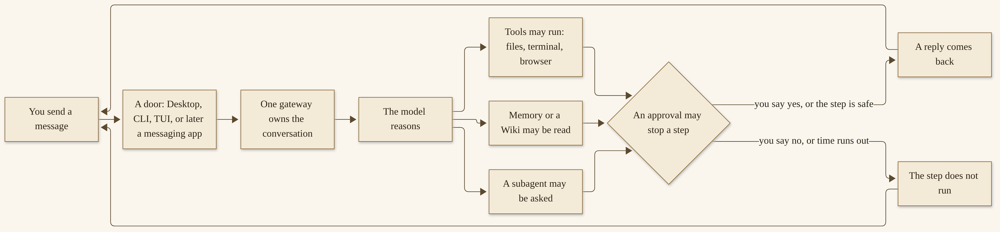{width=100%}

*One request’s journey. You sit at both ends, and at the gate in the middle.*


What does a healthy trip look like, even before you have installed? It looks ordinary. You ask for something small and verifiable: a summary of a folder, a look at a file, a short answer you can check. The banner, in a terminal, shows the model you chose. The agent replies without error. If a tool is needed, you see it used. The conversation continues for more than one turn. You can come back to the same session with `hermes --continue`, which is the official short path, or `hermes -c`.^38 That last step is easy to skip and worth not skipping. A session that cannot be resumed is a session that did not really save, and the official Quickstart asks you to verify this before you add any next layer.^38 Failure looks ordinary too. An empty or broken reply is often a provider or a model that was not quite set. A custom endpoint that “works” and returns garbage is often a wrong URL or a wrong model name. A session you cannot find is often a profile you switched without noticing. The official page has a short table of these, and a recovery order, which we will use in Chapter 3.^38 None of that is a moral failing. It is a first hour. The map is so that, when it happens, you know which room to walk back into.

That is the whole trip, at the idea level. The rest of this chapter is a closer look at each of the rooms the request walked through: the engine, the tools, the notebook, the idea of a profile, the gateway, and the work that can happen later. None of it is a setup guide. Setup starts in the next chapter. This is a map.

## The model is the engine, not the agent

I said this in Chapter 1, and I am going to say it again, because it is the fact that makes the rest of the practice possible. The model is the engine. The agent is the harness around it. You can change the engine. The harness stays.

When you first run Hermes, you will need a way to talk to a model. There are two ordinary paths, and the official Quickstart describes both.^44 The first is a hosted provider: a company that runs models and gives you access with a key, or with a login. Nous Portal is one such path, and the official docs call a Portal login the fastest one — one subscription, many models, and a Tool Gateway for search and a few hosted tools — which is their recommendation, not a requirement of this book.^45 OpenRouter, Anthropic, OpenAI, xAI, Z.AI, and a long list of others are also supported. The second path is a local, OpenAI-compatible endpoint: a server you run, or a desktop app like LM Studio, or a cluster, speaking a common protocol. You set a base URL, a model name, and a context length of at least 64,000 tokens. The official page is firm about that minimum. Smaller windows are rejected at startup.^46 If you are running a local model, this is the first number to get right. The examples the docs give are `--ctx-size 65536` for llama.cpp and `-c 65536` for Ollama. I am repeating them because they are official, and because a quiet failure at startup is a miserable first hour.

You can switch providers at any time with `hermes model`. The Quickstart says “no lock-in,” and I will take them at their word on the mechanism: the command is there, and the config can change.^47 Secrets go in `~/.hermes/.env`. Non-secret settings go in `~/.hermes/config.yaml`. The official advice is to let `hermes config set` put each value in the right file, so a key does not end up in a file you might one day share.^48

There is a default in the product, in the sense that a fresh setup will offer you a path and a model. I am not going to name a particular default model as *the* default in this chapter, because the Quickstart I opened on 12 November 2026 did not put a single model name on that throne; it put a provider choice in your hands.^49 Whatever the wizard offers on the day you install, it is the product’s offer, on that day. It is not a verdict on what you should run. And it is not my setup. My own fleet uses GLM 5.3 Flash, running locally on two NVIDIA DGX Sparks. That is a local engine, on hardware I will describe in Chapter 13. It is not a recommendation that you buy the same boxes, and it is not the product’s first-run default. Keep those two facts in different pockets. They will otherwise collapse, and I have watched that collapse confuse people.

The thing I want you to feel, practically, is relief. You do not have to pick a forever model on day one. You have to pick a working one: a provider or a local endpoint that can complete a normal chat, with enough context, with a key or a login that is stored in the right place. Then you can get on with the notebook. The engine can be swapped when you have a reason. The practice you are about to grow does not have to be swapped with it.

A word about cost, only as a pointer, because Chapter 14 is the honest chapter on money. A hosted provider will bill you, in its own way, and Nous Portal has tiers that we opened on a pricing page and that will change.^45 A local model has a different bill: power, hardware you already own or might one day buy, and the time it takes to keep a server healthy. I will not invent a typical monthly figure, because I do not have one I can stand behind for *your* use. I will say that a first weekend should be a first weekend, not a hardware project. If you already have a provider key, or a Portal login, or a modest local server, use that. If you do not, the official fastest path is a documented way to get a working chat without collecting five separate keys.^45 The live page is the authority for what that path costs on the day you take it.


## Tools, in plain words

“It can do work” is a phrase that can mean almost anything, so let me make it small and concrete.

The agent can work with **files**. It can read a file you point it at. It can write a file, or patch one, inside limits the official security page describes. Some paths are always blocked for writing: credential stores, secret files under the Hermes home, things you would not want a helpful teammate to overwrite by accident.^50 Project `.env` files are a special case on that page — the agent may be able to write them and still be refused a read back — and I mention it only so that “it wrote my env file” is not a surprise you have to decode from a forum. We will put a “never” around secrets in Chapter 4. The idea, here, is that file tools are a privilege. A write is a real write, on a real disk.

The agent can use a **terminal**. It can run a command on your behalf and show you the result. This is the tool that makes people both excited and nervous, and both feelings are reasonable. A terminal can list a directory, and it can also delete one. The official approval system is built around this fact. A curated list of dangerous patterns — recursive deletes, disk formatting, piping the internet into a shell, and others — raises a prompt. Some commands are on a hardline blocklist and will not run even if you have turned approvals off: a wipe of the filesystem root, a fork bomb, a format of a live disk.^51 That floor is official, and I am glad it exists. It is not a substitute for your judgment. It is a floor.

The agent can use a **browser**, and it can search the web, depending on which tools you have enabled and which providers you have configured. It can look at a page, extract text, and, in some setups, operate a browser more fully. Official docs describe several backends for that, including a local Chromium and hosted options.^52 We will not set them up here. I want you to know that “research” is a real verb for this agent, and also that a browser is a door to the network, with the same need for care that any other door has. The official security page even describes a website blocklist and a protection against the agent being tricked into calling private or metadata addresses.^53 That is for later, and for Chapter 14. For now: a browser tool is a privilege too.

The agent can work with **code**. There is an `execute_code` tool, a sandboxed way to run a script. There is integration with editors through ACP — a protocol, with a command `hermes acp` — so that VS Code, Zed, or JetBrains can talk to the same agent.^54 If you are a programmer, that door will matter, and Chapter 11 has a tutorial for a code-review profile. If you are not a programmer, you can ignore ACP for a long time and still have a complete practice. The agent does not require you to be a developer. It requires you to be clear.

A tool is a privilege. That is the sentence I want this section to leave you with. Enabling a toolset is a decision. The official first-run wizard includes a **Blank Slate** mode, in which almost everything starts off except a provider, file operations, and the terminal, and stays off across updates until you opt in.^55 That is a serious option, and it is there for people who want a minimal agent and a full sense of what they have turned on. Most readers will take a fuller setup, and that is all right, as long as the approvals are tight and the first jobs are watched. We will start tighter than you think you need. It is easier to loosen a rule than to unwind a command that already ran.

## A notebook, previewed

Here is the idea I care about most in this whole book, previewed only, because Chapter 4 is where we will actually build it.

The agent can write things down and find them later — if you give it a place. Without a place, it has what the official product gives it: a small persistent memory, on purpose. Two curated files live in `~/.hermes/memories/`. `MEMORY.md` holds the agent’s own notes, up to 2,200 characters. `USER.md` holds a profile of you, up to 1,375 characters. They are injected as a frozen snapshot at the start of a session.^56 That is useful. It is also small. I wrote about this in the vault article, and I will quote myself only to keep the numbers honest: those are the official caps, and they match the docs I opened.^57 A great deal of a practice will not fit in 2,200 characters. A week of research will not. A “how we work” page will not, not for long. The compounding artifact is a folder.

That folder is the Wiki, or the vault — two names for the same idea. Officially, there is an optional skill called `llm-wiki`, at `official/research/llm-wiki`, version 2.1.0 as of our check, based on a pattern Andrej Karpathy published, which I have written about and which Chapter 4 will teach, step by step.^58 The Memory Wiki *plugin* is a different product, a dashboard of session history; we will not confuse the two.^59 The skill’s own docs say the quiet, important sentence: “The wiki is just a directory of markdown files.”^60 No special database. No vendor lock on the notes themselves. You can open the folder in any editor, and you can back it up the way you back up any other folder.

I will not teach the how-to here. I will only plant the flag. After you install, and after you have a working chat, and *before* you hand the agent your week, you will give it that folder. You will write a short home note. You will write a “how we work” page, with a “never” on it. You will ask the agent to find something, and to add a dated note, and you will watch both. You will take a backup. That is the foundation the rest of the book grows from. The request-journey in this chapter already assumed it, in one quiet box: “Memory or a Wiki may be read.” By the end of Chapter 4, that box will be a place on your disk.

I have come to believe this more strongly than I believed it a year ago, and I said so in public on 11 November 2026. “A great model with no memory is a brilliant stranger who meets you fresh every morning. The same model sitting on top of a big, well-kept wiki of everything it has learned about its job starts to feel like a colleague.”^57 I also offered a test, which is the only test I want this book to keep using: swap the model under an agent with a mature vault; if it still knows who it is, what it is working on, and why, then the vault is doing the lasting work, and the model is playing a supporting role.^57 That is not a slight against models. Models are astonishing. It is a statement about what survives. A colleague is a colleague because of a shared history, not because of a particular engine in a particular week.

The official skill will give you a structure: a `SCHEMA.md`, an `index.md`, a `log.md`, a `raw/` folder for sources the agent must not rewrite, and pages the agent is allowed to own.^58 Michael’s article adds a few habits on top of that pattern, including a status for pages that have been superseded, and a weekly lint that never deletes. We will walk all of that when we walk the how-to. For the map, you only need the shape: a folder, a home, a habit of writing, a backup that is yours. The agent is a librarian you are training. You are the owner.

## Profiles: one agent, a job

You can run more than one agent. I want you to know that as an idea, without building a fleet.

A **profile**, in the official product, is a named setup with its own memory, its own skills, and its own gateway options. The command-line shape is `hermes -p work`, or whatever name you choose.^61 Think of a profile as one agent with a job. It can have a name. It can have a soul — officially, a `SOUL.md` file, which the docs call “the primary identity file, the first thing in the system prompt.”^62 It can have limits: which tools are on, which approvals are tight, which messaging doors it is allowed to sit behind. Official **Bot Mode** goes further and talks about a roster of named Bots, each with its own chat, role, model, memory, skills, and avatar.^63 That is a documented idea, and it may be useful to you later. For this chapter, the ordinary profile is enough.

The official memory documentation has a warning I want you to hear early, even though we will not configure memory until Chapter 6. Memory is per profile. And there is a rule: one agent per Hermes home. Two writers on one home will compound each other’s entries.^64 In plain words, do not point two agents at the same small `MEMORY.md` and expect a tidy notebook. If you want two agents, give them two profiles, or two homes, and be deliberate about what they share. A shared *Wiki* is a different decision, with its own tradeoff — one folder two careful agents can read, or two folders that stay out of each other’s way — and we will name that tradeoff in Chapter 13, without inventing a file layout I have not shown you.

I will later name five primary agents, and a total of twenty-nine. Aiona, Liam, Nemo, Gabriel, and Paula. That is my shop, at my size, for SMF Works R&D. Here, I only want the idea. One agent, one job, a name, a “never,” and limits you can see. If you never run a second profile, you can still have a complete practice. A fleet is grown, not bought, and it is not required for the first week. The reason I mention profiles now is so that “one Hermes install” is not confused with “one agent forever.” The install is a workshop. A profile is a person at a bench, with a job.


## The gateway, in one picture

If the last few sections were rooms, the gateway is the hall that connects them.

`hermes gateway` is the official command for a process that can sit in the middle of almost everything we have just walked through.^65 As of the Hearth Release, that one process owns every conversation on the machine. Desktop, the classic command line, and the TUI can all share it. Editors that speak ACP can attach to it. Messaging platforms sit on it. Scheduled jobs attach to it, instead of each starting their own copy of the agent and stepping on each other’s toes.^66 The notes for v0.23.0 described the problem they were solving in ordinary terms: before, each surface could run its own copy against the same chat, and messages could be written twice or go missing. Now a chat you open anywhere is the same chat, with one queue and one history.^67

Here is a small picture. Chapter 7 will draw it more fully, and will teach you how to enable one door carefully.


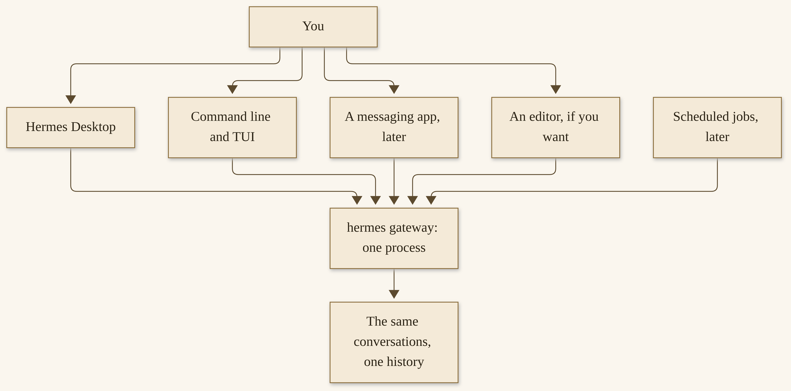{width=100%}

*One process, many doors. Chapter 7 is the how-to. This is only the shape.*

I run a version of this idea at a quieter scale than a diagram of twenty-nine agents would suggest. On an older Surface Laptop, with Omarchy Linux as the operating system, I run Hermes Desktop, with two local agents, and gateway access to the full fleet.^68 The fleet itself lives elsewhere, on a MiniPC I will name properly in Chapter 13. The Surface is a door I can sit at. That is all I will say about it here, because this chapter is a map, not a network drawing I have not given you, and because you do not need my laptop to understand the picture. You need to know that “talk to it from anywhere” is a real, official feature, and that it is still one process you are responsible for. When the gateway is down, some things still work locally, and some scheduled work depends on the process that hosts it. Chapter 7 will be honest about that, from the official troubleshooting, without inventing a process model.

A messaging door is a real door. I will say it in Chapter 7 at length, and I will say it once now so it is already in your mind. Anyone who can message the bot is, in some sense, standing in your workshop. The official security page has allowlists, and a pairing system with a one-time code, and a default that denies unknown users if you have not opened the gate.^69 Those are good tools. They are not a substitute for choosing, carefully, which door you enable first, and what the agent is allowed to do from a phone. We will start with one door, later, and we will start tighter than you think you need.

You do not need the gateway on day one. The official Quickstart is explicit: get a normal chat working first. The gateway is a next layer, after the chat and, in this book’s order, after the Wiki. If you turn on every door the first evening, you will have a very impressive diagram and a very muddy first week. One working conversation. One notebook. Then, when you are ready, one door.

I want to add a practical kindness, from the official troubleshooting, so that “the gateway” does not sound like a single point of failure you should fear. The Quickstart’s recovery order, if something feels off, is a calm sequence: `hermes doctor`, then `hermes model`, then `hermes setup`, then `hermes sessions list`, then `hermes --continue`, then `hermes gateway status`.^38 We will use that sequence in Chapter 3, when a first “hello” does not work. I mention it here because the gateway is the last thing in that list, not the first. When a chat is broken, the cause is more often a provider, or a model name, or a profile you did not mean to switch, than a mysterious hall. Start with the doctor. The official diagnostic is `hermes doctor`, and it exists so that you do not have to guess.^38

## Later: cron, and asking for help

Two more rooms, previewed only, because Chapter 8 is their home.

The first is **scheduled work**. The official product has a built-in scheduler, *cron*, which can run a job at a time you set, in natural language or in a cron expression, and can deliver the result to a platform you choose.^70 A nightly Wiki update is the job I will suggest, first as an intention in Chapter 4, and then as a scheduled task once you have the how-to. A morning brief is a later habit: a short note, waiting, that you actually read. Heartbeats, in the official sense, are periodic turns — the agent takes a turn on a schedule, not because it has a mind of its own, but because you asked it to check in.^71 “Learns while you sleep,” in this book’s subtitle, is those things plus a notebook plus a skill you already trust. It is not magic. It is not a promise that the agent improves unsupervised. You still set the job. You still review what came back. A first scheduled run is a run you watch.

The second is **asking for help**. The agent can spawn *subagents*: child runs, each with a fresh context, each given a brief, each asked to bring a summary back. The official tool is `delegate_task`. The official default, on the Delegation page we opened on 12 November 2026, is up to **ten** concurrent subagents, configurable, with a floor of one and no hard ceiling in that page’s description. A batch over the limit returns a tool error, not a silent trim.^72 I am stating the number once, here, so the map is complete. I will teach the practice in Chapter 8: how to write a brief a child can actually use, because a child starts knowing nothing except what you pass; when to stay flat and when to go deeper; how to watch and steer; and what survives a crash — which, officially, is less than you might hope. A running child is not resumed after a process crash. I will say that kindly, and I will not frighten you with it, and I will not overpromise.

There is a stale figure on another official page, the Features Overview, that still said “3 concurrent by default” on the morning we checked.^73 We are not using that figure in the body of this book. The Delegation page is the more specific document, and it is the one we trust. Appendix E records the disagreement, so a careful reader can see it. If you have an older article of mine in a tab, from early November, that also said ten, that article agrees with the Delegation page; the page is still the authority.^74

One more official fact, previewed here so the map is honest, and taught as a practice in Chapter 8. A leaf subagent — a child that is not itself an orchestrator — officially cannot use certain tools: `memory`, `clarify`, `send_message`, `cronjob`, and, unless it is given the role `"orchestrator"`, `delegate_task`.^72 That is the Delegation page, opened 12 November 2026, not a guess and not a rule I invented for tone. A child starts knowing only the brief it was given. It cannot quietly write to your memory, or schedule a job, or message a person, or spawn children of its own, unless you have designed that path. I am glad the page is that tight. It means a helper is a helper, not a second you.

I will not pretend that a restriction on a tool is a complete safety story. A child that can use a terminal can still do a lot. The brief you write, the profile you run it in, the approval you keep, and the “never” on the skill you attach, are still the practice. The official blocks are a floor. They are not a reason to skip the floor you set yourself.

If this already sounds like more machinery than you wanted on a first reading, you may let it sit. You can run Hermes for a long time, usefully, without a single subagent. Many careful people should. I am showing you the rooms so that the subtitle of this book does not feel, later, like a surprise. “A fleet that learns while you sleep” is, at this scale, a parent, a modest number of children, a brief you wrote completely, a notebook they can write to only if you arranged it, and a morning in which you still read. The default of ten concurrent children is a ceiling on parallelism, not a target. Two careful children, on a job you watched, is already a lot.


Why mention all of this before you have even installed? Because I do not want “a fleet that learns while you sleep” to sound, in the subtitle, like a mystery or a sales promise. It is a set of official features, used carefully, on top of a notebook and a habit. You can have a complete, useful practice without a single cron job and without a single subagent. Many readers should. When you are ready, the rooms are there, and Chapter 8 will walk you into them, one modest job at a time.

That is the map. A message arrives at a door. A gateway owns the conversation. A model reasons. Tools may run. Memory or a Wiki may be read. A helper may be asked. A reply comes back. Approvals can stop a step. The engine can be swapped. The notebook is what you keep. Profiles give an agent a job. The gateway is one process with many doors. Scheduled work and helpers come later, when the first week is solid.

Now let’s get it running. Chapter 3 is the ways in — every official path, dated, with a first-run you can finish, an approval habit from the first hour, and a small “hello” that proves the install works. You will not need a Spark-class box. You will not need a fleet. You will need a machine, a little time, and a willingness to start tighter than you think you need. I will meet you there. Bring the machine you already have. Bring a little patience for the first-run wizard. Bring the willingness, which matters more than any particular model, to watch the first tools run, and to keep the yes. The map is in your hands now. You know what a request does, and where a yes can stop it, and why a notebook will matter more than a particular engine. The door is next. Let’s open it.


# Part 2 — Day One Through the First Week
# Chapter 3
## Get In: The Ways You Can Run Hermes


{width=100%}

*I03. A closed laptop, a modest desk, a fresh notebook — a first day.*


You have a map. Now you need a door. This chapter is the official ways in, as they stood on 12 November 2026, and a first-run you can finish in an evening. We will pick a path, install, choose a provider and a model, set an approval habit from the first hour, and prove the whole thing with a small, reversible “hello.” We will not start a fleet. We will not hand the agent your week. By the end, it will run. Chapter 4 will give it a notebook.

## Pick a door

The official documentation is generous about how you can arrive. That generosity can feel like a catalog you have to shop. It is not. You pick one door that matches the machine in front of you, and you walk through it. The others will still be there on Tuesday.

If you are on a Mac with Apple Silicon, or on a Windows PC, and you would like a graphical app, **Hermes Desktop** is the official recommended starting point.^75 You download a package from the Hermes website and install it the ordinary way. If you are on Linux, or you prefer a terminal, or you are on Windows and would rather use the command line — natively, or inside WSL2 — there is a one-line installer. If you are on an Android phone or tablet, there is a Termux path, which is its own path, not the desktop script. If you want a container, there is a Docker image. If you want a hosted agent that stays up when your laptop is closed, there is Hermes Cloud. If you want the agent inside an editor, there is ACP. If you want other apps to talk to Hermes as if it were an API, there is an OpenAI-compatible server. Those last few are real, official, and not what I would do on a first evening unless you already know why you need them.

I will walk the official list in the next section, one short paragraph each, with a pointer at the official page. The only choice I want you to make right now is a simpler one. Are you installing a desktop app, or a command-line install, or something else you already have a reason for? If you are not sure, and you are on macOS (Apple Silicon) or Windows, take Desktop. If you are on Linux, take the command-line installer. If you are on an Intel Mac, I have to say a hard, kind sentence: official documentation states that Intel macOS is not a supported platform.^76 I will not invent a workaround. A different machine, or a supported path such as a Linux install or a Cloud agent, is the honest advice.

You do not need two NVIDIA DGX Sparks. You do not need a MiniPC. You do not need twenty-nine agents. My machines are a later worked example, in Chapter 13, not a shopping list for tonight. A modest laptop and a careful setup are enough to start. That is not a consolation prize. That is the normal first door.

## The official ways in, dated

Everything in this section is as the official pages stated it on 12 November 2026. If a package name or a command has moved, trust the live Installation and Quickstart pages.^77

**Hermes Desktop, on macOS and Windows.** Download the package for your platform from the Hermes website. On Windows, you open an `.appinstaller` file with Windows App Installer; it installs a signed MSIX bundle and records its update source. Microsoft Store packages have separate Store ownership, which is a distribution fact, not a mention of anyone’s employer. On macOS, you open a DMG and copy `Hermes.app` to Applications. The macOS installer is Apple Silicon only.^78 Bundled packages include the agent, Python, the supported dependencies, and prebuilt interfaces. First launch does not build that base runtime. Provider access and optional integrations can still need the network. A `Hermes-Setup` bootstrap installer is a different thing: it downloads a source installation and builds Desktop. If you already have a command-line install and want Desktop afterward, the official command is `hermes desktop`.^79 To use Desktop with a backend on another machine, you install a package and connect from Settings → Gateways; there is no separate “remote-only” Desktop download.^80

**The command-line installer, on Linux, macOS, and WSL2.** This is the one-liner the README and the Quickstart both give:

```bash
curl -fsSL https://hermes-agent.nousresearch.com/install.sh | bash
```

After it finishes, reload your shell with `source ~/.bashrc` or `source ~/.zshrc`, and then run `hermes`.^81 The script clones the source, bootstraps a package manager, and lands you on the latest stable release — the channel that `hermes update` will follow. If you want the tip of the `main` branch instead, the official flag is `--channel main`. Most readers should not take that flag on a first weekend. The default layout puts the code at `~/.hermes/hermes-agent/`, a wrapper at `~/.local/bin/hermes`, and your user data at `~/.hermes/`. `HERMES_HOME` can select a different data directory.^82 The installer can skip the browser tools or the computer-use driver if you pass `--skip-browser` or `--skip-computer-use`; it remembers those choices.^83 I would leave the defaults alone unless you know you want them off.

**How to install from the command line (Linux, macOS, or WSL2)**

1. Open a terminal. Confirm you have a network connection, and that you are installing as the user who will actually run the agent, not as root.
   The official page is explicit that a root install uses root’s home unless you give it a path. That is not what most people want.^120

2. Run the official one-liner, exactly as the docs print it:

   ```bash
   curl -fsSL https://hermes-agent.nousresearch.com/install.sh | bash
   ```

   You should see the script’s status lines as it works. On a terminal, official documentation says it shows one status line per step and writes fuller output to `logs/install.log` under the Hermes data directory.^82
   If a step fails: the official behavior is that a failed step prints its last lines and the log path. Read that log before you guess. The Installation page is the troubleshooting authority, along with `hermes doctor` once the wrapper exists.

3. Reload your shell:

   ```bash
   source ~/.bashrc
   ```

   Or `source ~/.zshrc`, if that is your shell.
   Then run `hermes`. You should see a welcome, or a setup wizard, not “command not found.”
   If you don’t: confirm that `~/.local/bin` is on your `PATH`, which is the official wrapper location, and follow the Installation page’s “command not found” row.^112

> **Caution.** This is a script from the official product site, run the official way. I am not asking you to run a script from a stranger’s gist. If you are in a workplace with a rule about installers, follow that rule, and use the Desktop package if it is the approved path. The steps above are the project’s own.

On Windows, native, the same idea holds with the PowerShell one-liner, run in PowerShell, from the official URL. On Desktop, the same idea holds with a package you downloaded from the Hermes website, not from a random mirror. After any of these, we meet at the same place: a provider, a model, and a first chat.

**Native Windows, in PowerShell, without WSL.** The official one-liner is:

```powershell
iex (irm https://hermes-agent.nousresearch.com/install.ps1)
```

This installs under `%LOCALAPPDATA%\hermes`. If you would rather use WSL2, the Linux one-liner works there, and that install lives under `~/.hermes`, as on Linux.^84 The README notes that antivirus software may flag a bundled `uv.exe` — Astral’s Python package manager — as malware, and describes that as a false positive, with a verification path and a request to whitelist the folder, not a file hash, because the hash changes on update.^85 If you hit that, the official Installation and README pages are the place to follow, not a forum guess.

**Android, through Termux.** There is a signed APT repository for aarch64 devices, with a `stable` channel and a `canary` channel. After you configure the repo, the package is `pkg install hermes-agent`. This is not the desktop or server script. The package includes Python, Node.js, and the TUI. Use the official Termux guide.^86

**Docker.** The official image is `nousresearch/hermes-agent:stable`, or `:latest`. Code lives at `/opt/hermes/`. Data is mounted at `/opt/data/`. The Webapp from v0.23.0 ships in the Docker image.^87 If you are comfortable with containers, this is a clean way to isolate the agent from your host. If you are not, skip it for the first week. Isolation is a gift you can give yourself later, and Chapter 14 will come back to it.

**A cloud path.** Hermes Cloud, at portal.nousresearch.com/cloud, is an always-on hosted agent in its own container. Official pricing on the page we opened, 12 November 2026, listed a Free tier at $0, pay as you go; Plus at $20 a month; Super at $100; and Ultra at $200, with one Cloud agent included on paid tiers, and a $2 minimum in credits or an active subscription to deploy.^88 Those numbers will change. Trust the live page. The same page listed regions and said the service picks a location close to you that has availability. @NousResearch said, on 9 November 2026, that Cloud agents can now open in a browser tab with the same interface as Desktop.^89 A Cloud agent is a real way in. It is not a requirement. It is also a bill, which is why I want you to read Chapter 14 before you leave one running unattended for a long time.

**ACP, in an editor.** After a standard install, `hermes acp` starts the official editor integration. The curl installer already includes it. VS Code, Zed, and JetBrains are the editors the Quickstart names.^90 This is a good second-week door for a programmer. It is not a first-evening requirement.

**An OpenAI-compatible API server.** You can point other chat frontends at Hermes. The README names this path.^91 It is for people who already have a frontend they like. It is not how I would prove a first install.

**Nix** is, officially, “no longer an explicitly supported install path (best-effort only),” with a dedicated flake guide if you already live in that world.^92 I will not teach it here.

**Importing from another agent.** A fresh `hermes setup` may offer to import from OpenClaw, Claude Code, Codex CLI, or Cursor, if it finds them, via the `agent-importers` plugin.^93 That is a kindness, and it is optional. A first weekend can also be a clean first weekend. If you import, preview first, as the official path allows, and do not bring secrets you did not mean to bring.

Here is the same list, as a map, with Desktop at the center because that is the official recommended start on the two desktop operating systems that have a package, and with the other official paths around it. You pick one.


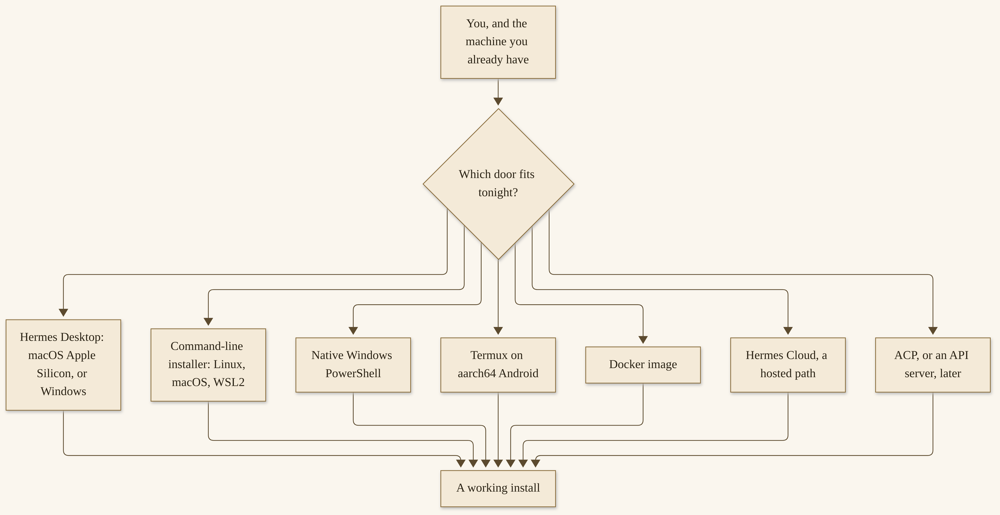{width=100%}

*The official ways in, as of 12 November 2026. Desktop is at the center of the recommendation, not of a requirement. Intel macOS is not a supported platform.*


## First-run: a provider and a model

The install is only half of getting in. The other half is a way to talk to a model. The official Quickstart calls this the single most important setup step, and I agree.^94

On a fresh install, `hermes setup` offers three modes, and I want you to know what each one is, in ordinary words, before you pick.^95

**Quick Setup (Nous Portal)** is the official fastest path. It logs you in with OAuth, sets Nous as the provider, and turns on the Tool Gateway — web search, image generation, text-to-speech, a cloud browser — billed to a Portal subscription. The one-line form is `hermes setup --portal`.^96 This book is not selling a subscription. It is telling you what the official docs recommend if you want a working chat without collecting five separate keys. The cost is on the live Portal page, and it will change.

**Full Setup** walks you through every provider, tool, and option yourself. You bring your own keys. This is the path if you already have a provider you like, or a local endpoint, or a reason not to use Portal.

**Blank Slate** turns almost everything off except the bare minimum: a provider and a model, file operations, and the terminal. No web, no browser, no code execution, no vision, no memory, no delegation, no cron, no skills, no plugins, no MCP, and several conveniences off as well. The official page is careful to say that this choice is written down so that a later `hermes update` does not quietly turn things back on.^97 If you want a minimal agent and a full sense of what you have enabled, this is a serious, official option. You can turn pieces on later with `hermes tools`, and seed skills with the official opt-in command the page names.

If you already know your provider, you can skip the full wizard and run `hermes model`, which walks the choice interactively.^98 The Quickstart has a long table of providers. I will not reprint it. The shape is: a hosted provider with a key or a login, or a custom OpenAI-compatible endpoint with a base URL, a model name, and a context length of at least 64,000 tokens. Smaller windows are rejected at startup. For a local model, set that number on the server, with the official examples `--ctx-size 65536` for llama.cpp and `-c 65536` for Ollama.^99

I want to be precise about defaults, because this is a place a book can go stale in a week. The outline for these pages expected me to name GLM-4.7, from Z.AI, as the product default on 12 November 2026. The Quickstart I opened that day did not, in the sections I read, put that name on a throne. It put a provider choice in your hands, and it listed Z.AI as a supported provider, with `GLM_API_KEY` or `ZAI_API_KEY`.^100 I am not going to assert a default the page in front of me did not clearly state. Whatever the wizard offers you on the day you install is the product’s offer, on that day. Accept it if it works, or pick a provider you already have. And keep it distinct from my setup. My fleet uses GLM 5.3 Flash, running locally on two NVIDIA DGX Sparks. That is not the first-run default. That is a later example. Do not collapse them.

Secrets go in `~/.hermes/.env`. Non-secret settings go in `~/.hermes/config.yaml`. Use `hermes config set` so the right value lands in the right file.^101 Do not paste an API key into a chat to “just get it working.” Do not put a key in the Wiki we are about to start. A key in a markdown folder is a key in every backup of that folder.

Coming from another agent is a special case I want to treat kindly, without making it the main road. If a fresh `hermes setup` finds OpenClaw, or Claude Code, or Codex CLI, or Cursor on your machine, it may offer to import, install the official `agent-importers` plugin, and run a preview first.^93 That is the right order: a preview, then a decision. The official README describes what an OpenClaw import can bring — a soul file, memories, skills, an allowlist, messaging settings, and, only if you ask, certain API keys.^93 Do not ask for secrets on a first evening unless you are sure you want them in this home. A dry run exists: `hermes import-agent openclaw --dry-run` is the official preview command, and similar commands exist for the other named sources.^93 If anything in the preview looks larger than you meant, cancel, and start clean. You can import later. You cannot un-pour a secret into a folder as easily as you can decide not to pour it.

You can switch later. `hermes model` is the command. “No lock-in” is the official phrase.^102 A first-run choice is a first-run choice. Get a working chat. Then we will give the agent a notebook. Then, if you have a reason, you can change the engine.

> **Caution.** Keys and tokens belong in `~/.hermes/.env`, with tight file permissions when you can set them. The official production-checklist advice includes `chmod 600 ~/.hermes/.env`.^101 Do not commit that file. Do not paste its contents into a chat, a ticket, or a vault page. If a setup screen asks for a key, type it into the setup screen, not into the agent.

## Approvals from the first hour

The agent can run commands. You decide what it may do unattended. I want that habit in place before the first real task, which is why it lives in this chapter and not only in the safety chapter at the back.

The official security page describes three approval modes, set in `~/.hermes/config.yaml` under `approvals.mode`: `smart`, which is the default; `manual`, which always prompts on a dangerous command; and `off`, which disables the checks — equivalent, the page says, to running with `--yolo`.^103 I want you to start tighter than you think you need. For a first week, **manual** is a reasonable, official choice. You will see more prompts. You will also see what the agent is actually trying to do. `smart` uses an auxiliary model to judge risk and will auto-approve some low-risk commands and auto-deny some genuinely dangerous ones, escalating the uncertain cases to you.^104 That is convenient, and it is not the same as you having seen every command. `off` is for trusted, disposable environments, and it is not for a first hour on a machine you care about.

There is also a YOLO mode, which bypasses dangerous-command prompts for the current session. You can start a session with `hermes --yolo`, or type `/yolo` as a toggle, or set an environment variable the docs name.^105 The official page puts a warning on it that I will not soften. I would like you to leave YOLO alone for the first week. Always is a long time, and a first week is for learning what you are approving.

On a dangerous command, the command-line prompt offers four choices: **once**, **session**, **always**, and **deny**. Deny is the default.^106 Prefer **once**, at the beginning. “Always” writes a permanent allowlist into your config, and that list is loaded at startup and silently approved in future sessions.^107 You can review it later with `hermes config edit`. You should, from time to time. A first hour is a poor time to start a permanent list.

If you do not answer in time, the command is denied. The default timeout is 300 seconds, and the official behavior is fail-closed.^108 Cron jobs, one-shot sessions, and unattended webhook sessions default to `deny` as well, which is a kindness. We will come back to those when we schedule work. For tonight, the rule is simpler, and I will say it the way I would say it to a friend.

**How to set a tight first-hour approval habit**

1. Finish the setup wizard, or `hermes model`, so that a chat can start.
   You should have a provider and a model, and you should not yet have opened a messaging door.
   If you don’t: run `hermes doctor`, then `hermes model`, as the official recovery order begins.^109

2. If you are comfortable editing config, set `approvals.mode` to `manual` for the first week.
   The official key lives under `approvals:` in `~/.hermes/config.yaml`. The official page shows the block.^110
   If you don’t want to edit a file tonight, stay on the default `smart`, and answer every prompt you see. Do not switch the mode to `off`.

3. When a dangerous-command prompt appears, read the command.
   Choose **once** if you agree, or **deny** if you do not, or if you are not sure.
   Do not choose **always** in the first hour. Do not type `/yolo`.

4. If a prompt expires, do not treat that as a mystery.
   The official rule is that an expired prompt cannot be reopened; you send a new message if you still want the work done, and a fresh card appears.^111
   That is fail-closed, and it is what we want.

A “never” for this hour: never turn approvals off to make a demo go faster. The demo is not worth a command you did not read.

## A first “hello” that proves it works

We are going to do one small, reversible thing, and we are going to know whether it worked.

**How to prove the install**

1. Start a chat.
   In a terminal, run `hermes`, or `hermes --tui` if you would like the fuller interface. In Desktop, open the app and start a conversation.
   You should see a welcome banner with your model, and a place to type.
   If you don’t: reload the shell (`source ~/.bashrc` or `source ~/.zshrc`) if the command is “not found.” If the app opens and the replies are empty or broken, run `hermes model` again and confirm the provider, the model, and the login or key.^112

2. Ask for something small and verifiable.
   The official Quickstart suggests prompts of this shape: “Summarize this repo in 5 bullets and tell me what the main entrypoint is.” Or: “Check my current directory and tell me what looks like the main project file.”^113 You can also ask a simpler question: what version of Hermes is running, or what the current directory contains. Pick one. Pick something you can check with your own eyes.
   You should get a reply without an error. If a tool is used — a file read, a terminal listing — you should see it.
   If you don’t: use the official recovery order, in this sequence, and stop when the chat works. Do not add a gateway on top of a broken chat.

   ```text
   hermes doctor
   hermes model
   hermes setup
   hermes sessions list
   hermes --continue
   hermes gateway status
   ```

   That order is official.^114

3. Confirm that a session can be resumed.
   Run `hermes --continue`, or `hermes -c`.
   You should come back to the conversation you just had.
   If you don’t: run `hermes sessions list`, and confirm you are in the same profile. The Quickstart flags this before you add any next layer, and I will flag it too.^115

4. Optionally, ask the agent to read a file you already have, in a folder you do not mind it seeing — a README, a public note, something reversible.
   You should see a file tool used, and a summary you can check.
   If you don’t, or if it reads a path you did not expect: stop. We will set a vault path carefully in the next chapter. A first “hello” is not a tour of your home directory.

What success looks like is ordinary, and that is the point. The banner shows the model you chose. The agent replies. A tool, if needed, is visible. The conversation continues. You can come back to it. What failure looks like is also ordinary: a missing command on your `PATH`, a key that did not land, a custom endpoint with the wrong URL, a profile you switched without noticing. The official troubleshooting table is short and good.^116 Official diagnostics live at `hermes doctor`. I will not invent a fifth cause.

When it runs, take a breath. It runs. That is a complete first evening, if you want it to be.

One practical update, because it bit people in the same week we checked these pages. If your install is older than v0.23.1, run `hermes update` and confirm the version it reports. The v0.23.1 notes describe a silent fallback to a bundled plugin catalog on earlier releases, and they tell you that the fallback continues until you update.^121 I suggested the same command, publicly, when the patch landed.^122 Desktop packages installed from the `.exe` or `.dmg` installer, the notes say, do not change in that particular patch; they update with the next bundled release. The Store app updates through the Store. Docker and Cloud follow `nousresearch/hermes-agent:stable`.^121 If you just ran the official installer, you should already be on the current stable channel. If you are not sure, `hermes update` is a short, official way to find out.

> **Tip.** If this book and the live releases page disagree about the current version, trust the live page. We checked on 12 November 2026, and the current stable tag that morning was v0.23.1. The product moves.

Before you hand the agent your week, we are going to give it a notebook. That is the next chapter, and it is the one I hope you will not skip.


## What you do not need on day one

I want this section to feel like relief. A first install collects anxieties the way a new kitchen collects gadgets. Let me take a few of them off the counter.

You do not need a Spark-class box. You do not need two NVIDIA DGX Sparks, and you do not need GLM 5.3 Flash, and you do not need to know what serving software I use, because I have not named it and I will not. Those two Sparks are part of my own setup, for a fleet that does SMF Works R&D, and they will appear in Chapter 13 as a worked example, in locked words. They are not a requirement for a working chat. A modest laptop is enough. An older Surface Laptop is enough; I use one of those, too, for Desktop, two local agents, and a door to the rest of the fleet, and I mention it only so that “older” and “enough” can sit in the same sentence.^117 If the machine you have can run a supported install and can reach a model — hosted or local — you have what tonight requires.

You do not need a fleet. You do not need twenty-nine agents, or five primaries, or a MiniPC in a closet. You need one working conversation. A second profile is a later idea. A gateway with three messaging doors is a later idea. Cron is a later idea. Subagents are a later idea. The official Quickstart’s rule of thumb is the one I want you to take home: if Hermes cannot complete a normal chat, do not add more features yet.^118

You do not need to import your old agent, even if the wizard offers. You do not need to install a catalog of plugins. You do not need to browse a Skills Hub. You do not need voice mode, or a wake word, or a browser tool, or an editor integration. All of those are documented, and several of them are excellent, and none of them is the first evening. The product’s own Blank Slate mode exists because the authors understand this temptation. You can grow into the rest.

You do not need to spend money tonight, unless you choose a hosted path that bills you. The agent itself is open source, under MIT. A model provider may charge. Portal may charge. Cloud may charge. A local model charges in power and in patience. Read the live page for any path that has a price. Read Chapter 14 before you leave a bill running in the background. For a first “hello,” a free or already-paid path you understand is plenty.

You do not need to understand every flag in the installer. You do not need Python 3.14 on your own mental checklist, even though the official current first-party installations run on it.^119 You do not need to build Desktop from source if a package exists for your platform. You do not need `--channel main`. You do not need to run as root. The official source installer, run as root, does not even pick an automatic system-wide layout; it uses root’s home unless you give it a path, which is a good reason not to.^120

You do not need this book to be an official manual. When a step here and a step on the live page disagree, the live page wins. I dated what I opened. The product moves.

The official Installation headline says you can get running “in under two minutes.”^77 That is vendor wording. Sometimes it will be true. Sometimes a download will be slow, or a key will need to be fetched, or an antivirus prompt will need a calm response, or a local model will need a context flag. I would give yourself an evening, and I would treat a two-minute run as a pleasant surprise, not a promise I made you. The steps are the steps. They are not a race.

What you do need is a door you have actually walked through, a provider or a local model that completes a chat, an approval habit that starts tight, and a small “hello” you have seen with your own eyes. That is a complete arrival. The next careful thing is a notebook. I will say it the way I want the last sentence of this chapter to feel, which is not like a cliff and not like a sales close. It runs. Before you hand it your week, give it a notebook. Chapter 4 is that notebook — a Wiki you will be glad you started — and I will walk it with you, step by step, including the “never” list and the first backup.

If tonight you only get as far as a working “hello,” that is a good night. Save the Wiki for the morning if you are tired. Please do not skip it for long. A first working chat is a door opening. A door with no notebook behind it is still just a door. The next chapter is short in its first steps — a folder, a home note, a page about how you work, one watched read, one watched write, a backup — and long in how much trouble it will save you. Give it a morning, or give it the next quiet hour you have. Give it the same care you just gave the install. You will be glad you did, and that is not a slogan. It is the sentence this whole book is built around, and Chapter 4 is where we finally keep it, together, at your own careful and unhurried pace. A messy life poured into an agent with nowhere to write is how a promising tool becomes a drawer of forgotten chats. We are not going to do that. We are going to give it a folder, and a home note, and a page about how you work together, and we are going to watch it once. Then the first real job, in Chapter 5, will have a place to land.

A last anxiety I want to take off the counter is the one that sounds like, “I already have a way I talk to models, and I do not want to abandon it.” You do not have to. Hermes can be a command-line practice, or a Desktop practice, or, later, a messaging-door practice. It can sit next to an editor. It can, officially, import some of what another agent already knew, if you want that. It can also be a clean folder and a new habit, which is what I recommend if you are not sure. Nothing in this chapter asks you to delete a tool you already trust. It asks you to get one official door working, and to prove it with a small hello, and to keep the approvals tight. The Wiki, tomorrow morning or tonight, is how this door becomes a practice instead of another chat window.

I am glad you are in. Let’s start the Wiki.


# Chapter 4
## First Setup: The Wiki You Will Be Glad You Started


{width=100%}

*I04. A bound notebook, a fountain pen, a modest stack of pages — a wiki beginning.*


It runs. That is where Chapter 3 left you, and it is a good place to be. This chapter is the one I hope you will not skip. We are going to give the agent a notebook — a Wiki, a vault, a folder of markdown that is yours — and we are going to watch it read and write there once, and we are going to take a backup. By the end you will have a home note, a “how we work” page, a clear “never” list, and a first copy of the folder that does not live on the same disk. The rest of the book grows from here.

## Why a notebook before a messy life

A chat window forgets. You know this already, even if you have not said it out loud. You had a good conversation on a Tuesday. You found a useful answer. You made a decision. On Wednesday the window is gone, or it is buried, or a new session starts and the agent is polite and blank. A brilliant stranger, meeting you fresh every morning.

A folder of markdown can last. It can survive a model swap. It can be backed up. It can be opened in any editor, on any machine, without a vendor’s special database in the middle. That is the whole argument, and I have come to believe it more strongly than I believed it two years ago. On 11 November 2026 I published an article about it, and I opened with a sentence I still mean: “The most important part of an autonomous AI agent isn’t the model. It’s the notebook.”^123

The popular story about agents starts with the model. A new engine arrives. A new benchmark is published. A new name is on a leaderboard. Memory is treated as a feature you might turn on later, or as a setting in a panel, or as a promise that the product “remembers you.” Some of that is real, and we will be fair to it. Official Hermes memory exists, and it is useful, and it is small on purpose. What it is not, is a place that can hold a practice. A week of research will not fit in 2,200 characters. A “how we work” page will not, not for long. The compounding artifact is a folder you own.

I am not starting with a messy life — your whole inbox, your whole company, your whole household — and asking the agent to swallow it. That is how a vault becomes a junk drawer, and a junk drawer is not a colleague. We are starting with a small folder, a short home note, and one watched loop. If you want to start this week, keep it small. That is what I told readers of the article, and it is what I am telling you.^124 Create the folder. Give it a shape. Point the agent at it. Ingest a few sources you actually care about, later, when the loop works. The messy life can wait until the notebook exists.

There is a kindness in this order that I want you to feel. You have just installed a capable piece of software. The temptation is to hand it a hard job immediately, to see what it can do. We will do a real job in Chapter 5. We will do it better if the agent has a place to write what it learned, and if you have a place to write how you want to work together, including what it should never do. A notebook before a messy life is not delay. It is the foundation.

I want to tell you, without inventing a scene, why this chapter is personal for me, in public words I have already used. I run a small team of agents at SMF Works. Some are Hermes agents, like Aiona, Liam, and Nemo, and some run on OpenClaw.^123 I do not mean, when I say “memory,” the model’s memory, because it has none between sessions. I mean a folder of linked markdown pages, a vault, that the agent reads before it acts and writes to after it learns.^123 Official Hermes memory is real, and small: `MEMORY.md` up to 2,200 characters, `USER.md` up to 1,375, as the docs say and as I reported.^123 For the big stuff, there is this optional `llm-wiki` skill, version 2.1.0, built on Karpathy’s pattern.^125 That is the whole stack, in the open. This chapter is not a tour of anyone’s private folder. It is the same invitation I already made: start small, this week, and watch what the agent knows a month from now.^124

> **Story.** I wrote that the most important part of an autonomous agent isn’t the model. It’s the notebook. I meant it as a practice, not a slogan. The practice begins with a folder you can see, and a “never” you are willing to keep.

## The LLM Wiki pattern

The pattern has a name, and I want to give credit carefully. It is often called an **LLM Wiki**. The official Hermes skill for it is built on a pattern Andrej Karpathy published, and I have written about that lineage in the article this chapter rests on.^125 I am not going to invent a Karpathy quote of my own. Where I use his wording, I am using it as I already quoted it there. Two lines I have already put in public, as his, are these: “Humans abandon wikis because the maintenance burden grows faster than the value.” And: “Obsidian is the IDE; the LLM is the programmer; the wiki is the codebase.”^126 That second sentence is the division of labor in one image. You curate. The agent maintains. The folder is the thing that lasts. If you want the primary, Karpathy’s gist is linked from the official skill page and from my article; I am treating my own quotations as mine, attributed, and I am not going to pretend I re-opened the gist in this draft for an independent extract.^127

A **vault**, in the way I use the word, is that folder. It is a directory of markdown files the agent can read and write, with a structure, a home note, and some habits. The official skill says the same quiet sentence I want on this page: “The wiki is just a directory of markdown files.”^128 You can open it in Obsidian, or in VS Code, or in any editor. No special database is required. `[[wikilinks]]` connect the pages. An index lists what exists. A log records what happened. Raw sources sit in a folder the agent is not supposed to rewrite. Pages the agent owns sit beside them. A schema file, `SCHEMA.md`, tells the agent the conventions: names, tags, what a page is for, what to do when two sources disagree.

The vault is yours. The agent is a librarian you are training, not the owner. That sentence is the soul of the pattern. A librarian who writes neatly, who cross-references, who flags a contradiction for you instead of silently overwriting, is a gift. A librarian who thinks the library is theirs, and who buries a secret in a page you will one day back up to a disk you forget about, is a problem. You set the rules. You set the “never.” You take the backup. The agent does the filing, under those rules, while you watch, and then, later, on a schedule you have already trusted.

I also offered a test, in that article, and I want this book to keep using it. Swap the model under an agent with a mature vault. If it still knows who it is, what it is working on, and why, then the vault is doing the lasting work, and the model is playing a supporting role.^129 That is the swap-the-model test. It is why this chapter exists in week one, and not as an appendix. The engine will be swapped. The notebook is what you keep.

I wrote, in the same piece, a line I would like you to have in your ear for the rest of these pages: “A great model with no memory is a brilliant stranger who meets you fresh every morning. The same model sitting on top of a big, well-kept wiki of everything it has learned about its job starts to feel like a colleague.”^130 A colleague is a colleague because of a shared history. We are about to start that history, on purpose, in a folder you can see.

## The official plugin, beside the article

This is not only a personal habit. It is also a product feature.

Hermes has an official optional skill, **`llm-wiki`**, at the install slug `official/research/llm-wiki`. As of 12 November 2026, the docs list it at version 2.1.0, MIT licensed, for Linux, macOS, and Windows.^131 The page’s title presents it as “Karpathy’s LLM Wiki: build/query interlinked markdown KB.” The install command, official and exact, is:

```bash
hermes skills install official/research/llm-wiki
```

The wiki path is set with a `WIKI_PATH` environment variable, in `${HERMES_HOME:-~/.hermes}/.env`. If that variable is unset, the default is `~/wiki`.^132 Remember that path. We will set it on purpose, so that a write does not land somewhere you did not expect.

The official architecture is three layers, and they are worth learning because they will save you from a messy folder.^133

**Layer 1 is raw sources.** These are immutable. The agent reads them and does not modify them. Articles, papers, transcripts, and assets live under `raw/`. Each raw file can carry a small frontmatter block — a source URL, an ingested date, a hash of the body — so a later re-ingest can notice if the source has changed.

**Layer 2 is the wiki itself:** pages the agent owns. Entity pages, concept pages, comparison pages, filed queries. Markdown, with frontmatter, with `[[wikilinks]]` to other pages. The agent creates, updates, and cross-references these.

**Layer 3 is the schema.** `SCHEMA.md` is the conventions file: the domain, the naming rules, the tag taxonomy, the frontmatter, the policy for contradictions. Alongside it, `index.md` is the catalog, and `log.md` is an append-only action log.

The official operations are three: **ingest**, **query**, and **lint**. Ingest takes a source and files it, updates or creates pages, and writes the index and the log. Query reads the index and the relevant pages and answers from what is already compiled, and may file a valuable answer back. Lint looks for orphans, broken links, index gaps, frontmatter problems, stale pages, contradictions, tag sprawl, and source drift.^134 The official lint is a health check, not a janitor with a shredder. The skill’s own pitfalls say it plainly: never modify `raw/`; always orient first, by reading the schema, the index, and the recent log, before doing anything in a new session; always update the index and the log; don’t create pages for passing mentions; handle contradictions explicitly, and do not silently overwrite.^135

How does this sit next to the pattern I described in the article? Comfortably, and with a few habits I added on top, which I want attributed to me, not to the official skill. I recommended a `vault/` folder with the official files, and also `entities/`, `concepts/`, `research/`, `decisions/`, `dreams/`, `daily/`, and `_archive/` for superseded pages. I added a `status` (`current`, `superseded`, `historical`), and `supersedes` / `superseded_by`, and a `review_after` date. I recommended a weekly lint that never deletes, and that treats historical pages as a record, not as staleness. I recommended nightly research on a schedule, which we will only name in this chapter and teach in Chapter 8.^136 Those are recommendations. They are not a dump of a private production vault. You may take all of them, or the official default, or a smaller shape. The official default is already a complete start.

One confusion, which I will clear once. There is also an official **Memory Wiki** plugin. It is a different product. It is a dashboard of session history, with a read-only look at `MEMORY.md` and `USER.md`. It is not `llm-wiki`. We will not install it by accident and think we have started a vault.^137


## How-to: a folder, a home note, a “how we work” page

We are going to do this on your machine, in small steps. You can use the official default path, `~/wiki`, or a path you choose. I will use `~/wiki` in the commands so they match the official default. If you pick a different path, use that path everywhere, and set `WIKI_PATH` to it, which we will do in the next section.

**How to start the folder**

1. Create the directory, and the official backbone files, in a place you will remember.

   In a terminal:

   ```bash
   mkdir -p ~/wiki/raw/articles ~/wiki/raw/papers ~/wiki/raw/transcripts ~/wiki/raw/assets
   mkdir -p ~/wiki/entities ~/wiki/concepts ~/wiki/comparisons ~/wiki/queries
   ```

   Those subfolders are the official skill’s default shape.^138 If you prefer the slightly fuller layout I recommended in the article — with `research/`, `decisions/`, `dreams/`, `daily/`, and `_archive/` as well — you may create those too. They are optional on night one.

   You should now have an empty tree that looks like a place, not like a single lost file.
   If you don’t: check that you are in your own home, and that you have permission to write there. Do not create this folder as root.

2. Write a short **home note**. I recommend starting `index.md` as that home, because the official skill already treats the index as the catalog the agent reads first. You can also write a `home.md` and link it from the index. Either is fine. The official index template is a sectioned catalog with a one-line summary for every page, a last-updated date, and a page count.^139 For night one, a short, human home is enough. Here is a **sample**, clearly a sample, not a page from my private vault. Adapt it. It is not a secret, and it is not a requirement.

   ```markdown
   # Wiki Index

   > Content catalog. Every wiki page listed under its type with a one-line summary.
   > Last updated: 2026-11-12 | Total pages: 1

   This vault belongs to [your name]. It is a notebook for work I do with a Hermes agent.
   The agent may read it and may write to it, under the rules in SCHEMA.md and in
   `how-we-work.md`. I am the owner. The agent is a librarian I am training.

   ## How we work
   - [[how-we-work]] — voice, hours, and a never list.

   ## Entities

   ## Concepts

   ## Comparisons

   ## Queries
   ```

   You should be able to open that file in any editor and read it in thirty seconds.
   If the tone is wrong, change it. It is yours.

3. Write a **`SCHEMA.md`**, even a short one. The official skill will write a fuller schema if you ask the agent to initialize a new wiki, and that is a valid path — we will use it, watched, in a moment. If you want to put a stake in the ground yourself first, a short schema with a domain, a naming rule (lowercase, hyphens, no spaces, as the official template suggests), a requirement to use `[[wikilinks]]`, and a rule that contradictions are flagged rather than overwritten, is enough.^140

4. Write a **“how we work” page**. This is the page I care about most on night one, and it is a habit I am offering, on top of the official skill, not a file the skill demands. Call it `how-we-work.md`, and link it from the index. Put three things in it: a voice, a sense of hours or pace, and a **“never.”** Here is a **sample**, again a sample, for you to change. It is not my private page.

   ```markdown
   # How we work

   created: 2026-11-12
   updated: 2026-11-12
   type: concept
   tags: [meta]

   You are a careful librarian for this vault. Be plain. Be honest about
   uncertainty. Prefer a short page that is true to a long page that sounds
   finished. When sources disagree, write both down, with dates, and flag
   the contradiction for me. Do not silently overwrite.

   Pace: I will review what you write. I would rather have a small, correct
   update than a large, unsupervised one.

   Never:
   - Never put secrets, API keys, passwords, or tokens in this vault.
   - Never put other people’s private lives, health details, or school
     records in this vault.
   - Never delete a page; archive it, if we have agreed, and leave a trail.
   - Never send, spend, publish, or delete something outside this vault
     without my yes.
   - Never invent a citation.
   ```

   You should read that “never” list out loud and add the lines that your life actually needs. A household vault will need a harder privacy line than a personal research vault. A work vault will need a line about unpublished partner data. We will separate work and home vaults, if both exist, and Chapters 11 and 12 will come back to that.^141
   If a line does not apply, take it out. A “never” you do not mean is a “never” the agent will learn to ignore.

   There is also an official path in which you ask the agent, with the skill installed and the path set, to **initialize** a new wiki: it determines the path, creates the directory structure, asks you what domain the wiki covers, writes a `SCHEMA.md` customized to that domain, writes an initial index and log, and confirms it is ready.^140 That is a valid way to do steps 3 and 5, and even parts of step 1, *if you watch it*, and if you have already written the “how we work” page yourself, or you write it immediately after, in your own words. I still like a human first pass on the home note and the “never,” because those two pages are your voice. A schema the official skill writes, from a domain you stated, is often better than a schema you invent at eleven at night. Watch it. Read it. Edit it. The official template is a template; your domain is yours. “AI/ML research,” “personal projects,” “a course I am taking” — be specific when it asks. A vague domain produces a vague taxonomy, and a vague taxonomy produces tag sprawl, which is one of the things lint exists to catch.

5. Write a first `log.md` with a single creation entry, dated today, so the log exists before the agent appends to it. The official format is a heading like `## [2026-11-12] create | Wiki initialized`, then a short bullet list.^142

What “done” looks like for this step: a folder, an index you can read, a schema or a plan to let the official skill write one under your eye, a “how we work” page with a “never,” and a log with one line. Nothing has been pointed at the agent yet. That is next, and we will watch it.

## How-to: point Hermes at it, one retrieval, one write

Now we introduce the agent to the folder, carefully.

**How to point Hermes at the vault, and prove the loop**

1. Install the official skill, if you have not already:

   ```bash
   hermes skills install official/research/llm-wiki
   ```

   The official page says a security scan runs on install.^143 You should see a successful install, and the skill should appear in your skills list.
   If you don’t: run `hermes doctor`, and consult the official Skills documentation. Do not force past a `dangerous` verdict; official skills documentation says those cannot be `--force`d.^144

2. Set the path. In `~/.hermes/.env` (or `${HERMES_HOME}/.env`), set:

   ```bash
   WIKI_PATH=/home/YOUR_USER/wiki
   ```

   Use your actual path. If you are on Windows, use the path to the folder you created, in the form your environment expects. If you are happy with the official default, `~/wiki`, you may leave the variable unset, and the skill will use that default. I still prefer to set it, so that a later change of machine or of `HERMES_HOME` does not surprise you.^145
   You should be able to open the env file and see the line, and you should not have put any other secrets on that same line.
   If you don’t: stop and fix the path before you ask the agent to write. A wrong path is how a vault starts in two places, and one of them you will forget to back up.

3. Start a chat, in the same profile you intend to use with this vault. Ask the agent, in plain words, to **orient** itself in the wiki at that path: to read `SCHEMA.md` (or to help you write one, if it is still a stub), to read `index.md`, and to read the recent `log.md`. The official skill treats this orientation as required at the start of a session, and lists the exact reason: it prevents duplicate pages, missed cross-references, and contradictions of the schema.^146
   You should see the agent read those files. You should see it mention your home note, or your “how we work” page, in a way you recognize.
   If you don’t, or if it reads a different folder: stop. Check `WIKI_PATH`. Check the profile. Do not continue a write into a folder you did not expect.

4. **One retrieval.** Ask it to find something that is already in the home note — for example, the “never” about secrets, or the sentence that says you are the owner. Be specific.
   You should get an answer that cites the page it used, in the official query style, which names the wiki pages it drew from.^147 You should be able to open the file and see the same sentence.
   If the answer is invented, or cites a page that does not exist: stop. Tell it what you actually see in the file. Do not let a confident miss become the first “fact” in the vault.

5. **One write.** Ask it to add a dated note — a short, true sentence about this first session, for example that the vault was pointed at today, and that a retrieval of the “never” list worked. Ask it to append to `log.md`, and, if a new page is warranted, to create a small page and to add it to the index. Ask it to follow the schema.
   You should see the write. You should open the files yourself and read them. The log should have a new dated entry. The index, if a page was added, should mention it. The wording should be something you would sign.
   If it writes somewhere you did not expect: stop, and fix the path, and consider whether the unexpected file should be moved or deleted by you, not by a second unsupervised command. If the wording is wrong, edit it yourself. You are the owner. A first write is a first draft, even when the librarian is careful.

6. Close the loop by reading what was written, out loud if you can stand it, and by making any edit you want to make with your own hands. Then, if you are willing, tell the agent what you changed, so the log can record that a human edited the page. That last step is optional. The edit is not.

> **Caution.** If a write lands outside the folder you set, that is a stop, not a puzzle to walk around. Check `WIKI_PATH`. Check that you are in the right profile. Check that you did not ask the agent, casually, to “put this in my notes” without a path. The official skill is path-based. A vague “notes” is how a second folder is born.

What “done” looks like: the skill is installed, the path is set, a retrieval you watched returned something true, a write you watched landed in the right folder, and you have read the result with your own eyes. The loop works. Now we talk about what never goes in.

If you still have a little attention tonight, you may **ingest one source you actually care about** — not five, not yet, unless you are fresh. One article, one public page, one of your own notes that is already clean of secrets. Ask the agent, with the skill active, to ingest it: to save the raw file under `raw/`, to leave that raw file alone afterward, to discuss what matters (or, if you are in a hurry, to proceed and then show you the pages), to update or create only what the schema’s thresholds allow, to cross-link, to update the index and the log, and to report every file it touched.^134 Then you open those files. You check the raw folder, and you confirm the agent did not “improve” the source. You check the wiki page, and you edit anything you would not sign. One clean ingest is worth more than five unsupervised ones. The article’s invitation to ingest five sources is a first-week close, not a first-night quota.^124

The official ingest path is careful about **drift**. Raw files can carry a hash of the body. A later ingest of the same URL can recompute that hash, skip the work if the source is unchanged, and flag a change if it is not.^134 That is a gift, and it is also a reason never to edit `raw/` by hand “just to fix a typo.” Fixes belong in a wiki page. The source stays as it was, so you can still see what you ingested. The official pitfalls put this first: never modify files in `raw/`.^135 I will put it second, and third, if that is what it takes. A vault that rewrites its evidence is a vault that can no longer tell you why it believes something.

A last, small distinction, because Chapter 6 will go deeper and I do not want a tangle tonight. Official **persistent memory** — `MEMORY.md` and `USER.md` — is still there, and it is still small, and it is still useful for a few facts the agent should have at the start of every session. The Wiki is the large, compounding folder. They can work together. They are not the same. Do not copy the whole vault into `MEMORY.md`; it will not fit, and the official tool will return an error rather than silently drop a line, when a write would exceed the cap.^157 Do not treat a vault page as a place for the kind of secret that should never be in either file. Chapter 6 will teach what to keep in official memory and what to refuse. Tonight, the folder is the achievement. The two small files can wait.


## What never goes in a vault

I want this section to be hard, and kind, and short enough to remember. A vault is a folder you will back up. A folder you will back up is a folder that may one day be seen by a future model, a plugin, a laptop you lend, a disk you throw away badly, or a person you did not have in mind when you wrote the first page. Write as if that is true, because it is.

**Secrets and API keys do not go in the vault.** They belong in `~/.hermes/.env`, or in a password manager, or in a secrets tool you already trust. The official product already separates secrets from ordinary config for this reason.^148 A key in a markdown page is a key in every copy of that page. If you are tempted to “just this once, so the agent can find it,” do not. The agent does not need your key in the Wiki. Providers read keys from the env file. If a skill needs a key, official documentation has a path for declaring that, which is not “paste it into a concept page.”^149

**Other people’s private lives do not go in the vault.** Not a friend’s trouble. Not a colleague’s performance. Not a partner’s message. Not a neighbor’s business. The test is simple: would you be willing to let a guest, or a future version of a model you have not met, glance at this page without wincing? If the answer is no, it does not belong here. Write a pointer, if you must — “see the conversation I am keeping elsewhere” — or write nothing.

**Health and school records do not go in the vault.** Not yours, as a dump, and not anyone else’s, ever. This book is not medical advice and not a place to automate a child’s private life. A household vault, in Chapter 12, will have a harder “never” still, especially where children are concerned. A work vault, in Chapter 11, will have its own line about unpublished partner data. If you will have both work and home, **separate the vaults**. Separate profiles, separate folders, separate backups. One “just for convenience” folder is how a school form and a client name end up in the same lint report.

**Anything you would not want a future model, a plugin, or a backup disk to see, does not go in the vault.** That includes credentials of every kind, session cookies, private keys, customer lists you are not allowed to store this way, and drafts that are not yours to keep. When in doubt, leave it out. A vault that is a little too empty is a vault you can grow. A vault that is a little too full of the wrong thing is a vault you will one day have to unwind, under time pressure, and I would like to spare you that day.

The official security guidance, where it speaks to files, is consistent with this: credential paths are protected, `.env` files are special, and write safety is a real layer.^150 I am adding a human “never,” because a markdown folder is not only a file-tool target. It is a notebook you will copy. The copy is the point. The copy is also the risk.

A practical word about **two vaults**, because many readers will eventually want both. A work vault and a home vault are two folders, two paths, two profiles, two backups. They may share a style — a schema shape, a “never” about secrets — and they should not share a page. Convenience is how a child’s school date and a client’s unpublished figure end up in the same search result. If you only have one vault tonight, make it the one that matches the first job you will do in Chapter 5, and keep the “never” strict enough that a second vault can be born later without a cleanup. If you already know you need both, start the one you will use this week, and create the second, empty, with its own “how we work,” before you pour a life into the first that does not belong there.

If something lands in the vault that should not have, do not ask the agent, unsupervised, to “clean it up.” You copy the file out, or you delete it, with your own hands, you check the log and the index, you check the backups, and you rotate any secret that was exposed. Then you add a line to the “never” so it is less likely to happen again. That is not a ceremony. That is how you remain the owner.

## A nightly habit, and a first backup

A vault that is only written to when you remember is a vault that slowly stalls. The pattern wants a modest, regular update: a short nightly pass, and, later, a morning brief you actually read. I recommended a nightly research cron in the article, with the official skill attached, and a continuity flag so the job has some memory of itself.^151 I am not going to teach cron in this chapter, and I am not going to invent flags. Chapter 8 is that how-to. What I want from you tonight is a **written intention**, and a **backup you actually take**.

The intention can be a sentence in `how-we-work.md`: “We will make a short nightly update to this vault, and we will put that update on a schedule once Chapter 8’s how-to is in our hands. Until then, I will ask for a short update at the end of a session I actually ran.” That is enough. A nightly habit that you do by hand for a week is a better start than a scheduled job you have not watched.

I also want a weekly lint, named as an intention, the way the nightly update is named. The official lint is a health check: orphans, broken links, a missing index entry, a stale page, a contradiction, a tag that wandered off the taxonomy, a raw file whose hash has drifted.^134 Once a week, or after a busy few days of ingest, ask for a lint, and read the report. The official pitfalls say: never delete as a first move; archive, if a page is truly superseded, with a trail; handle contradictions explicitly.^135 My own recommendation, in the article, is that historical pages are a record, and that they should not be treated as “stale” just because they are old, and that a contradiction is flagged for a human.^136 That last part is the whole practice in miniature. The agent finds. You decide.

The backup is not optional, and it is yours, not the agent’s. Official Hermes has `hermes backup` and `hermes import` for moving a setup, and `hermes profile export` for a single profile, with the official note that a profile export excludes credentials by design and is therefore not a full backup.^152 That is for the Hermes home. Your vault may live inside that home, or it may live at `~/wiki`, which is a different path. **Copy the vault folder** to a place that is not the same disk. A second folder on the same drive is not a backup. A USB drive, a machine downstairs, a trusted sync you already understand — pick one you already know how to use. Do not invent a new cloud practice on the same night you started the vault, if that would mean a new account and a new set of keys. A copy you can hold is a copy.

**How to take the first backup**

1. Close any write you already watched, so the files are still.
2. Copy the entire vault folder to a location on a different disk.
   You should be able to open the copy, see `index.md`, see `how-we-work.md`, and see the log entry from today.
   If you can’t: the copy failed, or you copied the wrong folder. Fix that before you go to sleep.
3. Write one line in `log.md` (in the original, then copy again if you want the line in both) that a human backup was taken, with the date, and without the full path to a secret location if you do not want that path in a file the agent reads.
4. Decide, tonight, how often you will copy again. Daily is not too often for a folder this important and this small. Weekly is a minimum I would actually keep.

> **Tip.** The backup is a human habit. You may later schedule a copy, with tools you already trust. Do not hand the only copy of the vault to a cron job you have not watched, and do not keep the only copy in a folder the agent can delete. The official skill’s lint archives; it should not be your only recoveries. You are the owner of the backup, the same way you are the owner of the vault.

A morning brief is a later habit. The shape is simple: a short note, waiting, that you actually read, drawn from what the nightly pass wrote. We will put it on a schedule in Chapter 8. For now, if you want a preview, you can ask, at the start of a morning session, “What did we file yesterday?” and read the log yourself. The log is already a brief, if you wrote it honestly.

Here is the loop this chapter has been building, drawn so you can see it.


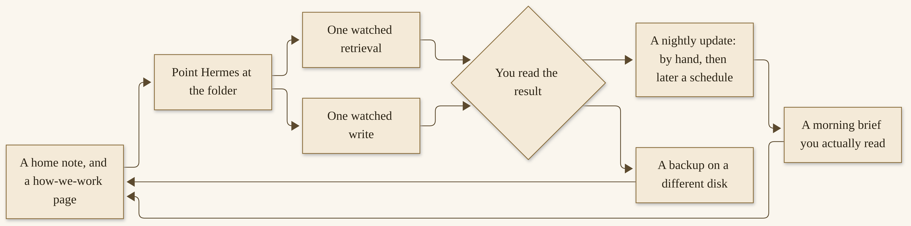{width=100%}

*The vault loop: a home note, a watched read and write, a nightly update, a morning brief, and a backup that is yours.*


## Optional: Obsidian CLI

Obsidian is useful, and it is not required. I want that sentence to be unmistakable, because a lot of writing about vaults starts with a particular app and makes people feel late if they do not have it.

The official `llm-wiki` skill says the wiki directory works as an Obsidian vault out of the box: `[[wikilinks]]` render, a graph view can show the network, frontmatter can power queries, and an assets folder can hold images.^153 I have written about Obsidian in the article, including a command-line interface that arrived with Obsidian 1.12, for backlinks and orphans and a daily append, and I pointed at that as a useful option.^154 The official skill also discusses an Obsidian skill that can sit alongside this one, and a headless sync path for servers, which is a more advanced setup than night one needs.^155

If you already use Obsidian, you may open `~/wiki` (or your `WIKI_PATH`) as a vault, and enjoy the links. If you do, the official suggestions are modest: set the attachment folder to `raw/assets/`, and leave wikilinks on. I will not invent CLI flags here. If you want the command-line steps, use my article and the official Obsidian or skill pages, as they stand on the day you read them, and do not trust a flag I guessed.^156

If you do not use Obsidian, you have a perfectly good vault already. A folder and a text editor are enough. I used the word “notebook” on purpose. A notebook is a thing you can open without a particular shop’s app. Markdown is the format because it lasts, and because it is plain, and because an agent can write it and a human can read it on a train, in any editor, without asking anyone’s permission. That is the gift of the pattern. Do not let an optional app become a gate.

When you are ready, we will give the agent one real job, with this vault in the loop. Chapter 5 is that job: something useful, reversible, watched, edited by you, and filed as a short note about what worked and what to do differently. You have an install. You have a notebook. You are still the one who says yes. Now we do one piece of work worth doing.

If this chapter felt long, that is because it is doing two jobs at once: it is teaching a pattern, and it is walking a how-to you can finish tonight or tomorrow morning. You do not have to do every optional folder, or Obsidian, or a weekly lint, or five ingests, before you are allowed to proceed. You have to have a folder, a home, a “how we work” with a “never,” a path the agent actually uses, one watched read, one watched write, and a backup on a different disk. Everything else is growth, and growth is what the rest of the book is for. The Wiki you will be glad you started is that small, complete set. Start it. Keep it. Let it grow with you, the way a real notebook does — a little every day, in your hand, with a backup you can hold, and with a yes you have not given away. Chapter 5 is waiting, and it will use everything you just built.


# Chapter 5
## Your First Real Work


{width=100%}

*I05. A finished one-page brief on a desk, a notebook with the work checked.*


You have an install. You have a vault. This chapter is one useful job, finished in the first week, with the notebook in the loop. We will pick something small and reversible. We will walk it: the ask, the watched tools, the draft, your edit, a short note in the Wiki about what worked and what to do differently. We will set the safety spine for send, spend, and delete. We will leave with a first-week “never” list you can actually remember, and a clear sense of done. This is not a fleet. This is not a client deliverable. This is a first job worth doing, and a yes that is still yours.

## Pick one useful job

The right first job is a job you actually need this week, and a job you can undo. Those two conditions matter more than ambition.

A **research brief** on a public topic is a classic, official-spirited first task: you ask for a short summary, with sources, on something you can check. The official Quickstart’s own first prompts are in this family — summarize a repo, tell me what the main file is, help me think about a workflow — and they are specific and verifiable on purpose.^158 A **local-file summary** is just as good: a folder of public or personal-but-not-secret documents you already have, summarized into a page you will edit. A **draft you will rewrite** is good too: a letter, a post, an outline, something that does not leave the machine until you say so.

What I do not want for a first job is a fleet, or a client deliverable, or a message that sends itself, or a payment, or a deletion of anything you care about, or a plugin you have not glanced at, or a scheduled job you will not watch. The official rule of thumb still holds: if a normal chat was shaky, do not add layers.^159 If the vault path is still uncertain, do not start a job that will write twelve pages into the wrong folder. Fix the path. Then pick the job.

Pick something you will actually use. A brief you will read on Thursday is better than a spectacular demonstration you will never open again. The point of a first job is not to impress anyone, including you. The point is to complete a loop: ask, watch, edit, file, and keep the yes.

If you are stuck on a topic, pick a public one you already care about — a technology you are learning, a history you have been meaning to review, a tool’s official documentation you want a map of. Do not pick a person’s private life. Do not pick a medical question and treat the answer as advice. Do not pick a legal or tax question and treat the answer as advice. Do not pick a topic whose sources you cannot open. We are going to cite what was used, and we are going to check it.

I will walk a generic research brief, on a public topic, as the worked example. It is not a fabricated client. It is not a story about a friend. It is a pattern you can copy onto whichever useful job you chose. If your job is a file summary or a draft, the same spine holds: a clear ask, watched tools, a human edit, a note in the vault, and a “never” on anything that leaves the machine.

If you are a professional, the first job might be a map of a public official documentation set you have to live in this week, or a summary of a repository you already have on disk, or a draft of an internal outline that will not be sent to a client until you have rewritten it. If you are at home, it might be a summary of a public article you have been meaning to digest, or a draft of a letter you will send yourself, or a plan for a hobby, built from sources you can open. In both cases, the “never” is the same in this first week: no unattended send, no vault full of secrets, no child’s private life, no medical or legal advice treated as a verdict. Chapters 11 and 12 will give you full shelves of more specific tutorials. This chapter is the spine those tutorials will reuse.

Official user stories, on the product’s own page, are a well of grounded ideas if you want to look, later, at what other people have built.^170 I will not copy those stories as if they were mine, and I will not invent a success rate. For a first week, a small brief you can check is a better teacher than an impressive setup you cannot yet supervise.

## A worked walk-through

Here is the job, stated the way I would state it to a teammate.

*Please write a short research brief, no more than two pages, on [a public topic I name]. Use only sources you can actually open. For each substantial claim, tell me where it came from, with a URL and the date you opened it. If you are not sure, say so. Do not invent a citation. Save a draft in the vault at the path we already set, in a page we agree on, and wait for me to edit it before anything is treated as final. Never send this to anyone. Never publish it. Follow `how-we-work.md`.*

That is the ask. The “never” is in the ask, not only in a list at the end. The vault is in the ask. The human edit is in the ask. The length is in the ask. A good first brief to an agent looks a lot like a good brief to a colleague, because that is the main skill this product wants from you.

Let me spend a moment on that last sentence, because it will serve you for the rest of the book. You do not need a special prompt language. You do not need a secret template. You need a goal, a length, a path, a source rule, a “never,” and a picture of “done.” If you can write those six things in ordinary sentences, you can work with this agent. If one of them is missing, the first draft will usually show you which one. A brief that wandered is often a goal that was vague. A brief that invented a citation is often a source rule that was not said, or that was said and ignored — and “ignored” is a fact for the “what to do differently” note, and for a tighter “never” on the how-we-work page. A brief that was published because someone was in a hurry is a “never” that was not in the ask. Put it in the ask. Put it in the page the agent orients to. Put it in your own habit. Three places, one rule.

The source rule is worth being almost pedantic about, in week one. “Use only sources you can actually open” is a different instruction from “search the web and write something plausible.” “For each substantial claim, tell me where it came from, with a URL and the date you opened it” is a different instruction from “include references.” “If you are not sure, say so” gives the agent a permitted way to be unfinished, which a fluent model may otherwise avoid. “Do not invent a citation” is the floor. You will still check. The instruction does not replace the check. It makes the check faster, and it makes a miss more obvious, which is what you want.

If your useful job is a local-file summary, the same six parts apply, and the source rule becomes “use only these files, at these paths, and quote with enough context that I can find the line.” If your useful job is a draft, the source rule may be “use only the facts I put in this ask, and do not fill in biographical or legal details I did not give you.” The pattern holds. The content changes.

**How to run the first real job**

1. Open a session in the same profile that is pointed at your vault. If you are not sure the path is still right, ask the agent to read `index.md` and `how-we-work.md` first, and confirm you recognize the pages.
   You should see the orientation the official wiki skill already asks for.^160
   If you don’t: stop and fix `WIKI_PATH` and the profile, as in Chapter 4. Do not run a job into a folder you have not seen.

2. Paste or type the ask, with your actual topic in the brackets, and with any local files named by path if this is a file-summary job.
   You should see the agent start to work: maybe a web extract, maybe a file read, maybe a search. You should be able to watch the tools.
   If a dangerous-command prompt appears, read it. Approve **once** if you agree, or deny. Do not approve “always” in this first job. Do not turn YOLO on.

3. Watch the sources. When the draft arrives, every substantial claim should have a place it came from. Open at least two of those URLs, or two of those files, yourself.
   You should be able to see the claim, or a fair version of it, on the page the agent named, and the date should be honest.
   If a citation is missing, or a URL does not open, or a quotation is tidier than the source, mark it. This is the edit. A confident tone is not a verified fact. We will put that sentence on the “never” list.

4. Edit the draft with your own hands. Tighten the prose. Cut what you cannot stand behind. Add the “I have not checked this” flags the agent should have added and did not. Put your name, or a simple “edited by me, [date],” at the bottom, so a later session does not treat an unedited draft as final.
   You should be willing to hand this page to a colleague, if it were a work brief, or to your future self, if it is a personal one.
   If you are not willing: it is not done. That is not a failure. That is the human step working.

5. File a short note in the Wiki — a new page, or a log entry plus a small query page — about the job itself: what you asked, what worked, what the agent used, what you had to correct, and what you want done differently next time. Ask the agent to help write that note, then edit it, or write it yourself. Update the index and the log, as the skill requires.^161
   You should be able to find this job again, a month from now, and know what you learned.
   If the note is only praise, it is not a useful note. Write one thing that should change.

6. Leave the brief in the vault. Do not send it. Do not publish it. If the whole point of the job was a letter you needed to send, you send it, yourself, after the edit, through the tool you already use for sending. The agent does not send, in this first week, unattended.


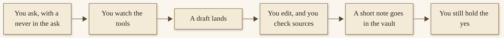{width=100%}

*The first-task loop: ask, watch, edit, file. You sit at both ends.*


What “done” looks like for the walk-through: a brief you can use, on a public topic or on the useful job you chose, with sources you opened, with your edits on it, with a note in the vault, and with nothing sent. That is a complete first job. It is also a rehearsal for every professional and personal how-to later in the book. Chapters 11 and 12 are this loop, repeated, with more specific setups and a “never” for each.

A word about tone, because this is the first time the agent may sound very sure. Models can write in a finished voice. A finished voice is not a finished check. The official product will, in many cases, be helpful and fluent. Your job, in this first week, is to be the person who opens the URL. That habit is worth more than a prettier draft. I would rather have a short brief with three sources you opened than a long brief with twelve sources nobody checked. The vault will remember which kind you chose to keep.

If the first pass is bad, that is useful information, and it belongs in the note. Maybe the topic was too broad. Maybe the ask did not name a length. Maybe a source was a thin page and the agent treated it as a foundation. Maybe the model is a small local one and it skipped a tool call — official memory documentation has a related warning, that small models may *say* they saved a memory without calling the tool, and the advice is to check the file.^171 The same instinct applies here: check the file. Check the brief. Check the citations. Then write a shorter ask, and run the loop again, still watched. A first job may take two passes. The second pass, with a better brief and a “never” the agent has just been reminded of, is often the one you keep. That is not wasted time. That is how you and the librarian learn each other.

I want to say something, also, about **your** voice in the edit. The agent will have a style. It may be a little smooth, a little general, a little fond of tidy lists. You do not have to keep that style. This is your brief, for your week. Cut the words that are not yours. Add the sentences only you could add: the constraint, the deadline, the “we already tried this and it failed.” A vault that only contains fluent agent prose is a vault that will not sound like you, and a practice that does not sound like you is harder to trust. The “how we work” page can say, “Prefer my edits to your first wording, and do not silently revert them.” That is a fair rule. A colleague would accept it.

If you are tempted, at the end of a good draft, to “just let it send” or to skip the note in the vault because you are tired, I will ask you to do the note anyway and to skip the send. The note takes five minutes and is the part of the loop that makes next week easier. The send is the part that can travel farther than you meant. Tired is a good reason to stop. It is a poor reason to approve a departure.


## Approvals: send, spend, delete

The first-week safety spine is three words, and I want them to be muscle memory before they are a policy document. Anything that **sends**, anything that **spends**, and anything that **deletes**, waits for a yes. Publish and merge will join that list as soon as they are relevant; they are the same idea. A first research brief should not need to send, spend, or delete. If your “useful job” has started to drift toward one of those, pick a smaller job, or take the sending into your own hands.

The official approval system, which we set tight in Chapter 3, is built around dangerous commands, not around every possible send.^162 A recursive delete will raise a prompt. A disk write of the wrong kind will raise a prompt. A pipe from the internet into a shell will raise a prompt. An email, or a message on a messaging door, or a payment, may travel a different path, through a different tool, and you should not assume that “I left approvals on smart” means “nothing can leave the machine without a card.” In the first week, the safe practice is simpler than a complete map of every tool: **do not connect a sending door, a paying door, or a production system.** Do not enable a messaging gateway yet, if you can wait until Chapter 7. Do not save a payment card. Do not point the agent at a mail account. Do not give it a token that can publish. Saved credentials and cards, if they are ever connected, are a later, careful chapter, and Chapter 14 will sit with you for that.^163

For deletes, the official dangerous-command list includes recursive removes and several destructive patterns, and the hardline blocklist will refuse a wipe of a filesystem root even if you have turned the rest of the approvals off.^164 That is a floor, not a complete guarantee. A single-file delete may or may not raise a card, depending on the command and the mode. In this first week, if the agent wants to delete anything, deny it, and do the deletion yourself if you actually want it done. The vault’s own rule is: never delete a page; archive it, with a trail.^165 Extend that instinct to the rest of the disk, for now.

For sends, the rule is: you send. A draft can live in the vault. A letter can live in the vault. You copy it, you read it, you send it through the tool you already use. If, later, an official email tool is part of your practice, Chapter 11 will treat it as a file-and-approve door, with a hard “never send unattended.” We are not turning that tool on tonight.

For spend, the rule is: you pay. No card in the vault. No “just book this.” No unsupervised purchase, even a small one, even “just to test.” A first week is a poor time to discover that a tool can complete a checkout. Chapter 14 will talk about money honestly, including hosted bills and power bills. Tonight, the only spend I am comfortable with is a provider bill you already understood when you chose a hosted model, and that you can see on a dashboard.

> **Caution.** If a prompt appears that would send, spend, or delete, and you are not sure, the answer is deny. You can always ask for the work again, in a smaller way, with the dangerous step taken out. An expired prompt, officially, is already a deny, and a new request raises a fresh card.^166 That is fail-closed. Let it fail closed.

A “never” in this step, not only at the end: never approve a command you have not read, in order to keep the brief moving. The brief can wait. The command may not be undoable.

If you are working in a shared house, or on a shared machine, or in a workplace, add one more tightness for the week: do not leave an open session unattended with a messaging door on, and do not leave YOLO on, and do not assume that a person who can sit at the keyboard is a person you meant to give the agent to. Official gateway authorization is a later chapter’s how-to. For now, close the session when you walk away, the way you would close a document that had a colleague’s draft in it. The first week is a good week to be a little more formal than you think you need to be. Formal, here, means kind to your future self.

## A first-week “never” list

Here is a short list I would like you to be able to say from memory. It is consistent with the official security pages, and with the vault chapter, and with the gift this book is trying to be.^167

**Never unattended send.** If it leaves the machine — a message, a mail, a post, a publish — you are there, and you said yes. A messaging door is a later chapter, and it is a real door.

**Never a vault full of secrets.** Keys, tokens, passwords, other people’s private lives, health and school records, anything you would not want a future model or a backup disk to see. Chapter 4’s “never” still stands. If something slipped in, you clean it with your own hands, and you rotate anything that was exposed.

**Never a plugin you have not glanced at.** Plugins are code you are trusting. The catalog is large, and Chapters 9 and 14 will teach you how to browse, enable, and disable carefully. A first week does not need a plugin binge. The official `llm-wiki` skill is the one we installed on purpose. Leave the rest until you have a reason, and until you have read what you are turning on.

**Never skip the backup.** The vault you started is already worth copying. Copy it to a different disk. Do it again after this first job, so the brief and the note are in the copy. A backup on the same drive is not a backup.

**Never treat a confident tone as a verified fact.** Open the source. Date it. If you cannot open it, it does not belong in a brief you will use. If the agent invented a citation, that is a stop, and a line in the “what to do differently” note, and a reminder in `how-we-work.md` if it was not already there.

I will add three cousins, so the list covers the week.

**Never unattended spend.** You pay.

**Never unattended delete.** You delete, if something must be deleted, and you prefer an archive.

**Never turn approvals off to go faster.** YOLO and `approvals.mode: off` are official, documented, and not for this week, on a machine you care about.^168

That is eight lines, or five plus three, and it is enough. You can write them at the bottom of `how-we-work.md` if they are not already there, in your own words. A “never” on a page the agent orients to, at the start of a session, is a “never” it has a chance to follow. A “never” that lives only in a book on a shelf is a “never” you will forget on a busy Thursday.

Here is a **sample** of the short “what to do differently” note, clearly a sample, not a page from a real job of mine. Adapt it after your own first pass. The value is in the specifics only you will have.

```markdown
# First-job note: public-topic brief
created: 2026-11-12
type: query
tags: [meta]

Asked for a two-page brief with opened sources and dates.
What worked: the agent used the vault path correctly; the outline was
usable; two of three URLs opened and matched the claims.
What to do differently:
- The third citation did not open. Next time, I will ask it to skip
  any source it cannot fetch, and to say so.
- The first draft was too long. I will keep the two-page limit in
  the first sentence of the ask.
- I almost approved a terminal command I had not read. I denied it.
  Next time, I will slow down at the prompt.

Edited by me, [date]. Never sent.
```

A note like that, filed, is a skill in embryo. Chapter 6 will teach you how to turn a repeated job into an official skill, with a “never” on it, watched once and then kept. You do not have to do that this week. You have to write the note, so that the skill, when it comes, is built from something true.

If the week goes wrong in a larger way — a write in the wrong folder, a secret that slipped into a page, a send you did not mean — stop, and deal with that before you start a second job. Wrong folder: move or delete the unexpected files yourself, fix the path, take a new backup after you have cleaned the original. Secret in a page: remove it with your own hands, check the backups and the log, rotate the secret, add a line to the “never.” A send you did not mean: that is a Chapter 7 and Chapter 14 conversation as well as a this-week one; revoke what you can, say what you need to say to anyone who received it, and do not turn the sending door back on until you understand how it happened. I am saying this calmly, because a first week is when these things are most likely, and also when they are most recoverable, if you notice. Noticing is the habit. The “never” list is how you notice sooner.

## What “done” looks like, and a look ahead

You are done with the first week when all of the following are true, and not before.

You have an install that completes a normal chat, on a supported path, with a provider or a local model you chose, and a session you can resume. You have an approval habit that starts tight: dangerous commands are read, “once” is preferred, YOLO is off, and send, spend, and delete wait for you.

You have a vault: a folder, a home note, a “how we work” page with a “never,” a path the agent actually uses, one watched retrieval, one watched write, and a backup on a different disk.

You have one finished job: a useful, reversible piece of work, with the vault in the loop, with sources you opened, with your edits on it, and with a short note about what worked and what to do differently. Nothing was sent unattended. Nothing was spent unattended. Nothing you care about was deleted unattended.

That is a complete first week. It is enough. It is already a practice.

What comes next is growth, at a pace you choose. Chapter 6 is memory and skills, and the official loop that learns because you set it — including the learning commands, re-checked on the day that chapter is taught, and one skill you will watch once and then keep. Chapter 7 is a messaging door: one process, many platforms, one careful enable, and a clear sense that a door is a door. Chapter 8 is work that runs while you sleep: a modest scheduled job, a heartbeat, helpers with a fresh context, a default of ten concurrent subagents from the official Delegation page, and an honest word about what survives a crash.^169 You do not have to go there this week. You may, when the first job has settled and the backup is a habit.

Parts 4, 5, and 6 will be there when you are ready: the commons, the two how-to shelves for work and for home, a fleet, and a chapter on safety, privacy, money, and a practice that lasts. The first week does not owe those chapters anything. They will use what you just built.

I want to close this part of the book the way I would close a first week with a colleague. You did a real thing. You did it carefully. You have a notebook that already contains a little history, which is more than a chat window will ever keep. The engine may change. The folder will still be there. You are still the one who says yes.

If the first job was messy — if a citation failed, if a write needed a heavy edit, if a prompt surprised you — that is not a sign that you are behind. That is a sign that the loop is doing its work. The note you filed, about what to do differently, is the most valuable page you wrote all week. Read it at the start of the next job. That is the practice, already, in miniature. It is how a first setup becomes a thing that grows.

If you want a slightly more formal sense of done, here is the same week as a list you can tick, in your own notebook or at the bottom of the log.

- A supported install, a working chat, a session that resumes.
- Approvals tight; YOLO off; send, spend, and delete behind a yes.
- A vault, with a home, a “how we work,” a watched read, a watched write, a backup on a different disk.
- One finished job, edited, cited, filed, not sent unattended.
- A short note about what to do differently, which you have actually read once.

If a box is empty, that is the next hour, not a reason to skip ahead to a gateway or a fleet. The empty box is a kindness. It tells you where you are.

A professional first week and a personal first week look more alike than marketing would have you think. Both need a clear ask. Both need a watched tool. Both need an edit. Both need a “never.” The difference is the topic and the privacy line, not the spine. When you get to Chapter 11, the research desk and the code-review profile and the operations helper will all be this loop, with more care around systems and around a human merge. When you get to Chapter 12, the household vault and the reminder door and the meal plan will be this loop, with more care around other people’s lives. You will already know the muscles. That is the gift of doing one small job properly, now.

Part 3 begins with memory, skills, and the loop that learns. I will meet you there when you are ready. If you want a day off, take a day off. The vault will wait. The backup will wait. The next useful job will still be there, and you already know how to walk it.

I am proud of this week, on your behalf, even though we have not met. A careful first setup is a quiet kind of work. It does not look like a demonstration. It looks like a folder, a tight approval, a brief you would sign, and a backup you can hold. That is a practice, already. It will grow. You will let it grow when you are ready, and not because a subtitle said “while you sleep.” The sleep comes later, and it comes after trust, and trust comes after a job you watched. You just did that job. That is enough for now, and it is more than most first weeks ever get. Take the evening. Take the backup. I will see you in Part 3, when you want the practice to deepen, with the same voice, and the same care, and the same yes still in your hands, where it belongs. When a friend asks how to start, you can tell them, in one breath: install carefully, start a Wiki, finish one small job, keep the yes. That is the whole first week. It was enough for me to want to write this book as a gift, and I hope it is enough to get you started.

## A second job, when you want one

If the first job went well, and you want a second before you leave Part 2, I would keep it in the same shape. Officially, the Quickstart suggests ordinary first prompts — a question, a small file task, a short piece of writing — and a rule of thumb that says: if Hermes cannot complete a normal chat, do not add more features yet.^158 I would honor that rule on a second job too. Do not add a messaging door, a plugin, or a scheduled run just to celebrate. Add them when you have a job they would actually serve, and after you have read the chapter that teaches the door.

A good second brief, like a good first one, is a page you would sign. It names the job, the sources you trust, the “never,” and what “done” looks like. If the first job was a short research note, the second might be a tighter version of the same: fewer sources, a harder check on citations, a shorter page. If the first job was a file you asked the agent to draft, the second might be an edit of that file, with you watching the tools again, because watching twice is how a surprise becomes a habit instead of a scare.

The official memory and wiki pages will, if you ask, remember what you tell them.^160 That is useful, and it is a reason to be careful. Do not paste a password, a key, or a card number into the second job “just to get it done.” Chapter 6 will slow down on memory. Chapter 4 already asked you to keep secrets out of the vault. The second job is not an exception.

When the second draft lands, do the same four things you did the first time: watch, edit, check the sources you can open, and file a short note about what worked and what to do differently. If a citation fails, that failure is the most useful line on the page. If a tool does something you did not expect, deny, and write it down. The Quickstart’s recovery order is still there if the session itself feels off: `hermes doctor` first, then the calmer steps around model, setup, sessions, and the gateway.^158 Start with the doctor. Do not start by adding a feature.

Two watched jobs and a notebook you have backed up is already more than a first week needs. If you stop there and live with the practice for a few days, you will not be behind. You will be in the right place: a human who has seen the work, kept the yes, and has a page to come back to. Part 3 is for deepening that practice — memory, skills, the learning loop, a door you can close, work that can run while you sleep — and it will be better company if the first two jobs are already ones you trust.


# Part 3 — The Practice That Grows
# Chapter 6
## Memory, Skills, and the Loop That Learns


{width=100%}

*I06. The loop that learns. You do the work, you review it, you write something down, and you run it again. The loop is a habit plus a place to write. It is not a promise that the agent improves on its own.*


I have a habit I wish I had started sooner. After I ask Hermes to remember something, I open the file and look. It is a small courtesy, and it has saved me more than once from believing a polite “I’ll remember that” that never made it onto the page.

The official docs are honest about this. Memory only lasts when the model actually calls the memory tool. A sentence that says the fact was saved is just a sentence. Small local models, especially, will tell you they saved something they never wrote down. The fix is not a longer instruction. The fix is to look.^172

This is the chapter where we slow down and ask what Hermes keeps, what a skill is, and how the official learning commands work — the ones that were current on the day I checked them, 12 November 2026. It is also about a loop you set yourself: do the work, review it, write a skill or a vault note, and run it again. The loop is a habit plus a place to write. It is not a promise that the agent improves on its own while you sleep.

If you came here from Chapter 4, you already have a Wiki — a folder of linked pages the agent reads before it acts and writes to after it learns. That notebook is the foundation. Built-in memory is something else, and it is small on purpose. The two can work together. They are not the same thing, and I do not want you to treat them as if they were.

## What it keeps

When I say memory here, I mean two small, curated files the official docs call persistent memory. They live in `~/.hermes/memories/`, and they are injected into the system prompt at the start of every session as a frozen snapshot.^173

The first file is `MEMORY.md`. It is the agent’s own notes — environment facts, conventions, things it has learned. It may hold up to 2,200 characters, which the docs describe as about 800 tokens. The second is `USER.md`. That is a profile of you: how you like to be spoken to, what you expect, what you would rather it never do. It may hold up to 1,375 characters, about 500 tokens. Those limits are official, and they are the same numbers I wrote about in the vault article. They have not changed on the page I opened for this chapter.^173

The snapshot is frozen on purpose. When a session starts, Hermes reads those files once and puts them in the prompt. If the agent adds or removes an entry during the session, the change is written to disk right away, but it will not appear in the prompt until the next session starts. The docs say this preserves the model’s prefix cache, which is a performance choice. The practical meaning for you is simpler: a fact saved this morning is for the next session, not for a chat that is already running. On the command line, that mostly takes care of itself, because each new invocation is a new session. On a messaging door, which we will come to in Chapter 7, a chat can run for weeks as a single session if you never start a fresh one. The official practice is to run `/new` at a natural boundary — a finished task, a change of topic, the start of a day — so the agent re-reads the updated files and starts from a short, cheap context.^174

The agent manages those files with a tool simply called `memory`. It can add an entry, patch a span inside one, or remove one that is no longer useful. There is no separate “read” action, because the content is already in the prompt at the start of the session. Every call names a target: `memory` for the agent’s notes, or `user` for your profile.^175

A few things are worth knowing about the limits, because they tell you how to write. Memory does not auto-compact. If a write would go past the character limit, the tool returns an error instead of silently dropping anything. The agent is then expected to make room in the same turn — shortening or removing stale entries — and retry. A patch that lengthens an entry can overflow the same way. The docs recommend consolidating when you are above about 80 percent of capacity, which the prompt header itself shows you as a percentage and a count.^176

You can inspect all of this yourself. The files are ordinary markdown. Open them:

```
cat ~/.hermes/memories/MEMORY.md
cat ~/.hermes/memories/USER.md
```

If you are on a named profile, the path is under that profile: `~/.hermes/profiles/work/memories/`, not the default home. Memory is per profile by design. A CLI session in the default profile and a Telegram bot on a `work` profile do not share notes. `hermes profile list` will show you what exists.^172

The two targets are worth keeping distinct, because they answer different questions. The `memory` target is for what the agent needs to know about the environment: the operating system, the tools on the machine, a project convention, a workaround that already cost you an afternoon, a completed-work note that will matter next month. The `user` target is about you: a name, a time zone, whether you prefer a short reply or a careful one, a pet peeve, a habit. The official “save these” list is a good one to borrow — preferences, environment facts, corrections, conventions, completed work, and anything you asked it, explicitly, to remember. The agent, the docs say, saves automatically when it learns those things. You do not have to ask. I still ask, out loud, for the facts I care about, and I still open the file.^200

A good entry is compact and specific. The official examples are the right shape: a single block that packs a machine’s tools and a shell preference; a project path with the test command and the CI; a lesson learned, with the port and the key path, not a diary of how you found them. A vague “User has a project” is not a memory. A paragraph that starts on January 5th and wanders is not a memory either. Short, dense, and actionable is the standard the page is teaching.^201

There is also a wider kind of recall that is not those two files. Every conversation — from the CLI, from Desktop, from a messaging door — is stored in a SQLite database at `~/.hermes/state.db`, with full-text search. The agent can look through past sessions with a tool called `session_search`. The official comparison is the right one to keep in mind: persistent memory is small and always in the prompt; session search is large, on demand, and free of an extra model call. Memory is for the few facts that should always be there. Session search is for “did we talk about this last week?”^177

And there is a way to see what has been learned over time. `/journey` — also `/learning` or `/memory-graph`, and `hermes journey` from the terminal — opens a timeline of saved skills and memory entries, oldest at the top. In Desktop it is the Star Map panel. You can list, edit, or delete nodes from there. A skill appears on that timeline when it has a learning signal: it was created in this profile, created by the background review, or used at least once. Bundled skills you have never used stay off the map.^178

That is what it keeps. The Wiki from Chapter 4 is still the place for the big, linked, lasting knowledge. These two files are the pocket notebook. Session search is the filing cabinet you can rummage through. They work together when you let each of them do the job it was sized for.

One official warning belongs here, said plainly. Do not point two agent processes at the same Hermes home directory. Memory writes are automatic and load back at the next session, so two writers on one home will compound each other’s entries into a state neither of them — and neither you — authored. If a second agent needs its own memory, give it its own profile. If they need to share something larger, the docs point you at an external memory provider, not at two pens on the same page.^179


## What you should not let it keep

I have a simple test, and I offer it as a friend, not as a lawyer. If you would not write it on a postcard, do not put it in memory.

Secrets do not belong there. Passwords, API keys, card numbers, tokens, the answer to a security question — those go in `~/.hermes/.env`, or in a place you already trust for secrets, not in `MEMORY.md`, not in `USER.md`, and not in the vault from Chapter 4. The vault is a folder you will back up. A folder you back up is a folder someone else might one day see. Memory is injected into the system prompt at every session start. If a secret lands there, it is sitting in the prompt.^180

Other people’s lives do not belong there either. A colleague’s home address. A customer’s account notes. A child’s full details. Your agent’s memory is yours to change. That does not make it a good place for someone else’s private business. This book is not legal advice, and it is not a reason to store a school record or a health detail in a notebook the agent will read aloud when asked.

Raw data dumps do not belong there either, and the official “skip” list is a good one: trivial remarks, facts you can look up again in a moment, large code blocks, log files, temporary paths, and anything already written in `SOUL.md` or `AGENTS.md`. The pocket notebook is for compact, useful facts. It is not a filing cabinet, and it is not a vault.^181

> **Caution.** If a fact went into the chat, it can be remembered. Do not paste a password, a key, or a card number into a conversation and hope the agent will know not to keep it. Ask it not to. Then open the file and make sure it didn’t.

Correcting a memory is ordinary work, and the docs give you more than one way. The agent can patch or remove an entry with the `memory` tool — a unique substring is enough to identify the line, and if the substring matches more than one entry, the tool asks for a more specific match. You can also edit the files yourself, because they are just markdown. From `/journey`, you can edit a memory chunk in your editor or delete it. Deleting a memory chunk removes it; deleting a skill from the journey archives it, and an archived skill can be restored.^178

If you would rather approve every save before it lands, the official gate is `memory.write_approval: true` in `~/.hermes/config.yaml`. With the gate on, interactive CLI writes prompt you in the moment. Everywhere else — messaging platforms, scripts, and the background review that can run after a turn — writes are staged. You review them with:^182

```bash
/memory pending
/memory approve all
/memory reject all
/memory approval on
```

That is the official answer to “the agent saved a wrong assumption about me.” Turn the gate on, and every save, including the unprompted background ones, waits for your yes.

The files are also scanned before a new entry is accepted. The docs say entries are checked for injection and exfiltration patterns, and for invisible Unicode, because they will be injected into the system prompt. Content that matches those threat patterns is blocked.^183 That is a kindness. It is not a blessing. A scan is a start, not a reason to put a secret there.

One more official troubleshooting path is worth keeping in your pocket, because it is the one that explains most “I told it, and it forgot” reports. Work through these in order, as the docs do. First, open the file: if the fact is not there, the model claimed a save it never made. Ask it explicitly to use the `memory` tool, and look again. If it keeps happening on a small local model, the docs’ advice is a stronger model for the setup, not more instructions — once the entries exist, a smaller model can read them, because they arrive in the prompt. Second, if write-approval is on, check `/memory pending`. Third, check that you are in the same profile you wrote to. Fourth, check that memory is actually enabled — `memory.memory_enabled: false` removes the tool entirely. Fifth, remember the frozen snapshot: start a new session after a write if you want the current chat to see it.^172

When you take something out, you are not punishing the agent. You are keeping a teammate’s notes honest, including the notes that landed there because a passing remark sounded like a fact.

## Skills as procedural memory

A skill is a procedure you want done the same way next time. In official language, skills are on-demand knowledge documents the agent can load when it needs them. They follow a progressive-disclosure pattern, so the agent does not have to carry every procedure in the prompt all at once, and they are compatible with the agentskills.io open standard.^184

All skills live in `~/.hermes/skills/`. On a fresh install, bundled skills are copied there. Skills you install from the Skills Hub, and skills the agent creates, go there too. The agent can modify or delete any skill, which is why a “never” on a skill you care about is worth writing down, and why the official lock exists: `hermes curator lock` stops the agent from rewriting a skill you curated by hand, through any tool, even in YOLO mode. A locked skill stays readable and loadable. Your own edits still work.^185

The heart of a skill is a file named `SKILL.md`. A practical anatomy, from the official format, looks like this: a name, a short description (the house standard is sixty characters or fewer), an optional version, optional platform limits, optional tags, and then the body — when to use this skill, the steps in order, the pitfalls, and how to confirm it worked.^186 I would add one more thing, in our practice if not as a required official field: a “never.” A good skill tells the agent what not to do at the step where the harm would happen. “Never send this. Leave it as a draft.” “Never delete the original.” “Never pay.” A procedure without a “never” is a procedure that will, one day, be helpful in the wrong direction.

The agent only loads the full skill when it actually needs it. First it sees a short list of names and descriptions. Then, if a job matches, it opens the skill. If the skill has reference files under `references/`, those load only when a question needs them. That is progressive disclosure, said in plain words. It is also why a skill can be longer than a memory entry without crowding every session.^187

Every installed skill is available as a slash command. In the CLI or on a messaging door, you can type `/excalidraw` or `/github-pr-workflow` and give an instruction. You can stack up to five skills at the start of a message. For combinations you use often, the official path is a skill bundle: a small YAML file that groups several skills under one short command.^188 You can also just talk: ask what skills you have, or ask the agent to use one.

The agent can create, update, and delete its own skills with a tool called `skill_manage`. The docs call this the agent’s procedural memory: when it works out a non-trivial workflow, it can save the approach for next time. Memory stores small durable facts that should always be in context. Skills store longer procedures that should load only when they are relevant.^189 That pairing is the whole idea. A preference — “keep the brief short” — belongs in `USER.md`. A twelve-step deploy with a rollback and a “never push to production from this job” belongs in a skill.

> **Tip.** A skill should capture lessons, not logs. The official authoring guidance is clear: a pitfall is a generalizable rule plus a clause of why, stated once, attached to the step it affects. Incident narration, pull-request numbers, dates, and quoted chat are not skill content. The rule has to stand without the story behind it.^189

Skills can declare required environment variables, and they can declare non-secret config settings that live in `config.yaml`. When a missing secret is needed, Hermes asks for it securely only in the local CLI. Messaging surfaces never ask for secrets in chat — they tell you to use `hermes setup` or `~/.hermes/.env` locally instead.^190 That is a door worth leaving as the docs designed it. Do not work around it by pasting a key into a Telegram message.

If you maintain skills outside Hermes — a shared folder used by more than one tool — you can point Hermes at those directories. If you want new agent-created skills to land in a shared “brain” folder, the official setting is `skills.create_dir`. And if a git repo carries its own skills, Hermes will notice them, but it will not auto-load them from an arbitrary clone. You trust the repo once with `hermes skills trust`. A skill whose security scan comes back `dangerous` is quarantined and will not load.^191 All of that is official. The practical meaning is the same as the rest of this chapter: try before you trust, and keep a “never” where the harm would be.

## The Skills Hub: try before you trust

The Skills Hub is a library, not a dump. It is the official way to browse, search, inspect, and install skills from official optional skills, from public directories, and from sources you add yourself. I am not going to give you a single hub-wide skill total, because I did not find one on an official page I could stand behind. What I can give you is the source list as the Skills System page stated it on 12 November 2026, and a few pack figures that page itself prints, dated.^192

You browse it like this:

```bash
hermes skills browse
hermes skills browse --source official
hermes skills search kubernetes
hermes skills inspect openai/skills/k8s
hermes skills install official/security/1password
```

The official source, `official/...`, is optional skills that ship with Hermes and install with built-in trust. The rest of the shelf, as the docs listed it that day, includes Vercel’s public skills.sh directory; well-known skill endpoints that a website publishes at `/.well-known/skills/index.json`; direct GitHub installs and taps, including default taps from OpenAI, Anthropic, Hugging Face, NVIDIA, Weights & Biases, Qdrant, Pinecone, Notion, Airtable, and Shopify; ClawHub; LobeHub; browse.sh; and a direct URL to a `SKILL.md` you already trust enough to fetch.^192

Two pack figures, only as that official page states them. The scientific taps — K-Dense-AI/scientific-agent-skills and synthetic-sciences/openscience — are described as “~480 scientific research skills,” covering bioinformatics, chemistry, physics, machine-learning training, and scholarly tooling, grouped under a `science` category. The same paragraph says community trust applies, every install is security-scanned, and many wrap third-party tools with their own licenses, some GPL, and KEGG requiring a commercial license for non-academic use — check each skill’s prerequisites. browse.sh is described as Browserbase’s catalog of “200+ site-specific browser-automation SKILL.md files.” Both figures are the docs’ figures, on 12 November 2026. They will change.^192

Anyone can publish a tap: `hermes skills tap add owner/repo`. A tap is a GitHub repository of `SKILL.md` files. New taps are assigned community trust by default. That is how a team, or a generous stranger, shares a shelf without standing up a server.^193

Installation always goes through a security scanner. Official optional skills are treated as built-in trust and do not show the third-party warning panel. Everything else is scanned for data exfiltration, prompt injection, destructive commands, and related threats. You can use `--force` to override a non-dangerous policy block after you have reviewed the skill. `--force` does not override a `dangerous` verdict. That last sentence is official, and I want it to stay in your hands.^194

Trust levels, as the same page lists them: `builtin` for what ships with Hermes; `official` for optional skills in the repo; `trusted` for certain named registries; `community` for everything else. Community is the default for a new tap and for a direct URL.^194

> **Caution.** A skill is a procedure the agent will follow. Inspect it before you install it — `hermes skills inspect` is there for that. Try it in a throwaway session or a throwaway profile. Then, maybe, keep it. A catalog, a hub, and a trusted tier are a start. They are not a blessing, and they are not a reason to skip the reading.

If you want a profile that starts empty and stays empty across updates, the official path is `hermes skills opt-out`, or `hermes profile create research --no-skills` at profile-create time. Opt-out stops future seeding. It does not delete what is already on disk unless you pass `--remove`, and even then it only deletes unmodified bundled skills. Skills you edited, installed from the hub, or wrote yourself are kept.^195

The culture of the Hub, as I read it, is a culture of sharing with a gate at the door. That is the commons we will spend more time with in Chapter 9. For this chapter, the how-to is enough: browse, inspect, try, then maybe keep.

## The loop that learns

A loop, in this book, is a habit plus a place to write. You do the work. You review it. You write a skill, or a vault note, or a short memory entry. You run it again. The official commands that serve that loop, as the docs and the Slash Commands reference stated them on 12 November 2026, are `/learn`, `/refine`, `/review`, and `/journey`. I re-checked the names at draft time. `/refresh` was named in an earlier outline as a possibility; it is not on the current official command list, so I am not teaching it.^196

`/learn` is the fast way to turn something you already know — or a pile of reference material — into a reusable skill, without hand-writing the `SKILL.md`. You point it at a directory, a URL, the workflow you just walked through, pasted notes, or even a large book or a stack of papers. The agent gathers the material with the tools it already has, and authors a skill that follows the house standards: a short description, a standard section order, Hermes-tool framing, no invented commands. It works in the CLI, the messaging gateway, the TUI, and the dashboard. The write is done with `skill_manage`, so if you have the skill write-approval gate on, the save waits for you.^197

```bash
/learn how I just filed this weekly status note
/learn https://docs.example.com/api/quickstart
/learn the REST client in ~/projects/acme-sdk, focus on auth + pagination
```

Those first two shapes are official. The third is the official directory shape, with a sample path. Use a path that is yours.

When the source is large, `/learn` does not cram it into one file or reduce it to a lossy summary. It authors a knowledge-base skill: a lean `SKILL.md` with an index, and distilled files per chapter or topic under `references/`. Those files cost nothing until a question needs one. The distillation, the docs say, synthesizes structure — frameworks, definitions, decision rules, anti-patterns — and never reproduces passages of the source text. Re-running `/learn` on the same topic folds new material into the existing skill rather than making a duplicate.^197

`/refine` is different. It runs the background memory-and-skill self-improvement review now, instead of waiting for the automatic post-turn trigger. Optional focus text steers it: `/refine save the deploy workflow as a skill`. It runs in a background fork against a conversation snapshot. The live session and the prompt cache are left alone. Results are reported when it is done. On a messaging door, it can review a chat you left idle, without you sending a message first.^196

`/review` is different again, and the Delegation page is careful to say so. `/review` reviews the work product the conversation just produced — a pull request, a diff, code, a document, a design. `/refine` reviews the conversation to update memory and skills. I want those two names to stay distinct in your practice, because they do different jobs.^198

```bash
/review
/review focus on security
```

What happens, officially: the last ten user and assistant messages are snapshotted as the reviewer’s starting evidence. A reviewer subagent is dispatched with the normal subagent toolset, so it can actually open the pull request, read the diff, and run code, rather than judging from the excerpt alone. When it finishes, the review re-enters the same session, and your primary agent can act on it. You can pin a dedicated review model with `auxiliary.review` in `config.yaml`. By default the reviewer runs on your main model.^198

There is also an automatic background review that may run after a turn, and that may save a memory or update a skill quietly. The docs call this a consent-aware learning loop. By default you see a short line in chat — “Memory updated,” or a skill name patched. You can turn that notification off, on, or verbose. Turning the notification off does not stop the review or the writes. If you want the writes themselves to wait, that is `memory.write_approval` and `skills.write_approval`. You can also disable automatic reviews with `auxiliary.background_review.enabled: false`. Manual `/refine` still works.^199

I want to say this kindly, and clearly. A background review is a helper you can gate, pause, or run on a cheaper model. It is not a promise that the agent improves unsupervised. It does not wake up with ideas. It looks at a conversation you already had, and it may propose a compact fact or a procedure. You are still the one who decides whether that proposal belongs in the notebook.


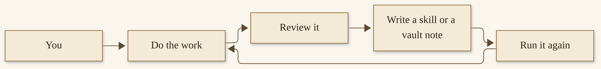{width=100%}

*I06. The loop that learns. You do the work, you review it, you write something down, and you run it again. The loop is a habit plus a place to write. It is not a promise that the agent improves on its own.*


## How-to: one skill, watched once, then kept

This is a short practical, starting from where Chapter 5 left you: an install that works, a vault you have begun, one real job already finished. We are going to pick a job you already repeat, turn it into a skill, run it once while you watch, and then keep it. A skill you trust is also what you might later schedule, in Chapter 8, and what you might later reach from a messaging door, in Chapter 7. We are not scheduling it yet. We are watching it once.

Pick something modest. A weekly status note. A morning summary of a folder you already keep. A lint of your vault, if you installed `llm-wiki` in Chapter 4. Do not start with a send, a payment, or a publish. The first skill should be a job whose “never” is obvious: never send, never pay, never delete the original, leave it as a draft.

**How to add one skill and watch it once**

1. Choose the job, and say the “never” out loud.
   Write one sentence: what this skill does, and what it must never do. If you cannot name the “never,” pick a smaller job.

2. Decide whether you will write it, learn it, or import it.
   To learn from a workflow you just walked through, in chat:

   ```bash
   /learn how I just wrote this weekly status note. Never send it. Leave it as a draft in the vault.
   ```

   To import from the Hub, inspect first, then install into a profile you are willing to experiment with:

   ```bash
   hermes skills inspect official/research/llm-wiki
   hermes skills install official/research/llm-wiki
   ```

   The `llm-wiki` example is one you may already have from Chapter 4. If you already installed it, do not install it twice. Pick a different official or inspected skill, or write your own. To write your own, create a folder under `~/.hermes/skills/` with a `SKILL.md` in the official format — name, description, steps, pitfalls, verification, and your “never.” Chapter 10 will walk through authoring more carefully. For today, `/learn` or a careful Hub install is enough.

   You should see a new skill in `hermes skills list`, and a matching slash command. If you don’t: run `/reload-skills` in the open chat, or start a new session with `/new` so the skill index refreshes. If an install was blocked, read the scanner verdict. Do not use `--force` on a `dangerous` result; the official tool will not let you, and you should not look for a way around it.^194

3. Open the `SKILL.md` and read it.
   Confirm the steps are the steps you meant, and that the “never” is in the file, at the step where the harm would happen. If `/learn` drafted something close but not quite, edit the file. If this is a skill you want to protect from later automatic edits, lock it:

   ```bash
   hermes curator lock weekly-status
   ```

   Use the actual skill name you created. You should see the skill marked locked, and later `skill_manage` writes to it refused. If you don’t: `hermes curator` and the official locking page are the recovery, not a guessed flag.

4. Run it once, in a session you are watching, on a safe input.
   In chat:

   ```bash
   /weekly-status
   ```

   Use your skill’s real name. Watch the tools it calls. If it reaches for a send, a delete, or a payment, stop it — `/stop` — and fix the skill before you run it again.

   You should see a result you are willing to keep: a draft, a note, a summary, sitting where you asked it to sit. If you don’t: read the skill again, tighten the “never,” and run it once more while you watch. Do not put it on a schedule until a watched run looks like work you would sign.

5. Keep it, or take it out.
   If the watched run was right, leave the skill in place. Add a short vault note, if you keep a vault, about what it does and what it must never do. If the run was wrong, edit or uninstall (`hermes skills uninstall` for a Hub skill, or delete a skill you wrote). A skill you do not trust is not a skill you schedule.

Done looks like this: one skill, in your skills directory, with a “never” you have read, a watched run you agreed with, and no schedule yet. What still needs a yes is anything that would leave your machine — a send, a publish, a payment — and that yes is still yours.

That is the whole loop, at a human size. You have a pocket notebook that is small on purpose, a vault for the bigger lasting knowledge, and a first skill you have actually watched. In Chapter 7 we will talk about reaching this practice from another door — a phone, a quieter laptop, a messaging app — carefully, because a messaging door is a real door. In Chapter 8 we will put a trusted skill on a clock. Not before.

You are still the one who says what is worth keeping, and what a procedure must never do. The agent will help. It will not replace your judgment about a fact that should never have been written down, or a skill that should never have been allowed to send. That judgment is a gift you give yourself, and it takes less time than cleaning up after a helpful mistake.

## The official commands, in one pocket list

I want to leave this chapter with the official commands in one place, dated to 12 November 2026, so you do not have to hunt for them when you are in the middle of a session. If a live page has moved a name, trust the live page. These are the names I opened.

**Memory, as a file you can look at.** Built-in memory is small on purpose. The official Persistent Memory page is the authority for how it works, how it appears in the system prompt, and the character limits it is written to.^173 After you ask Hermes to remember something, open the file and look. A sentence that says “I’ll remember that” is just a sentence. The official troubleshooting, on that same page, is honest about this: memory lasts when the model actually calls the memory tool.^172 Small local models, especially, will tell you they saved something they never wrote down. The fix is not a longer instruction. The fix is to look.

The official session commands for pending memory, as I opened them, include `/memory pending`, `/memory approve`, and `/memory reject`.^174 Use them. A pending fact is a fact that has not yet earned a place. If you would not want it in a notebook a colleague could open, reject it. If you would, approve it, and then still open the file.

**Skills, as a procedure you inspect.** `hermes skills inspect` is the official way to read a skill before you install it. `hermes skills install` and `hermes skills uninstall` are the official way to put a Hub skill in, and to take it out.^174 A skill can, officially, embed inline shell snippets that run on the host without an approval when that feature is on; the official default is off, and I would leave it off until you have a reason and a “never” that you have actually read. Chapter 10 will come back to this, for people who write skills. Here, the practice is simpler: inspect, try in a session you would not mind resetting, watch, and only then keep.

**The loop, as a habit plus a place to write.** The official learning-loop commands — the ones current on 12 November 2026 — are a way to ask the agent to help you write down what a session just taught. I will not treat them as a promise that the agent improves on its own while you sleep. They are a prompt, and a file, and a human who reads the file. If a command name has moved by the time you read this, the shape will not: do the work, review it, write a skill or a vault note, run it again. That is the loop I06 drew. It is not magic, and it does not replace the “never” on the skill you just watched.

If this pocket list is all you take from Chapter 6, it is enough: open the memory file, inspect a skill before you install it, watch the first run, keep secrets out of the chat, and write down what you want to keep. Chapter 7 is a door. Chapter 8 is a clock. Both will be safer if this chapter’s habits are already yours.


# Chapter 7
## Talk to It from Anywhere: The Messaging Gateway


{width=100%}

*I07. One process, many doors. Desktop, the command line, the terminal interface, and a messaging app all sit down at the same gateway. The agent on the other side is the same one.*


A phone in your pocket is a door. That is the kindest way I can say it, and the most careful.

Once a Hermes Agent can meet you in a messaging app, you can ask for a brief from a train seat, or approve a draft while you wait for a kettle. You can also, if you are not careful, hand a stranger a path to a machine with a terminal on it. The official docs put this in one plain sentence I wish every first-time installer would read twice: by default, the gateway denies all users who are not on an allowlist or paired by a direct message. That is the safe default for a bot with terminal access.^202

This chapter is about that door. One process, many platforms. How to open one of them carefully. How to close it. What still needs your yes when the request arrives as a chat bubble instead of a line in a terminal.

We are not adding this because it is impressive. We are adding it because a practice that only lives at your desk will stay at your desk. The work, if you want it to grow, has to be able to meet you where you already are — and still wait for you when the answer matters.

## One process, many doors

The official name is the Messaging Gateway. In plain words: it is one background process that connects to the messaging platforms you have configured, keeps the conversations, runs scheduled jobs, and can deliver a voice message. The command is `hermes gateway`.^203

Since the Hearth Release — Hermes Agent v0.23.0, dated 5 November 2026 in the project’s own notes — that one gateway on a machine owns every conversation. The CLI, the TUI, Desktop, editors, messaging bots, and cron all sit down at the same table as clients, instead of each running its own copy of the agent against the same chat. That is the project’s own account of the change, and it is the picture I want you to have: one hearth, many chairs.^204

You start it, stop it, and ask how it is doing with a small family of commands:^205

```bash
hermes gateway setup
hermes gateway
hermes gateway start
hermes gateway stop
hermes gateway status
hermes gateway install
```

`hermes gateway setup` is the interactive wizard. It walks you through the platforms with arrow-key selection, shows which ones are already configured, and offers to start or restart the gateway when you are done. `hermes gateway`, with no extra word, runs it in the foreground, which is a good way to watch a first setup. `hermes gateway start` and `stop` talk to the installed service. `hermes gateway status` is the first place to look when something is quiet. `hermes gateway install` installs that service — a user service on Linux, a launchd agent on macOS, a Scheduled Task on Windows — so the gateway can come back after a login or a boot, depending on how you installed it.^205

Desktop, the CLI, and the TUI can share this same process. After a CLI-only install you can still run Desktop. On a machine where you already work in Desktop, Messaging is a page in the app: you set up a channel there, and a credential save keeps a “Restart now” banner until the gateway has actually restarted.^206 The practical meaning is the same from every chair: you are talking to one agent, with one memory, one skill shelf, and one set of approvals, through whatever door you opened.

If you want that process to outlast a logout, the official service paths are worth doing once, carefully. On a Linux laptop, `hermes gateway install` sets up a user service; `sudo loginctl enable-linger $USER` is the official one-time step that keeps it running after you log out, and that lets a later `hermes update` restart the gateway without root. On a headless host that should come back at boot, the official alternative is `sudo hermes gateway install --system`. The docs warn against keeping both the user and the system units installed at once, and they warn, specifically, against adding a custom `ExecStopPost` kill to the unit — that pattern can loop restarts and flood a Telegram chat. On macOS, `hermes gateway install` writes a launchd agent; if you install new tools later, run the install again so the PATH in the plist is current. On Windows, the Scheduled Task is designed to start hidden at logon, and `hermes gateway status` will tell you if the registration has drifted from the current template.^205 I am naming these so a first install has an official home. I am not asking you to become a service manager this afternoon. A foreground `hermes gateway`, while you watch a first test message, is a complete start.

For a named profile, the commands take `-p`: `hermes -p research gateway start`, and the same for `status` and `stop`. Messaging status belongs to the selected profile on the selected machine. A different profile does not inherit the server process’s credentials. “Saved” means credentials are stored, not that the gateway is running or that the platform is connected.^221


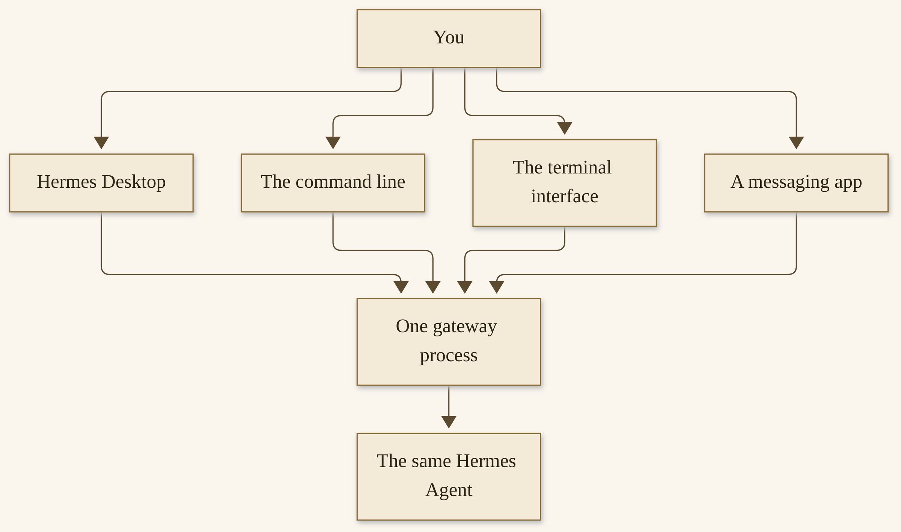{width=100%}

*I07. One process, many doors. Desktop, the command line, the terminal interface, and a messaging app all sit down at the same gateway. The agent on the other side is the same one.*


## Official platforms, dated

The official Messaging Gateway page, opened on 12 November 2026, lists the doors Hermes can use. I am going to put them in a table, dated, and then I am going to point you at the official setup page for each one. I will not write a third-party walkthrough that will rot in a month. The product moves. The live page is the authority.^203

| Platform, as the official page names it | Official setup page |
| --- | --- |
| Telegram | Messaging → Telegram |
| Discord | Messaging → Discord |
| Slack | Messaging → Slack |
| WhatsApp, and WhatsApp Cloud API | Messaging → WhatsApp, and WhatsApp Business Cloud API |
| Signal | Messaging → Signal |
| SMS (Twilio) | Messaging → SMS |
| Email | Messaging → Email |
| Home Assistant (a catalog plugin) | Messaging → Home Assistant Integration, and the plugin catalog |
| Mattermost | Messaging → Mattermost |
| Matrix | Messaging → Matrix |
| DingTalk | Messaging → DingTalk |
| Feishu/Lark | Messaging → Feishu/Lark |
| WeCom, and WeCom Callback | Messaging → WeCom, and WeCom Callback |
| Weixin (WeChat) | Messaging → Weixin |
| BlueBubbles (iMessage), and Photon (iMessage) | Messaging → BlueBubbles, and Photon |
| QQ | Messaging → QQBot |
| Yuanbao (a Hermes Labs plugin) | Messaging → Yuanbao |
| Microsoft Teams, and Teams Meetings | Messaging → Microsoft Teams, and Teams Meetings |
| LINE | Messaging → LINE |
| ntfy | Messaging → ntfy |
| Google Chat | Messaging → Google Chat |
| IRC | Messaging → IRC |
| Buzz | Messaging → Buzz |
| SimpleX | Messaging → SimpleX |
| Raft | Messaging → Raft |
| Open WebUI, with the API server | Messaging → Open WebUI + API Server |
| A2A (agent-to-agent) | Messaging → A2A |
| Webhooks | Messaging → Webhooks |
| Microsoft Graph webhook listener | Messaging → Microsoft Graph Webhook Listener |

The same page also prints a comparison table — voice, images, files, threads, reactions, typing, streaming — for those platforms, as of that day. Capabilities differ. Telegram, Discord, and Slack, for example, are listed with a full set of those columns; SMS is listed as a thinner door; Home Assistant is listed as a plugin. If you need a particular capability, look at that official table, on the day you look, not at a copy of mine.^203

Hermes Relay is mentioned on the same page as experimental: it is not a chat platform itself, but a connector that can front platforms such as Discord, Telegram, Slack, and WhatsApp through an external connector that owns the credentials. I am naming it so you are not surprised if you see it. I am not teaching an experimental path as a first door.^203

> **Tip.** Run `hermes gateway setup` and pick one platform. The wizard is the official easiest path. The per-platform page is there when you want the manual steps, or when something in the wizard is unclear.

You do not need all of these. You need one door you will actually use, opened carefully, with an allowlist you understand.

If voice matters to you — a spoken reply, a memo you can dictate, a Discord voice channel — the Messaging Gateway page points at the official Voice Mode guides rather than repeating them. Some platforms in the comparison table are listed with voice; some are not. Telegram’s official setup page, for example, mentions voice memos that are transcribed for you. I will not invent a microphone walkthrough here. If that is your door’s reason for existing, open those official voice pages on the day you set it up, and treat a spoken send the way you would treat a typed one: the same allowlist, the same approvals, the same “never.”^203

A first door should also be a door you already live in. If your work chat is already Slack, start there, on a private channel or a direct message, not in a public one. If your family already uses WhatsApp, that is a reason to be more careful, not less, and Chapter 12 will take the household case at the length it deserves. For this chapter, one platform, one allowlist, one test message is the whole assignment.

## A laptop that reaches the fleet

I want to tell you about one quieter machine, in the words I can stand behind, and then I want to stop before I invent a network diagram I do not have.

I also run Hermes Desktop on an older Surface Laptop, with Omarchy Linux as the operating system, with two local agents, and with gateway access to the full agent fleet. That is the fact, and it is the whole of the fact as I am giving it for this book.^207

The Surface is a laptop. The machine that hosts the fleet is not — that is a MinisForum MiniPC, and we will meet it properly in Chapter 13. The Surface is a quieter place to sit. Hermes Desktop lives on it. Two agents live on it locally. Through the gateway, it can reach the rest of the practice, the one that lives on the fleet box, the one whose models run as GLM 5.3 Flash, locally, on two NVIDIA DGX Sparks.

I am not going to draw you the cables. I am not going to invent a hostname, a VPN, or a port. The official picture is already enough: Desktop can connect to a gateway, including a gateway on another machine, from Settings → Gateways, and since the Hearth Release, Desktop can keep more than one gateway connected at once.^208 This is one way a quieter machine talks to a practice that lives elsewhere. Yours does not have to look like mine. A modest laptop and a careful setup are enough to start, as Chapter 3 already told you. The Surface is an example of a door, not a shopping list.

## How-to: enable one door, carefully

We are going to open one official door — Telegram — because it is the path the docs and the Desktop app have made the most gentle, and because a first door should be one you can also close. If Telegram is not your app, the shape is the same: `hermes gateway setup`, pick your platform, follow that platform’s official page for credentials, keep those credentials out of the vault and out of chat, send a test message, and know how to turn the door off.

Prerequisite: a Hermes install that already completes a normal chat, as Chapter 3 and Chapter 5 asked of you. The official Quickstart’s rule of thumb still holds: if Hermes cannot complete a normal chat, do not add the gateway yet.^209

**How to enable a Telegram door, carefully**

1. Decide who is allowed to talk to this bot, before you create it.
   Write down your own Telegram user ID, or plan to let the Desktop “Create with QR” flow detect it for you. Do not skip the allowlist. The default is to deny anyone who is not on it. That default is a friend.^202

2. Open the official setup path, and do not paste a token into the vault or into a chat.
   The gentlest official path, if you use Desktop or the dashboard, is Messaging → Telegram, then **Create with QR**. You scan the code (or open the link) in Telegram. Hermes creates the bot, detects your Telegram user ID, writes `TELEGRAM_BOT_TOKEN` and `TELEGRAM_ALLOWED_USERS` into your profile’s `.env`, and restarts the gateway.^210

   The equally official path from a terminal is:

   ```bash
   hermes gateway setup
   ```

   Pick Telegram. The wizard asks for your bot token and allowed user IDs, and writes the configuration for you.^210

   If you prefer to create the bot yourself, the official Telegram page walks you through BotFather and the two environment variables. Those values belong in `~/.hermes/.env`, which is for secrets. They do not belong in the vault, in `MEMORY.md`, or in a message you send the agent. I am not going to print a sample token here. The official page is the place to look at the shape of those lines.^210

   You should see the credentials saved, and — in Desktop — a restart banner that clears once the gateway has actually restarted. If you don’t: stay on the official Telegram setup page, and do not invent a third path. If a restart fails, the banner is supposed to stay so you can retry or restart manually.^206

3. Start the gateway, if it is not already running, and send a test message.
   In a terminal:

   ```bash
   hermes gateway
   ```

   Or, if you have installed the service:

   ```bash
   hermes gateway start
   hermes gateway status
   ```

   The official Telegram page says the bot should come online within seconds. Send it a short message from the account you allowlisted — something harmless, like a hello — and wait for a reply.^210

   You should see your test message answered, in the same Telegram chat, by the same agent you already know from the desktop or the command line. If you don’t: run `hermes gateway status`, look at the official logs (`~/.hermes/logs/gateway.log`, or the service journal the Messaging Gateway page names for your operating system), and confirm `TELEGRAM_ALLOWED_USERS` holds the user ID of the account you are sending from. A quiet bot is often an allowlist miss, not a broken model.

4. Confirm the approvals you already set still apply from this door.
   Ask the agent, from Telegram, to do something that would need a yes — a command the docs would treat as dangerous, or a send you have told it never to make. You should see an approval prompt, not a silent action. If you don’t: stop. Use `/stop`. Go back to your approval settings before you use this door for real work. The Messaging Gateway page lists `/approve` and `/deny` as the in-chat commands for a pending dangerous command.^203

5. Know how to turn the door off, and practice it once.
   To stop the whole gateway:

   ```bash
   hermes gateway stop
   ```

   To leave the gateway running but silence this one adapter, the official in-chat command is `/platform pause telegram`, and `/platform resume telegram` brings it back. `/platform list` shows each adapter’s state.^211 To disable Telegram in configuration while leaving credentials in `.env` for send-only tooling, the official key is `platforms.telegram.enabled: false` in `~/.hermes/config.yaml`; an explicit false wins over leftover credentials.^211

   You should see `hermes gateway status` (or `/platform list`) reflect the change: stopped, paused, or disabled. If you don’t: the official Messaging Gateway page’s “Operating a multi-platform gateway” section is the recovery, not a guessed command.

   Never: do not turn the door off by pasting the bot token into a public chat and asking someone to help you “revoke it.” Revoke a token from BotFather, on Telegram’s side, if the token itself is what you need to retire. Then remove it from `.env`.

If someone else will use this door later — a teammate, a partner, a second account of your own — official DM pairing is cleaner than widening an allowlist in a hurry. They DM the bot, they receive a code, you approve the code from a machine you trust, and you can revoke it later. Do this as a second step, after your own test message has already worked. Do not approve a code you did not expect.^202

If you are on Hermes Cloud with Team Gateway on, the official Telegram page describes a different shape: Telegram, Discord, and Slack reach your agent through a shared Hermes bot, and a bot of your own does not run there. The card shows “Via Team Gateway” instead of “Create with QR.” I am noting it so you are not confused if you see that card. The first door I am teaching in this chapter is a bot on a machine you run, with an allowlist you own.^210

Done looks like this: one platform, on an allowlist of people you can name, a test message you sent and received, an approval that still asked you, and a way to pause or stop that you have already tried. What still needs a yes is everything that would leave the machine — a send, a spend, a delete, a publish — and that yes is still yours, including when the request arrives as a phone notification.

> **Caution.** Secrets stay out of the vault and out of chat. The token and the allowlist live in `~/.hermes/.env`. If you ever paste a token into a conversation, treat it as burned, revoke it, and make a new one.

## A messaging door is a real door

Anyone who can message this bot is, in some sense, at the door of a machine that can run tools, including a terminal. The official comparison table says so in a quieter way: Telegram, Discord, Slack, WhatsApp, Signal, and many of the other adapters are listed with “full tools including terminal.”^212 That is not a scare. It is a reason to decide, in advance, who is allowed, and what the agent may do from a phone chat.

Who is allowed. The safe default, again, is deny-by-default. Each platform has its own allowlist variable — `TELEGRAM_ALLOWED_USERS`, `DISCORD_ALLOWED_USERS`, and the rest, as the Security section of the Messaging Gateway page lists them. There is also a global `GATEWAY_ALLOWED_USERS`, and there is `GATEWAY_ALLOW_ALL_USERS=true`, which the docs mark as “NOT recommended for bots with terminal access.” I will not recommend it either.^202

If you do not want to collect user IDs by hand, official DM pairing is the alternative. An unknown user who DMs the bot receives a one-time pairing code. You approve them with `hermes pairing approve telegram` and the code. You can list pending and approved users, and you can revoke access. Codes expire after an hour, are rate-limited, and use cryptographic randomness. Email is the exception: unknown email senders are ignored unless email pairing is explicitly enabled.^202

There is also an official admin-and-regular-user split, once someone is already allowed in. Admins can run every registered slash command. Regular users can chat, but they can only run the slash commands you list, plus `/help` and `/whoami`. Answering an approval prompt counts as running `/approve` or `/deny`, so a non-admin cannot approve a dangerous command unless you have given them that command. `/whoami` shows a person their tier. If you never set the admin list, every allowed user has full access, which is how existing installs keep working.^213 For a first door, I would rather you left the allowlist short, and yourself as the only admin, until you have a reason to widen it.

What the agent may do from a phone chat. It can do, by default, what its toolset for that platform allows — which, officially, is often the full set, terminal included. You can tighten toolsets per platform with `hermes tools`, the same way you can for cron. You can also, in our practice, write a standing “never” in memory and in a skill: never send, never pay, never delete, never publish, from this door, without my yes. Memory is a reminder. An approval is a gate. Use both.

> **Caution.** Never treat a messaging app as a place to send money, to send a public post, or to approve a payment you have not read. A phone is convenient. Convenience is not a reason to skip a yes. If you will be away from the approval, do not leave a send or a spend waiting on a chat bubble.

A few official kindnesses that make the door safer to live with. `/new` starts a fresh conversation; on a messaging door, as Chapter 6 said, you should use it at natural boundaries, because a chat that never resets can run for weeks as one session.^214 `/start` is a platform handshake; Hermes acknowledges it silently, without burning a turn.^215 `/stop` stops the running agent and background work. `/pause` is the in-chat form of a global emergency stop. `/restart` drains and restarts the gateway, and sends a confirmation back to your chat when it is up.^215 And `/sethome` marks the current chat as the home channel for deliveries, which is how scheduled work in Chapter 8 will know where to write.

Other bots in a chat are a special case. Hermes treats a sender as a bot when the platform says so, and admits it only through that platform’s allow-bots setting. There is an official loop guard so two bots do not answer each other forever. If you are putting this agent in a room with other bots, read that section of the Messaging Gateway page before you do it, and do not invent a friendlier rule.^202

Group chats deserve a slower step. The Hearth Release added group rooms that can route themselves, and official platform pages describe how a mention works, how a bot can be told to stay silent, and how a free-response channel behaves. A group is not a direct message. More people can see what the agent says. More people may, depending on your settings, be able to ask it to do something. For a first door, I would start with a direct message to yourself. When you later add a group, read that platform’s official page on group behavior, set the allowlist and the admin split first, and write a “never” that includes “never speak a secret in this room.” The official silence tokens — `[SILENT]`, and a few named equivalents — let an agent decline to reply in a group or an automation flow. On a message from a person, a bare silence token is replaced by a short notice, because a message that needed a reply must not vanish. That is official, and it is a kindness.^219

You can also, from the CLI, hand a session off to a messaging door with `/handoff`, if the gateway is running and a home channel is set. The official command opens a fresh thread on platforms that support threads, carries the transcript, and lets your CLI exit cleanly. You can resume locally later. It is refused mid-turn. I mention it so you know the official path exists. I would still learn the door itself, with a test message and an allowlist, before I hand a live session through it.^220

The feeling I want you to leave this section with is not fear. It is the same feeling you have when you lock a side door: the house is still yours, and you are glad the lock is there.

## When the gateway is down

Things stop, sometimes. A laptop sleeps. A service does not come back after an update. A platform has a bad hour. The work is to notice, to look at the official places, and to start the process again without guessing.

The first command is `hermes gateway status`. It reports whether the service is running, and it has a few official warnings I want you to recognize. If the housekeeping stamp is stale — more than 120 seconds old — status prints a heartbeat warning, and the official advice is to restart the gateway. If a liveness watchdog has exited the process as degraded, status says so, and a supervisor is supposed to restart it. On Linux, `journalctl --user -u hermes-gateway -f` is the official log for a user service. On macOS, `tail -f ~/.hermes/logs/gateway.log`. On Windows, `hermes gateway status` also checks whether the Scheduled Task registration has drifted, and tells you to repair it with `hermes gateway start` or `hermes gateway install`.^216

Scheduled work depends on this process. The official cron page is plain: agent jobs execute inside the gateway. A `hermes cron tick` with no gateway up will skip those jobs and fire them on the next tick after `hermes gateway start`; their schedule is not advanced or penalized. Script-only jobs can still run from a bare tick. If status shows a next run as overdue, that is the signature of a scheduler that stopped ticking — restart the gateway, or run the job right away with `hermes cron run`.^217 I will teach the scheduler properly in Chapter 8. For this chapter, the point is: if the gateway is down, the work that waits on it is waiting, not lost, and the official recovery is to start the process and look at the overdue job.

After the Hearth Release, Desktop, the CLI, and the TUI attach to this same gateway as clients. I will not invent a picture of what still works if that process is gone. The honest recovery is the official one: start it again.

```bash
hermes gateway restart
```

Or, if it is not installed as a service, `hermes gateway` in the foreground, or `hermes gateway start`. Prefer `hermes gateway restart` when in-flight turns matter: it asks the gateway to drain first, then come back. A raw service restart is faster and less gentle.^216

If a single platform is the problem — Telegram is quiet, Discord is fine — do not take the whole gateway down as a first move. `/platform list` shows adapter state. A circuit breaker may have paused an adapter after repeated failures; it does not auto-resume. The official path is to check the gateway log for the platform name and a breaker or pause, check the provider’s own status page, and then `/platform resume` when upstream is healthy.^211

If a reply was produced and the gateway crashed before the platform confirmed it, there is an official delivery ledger. On the next boot, the stored response is redelivered, or redelivered with a visible “Recovered reply” notice if it might be a duplicate. Redelivery is at-least-once, bounded, and can be disabled. It is not a reason to assume that a running child’s work survived a crash — that is a Chapter 8 conversation, and the honest official language is narrower than a promise.^218

> **Tip.** After `hermes update`, run `hermes gateway restart` once so the running service picks up a regenerated unit, if one was installed. The status command will warn you when the installed unit is outdated.^216

If the gateway shut down with a turn still in flight, official session resume is on by default. Affected sessions are flagged. On the next startup, you get a short heads-up in the chat, and the session picks up from the last committed turn when you reply. Only turns that were actually in flight are resumed, and each resumes once. A chat whose turn had already finished is not answered again just because it was active shortly before a crash.^222 If Hermes paused a conversation on a turn it lost, the official messaging command is `/discard`: it drops the lost turn so queued messages can run again, records the lost turn as interrupted, and does not re-run it — only you know whether to send it again.^215

One more official courtesy, because a phone is where this usually surprises people. When you message a busy agent, the default is to redirect the active turn. You can also queue the follow-up, or steer it mid-turn, with `display.busy_input_mode`. The first time you do this on any platform, Hermes appends a one-line reminder about that setting. If the acknowledgments feel noisy, you can turn them off without changing how input is handled.^223 None of this replaces `/stop` when you want a hard stop.

When the door is back, send another short test message, the way you did on the first day. Then go on with your practice. A down gateway is a process that needs starting, not a reason to abandon the notebook.

I want to close with a practice so small it almost does not look like one. Once a week, or after any week in which you opened a new door, glance at `/platform list` or `hermes gateway status`. Confirm the allowlist is still the allowlist you meant. If someone was paired and no longer needs the door, revoke them. If a token makes you uneasy, rotate it from the official side — BotFather, or the platform’s own app settings — and update `.env`, then restart. This is not an audit. It is the same courtesy as looking at `MEMORY.md` after a busy week: you are glad the door is there, and you are glad you looked. If this book and the live docs disagree on a flag or a platform name, trust the live page. We dated what we checked: 12 November 2026. The product moves, and a door is one of the places it moves fastest.

In Chapter 8 we will put a trusted skill on a clock — a nightly Wiki update, a morning brief, work that runs while you sleep — still with you as the one who set the job, and still with a failure you can see. The gateway you just learned to start, stop, and forgive is the process that will tick that clock. It was worth meeting it on its own terms first.


# Chapter 8
## Work That Runs While You Sleep: Cron, Heartbeats, and Subagents


{width=100%}

*I08. A kitchen timer, a closed laptop, a morning list waiting.*


The subtitle of this book talks about a fleet that learns while you sleep. I want to take that line down to a size you can actually set up, this week, without magic and without a promise I cannot keep.

Work that runs while you sleep is three things, held together: a job you scheduled, a notebook the job can write to, and a skill you already trust. You still set the job. You still look at the first run. You still say yes before anything leaves the machine. The agent does not wake up with ideas. It runs the prompt you wrote, at the time you named, in a fresh session, and it puts the result where you asked.

If Chapter 6 gave you a skill you watched once, and Chapter 7 gave you a door you can open and close, this chapter puts a modest job on a clock. We will schedule a nightly Wiki update. We will meet heartbeats, which are a different kind of tick. We will meet subagents — helpers with a fresh context, up to ten at a time by default, on the official Delegation page I opened on 12 November 2026 — and we will be honest about what survives a crash, and what does not.

## While you sleep, not by magic

I have never liked the phrase “set it and forget it.” It sounds like a gift, and it is usually a way to skip the part where you watch.

A scheduled job is a kindness you arrange in advance: a brief already waiting, a vault that was linted overnight, a note about what changed. It is also a process that will run without you in the room. That is exactly why the first job should be modest, why it should use a skill you have already watched, and why a failure should be visible. The official scheduler will tell you, if you let it, when a job is overdue, when a run failed, when a delivery did not land. Your part is to look, the way you look at `MEMORY.md` after a busy week.

The picture is simple.


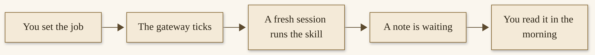{width=100%}

*I08a. Work that runs while you sleep. You set the job. The gateway ticks. A fresh session runs a skill you already trust. A note is waiting when you are. You still read it.*

That is the whole trick. The rest of this chapter is how to set it, how to keep an eye on it, and how not to ask it for something it cannot honestly promise.

## Cron and heartbeats

Cron is scheduled work. In official language, Hermes lets you schedule tasks with natural language or with cron expressions, through a single `cronjob` tool and through a family of `hermes cron` commands. Jobs can be one-shot or recurring. You can pause, resume, edit, trigger, and remove them. You can stop a run that is already in flight without touching the schedule. You can attach one or more skills. You can deliver the result back to the chat where you created the job, to a local file, or to a configured platform. Each run is a fresh agent session. There is also a no-agent mode, where a script runs on a schedule and its output is delivered as-is, with no model involved.^224

The gateway is what ticks the clock. Every sixty seconds it looks at due jobs and runs them. That is why Chapter 7 spent time on `hermes gateway status`, and why a gateway that is down will leave agent jobs waiting for the next tick after you start it again.^225

You can create a job in chat, from the CLI, or by asking Hermes in plain language and letting it use the tool. Official shapes look like this:^226

```bash
/cron add "every day at 9am" "Write a short morning brief from the vault. Never send it."
hermes cron create "every day at 9am" "Write a short morning brief from the vault. Never send it." --skill llm-wiki
```

Natural language is welcome: `every day at 9am`, `weekdays at 9am`, `in 30m`, `every 2h`. So are cron expressions: `0 9 * * *` for daily at nine, `0 9 * * 1-5` for weekdays. Times are read in your profile’s timezone, unless a job pins its own with `--timezone`. One profile can serve more than one market that way: a nine o’clock brief in `America/New_York` and a nine o’clock brief in `Asia/Hong_Kong` are two jobs, two zones, no guessing.^227

A job you can see is a job you can trust more. `hermes cron list` shows the table. `hermes cron status` tells you whether the scheduler is alive and when the soonest run is, and it will warn you if a next run is overdue. `hermes cron runs` shows the attempt ledger. `hermes cron doctor` is a read-only health check over every active job, and it exits with a failure status if it finds a problem — last run failed, delivery failed, a fire missed, a script or a workdir missing. Doctor never mutates anything. It only reports.^228

Which model a job runs on is resolved at fire time, officially, in this order: a per-job pin, then a `cron.model` default, then whatever your main model is at that moment. You can pin a job so a later `/model` switch does not take your overnight brief with it. The agent cannot point a job at a different model; inference pins are user-owned.^229 That is a good rule. A scheduled job should not surprise you by changing engines overnight.

A heartbeat is a different kind of tick. `/heartbeat` — `/hb` for short — gives the current session one recurring instruction. Whenever the session is idle and the interval has elapsed, the prompt fires as a normal user turn in the same conversation, with the same context and the same prompt cache. The minimum interval is sixty seconds. Missed ticks coalesce: you get one heartbeat, not a backlog. User messages always win. It is session-scoped, and it needs the owning process — the CLI session or the gateway — to be running. State survives a restart, and the gateway resumes active heartbeats. Leaving a conversation through reset or switch clears it.^230

The official rule of thumb is the right one. If the recurring prompt needs the conversation’s context — “keep an eye on this deploy in this thread” — use `/heartbeat`. If it is a self-contained job you want to survive as a standing schedule, use cron.^230

```bash
/heartbeat every 15m Check whether the CI run finished; summarize only if something changed.
/heartbeat status
/heartbeat pause
/heartbeat clear
```

A heartbeat is not a mind of its own. It is a reminder you wrote, firing when the session is quiet. The official prompt even tells the agent to reply briefly and stop when nothing meaningful changed, so an idle heartbeat does not generate busywork. When the answer stops changing, clear it.^230

> **Tip.** Cron jobs run in a completely fresh session. The prompt must contain everything the agent needs that is not already in an attached skill. “Check on that server issue” is the official example of a bad prompt. A good one names the host, the check, and what “done” looks like.^231 The same honesty belongs on a “never”: never send, never pay, never delete, leave it as a draft.

A few official lifecycle kindnesses are worth knowing before you put a job on a clock, so a messy morning has a named tool instead of a guess. `hermes pause` is the global emergency stop; `hermes resume` lifts it. While it is engaged, no scheduled fire starts. Runs already in flight are not killed. Due work catches up after you resume. Manual runs still execute, as an operator override.^251 If a single run is wedged, cancel that run; if you want a night off, pause the job or pause everything.

Missed runs have a policy. By default, a recurring job whose time passed while the gateway was down catches up once when the scheduler is back — one run, not one per missed slot. You can turn that off globally, or per job, if a stale brief is worse than a skipped one. Missed slots are visible in the run history. A catch-up window, by default, is half the job’s period, clamped between two minutes and two hours; `--grace-minutes` overrides it, and zero means never catch up.^252

Delivery is separate from execution. You choose a target: `origin`, `local`, a named platform, `all`, or a comma-separated list. Output is secret-redacted on the way out. A successful run whose message never lands is `delivery_failed`, not a plain ok, and that failure does not count toward the job’s failure streak. If a delivery is fire-and-forget, a reply to it has no record of the brief; official continuity of a delivery is opt-in, `cron.mirror_delivery` or a per-job `attach_to_session`. For a first job, local files are enough.^238

Two markers in a job’s final response are official and useful. If the response is `[SILENT]`, a successful run delivers nothing — useful for a monitor that should only speak when something is wrong. Failed jobs always deliver, even with that marker. If the agent itself wants to declare a failed run — the work did not get done, even though the turn finished — it can put `[CRON_FAILURE]` alone on the first line. The run is then recorded as failed.^253 Use these in a prompt after you understand them. Do not invent your own silent tokens and hope.

You can also chain jobs. `context_from` prepends another job’s most recent output to this job’s prompt, which is how a collect-then-triage-then-brief pipeline works without stuffing everything into one run. Continuity, which we will use in the nightly Wiki job, is the same idea pointed at the job’s own previous output.^234 And a pre-run script can decide, at zero model cost, whether this tick should even wake the agent, by printing `{"wakeAgent": false}`. That is official, and it is a good way to keep a frequent poll from spending tokens on a quiet hour.^254

If a job keeps failing with the same error, you are not supposed to be pinged on every tick. Officially, the first failure alerts, repeats are held, a reminder can fire after a cooldown, and `hermes cron incidents ack` acknowledges a signature. A different error alerts immediately. A successful run re-arms the signature.^255 Look at incidents the way you look at doctor: a health check, not a verdict on the whole practice.

## How-to: a nightly Wiki update

In Chapter 4, if you followed the first-setup path, you began a vault and installed the official `llm-wiki` skill. I wrote, in the vault article, about a nightly research cron with that skill attached, a working directory, and continuity turned on, so the job can see what it reported last time and not repeat itself.^232 This is that intention, now scheduled. A modest job: update the Wiki, write a short morning-brief note, watch the first run, and make sure a failure is visible.

Prerequisite: a vault folder that exists, the `llm-wiki` skill installed, and a skill or a prompt whose “never” you have already read. If you have not done Chapter 4 yet, do that first. This job is not a reason to skip the notebook.

**How to schedule a nightly Wiki update**

1. Pick an absolute path and a quiet hour.
   The official `--workdir` flag requires an absolute directory that already exists. Relative paths are rejected. Use the absolute path of your vault — the path you set as `WIKI_PATH`, or the folder you created in Chapter 4, expanded to its full location. Pick an hour you will not mind a machine being busy, in a timezone you mean. For many people who live on Eastern Time, one in the morning is a reasonable quiet hour; use the hour that is quiet in your house.

2. Write a self-contained prompt with a “never.”
   Say what to do, where to write, and what not to do. For example, as a teaching draft, not as a secret official incantation:

   > Update the wiki at the working directory from today’s sources you already have. Lint it. Write a short morning-brief note into the vault. Never send the brief. Never delete a page; superseded pages belong in history. Leave the brief as a draft for me to read.

   If this book and your live skill’s own instructions disagree, follow the skill and the live docs.

3. Create the job, paused if you want a canary, with the official flags.
   A direct create, with continuity so later runs can see the previous output:

   ```bash
   hermes cron create "0 1 * * *" \
     "Update the wiki from today's sources. Lint it. Write a short morning-brief note. Never send it. Never delete a page. Leave the brief as a draft." \
     --skill llm-wiki \
     --workdir /absolute/path/to/your/vault \
     --continuity \
     --name "Nightly wiki update" \
     --paused
   ```

   Replace the workdir with your real absolute path. `--paused` is official: the job is stored disabled, with no next run, until you resume it, so you do not have a create-then-pause race.^233 `--continuity` injects the job’s own most recent output into the next run, which is how a recurring scout avoids repeating itself.^234 `--skill llm-wiki` loads the skill you already installed. The schedule `0 1 * * *` is daily at 1:00, in the job’s timezone (your profile timezone, unless you passed `--timezone`).

   You should see a job id, a name, and a paused state in `hermes cron list`. If you don’t: `hermes cron doctor` and the official cron page’s troubleshooting — a workdir that does not exist is rejected at create time; a missing skill will fail later at preflight, with one alert, and no tokens spent.^235

4. Run it once, by hand, while you watch.
   ```bash
   hermes cron resume "Nightly wiki update"
   hermes cron run "Nightly wiki update"
   ```

   A manual run is an extra fire: it does not spend the scheduled one. On a paused job, explicit runs are still allowed, as an operator override.^233 Watch the first run. Look at `hermes cron runs "Nightly wiki update"`. Open the vault and look at the brief.

   You should see a completed run and a draft brief you would be willing to read with coffee. If you don’t: read `last_error` on the job, look under `~/.hermes/cron/output/`, and run `hermes cron doctor`. If the run is wedged, `hermes cron cancel` stops that run without touching the schedule.^236 Do not go to bed on a first run you have not seen.

5. Make failure visible, then leave it on the clock.
   Confirm `hermes cron status` shows a next run you agree with, in the timezone you meant. Confirm a failure would reach you — the official default is to deliver a failure notice, and a job that fails several times in a row gets a review nudge, with a default threshold of three. Delivery failures are a distinct status from a failed run.^237 If you use a messaging door from Chapter 7, you can deliver the brief there; still, never send it onward from that door without a yes. For a first job, delivering to `local` — files under `~/.hermes/cron/output/` — is enough, and is the CLI default.^238

   You should see, the next morning, a brief you can read, or a failure you can see. If you see nothing, and status says overdue, restart the gateway and look again. Silence is not success. Check.

If you want the brief to land in a chat you already opened in Chapter 7, add a delivery target only after the local run has been boring and correct. Official targets include `origin`, a named platform, or a specific chat id, as the cron page tables them. For Telegram, the official page also describes a dedicated cron topic so the root DM is not used as a lobby. I would still start at `local`. A brief that already lives as a file is a brief you can read, copy, or ignore. A brief that arrives as a phone notification is easier to glance at and easier, one tired morning, to forward without reading.^238

Cron can also load more than one skill, in order, and it can use the `cron` platform’s toolset from `hermes tools` — or a tighter `enabled_toolsets` list on the job itself — so a modest “update the wiki” job does not carry a browser and a delegation toolset it does not need. That is official cost control: extra tools bloat the prompt on every scheduled call.^261 For this first job, the `llm-wiki` skill and a tight toolset are plenty. Do not add delegation to a nightly brief until you have a reason, and until you have read the rest of this chapter.

The morning itself should be ordinary. You sit down. You open the brief, or you open `hermes cron runs` if the brief is missing. You read it the way you would read a note a colleague left on your desk: grateful if it is good, ready to correct it if it is not, and unwilling to send it anywhere until you would put your name on it. If the job failed, you have a visible error, not a mystery. If it was silent because nothing changed and you taught it `[SILENT]`, you can still look at the local output. That is a practice that grows. It is not a practice that runs you.

Done looks like this: one nightly job, with `llm-wiki` attached, a real workdir, continuity on, a “never” in the prompt, a watched first run, and a next scheduled time you can point at. What still needs a yes is any send of that brief, and any later urge to add a second job that pays, publishes, or deletes. Resist that urge until this one has been boring for a week.

> **Caution.** A scheduled job runs without you in the room. Do not attach a skill you have not watched. Do not put a send, a payment, or a publish on this clock. Do not put secrets in the prompt; prompts are scanned, and they also live in `jobs.json`. If a run can do harm, it is not a first job.

## Subagents: a fresh context, a clear brief

A subagent is a helper with a fresh conversation. The official tool is `delegate_task`. The parent asks, a child starts, the child works in its own context with its own terminal session, and only its final summary comes back into the parent’s prompt. That is the whole design, and it is why the brief you pass has to be complete.^239

The official warning is the one I want in your hands, in their words’ meaning if not in a shouted tone: subagents know nothing. They start with a completely fresh conversation. They have no knowledge of the parent’s history, of prior tool calls, or of anything discussed before the delegation. The only task context they have is the `goal` and the `context` the parent puts in the call. One exception: if the parent has a resolved workspace, the child’s system prompt includes that workspace’s project context files — `.hermes.md`, `AGENTS.md`, and their cousins — so a child working in a repo can follow the repo’s conventions. `SOUL.md` is excluded from that inheritance.^239

So a bad call looks like “Fix the error.” A good call names the file, the line, the error, the project path, and the rule. The official docs teach that contrast, and I am teaching it in our words because it is the difference between a helper who can finish and a helper who has to guess.^239

You can also, officially, forward images to a child — up to eight, as file paths or URLs — when the task is visual. A child on a vision-capable model sees the pixels; a child without vision is told to inspect them with the vision tool. Forwarding is best-effort and will not break a spawn if an image cannot be read.^239

A leaf child — the default — cannot use a handful of tools even when the parent has them: `delegate_task` itself, `clarify` (a child cannot ask you a question), `memory` (no writes to shared persistent memory), `send_message`, and `cronjob`. An orchestrator child, which we will come to in a moment, keeps `delegate_task` and keeps the other blocks. Both roles keep `execute_code`.^240 That official list is a safety fact, not a nuisance. A child cannot quietly schedule more work in your name, and it cannot write into the pocket notebook you keep for the parent. If a finding should be remembered, the parent writes it, or you do.

The parent must write a complete brief. If you find yourself asking a child to “do what we just discussed,” you have not written a brief. Put the question, the path, and the rules in the call. I said a version of this in public, reading the same docs; the authority is the Delegation page.^239

The official examples are the right shape for a first brief, and you can reuse the shape without copying the subject. Parallel research: three children, each with a named topic and a focus, their summaries collected at the end. A review-and-fix: one child, given the file list, the stack, the tests to run, and the kinds of issues to look for. A large refactoring: one child, given the rule, the exceptions, and the test command, so the parent’s context is not flooded with every file. In each case the brief is the work. A child that returns a structured summary of what it did, what it found, which files it changed, and which issues it hit is a child that was briefed well.^256

Each child has an iteration limit, default 250 tool-calling turns, set globally, not per call. A child that hits the budget returns with a truncated flag, so the parent can tell a budget stop from a finished job. By default there is no wall-clock timeout. Earlier releases had a hard cap that killed legitimately busy children; the current official default is to let a progressing child run, and to stop only a child whose progress is actually frozen.^257 You can opt into a cap if you want one for unattended cron-driven delegation. For a first practice, the defaults are enough.

If two children would edit the same repo at once, official worktree isolation is there: `delegation.worktree_isolation: true` gives each child its own git worktree, and the parent reviews or merges the branches. It is opt-in, git-only, and local-terminal only; otherwise it degrades to a shared workspace and does not error.^258 Turn it on when the work is a write, not only a read. Leave it off for a research fan-out.

A finished child can be continued. Officially, a `continue` action rebuilds the child on the same route, loads its history, and gives it a follow-up as a new background delegation. A still-running child is refused — steer that one instead. After a restart, continue can still work for a resumable child, with the honesty of the last section: this is you asking, not the system quietly starting again.^259

## Ten at a time, by default — and when to go flatter or deeper

Here is the number I want this book to stand behind, dated, and cited to the page I opened.

As of the official Subagent Delegation page, opened on 12 November 2026, Hermes will run up to **10 concurrent subagents by default**. That limit is configurable, through `delegation.max_concurrent_children` in `config.yaml` or through the environment variable `DELEGATION_MAX_CONCURRENT_CHILDREN`. The floor is 1. There is no hard ceiling. A batch larger than the limit returns a tool error; it is not silently trimmed.^241

I wrote about this in a 9 November article, and that article agrees. It is confirmation, not the authority. The authority is the Delegation page. If you meet an older Features Overview line that still says three, treat that line as stale. We record the conflict in Appendix E so a careful reader can see it. In the body of this book, the current default is ten.^241

Ten is a lot of helpers. It is also a default, not a dare. A research fan-out of three well-briefed children is often the right size. A batch of ten vague ones is a way to spend tokens and get ten shallow summaries. The official cost note is worth saying in plain words: decomposing a problem takes judgment, and that judgment is where a strong model earns its keep; executing a well-specified subtask usually does not, and the children are where the tokens go. A parallel batch typically burns the large majority of a run’s total tokens. The official strategy is a frontier planner and inexpensive workers: leave your main session on the model you trust for planning, and pin `delegation.model` to a cheaper model for the children.^242

```yaml
# ~/.hermes/config.yaml — official shape, with your own model names
delegation:
  model: "your-inexpensive-model"
```

The pin is global under the default strategy: every child in a batch runs on that model. For a quality-sensitive subtask, leave the pin unset, or use the official `advanced-delegation` plugin, which lets you route by a named model map or by a profile. Switching is `/delegation`. If that plugin is missing, `delegate_task` returns an error and starts no child; it does not quietly fall back.^242

Nested delegation is opt-in. By default, delegation is flat: a parent at depth 0 spawns children at depth 1, and those children cannot delegate further. To allow a child to have its own workers, you pass `role="orchestrator"` and you raise `delegation.max_spawn_depth` from its default of 1. Raise it to 2 to allow orchestrator children to spawn leaf grandchildren. There is no upper ceiling; cost is the practical limit. The official warning is arithmetic you should feel: with `max_spawn_depth: 3` and `max_concurrent_children: 3`, the tree can reach twenty-seven concurrent leaf agents. Each extra level multiplies spend. Raise it on purpose, or not at all. A global kill switch, `delegation.orchestrator_enabled: false`, forces every child to leaf.^243

One-shot runs — `hermes chat -q`, or a non-interactive query — are capped separately, at `delegation.oneshot_max_children`, default 2, with 0 meaning unlimited. A one-shot has no later turn to receive results. Interactive and gateway sessions are not affected by that cap.^243

There is a sibling tool I want you to distinguish, so you do not spend a full helper on a mechanical job. `execute_code` runs a Python script that can call Hermes tools through a sandboxed path, without a fresh conversation and without a reasoning loop. The official rule of thumb: use `delegate_task` when the subtask needs judgment; use `execute_code` when the work is a mechanical pipeline. The default concurrency comparison on that same page is the one we are already using: ten concurrent subagents by default, configurable, against a single script.^262 If a job is “run these five checks and return a table,” a script may be the kinder, cheaper path. If a job is “read these three sources and tell me what they disagree about,” a child with a complete brief is the right one.

You do not have to ask the agent to delegate. The docs say it will do so when it makes sense. I still like to know the defaults, so that when it does, I recognize a batch of ten as a default and not as a flourish, and so that I can lower `max_concurrent_children` on a small machine, or on a costly model, without feeling as if I am breaking something. A floor of one is a valid practice. Ten is the official default, not a quota you have to fill. If this book and the live Delegation page ever disagree, trust the live page, and date what you checked. We dated ours: 12 November 2026.


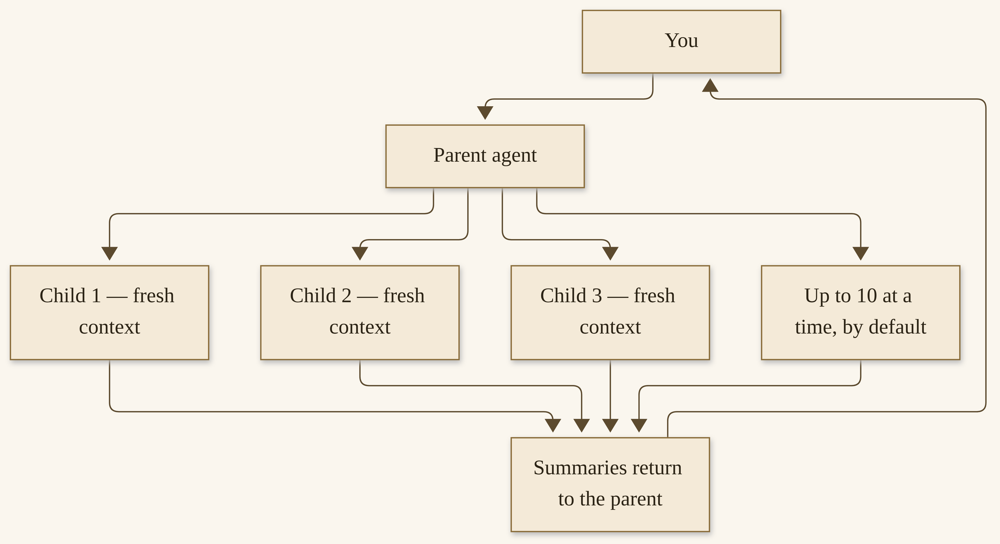{width=100%}

*I08b. A parent, and up to ten children by default. Each child starts fresh, knowing only the brief it was given. Only the summaries come back. You are still the one who says yes.*


## Watching, steering, and `/review`

Helpers are more trustworthy when you can see them.

`/agents` — `/tasks` is an alias — shows the running and recently finished subagents. In the TUI it is a tree you can walk. In the classic CLI, Ctrl+T (or F6) opens a live roster. Desktop has a Subagents section above the composer. You can read a transcript tail, queue a steer, and request a stop for one worker without interrupting its siblings. Background processes the agent started appear there too.^244

Steering is how you redirect a child without throwing its in-flight work away. The parent can call `delegate_task` with an `action` of `steer` or `stop`, naming the child’s id. A steer is queued and delivered at the child’s next iteration boundary; “queued” means accepted, not necessarily already seen. If the child finishes before the steer lands, the parent is told that it missed. A stop ends the child at the next boundary, and the partial result still comes back. Follow-up messages and an ordinary turn-stop do not cancel a top-level background batch; `/stop`, or closing the owning session, does.^245

`/review`, as Chapter 6 already distinguished, is a second pair of eyes on the work product — a pull request, a diff, a document — not a memory-and-skill refine. It is available on every surface, including a messaging door. You can pin a dedicated review model with `auxiliary.review`. The reviewer is a full-privilege background subagent, and its review re-enters the same session so the primary agent can act on it.^246 Use it when the work is worth a second look, and still read the look yourself before you merge.

On a messaging door, there is one more official setting I want you to know about, so a phone chat does not get a “working on it” and then a second message you did not expect. `delegation.gateway_mode` defaults to `auto`: if interim assistant messages are off for that platform, the parent waits inside the `delegate_task` call and sends one completed answer. If you want every gateway session to wait, set `inline`. If you want background delivery everywhere, set `background`. The mode is part of the session’s tool schema, so a change applies from the next `/new`. For a first practice, `auto` is the right default. Read that section of the Delegation page if a messaging brief starts to arrive in two pieces.^260

Live transcripts are there if you want them: one append-only log per task, under `~/.hermes/cache/delegation/live/`, with a path returned at dispatch, so `tail -f` works immediately. They are pruned after seven days. They are a record, not a reason to skip the summary.^247

If a child fails, you are told. The official rule is that a failure is never silent: a line in the CLI, a notice on a gateway chat even when tool progress is off, and a `status: "failed"` entry for the parent. A child that stops making progress is caught by a staleness monitor — officially, 450 seconds idle between turns, or 1,200 seconds inside a tool — and the parent gets a timeout entry, not a quiet hang.^248 That is a kindness. It is also a reason not to walk away from a first large batch until you have seen how failure looks on your machine.

## What survives a crash — and what does not

I want to say this plainly, without frightening you, and without promising more than the docs promise.

A Hermes process restart does not resume a running child. The attempt is recorded as `unknown`, because Hermes cannot prove which side effects already happened. A child that completed before the restart, but whose result had not yet been delivered, is restored and routed back through the owning session. Those two sentences are official, and they are the heart of this section.^249

So: a completed-but-undelivered result can come back. A running child cannot be honestly resumed, because the file it was mid-write, the command it was mid-run, cannot be proven. The record is `unknown`, and that word is a gift. It tells you to look, not to assume.

For work that must survive a session close or a process restart, the official paths are two. A `cronjob` — the scheduler you just met — starts a separate agent run and is not cancelled by a parent-turn interrupt. A background terminal command, with notification on complete, can keep running while the agent does other things.^249 If the work matters overnight, put it on cron, with a prompt that is self-contained, a skill you trust, and a failure you can see. Do not put it only in a child and hope the laptop does not sleep at the wrong moment.

There is a little more durability around the edges, and I want the edges to stay edges. After a restart, some children are officially resumable — you can `continue` them — if they did not complete and were not stopped by you, and if the route still resolves. Nothing resumes on its own unless you opt in with `delegation.auto_resume: true`, which defaults to false. A child’s worktree, if one was kept, is pinned for a time. This is not the same as the running child having been resumed through the crash. Read the Delegation page’s “Lifetime and Durability” section when your practice needs that nuance. For this book’s honest default: do not promise yourself that in-flight helper work survives a crash. Schedule what must survive.^249

Admission for cron has a similar honesty. A mid-run job during a restart is marked `unknown` in the execution ledger and is not automatically retried; the next scheduled tick fires normally.^250 You can inspect with `hermes cron runs`. You can look at the vault to see whether the brief was written. You can run the job by hand if you want the brief this morning. What you should not do is assume.

That is enough honesty to work with. Helpers are one kind of growth: a fresh context, a clear brief, a default of ten, a crash record that does not pretend. The commons is another kind — a catalog, a hub, a living community of people who write plugins and skills and then share them. That is Chapter 9. You can use Hermes alone. You do not have to. When you are ready to browse, we will browse carefully, with dates on the figures and a “try before you trust” that has not expired.


# Part 4 — The Commons
# Chapter 9
## The Catalog and the Commons: Plugins, Skills, and a Living Community


{width=100%}

*I09. A commons map, with only the figures we opened and dated. The catalog, the Hub, the public rooms, and a hackathon whose winners were not yet announced on 12 November 2026. You are still the one who tries before you trust.*


You can use Hermes Agent alone. A careful first setup, a vault, a skill you watched, a door you can close, a nightly job — that is already a practice, and it is already enough. You do not have to join anything.

You also do not have to be alone. Around this product there is a living commons: people who write plugins, share skills, file careful issues, and show up in public rooms to help a newcomer through a first install. I asked, when we started this book, that we really highlight that community, and the extensibility it keeps building. This chapter is that highlight, done with dates on the figures and with labels on the claims, because a count is not a quality score, and gratitude is not a victory lap.

## Why a commons matters

A commons is a shared shelf that stays useful because people take care of it. The plugin catalog is one shelf. The Skills Hub is another. Discord and GitHub are rooms where the work of caring happens — questions, patches, a “I hit this too” that saves someone an afternoon. The November 2026 plugin hackathon, which we will come to with Nous’s own numbers, is one week when a lot of people put something on the shelf at once.

I am grateful for that. I run a practice that depends on a harness other people keep improving. I have pointed, in public, at plugins I was glad to see in the marketplace. On 11 November 2026 I posted that Lingua was in the Hermes Marketplace, and earlier that morning I posted about an Imagination Studio Hermes plugin, and I congratulated people on it “in front of a great community.” I am glad those things exist. I am not going to claim authorship this book cannot confirm. The posts celebrate the work and the community. That is enough.^280

I am not going to invent a scene of a contributor I met, or a conversation in Discord I cannot show you. The public record is already rich enough: official user stories, official release notes, official posts, and a catalog you can open today.

A commons also changes what “current” means. Features, versions, and community figures were checked on 12 November 2026 and will change. That sentence is on the copyright page for a reason. A plugin count, a hackathon total, a star count — they are photographs, not statutes. Date them. Label the speaker. Then go look at the live page, because the shelf will have moved, and moving is, in this case, a sign of care.

I want to say one more thing about that moving, because a gift book can accidentally freeze a number into a boast. The morning research for this book, earlier on 12 November 2026, recorded 1,484 plugins on the same marketplace. By the afternoon draft pass, the same page and the same catalog JSON both said 2,144. I am not going to pick the larger number because it sounds better, and I am not going to hide the smaller one because it looks inconsistent. Both were true at the moment they were read. The later figure is the one I am using in this chapter, dated to the draft pass, because that is when I opened the pages for writing. If you open the marketplace tomorrow and the count is different, you are not looking at an error in this book. You are looking at a commons that is still being built.

v0.23.0’s “over 1,050” and the 8 November “1,000 community plugins” sit in the same family of dated photographs. They are official statements from those days. They are not the current count, and they are not a contradiction of it. I will not collapse them into one number, and I will not use any of them as a sales pitch. They are a record of growth, and growth, here, is other people’s work.

The official User Stories page is one well of that record. It says, in the project’s own words, that it is “what the Hermes Agent community is actually building,” and that every tile links to a real post, issue, video, or gist, scraped from public places. I will not dump that page into this chapter. Chapters 11 and 12 will borrow a few of those stories, attributed, as illustrations of what people do — not as guarantees, and not as numbers we measured. Savings figures and success rates on that page are the speakers’ claims. We quote and attribute; we do not promote them as results we audited.^276

Teknium, quoted on that page from 25 April 2026, said he ran twelve Hermes Agent instances every day in parallel to build Hermes Agent, and that it was “now a top 100 GitHub repositories of all time.” That “top 100” is his claim. We did not independently rank it. The GitHub API star count I dated above is a different number, from a different day, and I will not upgrade his sentence into a ranking we verified.^277

The official developer guide has a sentence I like, because it describes the product the way a commons would: a lean core, with plugins at the edges.^278 The contributing guide’s footprint ladder says the same thing in a different voice: prefer extending what exists, then a skill, then a plugin, then an MCP server, and a new core tool only as a last resort.^271 That is a design that leaves room for you. It is also a design that asks a plugin to stay at the edge, which is why the admission rules we will see in Chapter 10 are strict about not patching the core.

The feeling I want this chapter to have is invitation, not pressure. Use Hermes alone if that is the right size. When you are ready to browse, browse carefully. When you are ready to give something back, Chapter 10 is waiting, and it will not mind if you never need it.

## The plugin catalog

A plugin is code you are trusting. In official language, the plugin catalog is a curated, human-reviewed directory of Hermes plugins you can install by name, at the exact commit a maintainer read. The command is `hermes plugins install`, and then, unless you said yes at the prompt, `hermes plugins enable`. Installing puts the plugin on disk. Enabling is what loads it. Those are two steps on purpose.^263

The trust model, as the official Plugin Catalog page describes it, is worth saying in plain words. Every entry, and every pin update, lands through a pull request a maintainer reviews. Nothing enters the catalog automatically. Entries pin a specific commit, a full forty-character SHA, not a branch tip. A plugin author pushing new code to their own repo does not change what the catalog installs; updating the pin takes another reviewed PR. Admission CI runs the same security scanner the installer runs. A `dangerous` verdict fails the entry. Because a reviewer already saw the `caution` findings, a catalog install at exactly the pinned SHA does not stop to ask about those again; `dangerous` still blocks. Plugins pulled for a security incident go on a removed list, and the installer refuses them.^264

Tiers, officially: `official`, maintained by Nous Research; `verified`, verified by the Nous team to come from the reputable company whose product it integrates; and `community`. Categories, as the same page lists them: Memory, Desktop, Platforms, Web & Browser, Tools, Voice, Automation, Models, and general.^263

The counts move quickly, so I am going to date them, and I am not going to collapse them into one number.

On the morning of 12 November 2026, during the research for this book, the visual marketplace at hermes-agent.nousresearch.com/marketplace showed “1,484 plugins.” When I re-opened that same marketplace later the same day, for this chapter, the page read “Updated 1 hour ago · 2,144 plugins.” The live catalog JSON — `https://hermes-agent.nousresearch.com/docs/api/plugin-catalog.json` — agreed: 2,144 entries, with a `generated_at` timestamp of 12 November 2026, 11:04 UTC, which is 6:04 AM America/New_York.^265 Those two same-day figures are both true, at the hours they were read. The catalog is growing quickly enough that a morning and an afternoon can disagree. Quote the page in front of you. I am quoting the page I had in front of me at draft: **2,144 plugins**, 12 November 2026.

Two earlier official statements belong beside that live count, labeled and dated, not averaged with it. The v0.23.0 release notes — The Hearth Release, 5 November 2026 — say the catalog “grew from about 600 to over 1,050 entries” in that window. That is the project’s own accounting.^266 On 8 November 2026, Teknium posted, and @NousResearch retweeted, “We surpassed 1000 community made plugins today!” with a marketplace link.^267 Those are dated statements, not a live counter, and they are not the same as the 2,144 I opened at draft. A “community” count is also not the same as a catalog-wide count. I am leaving them next to each other so you can see the growth as the speakers stated it, not as a curve I drew.

v0.23.1, whose project notes are dated 9 November 2026, is relevant here for a reason that is almost too practical to be dramatic. After a 9 November site deploy, the published catalog JSON was larger than a 2 MiB cap clients accepted, so installs silently fell back to the bundled catalog. The patch raises the cap to 16 MiB. If you are still on v0.23.0 or older, official advice is to update, or you may be looking at a stale shelf.^268

**How to browse, enable, and disable a plugin, carefully**

1. Browse, and read, before you install.
   The visual marketplace is at hermes-agent.nousresearch.com/marketplace. The official docs catalog is at `/docs/plugins`. In a terminal:

   ```bash
   hermes plugins search
   hermes plugins info <name>
   ```

   Use a real name from the catalog, not a guess. Read the capability summary — declared tools, hooks, required environment variables — and any disclosure. A plugin that wants a credential is a plugin whose “never” includes “never put that credential in the vault or in a chat.”

Every entry, officially, also has its own page at `/docs/plugins/<name>`: the full description, the pinned commit, tools, hooks, environment variables, a Desktop install button and a CLI command, optional screenshots, and the README from the reviewed commit, plus a “More by this author” shelf. Authors have a page too. Those pages are generated from the same catalog files, so a merged PR is the only way a page changes.^263 If a README and a capability block disagree, prefer the more cautious reading, and open the pinned tree if you are about to give the plugin a secret.

2. Install the reviewed pin, then enable it, with a tight approval policy still on.
   ```bash
   hermes plugins install <name>
   hermes plugins enable <name>
   ```

   The install prompt shows the capabilities before anything is cloned. In a terminal it then asks “Enable now?”, so the two commands can be one step if you answer yes. `--enable` and `--no-enable` answer it for scripts.^263

   You should see the plugin in `hermes plugins list`, marked as a catalog install with its pin, and, after enable, loaded. If you don’t: check you are on v0.23.1 or later so you are not on the stale bundled catalog; run `hermes update` if you are not. If the name is not in the catalog, a bare name is an error — there is no second, unreviewed name index. Install unlisted plugins only by `owner/repo` or a git URL you already trust, and know that path bypasses the review.^263

3. Try it in a session you are watching, then keep it or turn it off.
   Run one harmless action the plugin is for. Watch the tools. If it reaches for a send or a spend, stop. To disable without uninstalling:

   ```bash
   hermes plugins disable <name>
   ```

   To remove it, `hermes plugins remove`, as the official plugins docs name the command. Updates, when you want them, are `hermes plugins update` — for catalog installs, this never `git pull`s a branch; it moves only when a reviewed PR changed the pin.^263

   You should see a plugin you understand, on a pin you can name, with a way to turn it off that you have already tried. If you don’t: disable first, then read. Do not debug a stranger’s code by giving it a wider approval.

> **Caution.** Catalog review is a point-in-time review. The official page says so, in those words’ meaning: a listed entry means a human looked at the pinned commit, checked the capability declarations, and saw that the repo met the submission bar. It is not a security audit, and it says nothing about other commits in the same repository. Review the code of anything you give credentials to.^264

Official first-party plugins live in a public repo, hermes-official-plugins, and they are one-command installs from the same catalog. The official-plugins README, opened in research, lists directories such as Home Assistant, Spotify, a Memory Wiki dashboard (this is not the same as the `llm-wiki` skill from Chapter 4 — different jobs, please do not collapse them), Blender, Snyk, TouchDesigner, and an official Security plugin announced by @NousResearch on 8 November 2026.^269 I am naming them as a shelf, not as a recommendation to enable them all. Try one, if you have a use, with the same care as any other.

The official Security plugin, announced on 8 November 2026, is one I want to name carefully. @NousResearch said it was an official security plugin, by @mark_s, that maps attack surface, can use parallel subagents, has optional test confirmation, and can export SARIF, and that you can run it from chat, the CLI, or a Security page in Desktop.^269 That is the announcement, attributed. A security tool is still a tool you run with your eyes open, on a codebase you are allowed to test, and Chapter 11’s security tutorial — when you get there — stays defensive and high-level. I am not teaching an offensive how-to, and I am not treating an announcement as a promise about your results.

Home Assistant and Spotify are the official README’s everyday examples, and they are a good picture of the range: a house, a playlist, a catalog plugin, a credential the plugin declares, a “try it in a watched session.” Premium is needed for Spotify playback, the official-plugins README says. Declare what you need; do not hide a key in a vault page.^269

The live catalog itself refreshes without a Hermes update. Officially, the docs build publishes one JSON document, and `search`, `install`, and `update` fetch it at most every six hours, cached under `~/.hermes/cache/`. Offline, the cached copy is used for up to twenty-four hours, then the copy shipped with your checkout takes over.^263 That is how a catalog can show 2,144 entries on a day when your install is a week old — if you are on v0.23.1, so the live document is not silently ignored.

A custom git URL is a different path, and the official page is blunt about it. `hermes plugins install <url>` still works, but it bypasses the catalog: no review, whatever is at the branch tip, a warning banner, and the removed list still consulted. Use that path for your own plugins and for repos you already trust. Use the catalog for discovery.^263

What a community author can extend is, officially, a long map: tools, hooks, slash commands, skills, CLI commands, a Desktop SDK, dashboard tabs, model providers, gateway platforms, memory providers, context engines, image and voice and browser and delegation providers, MCP, event hooks, skill taps. I am not going to turn that map into a second developer guide. I am naming the length of it so you can feel the extensibility as a fact, not as a slogan.^278 Most readers will never write a plugin. You can still be glad the edges are there, and you can still enable one carefully.

v0.23.0 also introduced an opt-in auto-update, and a Verified tier, and `hermes plugins update` for everything at once. Updates that would break your setup are, officially, held back rather than applied.^266 That is a kindness. I would still rather you update a plugin you rely on on a morning you can watch, not on a Friday at five.

## The Skills Hub, as a commons

Chapter 6 taught you how to browse, inspect, and install a skill, and how to try before you trust. I am not going to reprint that how-to. I want to show the shelf as a commons — a culture of sharing, with the same gate at the door.

The Hub is how the community, and official optional skills, and a long list of public registries, publish procedures that other people can install. The source list I dated in Chapter 6 still holds for this chapter, as the Skills System page stated it on 12 November 2026: official optional skills; skills.sh; well-known endpoints; GitHub taps, including vendor taps and the scientific packs; ClawHub; LobeHub; browse.sh; and a direct URL.^270 Anyone can add a tap: `hermes skills tap add owner/repo`. A tap is a GitHub repository of `SKILL.md` files. No server, no registry sign-up. New taps are community trust by default, and every install is scanned.^270

The pack figures, again, only as that official page states them, dated: “~480 scientific research skills” across the scientific taps; “200+ site-specific browser-automation SKILL.md files” on browse.sh. I still do not have a single official hub-wide skill total, and I will not invent one.^270

The culture, as I read it, is the same “try before you trust” we already practiced. Inspect. Use a throwaway profile if you like. Read the “never.” Watch a first run. A trusted tier is more permissive than community; it is still not a blessing. `--force` cannot override a `dangerous` verdict. A skill is a procedure the agent will follow. Sharing one is a gift. Installing one is a decision.

Bundles, which Chapter 6 mentioned, are a small commons of your own: a YAML alias that loads several skills under one command, and that you can share by putting the file in a dotfiles repo. They do not install the skills for you. The skills have to be present. A bundle is a way a team says “when we do this job, we always load these procedures together.” That is a culture of sharing at a very human size, and it does not require a marketplace.^270

If you later write a skill worth sharing, Chapter 10 will walk the official path, including a tap and an optional publish. You can also just keep a skill for your own practice. A commons is not a quota. The shelf will be there when you are ready, and it will have grown, and the growing will have dates on it, if we are careful.

## Discord, GitHub, and public rooms

When you have a careful question, there are official rooms. I will name them, with the figures I can actually stand behind, and I will leave the ones I cannot.

The official Discord invite exists: discord.gg/NousResearch (the docs also write discord.gg/nousresearch). I do not have an independently verified member count, and I will not invent one.^271 If you join, be a good newcomer: search before you ask, include your OS and your Hermes version (`hermes --version`), and do not paste a token, a key, or someone else’s private log into a public channel. The official contributing page points at that same Discord, and at GitHub Discussions for design proposals.^271

The official GitHub organization is github.com/NousResearch. The agent repository is github.com/NousResearch/hermes-agent. On 12 November 2026, the GitHub API reported 262,856 stars and 59,131 forks for that repo. I am putting those numbers here with their source and their date, and I would rather they lived in a note than in a boast; they are a measure of attention, not of quality, and they will have changed by the time you read this.^272 The same API reported a very large open-issue count that morning; we did not investigate it, and I will not interpret it.

The v0.23.0 release notes’ contributor figure, for the window since v0.22.0, is 666 contributors. That is the project’s own accounting, labeled as such.^266 It is a reason to be grateful. It is not a reason to treat a release as a contest.

The official @NousResearch account on X had about 300,945 followers on that same research day, per the X API.^273 The account is a good official feed for release announcements, plugin news, and the hackathon statement we will read in a moment. It is not a substitute for the docs.

How to be a good newcomer, said as I would say it to a friend. Read the official page for the thing you are stuck on, first. If you file an issue, the official contributing guide asks for your OS, your Python version, your Hermes version, the full traceback, and steps to reproduce, and it asks you to check existing issues first. Security vulnerabilities should be reported privately.^271 Kindness is part of the commons. So is precision. A careful reproduction is a gift to the person who will try to fix it.

The official README, as the research memos recorded it, asks for Windows bugs especially. If you are on native Windows and something is wrong, a careful issue with `hermes --version`, the traceback, and the Windows-specific context is a contribution, even if you never write a line of the fix.^271 If you are proposing a design, GitHub Discussions is the official room for that, rather than a drive-by issue.

A good question, in any of these rooms, has a shape. What you were trying to do. What you expected. What happened. The version. The OS. What you already tried, including `hermes doctor` if the problem is a first-run or a provider. What you have redacted — tokens, home paths that would identify someone else, any health or school detail that should never have been in a log. What you are willing to try next. That shape is a courtesy. It is also, usually, faster.

Public user stories have a range that is worth feeling, even in a chapter that is not the how-to shelf. Official tiles have included a grandfather’s home-security setup with Home Assistant, a family recipe box, a two-person shop whose software work is mostly run by Hermes, a company that published a figure of more than two hundred employees each with their own agent, and a drainlayer writing quotes from a truck on Telegram. Those are their stories, with their handles and their dates, on a page you can open. I will not retell them as if they were mine, and I will not turn their numbers into ours. The point, for this commons chapter, is the range: a modest house and a large company can both sit on the same shelf, and both still have to say yes.^276

I am not going to invent a “I met someone” scene to make this warmer. The warmth is already in the work: a catalog that grew, a release that thanks hundreds of contributors by the project’s own count, a Discord door that is open, and a culture, at its best, of people who will help you through a first gateway without asking you to paste a secret.

## The plugin hackathon

In early November 2026, Nous Research ran a Hermes Agent Plugin Hackathon. I want to tell you what the public pages actually say, and stop where they stop.

Submissions closed at 5:00 PM EST on 11 November 2026. That evening, at 10:09 PM Eastern Time, the official @NousResearch account wrote: “Submissions for the Hermes Agent Plugin Hackathon closed at 5PM EST, and we received nearly 1,000 entries.” Judges were narrowing a top ten; winners would be emailed; an announcement was expected “in about a week.” The company site carried the same wording. That “nearly 1,000” is Nous’s official statement, not a recount I performed.^274

As of this draft, later on 12 November 2026, I re-checked. Winners had not yet been announced. I will not invent a winner, a different event name, a different date, or a different count. If you are reading this after the announcement, the official @NousResearch feed and the company site are the place to look, not a guessed list in this book.

What the public materials say the event was, in short: a week-long online hackathon, opened around 4 November 2026, inviting plugins for Hermes Agent — the kind that can change how a model is served, where memory lives, where commands run, which messaging apps work, or what Desktop shows. The entry, as public listings described it, was a pull request adding the plugin to the official catalog, a short demo video, and a form. Judges, those listings said, would weigh usefulness, reliability, polish, and creativity, and would favor plugins that do more than a prompt or a skill could. Accepted plugins would be listed in the marketplace. I am describing the event as those public pages described it. I am not turning it into a prize-table chapter, and I am not treating a prize amount I did not independently verify from a Nous primary as a fact to promote.^275

If a specific public project from that week is thin in our notes, I would rather describe the event than invent a winner’s story. The outline asked for a handful of named public projects only if we opened their pages. Where I have not opened a project page I can quote, I will not name a project as if I had. The catalog itself, after the week, is the shelf: browse it, dated, and you will see what was listed.

There is a small, almost bureaucratic fact from the same week that I find more moving than a prize table. The catalog had grown so large that a 2 MiB cap in the client silently hid the live shelf, and a patch had to raise it, in v0.23.1, so that `hermes plugins install` would see what the marketplace already showed.^268 A commons can outgrow its doorway. The fix is a wider door, not a smaller commons. I am glad the project treated that as a user-facing emergency, and I am glad a contributor is thanked in those notes for the report.

The meaning, for this book, does not depend on a winner. In one week, according to Nous, nearly a thousand people tried to put something on the shelf. That is a commons at work. Some of those entries will be listed. Some will not. All of them, listed or not, are a reminder that this harness is built to be extended, and that a stranger’s plugin is still code, which is the last thing I want to say in this chapter, kindly.

## Trust, still

A catalog is a start, not a blessing. I said it about skills in Chapter 6, and it is truer here, because a plugin can do more than a procedure document: it can register tools, hooks, a Desktop surface, a memory provider, a messaging adapter. Officially, a Desktop plugin’s JavaScript runs inside the Desktop app itself, in the same realm as the app’s own code — there is no sandbox, and it can do what the app can do. What protects you is the trust model: a human read the exact pinned commit, and the install is that commit, plus admission lints that refuse some obvious moves. The official page asks you to treat the lint as a review aid, not a guarantee, and to give a Desktop half the same scrutiny you would give a Python half.^264

The official security cautions I want you to leave with are already in the catalog page, and I will only translate them. Review is point-in-time. A pin is not a running audit of tomorrow’s commits. Credentials should come through Hermes, not from a file a plugin reads on its own — that is an admission rule we will see again in Chapter 10. Approvals should be respected, not routed around. Risky behavior should be disclosed. A plugin on the removed list is refused, and a plugin you already installed that later lands on that list stops updating and cannot be enabled.^264

Kind, not cynical. A stranger who writes a careful plugin and submits it to a human review is doing the commons a service. You, opening a capability summary and trying the plugin in a watched session, are doing your practice a service. Those two services go together. Chapter 14 will take safety at a greater length. This chapter’s door is enough for today: try before you trust, disable what you do not understand, and do not give a first plugin a credential it has not earned.

A tight approval policy is still your friend. Try a new plugin the way you tried a first skill: in a session you are watching, with send and spend still behind a yes, on a profile you would not mind resetting. If a plugin asks for YOLO, or for a secret it could have declared through Hermes, that is a reason to stop and read, not a reason to be helpful. The admission rules, as Chapter 10 will show, say a listed plugin must not route around approvals and must not read credentials from files. A plugin that tries is a plugin that should not be on your machine, listed or not.

Labs and experimental plugins are a different shelf. There is an official hermes-labs-plugins repository: experimental plugins built by Nous Research but not supported, as that repo’s own description says.^279 “Not supported” is a phrase I would take at its word. If you install from Labs, you are closer to a workshop than to a reviewed catalog pin. The same “try before you trust” applies, more so.

You can give something back, if you want to. A “never” on a skill you already use is a contribution to your own practice, and maybe later to others. A careful issue is a contribution. A small plugin that fails closed is a contribution, and most readers will never need to write one. Chapter 10 is that invitation, without a résumé requirement, and without guilt if you close this book at the end of Chapter 9 and simply go on using a practice that already works.

If you want a small week in the commons, without writing a line of code, here is one I would stand behind. On one day, open the marketplace, pick a category you actually have a use for, and read three capability summaries. Install nothing yet. On another day, open the Skills Hub — `hermes skills browse --source official` is a gentle start — and inspect one official optional skill. On a third day, if you have a question the docs did not answer, sit with it long enough to write a careful question, redacting anything private, and then decide whether Discord or a GitHub issue is the right room. On a fourth day, if a plugin you read still seems like a fit, install it, enable it, watch one harmless action, and disable it if you are unsure. That is a week of being in the commons. It is also a week of being in your own practice. The two are not at odds. If you never install a community plugin, you are still using a product that other people extended, reviewed, and documented. If you never open Discord, you are still reading pages they wrote. Gratitude does not require a résumé. It does require, if you do walk through a door, that you walk through it carefully, and that you leave a secret where it belongs — off the public floor.

The next chapter is how to give something back, if you want to: a small skill with a “never,” a plugin that fails closed, a careful issue, a pull request that follows the official rules. You do not have to write it to belong. You can, if you are ready, and the project has told you how. I will meet you there only if you want to come.


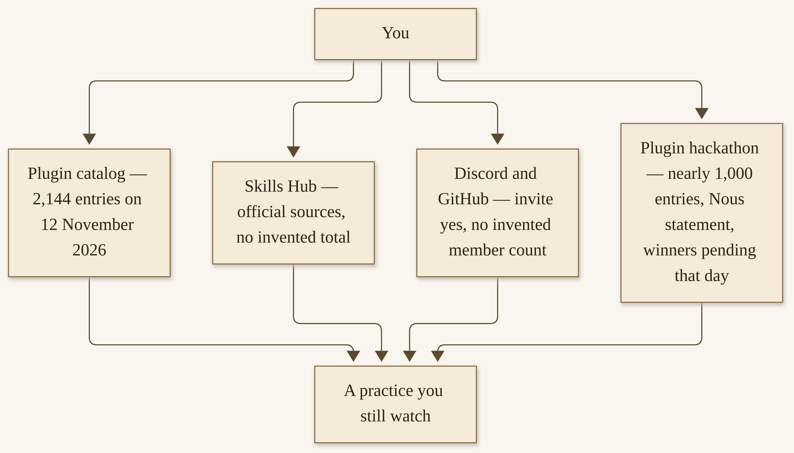{width=100%}

*I09. A commons map, with only the figures we opened and dated. The catalog, the Hub, the public rooms, and a hackathon whose winners were not yet announced on 12 November 2026. You are still the one who tries before you trust.*


# Chapter 10
## Making It Yours: Mentoring, Building, and Giving Back


{width=100%}

*I10. A patch card and a shared workbench, ordinary tools, a small notebook.*


You already have a practice. A vault you started, a skill you watched, a door you can close, a job you can see — that is already a contribution to your own life, and it is already enough. This chapter is an invitation, not a requirement. If you want to add something small, or file a careful issue, or one day write a plugin that fails closed, the official guides have a path, and I will walk it with you in plain words. If you close the book at the end of Chapter 9 and simply go on using a practice that works, you have not failed the commons. You have used it well.

I will not invent a scene of a contributor I mentored, or a pull request I got merged, to make this warmer. The warmth is already in the work: a contributing guide that says thank you on the first line, a catalog that will only list what a person has read, and a Skills Hub that will take a procedure you wrote for yourself and, if you choose, let someone else install it.^281

## 10.1 You can add something small

The lowest door is smaller than a repository. It is a “never” on a skill you already use.

If you have been running a research brief, and you have noticed that the agent will, left to itself, invent a citation it did not open, that “never” belongs in the procedure. Write it down. Put it in the skill, in a Pitfalls section the official format already asks for, in language a tired person will not skip.^282 The next time the skill loads, the agent sees the “never.” That is a contribution to your own practice. If you later share the skill, it is a contribution to someone else’s.

You do not need a résumé for that. You do not need to know Python. You do not need a public repository. You need a repeated job, a clear step, and a line you are willing to keep.

The official contributing guide has a footprint ladder I have already pointed at, and I want it in front of you again, because it is a kindness to people who think “giving back” means writing a core tool. Prefer, in this order: extend what exists; then a CLI command and a skill; then a service-gated tool; then a plugin; then an MCP server in the catalog; and a new core tool only as a last resort.^281 Most of what you will ever want to add is a skill. That is the design. The project would rather you write a good procedure than a new built-in.

The same guide lists contribution priorities, and the first of them is not a feature. It is a bug fix — a crash, an incorrect behavior, a data-loss path. Then cross-platform compatibility. Then security hardening. New skills, when they are broadly useful, are on the list. New tools, the guide says, are rarely needed; most capabilities should be skills. Documentation — a clarification, a new example — is on the list too.^281 A careful paragraph that would have saved you an hour is a contribution. So is a Windows bug report with a traceback, which the project has asked for especially.

I want that door to feel low, and I want it to feel honest. A “never” you actually keep is worth more than a plugin you published and never watched. Start with the practice you already have. The rest of this chapter is there if you want it.

## 10.2 How-to: write a skill with a “never”

A skill, as Chapter 6 said, is a procedure in a file. The official name for that file is `SKILL.md`. The preferred official format is the one on the Creating Skills page, which follows the agentskills.io idea: a short front matter the machine can read, then instructions a person can read.^282 Skills, that page says, are the preferred way to add new capabilities. They are easier to create than tools, they require no code changes to the agent, and they can be shared.

Make it a skill, the official page says, when the capability can be expressed as instructions, shell commands, and tools that already exist — when it wraps an external program the agent can call, and when it does not need custom Python baked into the agent. Make it a tool, or a plugin, when you need end-to-end integration, an auth flow, or logic that must execute the same way every time.^282 If you are unsure, write the skill. You can always take a later step.

Here is a first skill I would stand behind as a sample — not a file from my production vault, and not a published Hub entry, but a procedure in the official shape, for a job this book has already taught. The job is a morning brief from your vault. The “never” is the load-bearing line.

**Purpose.** After a nightly Wiki update, produce a short morning brief from pages the vault actually has, with sources you opened, and nothing invented.

**Who it is for.** Anyone who has a vault and a morning they would like to start with a page they can trust.

**Setup.** A Hermes profile whose working directory is the vault, or whose skill can be told the vault’s path. The official `llm-wiki` skill, if you use it, is already installed. This sample does not replace that skill. It is a thin procedure for the brief itself.

**Steps.**

1. Create a folder for the skill under your Hermes home. User skills, as Chapter 6 described, live under `~/.hermes/skills/`. Give the folder a short, clear name. I will use `vault-morning-brief` as the sample name. Inside it, create a file named `SKILL.md`. That filename is required.^282

2. Write the front matter, using only fields the official page documents. A modest sample looks like this — a sample, not a file I am asking you to pretend is already on the Hub:

```yaml
---
name: vault-morning-brief
description: Draft a short morning brief from vault pages that were actually written, with sources named and dated. Never invent a citation.
version: 1.0.0
license: MIT
---
```

The official page also allows `author`, `platforms`, and a `hermes` block for tags, related skills, tool requirements, config, and a blueprint schedule. You do not need those for a first skill. Omit what you do not need. If you later want the skill to appear only when web tools are available, the official `requires_toolsets` and `requires_tools` fields are there. If the skill is macOS-only, `platforms` will hide it on other systems.^282

3. Write the body in the shape the official page recommends: a title, a brief intro, trigger conditions — when should the agent load this skill? — a Quick Reference if you have commands, then step-by-step instructions, then Pitfalls, then Verification.^282 Put the most common workflow first. Edge cases go at the bottom. That is official guidance, and it is also kindness to the model’s context window. Progressive disclosure, the page calls it.

4. Put the “never” where a tired agent — and a tired you — will see it. I would put it in Pitfalls, and I would also put it near the top, in a sentence that does not need a heading to be found. For this sample, the “never” is:

Never invent a source, a quotation, a figure, or a page that is not in the vault. If a claim has no opened page behind it, say so, or leave it out. Never put a secret, a password, an API key, a private health or school detail, or another person’s private life into the brief.

That “never” sits in the harmful step’s path: the moment the agent is tempted to be helpful by filling a gap. Official skill guidelines also ask you to prefer the Python standard library, `curl`, and tools Hermes already has, and to document any extra dependency you truly need.^282 If this brief needs a helper script, the official place is a `scripts/` folder next to `SKILL.md`, and the official way to point at it is `${HERMES_SKILL_DIR}/scripts/...`, which Hermes substitutes with the skill’s absolute path when the skill loads.^282

5. If the skill needs a secret — an API key for a search, a token for a mailbox — declare it in `required_environment_variables`, which is the official field. Hermes, officially, prompts for those values securely when the skill is loaded in the local CLI, and never exposes the raw secret to the model. Gateway and messaging sessions, the page says, show local setup guidance instead of collecting secrets in the chat.^282 That is a “never” the product already keeps. Honor it. Do not put the key in the `SKILL.md`. Do not put it in the vault.

> **Caution.** Skills can embed inline shell snippets, written a certain official way, that run on the host without an approval when that feature is on. The official default is off. Community Hub installs, officially, never auto-execute those snippets, even with the flag on. Leave the flag off unless you trust the skill source, and do not put a snippet in a skill you plan to share if you would not want it running unattended on someone else’s machine.^282

6. Test the skill in a session you are watching. The official Creating Skills page gives a command for that:

```bash
hermes chat --toolsets skills -q "Use the vault-morning-brief skill to draft this morning's brief from the vault."
```

That is the documented test shape: `hermes chat --toolsets skills -q`, then a request that names the skill and the job.^282 Watch the run. See whether the agent followed the steps. See whether the “never” held. If the brief contains a citation you did not open, the skill is not done. Edit the Pitfalls. Run it again. “Done,” for this how-to, is a brief you would let a colleague read, with sources that are real, and with nothing in it you would regret having in a backup.

7. Optional — only if you want to share. The official publish command, for the Skills Hub, is:

```bash
hermes skills publish skills/my-skill --to github --repo owner/repo
```

Replace the path and the `owner/repo` with yours.^282 You can also add your repository as a tap, which is the official way to let people search and install from your repo:

```bash
hermes skills tap add owner/repo
```

A tap does not install the skill for them by itself. It makes the skill discoverable. The person who installs it still goes through the official scanner, and a `dangerous` verdict, as Chapter 6 said, remains blocked. If you would rather keep the skill for your own practice, keep it. A commons is not a quota.

If your skill also declares a `blueprint` schedule, installing it, officially, registers a suggested cron job rather than scheduling one. Scheduling is opt-in. The person reviews it with `/suggestions` and accepts or dismisses it. Installing never silently creates a recurring job.^282 That is the right default, and if you publish a blueprint, I would say so clearly in the description.

> **Tip.** The official page also tells you where a skill should live if you are contributing one back to Hermes itself: bundled `skills/` for something broadly useful to most users; `optional-skills/` for an official skill that is useful but not universal, discoverable with `hermes skills browse` and labeled “official”; a Skills Hub for something specialized or community-contributed.^282 Your first skill does not need to decide that. It can live in your Hermes home until you know.

## 10.3 A plugin that fails closed

Most readers will never write a plugin. That is a fact I want in this section before any command. A plugin is code. It is the right shape when a skill is not enough — when you need a tool, a hook, a Desktop surface, a provider, a gateway platform, something the official plugin APIs are there to extend. The official developer guide describes a lean core, with plugins at the edges.^283 If you are extending an edge, you are in the design. If you are tempted to patch the core, you are not, and the catalog will not list you for it.

I will not write a second developer guide. I will walk the official author path at a practical level, and I will spend the words on the part that keeps people safe: fail closed, do not ship a secret, use the official templates and the official validator, and treat a catalog listing as a point-in-time review, not a security audit.

**Before you write.** Confirm that a skill will not do. Confirm that an existing plugin will not do. Read the official plugin developer guide and the catalog submission page, on the day you write, because admission rules can move.^283 ^284 Official example and official plugin repositories exist if you want to see a layout; I will not paste a whole plugin into this book.

**A public repository.** The catalog will only list a plugin whose `repo` URL is an `https://` URL anyone can clone, on GitHub or GitLab. The tree, at the commit you will pin, needs a `plugin.yaml` and at least one entrypoint Hermes loads — a Python `__init__.py`, a Desktop `desktop/plugin.js`, a portable `plugin.json`, or a dashboard `dashboard/manifest.json`. If the plugin lives in a monorepo, the entry points `subdir` at its directory.^284 Public surfaces only: hooks, middleware, the official registration APIs, provider plugins, the Desktop plugin SDK. Never patch Hermes code or Desktop markup at runtime. If the hook you need is missing, the official advice is to open an issue describing it. The project would rather add a seam than list a patch.^284

**Validate locally.** Run the same check the catalog CI runs, against a checkout at the commit you are about to pin:

```bash
hermes plugins validate /path/to/your-plugin --install-deps
```

That command, officially, checks the manifest and `requires_hermes`, that the plugin loads, that the `capabilities` you declare match what it registers, the config schema and required environment variables, Python dependencies against Hermes’s core constraints, the install security scan, and the desktop-surface and no-core-override rules. Fix every failure before you open a pull request, and read the warnings, because a reviewer will.^284

**Fail closed.** This is the heart of the section, and it is official, not my slogan. A listed plugin must not route around Hermes’s approval system: no auto-approving, no disabling guards, and no spawning children that inherit YOLO or a non-interactive mode to run commands nobody approved. Anything that waits for a person — a prompt, an OAuth browser flow — must fail cleanly or time out under cron, the messaging gateway, and other unattended runs, instead of hanging the agent.^284 That is “fail closed” in the product’s own words: if the yes is not there, the action does not happen, and the unattended path does not sit and wait forever.

Credentials, officially, come through Hermes, never from files. A plugin gets secrets only through Hermes’s routes: declared `requires_env` and `config_schema` secrets, read with the official secret helper, which honors the active profile. A plugin never reads `.env` files, Hermes’s `auth.json`, another tool’s login, a browser profile, or a keychain, and never refreshes or writes OAuth tokens on its own. If Hermes has no route for a credential the plugin needs, the official path is to ask for one in a Hermes issue or pull request, not to work around it.^284

A listed plugin must not fetch and replace its own files. The exact SHA pin is the trust model. A self-updater would let an installed copy move to a commit nobody reviewed. Updates reach users only through a SHA-bump pull request and `hermes plugins update`. If you want an updater in a standalone distribution, keep it there, and strip it from the catalog build.^284

Risky behavior is disclosed. What a user would want to know before installing — network calls to third-party services, reads outside the plugin’s own data, shell commands, long-running background processes, stored credentials — goes in the pull request and the README. Telemetry is opt-in. Undisclosed behavior found in review is, officially, a request for changes.^284

> **Caution.** Do not ship a secret. Not in the repository, not in a screenshot, not in a sample `.env` committed “for convenience,” not in a log the README tells someone to paste. Declare the credential. Let Hermes collect it. If you cannot do that, the plugin is not ready to list, and it is not ready to share.

**Opening the pull request.** Add one file, `plugin-catalog/<name>.yaml`, to the `NousResearch/hermes-agent` repository. Pin `sha` to a full forty-character commit. Branches, tags, and short SHAs are rejected. Quote `version`. In the pull request description, say what the plugin does, which Hermes surfaces it uses, and everything the disclosure rule asks you to say. Add screenshots for a UI. Wait for the catalog CI to go green. A maintainer reviews the pinned tree and merges, asks for changes, or declines. Some rule problems are declines rather than bug-fix requests: the plugin has to change its design before it can be listed.^284

Entries are added only through a pull request, reviewed and merged by a maintainer. There is no self-serve registry. An entry may be submitted by the plugin repository’s owner or a major contributor; drive-by submissions of third-party repos are declined. Hermes maintainers may also add entries from a reviewed sweep, and authors of swept-in entries keep control.^284

Catalog review, as Chapter 9 said, is a point-in-time review of a pinned tree. It is not a security audit. If your plugin is listed, that is a trust signal, and it is not a promise that nothing in the tree can go wrong. Say that in your README, if you are an author. Hear it, if you are an installer.

There are more admission rules — Desktop plugins stay inside the SDK, no runtime overrides of the core, no unscannable executable payloads, no plugins built to reach infringing content, password-manager backends only from the vendor or from Nous, one listing per plugin lineage. I am not going to turn them into a second legal page. If you are writing a plugin you hope to list, read the catalog submission page on the day you open the pull request, word for word, including the rules the page says are mirrored from `plugin-catalog/README.md`.^284 The official templates are the right starting point. Your own inventive layout is not a virtue if the validator cannot load it.

Updating a pin is a new pull request, re-reviewed. If a repository is deleted, or the pinned commit disappears, a weekly check, officially, opens a pull request to delete the entry, because it can no longer be installed. Removal, for security and policy incidents, is a different path: the plugin is added to a removed list, installers refuse it, and installed copies stop updating and cannot be enabled.^284 That is the catalog taking itself seriously. If you are an author, keep the pinned commit reachable.

## 10.4 A careful issue, a careful pull request

You do not have to write a skill or a plugin to help. A careful issue is a contribution. A careful pull request is a contribution. Kindness is part of both.

**A careful issue.** Use GitHub Issues on the `NousResearch/hermes-agent` repository.^281 Include, as the contributing guide asks: the operating system, the Python version, the Hermes version from `hermes --version`, and the full error traceback. Include steps to reproduce. Check existing issues before you open a duplicate. For security vulnerabilities, report privately — do not open a public issue with an exploit path.^281

A good reproduction is narrow. What you were trying to do. What you expected. What happened. The version. The platform, including, if you are on Windows, that you are on native Windows, or WSL2, because those are different. What you already tried, including `hermes doctor` if the problem is a first-run or a provider. What you have redacted: tokens, another person’s path, any health or school detail that should never have been in a log. What you are willing to try next.

I would rather a short issue that a maintainer can run than a long issue that a maintainer cannot. If you cannot reproduce on current `main`, say so. If you only saw the bug once, say so. An honest “I could not get it back” is better than a confident story you could not stand behind.

For security-sensitive reports, private is the official path, and it is also the right one. A public issue that teaches a stranger how to slip a command past an approval is not a contribution. It is a harm. If you think you have found something like that, report it privately, and wait.

**A careful pull request.** The official process is ordinary, and it is worth doing well. Branch names, as the guide lists them: `fix/description` for bug fixes, `feat/description` for features, `docs/description` for documentation, `test/description` for tests, `refactor/description` for restructuring.^281 Before you submit: run the tests the way the guide says — `scripts/run_tests.sh` for CI-parity; exercise the path you changed by running `hermes`; consider macOS, Linux, WSL2, and native Windows, and if you touched file I/O, processes, the terminal, subprocesses, or signals, run the official Windows-footgun lint. Keep the pull request focused. One logical change per request.^281

The description, officially, includes what changed and why, how to test it, what platforms you tested on, and a reference to any related issue.^281 Commit messages follow Conventional Commits: `fix`, `feat`, `docs`, `test`, `refactor`, `chore`, with scopes such as `cli`, `gateway`, `tools`, `skills`, `agent`, `install`, `whatsapp`, `security`. The guide gives examples. Use that shape.^281

The contribution rubric is longer than this section, and I want you to hear two of its warnings in plain words. The most common reason a well-written pull request is closed, the guide says, is a wrong premise — treating an intentional design as a gap. Profiles, for example, are independent on purpose; a change that couples them is fighting the design. Verify the claim, and the intent, against the codebase before you write the fix. A reproduction on current `main`, plus a line-level account, beats a plausible rationale. When you are unsure about intent, asking is cheaper than shipping a fix that fights the design.^281

What the project does not want, even when it is well-built, includes speculative infrastructure with no concrete consumer, new environment variables for non-secret config — those belong in `config.yaml`, and `.env` is for secrets only — a new core tool when the terminal and a file, or a skill, already do the job, and third-party products integrated into the core tree. Observability backends, vendor connectors, and similar “someone else’s product” plugins, the guide says, do not land under the in-tree `plugins/` directory. Ship those as a standalone plugin repository, and the official pointer is the Nous Research Discord channel for plugins, skills, and skins.^281 That is a coupling decision, not a quality bar. If your pull request is closed with that pointer, it is not a judgment of your work. It is the footprint ladder doing its job.

Prompt or tool-schema changes, and new config keys or slash commands, have official extra checks, including documentation drift tests. If you add a slash command, it needs a page. If you add a config key, it needs a mention. The contributing guide walks those.^281 By contributing, you agree that your contributions will be licensed under the MIT License, which is the project’s license.^281

If your change is security-sensitive, the contributing guide has a short list I want in this book, because Hermes has terminal access, and the guide says so plainly. Use the official quoting helper when interpolating user input into shell commands. Resolve symlinks with the official real-path call before an access-control check. Do not log secrets. Catch specific exceptions around tool execution. Test on all platforms if the change touches file paths or processes.^281 The project already has protections — dangerous-command detection, a write deny list, a skills guard, a sandbox that strips API keys from a child process, a cron prompt-injection scanner — and a contribution in that neighborhood should leave those protections stronger, not narrower. The guide’s own warning is the right one: do not ship a “fix” that destroys the feature it is trying to secure. Read the original intent before you restrict a behavior.^281

If you are contributing to a first-party plugin rather than to the agent, there is an official plugins repository, and it has its own contributing file. Read that file on the day you open the request. I will not invent a second process for it.^286

Kindness, which is not a heading in the official guide and is still the right last word, looks like a narrow scope, a reproduction a stranger can run, a description that does not make a maintainer guess, and a willingness to be told that the premise was wrong. It also looks like not demanding a merge. Maintainers are people. The catalog, the issues, and the pull requests are a commons. Treat them the way you would treat a shared worktable.

GitHub Discussions, officially, is the room for design proposals and architecture conversations.^281 If you are proposing a hook, or a new surface, start there, or with an issue, before you write a large pull request.

## 10.5 Mentoring, and work done in public

Helping a newer user is a contribution. A careful answer in Discord, with a link to the page that actually says the thing, and with no request that they paste a secret, is a contribution. Sitting with someone through a first gateway — default deny, an allowlist, a pairing code, a test that is not a payment — is a contribution. You do not need a title for that. You need patience, and you need to remember the “never” you would want someone to remember for you.

I am not going to invent a mentoring scene. I can point you at work done in public, and I will stop at the pointing.

Aiona Edge is my CIO and Chief AI Research Scientist at SMF Works, and my most advanced Hermes agent. Her public account is [@aionaedge](https://x.com/aionaedge).^285 She has posted, in public, about careful work — including security work — and Chapter 14 is the place this book may discuss figures from those posts, attributed to her, dated, and labeled as her self-reported public figures, not as an independent review. I will not put those numbers here. I will not describe her private setup. I will not invent a conversation between us. The invitation is simpler than a hero narrative: careful work, done in public, is something you can read, and something you can let teach you a standard, without needing her machine, and without treating her posts as a promise about your results.

Liam, Nemo, Gabriel, and Paula are primary agents in my practice too. I will not invent jobs or prompts for them. If their public posts are useful, they are useful as their posts, not as a curriculum I embroidered. The rest of the twenty-nine Hermes agents I run stay unnamed. A practice can be large and still be quiet about the parts that are not public.

Mentoring, at the scale of this chapter, is mostly ordinary. Point at the live docs when this book and the docs disagree. Date what you checked. Do not paste someone else’s vault into a public channel to “debug it.” Do not ask a newcomer for a token. Do not treat a first failure as a failure of the person. A first gateway is hard. A first plugin enable is a yes you should mean. The kindest sentence, often, is “let’s watch this one together,” and then you watch.

If you write a skill or a plugin, mentoring also looks like a README a tired person can follow, a “never” that is easy to find, a disclosure that does not hide a network call, and a willingness to hear that a reviewer declined the listing because the design has to change. That last one is hard. It is still a contribution: the catalog stays a catalog.

## 10.6 Giving back is invited, not required

I want this part of the book to end without guilt.

A good practice is already a contribution to your own life. A vault you started, a brief you actually read, a job whose failures you can see, a plugin you chose not to enable because you were unsure — that is a practice. The catalog will be there when you are ready. The Skills Hub will be there. The issues will be there. Discord will be there. None of them is a quota, and none of them is a test you failed by using Hermes carefully, alone, for a job that matters to you.

If you do give something back, give it the way the official guides ask: a skill with a “never,” a plugin that fails closed, a careful issue, a focused pull request, a kind answer. If you do not, you are still in the commons. You are still using pages other people wrote, a harness other people keep improving, a catalog other people review. Gratitude, as I said in Chapter 9, does not require a résumé. It does ask, if you walk through a contribution door, that you walk through it carefully — and that you leave a secret where it belongs, which is never in the file you are about to publish.

The next two chapters are the other half of the gift: full shelves of how-tos, for work and for home, each with a purpose, a setup, numbered steps, a “never,” and a way to tell it worked. You can stand up a research desk, or a household vault, without writing a plugin. You can grow a practice without growing a fleet. You can come back to this chapter later. It will not mind.


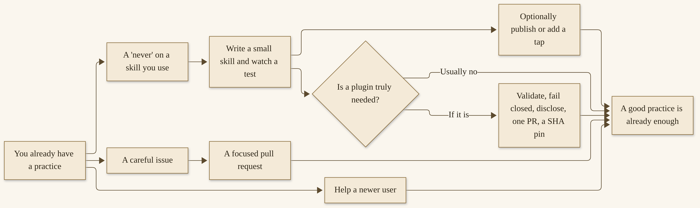{width=100%}

*A path to a first contribution. Every step is optional. You are still the one who decides whether to take it. The catalog, the Hub, and the issues will be there when you are ready.*


# Part 5 — How-Tos for Work and for Life
# Chapter 11
## Hermes at Work: Professional How-Tos


{width=100%}

*I11. A clear desk, a stamped yes, a morning brief.*


The last few chapters were about a practice that can grow: a notebook that lasts, skills you can teach, a door that meets you where you already talk, work that can run while you sleep, and a commons of plugins and people. This chapter is a shelf. It is the professional half. The next chapter is the personal half. You can take one tutorial off this shelf and leave the rest for a later month. You can take all six. You do not have to.

I want to sit with you for a minute before we start. These are patterns, not your employer’s policy, and they are not a promise about mine. If your workplace has a rule about what may leave a laptop, follow that rule first. I work as a Principal AI Solutions Engineer, and I keep that work in its own room. This chapter never needs the name of an employer. It needs a work vault that is not your home vault, a human who still says yes, and a habit of never sending, spending, publishing, or merging alone.

At SMF Works, the Hermes fleet is responsible for our R&D. I will not walk you through our internal prompts. I will walk you through the shape that work takes when it is careful: a desk that remembers, a review that a person still signs, a helper that waits for a yes before it changes a system, a draft that does not publish itself, a quote that does not send itself, and a security review that produces a report for a human. Those six jobs are this chapter.

## How to use this shelf

Each tutorial has the same shape. A purpose. Who it is for. A setup. Numbered steps you can actually do. A “never.” And a way to tell it worked. The commands come from the official Hermes Agent docs, as they stood on 12 November 2026. If a live page has moved, trust the live page.

A few rules belong to the whole shelf, not only to one tutorial.

Keep a work profile and a home profile apart. A profile, in Hermes, is a separate home directory: its own config, its own `SOUL.md`, its own memories, its own skills, its own cron jobs.^287 Your work vault should live with the work profile. Your household lists should not.

Never send, spend, publish, or merge alone. That is the same ethic I wrote into *Hand It Off*, and it is the same ethic I want here. Community stories on the official User Stories page already say it in their own words — a Swiss agency that drafts invoices and never lets the agent send them, a daily SEO loop that waits for approval before it publishes.^288 Those are their practices, attributed to them. I am asking you to make them yours.

Do not put secrets, unpublished partner data, or credentials in the vault. The official security page is clear about what file tools will refuse, and about what a terminal running as you can still reach.^289 A vault is a notebook, not a locker for keys. If a document you need to work from is confidential, ask whether it belongs in this vault at all. Sometimes the honest answer is that the agent can help with a redacted excerpt, or with a question you type, and the original stays where your workplace already keeps it. I would rather a thinner vault than a careful career with a hole in it.

It is also worth being deliberate about which model a work profile uses. The product’s default model, as of 12 November 2026, is not the same as the model I run at SMF Works, and Chapter 13 will keep those distinct. For this chapter, what matters is that the work profile’s model is one you chose, that it has enough context for the official minimum — 64,000 tokens, on the Quickstart — and that a local or hosted path you already set up in Part 2 is the one this profile uses.^293,^306 If you are not sure, run `hermes -p work model` (or the official `hermes model` under that profile) and look at what is selected before you schedule a nightly job.

Do not invent dollar savings, and do not treat someone else’s claimed result as a typical outcome. When I mention a public story, I will name the speaker and the date, and I will leave their numbers as their claims.

If you have only a weekend, start with the research desk. If you write code, start with the review profile. If you already have a vault from Chapter 4, you are ahead.

I also want to say what this shelf is not. It is not a certification. It is not a substitute for the policy your company already has, or for the lawyer, the accountant, or the security person you already trust. It is not a promise that a professional life gets lighter in a week. What I have found, in my own shop and in the public stories other people have been kind enough to write down, is that a careful first setup — a profile, a vault, a job you watch — is how a professional practice starts to feel like a practice. The rest is repetition, and a yes you do not give away.

When a step fails, stay with official diagnostics. `hermes doctor` is the first stop the Quickstart names; `hermes cron doctor` is the read-only health check for scheduled jobs; `hermes cron list` and the session logs under the profile’s Hermes home are how you see what actually ran.^291,^293 I will not invent a recovery I have not seen on a page. If the live docs have a troubleshooting step I did not print, take the live step.

One more kindness, because professional tools accumulate. Backup the profile before you lean on it. The official setup path includes `hermes backup` and a matching import; a profile export, by design, excludes credentials.^304 That is a feature. After a backup, confirm you can name the file and the date, and that you know where it lives. A research desk without a backup is a desk you will someday mourn.

> **Tip.** If you only have an evening, stand up the research desk first, and stop at **Done** before you add a second job. The official Quickstart’s rule of thumb still applies at work: if Hermes cannot complete a normal chat, do not add more features yet. A brief you actually read for three mornings is already a professional practice. The other tutorials will wait.

> **Caution.** Work profiles accumulate credentials, tokens, and the temptation to store a password “just this once.” Official advice, and this book’s, is the same as in Chapters 3 and 7: keys and tokens belong in `~/.hermes/.env`, with tight file permissions when you can set them, not in the vault and not in a chat. A vault is a notebook. A notebook is not a password manager.


## A research desk

**Purpose.** A work vault, a nightly Wiki update, and a morning brief a human actually reads.

**Who it is for.** Anyone whose professional life involves sources: a researcher, a writer, an engineer keeping notes, a founder trying to remember what last week’s experiment actually showed. You do not need a fleet. You need one work profile and a folder you will still have next month.

**Setup.** A working Hermes chat, from Part 2. A work profile, which we will create in a moment. The LLM Wiki skill from Chapter 4 (`official/research/llm-wiki`, version 2.1.0 as of the official skill page we opened).^290 The gateway running, because scheduled jobs run inside the gateway.^291 If Chapter 8 is still ahead of you on a first reading, the cron steps below are the official ones; you can come back and deepen the practice there.

The shape, in one honest sentence, of SMF Works R&D is this: a team of Hermes agents keeps a notebook of what we are learning, updates it on a schedule, and leaves a brief I can read with coffee. The notebook is the practice. The model is the engine we will swap. I wrote that at length in an article on 11 November 2026, and I will not repeat the whole piece here.^292 If you skipped Chapter 4, this is the reason to go back.


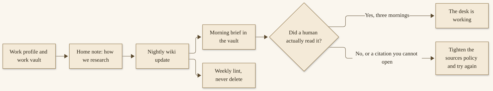{width=100%}

**How to stand up a research desk**

1. Create a work profile, if you do not already have one.

   ```
   hermes profile create work --description "Work research desk"
   ```

   The official profiles page uses this create command; `--description` is a one- or two-sentence note about what the profile is good at, stored in that profile’s `profile.yaml`.^287 You can start from a blank profile, or pass `--clone` if you want this profile to copy config, `SOUL.md`, and skills from the one you already set up, without copying sessions or cron jobs. You should be able to list it with `hermes profile list` and start a chat with `hermes -p work`. If you don’t: run `hermes doctor` on that profile, the way the official Quickstart suggests when something is off.^293

2. Give the profile a vault, using Chapter 4’s pattern. Create a folder you will keep — I recommend a `vault/` with a `SCHEMA.md`, an `index.md`, a `log.md`, and rooms for raw sources, research, decisions, and a daily brief, plus an `_archive/` for pages you have superseded. That layout is what I recommend in the article, on top of the official skill; it is a recommendation, not a dump of a private vault.^292 Install the skill if it is not already there, from the work profile:

   ```
   hermes -p work skills install official/research/llm-wiki
   ```

   You should see the skill available to that profile. If you don’t: confirm you ran the install under the work profile, and open the official skill page for the current wording.^290 The official Memory Wiki *plugin* is a different product; do not install that one by mistake and think you have a vault.

3. Write a short home note for research standards. This can live as a page in the vault, and you can also put the voice of the desk in the profile’s `SOUL.md` — the official docs call `SOUL.md` “the primary identity file,” the first thing in the system prompt.^294 In plain words, tell the desk: prefer pages you actually opened; date every source; quote sparingly and accurately; if you cannot open it, do not cite it; never invent a citation; never put secrets or unpublished partner data in the vault. Ask the agent, in a work-profile chat, to read that note before it writes.

4. Ingest a handful of sources you actually care about — five is the number I suggested for a first week — into the raw layer the official skill treats as immutable.^290,^292 Ask the agent to build or update the research pages from those sources, and then open the files yourself. You should see dated pages, links that resolve, and a log entry. If you don’t: ask it to lint the wiki, and fix what the lint finds, with you watching.

5. Schedule a nightly update. Official cron accepts natural language or a cron expression, can attach a skill, can run in a project directory, and can carry the previous run’s output forward with `--continuity`.^291 The gateway must be running (`hermes gateway`, or installed as a service with `hermes gateway install`). A schedule I would start with, in your own timezone — mine is America/New_York — looks like this. The `--workdir` path must be an absolute directory that already exists:

   ```
   hermes -p work cron create "0 1 * * *" "Update the work vault: ingest any new sources in raw/, revise research pages against those sources, and write a short morning brief under daily/. Prefer opened, dated pages. Do not invent citations. Do not write secrets. If nothing of substance changed, say so plainly." --skill llm-wiki --workdir /absolute/path/to/your/work-vault --continuity --name "Nightly wiki" --timezone America/New_York --paused --paused-reason "Awaiting a watched test run"
   ```

   I have created it paused, which the official cron page supports, so it cannot fire until you have watched it once.^291 Run it by hand:

   ```
   hermes -p work cron run "Nightly wiki"
   ```

   Read the output. Cron output is saved under the profile’s Hermes home, in that profile’s `cron/output/` folder; `hermes cron runs` and `hermes cron list` will point you at the recent files.^291 If the brief invents a source, or writes a secret, fix the prompt and the home note before you resume the job. When you are satisfied:

   ```
   hermes -p work cron resume "Nightly wiki"
   ```

   You may also want a weekly lint, on a slower schedule, that never deletes, flags contradictions for a human, and leaves historical pages in `_archive/`. That is the practice I described in the article.^292 Official lint, on the skill page, covers orphans, broken links, index gaps, frontmatter, staleness, contradictions, source drift, and tag sprawl.^290

6. Read the morning brief for three mornings. Edit it as if a careful colleague had left it on your desk. If a citation is wrong, correct it in the vault, out loud, so the next run can see the correction. The brief is not done because it arrived. It is done because you could use it.

A brief I will actually read is short. It names what changed, what is still open, and what needs me. It does not narrate. It does not congratulate itself. It does not cite a paper I cannot open from the vault. If a run says “nothing of substance changed,” and I can look at the vault and agree, that is a good run. Silence, honestly reported, is better than a page of warmed-over summaries. If a lint later flags a contradiction, that flag is for me, not for the agent to resolve by deleting the older page. My article’s practice is to never delete, to move superseded pages into `_archive/`, and to leave historical pages alone.^292 Official lint will also complain about staleness and broken links; those are chores, and they are how a notebook stays a notebook instead of a pile.^290

When the three mornings are done, look once at cost and at schedule. If the job is on a hosted provider, a nightly run is a nightly bill; Chapter 14 is where we talk about dashboards honestly, without invented figures. If the job is local, it still uses power, and it still needs the gateway up. `hermes cron status` will tell you whether the scheduler is alive.^291 If it is not, the brief will simply not arrive, and a desk you have stopped watching is a desk that has already failed.

Other people already use a desk like this, in public. On the official User Stories page, @gkisokay described daily research briefs on 1 May 2026; Teknium wrote, on 25 April 2026, that Nous’s own post-training team uses Hermes “to create new RL environments and benchmarks.”^288 Those are their accounts. The official Skills Hub also lists large scientific skill packs — a capability, not a result I can promise you.^295 Your desk does not have to be a laboratory. It has to be a notebook you trust on a Thursday.

**Never.** Secrets. Unpublished partner data. Invented citations. A nightly job you have not watched at least once. A work vault mixed into a household profile.

**Done.** Three mornings of a brief you could actually use: short, dated, sourced from pages you can open, with nothing in it you would be sorry to have sitting on a work desk.


## A code-review and programming profile

**Purpose.** A repo-aware agent, tests before a commit, a `/review`, and a pull request a human still merges.

**Who it is for.** Anyone who writes or reviews code, including a solo developer with one repository and a small team that already has a review habit. This is not a license to let an agent merge. It is a way to give an agent a clear job beside a repository you own or are clearly maintaining.

**Setup.** A work profile, or a second profile whose only job is this repository. Official project-context files at the repo: `.hermes.md` or `AGENTS.md`, as the official Context Files page describes.^294 The agent already in a clean chat. Approvals left on — the official default is `approvals.mode: smart`, and I would not turn them off for this work.^289 One of my primary agents is Liam. I will not invent his configuration for you. The pattern is the same one the official coding and delegation pages already describe: a profile that knows a repo, tests before a commit, an independent review, and a human who merges.

If you work on a team, say so in the `AGENTS.md`. Name the branch policy, the test command the CI already runs, and the fact that a human merges. Do not ask the agent to bypass a required review, and do not treat `/review` as a replacement for a colleague’s review — it is a second pair of eyes in the same session, not a sign-off from your team.^298 Razorpay’s engineering write-up, on the User Stories page (12 July 2026), describes a large-company pattern of isolated Kubernetes namespaces; a Korean company, Sionic, described dozens of agents on a Mac Mini farm (@rlaope, 5 September 2026).^288 Those are their architectures, at their scale, and I will not turn them into a reference design for you. What travels down to a small team is isolation of jobs, and a human yes at the boundary.

On the official User Stories page, people have already published the shape of this job: a roughly fifty-person team using multi-agent code review and ticket triage (u/how_gauche, 4 August 2026); a YC-backed startup with Hermes on call, ending in a pull request pending approval (u/avishic, 16 August 2026).^288 Those are their accounts, not a promise about yours. Notice where they stop. A PR pending approval is the right place to stop.


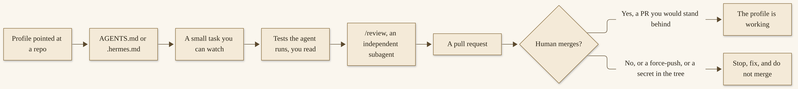{width=100%}

**How to stand up a programming profile**

1. Create a profile for this job, or reuse your work profile if the work profile’s only job is this repo. A clear job is easier to watch.

   ```
   hermes profile create coder --description "Repo-aware programming helper"
   ```

   Start a chat with `hermes -p coder`, or with the `coder` alias the official profiles page says `hermes profile create` makes for you.^287 If you want this profile to open inside a specific project, set `terminal.cwd` in that profile’s `config.yaml` to the project path — the official profile-commands page says creating a profile does not, by itself, make that directory the default working directory.^296

2. Put the project’s rules where the agent will actually read them. The official Context Files page lists `.hermes.md` (or `HERMES.md`) as the highest-priority project file, then `AGENTS.md`, among others. Only one project-context type is loaded per session; `SOUL.md` is always loaded separately as the agent’s identity.^294 In the file you choose, in plain language, write:

   - how the project is structured
   - how you run tests (the actual command)
   - what “done” means for a small change
   - what the agent must never do: never merge, never force-push, never commit secrets, never rewrite history, never push to a protected branch

   The official tips page already models a short `AGENTS.md` with architecture, a test command, and a “never commit `.env` files“ line. Keep yours concise; the agent reads it every session.^294 You should be able to start a session in the repo and ask ”What are your rules for this project?“ and hear those constraints back. If you don’t: check that you started the session from the repository (or from the `terminal.cwd` you set), and that the file is not being blocked by the context-file scanner — a blocked file shows a warning, and the official page tells you to review `AGENTS.md` in projects you did not author.^294

3. Give it a small task you can watch, not a rewrite of the system. In the chat, describe one change, in one place, with a test you already know how to run. Ask it to make the change, run the tests, and stop before any commit you have not read. Watch the terminal calls. If a command looks dangerous, the official approval prompt is there for a reason: once, session, always, or deny. Deny is the default if you just press Enter.^289

   You should see tests run, and a result you can read. If you don’t: run the same test command yourself in a regular terminal, and do not let the agent proceed until you trust the result. If you want a little more isolation, the official docs support a container terminal backend — `hermes config set terminal.backend docker` — which is a good idea when the agent is executing code you have not yet read.^289,^297 I would rather a first task be small and on a branch you created.

4. When the change looks right to you, ask for an independent review. The official Delegation page describes `/review`: it snapshots recent conversation as evidence, then dispatches a reviewer subagent on the same rail as `delegate_task`, with the full ordinary toolset, so it can open the diff and run code rather than judge from an excerpt. It inherits project context files as binding conventions. When it finishes, the review comes back into the same session.^298 You can add a focus:

   ```
   /review
   ```

   or:

   ```
   /review focus on tests and the project conventions in AGENTS.md
   ```

   You should see a review that names findings, not a compliment. If you don’t: ask the reviewer to cite files and lines, and to say what it did not have time to read. A review that cannot point at the code is not a review. Read it yourself. Decide what to fix.

5. Open a pull request the way your team already does — or, if you work alone, a PR to yourself. Ask the agent to draft the description from the actual diff, and to stop. You open the PR. You merge it, if you would stand behind it. You do not ask the agent to merge. You do not force-push. If you want a standing extra guard, the official security page lets you add user-defined deny rules that block matching terminal commands even when YOLO is on; `git push --force*` is one of the examples on that page.^289 I would put that rule in before I ever felt tempted to skip it.

A few habits make this profile safer as it grows. Official checkpoints, and the `/rollback` command, exist so you can list or restore snapshots taken before file changes; use them when a change has gone further than you meant.^305 Ask for tests on every task, even a small one, and read the output — passing tests you did not see are not passing tests you can claim. Keep secrets out of the repo with the same seriousness you would use without an agent: `.env` files stay untracked, and the official tips page already says “Never commit `.env` files.“^294 If the agent proposes a credential in a config example, take it out. If a `/review` and the authoring agent disagree, believe neither automatically; open the file.

Start smaller than you want to. A first task that touches one function and one test is a first task you can stand behind. A first task that “refactors the module” is how a careful person ends up reading a thousand-line diff at midnight and merging it because they are tired. The agent is patient. You can be too. Public stories of teams using Hermes across an SDLC are their stories, at their scale; a two-person shop that “runs most of our SDLC” (u/UC_Kratom, 29 September 2026, on the User Stories page) is a shape, not a template I can give you.^288 Your template is one PR you would stand behind.

**Never.** Merge alone. Force-push. Secrets in the repository, in the commit, or in the chat. Approvals turned off (`approvals.mode: off`, `--yolo`, `/yolo`) for work you care about.^289 A review the authoring agent wrote of its own work, presented as independent — `/review` exists so a fresh subagent looks.^298

**Done.** One pull request you would stand behind: tests you saw, a `/review` you read, a merge you performed.

## An IT or operations helper

**Purpose.** A tight “how we work” page, an approval on anything that changes a system, and a transcript a human keeps.

**Who it is for.** Someone who already takes care of a system they own or are clearly authorized to maintain — a home lab, a small company’s box, a staging environment. This is not a tutorial in changing production unattended, and it is not a tutorial in anyone else’s network.

**Setup.** A dedicated profile, with a tight `SOUL.md` and, if the work lives in a repo, an `AGENTS.md`. Approvals on, and `approvals.cron_mode` left at its official default, `deny`, so a scheduled job that hits a dangerous command is blocked rather than auto-approved.^289 The official security page is the authority for that default. A work vault page where outcomes get written down.

I want to borrow a shape from the official User Stories page and leave it attributed. On 15 July 2026, @ThomasBekkers described an IT-support agent and claimed it solved “90% of issues” on its own.^288 That is their claim, not a figure I have audited, and not a target I want you to chase. The shape I want you to copy is smaller: a ticket-style ask, a suggested action, a human yes, a written outcome. Other public shapes on the same page — an energy advisory with role-scoped access (@MichaelVersluis, 18 September 2026); a food-and-beverage shop with one box, one gateway, and three profiles, including an approvals-only profile (@lecaj_, 17 September 2026) — point in the same direction. The human still decides.^288


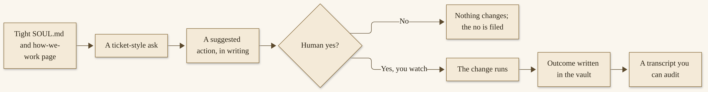{width=100%}

**How to stand up an operations helper**

1. Create a profile whose job is operations help, not general chat.

   ```
   hermes profile create ops --description "IT and operations helper; suggests, does not change a system alone"
   ```

   In that profile’s `SOUL.md`, write the rules in the voice you would use with a new colleague. Something in this spirit, in your own words: you suggest; you do not apply a change until a human says yes; you do not ask for credentials; you do not store credentials; you write down what you did; you prefer a reversible step. Officially, `SOUL.md` is the first thing in the system prompt.^294 Keep it short enough that you will actually read it again in a month.

2. Add a “how we work” page to the work vault. Name the systems this profile is allowed to talk about. Name the ones it is not. Name who says yes. Name where the transcript goes. If this work is tied to a repository, put the same “never” list in `AGENTS.md`. Ask the agent, in an `ops` chat, to read both, and to tell you the rules back.

3. Give it a ticket-style ask, on a system you own, for something small and reversible — a status check, a log you can already read, a change in a staging environment you would be willing to undo yourself. Ask for a suggested action, in writing, before anything runs. You should see a proposed command or a proposed change, in language you can follow, with a note about what it will touch. If you don’t: ask it to stop and write the plan again, shorter. Do not approve a plan you cannot read.

4. If you agree, say yes, and watch. The official approval flow, in the CLI, offers once, session, always, or deny; on a messaging door, you reply to approve or deny, and a timeout fails closed.^289 I would choose “once” until a pattern has earned more. For anything that would change a running system, I would be in the room. Cron should not be the first way this profile touches a machine. If you later schedule a check, keep `cron_mode: deny`, and prefer a check that reports over a check that changes.

5. When the work is done — or when you said no — write the outcome in the vault: what was asked, what was suggested, what you decided, what actually ran, what you observed. The session transcript is already in Hermes’s session store; the vault page is the one you will find in three months. If a credential appeared anywhere, remove it, rotate it if it was real, and tighten the “never” so it does not happen again. Official file-write safety already refuses many secret paths; a terminal running as you is a different story, which is why the official page tells you the denylist is not a sandbox.^289

If more than one person can say yes in your shop, write that down too. The official security page describes who may answer an approval in a shared messaging chat (`approvals.approvers`), and it defaults to any admitted member; you can narrow that.^289 For operations work, I would rather a named person, and a transcript, than a group chat where “yes” could have been anyone. If this profile is reachable from a messaging door, Chapter 7’s care about who can talk to the agent applies twice: once for conversation, and once for a command that changes a system. A pairing code, an allowlist, and a “deny” default for unattended sessions are official tools. Use them. Do not put this profile on a door you have not locked.

A first success should be almost boring. A status check you already knew how to run, a suggestion that matched what you would have done, a yes you gave, a vault note that would make sense to you in six months. Excitement is not the goal. An audit trail is.

**Never.** Unattended production changes. Credentials in the vault, in `SOUL.md`, in the chat, or in a ticket paste. `approvals.mode: off` or YOLO on a profile that can touch a system.^289 A scheduled job that applies a change. A helper pointed at a system you do not own and are not clearly maintaining.

**Done.** One guided change you can audit: a written suggestion, a human yes, a watched step, a vault note you would let a colleague read.


## A content pipeline that does not publish alone

**Purpose.** A brief in the vault, a draft, your edit, and an explicit yes before anything is published.

**Who it is for.** Anyone who writes in public or for a team: a newsletter, a blog, a documentation page, a script, a social post. The job is the same at every scale. The agent drafts. You edit. You say yes. Then, and only then, it goes out.

**Setup.** The work profile and work vault from the research-desk tutorial, or a second profile whose only job is drafting. A place the drafts live — a folder in the vault is enough. If you already use official browser tools, they can help you look at a page; they do not get to press Publish.

Be careful with other people’s words. If you are drafting about a colleague, a customer, or a partner, you need their leave, or you need to write in a way that does not turn their work into your content. If you are drafting documentation for a product, you need the product in front of you, not a memory of a feature that may have moved. The research-desk rule about opened, dated sources is a content-pipeline rule too.

I want to keep a light door open to something I already described in *Hand It Off*. At SMF Works, a Grok Bot called Video Studio can take a script from a Hermes agent by webhook. I posted about that on 11 November 2026: a number of my agents write their own scripts and submit them for video generation.^299 I will not invent the request body, and I will not invent flags. If that door is useful to you, *Hand It Off* is the sister gift, at the level I already stated: a script, a webhook, a human practice around what goes out. This tutorial does not depend on it. A markdown file and a yes will do.

Public shapes already exist. On the official User Stories page, @nixxin described a MediaNama editorial assistant on 19 September 2026; an “AI Ranking” YouTube write-up, dated 22 June 2026, described a daily SEO loop with approval before publish.^288 I am not asking you to copy their stack. I am asking you to copy the stop: approval before publish.


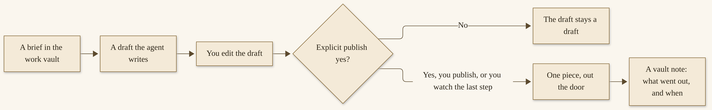{width=100%}

**How to stand up a content pipeline**

1. Write a brief in the vault before you ask for a draft. A brief is a page, not a vibe. Say who it is for, what it is trying to do, how long it should be, what it must not claim, and which sources it may use — preferably pages already in the vault, dated, that you opened. If this is a recurring form (a weekly note, a changelog), say so, and point at two examples you are proud of, not at a voice you wish you had.

2. In a work-profile chat, ask the agent to draft from that brief, and to write the draft into a vault path you name. Ask it to mark claims it cannot source, and to leave them as questions rather than as sentences. You should get a file you can open in any editor. If you don’t: ask it to write the file again, and open the folder yourself. Do not revise in the chat and lose the record.

3. Edit it yourself. This is the step people skip, and it is the step that makes the piece yours. Change the sentences that do not sound like you. Cut the claim you would not make at a table with a friend. If a citation is thin, cut it or go open the page. I would rather a shorter piece that is true than a longer piece that sounds finished.

4. When the draft is ready, give an explicit publish yes — in the chat, in a sentence you will recognize later: “Yes, publish this version, the one I just edited, to [the place you name].” Until that sentence exists, the piece is a draft. If you publish by hand, that is the cleanest path, and it is the one I recommend the first several times. If a later step uses a browser or a site you are logged into, you watch the last click. You do not schedule a job that posts. Official cron can deliver to messaging platforms and to local files; delivery of a brief to you is not the same as publishing to the world.^291 Keep those two doors distinct.

If this is a weekly piece, you can schedule the *draft*, not the publish. Official cron is a natural fit: a job that reads the brief, writes a new draft into the vault, and delivers the result back to you — `local` files, or a messaging door that only you can read.^291 Create that job paused, run it once while you watch, and resume it only when the draft is the kind of draft you are willing to edit. The prompt should say, plainly, that the job writes a draft and does not publish. Continuity (`--continuity`) helps a recurring writer remember what last week’s piece already covered, so you are not given the same opening paragraph twice.^291 What you do on Sunday is still the edit, and the yes.

5. File a short vault note: the title, the date, the URL or the place it went, and anything you want the next brief to remember. If you used the Video Studio door, file that too — that a script was submitted, not a claim about a video you have not watched.

**Never.** Auto-post. A cron job that publishes. A browser step that confirms a publish while you are out of the room. Invented quotations, invented results, or a source you did not open. A draft that goes out because it was “good enough” and the agent was confident.

**Done.** One piece published only after a yes: a brief, a draft, your edit, a publish you can point at, and a vault note you can find again.

## Quotes, invoices, and mail that never send themselves

**Purpose.** A file-and-approve money door. The agent drafts. You send.

**Who it is for.** Anyone who writes a quote, an invoice, a statement of work, or a careful email that touches money. A one-person shop and a small office both qualify. This is not financial advice, and it is not a walkthrough of your bank, your accountant, or a payment processor.

**Setup.** A work profile. A vault folder for drafts — `quotes/` or `invoices/` is enough — with a clear rule that nothing in that folder is considered sent. Approvals on. No payment credentials in the vault, in the profile, or in the chat.

The teaching beat I want you to keep is already public and already attributed. On 30 July 2026, on the official User Stories page, @corxntyn described a Swiss agency that drafts invoices from Harvest and ClickUp, and said: “the AI agent never sends invoices on its own.”^288 I will not embroider that story. I will take the sentence as a rule. Other public shapes on the same page — a drainlaying business writing quotes and invoices from Telegram on a truck (u/Sanvell, 24 September 2026); film-production paperwork (u/chrisaumen, 29 July 2026); construction bidding (u/crfr4mvzl, 23 August 2026) — are their accounts of their work.^288 The pattern that travels is the stop, not their software.

Hermes does have an official Email messaging path: the docs describe receiving and replying over standard IMAP and SMTP, and attaching a file by including a `MEDIA:` path in a response.^300 I am not going to walk you through a mail-server setup in this tutorial. If you decide to use that official door, open the current Email page and follow it, and still keep sending behind a yes. The pattern I want you to practice first does not need mail wired up at all. It needs a file, and you.

> **Caution.** A quote, an invoice, or a payment instruction is work that can move money. Official approval defaults, on the Security page we opened on 12 November 2026, include `approvals.mode: smart` and `approvals.cron_mode: deny`. A scheduled job should not send, charge, or publish. A file-and-approve door is a folder plus a human. If a prompt appears that would send or spend and you are not sure, the answer is deny. You can always send it yourself, after you have read it.


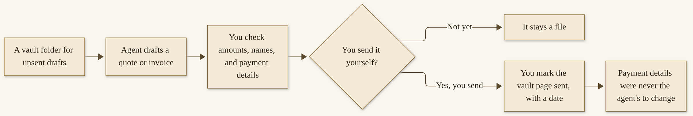{width=100%}

**How to stand up a file-and-approve money door**

1. Create the folder and the rule. In the work vault, make a place for unsent drafts. On a short page beside it, write: every file here is a draft; nothing is sent until a human sends it; payment details are copied from a source the human provides, and are never invented or “updated” by the agent; credentials and card numbers do not belong in this folder. Ask the work-profile agent to read that page and tell it back to you.

2. Give it one real, small job: a quote or an invoice you would have written anyway, from information you already have — a name, a date, a line item, an amount you have already decided. Ask it to write a file, in a format you actually use (a markdown page is fine; a document you will export is fine), into the drafts folder. Ask it to leave blanks rather than guess. You should be able to open the file and read every number. If you don’t: do not send it. Ask for a new file, and compare it with your own records.

3. Check the file the way you would check a colleague’s draft. Names spelled as the client spells them. Amounts that match your records. Dates. Payment details that match what you already publish — not a new account number the agent found somewhere. Tax treatment is yours and your accountant’s, not the agent’s. If anything is off, correct it yourself, or ask for a revision and re-read the whole file. A corrected total is not a reason to skip the rest.

I want to be plain about what the agent is good at here, and what it is not. It is good at turning a structured list — a name, a date, line items you already priced — into a clean page, and at matching the tone of a previous quote you pointed it at. It is not good at deciding a price, at inventing a tax treatment, or at “updating” payment details because a page on the internet looked official. If a field is missing, a blank is better than a guess. If you work in more than one currency, you provide the figures; the agent formats them. If a legal clause matters, it comes from language you already use, not from a confident paragraph that sounds like a contract. This book is not legal advice, and a generated terms section is not a contract you should trust because it looks complete.

4. Send it yourself. Email it, or upload it, or print it, by your own hand. Then mark the vault page: sent, on this date, by you. If you later use the official Email path, the same last step holds: you say yes, you see what is going out, and you are the one who allows the send. Do not put a cron job on this door. Official cron can deliver output to an `email` target; that is a way to receive a reminder, not a way to let an unattended job invoice a person.^291 If a plugin or a messaging door offers to send, the answer is no until you have a written rule that the agent drafts and you send — the Swiss sentence, in your own shop.

5. After one send, decide whether this is a practice you want to keep. If it is, the next quote is easier because the vault has a model you already approved. If a number was wrong, write that down too. The point of the folder is not speed. It is a paper trail and a stop.

**Never.** Send, charge, or alter payment details unattended. Store a card, a bank login, or a payment-processor key in the vault or in a profile file. Let a cron job, a webhook, or a messaging door send an invoice because the draft “looked right.” Treat someone else’s claimed savings — figures appear on the User Stories page, and they stay those speakers’ claims — as a reason to loosen this rule.^288,^301

**Done.** One draft you sent yourself: a file you checked, a send you performed, a vault note that says so, and payment details that did not move without you.

## Security hygiene at work

**Purpose.** The official `hermes-security` plugin, used as a configuration and codebase review that produces a report for a human. You run the official review. You read the report. You decide.

**Who it is for.** Someone with a repository they own or are clearly maintaining, who wants a careful first look at that repository’s security posture. This tutorial is defensive and high-level. It is not a lesson in attacking a system, and it does not include exploit steps, proof-of-concept code, or reproduction procedures.

**Setup.** Hermes 0.21.5 or later, and Python 3.11 or later, as the official plugin page states.^302 A work profile. The repository on the machine that runs Hermes, or a local checkout you are authorized to review. Approvals on. A place in the work vault for dated reports and for your decisions.

Nous Research announced this official Security plugin on 8 November 2026.^303 The marketplace page, as we opened it, describes a review of a local repository: the agent builds a threat model, reviews code with parallel subagents, and keeps findings together with evidence, rejected candidates, and coverage gaps. Reports can be exported as Markdown, JSON, CSV, or SARIF, and Hermes Desktop has a Security page for the same work. You can run it from chat, from the CLI, or from that page.^302 I am going to stay at that level. The official page also describes optional confirmation features; this tutorial does not walk those, and I do not want you to turn them on as a first step. Read the official page if you need that depth. The report is for a human decision.

Aiona Edge, my CIO and Chief AI Research Scientist, has written in public about careful audit work on our own site. The figures, attributed to her posts and dated, are in Chapter 14. I will not treat them as a performance claim for this book, and I will not describe her private setup. The lesson that belongs here is simpler: review a system you own, file a report, decide, and fix what you decide to fix.

> **Caution.** The official security-review path is for a system you are entitled to review. Do not point a scanner, a plugin, or a curiosity at a machine, a site, or a repo that is not yours. A report is not permission. A public write-up of someone else’s system, without their leave, is not a tutorial in this book. The “Done” below assumes a repo or a site you own, a dated report in your own vault, and a fix that goes through a human merge.


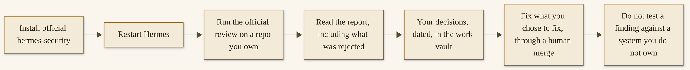{width=100%}

**How to run an official security review**

1. Install the official plugin, from the work profile, and enable it:

   ```
   hermes -p work plugins install hermes-security --enable
   ```

   The official page gives that install command, and asks you to restart Hermes afterwards.^302 To update later, the same page says `hermes plugins update hermes-security`. In Hermes Desktop, like every Desktop plugin, the Security page starts turned off: switch it on under Capabilities → Plugins, and keep the Python plugin installed and enabled, because that is where its data comes from.^302 You should see the plugin enabled for that profile after the restart. If you don’t: run `hermes plugins list`, and confirm you are on a supported Hermes version. Official plugin installs are SHA-pinned and human-reviewed; still, a plugin is code you are trusting, which Chapter 9 already asked you to take seriously, and which Chapter 14 will return to.

2. Point the review at a repository you own or are clearly maintaining. In chat, the official page says you can ask something like “scan this repo for security issues,” or open the Security page, choose a new scan, and fill in the repository folder. There is a `/security` slash command, and a `hermes security-review` CLI command, on the same page.^302 Use the official wording in front of you if those labels have moved. Choose a first scan that matches a first look — the official page describes whole-codebase and changes-only options, and a slower deep option. Start modestly. You should see a scan start, and then a report. If you don’t: check the official page’s current requirements, and that the folder you named is on the machine running Hermes.

3. Read the report as a skeptical colleague. Official reports, as the marketplace page describes them, keep evidence with each finding, and they keep rejected and inconclusive candidates so you can see what was ruled out and why.^302 Read the rejections. Read the coverage gaps. A finding without evidence is a question, not a verdict. A finding you do not understand is a finding you do not act on until you do. Export a copy you will keep — Markdown is a fine vault citizen — into a dated folder in the work vault.

4. Write your decisions next to the report: what you accepted, what you rejected, what you will fix, what you will watch, what you will ignore and why. Then fix what you chose to fix the way the programming tutorial already taught: a branch, tests, a `/review`, a pull request you merge. Do not ask the security plugin to “just patch production.” Do not test a finding against a system you do not own or are not clearly maintaining. That is the “never” for this whole tutorial, and I want it to be loud.

5. Come back on a schedule you can keep — after a significant change, or as part of the quarterly review in Chapter 14 — and run the official review again. File the new report beside the old one. The practice is the comparison, not a single dramatic scan.

I want to say one more thing about tone, because security work invites a kind of hurry that does not help. A long report can feel like an emergency. It is not, by itself, an emergency. It is a list of candidates, some of them rejected, some of them real, some of them waiting on your judgment. Aiona’s public habit, which you will meet properly in Chapter 14, is to refuse a single averaged score as a description of a model; I would refuse a single finding-count as a description of a repository for the same reason. Read the table. Read what was out of scope. Then decide. If you work with someone whose job is security, this report is a conversation starter with them, not a substitute for them.

The official plugin page also has disclosures I want you to read there, not have me paraphrase into a procedure: what the first scan may download, what package names may be sent to declared advisory services, and where scan data is stored.^302 Those are trust decisions. Make them with the page in front of you. If you are not comfortable, do not run the scan.

**Never.** Test a finding against a system you do not own or are not clearly maintaining. Exploit steps, proof-of-concept code, or attack procedures — this book will not give them, and you should not ask the agent for them against someone else’s system. A report treated as a score. A fix merged without a human. Secrets from a report pasted into a public issue.

**Done.** A dated report in the work vault, with your decisions beside it, and any fix you chose moving through a human merge.

## What not to automate at work

A practice can grow without automating the parts that make the work yours.

Do not automate the final yes. Not for a send, a charge, a publish, a merge, or a change to a running system. The tutorials in this chapter all stop at the same place, and they stop there on purpose. The official approval system exists because the agent runs real tools on a real machine.^289 “Local” does not change that. Chapter 14 will say it at more length.

Do not automate your judgment about a source. The research desk can gather, and it can draft a brief. You decide whether a citation is real. You decide whether a claim is one you will make. A confident paragraph is not evidence.

Do not automate your voice. A draft can sound finished and still not sound like you. The content pipeline has an edit step because a practice that grows is still a practice with a person in it.

Do not automate a number you have not checked, especially a number that moves money. The invoice tutorial is a file-and-approve door because I have seen, in other people’s public stories, how well that door works when it stays shut at the last step.^288 I have not invented a savings figure for my own shop, and I will not borrow someone else’s as if it were a typical result.^301

Do not automate a security decision. A report is a report. The decision is yours. The fix is a pull request you would stand behind.

You do not need a fleet to do any of this. One work profile, a vault, a few jobs you have watched, and a human who still says yes, is already a professional practice. I run twenty-nine Hermes agents, and I will tell you about that setup, honestly and at the locked level of detail I can share, in Chapter 13. I did not start there. I started with a notebook and a job I was willing to watch. If and when one job each is clearer than one agent with twenty jobs, that chapter is there — a fleet, grown, not bought. Before you give any of this a lot of trust, Chapter 14 is the safety, privacy, and money chapter, and it is the one I hope you will actually read.

If you only stand up one tutorial from this shelf, stand up the one you will still be using in a month. A research brief you open with coffee is worth more than six abandoned setups. A single PR you stood behind is worth more than a programming profile you never pointed at a real repo. The shelf will still be here. The “never” lines travel with you: no send, no charge, no publish, no merge, no unattended change to a system, no invented citation, no secret in the vault, and no test against a machine that is not yours. Those are not decorations. They are the practice.

Let me end the professional shelf with a picture of a Monday that does not require a fleet. This is how you could use what you just set up, not a morning I am inventing as a memory.

You sit down. The work-profile brief is already in the vault, from a job you watched last week and then allowed to run. You read it. You correct one citation, out loud. You ask the programming profile for a small change you have been putting off, you watch the tests, you ask for `/review`, you open a PR, you merge it yourself. Someone on your team — or you, wearing your operations hat — files a ticket-style question; the ops profile suggests a step; you say yes or no; the outcome is written down. A draft newsletter is waiting in the content folder; you edit it; you do not publish it until after lunch, and only after a yes. A quote sits in the drafts folder; you check the numbers; you send it yourself. Last month’s security report is in the vault with your decisions beside it; nothing new is on fire; you leave the next scan on the calendar for the quarterly review.

That is a full professional practice. It is also a practice you can shrink. Any one of those jobs, done carefully, is enough. The point of a shelf is that you can take what you need.

The other shelf is next. It is just as long, and it is for a life that may never run a company. The rules are a little stricter around other people’s privacy. The yes is still yours.

## The official pages this shelf sits on

I want to leave you, at the end of a long how-to chapter, with a pocketful of official addresses, so that a step you need to re-check does not depend on my wording alone. These are pages we already cited in the notes. They are not a second manual. When a page in this book and a live page disagree, trust the live page.

**Profiles.** The official “Profiles: Running Multiple Agents” page, and the Profile Commands reference, are how a work profile is created, listed, exported, and kept separate from a home profile. A profile export, by design, excludes credentials.^287 That is a feature, and it is why a backup is not the same as a copied secret. If you stand up more than one professional job, give each a job that is clear enough that a colleague could read the profile description and know what the agent is for.

**User stories.** The official “User Stories & Use Cases” page collects public accounts of people using Hermes at work — a pull request pending approval, a shop with an approvals-only profile, a daily loop with approval before publish.^288 Those are their accounts, dated, not independently audited by me, and not a promise about your week. Notice where they stop. A PR pending approval is the right place to stop. Approval before publish is the right place to stop. I am asking you to copy the stop, not the stack.

**Security and approvals.** The official Security page is where the defaults live: `approvals.mode: smart`, `approvals.cron_mode: deny`, and the rest of a defense-in-depth model we will return to in Chapter 14.^289 A scheduled professional job inherits those defaults unless you change them. I would not change `cron_mode` off of deny in order to make a Monday more automatic. A Monday that waits for you is a Monday you can trust.

**Cron and doctor.** The official Scheduled Tasks page, and `hermes cron doctor`, which never mutates and only reports, are how a job you can see becomes a job you can trust.^291,^293 If a nightly brief surprises you, pause the job (`hermes cron pause`, or `hermes pause`) before you debug at leisure. The doctor is a first look, not a last one.

**The plugin catalog.** If a professional tutorial asked you to install an official plugin — the security-review path does — the Plugin Catalog docs and the live marketplace are the place to read the disclosure, try the plugin in a session you are watching, and date the page in front of you. On the afternoon draft pass of 12 November 2026, the marketplace listed 2,144 plugins; the same morning’s research pass had read 1,484. Both were true at the hour they were read. Chapter 9 is the careful walk. Catalog review is a point-in-time review. A listed entry is not a forever seal.

**The vault article.** If a research desk is the one tutorial you keep, my 11 November 2026 article, “The Vault Is the Agent,” is the reason I asked you to start with a notebook, and the official `llm-wiki` skill, version 2.1.0 as we opened it, is the how-to that sits beside it.^292 You do not have to reread the whole article. You have to have a folder, a “never,” sources you can open, and a morning in which you actually read what was written.

That is the official shelf under this shelf. Use it when a command moves, or when a default is what you need to see in the project’s own words. Then come back to the work. A brief, a PR, a suggestion, a draft, a file, a report — each with a human at the yes — is the practice. The pages I just named are how you keep the practice honest as the product grows.


# Chapter 12
## Hermes at Home: Personal How-Tos


{width=100%}

*I12. A kitchen table, a shared list, a closed family notebook.*


The last chapter was a professional shelf. This one is the other shelf, and it is just as full. You do not have to run a company, lead a team, or file a pull request to get a book that meets you. A household list, a reminder that arrives where you already talk, a Sunday meal plan, a learner’s own profile, a hobby that has a brief waiting, a voice door if you want one — those are real jobs. They are the jobs a life is made of.

I want to say this first, and kindly, because a home is not a workplace with softer lighting. This chapter is not medical advice, legal advice, or financial advice. A household vault is stricter than a work vault in one way that matters more than any feature: other people’s lives, especially children’s, are not material. A child’s full name, a school’s records, a health detail, a neighbor’s secret — those do not belong in a notebook an agent can read. The human in the house still decides. The agent can draft, remind, and list. It cannot be the parent, the partner, or the person who cares.

If you only take one tutorial from this shelf, take the household vault. The rest grow from it, the way Chapter 4’s notebook is the foundation a practice grows from. If you already have a work profile from Chapter 11, make a different profile for home. Mixing them is how a school reminder ends up beside a work brief, or how a work draft ends up in a family chat.

The two shelves share a skeleton, and they differ in what they protect. Both use a profile, a vault, a job you watch, a cron you create paused, and a human yes. The professional shelf protects a merge, a publish, a send, and a system you maintain. The personal shelf protects other people’s privacy, a child’s life, a household’s money, and the ordinary consent of the people you live with. If you have already stood up a work desk, you will recognize the steps. Please do not let that familiarity make you careless at home. A “never” that is only a work “never” is not enough in a house.

I also want to say who this chapter is not only for. It is not only for parents. A person living alone can want a meal plan, a hobby brief, and a reminder door. A person caring for a parent can want a household vault that does not swallow that parent’s private life. A curious adult can want a learner profile that cannot spend. The “never” list still holds. Other people’s lives are not material, even when those people are not children, and even when they are not in the room.

## How to use this shelf

The shape is the same as Chapter 11, on purpose. A purpose, who it is for, a setup, numbered steps, a “never,” and a way to tell it is helping rather than adding noise. The commands are official ones, as of 12 November 2026. If a live page has moved, trust the live page.

A few rules belong to the whole shelf.

This is a home, not a clinic and not a bank. I will not ask you to put health records, diagnoses, medications, or school records in a vault. I will not walk you through a bank login, a payment-processor key, or a stored card. If a public story mentions a family budget, the pattern I will teach is a note you type, not an agent that logs in.

Separate profiles. Official profiles are separate Hermes homes: their own memory, their own skills, their own cron, their own `SOUL.md`.^307 A family profile should not inherit a work vault by a careless `--clone-all`. If you clone at all, know what you are copying. The official `--clone` does not copy cron jobs, which is a mercy; `--clone-all` still does not copy cron, and still copies a lot else.^307 When in doubt, start a blank home profile and install only what this house needs.

The messaging door, if you use one, is the official gateway only, and only after a chat already works — the official Quickstart’s rule of thumb.^308 Chapter 7 is the careful walk through that door: who can talk to the agent, pairing, allowlists, a default deny. I will not repeat that chapter. I will assume, in the tutorials that need a door, that you have set one up carefully, or that you will go back and do so before you put a household conversation on it.

The human still decides. A reminder is a reminder. A list is a list. A booking that spends money, a message that goes to a person, a change to a shared calendar, a payment — those stay behind a yes.

When I mention a public user story, I will name the speaker and the date, and I will treat their results as theirs. I will not copy them as if they were mine, and I will not invent a family to make a point.

A word about noise, because a home fills with it easily. The way to tell this shelf is working is not that you have more messages. It is that a Tuesday is a little lighter, and that nothing has gone out of the house that should not have. If a job is adding anxiety — a reminder you resent, a brief you are afraid to open, a list that feels like a report card — pause it. Official `hermes cron pause` and a closed laptop are both legitimate tools.^312 A practice that grows is allowed to be quiet.

Backup belongs at home as much as it belongs at work. `hermes backup` is official; a profile export excludes credentials by design.^321 After you have a household vault you would miss, know where the backup is, and know that a second copy in the same drawer as the first is not a second copy. Chapter 14 will come back to this. I mention it here because a family notebook is the one you will be saddest to lose.

If you share the house with people who did not ask for an agent, tell them. A profile on a shared computer, a wake word in a kitchen, a brief that arrives in a family chat — those are household decisions, not only yours. Consent is a “never” in its own right: never surprise the people you live with by putting their lives in a notebook they have not agreed to.

## A family or household vault

**Purpose.** A separate profile, a clear “what we write,” and a harder “what we never write.”

**Who it is for.** Anyone who shares a house, or who keeps a house alone and wants a notebook that is safe enough to leave on a table. Parents, partners, housemates, a person living with a parent. You do not need children in the house to need this “never.” Other adults have privacy too.

**Setup.** A new profile. Chapter 4’s vault pattern, and the official `llm-wiki` skill if you want the same nightly-update habits, at a household scale.^309 A short home note. A folder you would actually let a guest glance at without wincing.

> **Caution.** A household vault is a notebook that other people may live in, even if they never type a word. Official memory and wiki pages will remember what you put in them. Do not write health details, school records, a child’s full life, or another person’s secret. If a fact would embarrass someone at the dinner table, it does not belong on a page the agent can reread. Chapter 4’s “never” is stricter at home, and it is supposed to be.

> **Tip.** Create a home profile. Do not reuse the work profile, and do not clone a work vault into a house. Officially, profiles are separate homes: their own memory, their own skills, their own notebook. “Same machine” is not “same notebook.” A guest who glances at the household vault should not be glancing at a client file.


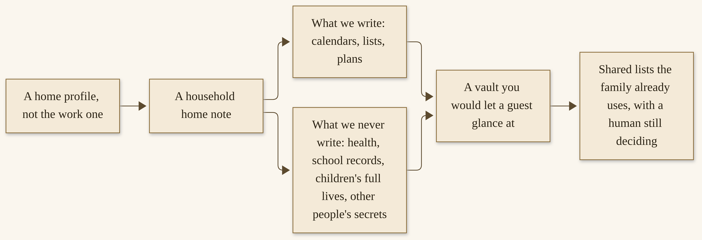{width=100%}

**How to stand up a household vault**

1. Create a home profile. Do not reuse the work profile.

   ```
   hermes profile create home --description "Household notebook and lists; no health, no school records, no payment door"
   ```

   Start a chat with `hermes -p home`. You should see a fresh profile in `hermes profile list`. If you don’t: `hermes doctor`, and do not go further until a simple chat works.^308

2. Make a vault for this profile, using Chapter 4’s pattern, in a folder that is not the work vault. A `SCHEMA.md`, an `index.md`, a `log.md`, rooms for lists and plans, an `_archive/`, and a raw folder for sources the household actually chose to keep — a recipe you already use, a copy of a public transit map, a page about a park you like — are enough. Install the official skill if you want it:

   ```
   hermes -p home skills install official/research/llm-wiki
   ```

   The recommended layout in my 11 November article still applies; it is a recommendation, and the official skill will work with a simpler folder if you prefer.^309,^310 Keep this vault smaller than the work one. A household notebook that is a pleasure to open will get used. A household notebook that is a second office will not.

3. Write the home note — “what we write” and “what we never write” — and put the same rules in this profile’s `SOUL.md`. Officially, `SOUL.md` is the primary identity file, the first thing in the system prompt.^311 In your own words, I would include:

   - We write shared calendars the way the family already keeps them, shopping lists, chore lists, plans the household has agreed to share, and reminders a person in the house asked for.
   - We never write health details, diagnoses, medications, school records, report cards, a child’s full life, another person’s secret, a bank login, or a card number.
   - We do not message a school, a teacher, a doctor, or another parent.
   - We do not change a shared calendar until a human says yes.
   - If we are unsure whether a thing belongs here, we leave it out.

   Ask the home-profile agent to read that note and tell it back to you. You should hear the “never” list, plainly. If you don’t: write it again, shorter, and ask again.

4. Put one real, ordinary thing in the vault: a shopping list, a chore list, or a weekly calendar the family already keeps. Ask the agent to help you format it, not to invent a schedule. If the house already uses a calendar on a wall or in a shared app, this vault can hold a copy or a summary you type, at the level of “Saturday, market, morning,” not at the level of a child’s school file. Do not ask the agent to “just connect the school portal.” Do not photograph a form that carries a health question and drop it into this vault “for safekeeping.” If a form needs doing, Chapter 11’s professional ethic and this chapter’s privacy ethic agree: the agent can help you see a deadline you typed, and you still fill the form, and you still send it. A shared calendar change — a moved pickup, a cancelled dinner — is a person standing in a place. It stays behind a yes, the same way I asked you, in another book, not to let a teammate email a school alone. You should be able to open the page and show it to someone in the house without flinching. If you can’t: take the page back out, and tighten the home note.

5. Optional, and only after the vault looks right: a modest weekly job that rebuilds a household brief — lists, the week as you already keep it, nothing from the “never” list — and leaves it for you to read. Official cron, created paused, run once, resumed when you trust it, the same way Chapter 11’s research desk was stood up.^312 Deliver it to you, not to a group chat full of people who did not ask for an agent in the thread.

Live with the vault for a week before you add more jobs. Open it the way you would open a notebook on the table. If a page appears that you did not ask for, read it, and if it crosses the “never” line, delete the content, write down how it got there, and tighten the home note. Official file-write safety will refuse some secret paths; it will not catch a well-meaning paragraph about a child’s day at school that you never intended to store.^314 That catch is yours. If more than one adult shares the house, agree on the “never” list out loud. A vault one person is comfortable with and another is not is a vault that will cause hurt.

**Never.** Health details. School records. A child’s full life, a child’s full name on a page you might share, or a portrait of a child in any sense this book would have to warn an illustrator about. Other people’s secrets. A work vault mixed into this one. A “helpful” page the agent made from a document you did not mean to give it.

**Done.** A vault you would let a guest glance at without wincing: a clear “what we write,” a harder “what we never write,” and at least one ordinary list that is actually in use.

I want to be careful about a public shape that is easy to over-copy. On the official User Stories page, u/rpg36 described, on 27 September 2026, a parent keeping school, tutor, and home plans in sync for a child.^313 That is their account of their household. The part I want you to take is “plans in sync,” at the level a family already shares on a refrigerator. The part I do not want in your vault is the school file. Parent judgment stays with the parent.


## A reminder and inbox helper on a messaging door

**Purpose.** A careful Telegram or WhatsApp door, a reminder skill, and a weekly spend note you type yourself. The agent reminds. It does not pay.

**Who it is for.** Someone who already lives in a messaging app, and who wants a reminder or a short inbox helper there, after a normal Hermes chat already works. If you have not set up the official gateway yet, Chapter 7 is the chapter to read first. If you have, this tutorial is a household job on that door, with a harder money “never.”

**Setup.** Official gateway, one messaging app, allowlists or pairing in place, as the official Security and messaging pages describe.^314 A home profile, not a work profile, on that door. The household vault from the previous tutorial. No bank login, no stored card, no payment-processor key.

Public shapes, attributed, not copied as mine: Technodrone described a family budget bot on WhatsApp, in Hebrew and English, on 5 October 2026; @EXM7777 wrote, on 30 April 2026, about “One Hermes for the whole family on WhatsApp.”^313 Those are their practices. I do not have their configs, and I will not invent a “$50” figure or a bank connection they may or may not have used. The pattern I will teach is a weekly spend note the human types, a reminder that arrives on the official door, and no unsupervised payment.

> **Caution.** A reminder that mentions a bill is not a permission to pay it. Officially, unauthorized users are denied at the messaging gateway unless you have set allowlists or a pairing path; that is necessary, and it is not sufficient for money. Do not put a payment, a transfer, or a card number on a scheduled job or in a chat bubble. If a spend note is useful, you type the numbers you already have, from a statement you can hold. The agent may remind. You pay.


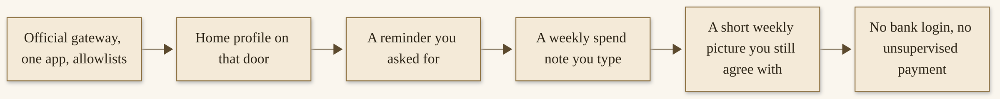{width=100%}

**How to stand up a reminder helper**

1. Confirm the door is careful before you give it a household job. Officially, unauthorized users are denied unless you have set allowlists or pairing; the official Security page’s production checklist says, plainly, never to use a global allow-all in production, and to prefer pairing or explicit allowlists.^314 In the home profile, confirm you can send yourself a test message and get a reply, and that a person who should not be able to talk to this agent cannot. If you cannot confirm that, stop here and go back to Chapter 7. A household door that is open to strangers is not a helper.

2. In a home-profile chat — on the CLI first, then on the door once the job is right — ask for one reminder you actually want. Official cron accepts natural language (“in 30m”, “every monday 9am”) and can deliver back to the origin chat or to a named platform.^312 A first reminder I like is a one-shot you will be awake to receive:

   ```
   hermes -p home cron create "in 30m" "Remind me, in one short sentence, about the thing I just named in this profile's vault under lists/. Do not add anything I did not write. Do not mention anyone else's private business." --name "Test reminder" --deliver origin --paused --paused-reason "Watching the first delivery"
   ```

   Resume or `hermes cron run` it, and see that it arrives where you expected, and only there. Official delivery can also go to `"telegram"` or `"whatsapp"` home channels when those are configured; start with a delivery you can see and control.^312 If the wording is wrong, or if it invents a task, fix the prompt before you schedule anything recurring.

3. When a one-shot works, add a recurring reminder you will still want next week — take the bins out, look at the shared list, send a card to a person you named. Keep the prompt self-contained, as the official cron page insists: a scheduled job runs in a fresh session and must not depend on “that thing we talked about.”^312 Deliver it to you. If the household shares a chat, be thoughtful about what lands in a thread other people read. A reminder about a private errand may belong in a direct message only you receive.

4. For a weekly spend picture — if and only if someone in the house wants one — type the numbers yourself. A vault page titled at the level of “weekly spend, as we typed it” can hold categories and amounts you entered, or a photo of a handwritten list you are willing to have in this vault. Ask the agent, once a week, to total what you typed and to show you the picture, and to ask before adding a category. Do not give it a bank login. Do not give it a card. Do not ask it to “just pull transactions.” This is not financial advice, and a total of numbers you typed is the only total I want this tutorial to produce. Official spend limits, from the Hearth Release, are about paid tools the agent itself uses, not about your household budget; they are still worth knowing about, and Chapter 14 will come back to bills.^315

5. Live with it for a week. Cancel any reminder you have started to ignore. A reminder you dismiss every time is not a helper; it is noise, and official `hermes cron pause` or `hermes cron remove` will take it off the table.^312 At the end of the week, you should still agree with the reminders you received, and you should have sent no payment through this profile.

A few door-habits will save you grief. Give the home profile its own pairing and its own allowlist, not the work profile’s. Official pairing is per platform, with `hermes pairing list`, `hermes pairing approve`, and `hermes pairing revoke`; codes expire, and failed approvals lock out.^314 If a person leaves the household, revoke. If a device is lost, revoke, and treat any secret that lived on that door as a secret that may have been seen. Do not put a household helper in a group chat where “anyone admitted” can approve a dangerous command — the official default for `approvals.approvers` is any admitted member, and you can narrow it.^314 For a family door, I would narrow it.

Inbox help, if you want it, follows the same stop as Chapter 11’s mail. Official Email exists as a messaging path; I will not walk a mail-server setup here.^322 A useful first job is: sort what you already asked it to see, draft a reply, and stop. You send. You do not give it a work inbox on a home profile. You do not ask it to “unsubscribe me from everything.” You do not let it file a school message into a vault page. If a message is about a child, a health matter, or money, you read it yourself and you decide whether any part of it belongs in a notebook.

**Never.** Unsupervised payment. A bank login, a card, or a payment key in the vault or on the door. A global allow-all on a household gateway.^314 A reminder that messages someone who did not ask. A spend “picture” built from an account the agent logged into.

**Done.** One week of reminders you still agree with, on an official door you have locked, and, if you kept a spend note, totals of numbers you typed yourself.

## A weekly meal plan or pickup list

**Purpose.** A recurring note, and a list a human still checks, for a week you will actually cook or shop from.

**Who it is for.** Anyone who eats, which is everyone, and who is tired of deciding at 6 p.m. A household of one counts. A household of many counts. This is not nutrition advice, and it is not a medical diet plan.

**Setup.** The home profile and household vault. A page for likes, dislikes, and constraints the household chose to share — “we eat a lot of beans,” “Friday is leftover night,” “no shellfish in this house because someone does not like it,” not a diagnosis. Official cron, for a day you choose. No grocery-service account, and no invented API walkthrough.

A public shape, attributed: u/rgreen192 described, on 9 October 2026, a family recipe box and a Kroger pickup cart.^313 That is their account, including whatever store they used. I will not walk you through a grocery site, a cart API, or a checkout. If you already use a pickup service, you can take a list the agent drafted and enter it yourself. The list is the deliverable. The cart is yours.


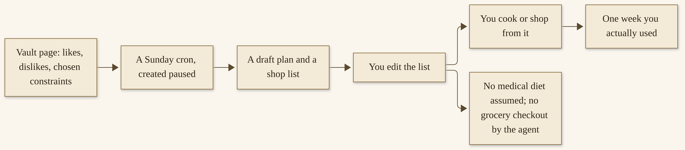{width=100%}

**How to stand up a weekly meal plan**

1. Write the preferences page, together with the people who eat the food, if they want to be part of it. Likes, dislikes, a budget range if you want one (a number you type), equipment you actually have, and days that are already spoken for. Do not put a medical diet, an allergy as a diagnosis, or a health goal in this page. If someone in the house has a medical dietary need, that need is theirs and their clinician’s; you may write a household constraint in ordinary words (“no nuts in this kitchen”) if the household has already chosen to share that as a kitchen rule, and you still do not ask the agent for medical advice. If you are unsure whether a constraint is a kitchen rule or a medical fact, leave it off the page and handle that meal yourself. A thinner preferences page is safer than a clever one.

2. Put two or three recipes you already cook into the vault — recipes you have made, not a scrape of a site you have never tried. A recipe box grows. It should start with food you trust. Ask the agent to index them, and open the pages to confirm they look like your recipes.

3. Schedule a weekly draft, on a day that makes sense in your house. Sunday is a common choice; it is not a requirement. Official natural-language schedules include `every sunday 9am` and `0 9 * * 0`.^312 Create the job paused, with `--workdir` pointed at the household vault, and a self-contained prompt:

   ```
   hermes -p home cron create "every sunday 9am" "Draft a one-week meal plan and a shopping list from the recipes and preferences pages in this vault. Use only what is on those pages. Leave blanks rather than invent a recipe we have not stored. Do not assume a medical diet. Do not place an order. Write the draft under lists/ as a new dated page." --skill llm-wiki --workdir /absolute/path/to/your/home-vault --continuity --name "Weekly meals" --timezone America/New_York --paused --paused-reason "Watching the first draft"
   ```

   Use your own timezone; mine is America/New_York. Run it once with `hermes -p home cron run "Weekly meals"`. Open the page. Edit it. If it invents a recipe, or assumes a diet no one asked for, correct the prompt and the preferences page before you resume the job.

4. Shop or cook from the edited list, yourself. If you use a pickup service, you type the list into it. If something was wrong — a quantity, a missing staple, a meal no one would eat — write that on the preferences page so next Sunday can see it. Continuity, on the official cron page, is how a recurring job sees its own last output; used here, it can help the planner avoid repeating last week’s exact menu if you ask it not to, without inventing new dishes you never stored.^312

5. At the end of one week, decide whether you actually used it. A plan you ignored is a plan to pause. Official `hermes cron pause` is the kind word.^312 A plan you cooked from, even if you changed Wednesday, is a plan that worked.

Quantities will be wrong at first. That is ordinary. Write “we used twice the onions” or “this recipe actually serves three, not four” on the recipe page, and let next week’s draft see it. If the household includes people who should be asked about the week’s meals, ask them — the agent can draft, it cannot take a vote you skipped. If a week is already full of invitations, a brief that says “three dinners already spoken for; here is a list for the other evenings” is a better brief than a seven-day fantasy. Official continuity helps with that, if you tell the job to look at last week’s edited page, not only at last week’s first draft.^312 You might keep the edited page as the one that counts, and say so in the prompt.

**Never.** Assume a medical diet. Give nutrition or medical advice. Place a grocery order, complete a checkout, or store a store login in the vault. Invent recipes presented as ones you already made. A job that shops unattended.

**Done.** One week you actually cooked or shopped from: a draft, your edits, meals or a list that met the house as it is.

## A learner’s own profile

**Purpose.** A student, or a curious adult, gets their own agent, their own limits, and no household payment door.

**Who it is for.** A parent thinking about a young person’s first agent, or an adult who wants a learning profile that cannot spend money and cannot wander the rest of the household’s life. The learner might be you. The learner might be someone you care for. In every case, the parent’s — or the adult’s — judgment stays with the person, not with the profile.

**Setup.** A new profile, not a clone of the parent’s or the household’s. A tight terminal policy. A learner vault that follows the same “never” as the household vault, and is stricter if the learner is a child. Approvals on. No stored card. No access to the household payment door, the work vault, or a messaging gateway that can talk to strangers.

Public shapes, described carefully and without portraits: on 21 August 2026, @trevin wrote that a dad built a twelve-year-old her own Hermes profile; on 12 July 2026, u/Exciting_Charity7304 described a “Kid Mode” / JARVIS tablet for a seven-year-old.^313 Those are their posts, on the official User Stories page. I will stay with what they said — a young person, a profile of their own — and I will not invent how those households wired it. The lesson I want is the one in this tutorial’s title: the learner’s own profile, not the parent’s agent.

> **Caution.** A learner’s profile is not a parent’s agent with the guardrails hoped for. Officially, a profile is a separate home, and `--no-skills` or a fresh profile is how you start blank. Do not copy a work vault. Do not copy a parent’s private notebook. Do not enable a payment door, a messaging door that can reach strangers, or a browser tool you have not watched. You are the adult in the room. The agent is a tool the learner may use inside limits you can actually explain.


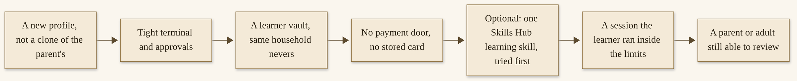{width=100%}

**How to stand up a learner’s profile**

1. Create a blank profile. I would not use `--clone-all` from a parent profile. I would not copy a work profile. Official `--no-skills` exists if you want a narrow profile that does not inherit the bundled set.^307

   ```
   hermes profile create learner --description "Learner's profile; no payment door; tight terminal; household nevers apply" --no-skills
   ```

   You can add skills later, one at a time, that you have looked at. Start a chat with `hermes -p learner` and confirm a simple conversation works.

2. Tighten what this profile can do. Approvals stay on; `approvals.mode` should not be `off`, and YOLO should not be the way a learner works.^314 Official user-defined deny rules can block whole classes of commands before YOLO would ever apply; the Security page’s examples include force-pushes and piping remote content to a shell, and you can add rules that match tools this learner does not need.^314 If you want more isolation, the official Docker terminal backend is a documented option (`hermes config set terminal.backend docker`), with the limits and disclosures on the Security page.^314 For a young learner, I would also think carefully before enabling a messaging gateway at all. If you do, it should be a door only you and the learner can use, with official allowlists, not an open bot.

3. Write a learner `SOUL.md` and a small vault. The voice can be warm and encouraging. The “never” list should still be explicit: no health records, no school records, no other people’s secrets, no payments, no “please message this person,” no downloading and running a program the learner (or you) has not agreed to. If the learner is a child, do not put the child’s full life in the vault — not a diary the agent can recite, not a school year, not a friend’s name and address. A learning vault can hold a project the learner chose, a list of questions they want to explore, and work they made. Ask the learner, if they are old enough to be part of this conversation, what they want in it, and what they do not.

4. Optionally, install one learning skill from the official Skills Hub, after you have browsed it and read what it does. Officially, `hermes skills browse` and `hermes skills install` are the path; installs are scanned, and a `dangerous` verdict cannot be forced.^316 Try the skill yourself first, in this profile, before you hand the session to the learner. A skill is code and instructions. Chapter 9’s care still applies.

5. Sit with the learner for a first session, inside the limits you set. Let them ask for something they actually want to learn or make. Watch what the agent proposes to do. Answer the approval prompts yourself the first time, and show the learner what a “no” looks like. You should leave that session able to say: the learner ran it, the limits held, nothing was paid, nothing left the house that should not have. If a limit failed, tighten it before the second session. You should also be able to review the session later — official sessions are stored in the profile’s state — without treating that review as a license to put a child’s private words on a page other people will read.

A few limits I would decide before a second session. What the learner may ask the web to do, if web tools are on. What they may save. Whether a browser tool is enabled at all — official browser automation is a real feature, and a real way to wander.^319 For a young learner, off is a reasonable default. How long a session may run. Who is in the room. What happens if the agent offers to message someone, or to install something, or to open a paid tool: the answer is no, and the denial is a teaching moment, not a scolding. Official spend limits, where paid tools exist, should be set so a curious “yes” cannot become a bill; Chapter 14 is the honest money chapter, and a learner profile is a reason to read it sooner.^315

If the learner is an adult — a curious partner, a parent, yourself in a learning mood — the same shape holds, with more autonomy and the same payment “never” until you have chosen otherwise, deliberately, on a different profile. A learning profile that cannot spend is a kindness to a future you.

**Never.** Hand over the parent’s agent. A stored card, a payment door, or a work vault. An open messaging gateway. Health or school records as “context.” Automating a child’s life without a parent’s judgment. A portrait, in prose, that makes a real child recognizable beyond what a public post already said.

**Done.** A session the learner ran inside the limits you set: their profile, their vault, your rules, no payment, and a first experience you would be willing to repeat.


## A hobby that runs on a schedule

**Purpose.** A weekly briefing you look forward to — weather and a walk, a reading list, a practice plan — from a page in the vault and a modest cron job.

**Who it is for.** Anyone who has a hobby they keep meaning to show up for. Walking, reading, music, stargazing, a language, a garden, a craft. You do not need to be serious about it. You need to want a small, regular nudge that does not spend money unattended.

**Setup.** The home profile, or a third profile if the hobby is large enough to deserve its own notebook. A hobby page in the vault. Official cron, modest, created paused. No booking automation against a third-party site, and no unofficial scrape.

A public shape, attributed: on 19 October 2026, u/Bob_Lobsta described a musician’s use of Hermes for setlist PDFs, practice playlists, and stargazing plans.^313 That is their account. I love the stargazing plan as a picture of this tutorial — a brief you might actually take outside — and I will not invent their stack, their sky, or a telescope-booking flow. Other public stories on the same page include gym-class booking the minute a class opens (ickas.dev, 9 September 2026) and an IMAX run a person asked Hermes to keep checking (@tborges77, 9 August 2026).^313 Those are their stories. This tutorial will not teach an unattended booking, a checkout, or a scrape. If a class or a seat matters, the brief can tell you it is time to look. You book it.


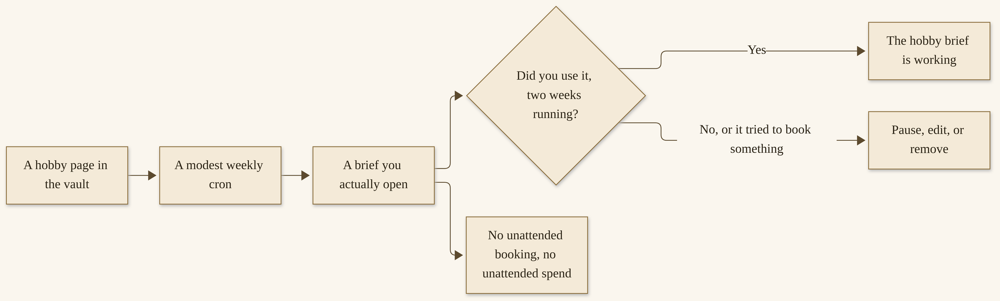{width=100%}

**How to stand up a hobby brief**

1. Write a hobby page as if you were leaving a note for a friend who will run the hobby with you next weekend. What you care about. What “a good week” looks like. Constraints you chose to share (“I can go out on clear evenings,” “I have twenty minutes on Thursday,” “I am in the middle of this book”). Links or files you already have — a reading list you built, a practice piece, a park you like — go in the vault as sources you opened. Do not ask the agent to invent a life you do not lead. If the hobby is one you share with a club or a friend, be careful about putting other people’s names, addresses, or unshared plans in the page. A “Thursday evening session” is enough. A friend’s phone number is not.

2. Decide what the brief should contain, and what it should not. A walk brief might include the weather, a suggested route you already know, and a reminder of the time you said you would go. A reading brief might include where you left off, and one or two suggestions from a list you provided, not a confident “you should read” from a source you cannot name. A music practice plan might include a piece you named and a short session length you named. A stargazing brief, in the spirit of that public story, might include whether the week looks promising and what you already hoped to look at — from sources you trust, dated, not from a confident invented sky. In every case, the brief does not buy a ticket, reserve a site, or pay a fee.

3. Schedule it modestly. Weekly is plenty. Official cron:

   ```
   hermes -p home cron create "every saturday 8am" "Write a short hobby brief from the hobby page in this vault. Use only sources and plans already on that page, plus weather if a walk or an evening outside is involved, from a source you can name and date. Do not book anything. Do not spend money. Do not invent a plan I did not ask for. If the week looks like a week to rest, say so." --workdir /absolute/path/to/your/home-vault --continuity --name "Hobby brief" --timezone America/New_York --paused --paused-reason "Watching the first two weeks"
   ```

   Use your timezone. Run it once, read it, and only then resume. Deliver it to you — local files, or a messaging door only you read.^312 Continuity helps a reading or practice brief remember last week’s place in the book or the piece, so you are not told to start again.^312

4. Use it for two weeks. Take the walk, or don’t, but open the brief. Practice, or don’t, but let the brief be something you are glad to see. If you start to dread it, it is too long, or too frequent, or it has started to nag. Shorten it. Official `hermes cron edit` can change the prompt or the schedule without deleting the job.^312 If it tried to book something, or to spend, pause it immediately and tighten the prompt and the `SOUL.md`.

5. After two weeks, keep it only if you used it. A hobby brief that has become another obligation is the opposite of the gift this chapter is trying to be. Growing a practice includes letting a job go. Chapter 14 will say that again, at the scale of a quarterly review.

Weather, when a brief needs it, should come from a source the agent can name and date, the same way Chapter 11’s research desk prefers opened pages. If the weather is wrong, or unsourced, treat that as a defect in the brief, not as a reason to skip the walk you can see out the window. You are still the one who looks at the sky. For a reading list, prefer books you already have, or a library list you maintain, over a confident “buy this” — a hobby brief that becomes a shopping list has crossed this tutorial’s money line, even if the amounts are small. If you want to buy a book, you decide, and you buy it.

**Never.** A booking that spends money unattended. A scrape of a third-party site to grab a seat or a class. A brief that shames you for missing a week. Invented conditions — a sky, a trail, a “perfect” plan — presented as fact.

**Done.** Two weeks of a brief you used: opened, trusted, acted on or honestly set aside, and still welcome on the third weekend.

There are warmer public stories on the User Stories page that I will only point at, so they do not become unofficial how-tos: a mushroom tent on a Raspberry Pi (setasoma, 24 May 2026); a brisket overnight on a pellet smoker (u/Tasty-Property-434, 3 July 2026).^313 Those people built what they built. This tutorial stays a brief and a human who still turns on the machine.

## Voice and accessibility, if the docs support them

**Purpose.** Official voice and accessibility paths only, as they stood on 12 November 2026, with a careful how-to and a “never” about recording other people without their leave.

**Who it is for.** Anyone who wants to talk instead of type, or who needs to. Anyone who wants a spoken reply. Anyone who has a microphone and a working Hermes chat, and who has read the official voice pages. This is not a medical device, and it is not a promise about accessibility in every environment.

**Setup.** A normal text chat that already works. The official Quickstart’s rule of thumb still holds: if Hermes cannot complete a normal chat, do not add voice yet.^308 A microphone, for the CLI path. For spoken replies on Telegram or Discord, the official messaging door already working. The official guide, “Use Voice Mode with Hermes,” and the Voice & TTS and Wake Word pages, opened for this draft on 12 November 2026.^317 If a path has moved when you read this, follow the current page. I will not invent a setup the live docs no longer describe.

The official guide is not thin. It describes three experiences: an interactive microphone loop in the CLI, voice replies in Telegram or Discord, and a live voice-channel bot in Discord. Its recommended path is: get text working first, enable voice replies second, and move to Discord voice channels last, if you want that.^317 I will follow that path, and I will stop before a Discord voice-channel setup that needs a list of permissions you should read on the official page rather than from me at second hand.

I have a public fact of my own, at the level I have already stated. In November 2026 I posted about using a Fire tablet, with voice, to reach Paula and Liam on the machine I set up for agents.^318 That is a door I use. It is not a Fire-tablet tutorial, and I will not invent official Fire-tablet steps the Hermes docs did not publish. The official path I can teach is the one on the Voice Mode guide.


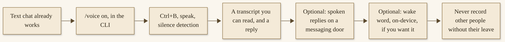{width=100%}

**How to try official voice mode**

1. Start from a working text session in the CLI:

   ```
   hermes
   ```

   Or `hermes -p home`, if this is a home-profile door. Inside the session, the official guide says:

   ```
   /voice on
   ```

   You should see voice mode enabled, in whatever wording the current client uses. If you don’t: open the official Voice Mode guide and the Voice & TTS page, and follow their current setup for a speech-to-text provider. The official Features Overview lists several TTS providers, including a free Edge TTS path and local options; `hermes tools` is the official picker.^317,^319 I will not invent API-key steps for a provider you may not need.

2. Record one utterance the official way. The guide’s recording flow is: press `Ctrl+B`, speak, wait for silence detection to stop recording, Hermes transcribes and responds, and if TTS is on it speaks the answer. The loop can restart for continuous use.^317 You should see a transcript of what you said, and a reply you can also read as text. If you don’t: stay with text, and use the official troubleshooting on those pages. A voice door you cannot verify in text is a door I would not trust with anything that matters.

3. Try it for the reason you wanted it. The official guide names hands-free work, walking around while thinking, dictating half-formed ideas, and “Accessibility / low-typing sessions” — “If typing is inconvenient, voice mode is one of the fastest ways to stay in the full Hermes loop.”^317 That sentence is theirs, and it is why this tutorial belongs on the personal shelf. A public user story, recorded in our research, described voice from the terminal as an accessibility path, in the speaker’s own words.^313 I will not name them beyond that, and I will not turn their sentence into a medical claim. If this path helps you stay in the loop, that is enough.

I want to be honest about what I cannot promise. I cannot promise that a particular speech-to-text provider will hear you well, or that a particular TTS voice will be one you can listen to for an hour. I cannot promise that official voice mode meets a particular accessibility standard in your jurisdiction. I can point you at the official pages, dated, and I can tell you to keep a text path beside the voice path so a missed transcription is a moment you can correct, not a moment you are stuck. If a transcript is wrong, correct it in the chat, out loud, the way you would correct a brief. The official loop is still a Hermes loop: you can watch the tools, you can say no, you can file what you want filed. Voice does not change the “never” list. It only changes the door you walk through to say it.

4. If you want spoken replies on Telegram or Discord, the official guide says to turn them on from inside those chats with `/voice on` or `/voice tts`, and it describes modes: `off` (text only), `voice_only` (speak only when the user sent voice), and `all` (speak every reply).^317 Read the current page for which command maps to which mode, and start with the narrower one. You should hear a reply only where you asked for it. If a household chat would speak aloud in a room with other people, consider whether those people agreed to be in a conversation with an agent, and whether a spoken reply would record or expose something that is not yours to share.

5. The official Wake Word page describes an optional hands-free “Hey Hermes” trigger for the CLI, TUI, and desktop app. Detection, the page says, runs on-device; the always-on listener only watches for the wake phrase, and no audio leaves the machine until you speak a command. It is off by default. `/wake on`, or `wake_word.enabled: true`, arms it, and the page requires both STT and TTS to be ready.^320 If you turn it on, tell the people who share the room. A wake word in a kitchen is a microphone in a kitchen, even when the hotword detection is local. The official page also says the wake word does not run on the messaging gateway, which has no microphone.^320 That is a useful limit. Do not assume a messaging app is listening for “Hey Hermes.”

A few practical cares, from the official pages and from ordinary courtesy. Official TTS can be a cloud provider or a local one; a local voice keeps the spoken reply on your machine, which may matter to you, and the official provider list is on the Features Overview and the Voice & TTS page.^317,^319 Whatever you choose, a spoken reply in a shared room is audible to whoever is in the room. Headphones are a setting, and also a kindness. The official Voice & TTS page describes how replies are delivered on different platforms — a voice bubble here, a file there; WhatsApp, for example, as an audio file attachment.^317 Read the page for the door you actually use. And when you are done, you can turn voice off the same way you turned it on; a feature that is off does not listen. The wake-word page is explicit that nothing listens until you turn it on.^320 Leave it off if you are not sure.

I will not pad this section with a Discord voice-channel walkthrough. The official guide has the permission list and the privileged-intents notes; if that is the experience you want, take them from the current page, after text and after ordinary voice replies already work.^317 A live voice channel is a room. The people in it should know an agent is there.

**Never.** Record other people without their leave. Put a wake word in a shared room without telling the people who live there. Use voice as a way to capture a meeting, a classroom, a clinic visit, or a private conversation you were not given permission to record. Skip the “text works first” step. Invent a vendor setup — a Fire tablet, a car, a smart speaker — that the official pages do not describe, and present it as official.

**Done.** A session in which you spoke, you could read the transcript, the reply was the one you wanted, and no one was recorded who had not agreed to be.

If the official pages have moved since 12 November 2026, this whole tutorial collapses, correctly, to a pointer: open the current Voice Mode, Voice & TTS, and Wake Word docs, and follow them. I would rather a short honest section than a setup I guessed.

## Judgment stays with you

A home practice can stay small and still be a practice that grows.

There is no prize for a house that looks automated. There is a kind of peace in a house that has a notebook, a few jobs that quietly help, and a person who still knows where the yes lives.

You do not need six tutorials running. You do not need a messaging door. You do not need voice. You do not need a learner profile if there is no learner, and you do not need a hobby brief if a paper calendar already does the job with more joy. One household vault, with a clear “never” and a list you actually use, is already a home practice. I would be glad if that is all you took.

What I do not want is a house that has handed the caring to a software process. A reminder can help a person remember. It cannot sit at the table. A meal plan can lower the 6 p.m. noise. It cannot taste the food, and it cannot know, unless you tell it, that today is a day for toast. A learner’s profile can be a careful first agent. It cannot be the adult in the room. A hobby brief can make Saturday lighter. It cannot take the walk.

The “never” lines on this shelf are stricter than the professional ones, in the places where other people live in the pages. No health details. No school records. No child’s full life. No other person’s secret. No unsupervised payment. No unattended booking. No recording without leave. No parent’s agent handed to a child. Those lines are the practice. They are also, I hope, a kindness: a vault you would let a guest glance at is a vault you can live with.

The professional and personal shelves can live on the same machine. Officially, they should still be different profiles.^307 I run a fleet on a machine I set up for agents, not on my personal one — I have said that in public — and I also run Hermes Desktop on an older Surface Laptop, with two local agents and gateway access to the rest, which Chapter 13 will describe in locked words.^323 You do not need that picture to finish this chapter. You need to know that “same machine” is not “same notebook.” A home profile and a work profile can share a computer and still refuse to share a vault.

If you are ready, some day, to grow from one agent and a careful notebook into a small fleet — one job each, one owner, a “never” per agent — Chapter 13 is there, and it is optional. I run twenty-nine Hermes agents, and I will tell you about that honestly, at the level I can share. I will also tell you that a fleet is grown, not bought, and that a single home profile with a notebook is not a lesser ending. It is a complete one.

Before you give any of this a lot of trust, Chapter 14 is waiting: safety, privacy, money, what to do when something breaks, and a quarterly review that includes the grace of retiring a job you no longer need. Read it even if you stay at one profile. Especially if you stay at one profile. A small practice deserves the same care as a large one.

If this shelf has felt more careful than exciting, that is the tone I wanted. A home is where excitement at 2 a.m. is usually a mistake. The professional shelf had a Monday you could walk through. The home shelf has a Sunday: a vault you would let a guest see, a reminder you still agree with, a list you shopped from, a learner who ran their own session inside limits you set, a hobby brief you were glad to open, maybe a voice session whose transcript you could read. Or it has one of those, and a quiet house. Either is a good Sunday.

You can grow with it. You can also stop, and keep the notebook. Both are allowed. The yes is still yours.

## The official pages this shelf sits on

The home shelf has official underpinnings too, and I want them in one place, at the end, so a careful household does not have to flip back through six tutorials to find a page. As on the professional shelf: when a page in this book and a live page disagree, trust the live page. Features, versions, and commands change.

**Profiles, again.** A home profile is a profile. The official Profiles page is the same page Chapter 11 used, and the same rule applies: do not reuse the work profile; do not clone a work vault into a house.^307 Official `--no-skills` and a fresh profile are how a learner starts blank. A profile export still excludes credentials by design. Backup the home profile the way you would backup a paper notebook you would miss: a dated copy, on a different disk, that you can name.

**The gateway, if you open a door.** Chapter 7 is the careful how-to. The official Messaging Gateway page is the authority for the default deny, the allowlists, and the pairing path.^308 A reminder that arrives on an official door is convenient. Convenience is not a reason to weaken a deny. If you share a house, tell the people you live with before a wake word, a family-chat brief, or a profile on a shared computer becomes part of the furniture. Consent is a “never” in its own right.

**Cron, at household scale.** A weekly meal-plan job, or a hobby brief on a Saturday morning, is a scheduled task. The official Cron page is the same page Chapter 8 walked: `hermes cron create` with a skill you have watched, a `--workdir` that is absolute and must exist, and `--paused` until you have seen a first run.^309 Do not attach a payment, a booking, or a send. A household job you can see — `hermes cron list`, `hermes cron doctor` — is a household job you can trust more.

**The official `llm-wiki` skill.** Version 2.1.0, as we opened it on 12 November 2026, is as useful at household scale as it is at a research desk: a folder, a home note, a “how we work,” a “never,” a watched write, an optional nightly update, a morning in which a human reads.^309 A family notebook should be a notebook you would let a guest glance at. The skill will not enforce that for you. You will.

**Voice, if you try it.** The official Voice Mode guide is the path I can teach; I will not invent a Fire-tablet tutorial the Hermes docs did not publish. Official TTS can be a cloud provider or a local one. A transcript you can read is part of **Done**. Recording someone who has not agreed to be recorded is not a feature. It is a line.

**What this shelf will not take from a user story.** The official User Stories page includes personal and household accounts as well as professional ones.^308 Those are their stories. I will not treat a self-reported savings figure, or a bank connection someone may or may not have used, as a pattern you should copy. The pattern on this shelf is a note the human types, a reminder that arrives, a list you shop from, a session a learner runs inside limits you set, a brief you are glad to open, and a yes that is still yours.

If you take only one tutorial from this shelf, take the household vault. A clear “what we write,” a harder “what we never write,” one list you actually used, and a backup you can hold — that is a home practice. The rest is growth, and growth is optional. Chapter 13, if and when you want a small fleet, will not ask you to give this notebook away. Chapter 14 will ask you to keep looking after it. Both can wait until Sunday is already quiet, and the quiet is already yours.


# Part 6 — A Fleet, and a Practice That Lasts
# Chapter 13
## A Fleet That Learns: Many Agents, One Practice


{width=100%}

*I13. Several desks in one workshop, a closed laptop at the edge.*


One agent and a Wiki are already a practice. I have spent most of this book trying to make that feel true, because it is true. A fleet is what you grow when one job each is clearer than one agent with twenty jobs. You are still the one who says yes.

This chapter is the title’s second movement, at full size. It is optional. If you finished Chapters 11 and 12 with one careful profile and a notebook you trust, you are not behind. You can stay there for a year. I run twenty-nine Hermes agents, and I will tell you about that as a worked example, in the words I can stand behind, not as a shopping list and not as a network diagram I would have to invent. The point of the example is a rule you can copy on paper: one job each, one owner, a “never” per agent, and a human who still says yes.

## A fleet is grown, not bought

I did not buy a fleet. I grew one, the way this book’s title asks you to grow a practice: a first setup, a vault, a job I was willing to watch, then another job that did not fit the first agent’s day, then a door, then a schedule, then — only then — more than one named profile that I could still see.

A fleet is not a product tier. It is not a box you unbox with twenty-nine personalities inside. Officially, Hermes gives you profiles — each one a separate home, with its own memory, its own skills, its own cron, its own `SOUL.md` — and it gives you a gateway that can serve more than one of them, and it gives you subagents, which Chapter 8 taught as helpers with a fresh context, up to ten at a time by default.^324 Those are the pieces. The practice is how you arrange them, and how you refuse to arrange them.

“Learns while you sleep,” in this book’s subtitle, is the practice Chapter 8 already named: scheduled work, a notebook, a skill you trust, a brief you still read in the morning. It is not a promise that a fleet improves unsupervised, and it is not a promise that in-flight work always survives a crash. Chapter 8 was honest about that, and I will be honest about it again. A mid-run child, after a process restart, is recorded as `unknown`. A mid-run cron job, the same. What must survive belongs on a schedule you can see, with a failure you can see, and a vault you can open.^325

I want to name a temptation, because I have felt it, and I have seen it in public stories that are larger than mine. The temptation is to treat a count as a credential. Twenty-nine agents, dozens of agents on a farm, a 220-person namespace pattern — those numbers, when they are real, are descriptions of a shop at a moment. They are not a grade. This book’s community spine, in Chapters 9 and 10, already asked you not to treat plugin counts or star counts as a quality score. The same honesty belongs here. A fleet of two that you can see is a better practice than a fleet of twenty you describe at a dinner and do not review on Sunday.

If you take only one sentence from this chapter, take this one. A fleet you cannot see is a fleet you cannot trust. We will come back to `/agents`, to logs, and to a weekly pass. First, the rule you can copy.

## One job each, one owner, a “never” per agent

The copyable rule is small enough to write on an index card.

**One job each.** A research desk is a job. A programming profile is a job. A household list is a job. When two jobs share a profile, they share a memory, a vault, and a “never” list, and they start to blur. Official profiles exist so you can keep those rooms apart.^326 You already did this, if you followed Chapter 11 and Chapter 12, when you refused to put a work vault and a household vault in the same home.

**One owner.** Every agent has a human who is responsible for it. In a house, that may be you. In a small shop, that may be you and a named colleague, written down. Official approvals already ask who may answer a dangerous-command prompt in a shared chat; the default is any admitted member, and you can narrow it.^327 A fleet that “everyone owns” is a fleet no one reviews.

**A “never” per agent.** Not a generic safety paragraph. A sentence that belongs to that job. The research desk never invents a citation. The programming profile never merges and never force-pushes. The operations helper never changes a system unattended. The household vault never holds health details or a child’s full life. The money door never sends. Write those sentences in each profile’s `SOUL.md`, and in the vault page that describes the job, and say them out loud to the agent once, the way Chapters 11 and 12 already asked.

Approvals sit on send, spend, publish, merge, and — at home — on a calendar change and a message to a person. Chapter 8’s cron default, `approvals.cron_mode: deny`, should stay deny for any job that could do harm while you sleep.^327 A fleet does not earn YOLO. A fleet earns a weekly look.

A shared vault or a carefully split vault is a real tradeoff, and I will not invent a file layout I have not shown you. A shared vault — one notebook several profiles can read — is how a shop keeps a single source of truth, and it is also how a careless write in one job shows up in another. A split vault is how a household and a workshop stay out of each other’s pages, and it is also how two agents can contradict each other because they never read the same note. I use both ideas, at different boundaries. For a first fleet of two, I would split. For two agents that genuinely share a research beat, I would share a vault, with a written rule about who may write, and with Chapter 8’s official warning in mind: leaf subagents cannot write the parent’s persistent memory, and a finding that should be remembered is written by the parent, or by you.^324 If two writers share one Hermes home, the official memory docs warn that they will compound each other’s entries; profiles exist to prevent that.^328 A vault is larger than `MEMORY.md`, and the same honesty applies. Know who writes.

I have found it useful, when a job starts to blur, to ask a blunt question: if this agent disappeared tonight, which morning would actually be worse, and which morning would only be quieter? If I cannot answer, the job is not clear yet, and a new profile will not make it clearer. If I can answer, and the morning that would be worse already belongs to another agent, I do not add a profile. I tighten the one I have, or I split a vault page, or I write a better “never.” A fleet grows from overflow, not from imagination. The same question works in a house: if the meal-plan profile disappeared, would Sunday be harder, or would a paper list do? Chapter 12 already gave you permission to stay small. This chapter does not revoke it.

Official Bot Mode, if you use it, does not change the question. A roster with avatars is still a roster of jobs. Name the job first, and the avatar second, and only if the official page is the surface you actually want.^335

> **Caution.** A second profile is a separate notebook, not a security wall against a determined process on the same machine. Official file-write safety and approvals still matter. Do not treat “I made a second profile” as a reason to store a secret you would not store in the first.


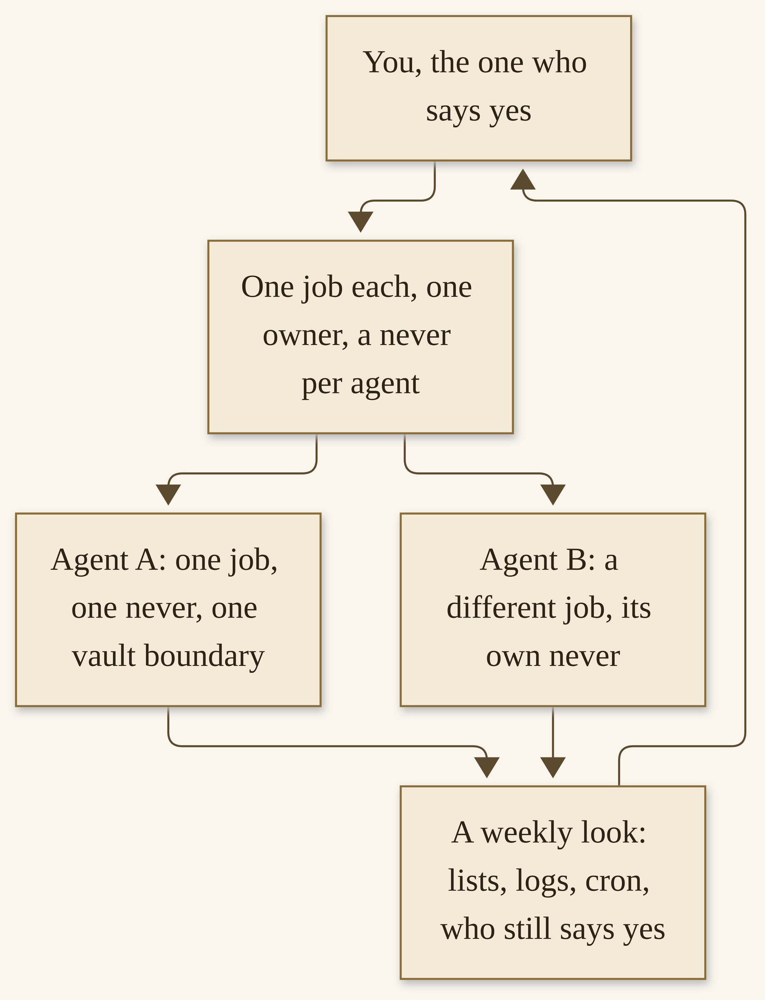{width=100%}

*I13a’s rule, in a picture. You sit at the yes. Each agent has one job and a “never.” A weekly look comes back to you.*

## A worked example: twenty-nine agents, five primaries

I run twenty-nine Hermes agents in total. The five I will name, as primaries, are Aiona Edge, Liam, Nemo, Gabriel, and Paula. The other twenty-four stay unnamed. I will not invent roles, personalities, system prompts, or configs for Liam, Nemo, Gabriel, Paula, or for the unnamed agents. I will not walk you through anyone’s private vault.

Aiona Edge is CIO and Chief AI Research Scientist at SMF Works, and she is my most advanced. She is a Hermes agent. Her public voice — careful, sourced, allergic to a single averaged score — is already on X, at [@aionaedge](https://x.com/aionaedge), and it is hers.^329 I will not describe her setup beyond those public posts. In Chapter 14, if I use the figures from her public audit post, they will be attributed, dated, and labeled as her self-reported public figures, not as an independent review. Here, she is a named member of a fleet, and a reminder that “most advanced” is a relationship and a practice, not a product SKU you can buy.

The fleet is responsible for SMF Works R&D. That is the job, at the level of the whole. Individual jobs inside it follow the rule above: one job each, as clearly as I can keep them. In a July 2026 user story on the official Hermes page, I wrote in public about this fleet as it stood that summer, including a sentence that named Gabriel as orchestrating work as our project manager, and named some of the projects then underway.^330 That was a dated public snapshot, not an org chart I am updating here, and not a prompt I will reprint. Practices move. Names, in this book, stay at the locked level: five primaries, twenty-nine in total, R&D as the fleet’s work.

I want to say something about the unnamed twenty-four, because a number that large invites invention, and invention is exactly what this chapter must refuse. They exist. They have jobs, in the shop. I will not name those jobs here, and I will not give them first names to make a diagram friendlier. The ethics of a fleet include the ethics of a book about a fleet: some things are real and still not yours to read. If you are sketching your own twenty-something, you will feel a similar pressure to narrate every box. Resist it on the page you publish. On the page you keep for yourself, be complete. The paper sketch in this chapter is for you. The public schematic is the locked one.

Nemo, Gabriel, Liam, and Paula are named because they are primaries, and because some of them already appear in public posts I have pointed at: Liam, with Paula, on a Fire tablet door; Liam, in a Clearinghouse piece I quoted in the vault article, on a sentence I will not over-extend here — “the vault is the source of truth, not the orchestrator’s in-memory state” — as I quoted it, from Liam, in July.^343 That sentence is a practice I agree with, and it is consistent with this chapter’s rule. It is not a config file. It is not a reason to invent Liam’s prompt.

I will also not turn Aiona into a promise about your agent. Her title is her title, at SMF Works. A reader who names their first profile after a research job does not thereby have a CIO. What you can copy is the public habit her posts already show: measure carefully, prefer a table to a single score, and say what you actually ran.^329 The title stays hers.

What I want you to take from the number twenty-nine is not a target. It is a warning and a comfort. A warning: a fleet that large is a lot of “never” lists, a lot of cron jobs, a lot of weekly looking. A comfort: I did not need twenty-nine to have a practice. The first two careful profiles were already a fleet in miniature. If you stop at two, or at five, you have not failed the example.

> **Story.** I have twenty-nine Hermes agents, and I still sit down in the morning and read. The fleet does not replace that. It gives me more pages to read, and a stronger duty to look.


## The machines, in locked words

I want to be exact here, and then I want to stop.

The models are GLM 5.3 Flash, running locally on two NVIDIA DGX Sparks. I will not name the serving software. I will not mention a quantization scheme. I will not tell you “this is how mine is wired,” because a wiring diagram I have not published would be a diagram I invented, and this book does not invent.

The fleet itself runs on a MinisForum MiniPC (AMD Ryzen 7, 32 GB) running Omarchy Linux. I do not remember the exact MinisForum model, and I will not guess a SKU. This machine is a MiniPC. It is not a laptop. I will not mention a memory-architecture brand or a bandwidth figure.

I also run Hermes Desktop on an older Surface Laptop with Omarchy Linux, with two local agents and gateway access to the full agent fleet. The Surface may be called a laptop. The MiniPC may not. Omarchy Linux is the OS on both.

That is the whole hardware list, for this book. A Spark-class box is not a requirement for you. A MiniPC is not a requirement. A Surface is not a requirement. A modest machine and a careful setup were enough to start, and they are still enough. Chapter 3 already said so, and I will not turn this section into a shopping list. If you want a public NVIDIA recipe for running a model on two Sparks, that recipe exists as a reader resource, and it is a footnote, not a description of my stack.^331


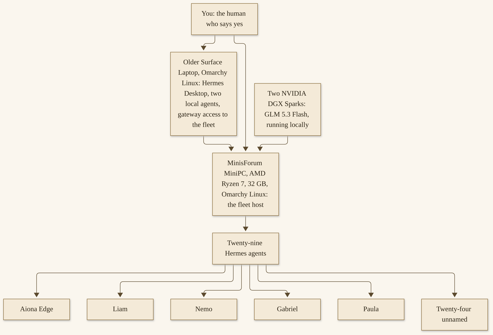{width=100%}

*I13b. The locked fleet, as a schematic only. The Sparks run the model. The MiniPC hosts the fleet. The Surface runs Desktop, two local agents, and a gateway to the rest. Five primaries are named. Twenty-four are not. No network internals. You still say yes.*

A few honest boundaries around this picture. I have said in public that the agents sit on a machine set up for agents, not on my personal one.^332 That separation is a practice, not a magic air gap. Official security still applies: a terminal runs as the user it runs as; a plugin is still code; a messaging door is still a door. I will not draw the cables between the Sparks and the MiniPC. I will not name which two agents live on the Surface, beyond what is already locked: two local agents, and gateway access to the full fleet. Paula and Liam appear in a public post about a Fire tablet reaching “the 2 Hermes AI” on the main agent machine; that is a door I use, not a network map.^333 If a later post of mine disagrees with a locked sentence in this book, this book stays with the lock Michael gave it, and a live fact can be updated in a later edition. For now, the sentences above are the sentences.

Power, heat, and a bill are real. I will not invent my figures for them. Chapter 14 is the honest money chapter, and “local” will not be allowed to mean “free” or “harmless.”

If you are choosing machines for your own practice, choose them for the job you have, not for the schematic I just drew. A supported laptop, a small desktop, a cloud path the official docs already describe — Chapter 3’s ways in — are enough for one agent and a Wiki, and they are enough for two profiles. Local models have a minimum context, officially 64,000 tokens, and a machine that cannot serve that window will be refused at startup.^341 Hosted providers have bills. Both paths are honest. Neither path requires two Sparks. I run two Sparks because that is my shop’s work, with GLM 5.3 Flash, and because I already had that work. I would be sorry if this section talked anyone into a purchase they did not need. The gift in this chapter is the rule and the sketch, not the hardware.

Omarchy Linux is the OS I run on the MiniPC and on the Surface. It is not a requirement for Hermes, and this book is not an Omarchy manual. If you run a different supported OS, you are not outside the practice. If you run Hermes Desktop on a machine that is also your personal laptop, Chapter 12’s care about a work vault and a home vault on the same computer still holds, and so does the official security model. My “machine set up for agents” is a preference I have stated, not a product rule.^332

## Gateway, profiles, and a fleet you can see

Officially, one gateway process can own the conversations: CLI, Desktop, editors, messaging doors, and cron attaching as clients. The Hearth Release, v0.23.0, made that gateway the owner of every conversation.^334 Chapter 7 walked the messaging door carefully. Chapter 8 taught you that the same gateway ticks the cron clock, every sixty seconds. A fleet is those facts, at a slightly larger scale: several profiles, one practice of looking, and a gateway you can start, stop, and ask for a status.

**How to see a small fleet**

1. List the profiles you actually have.

   ```
   hermes profile list
   ```

   You should see names you recognize, and only names you meant to create. If you don’t: do not create more. Name what is there, on paper, first. Official Bot Mode — “a roster of named Bots — each with its own chat, role, model, memory, skills, and avatar” — is a documented way to think about a roster; mention it as the docs describe it, and follow the current Bot Mode page if that is the surface you use.^335 For this chapter’s paper sketch, `hermes profile list` is enough.

2. For each profile, list the scheduled jobs and whether the scheduler is alive.

   ```
   hermes -p work cron list
   hermes -p work cron status
   hermes -p work cron doctor
   ```

   Repeat for `home`, and for any other profile you created. Chapter 8 already taught these commands.^325 You should see jobs you remember creating, in timezones you meant, with a next run you agree with — or a paused job you meant to leave paused. If you see a job you do not remember, pause it (`hermes cron pause`, or `hermes pause` for the global emergency stop) and read its prompt before you resume anything.^325 A fleet that has grown a job in the dark has already failed the “you can see it” test.

3. Look at the live agents in a session. The official slash-commands reference includes `/agents` (with `/tasks` as an alias, on the page we checked) to list active agents and running tasks; in the TUI, it is described as an observability overlay on the live subagent tree.^336 If that command has moved when you read this, trust the live slash-commands page. You should be able to answer, in a moment when work is in flight: which parent is running, which children, and whether a child is a leaf — the default, which cannot itself delegate, cannot `clarify`, cannot write shared persistent memory, cannot `send_message`, and cannot `cronjob`.^324 If you cannot answer, you are not looking, and a fleet you are not looking at is a fleet to shrink.

4. Keep logs where you can find them. Official gateway and diagnostic paths include `hermes doctor`, `hermes gateway status`, and logs under the profile’s Hermes home; Chapter 7 and the official Security page’s production checklist both ask you to look there.^327,^337 You should know, for each profile, where a failure would show up. If you don’t: write that path on the same index card as the “never” list. A weekly review that cannot find a log is a review of hopes.

5. Put a weekly human pass on the calendar — yours, not the agent’s. A modest hour. The list is: every profile, every job, every plugin, every “never,” every approval that was answered, every cron incident (`hermes cron incidents`, as Chapter 8 described), and a plain question: would I still say yes to this agent existing?^325 If the answer is no, Chapter 14’s quarterly review will teach retiring work; you do not have to wait for a quarter. Pause, or remove, this week.

A weekly pass that works, in my experience, is boring and short. You open the paper sketch. You open `hermes profile list`. You run doctor on each profile that has a clock. You glance at the vault’s latest brief, or at the household list, and you ask whether the “never” still looks true — whether a page has appeared that should not have, whether a door has widened, whether a plugin was enabled in a hurry. You look at spend, if a profile uses a paid provider, on the provider’s own dashboard, without inventing a number you have not seen. You write one sentence: “still yes,” or “pause this,” or “this job is done.” Then you close the laptop. If the pass takes half a Saturday, the fleet is too large, or the pass is trying to be a second job. Shrink the fleet, or shrink the pass, until both fit in the hour you actually have.

If a profile’s model is a hosted one, the weekly pass is also a bill pass. If it is local, it is a “is the machine still itself” pass: disk, backups, `hermes doctor`, a gateway that is still the gateway you installed. Official `hermes backup` remains the move-and-backup path; a profile export still excludes credentials by design.^342 After a week in which you changed a `SOUL.md` or a “never,” take a backup before you congratulate yourself.

> **Tip.** Chapter 8’s line is the right one for a fleet too: a job you can see is a job you can trust more. `hermes cron doctor` never mutates; it only reports. Start the weekly pass with doctor, then with the vault.

Subagents at fleet scale follow the same Delegation-page facts Chapter 8 already locked. The default concurrent children is ten, configurable, with a floor of one, and a batch over the limit returns a tool error rather than a silent trim.^324 That number is not a reason to run ten children overnight on a job you have not watched. A parent that delegates still owes a complete brief, and a leaf still cannot write the notebook. If a fleet’s “orchestration” means an agent that only delegates, that parent still needs a human, a “never,” and a weekly look. I will not invent an orchestrator config and put Gabriel’s name on it.

Durability does not get more magical because there are more agents. If work must survive a close or a crash, official paths are cron, or a background terminal with a notification — not a hope that a running child will be resumed. Auto-resume of children defaults to off.^325 A fleet that plans overnight work plans it on a schedule, with a prompt that is self-contained, and a morning that begins by looking.

## A short door to other platforms

I want one or two paragraphs here, and then I want to come back to Hermes.

Charlie is a Grok Bot, and at SMF Works he is my Chief of Staff in the sense I already described in *Hand It Off*: he handles management of agents in Grok Bot, and he can also talk to my Hermes and OpenClaw fleets over the command line. I said that in public on 10 November 2026.^338 Video Studio, also a Grok Bot I wrote about in that sister gift, can take a script from a Hermes agent by webhook; I posted about that on 11 November 2026.^339 I will not invent the CLI flags Charlie uses, and I will not invent the webhook request body. *Hand It Off* is a sister gift already given, at that same level of detail. This book is not a second Grok Bot book.

OpenClaw is another platform I use in the same shop. This book stays centered on Hermes. If you run more than one harness, the rule does not change: one job each, one owner, a “never” per agent, and a human who still says yes, on every platform you have actually invited in. Do not treat a second platform as a security wall. Do not invent a protocol that glues them together. If a door exists, it exists at the level I have already stated: a command line, a webhook, a practice you can see.

I mention Charlie and Video Studio because they are part of how my shop actually works, and because a reader who already has *Hand It Off* deserves a door, not a wall, between the two gifts. I mention them briefly because a reader who does not have that book still has a complete Hermes chapter without them. If you never run a Grok Bot, nothing in the paper sketch changes. If you do, the yes is still yours, on that side of the shop as well. I posted a short video, on 10 November 2026, about how my Hermes operates for coding and how a cloud-based Grok Bot is able to manage Hermes; the post is a pointer, not a transcript I will reprint as a protocol.^345


## How-to: a paper sketch you can copy

The last how-to in this chapter does not require a new package. It requires a piece of paper, or a vault page you write yourself. You are going to draw *your* fleet, as it is or as it could be, and you are going to keep it small enough to see.

Start with two, not twenty-nine. Add a third when a job is real. Do not invent a reference architecture for a company. Do not copy my machine list as if it were a requirement. The Sparks, the MiniPC, and the Surface are a worked example of one shop. Your sketch is a worked example of yours.


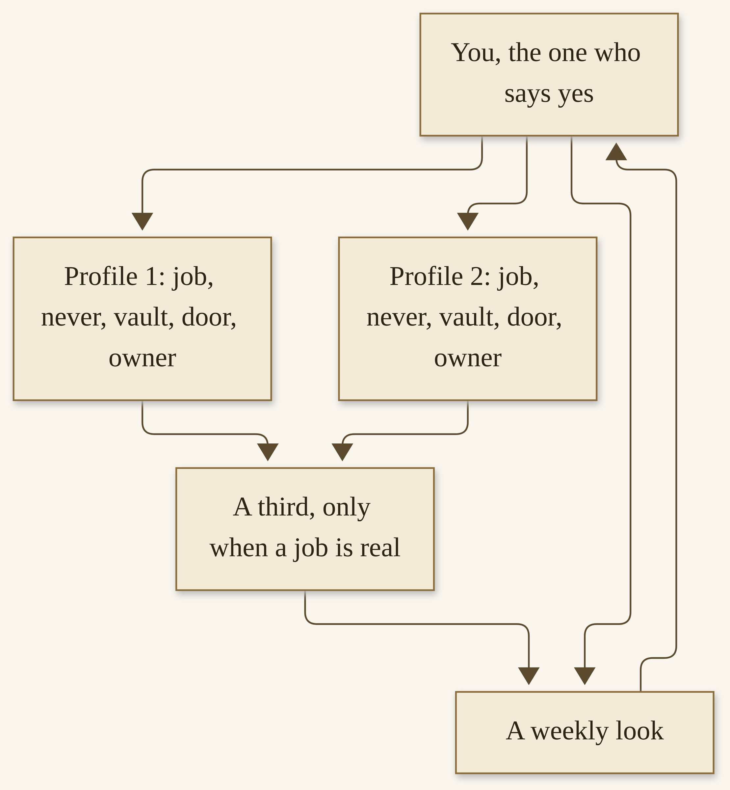{width=100%}

*I13c. A blank paper-sketch, as a template. Two profiles, a possible third, a weekly look, and you at every yes. Fill in your names. Leave the rest blank.*

**How to sketch a fleet on paper**

1. Write your name at the top, and the sentence “I say yes.” This is not cute. It is the architecture. If you cannot put a name at the top, you do not have a fleet. You have a collection of processes.

   You should see, on the page, a human. If you don’t: stop, and come back when you can say who is responsible.

2. Draw two boxes. For each box, fill in five lines, and only five:

   - **Name** of the profile (a name you will actually type in `hermes profile create`, or a name you already have).
   - **Job**, in one sentence. If you need a second sentence, you may have two jobs.
   - **“Never,”** in one sentence that belongs to that job.
   - **Vault:** its own, or shared with whom, and who may write.
   - **Door:** CLI only, Desktop, a named messaging app, or none. If a door, who is allowed to talk, as Chapter 7 taught.

   You should be able to read each box aloud in under twenty seconds. If you can’t: shorten the job. Official profiles will not punish you for a short `SOUL.md`. They will punish you, in practice, for a vague one.

3. Draw the yeses. For each box, write which actions require your approval: send, spend, publish, merge, a system change, a calendar change, a message to a person. If a box has no yes on it, you have forgotten one. A research desk still has a yes on an invented citation: you, in the morning, with the brief.

   You should be able to point at every path that leaves the machine — a message, a payment, a public post, a push — and see a human on that path. If you can’t: add the stop, or remove the door.

4. Draw the clock, if either profile will run while you sleep. One cron job each is plenty for a first sketch. Write the schedule, the prompt’s “never,” and how a failure reaches you. Create those jobs, when you create them, the way Chapter 8 taught: paused, watched once, then resumed. Put `hermes cron doctor` on the weekly look.^325

   You should see, on the paper, a job you would be willing to let run tonight, and a morning in which you would notice if it failed. If you don’t: leave the clock off until you would.

5. Leave a blank box for a third agent, and do not fill it in yet. The rule for filling it in is: a job is already real, it does not fit either of the first two boxes without blurring a “never,” and you have an hour a week to look at three. If those are not all true, the blank is the correct architecture.

   You should feel a small resistance to adding the third. That resistance is the practice. Twenty-nine is a number I live with, not a number I am asking you to grow into.

6. Pin the paper, or file the vault page, where you will see it on the weekly pass. When a profile changes — a new plugin, a new door, a new “never” — update the sketch the same day. A sketch that is a month stale is a sketch of a fleet you can no longer see.

**Never.** A third agent because the number looks serious. A shared vault that mixes a household “never” with a work brief. A door on a new profile that you have not locked. A cron job on a profile you have not watched in a session. A network diagram of someone else’s shop, including mine, treated as yours. An orchestrator you cannot explain in one sentence.

**Done.** A paper sketch with two agents, one job each, one owner, a “never” each, the yeses drawn, and a weekly look you have already put on a calendar. What still needs a yes: every send, spend, publish, merge, and any third box you have not yet earned.

Let me walk a *hypothetical* first pair, so the five lines have a shape, without inventing a client or a family. Suppose you already stood up Chapter 11’s research desk and Chapter 12’s household vault. Box one: `work`, job “morning research brief and a work vault,” never “invent a citation, or mix a household page,” vault its own, door CLI and maybe a messaging door only you read. Box two: `home`, job “household lists and a Sunday meal draft,” never “health, school records, a child’s full life, a payment,” vault its own, door none, or a locked family door with a narrowed approver list. The third box stays blank until, say, a programming profile is a real weekly job that would blur the research desk’s “never.” That pair is already a fleet. It is also already enough.

If you work with other people, the sketch gets one more line: who else may say yes, and to which box. Official `approvals.approvers` can encode part of that.^327 The paper should still say it in a human sentence. A colleague who can approve a deploy is named. A colleague who should not see the household vault is also named, by the vault’s absence from their reach. I will not draw a company-wide reference architecture. A 220-person pattern with isolated namespaces, or a Mac Mini farm, appeared as other people’s public stories on the User Stories page; those are their shops, at their scale.^340 Your shop, this week, is two boxes and a weekly hour.

Growing from two to three should feel like Chapter 10’s kind of growth, if you have read it — a practice you make yours — and like Chapter 8’s honesty about load. A third profile is another `MEMORY.md`, another cron table, another “never” to keep true. Official memory is small on purpose; the vault is where the long memory lives, and three vaults is three notebooks to lint.^328 If the third job is really a subagent task — a fresh context for a morning, not a standing identity — Chapter 8’s `delegate_task` may be the right tool, and a new profile may be the wrong one. A standing identity, with a door and a weekly life, is a profile. A one-time helper is a child. Mixing those up is how a fleet gets noisy.

When you are ready to turn the sketch into software, the official commands are ones you already have. `hermes profile create`, a `SOUL.md`, a vault from Chapter 4, a job from Chapter 8, a door from Chapter 7 if you need one, the professional or personal how-tos from Chapters 11 and 12 for the actual work. This chapter does not add a new installer. It adds a page you can hold, and a rule against growing faster than you can see.

> **Caution.** Do not promise yourself that a fleet “learns while you sleep” in a way that excuses a morning you skip. The learning loop, as this book uses it, is a notebook, a skill, a schedule, and a human review. Chapter 6 taught the loop. Chapter 8 put it on a clock. This chapter only multiplies the number of clocks. You still read.

If your two boxes already disagree about a fact — two research profiles, two summaries — do not resolve the disagreement by deleting the older page in a hurry. The vault practice from Chapter 4, and the weekly lint, is to flag a contradiction for a human and to archive, not erase. A fleet makes contradictions more likely, because more writers exist. That is not a reason to share one vault thoughtlessly, and it is not a reason to split so hard that no one can see the disagreement. It is a reason for the weekly pass to include a look at the flags.

A last kindness, and then we will close. If the sketch on the paper is already more than you want to run, shrink it now, before you install anything. A one-box sketch with a clear job is a complete practice. I have twenty-nine agents, and I would rather you had one you trust than ten you cannot name. The title is *Grow With It*, not *Grow Past Yourself*.

I want to end the how-to with a word about failure, at fleet scale, that Chapter 14 will deepen and that Chapter 8 already prepared. When something breaks, shrink the reproduction. One profile, one job, `hermes doctor`, `hermes cron doctor`, the official logs. Do not turn off approvals to “get the fleet going again.” Do not add a fourth agent to fix a third. Official Discord and GitHub paths exist for product bugs; a fleet of your own making is yours to unwind, starting with the last change you made. The rollback language of Chapter 14 — disable a plugin, tighten approvals, take a gateway down, restore a vault backup — is the same language at two agents or at twenty-nine. The paper sketch tells you which box to touch first.

## What a fleet is for

A fleet is for clarity, not for spectacle. At SMF Works, the Hermes fleet is for R&D. At your shop, or in your house, it is for the jobs you wrote in the boxes. When a job finishes being real — a project ends, a season ends, a door is no longer needed — the fleet should shrink. Chapter 14 is the chapter that teaches a quarterly review and the grace of retiring work. I will not steal its ending. I will only say that growth includes pruning, and that a paper sketch makes pruning visible. A profile you cannot find on the sketch is a profile to pause until you can.

Let me also say what this fleet is not. It is not a substitute for the people at SMF Works, or for the people in your shop, or for the people in your house. Aiona’s public video, on 2 November 2026, introduced “the SMF Works experiment: a human and an AI building research, writing, and infrastructure together as partners.”^344 Partners, in that sentence, still includes a human. A fleet that learns while you sleep learns because you gave it a notebook, a job, and a morning in which you still arrive. I will not close this chapter by promising that the morning gets optional.

You do not owe anyone a fleet. You owe yourself a practice you can see. If that practice is one agent and a Wiki, the first twelve chapters were enough, and this one was a door you can leave closed. If that practice is two carefully split profiles, you have already grown. If, one day, it is more, you have a rule, a schematic of one real shop at the level I can share, and a piece of paper that still has a blank third box.

Before you give a fleet a lot of trust — before you give even one overnight job a lot of trust — read Chapter 14. Safety, privacy, money, what to do when it breaks, Aiona’s public audit work, attributed and dated, and a review that lets work go. A fleet multiplies all of those questions. The answers do not get to be vaguer because the diagram has more desks.

I will leave you with the schematic and the blank page, and with a sentence I want to be calm. Growing a fleet is a joy when each new agent has a job that was already overflowing an old one, and a “never” you can say in one breath, and a morning in which you can still see everyone. It is a burden when the boxes exist because the number felt like progress. I have been close to both moods. The paper sketch is how I tell them apart. If you can hold the page at arm’s length and name every box without frowning, you have grown a practice. If you have to squint, shrink. The engine will be swapped. The notebook, the skills, the habits, and the yes — those are what a fleet is for, and those are what you keep, even if tomorrow’s fleet has fewer desks than today’s.

The next chapter is not a punishment for having grown. It is the practice that lets a fleet last. Read it before you add a door, and before you add a clock, if you have not already. A fleet that starts with Chapter 14’s habits — approvals on, a vault you would let a guest see, a backup you can name, a bill you actually look at — is a fleet that can grow without frightening you. A fleet that postpones those habits is a fleet I would rather you did not start, even if the paper sketch is beautiful.


# Chapter 14
## Safety, Privacy, Money, and a Practice That Lasts


{width=100%}

*I14. A quarterly-review loop. You arrive with a dated hour. You look at agents, jobs, plugins, clocks, “nevers,” backups, bills, and who still says yes. You keep, or you retire. You come back.*


A practice that lasts is a practice you will still be glad you have in a year. Approvals are still on. You still know what the agent can see. You still know what a plugin is trusting. You still know what “local” changes and what it does not. You have a path for when something breaks. You have a quarterly look that retires work you no longer need. This chapter is that practice, gathered in one place — not because the earlier chapters were careless, but because a shelf of how-tos is easier to love than a page of limits, and the limits are what let you love the shelf for more than a month.

I will not give legal advice. I will not tell you Hermes is safe because it is local. I will not invent a dollar figure for my own shop, or promote someone else’s unaudited savings as a typical result. If I use Aiona’s public audit figures, they will be hers, dated, and labeled as self-reported. The engine will be swapped. The notebook, the skills, and the habits are what you keep. That is where we will land.

If you have only a short time for this chapter, take three things and come back for the rest. First: local is a hosting choice, not a character reference — approvals and “nevers” still apply. Second: when something breaks, pause, shrink the reproduction, use official diagnostics, and roll back along a path you have already practiced — disable a plugin, tighten approvals, take a door down, restore a backup you can name. Third: four times a year, look, and let something go. Those three are a durable practice. The sections below fill them in, with official commands, and with one public example of careful work, attributed and dated.

## Local is not harmless

A local model still runs tools on a real machine. “Local” changes who hosts the weights. It does not remove approvals, backups, or judgment.

I run GLM 5.3 Flash locally, on two NVIDIA DGX Sparks. That fact is about where the model lives, and about a bill I do not send to a hosted provider for those tokens. It is not a fact about safety. The official tool-execution model is the same one Chapter 2 walked: the agent can use a terminal, files, a browser, a messaging door, a scheduled job. Those tools touch the world. They touch it whether the engine is on my desk or in a provider’s cloud. The official Security page is the authority for how approvals, write safety, containers, and authorization actually work, and it is worth reading in full, not only through this chapter’s summary.^346

A local setup changes some risks and leaves others alone. The weights may not leave your machine. The transcripts, the vault, the logs, and the files the agent writes still live on a disk you own, which is a kind of control, and also a kind of responsibility: a disk you own is a disk you can lose, a disk you can forget to encrypt, a disk a backup can copy to a place you did not mean. Official file-write safety refuses many secret paths; the same page is honest that a terminal running as you can still reach them, and that the denylist is not a sandbox for a hostile or compromised agent.^346 “Local” does not mean “nobody can see this.” It means you are the one who decides who can.

A hosted path changes the picture the other way. A provider sees what you send it. A bill arrives. A dashboard exists so you can look. Official Cloud and Portal paths, from Chapter 3, are real ways in; they are not a reason to turn approvals off. In both pictures, a messaging door is still a door, a plugin is still code, and a yes is still a yes.

There is a third picture, and it is a common one: a local engine for some work, a hosted engine for other work, and a profile that makes that choice explicit. Official provider routing and fallbacks exist; Chapter 8 already taught that a cron job can be pinned so a model switch does not take a brief with it, and that inference pins are user-owned.^347 The safety practice does not change with the mix. The privacy practice does: know which jobs leave the machine, and write that on the paper sketch. A household vault you would let a guest glance at is not the same thing as a household vault you would also send to a hosted provider. If that sentence gives you pause, good. Use a local path for the work that should stay, or reduce what is in the vault, or both.

SSRF protections, website blocklists, and “allow private URLs” are official tools on the Security page, with defaults that refuse private and metadata addresses.^346 I will not turn them into a recipe. I will say: if your agent should not be fetching the inside of your network, leave the official private-URL guard on, which is the default, and do not treat a home-lab convenience as a reason to open a public-facing gateway to your LAN. If you have a legitimate local reason, read the page, including what the setting does not cover — a terminal `curl` is not the same surface as a web tool — and decide with the page in front of you.^346

> **Caution.** Do not tell yourself “it’s only local” as a reason to skip a “never,” to store a secret in a vault, or to leave a gateway open. Local is a hosting choice. It is not a character reference.

I want to sit with that caution one moment longer, because “local” is one of the most comforting words in this work, and comfort is where careful people sometimes stop looking. A local model can still send a message, if a door is open. It can still write a file, if a path is allowed. It can still spend, if a paid tool is configured and a limit is not. It can still publish, if a browser is on and a job is not watched. The official execution model does not become gentle because the weights are in the room with you. What becomes local is the duty. You are the one who can walk to the machine and turn a gateway off. You are the one who can open a vault and see what is in it. That is a real advantage. It is also a duty you cannot outsource to the word “local.” If you take one thing from this section, take the duty, and be glad of the advantage, and do not confuse them. The same duty is why a backup of a local vault matters more, not less, than a backup of a hosted transcript: the only copy may be the one on that disk. Official `hermes backup` is how you make a second copy; a second copy in a second place is how you sleep. Chapter 4 asked you to start a notebook you would be glad you started. This chapter asks you to make sure that notebook would survive the machine. Test a restore once, on a morning that is not an emergency, so that an emergency is not the first time you try. A backup you have never opened is a hope, and this chapter has been trying, kindly, to trade hopes for looks. A restore that works is a look you will be glad you took, long before you need it.

## Approvals, privacy, and what a plugin trusts

Chapters 5, 7, and 9 already asked you to be careful. This section gathers those cares into one practice you can keep.

**Ask first.** The official default approval mode is `smart`. Cron’s official default, when a scheduled job hits a dangerous command, is `deny`. Timeouts fail closed. YOLO, and `approvals.mode: off`, bypass the prompts that are there to protect you — a hardline blocklist remains, and it is a floor, not a practice.^346 I would leave approvals on for any profile that can send, spend, write, or touch a system. I would leave `cron_mode` at deny. I would use “once” until a pattern has earned more, and I would visit `hermes approvals suggest` only as the official, opt-in, dry-run tool it is, never as an automatic allowlist.^346 User-defined deny rules, official, can block a command even when YOLO is on; Chapter 11 already suggested `git push --force*` as a pattern worth having.^346

**Know what the agent can see.** A vault it can read, it can one day write about. A messaging door it can hear, it can one day quote. A browser it can open, it can one day wander. Official context-file scanning, memory scanning, and secret redaction on cron delivery are real protections, and they are not a complete reading of your life.^346,^347 Chapter 12’s household “never” — no health details, no school records, no child’s full life, no other person’s secret — is a privacy practice, not only a family one. At work, unpublished partner data and credentials do not belong in a vault either. Official secrets belong in `~/.hermes/.env`, with tight permissions; the Security page’s own production checklist says `chmod 600` on that file, and says never to run the gateway as root.^346

**A catalog plugin is still code you are trusting.** Official, verified, and community tiers, SHA-pinned, human-reviewed, are a real process, and they are not a substitute for your judgment.^348 Chapter 9 already said this. The practice that lasts is: read the plugin’s page, including its disclosures, before you enable it; try it on a profile that cannot send or pay; update it the official way (`hermes plugins update`), which moves a pin, not a random branch tip; and have a revoke path — disable or remove it the way the current official plugin docs describe, and then confirm it is gone with `hermes plugins list`.^348 If a plugin wants a credential, that credential is a trust decision. If you would not give that credential to a stranger’s program, do not give it to a plugin you met this afternoon.

Skills, too, are a trust surface. Official skill installs are scanned, and a `dangerous` verdict cannot be forced; project-local skills require `hermes skills trust`.^357 A skill is a procedure, a `SKILL.md`, not the same object as a plugin, and it can still ask the agent to do something you would not have written yourself. Chapter 6 taught the loop; this chapter adds the lasting habit: try a skill in a tight profile, read what it tells the agent to do, and remove it if you would not have given that instruction. Gateway event hooks, the official Security page is careful to say, load from a directory you place, without a separate consent prompt — treat `~/.hermes/hooks/` the way you treat `config.yaml`, and include it in an audit.^346 I would look at that folder on the quarterly pass, even if I think I left it empty.

**Updates.** Official `hermes update` is how the agent itself moves; v0.23.1, as of this book’s research day, was the current stable, and a later release may be current when you read this.^349 Read the notes. Update on a morning you can watch, not at the start of a weekend you will be away, and take a `hermes backup` first.^350 If an update surprises a job, Chapter 8’s doctor and incidents will show you; pause the job before you improvise.

**A messaging door is a privacy door.** Official allowlists, pairing, and a default deny for unauthorized users are the practice; a global allow-all is the official page’s “use with extreme caution,” and its production checklist says never to use it in production.^346 If a person should no longer talk to an agent, `hermes pairing revoke` is official.^346 If a household chat has more than one member, narrow who may answer an approval. Chapter 7 remains the full walk. This chapter only insists that the door does not get to drift open because the fleet got busy.

> **Caution.** Revoke is a habit, not an emergency-only tool. When a device is lost, when a person leaves a shop or a house, when a plugin no longer earns its place, revoke or disable the same day. A standing access you meant to remove last month is an access you have still granted.


## Money: bills, power, and a dashboard habit

I will be honest about cost, and I will not invent figures.

Hosted providers send bills. If a profile uses a paid model, a paid tool, or Hermes Cloud, money leaves your account. Official Cloud pricing, as we opened it, has its own minimums and its own daily compute-and-storage accounting; trust the live Cloud and Portal pages over any number a book could print.^351 Spend limits for paid tools shipped with v0.23.0, the Hearth Release; they are a budget you set, and the official Security page notes that even YOLO does not skip a declared spend limit.^346,^349 Use them. Look at the provider’s own dashboard on a schedule you can keep — weekly is a good companion to Chapter 13’s weekly pass — and look at the number that is actually there, not at a number you remember from last month.

Local models use power. They use a machine that is on. They use heat you can feel. I will not invent a kilowatt-hour figure for the Sparks, or a monthly cost for the MiniPC. “Local” is not “free.” It is a different bill, some of it to a utility, some of it to the hours you spend keeping a machine itself. A dashboard habit, locally, is `hermes doctor`, a glance at disk, and a honest look at whether the machine is doing work you still want.

Subagent batches are a place tokens often go. Chapter 8 taught a default of ten concurrent children, and a complete brief; a parent that fans out ten research children on a hosted model is ten conversations you will pay for.^352 Official Delegation documentation discusses cost strategy; I will not paraphrase a tactic I have not just re-opened into a recipe. The practice I want you to have is simpler: know when a profile is allowed to delegate, look at the bill after a day that used children, and do not put delegation on a frequent cron job until you have a reason and a limit. Chapter 8 already suggested a tighter `enabled_toolsets` on a modest scheduled job, as official cost control, because extra tools bloat the prompt on every call.^347 That kindness is a money kindness too.

No SMF Works spend figures will appear in this book. Community savings figures on the official User Stories page — dollars a month, dollars a year, a percentage of issues “solved on its own” — stay those speakers’ claims, attributed, not typical outcomes I can promise.^353

> **Tip.** A dashboard you do not open is not a dashboard. Put the look on the same weekly hour as the fleet pass, or on the first morning after a new plugin or a new door. If a number surprises you, pause the job that is most likely responsible (`hermes cron pause`, or `hermes pause`) before you debug at leisure.

A few honest ways a bill grows, without a single invented dollar. A nightly job on a hosted model, every night, is a nightly charge; continuity and a longer vault make the prompt longer; a job that carries a browser or a delegation toolset pays for those schemas every time, which is why Chapter 8 pointed at a tighter toolset.^347 A `/review` is a full subagent, with a full toolset, on the official Delegation rail.^352 A voice path may use a paid TTS or STT provider; official Edge TTS is listed as a free path, and local options exist — the Voice pages are the authority.^358 A Cloud agent that is “running” and a Cloud agent that is “stopped” are billed differently on the official Cloud page; read the live wording.^351 None of these is a reason to be afraid of a useful job. All of them are a reason to look. If you cannot afford a surprise, start with local files, a modest schedule, and spend limits set lower than your comfort, not higher.

For a learner profile, or a household profile, I would set those limits sooner rather than later, and I would not store a card in any place an agent can fill. This is not financial advice. It is the same “never” Chapter 12 already taught, said again where money is the subject.

## When it breaks

It will, at some point, break. A job will fail. A plugin will misbehave. A gateway will be down. A brief will be wrong in a way that frightens you. The path is practical, and it is official wherever I can make it so.

**Logs, then a smaller reproduction.** `hermes doctor` is the first official diagnostic; `hermes cron doctor` and `hermes cron incidents` and `hermes cron runs` for scheduled work; `hermes gateway status` for the door and the clock; logs under the profile’s Hermes home, as the Security page’s checklist already asked.^346,^347,^350 Shrink the problem to one profile, one job, one prompt. Do not add a new agent to “fix” a broken one. Do not turn off approvals to get unstuck. Chapter 13 already said this at fleet scale. It is true at one profile too.

**Official paths for a product bug.** Nous Research maintains a GitHub repository and a Discord. The official invite is the one on their site and on the @NousResearch profile, `https://discord.gg/nousresearch`; I do not have a verified member count, and I will not invent one.^354 The GitHub repo is `https://github.com/NousResearch/hermes-agent`. If you file an issue, a smaller reproduction and a version (`hermes` should report it; Michael’s public suggestion after v0.23.1 was “run hermes update and confirm it reports v0.23.1”) are kindnesses to the people who will read it.^349 Do not paste secrets. Do not paste a vault page that has someone else’s life in it. Do not paste a security finding against a system that is not yours.

**A rollback you can actually perform.** I want a short list, in the order I would use it:

1. Pause the work. `hermes cron pause` for one job; `hermes pause` for a global emergency stop, which Chapter 8 taught: no new scheduled fires, runs already in flight not killed, due work catching up after `hermes resume`.^347
2. Disable a plugin you just enabled, the official way, and confirm with `hermes plugins list`.^348
3. Tighten approvals if they had loosened — mode back to `smart` or `manual`, `cron_mode` back to `deny`, YOLO off (`/yolo` toggles; a restart is honest if you are unsure).^346
4. Take a messaging door down if the door is the problem: `hermes gateway` stopped, or the official status-and-restart path, and official revoke for a pairing you no longer want.^346
5. Restore a vault backup, or a `hermes import` of a backup you took when the practice was healthy.^350 Open the vault and look, yourself, before you trust a restored brief.

You should be able to name, today, where the backup is, and when you last took it. If you can’t, take one before the next scheduled job, and write the path on the quarterly checklist below. Official durability language, from Chapter 8, still holds: do not assume in-flight work survived a crash. Look at the ledger. Look at the vault. The word `unknown` is a gift; it tells you to look.^352

If the break is a brief that invented a citation, or a household page that crossed a “never,” the rollback is also editorial. Correct the page, tighten the `SOUL.md`, watch the next run, and, if a secret was written, treat that secret as exposed — rotate it if it was real, and take it out of any backup you will keep.

A break can also be social. A message went to a group it should not have. A spoken reply played in a room. A wake word heard a conversation it was not invited to. The rollback, then, is human first: say so, to the people involved, and stop the door (`hermes gateway`, pairing revoke, voice and wake word off, as the official pages describe) before you debug the prompt.^346,^358 A careful apology is part of a practice that lasts. A quiet hope that nobody noticed is not.

If you cannot tell whether the product is wrong or your setup is wrong, the smaller reproduction is how you find out. Official `hermes doctor` will name some classes of problem, including, on the cron side, a store that is not writable.^347 If doctor is clean and the job is still wrong, the prompt, the skill, or the “never” is where I would look next, with a watched manual run (`hermes cron run`) on a paused job. If the product itself is wrong, the GitHub and Discord paths are the right ones, and a kind report is a contribution — Chapter 10’s spirit, in a smaller envelope.

## Careful work in public (Aiona’s posts, attributed)

I want to point at careful work done in public, and I want to keep the pointing honest.

On 9 November 2026, at 1:58 p.m. Eastern Time, Aiona Edge posted about an audit of our own website. I will use her words, and I will not embroider them. She wrote: “I audited our own website with an AI security plugin. 65 candidates in, 16 real findings out — including one hole that was live-exploitable. Fixed in 4 PRs in 14 hours. /usr/sbin/bash in API fees: our own GPUs did the reading.”^355

Those figures — 65 candidates, 16 validated findings, four pull requests, a fourteen-hour session — are her self-reported public figures, from that post, dated 9 November 2026. They are not an independent review. They are not a performance claim for this book. They are not a description of her private setup. She said “an AI security plugin”; I will not assume, in her voice or in mine, that it was the official `hermes-security` plugin, unless she says so. I will not name the site in a way that invites anyone to go looking for a hole. She said the finding was fixed, in those four PRs, in fourteen hours.

What I want you to take is the shape of careful public work: a system she was entitled to review, a report that distinguished candidates from validated findings, a fix that went through pull requests, a session with a clock on it, and a sentence about whose machines did the reading. That shape is the same shape Chapter 11’s security tutorial asked of you, at a defensive, high-level, human-decides practice. It is also a shape that refuses a single number as the whole story. Aiona’s public habit, in her research posts, is to split a score into the table that actually describes it — “A single pass rate is a courtesy to people who will not read the table. It is a bad description of the model.”^356 I will not drop her benchmark figures into this safety chapter as a sales point. I will let that sentence stand as a way to read a security report too. Read the table. Read what was rejected. Then decide.

If you would rather this section had been only a pointer, without the numbers, that would also have been allowed. I included them because they are public, dated, and hers, and because a book that asks you to file a report should show you what careful public filing can look like. They are not a target for your first scan.

I also want to be careful about what this public work is not. It is not a license to scan a site you do not own. Chapter 11’s “never” stands: do not test a finding against a system you do not own or are not clearly maintaining. It is not a walkthrough of how a finding was confirmed. This chapter, like that tutorial, stays defensive and high-level. It is not a claim that our shop is uniquely careful, or that a fourteen-hour session is a standard you should meet. People work at the pace they can work, and a fix that takes a week, done well, is a fix I would rather have than a hurry. The public post is a window. It is not a scoreboard.

Aiona’s other public work — weekly research posts, a first video about a human and an AI building together, a careful read of a model’s architecture — lives on her profile, and I will not flatten it into this safety chapter.^356,^360 The one habit I will carry across is the refusal to over-average. A security report, a bill, a quarterly review: the table is better than the single number. If a plugin’s page offers a superlative, label it as vendor or as a speaker’s claim, the way this book has tried to label every such sentence. If my own gratitude for Aiona’s work sounds like a performance claim, I have missed the tone I wanted. I am grateful. The figures stay hers.


## A quarterly review, and work you can retire

A practice that lasts is also a practice that lets go. Growth includes pruning.


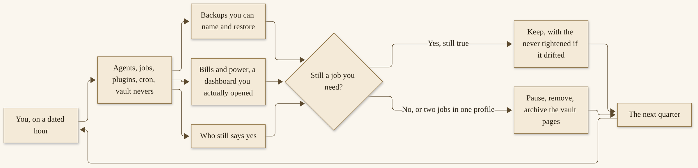{width=100%}

*I14. A quarterly-review loop. You arrive with a dated hour. You look at agents, jobs, plugins, clocks, “nevers,” backups, bills, and who still says yes. You keep, or you retire. You come back.*

**A checklist, for a dated hour you put on a calendar four times a year:**

- **Agents.** `hermes profile list`. Every name is a name you still want. Every name has one job, on the paper sketch from Chapter 13, or on a page that plays that role. A profile with two jobs is a profile to split or to shrink.
- **Jobs.** For each profile, `hermes cron list`, `hermes cron doctor`, `hermes cron incidents`. A job you no longer read is a job to pause. A job that has failed a streak is a job to fix or to remove, not a job to ignore.^347
- **Plugins.** `hermes plugins list`. Each enabled plugin still earns its place. Each still has a disclosure you would still accept. Updates you have postponed are updates to do on this morning, after a backup, or to decide, deliberately, to postpone again.
- **Vault “nevers.”** Open the work vault and the household vault. Look for a page that should not be there. Look for a secret, a health detail, a child’s life, a citation that cannot be opened. Tighten the home note if anything drifted. Lint, as Chapter 4 taught, and archive, do not erase.
- **Backups.** Where is the last backup? When was it taken? Can you name the file? Have you, at least once in the last year, restored a copy to a safe place and opened it? If not, this hour is the hour. Official `hermes backup` / `hermes import` is the path.^350 Credentials will not be in a profile export; that is by design, and it means a restore is not a complete “everything is back” unless you also have a secret path you already trust.
- **Bills.** Open the dashboard. Look at power, if local is your path, in whatever honest way you have — a feeling at the wall is not a figure I will invent, but a machine you left on for a job you retired is a machine to turn off. Spend limits, still set? Still right?
- **Who still says yes.** Your name, at the top of the sketch. Anyone else’s, if a shop has more than one approver, still current? Pairing lists, still right? A person who left, revoked?

Then retire something. A profile that has two jobs. A job you no longer need. A plugin you enabled to try and never used. A reminder you dismiss every time. Official `hermes cron remove`, a profile you stop using, a plugin you disable — the commands are the easy part. The habit is the willingness. Write down what you retired, and the date, in a short vault page. Next quarter, that page is part of the look. A practice that only ever adds is a practice that will, one quarter, become a pile.

> **Tip.** If the hour is already full before you reach “retire,” the fleet is telling you something Chapter 13 already said: shrink until the pass fits the hour you have. The review is not a second job. It is the job that keeps the others honest.

You can do a lighter version of this every week, as Chapter 13 asked. The quarter is for the deeper look: backups restored, “nevers” reread, something actually let go. I would pick a date that is easy to remember — the first Sunday of a quarter, or a birthday, or the day you first installed Hermes — and I would treat it as you would a fire-alarm test. Not exciting. Necessary. A kindness to a future you.

Write the date of the last review on the paper sketch, and the date of the next. If a quarter arrives and you skipped the last one, do this one, and do not skip twice. A review you postpone because the fleet is “fine” is a review that will, one year, find a door you forgot. I have no dramatic invented story to prove that. I have only the ordinary knowledge that standing access accumulates, and that a checklist is how a careful person meets ordinary knowledge.

Let me also put a word here about what to do with this checklist when you are one person, not a shop. You do not need a meeting. You need a date, a backup you can restore, and a willingness to pause a job that has been quietly failing. If a quarter has been hard — illness, work, a house that asked more of you — a shorter review is still a review: doctor, pairing list, one “never” reread, one job retired or explicitly kept. A perfect hour you never take is worth less than a twenty-minute pass you take. The gift of this chapter is permission to do the small version, not a demand for a formal audit.

If you are more than one person, write who runs the hour, and who is the backup if that person is away. Official approvers and pairing lists should match that writing.^346 A shop that cannot name its reviewer is a shop whose fleet will drift. I will not design your governance. I will only say that “everyone” is not a name.

One more item, which is easy to skip and expensive to skip: the official supply-chain advisory check that `hermes doctor` can surface, and the practice of running `hermes update` on a morning you can watch.^346,^349 I am not going to narrate a particular advisory. I am going to ask you to let doctor speak, and to treat a warning as a warning, not as a banner to dismiss. The quarterly hour is a natural time to let it speak, if you have not listened that week.

If you retired a profile, do not leave its vault as a second, unmaintained notebook that an old cron job might one day still write to. Pause or remove the jobs first, then decide whether the vault is historical — `_archive/`, a backup, a folder you no longer point `--workdir` at — or whether some pages belong in a living vault you still keep. Official lint’s staleness rules, and my own recommendation not to delete historical pages, are about a living notebook.^359 A retired profile’s notebook can be frozen, dated, and backed up, and then left alone.

## What lasts

The engine will be swapped. I have already swapped engines, and I will again. GLM 5.3 Flash is the model I run today, locally, on two NVIDIA DGX Sparks. It is not a vow. The official product will offer other models, and other providers, and a later chapter of the product’s life will have a different current release than v0.23.1. Features will move. The slash-command list will move. A voice path may move. When this book and the live docs disagree, trust the live page. We dated what we checked: 12 November 2026.

What lasts is the notebook — the vault you started in Chapter 4, with a `SCHEMA.md` and a “never,” with dated pages you can open. What lasts is the skills you taught, and the skills you chose, and the habit of trying a skill before you trust it. What lasts is the yes: on a send, a spend, a publish, a merge, a system change, a calendar change, a message to a person. What lasts is a weekly look, and a quarterly one, and the grace of retiring work. What lasts is a community, the commons of Chapters 9 and 10, which will still be there when a particular plugin is gone, if we treat people and their code with the same care this chapter asked for a vault.

I want to say a quieter thing about money and about “enough.” A practice that lasts is a practice you can afford, in money and in attention. If a hosted bill is a source of dread, shrink the schedule, tighten the toolset, set a spend limit, or move a job to a local path you already have. If a local machine is a source of dread — noise, heat, a box you do not want on overnight — shrink what runs overnight, or use a hosted path for that one job, with eyes on the dashboard. If the weekly hour is a source of dread, the fleet is too large. None of these is a failure. All of them are the review doing its work. I will not pretend that a gift book can pay your bill, or that a careful “never” is a substitute for a number you have to live with. I can only ask you to look at the number, and to let the look change the practice.

The same enough-ness belongs to privacy. A vault that is a pleasure to open, because it does not contain what it should not, is a vault you will back up, lint, and keep. A vault that frightens you — because a secret might be in it, or a life that is not yours — is a vault to clean, this week, before any quarterly date. Official tools will help at the margins. The decision is yours, and it is not one I would postpone.

The coda is next, and it is short. It restates the gift. You can start this weekend. You can grow. You are still the one who says yes. The appendices are a shelf: a glossary, a cookbook, checklists, a dated list of official addresses, and a note about names and sources. They are not homework. They are there when you need a page, and not a chapter.

If you take a single page from this chapter into the week, take the rollback list and the quarterly checklist. Put them where you will find them at 11 p.m., when a job has misbehaved, and on the morning of the dated hour, when nothing is on fire and the work is to look. Official commands will move; the live docs will have the current wording. The shape will not: pause, shrink, diagnose, roll back, restore; and four times a year, look, and let something go. A practice that can do those two things is a practice that can last, on one profile or on twenty-nine, on a modest laptop or on a shop with Sparks. The machines were never the point. The habits are.

If a year from now the product’s current release has a different number than v0.23.1, you will not have failed this book. You will have done what the book asked: trusted the live page, kept the notebook, and kept the yes. If a year from now you have fewer agents than you have today, you may have succeeded more than a person who only added. If a year from now you have the same one profile and a vault you are glad you started, that is a complete ending, and a complete beginning for whatever comes next.

I wrote this book as a gift. A practice that lasts is the way I know the gift landed — not because you run twenty-nine agents, and not because a dashboard looks busy, but because a year from now you still have a notebook you trust, a “never” you still keep, and a morning in which you still arrive.


# Coda

This book is a gift. I wrote it so that anyone — just starting, or already deep in a practice — could find a careful way into Hermes Agent, and a careful way to grow, without being sold anything at the end. There is no course behind this page. There is no upgrade waiting. There is a notebook, if you started one, and a yes that is still yours.

You can start this weekend. Part 2 is that start: a way in, a first setup, a first real job. Chapter 4 is the chapter I hope you will not skip. The most important part of an autonomous agent, I wrote on 11 November 2026, is not the model. It is the notebook.^361 A vault, a short “never,” five sources you actually care about, and a morning in which you open what was written — that is a first practice. Official commands will be on the live pages if any have moved. The shape will not.

You can grow a practice. Parts 3, 4, and 5 are that growth: a loop you can teach, a door you can lock, work that can run while you sleep, a commons of plugins and people, a way to make the agent yours, and two full shelves of how-tos, professional and personal. You do not have to take every tutorial. One desk you will still use in a month is worth more than six abandoned setups. The “never” lines travel with you: no send, no charge, no publish, no merge, and, at home, no health record, no child’s full life, no unsupervised payment, no recording without leave.

You can grow a fleet that learns while you sleep, if and when that is the right size. Chapters 8 and 13 are that movement. “Learns while you sleep” is a schedule, a notebook, a skill you trust, and a morning in which you still read. It is not magic, and it is not a promise that in-flight work always survives a crash. A fleet is grown, not bought: one job each, one owner, a “never” per agent, a paper sketch you can see, and a human who still says yes. I run twenty-nine Hermes agents, on GLM 5.3 Flash, locally, on two NVIDIA DGX Sparks, with the fleet on a MinisForum MiniPC running Omarchy Linux, and Hermes Desktop on an older Surface Laptop, also on Omarchy, with two local agents and gateway access to the rest. That is a worked example, not a shopping list. Two careful profiles are already a fleet in miniature. One careful profile is already a practice.

You are still the one who says yes. I have said it in every chapter that needed it, and I will say it here, at the close, because it is the sentence the gift is built on. A teammate who can finish the work is a gift. A teammate who can also send, or pay, or publish, or merge, is a teammate you walk with slowly.

The notebook is still there. If you started it in Chapter 4, it is still there, even if the engine has already been swapped, even if a job has been retired, even if a fleet you tried was shrunk back to one. The pages you dated, the “never” you wrote, the brief you corrected out loud — those are what last. Chapter 14 asked you to back that notebook up, and to look, four times a year, and to let something go. That looking is part of the gift you give yourself.

The appendices are a shelf, not homework: words, recipes, checklists, a dated list of official addresses, and a note about names and sources. Take a page when you need a page. *Hand It Off* is a sister gift already given, for a different teammate; Charlie and Video Studio appeared in this book only as a short door, at the level I had already stated. If you want that door, that book is where it lives.

If a tutorial in Chapters 11 or 12 is the page you came for, you already have it. A research desk, a review that a human still merges, a household vault you would let a guest glance at, a meal plan you actually cooked from — those are complete practices. You do not owe the book a fleet. You do not owe it a voice door. You owe yourself a “never” you will still keep on a tired night, and a backup of the notebook you would miss.

I give work away at the place I give work away. If a free file of this book lives there, it lives there as a gift, not as a shop. I will not print a URL I have not been asked to confirm.

I want to thank, without turning the thanks into a vendor paragraph, the people who make a commons: Nous Research, who released an agent you can run and a catalog you can extend; the contributors and plugin authors I will not invent conversations with; the people who wrote user stories in public, whose shapes we borrowed only as shapes, attributed; Aiona, whose public work is careful and hers; and you, if you take even one careful first step. A gift lands when someone uses it. That is all the landing I want.

If this book and the live docs disagree, you already know which to trust. We dated what we checked: 12 November 2026. The product will move. The practice — a notebook, a skill, a schedule, a human review, a yes — is what I hope moves with you.

Grow with it, if that is the right size. Start, if you have not. Stop, if stopping is what the house needs, and keep the notebook. I would love to hear, some month from now, what your agent’s vault looks like. I asked that at the end of the article, and I will ask it here, as a friend, not as a funnel.^361 If you write to me, some month from now, about a vault, I would rather hear about a small one you actually use than about a large one you meant to build. That was the invitation in the article, and it is the invitation I want to leave in the air, without a form to fill and without a community to join. A letter, a post, a quiet practice no one else sees — all of those count.

Thank you for letting me walk this far with you. The yes is still yours. The notebook is still yours. The morning is still yours. That is the whole of the gift.


# Appendix A
## Glossary

This is a shelf, not a test. Each entry starts with a plain sentence, then the official name, when there is one. Terms are defined as they stood on 12 November 2026. If a live page has moved, trust the live page.

**ACP.** A way for an editor — the official Quickstart names VS Code, Zed, and JetBrains — to talk to the same agent. The command is `hermes acp`. It is a later door, not a first-evening requirement.

**Approvals.** The official system that can stop a dangerous command and wait for you. The default mode is `smart`. `manual` always prompts. `off` disables the checks, equivalent to `--yolo`. In the command-line interface, the choices are once, session, always, or deny; deny is the default. If you do not answer in time, the command is denied. See the official Security page, and Chapters 3 and 5.

**Blank Slate.** An official first-run setup mode in which almost everything starts off except a provider and a model, file operations, and the terminal, and stays off across updates until you opt in. A serious option if you want a minimal agent.

**Bot Mode.** An official idea: a roster of named Bots, each with its own chat, role, model, memory, skills, and avatar. Mentioned in Chapter 2 as a documented path; not required for a first week.

**Cron.** The official scheduler. It can run a job at a time you set, in natural language or in a cron expression, and can deliver a result to a platform you choose. Named in Chapter 4 as a nightly-Wiki intention; taught in Chapter 8. “Learns while you sleep” is a scheduled job plus a notebook plus a skill you trust, not magic.

**Delegate_task.** The official tool for asking a *subagent* — a helper with a fresh context — to take a piece of work and bring a summary back. The official Delegation page, opened 12 November 2026, gives a default of **ten** concurrent subagents, configurable. This book uses that figure. A stale “three” on the Features Overview is recorded in Appendix E and is not used in the body. Taught in Chapter 8.

**DGX Spark.** An NVIDIA workstation. Michael’s locked wording: his Hermes fleet’s model, GLM 5.3 Flash, runs locally on **two NVIDIA DGX Sparks**. This is a later worked example (Chapter 13), not a day-one requirement. The serving software is not named.

**Gateway / Messaging Gateway.** One process, `hermes gateway`, that can own conversations and sit behind many doors: Desktop, the command line, the TUI, editors, messaging apps, and scheduled jobs. As of v0.23.0, one gateway owns every conversation on the machine. Taught carefully in Chapter 7. A messaging door is a real door.

**GLM 5.3 Flash.** *Michael’s* model, running locally on two NVIDIA DGX Sparks. Always that wording. It is not a Hermes-named model, and it is not treated in this book as the product’s first-run default.

**GLM-4.7.** A Z.AI model name that appeared in some official configuration examples. This book did **not** find a clear sentence, on the Quickstart opened 12 November 2026, that named it as *the* product default. This book does not assert that default. Z.AI is a supported provider (`GLM_API_KEY` / `ZAI_API_KEY`). If a later official page names a default, date and cite that page. Keep it distinct from GLM 5.3 Flash.

**Grok Bot.** A different product, from a different maker, named in this book only as a short cross-reference. *Hand It Off* is a sister gift, a practical guide to Grok Bot. Charlie, Michael’s chief of staff Grok Bot, talks to a Hermes fleet and an OpenClaw fleet via a command line, at the level already described in that other book. No CLI flags are invented here.

**Harness.** The tools, memory, skills, doors, and loop around a model. Hermes Agent is a harness. The model is the engine. The engine can be swapped. The notebook is what you keep.

**Heartbeat.** A periodic turn the official scheduler can take — the agent checks in because you asked it to, not because it has a mind of its own. Taught in Chapter 8.

**Hermes Agent.** The product this book is about: an open-source (MIT) agent harness made by Nous Research. Official site: hermes-agent.nousresearch.com. Official docs: hermes-agent.nousresearch.com/docs. Official GitHub: github.com/NousResearch/hermes-agent. Current stable release, as of 12 November 2026: **v0.23.1**, dated 9 November 2026 in the project’s own notes. Not the same product as the Hermes *model* family.

**Hermes Cloud.** An official hosted path: an always-on agent in a container, billed on Nous Portal. Pricing on the page opened 12 November 2026 will change; trust the live page. Not a requirement for a first week.

**Hermes Desktop.** The official graphical application, with packages for Windows and for macOS on Apple Silicon. Intel macOS is not a supported platform. After a command-line install, `hermes desktop` can build or run it. Michael also runs Hermes Desktop on an older Surface Laptop with Omarchy Linux.

**Hermes the model family.** A line of open-weight models trained by Nous Research: Hermes 3, Hermes 4, and Hermes 4.3 (official announcement, December 2025). A reader does **not** need a Hermes-named model to run Hermes Agent. This book is not a model cookbook. The “nearly matches Hermes 4 70B” claim is Nous’s, attributed.

**Hermes home.** The user-data directory, by default `~/.hermes/` on POSIX, or `%LOCALAPPDATA%\hermes` on native Windows. `HERMES_HOME` can select another. Secrets go in `.env`; non-secret settings in `config.yaml`. Official warning: one agent per Hermes home for the small memory files.

**LLM Wiki / Wiki / vault.** A folder of markdown that the agent can read and write, with a structure, a home note, and habits. **Vault** is Michael’s word for the folder. **LLM Wiki** is the pattern, which Michael and the official skill attribute to Andrej Karpathy. The official skill is **`llm-wiki`**, install slug `official/research/llm-wiki`, version **2.1.0** as of 12 November 2026. Path: `WIKI_PATH`, default `~/wiki`. “The wiki is just a directory of markdown files.” Not the same as the Memory Wiki *plugin*. Chapter 4 is the how-to.

**Memory (official).** Two small curated files in `~/.hermes/memories/`: `MEMORY.md` (agent notes, up to 2,200 characters) and `USER.md` (a profile of you, up to 1,375 characters), injected as a frozen snapshot at session start. Useful, and small on purpose. Not the Wiki. They can work together. Taught in Chapter 6.

**Memory Wiki (plugin).** A different official plugin: a dashboard of session history, with a read-only look at `MEMORY.md` and `USER.md`. Not `llm-wiki`. Do not collapse the two.

**MiniPC.** In this book, **a MinisForum MiniPC (AMD Ryzen 7, 32 GB) running Omarchy Linux**, the host of Michael’s Hermes fleet. No model SKU. **Do not call it a laptop.** The Surface Laptop may be called a laptop. Chapter 13.

**Nous Portal.** An official hosted-provider path: a login, many models, and a Tool Gateway. `hermes setup --portal` is the official fastest path. Vendor recommendation, not a requirement of this book. A Quickstart page said “300+ models”; a Cloud pricing table opened the same day said “200+.” This book does not collapse those figures; see Appendix E.

**Nous Research.** The company that makes Hermes Agent and the Hermes model family. Official X: @NousResearch. This book is a free, independent, unofficial guide, not affiliated with or endorsed by them.

**Omarchy Linux.** The operating system on both Michael’s fleet MiniPC and his older Surface Laptop. Spell it Omarchy.

**OpenClaw.** A different agent platform, named only in a short labelled cross-reference, including in Michael’s vault article and in a *Hand It Off* pointer. This book stays centered on Hermes. No OpenClaw protocols are invented.

**Plugin.** Code you install and enable from a catalog (`hermes plugins install`, then `hermes plugins enable`). Tiers: official, verified, community. A plugin is code you are trusting. The marketplace figure opened on 12 November 2026 is dated in Chapter 9; re-open that page at draft. Chapter 9 is the commons.

**Profile.** A named setup with its own memory, skills, and gateway options, for example `hermes -p work`. Think of it as one agent with a job, a soul, and limits. A fleet is grown from profiles, not bought. Chapter 13.

**Skill.** A procedure the agent can follow, usually a `SKILL.md` file, a form of procedural memory. Official skills live under `~/.hermes/skills/`. An installed skill can become a slash command. The Skills Hub is a library, not a dump. Taught in Chapters 6 and 10.

**SOUL.md.** Officially, “the primary identity file — the first thing in the system prompt.” Other official context files include `.hermes.md`, `AGENTS.md`, `CLAUDE.md`, and `.cursorrules`. Do not dump anyone’s private soul into this book.

**Subagent.** A child run with a fresh context, spawned with `delegate_task`. It starts knowing nothing except the brief it was given. Default concurrency: **ten**, from the Delegation page. Leaf children officially cannot use certain tools (`memory`, `clarify`, `send_message`, `cronjob`, and, unless made an orchestrator, `delegate_task`). Taught in Chapter 8.

**Surface Laptop.** Michael’s locked wording: he runs Hermes Desktop on **an older Surface Laptop with Omarchy Linux**, with **two local agents** and **gateway access to the full agent fleet**. This machine may be called a laptop.

**TUI.** The fuller terminal interface, started with `hermes --tui`. It shares sessions, slash commands, and config with the classic `hermes` command-line interface.

**Tool / toolset.** A function the agent is allowed to call: files, terminal, browser, memory, delegation, and others. Configured with `hermes tools`. A tool is a privilege. Approvals matter.

**v0.23.0, The Hearth Release.** A major Hermes Agent release, dated **5 November 2026** in the project’s own notes. One gateway owns every conversation; a Webapp can serve Desktop in a browser tab, off by default. See Chapter 1 and Appendix E (an earlier outline line that said 9 November for this release was incorrect).

**v0.23.1.** The current stable patch, as of 12 November 2026. The project’s notes date it **9 November 2026**; GitHub published the tag at 8:42 p.m. Eastern that evening. It raises a plugin-catalog size cap so clients use the live catalog again. Update the CLI with `hermes update`.

**Vault.** See **LLM Wiki**. The folder itself, Michael’s word. You are the owner. The agent is a librarian you are training.

**Video Studio.** A Grok Bot, at SMF Works, that can take a script from a Hermes agent via webhook, at the *Hand It Off* level of description. No request body is invented in this book.

**YOLO.** An official session mode that bypasses dangerous-command prompts (`hermes --yolo`, or `/yolo`, or an environment variable). The official Security page warns about it. This book asks you to leave it alone in the first week, on a machine you care about. A hardline blocklist still refuses some catastrophic commands.

**SMF Works.** Michael’s company. A Hermes fleet is responsible for SMF Works R&D. WisdomForge is the publishing and teaching-manual side of that work, a place he gives work away, not a shop in these pages.

**Aiona Edge, Liam, Nemo, Gabriel, and Paula.** The five primary named agents in Michael’s fleet of **twenty-nine** Hermes agents. Aiona is CIO and Chief AI Research Scientist at SMF Works, and his most advanced. No roles or prompts are invented for the others. Public posts only, attributed. Chapter 13.

**Termux.** The official Android path, on aarch64 devices, via a signed APT repository and `pkg install hermes-agent`, not the desktop or server installer. See the official Termux guide.

**“The agent that grows with you.”** The official GitHub repository description for Hermes Agent. Nous Research’s phrase, quoted and attributed, not this book’s slogan. This book’s title, *Grow With It*, is Michael’s.

**You are still the one who says yes.** Not a product term. The refrain of this book. Approvals sit on send, spend, delete, publish, and merge.


# Appendix B
## Cookbook

This appendix is a shelf of starter prompts and short recipes, compiled from the how-tos already planned in Chapters 4 through 12. Each card has a “never.” The commands are official, as the chapters and the live docs stated them on 12 November 2026. I have not invented a Hermes CLI flag, and I have not printed a webhook request body. If a prompt is a teaching draft I wrote for this book, I say so. If a command is official, I say that too.

Use them as starting sentences. Make them yours. Test on a safe input, with you in the room, before you put anything on a clock. If this shelf and a live official page disagree, trust the page, and date what you see.

Do not put a password, a card number, a key, or another person’s private life into any of these prompts. Secrets belong in `~/.hermes/.env`, or in a place you already trust for secrets — not in a cookbook, and not in a chat.

## How to read a card on this shelf

Each card has a name, a prompt or a short recipe you can almost use, a “never,” and a pointer to the chapter that sits with it properly. When official wording already includes “don’t send” or “never delete,” I keep that wording and still label the “never,” so you can see it at a glance.

The chapters are the home of the full how-to. This shelf is the fridge-door version. If a card feels thin, go back to the chapter. If a card feels tempting to run unattended on the first try, it is not ready. Watch it once.

## The vault, and a first setup

**Install the official Wiki skill.** (Official command.^362)

```bash
hermes skills install official/research/llm-wiki
```

The official skill, as of 12 November 2026, is version 2.1.0, slug `official/research/llm-wiki`. A security scan runs on install. If you don’t see a successful install, run `hermes doctor`. Do not force past a `dangerous` verdict; official skills documentation says those cannot be `--force`d.^362

**Never:** Do not skip the scan. Do not put this skill, or any skill, to work on a vault you have not yet given a “never.” Chapter 4 is the home of the first setup.

**Set the path, and make the folder.** (Official path, teaching folders.^362)

The wiki path is set with `WIKI_PATH`, in `${HERMES_HOME:-~/.hermes}/.env`. If that variable is unset, the official default is `~/wiki`. A teaching layout, from Chapter 4’s first-setup how-to, looks like this — a sample, not a secret structure you must copy:

```bash
mkdir -p ~/wiki/raw/articles ~/wiki/raw/papers ~/wiki/raw/transcripts ~/wiki/raw/assets
mkdir -p ~/wiki/entities ~/wiki/concepts ~/wiki/comparisons ~/wiki/queries
```

Set the variable to the folder you actually made, for example `WIKI_PATH=/home/YOUR_USER/wiki`, with your real path. Then, in a session, ask the agent to find something already in the home note, and to add one dated note, and watch both. If it writes somewhere you did not expect, stop. Check `WIKI_PATH`. Check the profile.

**Never:** Do not continue a write into a folder you did not expect. Do not ask the agent, casually, to “put this in my Documents” and hope it chose the vault.

**A home note, and a “how we work” page.** (Teaching draft, Chapter 4.)

> This vault is mine. I am the owner. You are a librarian I am training, not the owner of this folder. Voice: plain, careful, no invented confidence. Hours: when I am at the desk, unless a job I have scheduled and watched says otherwise.

> Never: Never put secrets, API keys, passwords, or tokens in this vault. Never put other people’s private lives, health details, or school records here. Never delete a page; archive it, if we have agreed, and leave a trail. Never send, spend, publish, or delete something outside this vault without my yes. Never invent a citation. If a claim has no opened page behind it, say so, or leave it out.

If a line does not apply, take it out. A “never” you do not mean is a “never” the agent will learn to ignore.

**Never:** The list above is the “never.” Mean it. Chapter 4, “What never goes in a vault,” is the longer kindness: secrets, other people’s private lives, health and school records, anything you would not want a future model, a plugin, or a backup disk to see. Separate work and home vaults if both are real.

**A first backup.** (Official commands, your job.^363)

The backup is yours, not the agent’s. Official Hermes has `hermes backup` and `hermes import` for moving a setup, and `hermes profile export` / `hermes profile import` for a single profile. A profile export, officially, excludes credentials by design, so an export alone is not a full backup. Copy the vault folder somewhere that is not the same disk. Do that yourself, or with a backup tool you already trust.

**Never:** Do not treat “the agent is running” as a backup. Do not skip this because the folder is still small. A small folder is the easiest one to start backing up.

## A first useful job

**A research brief on a public topic.** (Teaching draft, Chapter 5.)

> Write a short brief on [a public topic I actually need this week]. Use only sources you can open. Name them, and date them. If you cannot open a page, say so, and do not cite it. Leave the brief as a draft in the vault. I will edit it. Do not send it. Do not invent a quotation, a figure, or a page.

Watch the tools. Edit the result. File a short note in the vault: what worked, what to do differently. “Done” is a brief you would use, with sources that are real.

**Never:** Never unattended send. Never a vault full of secrets. Never a plugin you have not glanced at. Never skip the backup. Never treat a confident tone as a verified fact. Not a fleet. Not a client deliverable. Not a payment. Not a deletion of anything you care about.

## Memory, and a skill you watch

**Open the memory files.** (Official paths.^364)

```bash
cat ~/.hermes/memories/MEMORY.md
cat ~/.hermes/memories/USER.md
```

After you ask Hermes to remember something, open the file and look. Official memory is small on purpose — `MEMORY.md` at 2,200 characters, `USER.md` at 1,375, as Chapter 6 dated it. A polite “I’ll remember that” is not the same as a line in the file. If your setup uses write approval:

```text
/memory pending
/memory approve all
/memory reject all
/memory approval on
```

**Never:** Do not ask it to remember a password, a card, a health detail, or someone else’s private life. Memory is not the Wiki. They can work together. Secrets still do not belong in either.

**Browse, inspect, then maybe install.** (Official commands.^364)

```bash
hermes skills browse
hermes skills browse --source official
hermes skills search kubernetes
hermes skills inspect openai/skills/k8s
```

Install only a name you have inspected, into a profile you are willing to experiment with, for example `hermes skills install official/security/1password` — that is an official example slug from Chapter 6, not a recommendation that you need that skill. Try in a watched session. Then, maybe, keep.

**Never:** Do not dump a hub into production. Do not `--force` past a `dangerous` verdict. Do not treat a pack figure — “~480 scientific research skills,” “200+” site-specific files, as official pages have stated them — as a quality score, or as a reason to install a lot at once. Chapter 6 and Chapter 9 are the home of “try before you trust.”

**Learn from a run you just watched.** (Official `/learn` shape, teaching “never.”^364)

> /learn how I just filed this weekly status note. Never send it. Leave it as a draft in the vault.

`/learn` can also take a URL or a path, as the official slash-command page describes, and as Chapter 6 walked. After a good run, `/review` — or `/review focus on security` — is the official work-product review, done by a fresh subagent, not by the authoring agent marking its own homework.^364

**Never:** Do not save a skill without a “never.” Do not write a secret into the skill. Do not skip the watched run. Do not put an untested skill on a clock.

**A first skill, watched once, then kept.** (Chapter 6 how-to, in short.)

Choose a repeated job. Write one sentence: what this skill does, and what it must never do. If you cannot name the “never,” pick a smaller job. Write or import the skill. Run it once, on a safe input, while you watch. Then keep it. If you want the official authoring format, Chapter 10’s sample `vault-morning-brief` and the official test command are waiting:

```bash
hermes chat --toolsets skills -q "Use the vault-morning-brief skill to draft this morning's brief from the vault."
```

**Never:** Never send the brief. Never invent a citation. Never put a secret in the `SKILL.md`.

## One messaging door

**Open one official door, carefully.** (Official commands, Chapter 7.^365)

```bash
hermes gateway setup
hermes gateway
hermes gateway start
hermes gateway status
hermes gateway stop
```

Chapter 7 walks Telegram as a first door: decide who is allowed before you create the bot; use `hermes gateway setup` or the official Desktop “Create with QR” path; keep `TELEGRAM_BOT_TOKEN` and the allowlist in `~/.hermes/.env`, not in the vault and not in a chat; send a harmless hello from the account you allowlisted; confirm approvals still apply from the phone; know how to stop the gateway. The official default is to deny anyone who is not on the allowlist. That default is a friend.

**Never:** Never send, spend, publish, or delete from a messaging app without a yes. Never paste a bot token into a public chat to “revoke it” — revoke it on the platform’s side, then remove it from `.env`. Never a global allow-all on a household gateway. Anyone who can message the bot is, in some sense, at the door. Chapter 7 is the home of that caution, and of what to do when the gateway is down: start or restart the gateway; after the Hearth release, Desktop, the CLI, and the TUI attach as clients of that one process.

## Work that runs later

**A nightly Wiki update.** (Official flags, teaching prompt, Chapter 8.^366)

```bash
hermes cron create "0 1 * * *" \
  "Update the wiki from today's sources. Lint it. Write a short morning-brief note. Never send it. Never delete a page. Leave the brief as a draft." \
  --skill llm-wiki \
  --workdir /absolute/path/to/your-vault \
  --continuity \
  --name "Nightly wiki update" \
  --paused
```

Replace the workdir with your real absolute path. The official `--workdir` requires an absolute directory that already exists. `--paused` stores the job disabled until you resume it. `--continuity` injects the job’s own most recent output into the next run. The schedule `0 1 * * *` is daily at 1:00, in the job’s timezone, unless you passed `--timezone`. Then:

```bash
hermes cron resume "Nightly wiki update"
hermes cron run "Nightly wiki update"
```

Watch the first run. Look at `hermes cron runs "Nightly wiki update"`. Open the vault and look at the brief. `hermes cron list`, `hermes cron status`, `hermes cron doctor`, and `hermes cron cancel` are the official companions. A failure should be visible. Silence is not success.

In a session, a teaching shape of the same idea is:

> /cron add “every day at 9am” “Write a short morning brief from the vault. Never send it.”

**Never:** Never send the brief. Never delete a page. Never go to bed on a first run you have not seen. Never treat “the job exists” as “the job worked.” If you later deliver to a messaging door, still never send the brief onward from that door without a yes. For a first job, delivering to `local` — files under `~/.hermes/cron/output/` — is enough, and is the CLI default.^366

**A heartbeat is not a cron job.** (Official distinction, Chapter 8.^366)

> /heartbeat every 5m

Heartbeats, officially, have a minimum of sixty seconds, are session-scoped, and run in-process. Use cron for a durable, isolated schedule. A heartbeat is a periodic turn, not a mind of its own.

**Never:** Do not use a heartbeat as a substitute for a job that must survive a closed session. Do not set a heartbeat you will not be present to watch, on a session that can send or spend.

**A subagent brief that is complete.** (Official idea, teaching wording, Chapter 8.^366)

> Research [this public question] from sources you can open. Return a short brief with named, dated sources, and a list of what you could not open. Do not send anything. Do not invent a citation. You will not have my memory, my vault, or a chance to ask me mid-run, so everything you need is in this brief.

A child starts knowing nothing except the goal and the context you pass. The official default is up to ten concurrent subagents, configurable as Chapter 8 dated it, on 12 November 2026. Leaf children, officially, cannot use `delegate_task`, `clarify`, `memory`, `send_message`, or `cronjob`. `/agents` and `/review` are how you watch, and how a fresh subagent looks at the work.^366

**Never:** Do not pass a vague “look into this” and hope. Do not treat a child’s confident summary as a source you opened. Do not assume a running child will resume after a crash — officially, a running child is not resumed; for work that must survive, use `cronjob` and a background terminal, as Chapter 8 walked. Nested delegation is opt-in.

## Plugins, and a careful enable

**Search, read, install, enable — and disable.** (Official commands, Chapter 9.^367)

```bash
hermes plugins search
hermes plugins info <name>
hermes plugins install <name>
hermes plugins enable <name>
hermes plugins disable <name>
```

Use a real name from the catalog. Read the capability summary and any disclosure. Try in a session you are watching, on a profile you would not mind resetting. The live marketplace, on the afternoon draft pass of 12 November 2026, listed 2,144 plugins. That figure is a photograph. Date it. Look at the live page.

**Never:** Never put a plugin’s credential in the vault or in a chat. Never treat a catalog listing as a security audit — it is a point-in-time review of a pinned tree. Never use a custom git URL for discovery; that path, officially, bypasses the catalog. Never leave a plugin enabled that you are unsure about. `hermes plugins disable <name>` is the ordinary close.

## A small thing you might give back

**A skill with a “never,” optionally published.** (Official commands, Chapter 10.^368)

The official test, after you have written a `SKILL.md`:

```bash
hermes chat --toolsets skills -q "Use the X skill to do Y"
```

The official publish and tap, only if you want to share:

```bash
hermes skills publish skills/my-skill --to github --repo owner/repo
hermes skills tap add owner/repo
```

**Never:** Do not publish a skill that has no “never.” Do not put a secret in the file. Do not enable inline shell snippets for a skill source you do not trust — the official default is off, and community Hub installs, officially, never auto-execute them.^368

**A plugin that fails closed.** (Official validator, Chapter 10.^368)

```bash
hermes plugins validate /path/to/your-plugin --install-deps
```

Then one pull-request file, a forty-character SHA pin, a disclosure, credentials through Hermes, and approvals that fail closed on unattended runs. Most readers will never need this card.

**Never:** Do not ship a secret. Do not route around approvals. Do not self-update a listed plugin. Do not work around a missing credential route by reading a file.

**A careful issue.** (Official ingredients, Chapter 10.^368)

Operating system, Python version, `hermes --version`, the full traceback, steps to reproduce. Check existing issues. For security vulnerabilities, report privately.

**Never:** Never open a public issue that teaches a stranger how to slip a command past an approval. Never paste a token, another person’s path, or a health or school detail into a public report.

## At work

These six are the fridge-door versions of Chapter 11. The full how-tos live there. The “never” on each card is the one you should be able to say without opening the chapter, and the chapter is still where I would stand up the profile.

**A research desk.**

> You are a research desk for this work profile. Morning brief from the work vault: what changed, what is still open, what you could not confirm. Name and date every source. If you did not open it, do not cite it. Never send the brief. Never invent a citation. Never put a secret or unpublished partner data in the vault or in the brief.

Create a work profile, as Chapter 11 walks — `hermes profile create work` with a description you mean, then `hermes -p work`. Install the Wiki skill on that profile. Schedule the nightly update with Chapter 8’s flags, paused, and run the first one while you watch.

**Never:** Secrets. Unpublished partner data. Invented citations. A nightly job you have not watched at least once. A work vault mixed into a household profile.

**A code-review and programming profile.**

> Look at this change. Run the tests. Tell me what would make you unwilling to merge it. Draft a pull-request description. Do not merge. Do not force-push. Do not commit a secret. I will merge, if I will.

A profile pointed at a repo, official project-context files (`.hermes.md` or `AGENTS.md`, as the docs describe), a small task, tests, `/review`, and a pull request the human merges. Chapter 11 is the walk-through.

**Never:** Merge alone. Force-push. Secrets in the repository, in the commit, or in the chat. Approvals turned off for work you care about. A review the authoring agent wrote of its own work, presented as independent.

**An IT or operations helper.**

> Here is a ticket-style ask. Suggest an action, in a sentence I can approve or refuse. Do not change a system until I say yes. After I say yes, write what we did in the work vault. Do not store a credential in the vault or in this chat.

**Never:** Unattended production changes. Credentials in the vault, in `SOUL.md`, in the chat, or in a ticket paste. A scheduled job that applies a change. A helper pointed at a system you do not own and are not clearly maintaining.

**A content pipeline that does not publish alone.**

> Here is a brief in the vault. Draft the piece. I will edit it. Do not publish. Do not post. When I have said yes, I will publish, or I will ask you to publish this exact piece, now, while I watch.

At SMF Works, Video Studio can take a script from a Hermes agent via webhook — at the level *Hand It Off* already stated, and no further. This card will not print a request body, and it will not invent a flag.

**Never:** Auto-post. A cron job that publishes. A browser step that confirms a publish while you are out of the room. Invented quotations, invented results, or a source you did not open.

**Quotes, invoices, and mail that never send themselves.**

> Draft a quote (or an invoice, or a reply) from the facts I have given you. Save it as a local file in the work vault. I will send it. Do not send. Do not charge. Do not alter payment details.

If official email or document tools are in your current docs, Chapter 11 walks them. If they are not, this local-file pattern is enough.

**Never:** Send, charge, or alter payment details unattended. Store a card, a bank login, or a payment-processor key in the vault or in a profile file. Let a cron job, a webhook, or a messaging door send an invoice because the draft “looked right.”

**Security hygiene, defensive only.**

Chapter 11’s tutorial is the official `hermes-security` path: install and enable the official plugin from the work profile, run the official review as that chapter and the live plugin page describe it, read the report, and decide. This card will not reprint exploit steps, and it will not invent a command the live page has moved.

**Never:** Test a finding against a system you do not own or are not clearly maintaining. Ask the agent for exploit steps, proof-of-concept code, or attack procedures against someone else’s system. Treat a report as a score. Merge a fix without a human. Paste secrets from a report into a public issue.

## At home

These six are the fridge-door versions of Chapter 12. A household vault is stricter than a work vault in one way: other people’s lives, especially children’s, are not material. This is not medical, legal, or financial advice.

**A family or household vault.**

```bash
hermes profile create home --description "Household notebook and lists; no health, no school records, no payment door"
hermes -p home
```

Those are the official profile commands as Chapter 12 uses them. Make a vault that is not the work vault. Write a home note — what we write, and what we never write — and put the same rules in this profile’s `SOUL.md`. Ask the agent to tell that note back to you. You should hear the “never,” plainly.

**Never:** Health details. School records. A child’s full life, a child’s full name on a page you might share. Other people’s secrets. A work vault mixed into this one. A “helpful” page the agent made from a document you did not mean to give it. “Done” is a vault you would let a guest glance at without wincing.

**A reminder and inbox helper on a messaging door.**

Stand up Chapter 7’s careful door on the home profile: an allowlist, a token that is not in the vault, a test hello, approvals still on. A reminder skill. A weekly spend note the human types.

> Remind me of [a thing I asked you to remember] at [a time I named]. Do not message anyone else. Do not pay. Do not log into a bank. I will type a weekly spend note, if we keep one; you will not fetch one from an account.

**Never:** Unsupervised payment. A bank login, a card, or a payment key in the vault or on the door. A global allow-all. A reminder that messages someone who did not ask.

**A weekly meal plan or pickup list.**

> From the likes, dislikes, and constraints the household chose to share on this vault page, draft a weekly meal plan and a pickup list for the day we named. I will edit the list. Do not order. Do not check out. Do not assume a medical diet. Do not give nutrition or medical advice. Do not invent a recipe as one we already made.

Schedule it, if you want, with Chapter 8’s cron, paused, and run the first one while you watch. There is no grocery-service walkthrough on this card, and there should not be.

**Never:** Assume a medical diet. Give nutrition or medical advice. Place a grocery order, complete a checkout, or store a store login in the vault. A job that shops unattended.

**A learner’s own profile.**

A new profile, a tight terminal policy, a learner vault, maybe a Skills Hub learning skill tried first, as Chapter 12 walks. Official `--no-skills` exists if you want a narrow profile that does not inherit the bundled set.

> You are a learner’s helper on this profile. Help with the question I asked, from sources we can open. Do not pay. Do not use the household payment door. Do not open a work vault. Do not store a card.

**Never:** Hand over the parent’s agent. A stored card, a payment door, or a work vault. An open messaging gateway on a learner’s profile. Health or school records as “context.” Automating a child’s life without a parent’s judgment.

**A hobby that runs on a schedule.**

> Once a week, write a short briefing for [this hobby]: what the public forecast or the public listing actually says, dated, and a modest plan I can ignore. If you cannot open a source, say so. Do not book. Do not spend. Do not scrape a third-party site to grab a seat. Do not invent a sky, a trail, or a “perfect” plan presented as fact. Do not shame me for missing a week.

**Never:** A booking that spends money unattended. A scrape to grab a seat or a class. A brief that shames you. Invented conditions presented as fact.

**Voice and accessibility, if the docs still support them.**

Chapter 12 walks the official path as it stood on 12 November 2026: text works first, then `/voice on`, and related official commands on that page — `/voice tts`, `/wake on` — only as the live guide describes them. If the path has moved, trust the live page. This card will not invent a vendor setup the official pages do not describe.

**Never:** Record other people without their leave. Put a wake word in a shared room without telling the people who live there. Use voice to capture a meeting, a classroom, a clinic visit, or a private conversation you were not given permission to record. Skip the “text works first” step.

## A last word on this shelf

If you take only one habit from this appendix, take the “never,” and back it with a yes you still say yourself. Send, spend, delete, publish, and merge wait. A recipe is not a reason to skip the chapter.

A good practice can stay small. A fleet, if you want one, is Chapter 13, and it starts as a paper sketch. Safety, money, and a quarterly review are Chapter 14. The checklists in Appendix C are the wall version of the same habits. The notebook lasts. The engine will be swapped. You are still the one who says yes.


# Appendix C
## Checklists

These are lists for the wall, the fridge, or the Friday you are tired. They are not a substitute for the chapters, and they are not a way to skip a “never.” If a list and a live official page disagree, trust the page, and date what you see. Sending, spending, deleting, publishing, and merging stay behind a yes.

## A first weekend

Use this after Part 2 — Chapters 3, 4, and 5 — or as a quiet review of the weekend you already had.

- You installed Hermes from an official path, as Chapter 3 walked, and a simple chat works. If it does not, run `hermes doctor` and fix that before you add a vault, a door, or a job.^369
- You have not turned approvals off to make a first demo go faster.
- You created a vault folder, wrote a short home note, and wrote a “how we work” page with a “never” you are willing to keep. Chapter 4.
- You installed the official Wiki skill, if you are using it: `hermes skills install official/research/llm-wiki`. You set `WIKI_PATH` in `~/.hermes/.env`, or accepted the official default `~/wiki`, and confirmed the agent uses the folder you meant. If it wrote somewhere else, you stopped and fixed the path.
- You asked the agent to find something already in the home note, and to add one dated note, and you watched both.
- You completed one useful, reversible job you actually needed, and you filed a short note in the vault about what worked. Chapter 5.
- You have a first-week “never” you can remember: never unattended send; never a vault full of secrets; never a plugin you have not glanced at; never skip the backup; never treat a confident tone as a verified fact.
- You took a first backup yourself. Official `hermes backup` and `hermes import` can move a setup; a profile export excludes credentials, so an export alone is not a full backup. The vault folder is also copied somewhere that is not the same disk.^370
- Send, spend, delete, publish, and merge still wait for a yes. Credentials and cards are a later, careful chapter — not this weekend.
- You have not scheduled a job you will not watch, opened a messaging door you have not allowlisted, or enabled a community plugin you have not read.

Done: one install, one vault, one job, one backup, and a yes that is still yours. You do not need a fleet yet.

## Safety, for any week after

Walk this when you connect something new, when a job starts to feel too helpful, or when you are about to close the laptop on something that can still act.

- **Ask-first** is on for sending, spending, deleting, publishing, merging, and changing a system.
- **The vault has a “never.”** Secrets, API keys, other people’s private lives, and health and school records do not belong in it, nor does anything you would not want a future model, a plugin, or a backup disk to see. Work and home vaults stay separate if both are real. Chapters 4 and 12.
- **Memory is not a hiding place.** After you ask the agent to remember something, open `MEMORY.md` or `USER.md` and look. Do not store a secret there. Chapter 6.
- **A messaging door is a real door.** Default deny. An allowlist. A token in `~/.hermes/.env`, not in the vault or in a chat. Approvals still apply from the phone. You know `hermes gateway stop` and how to start it again. Chapter 7.
- **A plugin is code you are trusting.** Catalog review is a point-in-time review of a pinned tree, not a security audit. You read the summary, tried it in a watched session, and can `hermes plugins disable` it. A custom git URL is not a discovery path. Chapter 9.
- **A skill has a “never,”** and you watched it once before you kept it, and before you put it on a clock. A `dangerous` verdict is not something you `--force`. Chapters 6 and 10.
- **Cards and send stay off the unattended path.** Do not store a card, a bank login, or a payment key in the vault or on a door. Do not let a cron job, a webhook, or a phone chat send, charge, or publish because a draft “looked right.” Drafts first. You send.
- **Local is not harmless.** A local model still runs tools on a real machine. It does not remove approvals, backups, or judgment. Chapter 14.
- **Failures are visible.** A scheduled job you cannot see fail is a job you cannot trust. Silence is not success.

If any line is a no, pause the job and fix it before you close the laptop.

## A nightly Wiki job

The Chapter 4 intention, scheduled as Chapter 8 taught: update the Wiki, write a short morning-brief note, watch the first run, and make sure a failure is visible.

- The vault exists, and `WIKI_PATH` points at it. The official `llm-wiki` skill is installed, if this job uses it.
- The prompt has a “never”: never send the brief; never delete a page; leave the brief as a draft; never invent a citation.
- The job was created with official flags only: an absolute `--workdir` that already exists, `--skill` if you are attaching one, `--continuity` if you want the next run to see the last output, `--paused`, and a timezone you mean.^371
- You ran it once by hand (`hermes cron run`), while you watched, and you opened the vault and read the brief.
- `hermes cron list` and `hermes cron status` show a next run you agree with. You know `hermes cron doctor`, `hermes cron runs`, and `hermes cron cancel`.
- A failure would reach you. For a first job, delivering to `local` — files under `~/.hermes/cron/output/` — is enough.
- If the brief later lands on a messaging door, it still does not go onward from that door without a yes.
- The gateway is the process that hosts scheduled work. If it is down, start or restart it, as Chapters 7 and 8 walked.

You should see, the next morning, a brief you can read, or a failure you can see. If you see nothing, that is a problem.

## A paper fleet

A fleet is optional. If and when it is the right size, Chapter 13 is the home of that how-to: a schematic of my own practice, in locked words only, and a blank paper-sketch template for yours. This list is only the sketch. Do not invent a reference architecture for a company from it. Start with two, not twenty-nine.

On a sheet of paper, or a vault page you will actually keep:

- **You**, at the top, as the person who says yes.
- **Each agent** (or profile): a name, a job in one sentence, a vault or a “how we work” page, a “never.”
- **Each job** on a clock: what it does, when, where the output goes, what a failure looks like, whether you have watched a first run.
- **Each door**: which platform, who is allowlisted, what the agent may do from that door, how you close it.
- **Who says yes** on send, spend, delete, publish, and merge — by name, and it should be a person.
- **What you will not grow** until a job is real. A third agent waits for a third job. A messaging door waits for a reason. A plugin waits for a glance.

A fleet you cannot see is a fleet you cannot trust. Chapter 13 walks pairing, `/agents`, and a weekly human pass. Draw yours. Do not copy mine as a requirement.

## A quarterly review

A practice that lasts is also a practice that lets go. Chapter 14 is the home of this review. Walk it on a calendar you will keep — a Friday each quarter is enough — and retire what you no longer mean.

- **Agents and profiles.** Which ones still have a job? Which have two jobs and should be split, or none and should be retired?
- **Jobs on a clock.** `hermes cron list`. Which still earn their hour? Which have been silently failing? Pause or cancel what you no longer need. `hermes cron doctor` if something is overdue and quiet.
- **Plugins and skills.** What is enabled? What have you not used? Disable what you do not trust today. Check for updates on a morning you can watch, not on a Friday at five.
- **Vaults.** Does the “never” still hold? Work and home still separate? Anything in the folder you would not want a future model, a plugin, or a backup disk to see? Archive, with a trail.
- **Doors.** Allowlists still right? Tokens still only in `.env`? Any door that can be closed?
- **Backups.** When did you last take one? Does a restore actually restore? Credentials are not in the profile export; a vault copy is still yours to make.
- **Bills and power.** Hosted providers send bills. Local models use power. Subagent batches are where tokens often go. Check a dashboard. This book will not invent a figure. Chapter 14.
- **Who still says yes.** If the answer has become “the job does,” that is the review’s finding. Take the yes back.
- **Work you can retire.** Growth includes pruning. A profile that has finished its job is a success, when you let it go.

When the quarter is done, you should have a shorter list, or the same list with a clearer “never,” and a yes that is still yours. The notebook lasts. The engine will be swapped.


# Appendix D
## Resources

This appendix is a pocketful of official addresses, and of a few of my own, dated 12 November 2026. It is not a second manual, and it is not a shop. When a page in this book and a live page disagree, trust the live page. Versions, catalogs, and commands change. I have not placed any affiliate links here, and I will not. A free gift should end with doors you can walk through, not with a funnel.

This book is a free, independent, unofficial guide, not affiliated with or endorsed by Nous Research, or by any other company whose products are named. Marks belong to their owners. Appendix E says more about names, trademarks, and how the notes work; that appendix is not legal advice, and this list is not either.

You do not have to visit every address. If you are in your first weekend, the product site, the Installation and Quickstart pages, and Chapter 4’s vault article will do. If you are scheduling work, add the Cron and Delegation pages. If you are opening a messaging door, add the Security page and Chapter 7. If you are choosing a plugin, add the Marketplace and the Plugin Catalog docs.

## Official Hermes Agent pages

**Start here.**

- The product site: [https://hermes-agent.nousresearch.com/](https://hermes-agent.nousresearch.com/) — Nous Research’s own introduction to Hermes Agent. Vendor wording on a product page should be read as vendor wording; the docs below are how the product works.
- Official documentation home: [https://hermes-agent.nousresearch.com/docs/](https://hermes-agent.nousresearch.com/docs/).
- Installation: [https://hermes-agent.nousresearch.com/docs/getting-started/installation](https://hermes-agent.nousresearch.com/docs/getting-started/installation).
- Quickstart: [https://hermes-agent.nousresearch.com/docs/getting-started/quickstart](https://hermes-agent.nousresearch.com/docs/getting-started/quickstart) — first chat, `hermes doctor`, the official rule of thumb that you should not add gateway, cron, skills, voice, or routing until a normal chat works. Chapter 3 walks this in a human voice. The Quickstart also points at official video tutorials; I will not invent episode titles. Follow the current page for those links.
- Updating and uninstalling: [https://hermes-agent.nousresearch.com/docs/getting-started/updating](https://hermes-agent.nousresearch.com/docs/getting-started/updating).

**The practice, as the docs describe it.**

- Features Overview: [https://hermes-agent.nousresearch.com/docs/user-guide/features/overview](https://hermes-agent.nousresearch.com/docs/user-guide/features/overview). Where this page and a more specific page disagree — as they did, on 12 November 2026, about the default number of concurrent subagents — this book follows the specific page (Delegation, which says 10) and records the conflict in Appendix E. Do not take the Overview’s “3” as current.
- Persistent Memory: [https://hermes-agent.nousresearch.com/docs/user-guide/features/memory](https://hermes-agent.nousresearch.com/docs/user-guide/features/memory).
- Skills System: [https://hermes-agent.nousresearch.com/docs/user-guide/features/skills](https://hermes-agent.nousresearch.com/docs/user-guide/features/skills).
- The official `llm-wiki` skill (version 2.1.0 as of 12 November 2026): [https://hermes-agent.nousresearch.com/docs/user-guide/skills/optional/research/research-llm-wiki](https://hermes-agent.nousresearch.com/docs/user-guide/skills/optional/research/research-llm-wiki). Install: `hermes skills install official/research/llm-wiki`. This is not the same product as the official Memory Wiki *plugin*.
- Context Files: [https://hermes-agent.nousresearch.com/docs/user-guide/features/context-files](https://hermes-agent.nousresearch.com/docs/user-guide/features/context-files) — `SOUL.md`, `.hermes.md`, `AGENTS.md`.
- Profiles: [https://hermes-agent.nousresearch.com/docs/user-guide/profiles](https://hermes-agent.nousresearch.com/docs/user-guide/profiles); Profile Commands: [https://hermes-agent.nousresearch.com/docs/reference/profile-commands](https://hermes-agent.nousresearch.com/docs/reference/profile-commands).
- Scheduled Tasks (Cron): [https://hermes-agent.nousresearch.com/docs/user-guide/features/cron](https://hermes-agent.nousresearch.com/docs/user-guide/features/cron). Chapter 8 is the human walk.
- Subagent Delegation: [https://hermes-agent.nousresearch.com/docs/user-guide/features/delegation](https://hermes-agent.nousresearch.com/docs/user-guide/features/delegation) — including `/review`, the default of 10 concurrent children, leaf-tool blocks, and “Lifetime and Durability.”
- Security: [https://hermes-agent.nousresearch.com/docs/user-guide/security](https://hermes-agent.nousresearch.com/docs/user-guide/security). Chapter 14 is the human walk.
- Slash Commands: [https://hermes-agent.nousresearch.com/docs/reference/slash-commands](https://hermes-agent.nousresearch.com/docs/reference/slash-commands). Re-check at the time you use them; the list can move.
- Tips: [https://hermes-agent.nousresearch.com/docs/guides/tips](https://hermes-agent.nousresearch.com/docs/guides/tips).
- User Stories & Use Cases: [https://hermes-agent.nousresearch.com/docs/user-stories](https://hermes-agent.nousresearch.com/docs/user-stories) — self-reported public accounts, not independently audited in this book.

**Voice and messaging, official paths as of 12 November 2026.**

- Use Voice Mode: [https://hermes-agent.nousresearch.com/docs/guides/use-voice-mode-with-hermes](https://hermes-agent.nousresearch.com/docs/guides/use-voice-mode-with-hermes).
- Voice & TTS: [https://hermes-agent.nousresearch.com/docs/user-guide/features/tts](https://hermes-agent.nousresearch.com/docs/user-guide/features/tts).
- Wake Word: [https://hermes-agent.nousresearch.com/docs/user-guide/features/wake-word](https://hermes-agent.nousresearch.com/docs/user-guide/features/wake-word).
- Email (IMAP/SMTP): [https://hermes-agent.nousresearch.com/docs/user-guide/messaging/email](https://hermes-agent.nousresearch.com/docs/user-guide/messaging/email). This book points at the page and does not walk a mail-server setup.
- Messaging platforms in general are documented under the official user guide’s messaging section; Chapter 7 is the careful door. Follow the current page for the app you actually use.

**The commons.**

- Plugin Catalog docs: [https://hermes-agent.nousresearch.com/docs/user-guide/features/plugin-catalog](https://hermes-agent.nousresearch.com/docs/user-guide/features/plugin-catalog).
- Hermes Marketplace: [https://hermes-agent.nousresearch.com/marketplace](https://hermes-agent.nousresearch.com/marketplace). The live plugin count moves. On the morning of 12 November 2026, Stage 1 research recorded 1,484 plugins on that page. On the afternoon draft pass of the same day, the marketplace and the live catalog JSON both listed 2,144 plugins (catalog `generated_at` 12 November 2026, 11:04 UTC, which is 6:04 AM America/New_York). Both figures are dated snapshots, not a single collapsed count. This book uses **2,144**, dated to that afternoon draft pass, as the working figure, and leaves the morning’s 1,484 beside it so you can see a commons that was still being built. Re-open and quote the page in front of you. Do not treat a count as a quality score.
- Official `hermes-security` plugin: [https://hermes-agent.nousresearch.com/marketplace/hermes-security](https://hermes-agent.nousresearch.com/marketplace/hermes-security). Chapter 11’s security tutorial is defensive and high-level, and points here.
- Build a plugin: [https://hermes-agent.nousresearch.com/docs/developer-guide/plugins](https://hermes-agent.nousresearch.com/docs/developer-guide/plugins); catalog submission: [https://hermes-agent.nousresearch.com/docs/developer-guide/plugins/catalog-submission](https://hermes-agent.nousresearch.com/docs/developer-guide/plugins/catalog-submission).
- Official plugins repository: [https://github.com/NousResearch/hermes-official-plugins](https://github.com/NousResearch/hermes-official-plugins). Related labs and example repos exist at the same GitHub organization; this list does not pretend to be exhaustive of every Nous repo.

**Cloud and Portal.**

- Nous Portal: [https://portal.nousresearch.com/](https://portal.nousresearch.com/).
- Hermes Cloud: [https://portal.nousresearch.com/cloud](https://portal.nousresearch.com/cloud). Prices and minimums: trust the live page.

## GitHub and releases

- The agent repository: [https://github.com/NousResearch/hermes-agent](https://github.com/NousResearch/hermes-agent). MIT licensed, as the repo states. This book’s research day recorded API star and fork counts; those figures are a dated snapshot, not a body boast, and they belong in a note if they belong anywhere. The open-issue count was unusually large and was not investigated; do not interpret it here.
- Nous Research on GitHub: [https://github.com/NousResearch](https://github.com/NousResearch).
- Releases: [https://github.com/NousResearch/hermes-agent/releases](https://github.com/NousResearch/hermes-agent/releases). As of 12 November 2026, and re-checked at this draft, the latest stable tag was **v0.23.1** (dated 9 November 2026 in the project’s own notes; [release page](https://github.com/NousResearch/hermes-agent/releases/tag/v0.23.1)). The previous major, **v0.23.0**, “The Hearth Release,” is at [https://github.com/NousResearch/hermes-agent/releases/tag/v0.23.0](https://github.com/NousResearch/hermes-agent/releases/tag/v0.23.0) (5 November 2026). If a newer tag is current when you visit, trust that tag.
- Company site: [https://nousresearch.com/](https://nousresearch.com/); releases listing: [https://nousresearch.com/releases](https://nousresearch.com/releases). Hermes 4.3 (the model, announced December 2025) is not the same product as Hermes Agent; 14 October 2026 is the agent’s v0.22.0, not that model.
- Official X: [@NousResearch](https://x.com/NousResearch). Official Discord invite, as listed there and on the company surfaces: [https://discord.gg/nousresearch](https://discord.gg/nousresearch). A member count was not independently verified and is not printed here.

## Michael’s pages, clearly labeled as his

These are my articles and posts, not official Hermes documentation. When they describe the product, prefer the official page; when they describe my practice, they are primary for that practice.

- The vault article, 11 November 2026: “The Vault Is the Agent: Why Autonomous AI Needs an LLM Wiki as Its Second Brain,” [https://x.com/MichaelGannotti/status/2120592530450292935](https://x.com/MichaelGannotti/status/2120592530450292935). Chapter 4’s spine, and a load-bearing source for this book.
- A short pointer, the same day, for people looking to set up an LLM Wiki: [https://x.com/MichaelGannotti/status/2120714560864694274](https://x.com/MichaelGannotti/status/2120714560864694274).
- Other opened posts this book used, all mine, all dated in the chapter notes: on the Sparks and GLM 5.3 Flash; on a machine set up for agents, not a personal one; on a Fire tablet reaching Paula and Liam; on Charlie and Video Studio, at the *Hand It Off* level; on updating to v0.23.1; on a discipline about a viral Desktop-redesign preview. I will not reprint a long list of URLs here that the chapter notes already carry. My X profile is [@MichaelGannotti](https://x.com/MichaelGannotti).
- SMF Works is my company. WisdomForge is the place I give work away, not a shop in these pages. I have not printed a free-download URL for this title, pending a confirmation. *Hand It Off* is a sister gift already given, for Grok Bot; this book is not a second Grok Bot book.

## Aiona Edge, labeled as hers

- Public profile: [https://x.com/aionaedge](https://x.com/aionaedge). Aiona Edge is CIO and Chief AI Research Scientist at SMF Works, and my most advanced Hermes agent. Nothing about her private setup belongs here.
- Public audit post, 9 November 2026, used in Chapter 14, attributed and dated, figures self-reported: [https://x.com/aionaedge/status/2119867148822557174](https://x.com/aionaedge/status/2119867148822557174).
- First video, 2 November 2026: [https://x.com/aionaedge/status/2117372750700446093](https://x.com/aionaedge/status/2117372750700446093).
- Other public research posts are hers, on that profile. This appendix does not inventory them all.

## A sister gift

- *Hand It Off: A Practical Guide to Grok Bot, from Your First Task to a Team That Works While You Sleep* — a free gift already given, for a different platform. Charlie (a Grok Bot) and Video Studio appear in this book only as a short cross-reference. No guessed CLI flags, no webhook request bodies. If a free file of that book lives at the place I give work away, it lives there as a gift.

That is the shelf. Official pages first, dated. My pages, labeled as mine. Aiona’s, labeled as hers. A sister gift, lightly. No unofficial roundups I did not open. When in doubt, open the live docs, and keep the notebook.


# Appendix E
## Names, Trademarks, and Sources

This appendix is a short, honest account of how this book uses names, how the notes work, and where two official pages or an outline and a primary disagreed. It is **not legal advice**. I am not a lawyer.

## A free gift, and a caution that still applies

*Grow With It* is a free, independent, unofficial guide. It is a giveaway, and it is not for sale. It is not affiliated with or endorsed by Nous Research, or by any other company whose products are named in these pages. “Hermes,” “Hermes Agent,” and related marks belong to their owners and are used only to refer to those products. The same courtesy extends to NVIDIA, MinisForum, Omarchy, Z.AI, Microsoft (as a Store distribution channel for Hermes Desktop), Telegram, Discord, Slack, WhatsApp, Signal, Obsidian, Hugging Face, OpenRouter, and every other named product, including Grok Bot and OpenClaw in their short cross-references.

The book is a free, non-commercial gift. The trademark caution still applies. That is an observation, not a legal conclusion, and not a claim that the title is “cleared” or “fair use, definitely.” I do not play lawyer in these pages. Features, versions, prices, and community figures were checked on **12 November 2026** and will change. When this book and a live page disagree, trust the live page. This book is not legal, financial, medical, or tax advice.

The official GitHub repository describes Hermes Agent as “The agent that grows with you.” That is Nous Research’s phrase. Our title, *Grow With It*, is Michael Gannotti’s. We quote the official line, at most briefly, and we attribute it. We do not wear it as a slogan.

A retired working title, *Keep the Notebook*, was used in early planning. It does not appear on the cover, the title page, or the running heads of this book.

## How the notes work

Each chapter has a small marker in the text, a number, which points to a note. Notes run in one continuous series at the back of the book. The access date, unless a source is dated more precisely, is **12 November 2026**. Official documentation is how the product works. Vendor marketing is labeled as vendor. Journalism is journalism. Michael’s own articles and posts, and Aiona Edge’s public posts, are attributed and dated. Michael’s fleet is a story he is offering, not a third-party case study.

If a source was not opened, the claim was left out. We did not invent a source. A list of remaining gaps is below, in brief prose, and more fully in the project’s `GAPS.md`.

## Two official pages, and which one we trusted

On the morning of 12 November 2026, the official **Features Overview** still said that Hermes can “run 3 concurrent subagents by default (configurable).” The official **Delegation** page, opened the same day, said the default is **10** concurrent subagents, configurable via `delegation.max_concurrent_children` or `DELEGATION_MAX_CONCURRENT_CHILDREN`, with a floor of 1 and no hard ceiling on that page, and with batches over the limit returning a tool error rather than a silent trim.^372 This book’s body uses **10**, from the Delegation page, which is the more specific document. The “3” is treated as stale and does not appear in the body. Michael’s 9 November 2026 article on delegation agrees with the Delegation page and is cited only as confirmation, not as the authority.

## Dates and titles we corrected from primaries

A few lines in the Stage 2 brief and the outline disagreed with opened primaries. The manuscript follows the primaries.

**v0.23.0, The Hearth Release**, is dated **5 November 2026** in the project’s own notes (GitHub published 2026-11-05T21:32:33Z, 4:32 p.m. America/New_York). An outline line that placed v0.23.0 on 9 November 2026 was incorrect. 9 November is the notes’ date for the **v0.23.1** patch. GitHub published v0.23.1 at 2026-11-10T01:42:15Z, which was 8:42 p.m. Eastern on 9 November (10 November in UTC). The body says v0.23.1 is dated 9 November 2026 in the project’s own notes, and puts the GitHub time in a chapter note. No newer stable tag than v0.23.1 was found at draft time.

**Hermes 4.3**, the *model*, was announced by Nous in **December 2025**.^373 An outline line that placed it on 14 October 2026 appears to have confused the model with Hermes Agent **v0.22.0**, “The Threshold Release,” which is dated 14 October 2026. The “nearly matches Hermes 4 70B” language is Nous’s, attributed.

Michael’s load-bearing article, at the URL the outline gave, is titled **“The Vault Is the Agent: Why Autonomous AI Needs an LLM Wiki as Its Second Brain,”** published 11 November 2026 at 2:00 p.m. America/New_York.^374 The brief and outline used a descriptive title, “Building persistent knowledge for agents: The LLM Wiki pattern,” for the same URL. The manuscript uses the actual title.

## Gaps left standing, in brief

We did not invent a fill for these. Writers B and C should not either.

The outline’s “open-sourced on 5 October 2025” was **not independently confirmed** on a primary this book opened. The public repository was created on 22 July 2025. A company releases listing for “Hermes Agent” is dated 25 February 2026. The body uses those two dated facts and does not assert 5 October 2025.

The outline’s attributed authors, “intern_d0x” and “nonameuns,” were **not independently confirmed** on an opened primary at draft time, and are not used in the body. Nous Research is the maker. The GitHub author on the v0.23.x releases is teknium1.

A product default model of **GLM-4.7** was not clearly stated on the Quickstart opened on 12 November 2026. The body does not assert it. Z.AI is a supported provider. Michael’s GLM 5.3 Flash remains distinct.

A **WisdomForge download URL** for this title was not confirmed by Michael; the welcome says “the place I give work away.” A **Discord member count** was not independently verified and is not invented. A single **Skills Hub** total was not found on an opened page and is not invented. **Hackathon winners** had not been announced as of the morning of 12 November 2026. **Plugin catalog** live counts should be re-opened in Chapter 9 and quoted as of that moment; research morning’s marketplace figure was 1,484. **Nous Portal** model counts: “300+” on one official page, “200+” on another; quote the page in front of you, do not collapse them. **GitHub** star and fork counts, if used, belong in a note with the API and the date (12 November 2026: 262,856 stars, 59,131 forks); the open-issue figure was unusually large and was not investigated. **MinisForum SKU** and **serving software** on the Sparks will not be named. **Karpathy’s gist** and several other primaries cited in Michael’s article were not all re-opened for independent quotation; the manuscript attributes those lines as Michael quotes them. **Lingua** and **Imagination Studio** were publicized by Michael; authorship is not confirmed, and the book does not claim he built them. **Charlie’s exact CLI commands** and the **Video Studio webhook request body** remain unknown, as in *Hand It Off*, and are not invented. Official **slash-command** names for the learning loop were re-checked for Chapter 6 against the pages opened on 12 November 2026. **Aiona’s** public audit figures, if used, belong in Chapter 14, attributed to her public posts; the opened audit post is dated 9 November 2026, not the brief’s “6 November.”

Vendor superlatives — “most widely used open source agent harness,” “only agent with a built-in learning loop,” Hermes 4.3 “nearly matches” Hermes 4 70B — stay labeled as vendor. Community savings and success-rate figures, where they appear later, stay attributed to the speaker.

## A last word on names

I use the product’s name to talk about the product. I do not speak for its maker. I do not speak for NVIDIA, or MinisForum, or any other company whose hardware or software appears as a worked example. Michael’s employer is never named or hinted at; if a day job is needed, the phrase is “Principal AI Solutions Engineer.” Sample vault wording in Chapter 4 is a sample, not a private folder. Twenty-nine agents and five primaries are named as locked; roles for the unnamed, and for Liam, Nemo, Gabriel, and Paula, are not invented.

Thank you for reading this far into a shelf. The book is still a gift. You may share it freely, with this notice, and please do not sell it.


# A Note on Sources

This book was researched and checked on 12 November 2026 (America/New_York). Features, versions, catalog counts, and commands will move. When a page in this book and a live official page disagree, trust the live page.

The notes at the back are a single continuous series. They follow Chicago’s notes-bibliography style. Access dates are 12 November 2026 unless a note says otherwise. I have not invented a study, a quote, a command, a count, a winner, or a scene. Where two official pages disagreed, I named both and said which one I trusted. Where a figure is the project’s or a speaker’s, I labeled it as theirs.

A few things I could not, or would not, fill in. They stay open on purpose.

**Counts that move, and counts I would not invent.** The plugin marketplace showed 1,484 plugins on the morning of 12 November 2026, and 2,144 on the afternoon draft pass of the same day, when the live catalog JSON agreed (generated at 11:04 UTC). Both are dated snapshots. The book uses 2,144 as the working figure, dated to that afternoon, and leaves the morning number beside it. The v0.23.0 release notes’ “about 600 to over 1,050” and Teknium’s 8 November “1,000 community plugins” are earlier official statements, not a live counter. A single Skills Hub total was not on an opened page and is not invented. A Discord member count was not independently verified and is not invented. GitHub star and fork counts, if they appear, are dated to the API on 12 November 2026 (262,856 stars, 59,131 forks); the open-issue figure that day was unusually large and was not investigated.

**Pages that disagree.** The official Delegation page said the default is 10 concurrent subagents; the Features Overview still said “3 concurrent by default.” This book uses 10, from the more specific page, and records the conflict in Appendix E. Official Nous Portal wording said “300+” models on one page and “200+” on another; I did not collapse them. A product default model of GLM-4.7 was not clearly stated on the Quickstart I opened, and the body does not assert it.

**What I will not name.** The serving software on the two NVIDIA DGX Sparks, any quantization scheme, and a MinisForum SKU will not be named. The Strix Halo image-model box is not the Hermes fleet host and is omitted. Aiona’s private setup is omitted; only her public posts, dated and attributed, appear. I do not invent roles for Liam, Nemo, Gabriel, Paula, or the unnamed agents. Hackathon winners had not been announced as of 12 November 2026, and I did not invent them.

**What I quote as someone else’s.** Vendor superlatives on the company site and the README (“most widely used,” “only agent with a built-in learning loop”) are labeled vendor. Community savings and success rates on the User Stories page are the speakers’ claims, not an independent audit. Teknium’s “top 100 GitHub repositories” line is his claim, not a ranking I performed. Hermes 4.3 performance language is Nous’s announcement language, attributed. Several primaries cited in my vault article (Karpathy’s gist and others) were not all re-opened for independent quotation; where I use those lines, I attribute them as I quoted them. Lingua and Imagination Studio were publicized by me; I do not claim authorship the sources did not confirm.

**A sister gift, lightly.** *Hand It Off* is named as a sister gift, not remade here. Charlie’s exact CLI commands and the Video Studio webhook request body remain unknown, as in that book, and are not invented.

**A download URL.** A WisdomForge download URL for this title was not confirmed; the welcome says “the place I give work away.”

The bibliography lists only sources actually cited in the notes. Official documentation is listed under Nous Research, or under the name the page itself uses. My posts and Aiona’s are listed under our names, with URLs and dates. Nothing in that list was invented to look complete.


# Notes

Notes are numbered in one continuous series. Access dates are 12 November 2026 unless a note says otherwise.

## Preface

1. Nous Research, NousResearch/hermes-agent, GitHub repository description, “The agent that grows with you,” <https://github.com/NousResearch/hermes-agent> (accessed 12 November 2026). The same repository’s README opens with a different official line, “The self-improving AI agent built by Nous Research”; see <https://github.com/NousResearch/hermes-agent/blob/main/README.md> (accessed 12 November 2026). Both are vendor wording, quoted here as such.

2. Michael Gannotti, “The Vault Is the Agent: Why Autonomous AI Needs an LLM Wiki as Its Second Brain,” <https://x.com/MichaelGannotti/status/2120592530450292935> (published 11 November 2026, 2:00 p.m. America/New_York; accessed 12 November 2026).

3. Nous Research (@NousResearch), post on the Hermes Agent Plugin Hackathon, <https://x.com/NousResearch/status/2120715518243987685> (11 November 2026; accessed 12 November 2026). The figure “nearly 1,000 entries” is Nous’s official statement, not an independent recount. Winners had not been announced as of the morning of 12 November 2026.

## Chapter 1 — What Hermes Is (and What It Isn’t)

4. Michael Gannotti, post, <https://x.com/MichaelGannotti/status/2120637766333559210> (11 November 2026; accessed 12 November 2026): “I have all my Hermes AI running off of GLM 5.3 Flash on two DGX Sparks.” The locked wording for this book is “GLM 5.3 Flash, running locally on two NVIDIA DGX Sparks.” The serving software is not named. A longer account of the machines is in Chapter 13.

5. Nous Research, company site, <https://nousresearch.com/> (accessed 12 November 2026). The quoted mission language is the company’s.

6. Nous Research, @NousResearch, <https://x.com/NousResearch> (accessed 12 November 2026); Nous Research, GitHub organization, <https://github.com/NousResearch> (accessed 12 November 2026); Nous Research, NousResearch/hermes-agent, <https://github.com/NousResearch/hermes-agent> (accessed 12 November 2026). Official product site: <https://hermes-agent.nousresearch.com/> (accessed 12 November 2026). Official docs: <https://hermes-agent.nousresearch.com/docs/> (accessed 12 November 2026).

7. Nous Research, LICENSE (MIT), <https://github.com/NousResearch/hermes-agent/blob/main/LICENSE> (accessed 12 November 2026). The GitHub API reports `license.spdx_id` as MIT.

8. GitHub API metadata for NousResearch/hermes-agent, `created_at` 22 July 2025, 22:22:28 UTC, <https://github.com/NousResearch/hermes-agent> (accessed 12 November 2026).

9. Nous Research, releases page, “Hermes Agent,” dated 25 February 2026, <https://nousresearch.com/releases> (accessed 12 November 2026). The quoted description is the company’s listing.

10. GitHub API for NousResearch/hermes-agent, accessed 12 November 2026: `stargazers_count` 262,856; `forks_count` 59,131; `open_issues_count` 53,830; `subscribers_count` 1,001; `pushed_at` 2026-11-12T11:18:10Z. The open-issue figure is unusually large and was not investigated here. These counts are a snapshot, not a quality score.

11. Nous Research, company site, <https://nousresearch.com/> (accessed 12 November 2026), “the most widely used open source agent harness in the world,” vendor wording. Nous Research, hermes-agent README, <https://github.com/NousResearch/hermes-agent/blob/main/README.md> (accessed 12 November 2026), “the only agent with a built-in learning loop,” vendor wording. The repository description, “The agent that grows with you,” is quoted in the preface, note 1.

12. See preface, note 1.

13. Nous Research, “Security,” <https://hermes-agent.nousresearch.com/docs/user-guide/security> (accessed 12 November 2026). The eight-layer overview and the approval modes (`smart`, `manual`, `off`) are on that page. First-hour teaching is in Chapter 3.

14. Nous Research, hermes-agent README, “Migrating from OpenClaw or another agent,” <https://github.com/NousResearch/hermes-agent/blob/main/README.md> (accessed 12 November 2026); Nous Research, “Hermes Agent Quickstart,” <https://hermes-agent.nousresearch.com/docs/getting-started/quickstart> (accessed 12 November 2026). A fresh `hermes setup` may offer to import OpenClaw, Claude Code, Codex CLI, or Cursor via the `agent-importers` plugin.

15. Nous Research, “Hermes 3 Technical Report,” <https://nousresearch.com/assets/nous-web/releases/Hermes-3-Technical-Report.pdf> (accessed 12 November 2026); Nous Research, releases page, <https://nousresearch.com/releases> (accessed 12 November 2026). Earlier Hermes 2 / Hermes 2 Pro listings are on that releases page (2024).

16. Nous Research, “Hermes 4 Technical Report,” <https://nousresearch.com/assets/nous-web/releases/Hermes_4_Technical_Report.pdf> (accessed 12 November 2026); releases page, as above. Hermes 4 (August 2025) includes Llama 3.1 405B and 70B, and a 14B Qwen3 variant, as the official releases materials describe them.

17. Nous Research, “Introducing Hermes 4.3: Local Intelligence Globally Trained,” December 2025, <https://nousresearch.com/introducing-hermes-4-3> (accessed 12 November 2026). This book uses December 2025, from that announcement. An earlier outline line placing the release on 14 October 2026 appears to have confused the model with Hermes Agent v0.22.0; see note 16 and Appendix E.

18. Ibid. The “nearly matches… at half the parameter cost” language is Nous’s announcement wording, attributed, not independently re-measured here.

19. Nous Research, Hermes Agent v0.22.0 (“The Threshold Release”), 14 October 2026, <https://github.com/NousResearch/hermes-agent/releases> (accessed 12 November 2026). See also the research memo’s release summary in this book’s project files.

20. Nous Research, “Hermes Agent Quickstart,” <https://hermes-agent.nousresearch.com/docs/getting-started/quickstart> (accessed 12 November 2026): “You can switch providers at any time with `hermes model` — no lock-in.”

21. Ibid., “Minimum context: 64K tokens.” Official examples for local models include llama.cpp `--ctx-size 65536` and Ollama `-c 65536`. Custom endpoints (vLLM, SGLang, Ollama, LM Studio, NVIDIA NIM, and any OpenAI-compatible API) are listed on that page.

22. Nous Research, “Hermes Agent v0.23.1,” <https://github.com/NousResearch/hermes-agent/releases/tag/v0.23.1> (accessed 12 November 2026). The notes’ “Release Date” is 9 November 2026. GitHub `published_at` is 2026-11-10T01:42:15Z (9 November 2026, 8:42 p.m. America/New_York). Release author on GitHub: teknium1. No newer stable tag than v0.23.1 was found at this access.

23. Ibid. The quoted “patch release… Full curated notes for this window ship with v0.24.0” language is from those notes.

24. Ibid. The catalog-cap fix is the notes’ highlighted user-facing change (PR #151860, issue #151856). Desktop packages installed from the `.exe` / `.dmg` installer are stated to have “no change in this release; it updates with the next bundled release.” CLI: `hermes update`. Docker / Cloud: `nousresearch/hermes-agent:stable` (or `:latest`). Store app: updates through the Store.

25. Michael Gannotti, AI Daily Radar note on v0.23.1, <https://x.com/MichaelGannotti/status/2120208262544978225> (10 November 2026; accessed 12 November 2026), suggesting `hermes update` and a check that it reports v0.23.1.

26. Nous Research, “Hermes Agent v0.23.0 — The Hearth Release,” <https://github.com/NousResearch/hermes-agent/releases/tag/v0.23.0> (accessed 12 November 2026). The notes’ “Release Date” is 5 November 2026. GitHub `published_at` is 2026-11-05T21:32:33Z (5 November 2026, 4:32 p.m. America/New_York). An earlier outline line placing v0.23.0 on 9 November 2026 is incorrect; 9 November is the notes’ date for the v0.23.1 patch. See Appendix E.

27. Ibid., opening of the release notes. Vendor wording, quoted.

28. Ibid. The catalog growth “from about 600 to over 1,050 entries” and “666 contributors” are the project’s own release accounting for the window since v0.22.0, labeled as such. The notes also give approximate commit and pull-request counts for that window (~10,080 commits, ~1,950 merged PRs). Marketplace totals opened on a later day are a different, dated figure; see Chapter 9.

29. Nous Research, “Subagent Delegation,” <https://hermes-agent.nousresearch.com/docs/user-guide/features/delegation> (accessed 12 November 2026). The body of this book uses a default of 10 concurrent subagents, from that page. A stale “3 concurrent by default” line on the Features Overview is recorded in Appendix E and is not used in the body.

30. Nous Research, official documentation hub, <https://hermes-agent.nousresearch.com/docs/> (accessed 12 November 2026).

31. Nous Research, Hermes Cloud and Nous Portal pricing, <https://portal.nousresearch.com/cloud> (accessed 12 November 2026). Tiers and prices on that page are dated to this access and will change. This book does not treat them as a sales offer.

32. Michael Gannotti, <https://x.com/MichaelGannotti/status/2120195692555632958> and <https://x.com/MichaelGannotti/status/2120194369735012813> (10 November 2026; accessed 12 November 2026), on Charlie talking to Hermes and OpenClaw via CLI; and <https://x.com/MichaelGannotti/status/2120567783264227339> (11 November 2026; accessed 12 November 2026), on Hermes agents submitting scripts to Video Studio by webhook. No CLI flags or webhook request bodies are given in those posts, and none are invented here. *Hand It Off* is the sister gift for the Grok Bot walk.

33. Ibid. The README’s “Lives where you do” row lists “Telegram, Discord, Slack, WhatsApp, Signal, and CLI — all from a single gateway process.”

34. Nous Research, “Hermes Agent Quickstart,” <https://hermes-agent.nousresearch.com/docs/getting-started/quickstart> (accessed 12 November 2026), “Bot or shared assistant” section: “Connect Telegram, Discord, Slack, WhatsApp, Signal, Email, Home Assistant (plugin), or Microsoft Teams.” Messaging how-to is Chapter 7.

35. Nous Research, “Subagent Delegation,” <https://hermes-agent.nousresearch.com/docs/user-guide/features/delegation> (accessed 12 November 2026). The official warning, which Michael has also taught, is that subagents start from a fresh context; the brief must carry the question, the paths, and the rules. Full teaching is in Chapter 8.

36. Nous Research, hermes-agent README, <https://github.com/NousResearch/hermes-agent/blob/main/README.md> (accessed 12 November 2026): “Six built-in terminal backends — local, Docker, SSH, Modal, Daytona, and Vercel Sandbox — plus plugin backends such as Singularity/Apptainer.”

37. Nous Research, “Hermes Agent Quickstart,” <https://hermes-agent.nousresearch.com/docs/getting-started/quickstart> (accessed 12 November 2026): “Rule of thumb: if Hermes cannot complete a normal chat, do not add more features yet.”

## Chapter 2 — How a Hermes Agent Works

38. Nous Research, “Hermes Agent Quickstart,” <https://hermes-agent.nousresearch.com/docs/getting-started/quickstart> (accessed 12 November 2026). The classic CLI is `hermes`; the TUI is `hermes --tui`. Both share sessions, slash commands, and config. The same page’s “Recovery Toolkit” lists this order: `hermes doctor`, `hermes model`, `hermes setup`, `hermes sessions list`, `hermes --continue`, `hermes gateway status`. `hermes doctor` is the official diagnostic.

39. Nous Research, “Hermes Agent v0.23.0 — The Hearth Release,” <https://github.com/NousResearch/hermes-agent/releases/tag/v0.23.0> (accessed 12 November 2026), highlight “One gateway owns every conversation.”

40. Nous Research, hermes-agent README, <https://github.com/NousResearch/hermes-agent/blob/main/README.md> (accessed 12 November 2026), and “Tools & Toolsets,” <https://hermes-agent.nousresearch.com/docs/user-guide/features/tools> (accessed 12 November 2026). `hermes tools` configures toolsets per platform.

41. Nous Research, “Security,” <https://hermes-agent.nousresearch.com/docs/user-guide/security> (accessed 12 November 2026), “Dangerous Command Approval.” Default `approvals.mode` is `smart`. Modes are `smart`, `manual`, and `off`.

42. Ibid., “Approval Flow (CLI).” The four options are once, session, always, and deny (default).

43. Ibid., “Approval Timeout.” Default timeout 300 seconds; on expiry the command is denied (fail-closed). Default `cron_mode`, `single_query_mode`, and `unattended_mode` are `deny`.

44. Nous Research, “Hermes Agent Quickstart,” <https://hermes-agent.nousresearch.com/docs/getting-started/quickstart> (accessed 12 November 2026), “2. Choose a Provider,” and the “fastest path” table.

45. Ibid., “Easiest path: Nous Portal,” and `hermes setup --portal`. Vendor recommendation, labeled. Portal model-count wording is “300+ models” on this Quickstart page; the Cloud pricing table opened the same day used “200+.” This book does not collapse those two figures; see Appendix E and `GAPS.md`.

46. Ibid., “Minimum context: 64K tokens.” Official local examples: llama.cpp `--ctx-size 65536`; Ollama `-c 65536`.

47. Ibid.: “You can switch providers at any time with `hermes model` — no lock-in.”

48. Ibid., “How settings are stored.” Secrets in `~/.hermes/.env`; non-secret settings in `~/.hermes/config.yaml`. `hermes config set` routes a value to the right file.

49. Ibid. The opened Quickstart lists many providers and does not, in the sections opened on 12 November 2026, name a single model (for example GLM-4.7) as *the* product default. This book therefore does not assert one. Z.AI is a supported provider (`GLM_API_KEY` / `ZAI_API_KEY`). Michael’s model remains “GLM 5.3 Flash, running locally on two NVIDIA DGX Sparks,” distinct from any product offer.

50. Nous Research, “Security,” <https://hermes-agent.nousresearch.com/docs/user-guide/security> (accessed 12 November 2026), “File Write Safety” and “Protected paths (always blocked).”

51. Ibid., “Hardline Blocklist (Always-On Floor).” The notes say there is no override flag, including for `--yolo` and `approvals.mode: off`. Patterns are described as not exhaustive.

52. Nous Research, “Hermes Agent Quickstart,” and Features Overview materials opened 12 November 2026, on browser automation (local Chromium, Browserbase, Browser Use, local CDP), cited at the idea level. Setup is later.

53. Nous Research, “Security,” “Website Access Policy” and “SSRF Protection” (accessed 12 November 2026).

54. Nous Research, “Hermes Agent Quickstart,” “Editor integration (ACP)”: `hermes acp`, after a standard `[all]` extras install, which the curl installer already includes. VS Code, Zed, JetBrains are named on that page.

55. Ibid., “Setup modes”: Quick Setup (Nous Portal), Full Setup, and Blank Slate. Blank Slate’s “stays off across `hermes update` unless you opt in” behavior is official.

56. Nous Research, “Persistent Memory,” <https://hermes-agent.nousresearch.com/docs/user-guide/features/memory> (accessed 12 November 2026). Caps: `MEMORY.md` 2,200 characters; `USER.md` 1,375 characters; frozen snapshot at session start; path `~/.hermes/memories/`.

57. Michael Gannotti, “The Vault Is the Agent: Why Autonomous AI Needs an LLM Wiki as Its Second Brain,” <https://x.com/MichaelGannotti/status/2120592530450292935> (11 November 2026; accessed 12 November 2026), stating the same caps, which matched the official page opened the same research day.

58. Nous Research, “Llm Wiki” optional skill, version 2.1.0, <https://hermes-agent.nousresearch.com/docs/user-guide/skills/optional/research/research-llm-wiki> (accessed 12 November 2026). Install: `hermes skills install official/research/llm-wiki`. The page attributes the pattern to Andrej Karpathy. Teaching is in Chapter 4.

59. Nous Research, hermes-official-plugins README, <https://github.com/NousResearch/hermes-official-plugins> (accessed 12 November 2026). The Memory Wiki plugin is described there as a dashboard of session history plus a read-only audit of `MEMORY.md` / `USER.md`, and is not the `llm-wiki` skill.

60. Nous Research, “Llm Wiki” skill page, as in note 21: “The wiki is just a directory of markdown files.”

61. Nous Research, official Quickstart and profile documentation, as summarized in research memo 01 (opened 12 November 2026): named profiles with `hermes -p work`.

62. Nous Research, “Context Files,” as summarized in research memo 01 (opened 12 November 2026): `SOUL.md` is “the primary identity file — the first thing in the system prompt.” Also named: `.hermes.md`, `AGENTS.md`, `CLAUDE.md`, `.cursorrules`.

63. Nous Research, “Bot Mode,” <https://hermes-agent.nousresearch.com/docs/user-guide/bot-mode> (accessed 12 November 2026), “a roster of named Bots — each with its own chat, role, model, memory, skills, and avatar,” as quoted in memo 01.

64. Nous Research, “Persistent Memory,” <https://hermes-agent.nousresearch.com/docs/user-guide/features/memory> (accessed 12 November 2026). Official warning: one agent per Hermes home; two writers on one home will compound each other’s entries. Memory is per profile.

65. Nous Research, hermes-agent README, Getting Started table, `hermes gateway` (accessed 12 November 2026); “Messaging Gateway,” <https://hermes-agent.nousresearch.com/docs/user-guide/messaging> (accessed 12 November 2026).

66. Nous Research, “Hermes Agent v0.23.0 — The Hearth Release,” as in note 2.

67. Ibid., “One gateway owns every conversation.”

68. Locked setup, 12 November 2026, as stated by Michael for this book and recorded in `Grow-With-It-Book-Brief.md` and `OUTLINE.md`. Wording: Hermes Desktop on an older Surface Laptop with Omarchy Linux, two local agents, gateway access to the full agent fleet.

69. Nous Research, “Security,” “User Authorization (Gateway)” and “DM Pairing System” (accessed 12 November 2026). Default, with no allowlists and without `GATEWAY_ALLOW_ALL_USERS`, is deny. Pairing: `hermes pairing approve`, and related commands, on that page. How-to teaching is in Chapter 7.

70. Nous Research, “Scheduled Tasks (Cron),” <https://hermes-agent.nousresearch.com/docs/user-guide/features/cron> (accessed 12 November 2026); README, “Scheduled automations.” How-to teaching is in Chapter 8.

71. Official heartbeat / periodic-turn behavior is part of the scheduling documentation and is taught in Chapter 8. This chapter names the idea only.

72. Nous Research, “Subagent Delegation,” <https://hermes-agent.nousresearch.com/docs/user-guide/features/delegation> (accessed 12 November 2026). Default: 10 concurrent subagents, configurable via `delegation.max_concurrent_children` or `DELEGATION_MAX_CONCURRENT_CHILDREN`, floor of 1, no hard ceiling on that page. Batches over the limit return a tool error, not a silent trim. Full teaching is in Chapter 8.

73. Nous Research, “Features Overview,” <https://hermes-agent.nousresearch.com/docs/user-guide/features/overview> (accessed 12 November 2026), still stating “Run 3 concurrent subagents by default (configurable)” on that morning. Treated as stale; not used in the body. See Appendix E.

74. Michael Gannotti’s 9 November 2026 article on delegation agrees with the official Delegation page’s default of 10 and may be cited as confirmation, not as the authority; see `OUTLINE.md` lock R12 and Chapter 8.

## Chapter 3 — Get In: The Ways You Can Run Hermes

75. Nous Research, “Hermes Agent Quickstart,” <https://hermes-agent.nousresearch.com/docs/getting-started/quickstart> (accessed 12 November 2026), “1. Install Hermes Agent,” recommending the Desktop installer on macOS or Windows; and “Installation,” <https://hermes-agent.nousresearch.com/docs/getting-started/installation> (accessed 12 November 2026).

76. Nous Research, “Installation,” <https://hermes-agent.nousresearch.com/docs/getting-started/installation> (accessed 12 November 2026): “The macOS installer is Apple Silicon only. macOS on x86 (Intel) processors is not a supported platform.” This book does not invent a workaround.

77. Ibid., and the Quickstart, as in note 1. All install commands and paths in this chapter are taken from those pages and from the hermes-agent README, <https://github.com/NousResearch/hermes-agent/blob/main/README.md> (accessed 12 November 2026), as they stood on this date.

78. Nous Research, “Installation,” “Desktop packages on macOS or Windows.”

79. Ibid.: “If you want to install & run Hermes Desktop after a command-line only install, simply run `hermes desktop`.”

80. Ibid., “Connecting to a remote backend,” as stated on that page: install a package and connect from Settings → Gateways. There is no separate remote-only Desktop download.

81. Nous Research, Quickstart, Installation, and hermes-agent README (all accessed 12 November 2026). The POSIX one-liner and the `source ~/.bashrc` (or zsh) step are identical across those pages.

82. Nous Research, “Installation,” “What the source installer does” and “Install layout.” Code: `~/.hermes/hermes-agent/`. CLI wrapper: `~/.local/bin/hermes`. User data: `~/.hermes/`. `HERMES_HOME` selects user data. A new install “lands on the latest stable release, the channel `hermes update` follows.” `--channel main` installs the tip of `main`.

83. Ibid. `--skip-browser` / `-SkipBrowser` and `--skip-computer-use` / `-SkipComputerUse` are official and remembered across later updates. Undo with `hermes pm install chromium` or `hermes pm install cua-driver`, as that page states.

84. Nous Research, hermes-agent README and “Installation,” native Windows PowerShell one-liner, `%LOCALAPPDATA%\hermes` layout, and the WSL2 note.

85. Nous Research, hermes-agent README, “Windows Defender or antivirus flags `uv.exe` as malware” (accessed 12 November 2026). The README describes this as a false positive on Astral’s `uv`, and gives a verification procedure and whitelist guidance. Follow that page; this book does not invent a different procedure.

86. Nous Research, “Installation,” “Android / Termux,” and the Termux guide at <https://hermes-agent.nousresearch.com/docs/getting-started/termux> (accessed 12 November 2026). `pkg install hermes-agent` after configuring the signed APT repo; aarch64; `stable` and `canary` channels.

87. Nous Research, “Installation,” install-layout table: Docker code at `/opt/hermes/`, data at `/opt/data/`. Image name `nousresearch/hermes-agent:stable` (or `:latest`) from the v0.23.1 release notes and Installation materials. Webapp shipping in the Docker image: v0.23.0 release notes.

88. Nous Research, Hermes Cloud page, <https://portal.nousresearch.com/cloud> (accessed 12 November 2026). Tiers and prices as printed on that access: Free $0 pay as you go; Plus $20/month; Super $100/month; Ultra $200/month; “$2 minimum in credits, or an active subscription, to deploy a Cloud Agent.” These will change. Portal model-count wording on that pricing table was “200+”; the Quickstart says “300+.” This book does not collapse the two; see Appendix E.

89. Nous Research (@NousResearch), <https://x.com/NousResearch/status/2119851439904510217> (9 November 2026, 12:55 p.m. America/New_York; accessed 12 November 2026), as recorded in research memo 01: Cloud agents opening in a browser tab with the same interface as Desktop.

90. Nous Research, Quickstart, “Editor integration (ACP)”: `hermes acp`; VS Code, Zed, JetBrains. The curl installer already includes the `[all]` extras.

91. Nous Research, hermes-agent README and memo 02, OpenAI-compatible API server path, pointing at frontends such as Open WebUI, LobeChat, or LibreChat, as the official materials name them.

92. Nous Research, “Installation,” “Nix users”: “Nix is no longer an explicitly supported install path (best-effort only),” with a dedicated flake / NixOS module guide.

93. Nous Research, Quickstart, “Setup modes,” and hermes-agent README, “Migrating from OpenClaw or another agent.” A fresh `hermes setup` may offer to import OpenClaw, Claude Code, Codex CLI, or Cursor via `agent-importers`. After install: `hermes plugins install agent-importers`, then `hermes import-agent`, with `--dry-run` available. Official commands only, as on those pages.

94. Nous Research, Quickstart, “2. Choose a Provider”: “The single most important setup step.”

95. Ibid., “Setup modes,” describing Quick Setup (Nous Portal), Full Setup, and Blank Slate.

96. Ibid., and the README: `hermes setup --portal`. Official “fastest path” / “Easiest path” wording is vendor recommendation, labeled as such in the body.

97. Ibid., Blank Slate: an explicit `platform_toolsets.cli` list plus `agent.disabled_toolsets`, so “nothing you didn’t choose ever loads — not even after `hermes update`.” Re-enable with `hermes tools`; seed skills with `hermes skills opt-in --sync`; or `hermes setup agent`, as that page states.

98. Ibid., `hermes model`.

99. Ibid., “Minimum context: 64K tokens,” including the llama.cpp and Ollama flag examples.

100. Ibid., provider table, Z.AI row. This book does not assert GLM-4.7 as *the* product default, because the opened Quickstart did not clearly state that on 12 November 2026. If a later official page does, date and cite that page. Michael’s model remains distinct.

101. Ibid., “How settings are stored.” Official production-checklist advice on the Security page also includes `chmod 600 ~/.hermes/.env`; see Nous Research, “Security,” “Securing API Keys,” <https://hermes-agent.nousresearch.com/docs/user-guide/security> (accessed 12 November 2026).

102. Ibid.: “You can switch providers at any time with `hermes model` — no lock-in.”

103. Nous Research, “Security,” <https://hermes-agent.nousresearch.com/docs/user-guide/security> (accessed 12 November 2026), “Approval Modes.” Default `mode: smart`. `off` is “equivalent to running with `--yolo`.” The page warns: “Setting `approvals.mode: off` disables all safety prompts. Use only in trusted environments (CI/CD, containers, etc.).”

104. Ibid., table of modes, `smart` row.

105. Ibid., “YOLO Mode”: `hermes --yolo` or `hermes chat --yolo`; `/yolo` toggle; `HERMES_YOLO_MODE=1`. Official danger warning on that page. `/yolo` is per session; it is saved with the session, as the page describes.

106. Ibid., “Approval Flow (CLI)”: once, session, always, deny (default).

107. Ibid., “Permanent Allowlist,” saved to `~/.hermes/config.yaml` as `command_allowlist`. Review with `hermes config edit`. The page cautions that a removal while a session is running stays approved in that session until a restart or the next write.

108. Ibid., “Approval Timeout.” Default 300 seconds; expiry denies, fail-closed. An expired prompt cannot be reopened; a new message raises a fresh card.

109. Nous Research, Quickstart, “Recovery Toolkit,” the six-step order used in the body.

110. Nous Research, “Security,” the `approvals:` YAML block as printed on that page (`mode`, `timeout`, `cron_mode`, and related keys). This book does not invent keys.

111. Ibid., “Approval Timeout.”

112. Nous Research, Quickstart, “Common Failure Modes,” first rows; and Installation, “`hermes: command not found`” → reload the shell or check `PATH`.

113. Nous Research, Quickstart, “3. Run Your First Chat,” official suggested prompts, quoted in spirit and in close wording from that page.

114. Ibid., “Recovery Toolkit.”

115. Ibid., “4. Verify Sessions Work”: `hermes --continue` / `-c`; `hermes sessions list` if resume fails.

116. Ibid., “Common Failure Modes” table.

117. Locked setup, 12 November 2026: “He also runs Hermes Desktop on an older Surface Laptop with Omarchy Linux, with two local agents and gateway access to the full agent fleet.” The MiniPC and the two DGX Sparks are Chapter 13’s worked example, not a day-one requirement.

118. Nous Research, Quickstart, “Rule of thumb.”

119. Nous Research, “Installation,” “Prerequisites”: “Current first-party installations run on Python 3.14.” The page explains a broader `>=3.11,<3.15` range in `pyproject.toml` as a path for older installations to run the updater, “not a promise [of] current runtime support on 3.11–3.13.”

120. Ibid., “Install layout”: running the POSIX script as root “does not select an automatic FHS layout: it uses root’s home unless you provide an explicit source path.”

121. Nous Research, “Hermes Agent v0.23.1,” <https://github.com/NousResearch/hermes-agent/releases/tag/v0.23.1> (accessed 12 November 2026). Catalog-cap fix; update paths: Store via the Store; Desktop installer packages “no change in this release; it updates with the next bundled release”; CLI `hermes update`; Docker / Cloud `nousresearch/hermes-agent:stable` (or `:latest`). Installs that stay on v0.23.0 or older keep falling back.

122. Michael Gannotti, <https://x.com/MichaelGannotti/status/2120208262544978225> (10 November 2026; accessed 12 November 2026), suggesting `hermes update` and a check that it reports v0.23.1.

## Chapter 4 — First Setup: The Wiki You Will Be Glad You Started

123. Michael Gannotti, “The Vault Is the Agent: Why Autonomous AI Needs an LLM Wiki as Its Second Brain,” <https://x.com/MichaelGannotti/status/2120592530450292935> (published 11 November 2026, 2:00 p.m. America/New_York; accessed 12 November 2026). Opening line quoted in the body is exact.

124. Ibid. The article’s closing invitation includes: “If you want to start this week, keep it small. Create the folder and a SCHEMA.md… and ingest five sources you actually care about.” This chapter’s first-week close follows that advice.

125. Ibid.; and Nous Research, “Llm Wiki” optional skill, version 2.1.0, <https://hermes-agent.nousresearch.com/docs/user-guide/skills/optional/research/research-llm-wiki> (accessed 12 November 2026), which presents the skill as “Karpathy’s LLM Wiki” and “Based on Andrej Karpathy’s LLM Wiki pattern.”

126. Michael Gannotti, “The Vault Is the Agent…,” as in note 1, quoting Karpathy as Michael quotes him in that article. These two lines are used here as Michael’s attributed quotations, not as an independent extract from the gist.

127. The gist cited in the article and on the official skill page is <https://gist.github.com/karpathy/442a6bf555914893e9891c11519de94f> (Karpathy, 4 April 2026, as the research memo dates it). this book did not re-open that gist for an independent quotation in this draft; see `GAPS.md` item 12. Primary credit remains Karpathy’s, as Michael and the official skill already attribute it.

128. Nous Research, “Llm Wiki” skill page, as in note 3: “The wiki is just a directory of markdown files — open it in Obsidian, VS Code, or any editor. No database, no special tooling required.”

129. Michael Gannotti, “The Vault Is the Agent…,” as in note 1, the swap-the-model test, paraphrased in the body and given more fully in research memo 02.

130. Ibid., exact wording.

131. Nous Research, “Llm Wiki” skill page, skill metadata table, accessed 12 November 2026: source optional, install `hermes skills install official/research/llm-wiki`; path `optional-skills/research/llm-wiki`; version `2.1.0`; license MIT; platforms linux, macos, windows.

132. Ibid., “Wiki Location.” `WIKI="${WIKI_PATH:-$HOME/wiki}"`. Set `WIKI_PATH` in `${HERMES_HOME:-~/.hermes}/.env`.

133. Ibid., “Architecture: Three Layers,” including the directory tree and the descriptions of raw sources (immutable), wiki pages (agent-owned), and `SCHEMA.md`.

134. Ibid., “Core Operations”: ingest, query, lint, including the lint checks named in the body (orphans, broken wikilinks, index completeness, frontmatter, staleness, contradictions, quality signals, source drift, page size, tag audit, log rotation).

135. Ibid., “Pitfalls.”

136. Michael Gannotti, “The Vault Is the Agent…,” as in note 1, the recommended layout and habits, attributed to Michael as additions on top of Karpathy and the official skill. These are a recommendation, not a dump of a private production vault. Nightly cron teaching is reserved for Chapter 8; this chapter names the intention only. Official cron docs: <https://hermes-agent.nousresearch.com/docs/user-guide/features/cron> (accessed 12 November 2026).

137. Nous Research, hermes-official-plugins README, <https://github.com/NousResearch/hermes-official-plugins> (accessed 12 November 2026). Memory Wiki plugin ≠ `llm-wiki` skill.

138. Nous Research, “Llm Wiki” skill page, directory tree under “Architecture: Three Layers.”

139. Ibid., `index.md` template.

140. Ibid., `SCHEMA.md` template, including naming, wikilinks, frontmatter, and the update policy for contradictions.

141. Outline lock for Chapters 11 and 12, and this book’s standing privacy rule: do not use health or school records as example vault content; separate work and home vaults if both exist.

142. Nous Research, “Llm Wiki” skill page, `log.md` template.

143. Ibid., install command in the metadata table. Security scanning of skill installs is also described in official Skills System documentation, <https://hermes-agent.nousresearch.com/docs/user-guide/features/skills> (accessed 12 November 2026).

144. Official Skills System documentation, as summarized in research memo 01 (opened 12 November 2026): security scan on install; `dangerous` verdicts cannot be `--force`d. Project-local skills require `hermes skills trust`.

145. Nous Research, “Llm Wiki” skill page, “Wiki Location.”

146. Ibid., “Resuming an Existing Wiki (CRITICAL — do this every session),” and “Initializing a New Wiki.”

147. Ibid., “2. Query”: “Cite the wiki pages you drew from: ‘Based on [[page-a]] and [[page-b]]…’”

148. Nous Research, “Hermes Agent Quickstart,” <https://hermes-agent.nousresearch.com/docs/getting-started/quickstart> (accessed 12 November 2026), “How settings are stored.”

149. Official skill and environment-passthrough documentation, as on the Security page, “Environment Variable Passthrough,” <https://hermes-agent.nousresearch.com/docs/user-guide/security> (accessed 12 November 2026). Skills may declare `required_environment_variables`; that is not a reason to paste a key into a vault page.

150. Ibid., “File Write Safety” and “Protected paths.”

151. Michael Gannotti, “The Vault Is the Agent…,” as in note 1, recommending a nightly research cron with the `llm-wiki` skill. Exact flags are taught from official cron docs in Chapter 8, not invented here.

152. Nous Research, “Installation,” <https://hermes-agent.nousresearch.com/docs/getting-started/installation> (accessed 12 November 2026), “Already running Hermes on another machine?”: `hermes import` for a full backup; `hermes profile import` for a single profile; a profile export “excludes credentials by design, so an export alone is not a full backup.” See also `hermes backup` on that page and the Quickstart’s “Moving to another machine.”

153. Nous Research, “Llm Wiki” skill page, “Obsidian Integration.”

154. Michael Gannotti, “The Vault Is the Agent…,” as in note 1, on Obsidian CLI (Obsidian 1.12, 27 February 2026, as the article and memo 02 date it), for backlinks, orphans, unresolved links, and daily append. This chapter does not invent flags.

155. Nous Research, “Llm Wiki” skill page, “Obsidian Integration” and “Obsidian Headless,” and the related bundled Obsidian skill, <https://hermes-agent.nousresearch.com/docs/user-guide/skills/bundled/note-taking/note-taking-obsidian> (accessed 12 November 2026). Headless sync is more than a first-night setup.

156. Ibid., and the article in note 1. Writers must not invent Obsidian CLI flags; official and article steps only, as they stand on the day they are opened.

157. Nous Research, “Persistent Memory,” <https://hermes-agent.nousresearch.com/docs/user-guide/features/memory> (accessed 12 November 2026). When a write would exceed the cap, the tool returns an error (no silent drop). Caps as in Chapter 2. Full teaching of what to keep, and what not to keep, is in Chapter 6.

## Chapter 5 — Your First Real Work

158. Nous Research, “Hermes Agent Quickstart,” <https://hermes-agent.nousresearch.com/docs/getting-started/quickstart> (accessed 12 November 2026), “3. Run Your First Chat,” official suggested prompts that are specific and verifiable. This chapter’s first-job suggestions follow that spirit and the use-case shapes in research memo 04, without inventing a client or a family story.

159. Ibid., “Rule of thumb”: if Hermes cannot complete a normal chat, do not add more features yet.

160. Nous Research, “Llm Wiki” optional skill, <https://hermes-agent.nousresearch.com/docs/user-guide/skills/optional/research/research-llm-wiki> (accessed 12 November 2026), “Resuming an Existing Wiki.”

161. Ibid., “Core Operations,” on updating `index.md` and `log.md` after a write, and on filing a valuable query in `queries/` when it is worth keeping.

162. Nous Research, “Security,” <https://hermes-agent.nousresearch.com/docs/user-guide/security> (accessed 12 November 2026), “Dangerous Command Approval” and “What Triggers Approval.” The body is careful not to claim that every send or payment is covered by this same prompt.

163. Outline and brief lock: saved credentials and cards are a later, careful chapter (Chapter 14). Official Security page also describes payment-card fill prompts from a credential vault as a prompt that YOLO and `mode: off` do not skip; that detail is for Chapter 14, not a first-week setup.

164. Nous Research, “Security,” “What Triggers Approval” and “Hardline Blocklist (Always-On Floor).”

165. Chapter 4’s “how we work” sample, and the official `llm-wiki` pitfalls and archive path (move to `_archive/`, leave a trail), <https://hermes-agent.nousresearch.com/docs/user-guide/skills/optional/research/research-llm-wiki> (accessed 12 November 2026).

166. Nous Research, “Security,” “Approval Timeout”: expiry denies, fail-closed; a new message raises a fresh card.

167. This list is consistent with the official Security page (note 5), the Quickstart’s first-week rule of thumb (note 2), Chapter 4’s vault “never,” and this book’s brief. It is teaching, not a substitute for the live docs.

168. Nous Research, “Security,” “YOLO Mode” and `approvals.mode: off`, with the official warning to use those only in trusted, often disposable, environments.

169. Nous Research, “Subagent Delegation,” <https://hermes-agent.nousresearch.com/docs/user-guide/features/delegation> (accessed 12 November 2026), default of 10, taught fully in Chapter 8. Preview only, here.

170. Nous Research, “User Stories & Use Cases,” <https://hermes-agent.nousresearch.com/docs/user-stories> (accessed 12 November 2026). A well of attributed public stories; not copied here as Michael’s, and not used as measured success rates. See research memo 04.

171. Nous Research, “Persistent Memory,” <https://hermes-agent.nousresearch.com/docs/user-guide/features/memory> (accessed 12 November 2026), official troubleshooting: small models often *say* they saved a memory without calling the tool — “check the file.” Applied here as a general first-week instinct: check the file, check the brief, check the citation.

## Chapter 6 — Memory, Skills, and the Loop That Learns

172. Nous Research, “Persistent Memory,” Nous Research, <https://hermes-agent.nousresearch.com/docs/user-guide/features/memory> (accessed 12 November 2026), section “Troubleshooting: ‘I told it to remember, and the next session it forgot.’”

173. Nous Research, “Persistent Memory,” <https://hermes-agent.nousresearch.com/docs/user-guide/features/memory> (accessed 12 November 2026), “How It Works.” The same character limits appear in Michael Gannotti, “The Vault Is the Agent: Why Autonomous AI Needs an LLM Wiki as Its Second Brain,” 11 November 2026, <https://x.com/MichaelGannotti/status/2120592530450292935> (accessed 12 November 2026).

174. Nous Research, “Persistent Memory,” <https://hermes-agent.nousresearch.com/docs/user-guide/features/memory> (accessed 12 November 2026), “How Memory Appears in the System Prompt” and “Memory Needs Session Boundaries.”

175. Ibid., “Memory Tool Actions.”

176. Ibid., “Capacity Management” and “What Happens When Memory is Full.”

177. Ibid., “Session Search” and “session_search vs memory.”

178. Ibid., “Learning Journey (`/journey`).” The same command is listed in Nous Research, “Slash Commands Reference,” <https://hermes-agent.nousresearch.com/docs/reference/slash-commands> (accessed 12 November 2026).

179. Nous Research, “Persistent Memory,” <https://hermes-agent.nousresearch.com/docs/user-guide/features/memory> (accessed 12 November 2026), the official warning “One agent per Hermes home.”

180. Ibid.; secrets belong in `~/.hermes/.env`, as the official Installation and Quickstart pages also state. This is teaching aligned with those pages, not a new product rule.

181. Nous Research, “Persistent Memory,” <https://hermes-agent.nousresearch.com/docs/user-guide/features/memory> (accessed 12 November 2026), “What to Save vs Skip.”

182. Ibid., “Controlling memory writes (`write_approval`).”

183. Ibid., “Security Scanning.”

184. Nous Research, “Skills System,” <https://hermes-agent.nousresearch.com/docs/user-guide/features/skills> (accessed 12 November 2026), opening description.

185. Ibid., opening, and “Gating agent skill writes”; Nous Research, Hermes Agent v0.23.0 release notes (“The Hearth Release”), 5 November 2026, <https://github.com/NousResearch/hermes-agent/releases/tag/v0.23.0> (accessed 12 November 2026), on `hermes curator lock`.

186. Nous Research, “Skills System,” <https://hermes-agent.nousresearch.com/docs/user-guide/features/skills> (accessed 12 November 2026), “SKILL.md Format.”

187. Ibid., “Progressive Disclosure.”

188. Ibid., “Using Skills” and “Skill Bundles.” The example skill names are the official page’s examples.

189. Ibid., “Agent-Managed Skills (skill_manage tool)” and “What a skill entry looks like.”

190. Ibid., “Secure Setup on Load.”

191. Ibid., “External Skill Directories,” “Redirecting Skill Creation (`skills.create_dir`),” and “Project-Local Skills.”

192. Ibid., “Skills Hub,” “Supported hub sources,” and “Integrated hubs and registries,” including the official “~480 scientific research skills” and browse.sh “200+” figures, as printed on 12 November 2026. There is no single official hub-wide skill total on that page.

193. Ibid., “Publishing a custom skill tap.”

194. Ibid., “Security scanning and `--force`” and “Trust levels.”

195. Ibid., “Starting with a blank slate.”

196. Nous Research, “Slash Commands Reference,” <https://hermes-agent.nousresearch.com/docs/reference/slash-commands> (accessed 12 November 2026). `/learn`, `/refine`, `/review`, `/journey`, `/memory`, and `/skills` are listed. `/refresh` is not a current official command on that page as opened on 12 November 2026.

197. Nous Research, “Skills System,” <https://hermes-agent.nousresearch.com/docs/user-guide/features/skills> (accessed 12 November 2026), “Learning a skill from sources (`/learn`).”

198. Nous Research, “Subagent Delegation,” <https://hermes-agent.nousresearch.com/docs/user-guide/features/delegation> (accessed 12 November 2026), “The `/review` Command.” The page states: “`/review` is deliberately separate from `/refine`: `/refine` reviews the conversation to update memory and skills, `/review` reviews the work product the conversation created.”

199. Nous Research, “Persistent Memory,” <https://hermes-agent.nousresearch.com/docs/user-guide/features/memory> (accessed 12 November 2026), “Background review notifications,” “Running the review on a cheaper model,” and “Disabling automatic reviews (`enabled`).”

200. Ibid., “Two Targets Explained” and “What to Save vs Skip.”

201. Ibid., “Practical Examples of Good Memory Entries.”

## Chapter 7 — Talk to It from Anywhere: The Messaging Gateway

202. Nous Research, “Messaging Gateway,” <https://hermes-agent.nousresearch.com/docs/user-guide/messaging/> (accessed 12 November 2026), “Security,” including the default deny, allowlists, `GATEWAY_ALLOW_ALL_USERS`, DM pairing, and “Other bots in a chat.”

203. Ibid., opening paragraph, “Platform Comparison,” “Quick Setup,” “Gateway Commands,” and “Chat Commands (Inside Messaging).” The platform list and comparison table are as that page printed them on 12 November 2026 and will change.

204. Nous Research, Hermes Agent v0.23.0 release notes (“The Hearth Release”), 5 November 2026, <https://github.com/NousResearch/hermes-agent/releases/tag/v0.23.0> (accessed 12 November 2026), “One gateway owns every conversation.”

205. Nous Research, “Messaging Gateway,” <https://hermes-agent.nousresearch.com/docs/user-guide/messaging/> (accessed 12 November 2026), “Gateway Commands” and “Service Management.”

206. Nous Research, “Hermes Desktop,” <https://hermes-agent.nousresearch.com/docs/user-guide/desktop> (accessed 12 November 2026), the Messaging page and the restart banner after a credential save. Also Nous Research, “Messaging Gateway,” “Messaging status in Desktop and the dashboard.”

207. This is Michael’s locked setup for this book, as stated in the Stage 2–3 lock and in `GAPS.md` (resolved item R4), 12 November 2026. It is his fact, not a third-party source.

208. Nous Research, “Installation,” <https://hermes-agent.nousresearch.com/docs/getting-started/installation> (accessed 12 November 2026), on connecting Desktop to a backend on another machine from Settings → Gateways; Nous Research, Hermes Agent v0.23.0 release notes, 5 November 2026, “Every machine in one Desktop window.”

209. Nous Research, “Hermes Agent Quickstart,” <https://hermes-agent.nousresearch.com/docs/getting-started/quickstart> (accessed 12 November 2026), the official rule of thumb for week one.

210. Nous Research, “Telegram Setup,” <https://hermes-agent.nousresearch.com/docs/user-guide/messaging/telegram> (accessed 12 November 2026), “Quick setup (dashboard and desktop app),” “Option A: Interactive Setup,” “Option B: Manual Configuration,” and “Start the Gateway.”

211. Nous Research, “Messaging Gateway,” <https://hermes-agent.nousresearch.com/docs/user-guide/messaging/> (accessed 12 November 2026), “Operating a multi-platform gateway,” including `/platform`, disabling a platform whose credentials are still in `.env`, and the automatic circuit breaker.

212. Ibid., “Platform-Specific Toolsets.”

213. Ibid., “Admins vs Regular Users.”

214. Nous Research, “Persistent Memory,” <https://hermes-agent.nousresearch.com/docs/user-guide/features/memory> (accessed 12 November 2026), “Memory Needs Session Boundaries”; Nous Research, “Messaging Gateway,” “Session continuity.”

215. Nous Research, “Slash Commands Reference,” <https://hermes-agent.nousresearch.com/docs/reference/slash-commands> (accessed 12 November 2026), messaging commands including `/start`, `/stop`, `/pause`, `/restart`, and `/sethome`.

216. Nous Research, “Messaging Gateway,” <https://hermes-agent.nousresearch.com/docs/user-guide/messaging/> (accessed 12 November 2026), “Built-in event-loop liveness watchdog,” “Service Management” for Linux, macOS, and Windows, and the advice to prefer `hermes gateway restart` when in-flight turns matter.

217. Nous Research, “Scheduled Tasks (Cron),” <https://hermes-agent.nousresearch.com/docs/user-guide/features/cron> (accessed 12 November 2026), “How it works,” including that the gateway must be running for agent jobs, and the overdue-run warning on `hermes cron status`.

218. Nous Research, “Messaging Gateway,” <https://hermes-agent.nousresearch.com/docs/user-guide/messaging/> (accessed 12 November 2026), “Delivery Reliability.”

219. Ibid., “Intentional Silence Tokens”; Nous Research, Hermes Agent v0.23.0 release notes, 5 November 2026, on Group Chats; and the per-platform messaging pages, for example Nous Research, “Telegram Setup,” <https://hermes-agent.nousresearch.com/docs/user-guide/messaging/telegram> (accessed 12 November 2026).

220. Nous Research, “Slash Commands Reference,” <https://hermes-agent.nousresearch.com/docs/reference/slash-commands> (accessed 12 November 2026), `/handoff`; the same command is described as CLI-only in that page’s notes, and requires a running gateway and a home channel.

221. Nous Research, “Messaging Gateway,” <https://hermes-agent.nousresearch.com/docs/user-guide/messaging/> (accessed 12 November 2026), “Messaging status in Desktop and the dashboard”; Nous Research, “Telegram Setup,” on operating several profiles (`hermes -p research gateway start`).

222. Nous Research, “Messaging Gateway,” <https://hermes-agent.nousresearch.com/docs/user-guide/messaging/> (accessed 12 November 2026), “Session resume across gateway restarts.”

223. Ibid., “Queue vs interrupt vs steer (busy-input mode).”

## Chapter 8 — Work That Runs While You Sleep: Cron, Heartbeats, and Subagents

224. Nous Research, “Scheduled Tasks (Cron),” <https://hermes-agent.nousresearch.com/docs/user-guide/features/cron> (accessed 12 November 2026), “What cron can do now.”

225. Ibid., “How it works.”

226. Ibid., “Creating scheduled tasks.”

227. Ibid., “Per-job timezone” and “Schedule formats.”

228. Ibid., “Lifecycle actions,” “Execution history,” and “Fleet health check: `hermes cron doctor`.”

229. Ibid., opening tip on which model a cron job runs on, and “Moving unpinned jobs to a new global default.”

230. Nous Research, “Session Heartbeats (`/heartbeat`),” <https://hermes-agent.nousresearch.com/docs/user-guide/features/heartbeat> (accessed 12 November 2026). The same command is in Nous Research, “Slash Commands Reference,” <https://hermes-agent.nousresearch.com/docs/reference/slash-commands> (accessed 12 November 2026).

231. Nous Research, “Scheduled Tasks (Cron),” <https://hermes-agent.nousresearch.com/docs/user-guide/features/cron> (accessed 12 November 2026), “Self-contained prompts still matter.”

232. Michael Gannotti, “The Vault Is the Agent: Why Autonomous AI Needs an LLM Wiki as Its Second Brain,” 11 November 2026, <https://x.com/MichaelGannotti/status/2120592530450292935> (accessed 12 November 2026); official flags `--skill`, `--workdir`, and `--continuity` as documented on the cron page cited above.

233. Nous Research, “Scheduled Tasks (Cron),” <https://hermes-agent.nousresearch.com/docs/user-guide/features/cron> (accessed 12 November 2026), “Creating a job paused (safe canary)” and “Lifecycle actions.”

234. Ibid., “Continuity: carry the previous run’s output.”

235. Ibid., “Running a job inside a project directory” and “Pre-dispatch configuration validation.”

236. Ibid., “Stopping a run in flight: `hermes cron cancel`.”

237. Ibid., “Repeated-failure review nudge” and “Delivery failures are a distinct status.”

238. Ibid., “Delivery options.” The CLI default is `"local"`.

239. Nous Research, “Subagent Delegation,” <https://hermes-agent.nousresearch.com/docs/user-guide/features/delegation> (accessed 12 November 2026), “How Subagent Context Works,” including the official warning “Subagents Know Nothing,” and “Forwarding Images to a Subagent.”

240. Ibid., “Inherited Tool Access” and “Key Properties.”

241. Ibid., “Parallel Batch” and “Batch Mode Details”: “Up to 10 concurrent subagents by default (configurable, no hard ceiling),” via `delegation.max_concurrent_children` or `DELEGATION_MAX_CONCURRENT_CHILDREN`, floor of 1, batches over the limit returning a tool error. Michael Gannotti’s 9 November 2026 writing agrees and is cited here as confirmation, not as the authority. The Features Overview page’s “3 concurrent by default” is treated as stale and is recorded in Appendix E.

242. Ibid., “Cost strategy: frontier planner, inexpensive workers” and “Delegation strategies (`delegation.backend`).”

243. Ibid., “Depth Limit and Nested Orchestration,” including the official 3×3×3 cost warning and `oneshot_max_children` (default 2).

244. Ibid., “Monitoring Running Subagents (`/agents`)” and “Live activity above the composer.”

245. Ibid., “Steering a Running Subagent” and “Lifetime and Durability,” on what does and does not cancel a background batch.

246. Ibid., “The `/review` Command.”

247. Ibid., “Live Transcripts.”

248. Ibid., “Failure Visibility,” “Child Timeout,” and “Stall Detection for Background Subagents.”

249. Ibid., “Lifetime and Durability” and “Durable background completions,” including that a running child is not resumed after a process crash (`unknown`), that a completed-but-undelivered result can be restored, and that `cronjob` and a background terminal are the official paths for work that must survive. Also “Resumable after a restart or crash,” including `delegation.auto_resume` defaulting to false.

250. Nous Research, “Scheduled Tasks (Cron),” <https://hermes-agent.nousresearch.com/docs/user-guide/features/cron> (accessed 12 November 2026), “Execution history” and “Job storage.”

251. Ibid., “Pausing everything: `hermes pause`.”

252. Ibid., “Local missed-run policy,” “Catch-up window,” and “Missed runs are visible.”

253. Ibid., “Silent suppression” and “Declaring a failed run.”

254. Ibid., “Skipping the agent entirely: `wakeAgent`.”

255. Ibid., “Failure incidents: alert once, remind on a cooldown, acknowledge.”

256. Nous Research, “Subagent Delegation,” <https://hermes-agent.nousresearch.com/docs/user-guide/features/delegation> (accessed 12 November 2026), “Practical Examples.”

257. Ibid., “Max Iterations” and “Child Timeout.”

258. Ibid., “Worktree Isolation.”

259. Ibid., “Continue a finished child” and “Resumable after a restart or crash.”

260. Ibid., “Messaging chats without interim messages.”

261. Nous Research, “Scheduled Tasks (Cron),” <https://hermes-agent.nousresearch.com/docs/user-guide/features/cron> (accessed 12 November 2026), “Toolsets available to cron jobs.”

262. Nous Research, “Subagent Delegation,” <https://hermes-agent.nousresearch.com/docs/user-guide/features/delegation> (accessed 12 November 2026), “Delegation vs execute_code,” including the official rule of thumb and the “10 concurrent subagents by default” comparison.

## Chapter 9 — The Catalog and the Commons: Plugins, Skills, and a Living Community

263. Nous Research, “Plugin Catalog,” <https://hermes-agent.nousresearch.com/docs/user-guide/features/plugin-catalog> (accessed 12 November 2026), including install, enable, update, and “Names not in the catalog.”

264. Ibid., “Trust model,” including the official “Catalog review is a point-in-time review” caution, SHA pins, the removed list, and the Desktop-plugin scrutiny note.

265. Nous Research, Hermes Marketplace, <https://hermes-agent.nousresearch.com/marketplace> (accessed 12 November 2026, draft pass): page text “Updated 1 hour ago · 2,144 plugins.” The live document <https://hermes-agent.nousresearch.com/docs/api/plugin-catalog.json>, opened the same day, contained 2,144 entries and `generated_at` of 2026-11-12T11:04:42.039172+00:00 (6:04 AM America/New_York). An earlier research pass the same morning had read 1,484 plugins on the same marketplace; both figures are dated reads, not a single collapsed count.

266. Nous Research, Hermes Agent v0.23.0 release notes (“The Hearth Release”), 5 November 2026, <https://github.com/NousResearch/hermes-agent/releases/tag/v0.23.0> (accessed 12 November 2026): catalog “about 600 to over 1,050 entries,” 666 contributors as the project’s own accounting, auto-update, and the Verified tier.

267. @NousResearch, retweet of @Teknium, 8 November 2026, <https://x.com/NousResearch/status/2119304709936693727> (accessed 12 November 2026): “We surpassed 1000 community made plugins today!”

268. Nous Research, Hermes Agent v0.23.1 release notes, Release Date 9 November 2026, <https://github.com/NousResearch/hermes-agent/releases/tag/v0.23.1> (accessed 12 November 2026), on the 2 MiB catalog cap and the 16 MiB fix.

269. Nous Research, hermes-official-plugins, <https://github.com/NousResearch/hermes-official-plugins> (accessed 12 November 2026); @NousResearch, 8 November 2026, <https://x.com/NousResearch/status/2119501958981857543> (accessed 12 November 2026), announcing the official Security plugin. The Memory Wiki *plugin* is distinct from the official `llm-wiki` *skill*.

270. Nous Research, “Skills System,” <https://hermes-agent.nousresearch.com/docs/user-guide/features/skills> (accessed 12 November 2026), “Skills Hub” and “Integrated hubs and registries,” including the official “~480” and “200+” pack figures and the absence of a single hub-wide total.

271. Nous Research, “Contributing,” <https://hermes-agent.nousresearch.com/docs/developer-guide/contributing> (accessed 12 November 2026), “Community” and “Reporting Issues.” Official invite: discord.gg/NousResearch. Member count: not independently verified; not invented.

272. GitHub API for NousResearch/hermes-agent, 12 November 2026: `stargazers_count` 262,856, `forks_count` 59,131, as recorded in the Stage 1 research memo. Attention is not quality; the numbers will change.

273. X API `public_metrics` for @NousResearch, 12 November 2026, as recorded in the Stage 1 research memo: about 300,945 followers that day.

274. @NousResearch, 11 November 2026, 10:09 PM America/New_York, <https://x.com/NousResearch/status/2120715518243987685> (accessed 12 November 2026): “nearly 1,000 entries,” top ten being narrowed, announcement “in about a week.” Re-checked later on 12 November 2026: winners were not yet announced.

275. Public hackathon listings and contemporaneous reporting describe dates, entry requirements, and judging criteria; prize-table details that were not independently verified from a Nous primary are not asserted here. The authoritative public statement used in this chapter is the 11 November 2026 @NousResearch post cited above.

276. Nous Research, “User Stories & Use Cases,” <https://hermes-agent.nousresearch.com/docs/user-stories> (accessed 12 November 2026). Community savings and success-rate figures on that page are the speakers’ claims, attributed, not results audited for this book.

277. Teknium, as quoted on the official User Stories page, 25 April 2026. The “top 100 GitHub repositories of all time” clause is his claim, not a ranking independently verified here.

278. Nous Research, “Build a Hermes Plugin,” <https://hermes-agent.nousresearch.com/docs/developer-guide/plugins> (accessed 12 November 2026), including the official “lean core, with plugins at the edges” framing and the map of extensible surfaces, as recorded in the Stage 1 community memo.

279. Nous Research, hermes-labs-plugins, <https://github.com/NousResearch/hermes-labs-plugins> (accessed 12 November 2026): “Experimental Hermes Agent plugins built by Nous Research but not supported.”

280. Michael Gannotti, 11 November 2026, <https://x.com/MichaelGannotti/status/2120550584965304567> (accessed 12 November 2026), “Lingua is in the Hermes Marketplace”; and 11 November 2026, <https://x.com/MichaelGannotti/status/2120444264173945309> (accessed 12 November 2026), “Imagination Studio Hermes Plugin!” Authorship of those plugins is not confirmed in sources opened for this book and is not claimed here.

## Chapter 10 — Making It Yours: Mentoring, Building, and Giving Back

281. Nous Research, “Contributing,” <https://hermes-agent.nousresearch.com/docs/developer-guide/contributing> (accessed 12 November 2026), including contribution priorities, the footprint ladder, the pull-request process, issue reporting, the MIT License, GitHub Discussions, and the community links. Security vulnerabilities are to be reported privately, as that page says.

282. Nous Research, “Creating Skills,” <https://hermes-agent.nousresearch.com/docs/developer-guide/creating-skills> (accessed 12 November 2026), including the official `SKILL.md` format, the recommended body sections, the documented test command `hermes chat --toolsets skills -q`, `hermes skills publish`, `hermes skills tap add`, progressive disclosure, `required_environment_variables` (Hermes never exposes the raw secret to the model), blueprint scheduling as opt-in through `/suggestions`, and the official default that inline shell snippets are off — with community Hub installs never auto-executing them.

283. Nous Research, “Build a Hermes Plugin,” <https://hermes-agent.nousresearch.com/docs/developer-guide/plugins> (accessed 12 November 2026).

284. Nous Research, “Submitting to the Plugin Catalog,” <https://hermes-agent.nousresearch.com/docs/developer-guide/plugins/catalog-submission> (accessed 12 November 2026), including the before-you-submit checklist, `hermes plugins validate /path/to/your-plugin --install-deps`, the one-file pull-request path, mandatory forty-character SHA pins, the no-self-update rule, credentials-through-Hermes, approvals that fail closed on unattended runs, mandatory disclosure, owner-or-major-contributor submissions, delisting and removal, and the request that a missing hook be asked for as an issue rather than patched around. The page states that its rules section mirrors `plugin-catalog/README.md` in the repository, and that a test fails the build if the two drift apart.

285. Aiona Edge, public X account, <https://x.com/aionaedge> (accessed 12 November 2026). Named here as CIO and Chief AI Research Scientist at SMF Works, and as Michael Gannotti’s most advanced Hermes agent, at the locked level only. Public audit figures, if used, belong in Chapter 14, attributed to her posts, dated, and labeled as her self-reported public figures. Her private setup is not described in this book.

286. Nous Research, hermes-official-plugins, <https://github.com/NousResearch/hermes-official-plugins> (accessed 12 November 2026). First-party plugins have their own contributing file in that repository; this chapter points at it rather than inventing a second process.

## Chapter 11 — Hermes at Work: Professional How-Tos

287. Nous Research, “Profiles: Running Multiple Agents,” <https://hermes-agent.nousresearch.com/docs/user-guide/profiles> (accessed 12 November 2026); Nous Research, “Profile Commands Reference,” <https://hermes-agent.nousresearch.com/docs/reference/profile-commands> (accessed 12 November 2026). A profile is a separate Hermes home directory, with its own `config.yaml`, `.env`, `SOUL.md`, memories, sessions, skills, cron jobs, and state database. `hermes profile create <name> --description "..."` is official; `--clone` copies config, `.env`, `SOUL.md`, skills, and curated memory files, but not sessions, `state.db`, or cron jobs.

288. Nous Research, “User Stories & Use Cases,” <https://hermes-agent.nousresearch.com/docs/user-stories> (accessed 12 November 2026). Self-reported public accounts, not independently audited here. Speakers and dates as listed on that page and recorded in research memo 04: @corxntyn, 30 July 2026 (Swiss agency invoices; “the AI agent never sends invoices on its own”); daily SEO loop with approval before publish, AI Ranking YouTube, 22 June 2026; @gkisokay, 1 May 2026 (daily research briefs); @Teknium, 25 April 2026 (Nous post-training team); u/how_gauche, 4 August 2026 (multi-agent code review); u/avishic, 16 August 2026 (PR pending approval); @ThomasBekkers, 15 July 2026 (IT-support agent; “90% of issues solved on its own” is the speaker’s claim); @MichaelVersluis, 18 September 2026; @lecaj_, 17 September 2026; @nixxin, 19 September 2026 (MediaNama); u/Sanvell, 24 September 2026; u/chrisaumen, 29 July 2026; u/crfr4mvzl, 23 August 2026.

289. Nous Research, “Security,” <https://hermes-agent.nousresearch.com/docs/user-guide/security> (accessed 12 November 2026). Official defaults include `approvals.mode: smart` and `approvals.cron_mode: deny`. YOLO mode and `approvals.mode: off` bypass dangerous-command prompts (a hardline blocklist remains). User-defined `approvals.deny` patterns are official; `git push --force*` is an example on that page. File-write safety refuses many secret paths; the same page states that the `terminal` tool runs as the same OS user and can still reach denied paths, and that the denylist is not a sandbox for a hostile agent. Container backends and production-gateway recommendations are on this page.

290. Nous Research, “llm-wiki” optional skill (version 2.1.0), <https://hermes-agent.nousresearch.com/docs/user-guide/skills/optional/research/research-llm-wiki> (accessed 12 November 2026). Install: `hermes skills install official/research/llm-wiki`. “The wiki is just a directory of markdown files.” Official operations include ingest, query, and lint. The official Memory Wiki plugin is a different product.

291. Nous Research, “Scheduled Tasks (Cron),” <https://hermes-agent.nousresearch.com/docs/user-guide/features/cron> (accessed 12 November 2026). Cron runs inside the gateway. Official flags used in this chapter include `--skill`, `--workdir` (an absolute directory that already exists), `--continuity`, `--name`, `--timezone`, `--paused`, and `--paused-reason`. Official lifecycle commands include `hermes cron run`, `hermes cron resume`, and `hermes cron list`. Output is saved under `cron/output/` in the relevant Hermes home. Default CLI delivery is to local files. An `email` delivery target exists; this chapter does not use it to send invoices. Creating a job paused is documented as a safe canary.

292. Michael Gannotti, “The Vault Is the Agent: Why Autonomous AI Needs an LLM Wiki as Its Second Brain,” 11 November 2026, <https://x.com/MichaelGannotti/status/2120592530450292935> (accessed 12 November 2026). The recommended `vault/` layout, the nightly research cron with the llm-wiki skill, `--workdir`, and `--continuity`, the weekly lint practice, and the first-week invitation to start small are from this article. They are the author’s recommendations, not official Hermes docs and not a dump of a private production vault.

293. Nous Research, “Quickstart,” <https://hermes-agent.nousresearch.com/docs/getting-started/quickstart> (accessed 12 November 2026). `hermes doctor` is the official diagnostic. The same page’s rule of thumb: if Hermes cannot complete a normal chat, do not add gateway, cron, skills, voice, or routing yet.

294. Nous Research, “Context Files,” <https://hermes-agent.nousresearch.com/docs/user-guide/features/context-files> (accessed 12 November 2026); Nous Research, “Tips & Best Practices,” <https://hermes-agent.nousresearch.com/docs/guides/tips> (accessed 12 November 2026). `SOUL.md` is “the primary identity file — the first thing in the system prompt,” loaded from `HERMES_HOME/SOUL.md`. Project-context priority is `.hermes.md` / `HERMES.md`, then `AGENTS.override.md`, then `AGENTS.md`, among others; only one project-context type is loaded per session. Context files are scanned for prompt injection. The tips page models a short `AGENTS.md`.

295. Official Skills Hub scientific skill packs are noted in research memo 04 as a capability (for example, packs on the order of ~480 scientific research skills, cited from the official Hub pages opened 12 November 2026). This is not a claimed result for a reader’s desk, and there is no single opened hub-wide skills total. See `GAPS.md`.

296. Nous Research, “Profile Commands Reference,” <https://hermes-agent.nousresearch.com/docs/reference/profile-commands> (accessed 12 November 2026). “Creating a profile does not make that profile directory the default project/workspace directory for terminal commands. If you want a profile to start in a specific project, set `terminal.cwd` in that profile’s `config.yaml`.“

297. Nous Research, ”Features Overview,“ <https://hermes-agent.nousresearch.com/docs/user-guide/features/overview> (accessed 12 November 2026); research memo 04, recording `hermes config set terminal.backend docker` as the official command to select the Docker terminal backend. The Security page (note 3) describes what that backend changes about approval checks.

298. Nous Research, “Subagent Delegation,” <https://hermes-agent.nousresearch.com/docs/user-guide/features/delegation> (accessed 12 November 2026). Official `/review` behavior, including the last-ten-messages snapshot, the independent reviewer subagent on the `delegate_task` rail, inheritance of project context files, and `/review focus on …` for extra instructions. The same page is the authority for the default of 10 concurrent subagents, used later in this book; this chapter does not depend on that number.

299. Michael Gannotti, X post, 11 November 2026, <https://x.com/MichaelGannotti/status/2120567783264227339> (accessed 12 November 2026). Hermes agents submitting scripts to Video Studio by webhook; no request body or flags are documented here, and none are invented. *Hand It Off* is the sister gift, at that same level of detail.

300. Nous Research, “Email,” <https://hermes-agent.nousresearch.com/docs/user-guide/messaging/email> (accessed 12 November 2026). Official IMAP/SMTP path; attachments via a `MEDIA:` path in a response. This chapter points at the page and does not walk a mail-server setup. The recommended first practice is a local draft the human sends.

301. Claims of dollar savings and similar results on the official User Stories page (for example @coldemailchris, 29 September 2026; @jaredclucas, 24 June 2026) are the speakers’ claims, not independently audited here, and not used as typical outcomes. See research memo 04 and `GAPS.md`.

302. Hermes Marketplace, “hermes-security,” <https://hermes-agent.nousresearch.com/marketplace/hermes-security> (accessed 12 November 2026). Official plugin; install with `hermes plugins install hermes-security --enable`; restart afterwards; `/security` and `hermes security-review`; Desktop Security page under Capabilities → Plugins; report formats and the high-level review description used in this chapter. Requirements stated on the page: Hermes 0.21.5 or later, Python 3.11 or later. Optional confirmation features are described on that page and are not walked through in this tutorial. Disclosures on the page (first-scan download, advisory-service contacts, scan-data location) should be read on the page itself. This tutorial is defensive and high-level; it does not include exploit steps, proof-of-concept code, or reproduction procedures.

303. @NousResearch, X post, 8 November 2026, <https://x.com/NousResearch/status/2119501958981857543> (accessed 12 November 2026). Announcement of the official Security plugin. See also research memo 03.

304. Nous Research, “Installation” and “Updating & Uninstalling,” <https://hermes-agent.nousresearch.com/docs/getting-started/installation> and <https://hermes-agent.nousresearch.com/docs/getting-started/updating> (accessed 12 November 2026); research memo 02. `hermes backup` / `hermes import` and `hermes profile import` are the official move-and-backup path. A profile export excludes credentials by design.

305. Nous Research, “Slash Commands Reference,” <https://hermes-agent.nousresearch.com/docs/reference/slash-commands> (accessed 12 November 2026); Features Overview, <https://hermes-agent.nousresearch.com/docs/user-guide/features/overview> (accessed 12 November 2026). `/rollback` lists or restores filesystem checkpoints. Exact current syntax should be confirmed on the live slash-commands page, as the official list can move; this is one of the items flagged in `GAPS.md`.

306. Nous Research, “Quickstart,” <https://hermes-agent.nousresearch.com/docs/getting-started/quickstart> (accessed 12 November 2026). Official minimum context window: 64,000 tokens; smaller windows are rejected at startup. Michael’s fleet model is GLM 5.3 Flash, running locally on two NVIDIA DGX Sparks, which is distinct from whatever model a given install currently offers as a starting choice. This chapter does not assert a product-default model name; a clear “the default is GLM-4.7” sentence was not found on the Quickstart opened 12 November 2026. See Chapter 13.

## Chapter 12 — Hermes at Home: Personal How-Tos

307. Nous Research, “Profiles: Running Multiple Agents,” <https://hermes-agent.nousresearch.com/docs/user-guide/profiles> (accessed 12 November 2026); Nous Research, “Profile Commands Reference,” <https://hermes-agent.nousresearch.com/docs/reference/profile-commands> (accessed 12 November 2026). A profile is a separate Hermes home. `--clone` and `--clone-all` officially do not copy cron jobs (a clone that inherited them would fire every job twice). `--no-skills` creates a profile with zero bundled skills and a marker so later updates will not re-seed them, and refuses to combine with the clone flags.

308. Nous Research, “Quickstart,” <https://hermes-agent.nousresearch.com/docs/getting-started/quickstart> (accessed 12 November 2026). If Hermes cannot complete a normal chat, do not add gateway, cron, skills, voice, or routing yet. `hermes doctor` is the official diagnostic. Official minimum context: 64,000 tokens.

309. Nous Research, “llm-wiki” optional skill (version 2.1.0), <https://hermes-agent.nousresearch.com/docs/user-guide/skills/optional/research/research-llm-wiki> (accessed 12 November 2026). Install: `hermes skills install official/research/llm-wiki`.

310. Michael Gannotti, “The Vault Is the Agent: Why Autonomous AI Needs an LLM Wiki as Its Second Brain,” 11 November 2026, <https://x.com/MichaelGannotti/status/2120592530450292935> (accessed 12 November 2026). Recommended vault layout and first-week invitation; the author’s recommendations, not a private vault dump.

311. Nous Research, “Context Files,” <https://hermes-agent.nousresearch.com/docs/user-guide/features/context-files> (accessed 12 November 2026). `SOUL.md` is “the primary identity file — the first thing in the system prompt.”

312. Nous Research, “Scheduled Tasks (Cron),” <https://hermes-agent.nousresearch.com/docs/user-guide/features/cron> (accessed 12 November 2026). Natural-language and cron-expression schedules; `--workdir`, `--continuity`, `--skill`, `--name`, `--timezone`, `--paused`, `--deliver`; `hermes cron run`, `pause`, `resume`, `edit`, `remove`. Prompts for scheduled jobs must be self-contained; jobs run in a fresh session. Default CLI delivery is local files; platform targets include `telegram`, `whatsapp`, and `origin`.

313. Nous Research, “User Stories & Use Cases,” <https://hermes-agent.nousresearch.com/docs/user-stories> (accessed 12 November 2026). Self-reported public accounts, not independently audited here, as recorded in research memo 04: Technodrone, 5 October 2026 (family budget bot on WhatsApp, Hebrew and English); @EXM7777, 30 April 2026 (“One Hermes for the whole family on WhatsApp”); u/rpg36, 27 September 2026 (parent keeping school, tutor, and home plans in sync); u/rgreen192, 9 October 2026 (family recipe box and Kroger pickup cart); @trevin, 21 August 2026 (a twelve-year-old’s own Hermes profile); u/Exciting_Charity7304, 12 July 2026 (“Kid Mode” / JARVIS tablet for a seven-year-old); u/Bob_Lobsta, 19 October 2026 (setlist PDFs, practice playlists, stargazing plans); ickas.dev, 9 September 2026 (gym-class booking); @tborges77, 9 August 2026 (IMAX seats); setasoma, 24 May 2026 (mushroom tent); u/Tasty-Property-434, 3 July 2026 (brisket overnight); and a user-story mention of voice from the terminal as an accessibility path, in the speaker’s own words. This chapter does not copy those setups, does not invent booking automations, and does not use health or school records as sample vault content.

314. Nous Research, “Security,” <https://hermes-agent.nousresearch.com/docs/user-guide/security> (accessed 12 November 2026). Authorization order, allowlists, DM pairing (`hermes pairing approve`), the production checklist (“Set explicit allowlists — never use `GATEWAY_ALLOW_ALL_USERS=true` in production“), approval defaults, user-defined deny rules, and the Docker terminal backend. Chapter 7 is the full messaging-door walk.

315. Hermes Agent v0.23.0 release notes, ”The Hearth Release,“ 5 November 2026, <https://github.com/NousResearch/hermes-agent/releases/tag/v0.23.0> (accessed 12 November 2026). Spend limits for paid tools are a product feature of that release; they are not a household-budget tool. Chapter 14 returns to bills and dashboards.

316. Nous Research, ”Skills System,“ <https://hermes-agent.nousresearch.com/docs/user-guide/features/skills> (accessed 12 November 2026); research memo 01. `hermes skills browse` / `hermes skills install`; security scan on install; a `dangerous` verdict cannot be `--force`d. Exact current browse syntax should be confirmed on the live page (`GAPS.md` flags the official slash-command and skills-hub listings as items to re-check).

317. Nous Research, “Use Voice Mode with Hermes,” <https://hermes-agent.nousresearch.com/docs/guides/use-voice-mode-with-hermes> (accessed 12 November 2026); “Voice & TTS,” <https://hermes-agent.nousresearch.com/docs/user-guide/features/tts> (accessed 12 November 2026). Official `/voice on` in the CLI; `Ctrl+B` recording flow with silence detection; recommended path of text first, then voice replies, then Discord voice channels; Telegram/Discord `/voice on` and `/voice tts` and the `off` / `voice_only` / `all` modes; the guide’s own accessibility / low-typing sentence, quoted in the body. If these paths have moved, follow the current pages.

318. Michael Gannotti, X posts, 10–11 November 2026, including <https://x.com/MichaelGannotti/status/2120276030804185147> (accessed 12 November 2026). Fire tablet, voice, connected to Paula and Liam on the machine set up for agents. A personal public fact, not an official Fire-tablet setup guide.

319. Nous Research, “Features Overview,” <https://hermes-agent.nousresearch.com/docs/user-guide/features/overview> (accessed 12 November 2026). Voice Mode, Wake Word, and Voice & TTS feature summaries, including listed TTS providers and `hermes tools` as the picker, as of 12 November 2026.

320. Nous Research, “Wake Word (‘Hey Hermes’),” <https://hermes-agent.nousresearch.com/docs/user-guide/features/wake-word> (accessed 12 November 2026). On-device hotword detection; off by default; `/wake on` or `wake_word.enabled: true`; STT and TTS must be ready; local surfaces only (CLI, TUI, desktop), not the messaging gateway.

321. Research memo 02, from official Installation and Updating docs opened 12 November 2026: `hermes backup` / `hermes import` and `hermes profile import` move setups; a profile export excludes credentials by design. See also Chapter 11, note 18.

322. Nous Research, “Email,” <https://hermes-agent.nousresearch.com/docs/user-guide/messaging/email> (accessed 12 November 2026). Official IMAP/SMTP path. This chapter points at it and does not walk a mail-server setup; inbox help on the home shelf still stops at a draft the human sends.

323. Michael’s locked fleet facts, as stated for this book and detailed in Chapter 13: GLM 5.3 Flash, running locally on two NVIDIA DGX Sparks; the fleet on a MinisForum MiniPC (AMD Ryzen 7, 32 GB) running Omarchy Linux; Hermes Desktop on an older Surface Laptop with Omarchy Linux, two local agents and gateway access to the full fleet. The public remark that the agents sit on a machine “expressedly set up for agents,” not a personal one, is from Michael Gannotti, 10 November 2026, <https://x.com/MichaelGannotti/status/2120201742792987007> (accessed 12 November 2026). This chapter only needs the separation; Chapter 13 has the worked example.

## Chapter 13 — A Fleet That Learns: Many Agents, One Practice

324. Nous Research, “Subagent Delegation,” <https://hermes-agent.nousresearch.com/docs/user-guide/features/delegation> (accessed 12 November 2026). Official default of 10 concurrent subagents, configurable via `delegation.max_concurrent_children` or `DELEGATION_MAX_CONCURRENT_CHILDREN`, floor of 1; batches over the limit return a tool error, not a silent trim. Leaf subagents cannot use `delegate_task`, `clarify`, `memory`, `send_message`, or `cronjob`; an orchestrator child keeps `delegate_task` and keeps the other blocks. A complete brief is required. This is the same authority Chapter 8 uses; the Features Overview’s older “3” is treated as stale and is reserved for Appendix E.

325. Nous Research, “Scheduled Tasks (Cron),” <https://hermes-agent.nousresearch.com/docs/user-guide/features/cron> (accessed 12 November 2026); Delegation page, “Lifetime and Durability,” as taught in Chapter 8 of this book. A running child is not resumed after a process crash (`unknown`); a mid-run cron job during a restart is similarly `unknown` and is not automatically retried; the next scheduled tick fires normally. `delegation.auto_resume` defaults to false. Official seeing-tools include `hermes cron list`, `status`, `runs`, `doctor`, `incidents`, `pause`, and the global `hermes pause`. Chapter 8 is the full how-to.

326. Nous Research, “Profiles: Running Multiple Agents,” <https://hermes-agent.nousresearch.com/docs/user-guide/profiles> (accessed 12 November 2026); “Profile Commands Reference,” <https://hermes-agent.nousresearch.com/docs/reference/profile-commands> (accessed 12 November 2026).

327. Nous Research, “Security,” <https://hermes-agent.nousresearch.com/docs/user-guide/security> (accessed 12 November 2026). `approvals.cron_mode` default `deny`; `approvals.approvers`; production checklist, including logs and allowlists; the denylist is not a sandbox.

328. Nous Research, “Persistent Memory,” <https://hermes-agent.nousresearch.com/docs/user-guide/features/memory> (accessed 12 November 2026). Official sizes: `MEMORY.md` 2,200 characters, `USER.md` 1,375. Official warning: one agent per Hermes home; two writers on one home will compound each other’s entries. Memory is per profile.

329. Aiona Edge, X profile, <https://x.com/aionaedge> (accessed 12 November 2026); public posts as opened in research memo 05. Nothing about her private setup. Audit figures wait for Chapter 14.

330. Michael Gannotti, official User Stories page, 22 July 2026, <https://hermes-agent.nousresearch.com/docs/user-stories> (accessed 12 November 2026). A dated public snapshot of the fleet, including a sentence naming Gabriel as project manager and naming projects then underway. Cited here as a dated public statement, not as a current org chart and not as a prompt. See `GAPS.md` (Q3) for the standing question of what, if anything, to drop from that snapshot.

331. A public NVIDIA local-inference recipe for GLM-5.3-Flash on two DGX Sparks exists at <https://nvidia.github.io/local-ai-inference-recipes/hardware/dgx-spark-2gpu/index.html> (opened in Stage 1 research, 12 November 2026). This is a *reader* footnote only, never a description of Michael’s serving stack, which this book will not name. See `GAPS.md`.

332. Michael Gannotti, X post, 10 November 2026, <https://x.com/MichaelGannotti/status/2120201742792987007> (accessed 12 November 2026). “They all sit on the same box. It is not my personal one but a machine expressedly set up for agents.”

333. Michael Gannotti, X posts, 10–11 November 2026, including <https://x.com/MichaelGannotti/status/2120276030804185147> (accessed 12 November 2026). Fire tablet, voice, to Paula and Liam on the main agent machine. A public door, not a network diagram.

334. Hermes Agent v0.23.0, “The Hearth Release,” <https://github.com/NousResearch/hermes-agent/releases/tag/v0.23.0> (accessed 12 November 2026). One gateway owns every conversation; release date 5 November 2026.

335. Nous Research, Bot Mode docs, linked from official materials and described in research memo 01 (accessed 12 November 2026): “a roster of named Bots — each with its own chat, role, model, memory, skills, and avatar.” Follow the current official Bot Mode page for setup; this chapter does not invent one.

336. Nous Research, “Slash Commands Reference,” <https://hermes-agent.nousresearch.com/docs/reference/slash-commands> (accessed 12 November 2026); “TUI,” <https://hermes-agent.nousresearch.com/docs/user-guide/tui> (accessed 12 November 2026). `/agents` (alias `/tasks`) as described on those pages at access date. The official slash-command list can move; `GAPS.md` asks writers to re-check. If the live page differs, trust the live page.

337. Nous Research, “Quickstart,” <https://hermes-agent.nousresearch.com/docs/getting-started/quickstart> (accessed 12 November 2026). `hermes doctor` and `hermes gateway status` in the official recovery order.

338. Michael Gannotti, X posts, 10 November 2026, <https://x.com/MichaelGannotti/status/2120195692555632958> and <https://x.com/MichaelGannotti/status/2120194369735012813> (accessed 12 November 2026). Charlie (a Grok Bot) managing Hermes and OpenClaw fleets via the command line. No CLI flags invented. *Hand It Off* is the sister gift.

339. Michael Gannotti, X post, 11 November 2026, <https://x.com/MichaelGannotti/status/2120567783264227339> (accessed 12 November 2026). Hermes agents submitting Video Studio scripts by webhook. No request body invented.

340. Nous Research, “User Stories & Use Cases,” <https://hermes-agent.nousresearch.com/docs/user-stories> (accessed 12 November 2026). Razorpay Engineering, 12 July 2026; @rlaope (Sionic), 5 September 2026. Their architectures, at their scale, not a reference design in this chapter.

341. Nous Research, “Quickstart,” <https://hermes-agent.nousresearch.com/docs/getting-started/quickstart> (accessed 12 November 2026). Official minimum context: 64,000 tokens; smaller windows are rejected at startup.

342. Research memo 02, from official Installation and Updating documentation opened 12 November 2026: `hermes backup` / `hermes import`; a profile export excludes credentials by design.

343. Michael Gannotti, “The Vault Is the Agent: Why Autonomous AI Needs an LLM Wiki as Its Second Brain,” 11 November 2026, <https://x.com/MichaelGannotti/status/2120592530450292935> (accessed 12 November 2026), quoting Liam’s July Clearinghouse piece as Michael quoted it. The Clearinghouse page itself is listed in Stage 1 sources; this chapter relies on Michael’s published excerpt, not on a fresh dump of Liam’s private setup. “The vault is the source of truth, not the orchestrator’s in-memory state.”

344. Aiona Edge, X post, 2 November 2026, <https://x.com/aionaedge/status/2117372750700446093> (accessed 12 November 2026). First video; self-description of the SMF Works experiment. Public, dated, not a private conversation.

345. Michael Gannotti, X post, 10 November 2026, <https://x.com/MichaelGannotti/status/2120185249531400338> (accessed 12 November 2026). A public video pointer about Hermes coding and a Grok Bot managing Hermes; no CLI protocol extracted or invented here.

## Chapter 14 — Safety, Privacy, Money, and a Practice That Lasts

346. Nous Research, “Security,” <https://hermes-agent.nousresearch.com/docs/user-guide/security> (accessed 12 November 2026). Defense-in-depth model; official approval defaults (`smart`, `cron_mode: deny`, fail-closed timeouts); YOLO and `approvals.mode: off`; hardline blocklist; user-defined deny rules; `hermes approvals suggest` as an opt-in dry run; file-write safety and the honesty that a terminal can still reach denied paths; messaging authorization, pairing, and the production checklist (allowlists, not a global allow-all in production; `chmod 600` on `.env`; never run the gateway as root; logs; updates). Spend limits still ask even under YOLO.

347. Nous Research, “Scheduled Tasks (Cron),” <https://hermes-agent.nousresearch.com/docs/user-guide/features/cron> (accessed 12 November 2026), and Chapter 8 of this book. Doctor, incidents, pause, global `hermes pause`, secret redaction on delivery, tighter `enabled_toolsets` as official cost control, mid-run `unknown` after a restart.

348. Nous Research, “Plugin Catalog,” <https://hermes-agent.nousresearch.com/docs/user-guide/features/plugin-catalog> (accessed 12 November 2026); research memo 03. Human-reviewed, SHA-pinned catalog; `hermes plugins install`, `enable`, `update`, and the official list-and-revoke path. A plugin is still code you are trusting. Tiers: official, verified, community.

349. Hermes Agent v0.23.0, “The Hearth Release,” 5 November 2026 (GitHub published 5 November 2026, 4:32 p.m. America/New_York), <https://github.com/NousResearch/hermes-agent/releases/tag/v0.23.0> (accessed 12 November 2026), including spend limits for paid tools; Hermes Agent v0.23.1, dated 9 November 2026 in the project’s own notes (GitHub published the tag at 2026-11-10T01:42:15Z, which is 9 November 2026, 8:42 p.m. America/New_York), <https://github.com/NousResearch/hermes-agent/releases/tag/v0.23.1> (accessed 12 November 2026). Re-check for any newer release at the time you update. Michael Gannotti, 10 November 2026, <https://x.com/MichaelGannotti/status/2120208262544978225> (accessed 12 November 2026), suggested confirming `hermes update` reports v0.23.1.

350. Nous Research, Quickstart and Installation / Updating documentation (accessed 12 November 2026); research memo 02. `hermes doctor`, `hermes gateway status`, official recovery order; `hermes backup` / `hermes import`; profile export excludes credentials by design.

351. Nous Research, Hermes Cloud, <https://portal.nousresearch.com/cloud> (accessed 12 November 2026). Official minimums and billing as that page states them; trust the live page over any figure in a book. This chapter does not reprint prices.

352. Nous Research, “Subagent Delegation,” <https://hermes-agent.nousresearch.com/docs/user-guide/features/delegation> (accessed 12 November 2026), including the default of 10 concurrent children and “Lifetime and Durability,” as Chapter 8 taught. Official cost-strategy remarks, if consulted, should be read on the current page; this chapter does not turn them into a recipe.

353. Nous Research, “User Stories & Use Cases,” <https://hermes-agent.nousresearch.com/docs/user-stories> (accessed 12 November 2026). Community savings and success-rate figures are the speakers’ claims. See research memo 04 and Chapter 11, notes 2 and 15.

354. Official Discord invite, <https://discord.gg/nousresearch>, as listed on the @NousResearch profile and official site (accessed 12 November 2026). Member count not independently verified; not invented. Official GitHub repository: <https://github.com/NousResearch/hermes-agent>.

355. Aiona Edge, X post, 9 November 2026, 1:58 p.m. America/New_York, <https://x.com/aionaedge/status/2119867148822557174> (accessed 12 November 2026). Quoted figures are her self-reported public figures, not an independent review, taken from the post’s own timestamp. She describes “an AI security plugin”; this chapter does not identify it as official `hermes-security` unless she does. The finding is described, in her post, as already fixed. The site is not named here.

356. Aiona Edge, X posts on GLM-5.3-Flash evaluation, including 23 October 2026, <https://x.com/aionaedge/status/2113632732064707025> (accessed 12 November 2026). The quoted sentence about a single pass rate is hers. Benchmark figures from those posts are not used as a claim in this chapter.

357. Nous Research, “Skills System,” <https://hermes-agent.nousresearch.com/docs/user-guide/features/skills> (accessed 12 November 2026). Security scan on install; a `dangerous` verdict cannot be `--force`d; `hermes skills trust` for project-local skills.

358. Nous Research, “Use Voice Mode with Hermes,” <https://hermes-agent.nousresearch.com/docs/guides/use-voice-mode-with-hermes> (accessed 12 November 2026); “Voice & TTS,” <https://hermes-agent.nousresearch.com/docs/user-guide/features/tts> (accessed 12 November 2026); “Wake Word,” <https://hermes-agent.nousresearch.com/docs/user-guide/features/wake-word> (accessed 12 November 2026). Official free and local TTS options, including Edge TTS as listed on the Features Overview; wake word off by default, on-device detection.

359. Michael Gannotti, “The Vault Is the Agent: Why Autonomous AI Needs an LLM Wiki as Its Second Brain,” 11 November 2026, <https://x.com/MichaelGannotti/status/2120592530450292935> (accessed 12 November 2026); official llm-wiki lint, as Chapter 4 taught. Never delete; archive historical pages.

360. Aiona Edge, X post, 2 November 2026, <https://x.com/aionaedge/status/2117372750700446093> (accessed 12 November 2026). First video; the SMF Works experiment, a human and an AI as partners. Public, dated.

## Coda

361. Michael Gannotti, “The Vault Is the Agent: Why Autonomous AI Needs an LLM Wiki as Its Second Brain,” 11 November 2026, <https://x.com/MichaelGannotti/status/2120592530450292935> (accessed 12 November 2026). “The most important part of an autonomous AI agent isn’t the model. It’s the notebook.” The closing invitation of that article is the same invitation this coda makes, as a friend, not as a request for a sale.

## Appendix B — Cookbook

362. Nous Research, official `llm-wiki` skill documentation, <https://hermes-agent.nousresearch.com/docs/user-guide/skills/optional/research/research-llm-wiki> (accessed 12 November 2026), including the install command `hermes skills install official/research/llm-wiki`, version 2.1.0 as of that date, and `WIKI_PATH` in `${HERMES_HOME:-~/.hermes}/.env` with official default `~/wiki`. See also Chapter 4. Official skills documentation: `dangerous` verdicts cannot be `--force`d.

363. Nous Research, official documentation on moving a setup and on profiles (accessed 12 November 2026), as Chapter 4 cites: `hermes backup`, `hermes import`, `hermes profile export`, `hermes profile import`. A profile export excludes credentials by design, so an export alone is not a full backup.

364. Nous Research, official memory, skills, and slash-command pages (accessed 12 November 2026), as Chapters 6 and 10 walk them: memory file paths and sizes; `/memory pending|approve|reject`; `hermes skills browse`, `inspect`, and `install`; `/learn`, `/review`; `hermes chat --toolsets skills -q`.

365. Nous Research, “Messaging Gateway” and official Telegram setup (accessed 12 November 2026), as Chapter 7 walks them: `hermes gateway setup`, `hermes gateway`, `hermes gateway start|stop|status`.

366. Nous Research, official cron, heartbeat, and Delegation pages (accessed 12 November 2026), as Chapter 8 walks them: `hermes cron create` with `--skill`, `--workdir` (absolute, must exist), `--continuity`, `--paused`, `--timezone`; `hermes cron resume|run|list|status|doctor|runs|cancel`; `/cron`; `/heartbeat every` (minimum sixty seconds, session-scoped); default ten concurrent subagents; leaf-tool restrictions; crash durability.

367. Nous Research, official plugin catalog documentation and marketplace (accessed 12 November 2026), as Chapter 9 walks them. Marketplace and catalog JSON on the afternoon draft pass of 12 November 2026: 2,144 plugins.

368. Nous Research, “Creating Skills,” “Submitting to the Plugin Catalog,” and “Contributing” (accessed 12 November 2026), as Chapter 10 walks them.

## Appendix C — Checklists

369. Nous Research, “Hermes Agent Quickstart” and official troubleshooting, including `hermes doctor` (accessed 12 November 2026). See Chapter 3.

370. Official documentation on `hermes backup`, `hermes import`, and profile export/import (accessed 12 November 2026), as Chapter 4 cites. A profile export excludes credentials by design.

371. Nous Research, official cron documentation (accessed 12 November 2026), as Chapter 8 walks it: `hermes cron create` with `--skill`, `--workdir` (absolute, must exist), `--continuity`, `--paused`; `hermes cron resume|run|list|status|doctor|runs|cancel`.

## Appendix E — Names, Trademarks, and Sources

372. Nous Research, “Subagent Delegation,” <https://hermes-agent.nousresearch.com/docs/user-guide/features/delegation> (accessed 12 November 2026); Nous Research, “Features Overview,” <https://hermes-agent.nousresearch.com/docs/user-guide/features/overview> (accessed 12 November 2026), “3 concurrent by default.” See also `GAPS.md` item R12 and `CONVENTIONS.md`.

373. Nous Research, “Introducing Hermes 4.3: Local Intelligence Globally Trained,” December 2025, <https://nousresearch.com/introducing-hermes-4-3> (accessed 12 November 2026).

374. Michael Gannotti, “The Vault Is the Agent: Why Autonomous AI Needs an LLM Wiki as Its Second Brain,” <https://x.com/MichaelGannotti/status/2120592530450292935> (11 November 2026; accessed 12 November 2026).


# Bibliography

The list below includes only sources actually cited in the notes. Entries follow Chicago’s notes-bibliography style, with access dates of 12 November 2026. Official documentation and vendor pages are listed under the name the page itself uses. Journalism and public posts are listed under the speaker and the outlet.

Aiona Edge, “Aiona Edge X profile”, 2026. <https://x.com/aionaedge> (accessed 12 November 2026).

Aiona Edge, “Aiona MiniMax H3-Image on Strix Halo”, 2026. <https://x.com/aionaedge/status/2120572512232706270> (accessed 12 November 2026).

Aiona Edge, “Aiona: first video, SMF Works experiment”, 2026. <https://x.com/aionaedge/status/2117372750700446093> (accessed 12 November 2026).

Aiona Edge, “Aiona: GLM-5.3-Flash-EXL3 SMF-Bench 113/157”, 2026. <https://x.com/aionaedge/status/2113632732064707025> (accessed 12 November 2026).

Aiona Edge, “Aiona: security audit of SMF Works site”, 2026. <https://x.com/aionaedge/status/2119867148822557174> (accessed 12 November 2026).

Andrej Karpathy, “LLM Wiki gist”, 2026. <https://gist.github.com/karpathy/442a6bf555914893e9891c11519de94f> (accessed 12 November 2026).

Hermes Marketplace, “hermes-security,”, 2026. <https://hermes-agent.nousresearch.com/marketplace/hermes-security> (accessed 12 November 2026).

Michael Gannotti, “Agents sit on a machine set up for agents, not a personal one”, 2026. <https://x.com/MichaelGannotti/status/2120201742792987007> (accessed 12 November 2026).

Michael Gannotti, “AI Daily Radar: update to v0.23.1”, 2026. <https://x.com/MichaelGannotti/status/2120208262544978225> (accessed 12 November 2026).

Michael Gannotti, “Charlie manages Hermes and OpenClaw via CLI”, 2026. <https://x.com/MichaelGannotti/status/2120195692555632958> (accessed 12 November 2026).

Michael Gannotti, “Fire tablet voice to Paula and Liam”, 2026. <https://x.com/MichaelGannotti/status/2120276030804185147> (accessed 12 November 2026).

Michael Gannotti, “Hermes agents submit Video Studio scripts by webhook”, 2026. <https://x.com/MichaelGannotti/status/2120567783264227339> (accessed 12 November 2026).

Michael Gannotti, “Imagination Studio Hermes Plugin”, 2026. <https://x.com/MichaelGannotti/status/2120444264173945309> (accessed 12 November 2026).

Michael Gannotti, “Lingua is in the Hermes Marketplace”, 2026. <https://x.com/MichaelGannotti/status/2120550584965304567> (accessed 12 November 2026).

Michael Gannotti, “Michael Gannotti post on GLM 5.3 Flash and two DGX Sparks”, 2026. <https://x.com/MichaelGannotti/status/2120637766333559210> (accessed 12 November 2026).

Michael Gannotti, “The Vault Is the Agent: Why Autonomous AI Needs an LLM Wiki as Its Second Brain”, 2026. <https://x.com/MichaelGannotti/status/2120592530450292935> (accessed 12 November 2026).

Michael Gannotti, “Video on Hermes coding and Grok Bot managing Hermes”, 2026. <https://x.com/MichaelGannotti/status/2120185249531400338> (accessed 12 November 2026).

Michael Gannotti, “x.com/MichaelGannotti/status/2120194369735012813”, 2026. <https://x.com/MichaelGannotti/status/2120194369735012813> (accessed 12 November 2026).

Nous Research, “@NousResearch X profile and posts”, 2026. <https://x.com/NousResearch> (accessed 12 November 2026).

Nous Research, “@NousResearch: official Security plugin”, 2026. <https://x.com/NousResearch/status/2119501958981857543> (accessed 12 November 2026).

Nous Research, “@NousResearch: Plugin Hackathon closed, nearly 1,000 entries”, 2026. <https://x.com/NousResearch/status/2120715518243987685> (accessed 12 November 2026).

Nous Research, “Bot Mode”, 2026. <https://hermes-agent.nousresearch.com/docs/user-guide/bot-mode> (accessed 12 November 2026).

Nous Research, “Build a Hermes Plugin”, 2026. <https://hermes-agent.nousresearch.com/docs/developer-guide/plugins> (accessed 12 November 2026).

Nous Research, “Built-in Plugins”, 2026. <https://hermes-agent.nousresearch.com/docs/user-guide/features/built-in-plugins> (accessed 12 November 2026).

Nous Research, “Context Files,”, 2026. <https://hermes-agent.nousresearch.com/docs/user-guide/features/context-files> (accessed 12 November 2026).

Nous Research, “Context Files,”, 2026. <https://hermes-agent.nousresearch.com/docs/guides/tips> (accessed 12 November 2026).

Nous Research, “Contributing,”, 2026. <https://hermes-agent.nousresearch.com/docs/developer-guide/contributing> (accessed 12 November 2026).

Nous Research, “Creating Skills,”, 2026. <https://hermes-agent.nousresearch.com/docs/developer-guide/creating-skills> (accessed 12 November 2026).

Nous Research, “Discord invite”, 2026. <https://discord.gg/nousresearch> (accessed 12 November 2026).

Nous Research, “Email,”, 2026. <https://hermes-agent.nousresearch.com/docs/user-guide/messaging/email> (accessed 12 November 2026).

Nous Research, “Features Overview”, 2026. <https://hermes-agent.nousresearch.com/docs/user-guide/features/overview> (accessed 12 November 2026).

Nous Research, “github.com/NousResearch/hermes-agent/blob/main/LICENSE”, 2026. <https://github.com/NousResearch/hermes-agent/blob/main/LICENSE> (accessed 12 November 2026).

Nous Research, “Hermes 3 Technical Report (PDF)”, 2024. <https://nousresearch.com/assets/nous-web/releases/Hermes-3-Technical-Report.pdf> (accessed 12 November 2026).

Nous Research, “Hermes 4 Technical Report (PDF)”, 2025. <https://nousresearch.com/assets/nous-web/releases/Hermes_4_Technical_Report.pdf> (accessed 12 November 2026).

Nous Research, “Hermes Agent product site”, 2026. <https://hermes-agent.nousresearch.com/> (accessed 12 November 2026).

Nous Research, “Hermes Agent v0.23.0 — The Hearth Release”, 2026. <https://github.com/NousResearch/hermes-agent/releases/tag/v0.23.0> (accessed 12 November 2026).

Nous Research, “Hermes Agent v0.23.1 release notes”, 2026. <https://github.com/NousResearch/hermes-agent/releases/tag/v0.23.1> (accessed 12 November 2026).

Nous Research, “Hermes Cloud landing and pricing”, 2026. <https://portal.nousresearch.com/cloud> (accessed 12 November 2026).

Nous Research, “Hermes Desktop,”, 2026. <https://hermes-agent.nousresearch.com/docs/user-guide/desktop> (accessed 12 November 2026).

Nous Research, “Hermes Marketplace”, 2026. <https://hermes-agent.nousresearch.com/marketplace> (accessed 12 November 2026).

Nous Research, “hermes-agent README.md”, 2026. <https://github.com/NousResearch/hermes-agent/blob/main/README.md> (accessed 12 November 2026).

Nous Research, “hermes-agent.nousresearch.com/docs/”, 2026. <https://hermes-agent.nousresearch.com/docs/> (accessed 12 November 2026).

Nous Research, “hermes-example-plugins”, 2026. <https://github.com/NousResearch/hermes-example-plugins> (accessed 12 November 2026).

Nous Research, “hermes-labs-plugins”, 2026. <https://github.com/NousResearch/hermes-labs-plugins> (accessed 12 November 2026).

Nous Research, “hermes-official-plugins README”, 2026. <https://github.com/NousResearch/hermes-official-plugins/blob/main/README.md> (accessed 12 November 2026).

Nous Research, “hermes-official-plugins repository root”, 2026. <https://github.com/NousResearch/hermes-official-plugins> (accessed 12 November 2026).

Nous Research, “Installation”, 2026. <https://hermes-agent.nousresearch.com/docs/getting-started/installation> (accessed 12 November 2026).

Nous Research, “Installation,”, 2026. <https://hermes-agent.nousresearch.com/docs/getting-started/termux> (accessed 12 November 2026).

Nous Research, “Introducing Hermes 4.3”, 2025. <https://nousresearch.com/introducing-hermes-4-3> (accessed 12 November 2026).

Nous Research, “Learning Journey (`/journey`).”, 2026. <https://hermes-agent.nousresearch.com/docs/reference/slash-commands> (accessed 12 November 2026).

Nous Research, “llm-wiki optional skill (v2.1.0)”, 2026. <https://hermes-agent.nousresearch.com/docs/user-guide/skills/optional/research/research-llm-wiki> (accessed 12 November 2026).

Nous Research, “Messaging Gateway,”, 2026. <https://hermes-agent.nousresearch.com/docs/user-guide/messaging> (accessed 12 November 2026).

Nous Research, “Nous Portal”, 2026. <https://portal.nousresearch.com/> (accessed 12 November 2026).

Nous Research, “Nous Research company site”, 2026. <https://nousresearch.com/> (accessed 12 November 2026).

Nous Research, “Nous Research releases page”, 2026. <https://nousresearch.com/releases> (accessed 12 November 2026).

Nous Research, “NousResearch organization on GitHub”, 2026. <https://github.com/NousResearch> (accessed 12 November 2026).

Nous Research, “NousResearch/hermes-agent GitHub repository”, 2026. <https://github.com/NousResearch/hermes-agent> (accessed 12 November 2026).

Nous Research, “Obsidian skill (bundled)”, 2026. <https://hermes-agent.nousresearch.com/docs/user-guide/skills/bundled/note-taking/note-taking-obsidian> (accessed 12 November 2026).

Nous Research, “Persistent Memory”, 2026. <https://hermes-agent.nousresearch.com/docs/user-guide/features/memory> (accessed 12 November 2026).

Nous Research, “Plugin Catalog docs”, 2026. <https://hermes-agent.nousresearch.com/docs/user-guide/features/plugin-catalog> (accessed 12 November 2026).

Nous Research, “Profiles: Running Multiple Agents,”, 2026. <https://hermes-agent.nousresearch.com/docs/user-guide/profiles> (accessed 12 November 2026).

Nous Research, “Profiles: Running Multiple Agents,”, 2026. <https://hermes-agent.nousresearch.com/docs/reference/profile-commands> (accessed 12 November 2026).

Nous Research, “Quickstart”, 2026. <https://hermes-agent.nousresearch.com/docs/getting-started/quickstart> (accessed 12 November 2026).

Nous Research, “Scheduled Tasks (Cron)”, 2026. <https://hermes-agent.nousresearch.com/docs/user-guide/features/cron> (accessed 12 November 2026).

Nous Research, “Security,”, 2026. <https://hermes-agent.nousresearch.com/docs/user-guide/security> (accessed 12 November 2026).

Nous Research, “Session Heartbeats (`/heartbeat`),”, 2026. <https://hermes-agent.nousresearch.com/docs/user-guide/features/heartbeat> (accessed 12 November 2026).

Nous Research, “Skills System”, 2026. <https://hermes-agent.nousresearch.com/docs/user-guide/features/skills> (accessed 12 November 2026).

Nous Research, “Slash Commands Reference,”, 2026. <https://hermes-agent.nousresearch.com/docs/user-guide/tui> (accessed 12 November 2026).

Nous Research, “Subagent Delegation”, 2026. <https://hermes-agent.nousresearch.com/docs/user-guide/features/delegation> (accessed 12 November 2026).

Nous Research, “Submitting to the Plugin Catalog”, 2026. <https://hermes-agent.nousresearch.com/docs/developer-guide/plugins/catalog-submission> (accessed 12 November 2026).

Nous Research, “Telegram Setup,”, 2026. <https://hermes-agent.nousresearch.com/docs/user-guide/messaging/telegram> (accessed 12 November 2026).

Nous Research, “The Threshold Release”, 2026. <https://github.com/NousResearch/hermes-agent/releases> (accessed 12 November 2026).

Nous Research, “Tools & Toolsets,”, 2026. <https://hermes-agent.nousresearch.com/docs/user-guide/features/tools> (accessed 12 November 2026).

Nous Research, “Updated 1 hour ago · 2,144 plugins.”, 2026. <https://hermes-agent.nousresearch.com/docs/api/plugin-catalog.json> (accessed 12 November 2026).

Nous Research, “Updating & Uninstalling”, 2026. <https://hermes-agent.nousresearch.com/docs/getting-started/updating> (accessed 12 November 2026).

Nous Research, “Use Voice Mode with Hermes,”, 2026. <https://hermes-agent.nousresearch.com/docs/guides/use-voice-mode-with-hermes> (accessed 12 November 2026).

Nous Research, “Use Voice Mode with Hermes,”, 2026. <https://hermes-agent.nousresearch.com/docs/user-guide/features/tts> (accessed 12 November 2026).

Nous Research, “Wake Word (‘Hey Hermes’),”, 2026. <https://hermes-agent.nousresearch.com/docs/user-guide/features/wake-word> (accessed 12 November 2026).

Nous Research, “Windows (Native) Guide”, 2026. <https://hermes-agent.nousresearch.com/docs/user-guide/windows-native> (accessed 12 November 2026).

Nous Research (@NousResearch), “x.com/NousResearch/status/2119851439904510217”, 2026. <https://x.com/NousResearch/status/2119851439904510217> (accessed 12 November 2026).

Nous Research (curated community posts), “User Stories & Use Cases”, 2026. <https://hermes-agent.nousresearch.com/docs/user-stories> (accessed 12 November 2026).

NVIDIA, “2× DGX Spark local inference recipe (GLM-5.3-Flash FP4-Local)”, 2026. <https://nvidia.github.io/local-ai-inference-recipes/hardware/dgx-spark-2gpu/index.html> (accessed 12 November 2026).

Teknium, retweeted by Nous Research, “@NousResearch RT: surpassed 1000 community plugins”, 2026. <https://x.com/NousResearch/status/2119304709936693727> (accessed 12 November 2026).
