# Make It Yours

**A Practical Guide to OpenClaw, Its Community, and the Skills That Compound**

Michael Gannotti

A free gift to the community.

Final edition, 12 November 2026. Notes run in one continuous series at the back of the book.


## Copyright
© 2026 Michael Gannotti.

**This book is a free giveaway and is not for sale.**

This is a free, independent, unofficial guide. It is not affiliated with or endorsed by the OpenClaw Foundation, or by any other organization whose products are named in these pages. “OpenClaw,” “ClawHub,” and related marks belong to their owners and are used only to refer to those products. Features, versions, and community figures were checked on 12 November 2026 and will change. This book is not legal, financial, medical, or tax advice.

You may share this book freely as a gift, the way it was given. Please keep this notice with it, and please do not sell it.

A later appendix, Appendix E, says a little more about names, trademarks, and how the notes at the back of the book, in one continuous series, work. That appendix is not legal advice either.

---

The cover and the still-life illustrations in this edition were created with Grok. Diagrams were drawn for this book from the manuscript’s own descriptions. No official logos are used.


## A welcome, before we begin

This book is a gift. I wrote it for anyone who has wanted a careful teammate — one that lives on a machine you control, keeps a wiki, and, when you are ready, can take on real work in the channels you already use — and who would rather be walked in kindly than sold to. You do not have to buy anything. There is no course at the end, and no upgrade waiting behind a link. If these pages help you stand up OpenClaw this weekend, turn on its built-in wiki, and finish one useful job with your own yes still on it, that is the whole point.

I already gave two sister gifts. *Hand It Off* is a practical guide to Grok Bot. *Grow With It* is a practical guide to Hermes Agent. This book is not a remake of either. It is its own walk, about a different product, with its own first setup and its own practice. I will name those earlier books once or twice, the way you would name a tool already on the shelf. Then we will stay with OpenClaw.

I run a small company called SMF Works, and a press and academy inside it called WisdomForge. At SMF Works, an OpenClaw fleet of seven agents is responsible for WisdomForge. I will tell you that story only as far as I have already said it, and only as a worked example, not as a shopping list. You are still the one who says yes.

If you only have a weekend, start with Part 2. That is the ways in, the wiki, and your first real work, and Chapter 4 is the chapter I hope you will not skip. Chapters 9 and 10 are the commons and the spine of this book’s title: ClawHub, the skills you actually keep, and a community you can join and contribute to. Chapters 11 and 12 are two full how-to shelves: professional uses in one, personal uses in the other. Chapter 13 is a fleet, when you are ready — those seven agents, responsible for SMF WisdomForge. Chapter 14 is safety, privacy, and a practice that lasts — worth a look before you give anything a lot of trust.

You can get a free copy of this book at the place I give work away. That is a place to pick up the file, not a shop. This book is not for sale there or anywhere else.

I am glad you are here. Let’s begin.

---


# Contents

- [A welcome, before we begin](#a-welcome-before-we-begin)
- [Preface](#preface)

**Part 1 — Meet OpenClaw**

- [Chapter 1 — What OpenClaw Is (and What It Isn’t)](#chapter-1--what-openclaw-is-and-what-it-isnt)
- [Chapter 2 — How an OpenClaw Agent Works](#chapter-2--how-an-openclaw-agent-works)

**Part 2 — Day One Through the First Week**

- [Chapter 3 — Get In: Every Way to Install and Access OpenClaw](#chapter-3--get-in-every-way-to-install-and-access-openclaw)
- [Chapter 4 — First Setup, and Why the Wiki Comes First](#chapter-4--first-setup-and-why-the-wiki-comes-first)
- [Chapter 5 — Your First Real Work](#chapter-5--your-first-real-work)

**Part 3 — Habits That Compound**

- [Chapter 6 — Memory, Skills, and the Learning Loop](#chapter-6--memory-skills-and-the-learning-loop)
- [Chapter 7 — The Gateway, and Living Where You Already Are](#chapter-7--the-gateway-and-living-where-you-already-are)
- [Chapter 8 — Cron, Multi-Agent, and Work That Runs While You Sleep](#chapter-8--cron-multi-agent-and-work-that-runs-while-you-sleep)

**Part 4 — The Commons**

- [Chapter 9 — The Catalog and the Commons: ClawHub, Skills, Plugins, and a Living Community](#chapter-9--the-catalog-and-the-commons-clawhub-skills-plugins-and-a-living-community)
- [Chapter 10 — Making It Yours: Write a Skill, Ship a Plugin, Contribute](#chapter-10--making-it-yours-write-a-skill-ship-a-plugin-contribute)

**Part 5 — How-Tos for Work and for Life**

- [Chapter 11 — OpenClaw at Work: Professional How-Tos](#chapter-11--openclaw-at-work-professional-how-tos)
- [Chapter 12 — OpenClaw at Home: Personal How-Tos](#chapter-12--openclaw-at-home-personal-how-tos)

**Part 6 — A Fleet, and a Practice That Lasts**

- [Chapter 13 — A Fleet: Agents, Gateways, and the WisdomForge Shop](#chapter-13--a-fleet-agents-gateways-and-the-wisdomforge-shop)
- [Chapter 14 — Safety, Privacy, and a Practice That Lasts](#chapter-14--safety-privacy-and-a-practice-that-lasts)

- [Coda](#coda)

**Appendices**

- [Appendix A — Glossary](#appendix-a--glossary)
- [Appendix B — Cookbook](#appendix-b--cookbook)
- [Appendix C — Checklists](#appendix-c--checklists)
- [Appendix D — Resources](#appendix-d--resources)
- [Appendix E — Names, Trademarks, and Sources](#appendix-e--names-trademarks-and-sources)
- [A Note on Sources](#a-note-on-sources)
- [Notes](#notes)
- [Bibliography](#bibliography)


# Preface

This book is a gift. I wrote it because I wanted you to have, in plain words, what I wish someone had handed me the first week I sat down with OpenClaw: a warm guide from a careful first setup — a Gateway on a machine you control, and a wiki you turn on before the work gets messy — to a practice you can actually make your own. Skills you read and keep. A community you can join. And, when you are ready, a fleet. The cautions are said the way a friend would say them. No one is asking you to buy anything at the end.

I already gave two sister gifts. *Hand It Off* is a practical guide to Grok Bot. *Grow With It* is a practical guide to Hermes Agent. This book is not a remake of either. OpenClaw is a different product, with a different first hour and a different kind of vault. If you have those earlier books on the shelf, you are welcome to them. You do not need them to use this one. I will mention them once or twice, and then we will stay here.

I have spent a lot of my working life as a Principal AI Solutions Engineer, and a lot of my other hours running a small company called SMF Works. Inside that company there is a press and an academy, WisdomForge. At SMF Works, an OpenClaw fleet of seven agents is responsible for WisdomForge. I will introduce you, when the time is right, to Carol, who coordinates that team and stays in sync with Charlie, my Grok Bot chief of staff; to Randal, Wesley, Vai, Rachel, and Parker, who move the work from research to a finished page; and to OC, who keeps the environment and the agents healthy. That fleet is a later worked example, stated only as far as I can stand behind. It is not a shopping list. You can have a useful life with one agent, a careful wiki, and a habit of saying yes yourself.

I am not writing this as a vendor, and I am not writing it as an official manual. The product is stewarded by the OpenClaw Foundation. This book is a free, independent, unofficial guide. It is not affiliated with them, and they have not endorsed it. I use the product’s name because I am talking about the product. I do not speak for the people who made it. Their marks belong to them. Appendix E says a little more about how I have tried to be careful with those names. That is not a lawyer talking, and this book is not legal advice.

What I can offer you is practice.

## Who this is for

This book is for you if you are willing. That is the only résumé I am asking for.

Maybe this is your first weekend with an agent of any kind. You have heard a name, you have a laptop, and you would like to get something running without being made to feel late. Part 2 is for you. You can install OpenClaw, point it at a model, give it a wiki to write in, and finish one useful job, with your approvals still tight and your secrets still out of the vault. That is a complete start. It is enough.

Maybe you already run agents. You have a Gateway, or a scheduled job, or a small roster, and you picked up this book because you want the practice to be cleaner — a wiki that lasts, a skill with a “never” on it, a fleet you can actually see. You are welcome too. You can skip ahead. You will not be talked down to, and you will not be asked to start from zero for the sake of a chapter count.

A student can follow it. A solo operator can follow it. A Principal AI Solutions Engineer can follow it. Someone setting up a family helper can follow it, with a harder privacy “never” than a work vault needs, which we will get to in Chapter 12. The language is plain on purpose.

## What “make it yours” means here

The official project has a short way of saying what OpenClaw is for. On the Foundation’s public X account, the bio describes “personal AI that lives on your machine, by your rules.”^1 That is their phrase, and it is a good one. It is not ours to wear as a slogan. Our title, *Make It Yours*, is mine. I chose it because it is what I have actually watched happen: you start carefully, on hardware you control; you keep a wiki; you read the skills you install; and the practice becomes yours. The agent does not become wiser by magic. You give it a place to write, a procedure you trust, and, later, a schedule. You review what comes back. You still say yes.

On 11 November 2026 I published an article about that place to write. I opened it with a sentence I still mean: “The most important part of an autonomous AI agent isn’t the model. It’s the notebook.”^2 A chat window forgets. A compiled vault can last. It can survive a model swap. It can, if you keep it well, survive a change of runtime. It can be backed up. The popular story about agents starts with a viral install and a model, and treats memory as an afterthought. This book starts the other way around. We will get a model talking, yes. Then, before you hand the agent your week, we will give it a wiki — OpenClaw’s built-in one, a plugin you enable on purpose — and we will watch it read and write there once, with you in the room. That is Chapter 4, and it is the foundation the rest of the book grows from.

From there, a practice you make your own. Memory and skills, in Chapter 6. A messaging door, in Chapter 7, treated as a real door. Work that runs while you sleep, in Chapter 8: not a promise that the agent wakes up with ideas, but a scheduled job, and more than one agent when that is the right size. The commons, in Chapters 9 and 10: ClawHub, a living catalog of skills and plugins, and an invitation to write one, ship one, or contribute something small if you want to — never a demand. Those two chapters are the spine of this book’s title, and I gave them the room they need. Two full shelves of how-tos, professional and personal, in Chapters 11 and 12. And when you are ready, a fleet, in Chapter 13 — seven named agents in my own shop, one pipeline, still with you as the one who says yes.

“Skills that compound” is the last phrase of the subtitle. I want to say, kindly, what that means. It means a small, reviewed set you will still be glad you kept, and a wiki that grows because you ingested something real and looked at what came back. It does not mean a binge from a public registry, or that the agent improves unsupervised, or that you have to buy a particular box. My own machines are a later example. A modest laptop and a careful setup are enough to start.

## How to use this book

You do not have to read it in one sitting. I would rather you didn’t, if sitting that long would make you skip the part where you actually install something.

Part 1 is a meeting. Chapter 1 tells you what OpenClaw is, and what it is not — a self-hosted agent, not a paid official cloud, not the model it talks to — and dates where the product is as of 12 November 2026. Chapter 2 walks one request from a channel through the Gateway and back as a reply, so that install is not a leap into fog. You can read both with a cup of coffee and nothing running yet.

Part 2 is this weekend. Chapter 3 is every official way in. Chapter 4 is first setup, and why the wiki comes first. If you only do one careful thing in these pages besides installing, do that chapter. Chapter 5 is your first real work: one useful, reversible job, watched, and filed in the vault, with a first-week “never” list you can actually remember.

Parts 3 and 4 are habits and the commons. Come back to them when the first week is behind you and you want the practice to deepen. They are not homework. They are the difference between a tool you tried once and a teammate you can trust with a schedule. Chapters 9 and 10, especially, are where “make it yours” becomes practical: a catalog you can trust only as far as you have read it, and a path to giving something back.

Chapters 11 and 12 are two full how-to shelves, the longest chapters in the book. Each has step-by-step tutorials, with a purpose, a setup, a “never,” and a way to tell it worked. Take the one that matches the work in front of you. You do not have to stand up every tutorial. One good setup, carefully, is better than six hurried ones.

Chapter 13 is a fleet, when you are ready. It includes my own setup, in the exact words I can stand behind — seven agents, a pipeline, the machine they share, the model they run, and the academy they are responsible for. That is a picture of one practice, at one size. Start with two, not seven, if two is what you need.

Chapter 14 is the chapter I want you to read before you give the agent a lot of trust: safety, privacy, and a practice that lasts. Local is not harmless. A plugin is code you are trusting. A Gateway is one trust boundary. A quarterly review is how a practice stays yours.

The appendices are shelves, not homework: a glossary, a cookbook, checklists, a dated list of official pages, and a short note on names, trademarks, and how the notes work.

There will be diagrams — process drawings, and still-lifes for later — to make the shape of the work visible, not to decorate a slide.

## Names, and who says yes

I should say the quiet, necessary thing about names, in a human paragraph, and then we can get on with the work.

This book talks about OpenClaw, and about the OpenClaw Foundation, and about other products whose tools come up along the way. I use those names to talk about those products. I do not speak for their makers. I am not affiliated with them, and they have not endorsed this guide. “OpenClaw,” “ClawHub,” and the other marks in these pages belong to their owners. Features, versions, and community figures will move. Everything we checked, we checked on 12 November 2026. When this book and the live page disagree, trust the live page.

SMF Works and WisdomForge are the thread of my own work. They are not a storefront in these pages, and they are not a reason to buy anything. WisdomForge is the academy the fleet is responsible for, and it is a place this file may be given away. This book is a free giveaway. It is not for sale.

You will notice a refrain. I will say it in the first chapter, and I will say it again in the last: you are still the one who says yes. The official docs already model this, in their own way. Unknown messages get a pairing code, not an open inbox. Group access is allowlisted. A teammate who can finish the work is a gift. A teammate who can also send, spend, delete, or publish is a teammate you walk with slowly. I will teach that as a first-week habit, and I will keep teaching it, because the product is capable enough that it is easy to forget.

I want to be honest about what this book will not do. It will not make you rich. It will not replace your staff this weekend. It will not crown OpenClaw the winner against every other tool. Other tools exist, and they will keep arriving. This is a practical guide to one of them, written by someone who uses it to run real work.

The product moves fast. Every version number in this book is dated 12 November 2026, and every version number will change. If a command in these pages has moved, the official docs are the authority, and Appendix D will point you at them.

You do not need to be an engineer. If you can write a clear note to a coworker — here is the goal, here is what “done” looks like, here is what you should never do — you already have the main skill this product asks of you. The rest is practice. Each how-to is a numbered list. I will tell you what “good” looks like, and I will put the “never” in the step that needs it.

The notes live at the back of each chapter, and, in the finished book, in one list at the back. A little marker in the text points to a source I actually opened. Official documentation is how the product works. Vendor claims stay labeled as vendor. My own fleet is a story I am offering, not a third-party case study. If you never look at a note, the book should still read cleanly. If you do look, you should be able to walk to the same page I walked to, on 12 November 2026.

I wrote this as a giveaway because I think a careful guide should not sit behind a cash register. The community that is already building this product gave a lot. This is what I can give back. Take what helps. Leave the rest. Start a wiki this weekend. Finish one small job. Watch it. Keep the yes.

An agent with tools can do a great deal. It can also do a great deal you did not mean. The difference is almost never a secret trick. The difference is a clear first setup, a wiki you will be glad you started, a reversible first job, and a yes you have not given away. We will go slowly enough for that. We will also go far enough that, when you are ready, you can make the practice yours, and even, if that is the right size, grow a fleet.

I am glad you opened this. Let’s start by saying what OpenClaw is, and what it is not.


# Part 1 — Meet OpenClaw
# Chapter 1
## What OpenClaw Is (and What It Isn’t)


{width=100%}

*I01. A quiet desk, an unmarked small computer, a closed notebook.*


Before we install anything, I want you to be able to say, in a sentence you could say to a friend, what OpenClaw is. Not a slogan. Not a feature list. The ordinary thing. Because a lot of the confusion around this product is really a confusion about *where it lives*, and *what it is not*, and if we clear that up now, the first weekend will feel a lot less like a leap.

OpenClaw is a self-hosted agent. You run it on a machine you control. It is a Gateway — one process, on that machine — plus an agent that can use tools, keep memory, learn skills, and meet you in the chat apps you already use. It is not a paid official cloud you simply log into. There isn’t one. It is not the model it talks to. The model is the engine. OpenClaw is the practice around the engine: the doors, the memory, the skills, and the yes that is still yours.

That is the whole idea, in plain words. The rest of this chapter is just making sure it sits still.

## A self-hosted agent, on a machine you control

When people say “an AI assistant,” they often mean a website. You open a tab. You sign in. Someone else’s computers do the work. That is a fine way to use a model. It is not what OpenClaw is.

The official docs open with a sentence I will quote once, and then we will use our own words: “Your AI assistant, on your own hardware, in every chat app you already use. One Gateway. Any model. Any device. No hosted service in the middle.”^3 The official README says it another way: “an open-source AI assistant that runs on your own computer and meets you in the channels you already use.”^4 Both are theirs. Both are accurate. I want you to hear the practical meaning.

You install OpenClaw on a laptop, or a small desktop, or a server you already run. A single **Gateway** process starts. That Gateway is the control plane: sessions, tools, events, and the connections to your chat apps all go through it. Configuration lives in a file on that machine, at `~/.openclaw/openclaw.json`. The Control UI — a dashboard you can open in a browser — defaults to your own computer, at `http://127.0.0.1:18789/`.^5 That address is *loopback*: it means “this machine, and only this machine,” unless you later choose, carefully, to change the bind. We will not change it this chapter. We will not change it on day one without a reason.

Around that Gateway sits an embedded agent runtime: the loop that takes a message, assembles a prompt, calls a model you have chosen, and, if the job needs it and if you have allowed it, uses a tool. Each agent you configure gets its own workspace — a folder on disk — and its own session store. There are channels, so the same agent can meet you in a messenger you already live in. There is memory, so something can last past the end of a chat. There are skills and plugins, so the practice can grow. We will walk all of that in Chapter 2, as a single request’s journey, before we install. The point for now is simpler. All of that lives on *your* side of the wall.

The model is underneath, and you choose it. OpenClaw will talk to many providers. There is an official directory of them, and I will point you at it in Chapter 3 rather than invent a count.^6 In my own shop, the OpenClaw fleet runs on Grok 4.7. That is a later example, for Chapter 13, and it is not a requirement. You do not need my model. You do not need a particular cloud. You need a machine you control, a supported way in, and a model the Gateway can reach.

That last point is worth sitting with for a moment, because it is the one that saves people the most money and the most frustration. A lot of first-weekend guides start with “pick a model,” as if the model were the product. A model is necessary. It is not sufficient. Two people can point the same Gateway at the same model and end up with completely different practices: one has a wiki they have actually filled, a pairing code they did not skip, and a skill they read before they enabled it; the other has a chat window and a feeling that the magic did not arrive. This book is for the first of those practices. The engine matters. The place you write, and the yes you keep, matter more.

Self-hosted also means the responsibility is yours, in a way a hosted tab sometimes hides. The files are on your disk. The doors are on your Gateway. The backups are yours to take. That is a gift, and it is a duty. I will not scare you with it. I will also not pretend that “it runs on my machine” is the same as “it cannot cause trouble.” Local is not harmless. We will say that kindly, and often enough that it sticks.

This is also what OpenClaw is not, said once, kindly, so we can stop circling it. It is not a hosted chatbot with an official monthly plan from the Foundation. The Foundation does not sell a hosted OpenClaw Cloud. Third-party people may offer their own distributions; those are their products, not the core install, and you do not need them to start.^7 It is not a token. If someone tries to sell you an “OpenClaw coin,” that is not this project. We will say that once more, briefly, in the naming history, and then we will get back to work. And it is not the model. If you swap the engine, the Gateway is still there, and the workspace is still there, and — once we turn it on, in Chapter 4 — the wiki is still there. That is the popular-story correction this book is built on. The runtime may be swapped. The vault, the skills you actually keep, and the community you join are what compound.


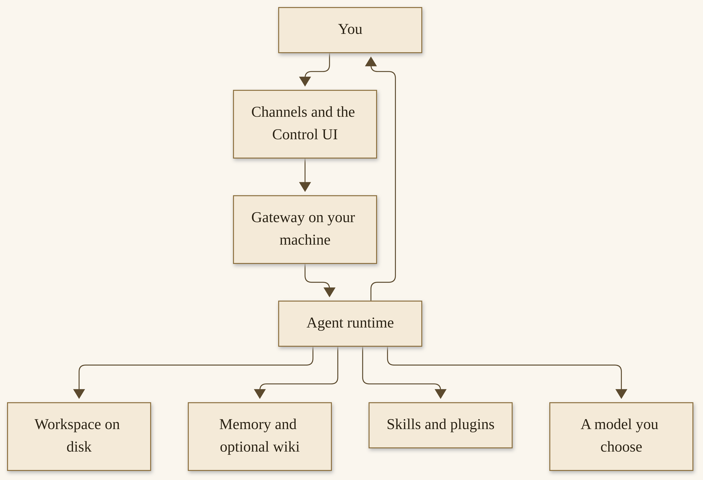{width=100%}

*I01. What ships in the box. The Gateway, the runtime, the workspace, the channels, memory, and skills all live on a machine you run. The model sits underneath, and you pick it. You are still the one who says yes.*

## Who stewards it, and the license

OpenClaw is stewarded by the OpenClaw Foundation, which official pages describe as an independent 501(c)(3).^8 That is a nonprofit. It is not a company selling you a seat. I am giving you that fact as the Foundation states it, and I am not going to invent a tour of their offices or a conversation I was not in. The public record is enough, and it is honest.

The license is MIT.^9 In plain words, that means you can run the software, read it, change it, and share it, with the notice the license asks for. The code is public, at github.com/openclaw/openclaw. The docs are public, at docs.openclaw.ai. The website is openclaw.ai. The Foundation’s own site is openclaw.org. I will point you at those doors again in the appendix. You can read what you are running.

The official posture, as the README and the Foundation state it, is straightforward: no paid tier, no hosted service, no token.^10 By default, an install phones home only for a daily version check, which you can turn off by setting `update.checkOnStart` to `false`. Anonymous feature statistics are opt-in. That is their wording, and I want you to have it as they wrote it, not as a rumor. A version check is a practical kindness — it is how you find out a security release exists — and it is also a small door off your machine. You get to decide whether it stays open. We will come back to updates in Chapter 3, and to trust more carefully in Chapter 14.

Around the Foundation there is a living community: an official account on X, a Discord, a GitHub organization, and ClawHub, the public registry for skills and plugins. Those doors are real, and they are part of why this book’s title talks about a community and about skills that compound. We will walk them properly in Chapters 9 and 10, with every count dated, and with the same care we will bring to a skill you did not write yourself. A commons is a gift. It is also a trust problem. I am glad it exists. I will not treat a follower count as a reason to relax a pairing code.

You do not have to join any of that to use the product. A Gateway on a quiet machine, a wiki you keep, and one job you watch is a complete practice. The commons is there when you want it.

I am grateful for the work. I am also, in these pages, a neighbor with a practice, not a spokesperson. The OpenClaw Foundation does not endorse this guide. I do not speak for them. I use their product’s name because I am talking about their product, and then I go back to teaching you how to start.

## A short naming history

Products sometimes arrive with one name and keep it. This one did not. The official lore, and a founder blog post dated 29 January 2026, tell a short, public naming story, and I will tell it the way those pages tell it — lightly, without a courtroom, and without inventing a hallway scene.^11

It began as **Warelay**, a WhatsApp gateway. The public GitHub repository was created on 24 November 2025.^12 Then it was **Clawd**, living in **Clawdbot**, a playful pun on a well-known model name, until Anthropic asked for a name change, citing a trademark. Official lore and the founder blog agree on that request. I am not going to embellish the legal exchange. A name was asked for; a name was changed.

On 27 January 2026 came what the lore calls the first molt: a community brainstorm, and a new name, **Moltbot**, with a character, Molty, that the lore sketches with some humor. Those sketches are lore. They are not product specifications, and they are not a security model. I will not treat a lobster joke as a claim about how the Gateway is hardened.

Then came **OpenClaw**: announced on 29 January 2026 on the founder blog, and dated 30 January 2026 in the official lore. The GitHub repository moved to github.com/openclaw/openclaw. The docs moved to docs.openclaw.ai. The npm package took the new name. The official account on X is @openclaw.

That is the history, as the project tells it. It is enough to know, so that an old screenshot or an old blog post does not send you looking for a product that has since changed its name. If you see Clawdbot or Moltbot in a post from January 2026, you are looking at this project’s earlier clothes.

One more sentence, because it mattered at the time and it still matters if someone tries it again. During the rename, official lore describes handle-sniping and a fake token that appeared quickly, with stolen artwork. The token is not the project.^13 If someone offers you one, walk away. We will not point you at those listings. Then we will get back to the work.


## Where the product is, on 12 November 2026

Software moves. A book is a snapshot. I would rather date the snapshot than pretend the number will sit still.

As of 12 November 2026, the latest stable release is **OpenClaw v2026.11.3**. GitHub published it on 10 November 2026, at 1:53 p.m. Eastern Time.^14 The official release notes call it a security release, and “a patch release with no new features.” I checked again on the morning I drafted this chapter: GitHub’s “latest” release still pointed here. If you are reading this later and a newer stable tag exists, trust the live releases page, and run `openclaw update` on a machine you already have running, after a backup you already took. The sentence in this book is dated on purpose.

The version number itself is a date: `v2026.11.3`, not a 0.x semantic version. Once you see it that way, a lot of the release line makes sense. There is a **stable** channel, which is the one this book teaches. There is a **beta** channel. On this same research day, the current beta was `2026.11.5-beta.2`, published on 11 November 2026, at 7:43 p.m. Eastern Time.^15 Beta is interesting, and it is not the path I will walk you down in these pages. Features that show up first on a beta — and that beta’s notes mentioned some — are not stable features until they ship in a stable release. There is also an **extended-stable** tag, `2026.9.37`, described in its own notes as a gateway-only maintenance release from a retired line, published by an explicit maintainer decision.^16 I mention it so that if you see it, you are not confused. It is a maintenance channel. It is not “the” current OpenClaw.

I want to warn you about one stale public page, because I almost used it myself and then didn’t. Wikipedia, as of this research day, still described a “stable release 2.0 (v2026.8.1)” dated 30 August 2026.^17 That line is stale. I am not going to use it, and I would like you not to use it either. The live GitHub releases page, and `openclaw --version` on a machine you installed, are how you know where you actually are.

How you stay current, once you are installed, is official and short: `openclaw update --channel stable`, or `--channel dev` if you have chosen that path on purpose.^18 We will put that in Chapter 3’s recovery kit. The 11.3 notes themselves are worth a look if you are already running, because a security release is the kind of update you do not put off without a reason. The notes describe, among other things, private subagent completions kept out of streamed chat, certificate-verification fixes, sandbox image-preview bounds, and update-recovery fixes that could leave the Gateway stopped.^14 I mentioned the release in public, the same week, as a reliability and credential-scoping release. The official notes are the authority. This book will not freeze a list of every fix into the body, and it will not turn release notes into a vulnerability catalog. The habit is simpler, and it lasts: read the notes, take a backup, update, run `openclaw doctor`.

If you are installing for the first time this weekend, you will get whatever “latest stable” is on the day you run the installer. That may already be newer than v2026.11.3. Good. Date your own install. Keep the habit. The commands in this book were checked against the docs as they stood on 12 November 2026. When a flag has moved, the live page wins.

## What vendors say, and how we will use it

Projects that grow quickly attract language that grows quicker still. I want you to be able to hear that language without swallowing it whole, and without becoming cynical about the work underneath.

The OpenClaw Foundation published a launch blog on 8 July 2026. That post, and the official Why OpenClaw page, contain superlatives: “fastest growing repository in GitHub history,” “the Switzerland of AI,” “the most mature, battle-tested agent,” and other lines in the same register, including a figure about new “claws” being born each week.^19 Those are vendor claims, or official-blog wording, dated to the pages they live on. I am telling you that they exist on those pages. I am not independently verifying a ranking, and I am not going to wear those phrases as if I measured them. A free gift does not need to win a contest.

Star counts, follower counts, and Discord sizes are the same kind of fact: real, dated, and not a quality score. Popularity is not the same as care, and a number on a repository is not a reason to trust a command. If you are curious, I opened the GitHub API on 12 November 2026, and the official X profile and Discord invite the same morning; the exact figures are in a note, with the date and the source, which is where a figure like that belongs.^20 We will come back to the community, properly, in Chapter 9, including ClawHub, which is the official public registry for skills and plugins. Every one of those counts will have moved by the time you read this. Date them, or leave them in a note. Do not treat them as a reason to skip a pairing code.

The same July blog announced ClawCon figures — 34 events, 16 countries, nearly 30,000 sign-ups, with Seattle then next on 11 August — as of 8 July 2026.^21 That is a July census, from the Foundation, not a November one. I will not update those numbers without a newer official page. Community is real. A dated blog post is a dated blog post.

What I will use from official pages, without a label of caution, is how the product works: the commands, the defaults, the architecture, the security posture. When a page says the Gateway binds to loopback by default, that is how the product works. When a page says sandboxing and exec approvals are off by default, and that “Default OpenClaw is a trusted single-operator assistant,” that is also how the product works, and it is a fact we will take seriously, not a slogan we will sand down.^22 I will teach it kindly, and I will not call OpenClaw “secure by default” in the enterprise sense, because the official posture is more honest than that. One operator. One trust boundary per Gateway. Approvals you turn on. A security audit you can run. Chapter 14 is where we sit with that. Chapter 2 will preview it, so it is not a surprise.

Partner and donor quotes on that same July blog are dated partner claims. If a later chapter names a partner distribution, it will be labelled as someone else’s product, and it will not be required. I will not connect a partner name to my own shop, and I will not turn a donor list into a story about me.

## What this book is, and is not

This book is a free, unofficial gift. It is a practical guide from a first install to a practice you make your own — a wiki, a small reviewed set of skills, a community you can join, and, when you are ready, a fleet. It is not a vendor manual. It is not an endorsement. It is not a review that crowns a winner. Other tools exist. I have already written about two of them, as gifts: *Hand It Off*, for Grok Bot, and *Grow With It*, for Hermes Agent. Those books are on the shelf if you want them. You do not need them here. This walk is about OpenClaw.

It is also not a book that will pretend a first weekend is a finished practice. We will get you running, this weekend, if you want that. We will turn on the built-in wiki, in Chapter 4, before the work gets messy. We will finish one real job, in Chapter 5, with your yes still on it. Then there is more: habits, the commons, how-tos for work and for home, a fleet chapter, and a safety chapter I hope you will read before you give the agent a messaging door and a lot of trust. You can stop after the first weekend and still have something useful. You can come back.

I should also say what this chapter is not. It is not a buyer’s guide. It is not a comparison table. It is not a history of every fork and every rumor. The naming story above is the official one, told briefly so an old name does not send you looking in the wrong place. The version numbers are dated so a stale encyclopedia line does not. The rest of what you need in order to start — every official install path, the wiki, the first job — is a few chapters away, and it is written as steps you can take, not as a lecture about the industry. If you came here for a careful weekend, you are in the right book.

I will not invent a client, a classroom, or a family dinner to make a point. If a step needs a story I do not have, I will teach the step. My own fleet — seven agents, responsible for SMF WisdomForge — is a later chapter, told only as far as I can stand behind. It is a picture of one shop, at one size. It is not a requirement.

Chapter 4, I want to flag now, is the chapter I hope you will not skip. OpenClaw ships with a built-in LLM Wiki — officially a bundled plugin called `memory-wiki` — and it is off until you enable it. A lot of people will get a chat working and call the weekend done. That chat will forget. A compiled vault can last, and it can be backed up, and, as I argued in an article on 11 November 2026, it can outlast a change of runtime.^23 We will enable it from the official docs, step by step, before we hand the agent a messy week. That is not an advanced topic. That is first setup.

The next chapter is a map. We will not install yet. We will follow one message from a channel, through the Gateway, into the agent’s workspace and memory, out to a tool or a skill, and back as a reply. You will be able to tell memory-core from the wiki, and a skill from a plugin, before the first command. That is the kind of knowing that makes an install feel like a step, not a leap.

If you are already impatient to type something, I understand. Chapter 3 is right after that map, and it is every official way in. You will not be asked to buy a particular model, or a particular cloud, or hardware you do not have. You will be asked to run `openclaw doctor`, and to see that it is clean, before we give the agent a wiki. That is a short wait, and it is worth it.

I have one last thing to say in this chapter, and then we will look at how a request actually moves. OpenClaw is capable. That is why I use it, and why I wanted you to have a careful guide. Capability is not the same as a finished judgment. A Gateway on your machine is a real piece of software, with real doors, and a default posture that trusts a single operator. You are that operator, if you install it. You are still the one who says yes.


# Chapter 2
## How an OpenClaw Agent Works


{width=100%}

*I02. A letter arriving at a quiet desk, an unmarked folder, a closed notebook.*


The last chapter named the thing. This one is a map. I want you to be able to follow a single message from a channel, through the Gateway, into the agent’s workspace and memory, out to a tool or a skill, and back as a reply — and I want you to be able to tell two memory layers apart, and a skill from a plugin, before you type an install command. Nothing in this chapter has to be running yet. We are just walking the path so that, tomorrow, the path is familiar.

## One request’s journey

Imagine you send a short message. It might come from the Control UI, which is the dashboard on your own machine. It might come, later, from a messenger you already live in — Telegram, or WhatsApp, or Discord, or another official channel. For this walk, it does not matter which door it used. What matters is where it goes next.

The message arrives at the **Gateway**. The Gateway is one process, on the machine you installed. Official docs treat it as the source of truth for sessions, routing, and channels.^24 Every chat app, the command line, the Control UI, a companion app, a phone acting as a node — they all talk to this one process. It is not a second brain in the cloud. It is a control plane on your desk, or on a small computer in the other room.

By default, that Gateway binds to *loopback*: it listens on your machine, for your machine.^25 The address you have already seen, `http://127.0.0.1:18789/`, is that default made visible. Loopback is a kindness and a limit. It means a stranger on the same café Wi-Fi is not, by default, looking at your dashboard. It also means that if you later decide to expose the Gateway — to a phone off your desk, to a teammate, to the wider network — you are opening a real door, and you should know you are opening it. We will not do that in this chapter. Chapter 7 is the careful how-to for doors. Chapter 14 is the chapter about what a door is worth.

The Gateway hands the message to the **agent runtime**: the loop that assembles a prompt, calls the model you chose, and decides, turn by turn, whether a tool or a skill is needed. The runtime is not the model. The model answers. The runtime is what makes the answer into work: reading a file, writing a note, following a procedure, coming back with a reply on the same channel the message arrived on.

Before it answers, the agent looks at its **workspace**. That is a folder on disk, a home for the agent’s instructions and its memory files. The default is `~/.openclaw/workspace`.^26 The agent may also consult memory — a search, a daily note, a page in a wiki, if you have enabled one. It may use a tool: read a file, write a file, look something up, run a command you have allowed. It may follow a skill, which is a procedure written in markdown. It may write something down, so that the next turn, or tomorrow, is not a stranger. Then a reply goes back out, through the Gateway, to the door you used.

That is the whole journey, in ordinary language. A message in. A Gateway that owns the session. A runtime that can use a workspace, memory, a skill, and a tool. Something, if you asked for it and if the agent is well set up, written to disk. A reply out. You are in the room for all of it, on this first walk. Later chapters will add a schedule, and a second agent, and a catalog. They do not change this shape. They grow it.

I want to say a word about sessions, because the word will come up the first time you open the dashboard. A session is one thread of work the Gateway is keeping: the messages, the tool calls, the context the model can still see. Sessions live in the Gateway’s state, not as a secret mind, but as records. You can start a new one. You can come back to an old one. What the model can use from the past, on a fresh turn, is still what got saved to disk and what this session still holds. That is why the workspace, and later the wiki, matter more than a long chat you never filed. Chats end. Files last.


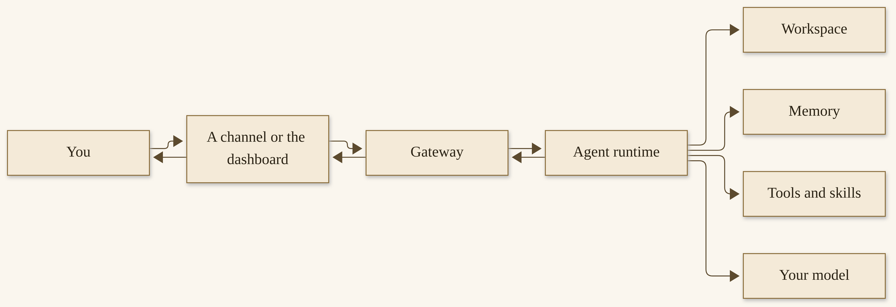{width=100%}

*I02. One request’s journey. A message arrives on a channel. The Gateway is the source of truth. The agent reads its workspace, may use memory or a skill or a tool, may write something to disk, and replies. The default Gateway bind is loopback.*

One more fact, because it will matter the first time something surprising happens. The workspace is the agent’s default working directory. It is not, by itself, a hard wall. Official workspace docs say it plainly: tools resolve relative paths against the workspace, but absolute paths can still reach elsewhere on the host unless sandboxing is enabled.^26 Sandbox is off by default. We will say that again when we talk about trust, later in this chapter, and we will teach the “never” in the first week. For now, I want you to know that “it lives in a folder” is not the same as “it cannot see the rest of the machine.” A folder is a home. A sandbox, when you turn it on, is a fence. They are not the same thing.

## The workspace, and what gets remembered

If there is one official sentence I want you to keep from this chapter, it is this one, from the memory docs, and I will quote it exactly: “The model only remembers what gets saved to disk; there is no hidden state.”^27

That sentence is a relief, and it is a responsibility. It is a relief because there is no secret drawer the official pages claim sits behind the files you can actually open. It is a responsibility because if something is going to last, someone — you, or the agent, under instructions you can read — has to write it down. A brilliant reply that never lands in a file is gone when the session is gone. A modest note, dated, in a folder you back up, can last a year.

The workspace is that folder. Official docs call it the agent’s home: the working directory used for file tools and workspace context. They also say to keep it private, and to treat it as memory.^26 It is separate from `~/.openclaw/`, which is where configuration, credentials, and sessions live. That separation is worth honoring. The workspace is what you might someday put in a private git repository, as the official page recommends. The credentials folder is not.

Inside the workspace, OpenClaw expects a small set of files, and I want you to know their names the way you would know the names of the rooms in a house you were about to move into.

**`SOUL.md`** is persona and tone: who the agent is, how it should speak, where its boundaries are. It is loaded every session.^26 **`AGENTS.md`** is operating instructions: rules, priorities, how the agent should use memory, how it should behave. It is also loaded at the start of every session. Optional **`USER.md`** is a compact picture of you: stable preferences, communication style, relationships, active-project context, written as current directives. It has its own small budget at the start of a session.^27 **`MEMORY.md`** is curated long-term memory: durable facts and decisions, not a raw transcript, not a daily log. Daily notes live under **`memory/YYYY-MM-DD.md`**, a running layer of observations and context. Today’s and yesterday’s dated notes can load automatically on a fresh session. Optional **`DREAMS.md`** is a Dream Diary, for human review, written by a background consolidation the docs call dreaming. We will come back to dreaming in Chapter 6. It is not a mind of its own. It is a scheduled kind of housekeeping, and the diary is for you to read.

The official workspace page also lists a few other files you may meet: `IDENTITY.md`, for a name and a vibe; `BOOT.md` and `BOOTSTRAP.md`, for startup and first-run rituals; a `skills/` folder, for workspace-specific skills.^26 I will not dump every template into this chapter. I want you to know that the house has those rooms, and that the ones we will actually write in, this first week, are the ones above: a soul, a set of instructions, a little about you, a memory file, a daily note. Chapter 4 will ask you to tighten those files as part of first setup, before we enable the wiki. You do not have to finish a novel. You have to write a clear note.

If you want the agent to remember something, the official advice is almost disarmingly simple: ask it. “Remember that I prefer TypeScript,” and it writes the note to the appropriate file.^27 That works when the agent is well instructed and the files are writable. It fails, quietly, when nothing is saved. The official sentence is still the rule. What is not on disk is not remembered.

Two cautions, said early, so they are not a surprise later. Do not put secrets in the workspace: API keys, tokens, passwords, other people’s private lives, health records, school records, anything you would not want a future model, a plugin, or a backup disk to see. The official workspace page already says not to commit secrets, even to a private repo.^26 I will say it again in Chapter 4, as a “never” on the vault. And do not treat a file the agent wrote as gospel without a look. Memory can preserve a fact. It does not enforce your policy. Approvals, sandboxing, and scheduled tasks are how hard limits are set. We will teach those as habits, not as decorations.


## Memory-core and the wiki, previewed

OpenClaw has two memory layers, and I want you to keep them distinct from the first day, because collapsing them is how people get lost, and how older public guides go stale.

The first layer is the default, and it is already on. Officially it is the built-in memory plugin, **`memory-core`**. It is the recall path: it indexes `MEMORY.md`, an existing `USER.md`, and the daily notes under `memory/`. It can search by keyword, and, if you have configured embeddings, by meaning, and by a hybrid of the two.^27 Dreaming — the background consolidation into `MEMORY.md`, with `DREAMS.md` for you to review — belongs to this layer. So does the pre-compaction flush that reminds the agent, quietly, to save important context before a long conversation is summarized. This layer is how the agent *finds* what was written down. You do not have to turn it on. You do have to let it write, and you do have to look at what it wrote, now and then.

The second layer is optional, and it is off until you enable it. Officially it is the bundled plugin **`memory-wiki`**, and it is OpenClaw’s built-in LLM Wiki.^28 It does not replace memory-core. Recall, promotion, indexing, and dreaming stay with the active memory plugin. The wiki sits beside it and *compiles* durable knowledge into a navigable vault: pages, structured claims with evidence, provenance, dashboards, and tools with names like `wiki_status`, `wiki_search`, `wiki_get`, `wiki_apply`, and `wiki_lint`. If memory-core is how the agent remembers a note, the wiki is how a set of notes becomes a place you can actually walk around — a folder of pages, with sources, and with a lint that can tell you when two claims disagree.

I will not teach you how to enable it in this chapter. That is Chapter 4, and it is the chapter I hope you will not skip. I will only say this much, so the first-setup chapter is not a surprise: you turn it on with a plugin command, you pick a mode (isolated, by default; bridge, if you want it to compile what memory-core has already made public; a third mode, experimental, that we will name and caution), and you pick a scope (one vault for everyone, or a vault per agent). The default path is `~/.openclaw/wiki/main`. Ingest, as of the official CLI on 12 November 2026, takes a local file, not a URL. Then you compile, you lint, and you look. The popular story starts with a model. We will start with that folder.


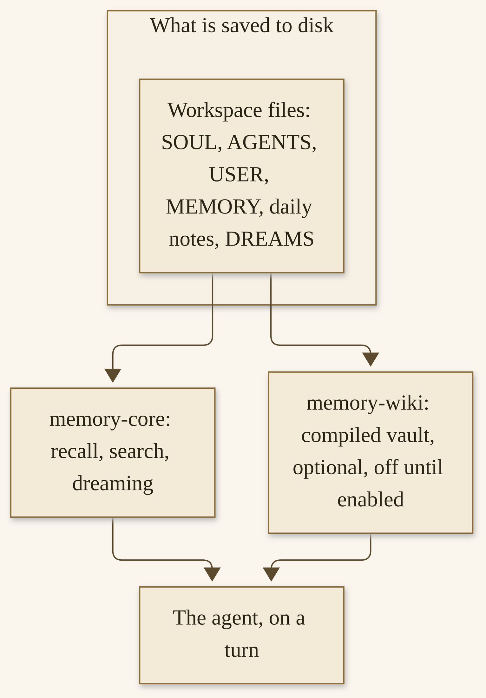{width=100%}

*I02b. Two layers, not one. memory-core is the default recall path. memory-wiki is the built-in LLM Wiki, off until you enable it, and it does not replace memory-core. Chapter 4 is the how-to.*

If you have already read about QMD, or if you have an older article of mine from June 2026 open in another tab, put it aside for current setup. Built-in memory owns this path as of v2026.8.1. We will say that carefully in Chapter 4, so no one pastes a retired config. The idea I was teaching then — give the agent a durable memory — is still the idea. The mechanism has moved, and we will follow the official mechanism.

## Skills, plugins, and MCP, in plain words

This book’s subtitle ends with “the skills that compound.” I want those words to mean something ordinary before we get to the catalog.

A **skill** is a procedure. In OpenClaw, it is a markdown file, usually called `SKILL.md`, with a little frontmatter, written to the Agent Skills specification the project follows.^29 It teaches the agent how and when to use tools for a particular job: how to file a weekly review, how to check a calendar, how to compile a brief the way you like it. A skill is loaded when it is relevant. It is instructions, not a new engine. The right picture is a recipe card the agent can pick up, not a new appliance on the counter.

A **plugin** is code. It extends the product itself: a new channel, a new model provider, a new tool, a new memory engine, a new kind of door.^30 `memory-wiki` is a plugin — a bundled one, which is why first setup can enable it with an official command. Other plugins come from ClawHub, or from npm, or from a path you trust. This distinction matters for trust. A skill is a document you can read. A native plugin runs *in-process*, and official pages are honest about a limit: native plugins are not sandboxed.^30 That is not a reason to never install one. It is a reason to install one the way you would install any code you are actually trusting — having read it, having pinned it, having decided the Gateway that will run it is a Gateway you would trust with that code. We will teach the review ritual in Chapters 9 and 14. I am saying it once now, so “plugin” never sounds like a theme for a store.

**MCP** is a third door, and I want it demystified in one paragraph. MCP, the Model Context Protocol, lets OpenClaw talk to a connected server — a calendar, an issue tracker, a docs host — under the same tool policy as everything else.^31 It is not a bypass. It is not a secret privilege. If you connect a server, you are giving the agent a tool, and that tool is still subject to the approvals and the policy you set. Detail waits for later chapters. The first-week rule is the same as for a plugin: do not connect a server you have not chosen on purpose.

Skills compound when you keep a small, reviewed set and actually use them. They do not compound when you install thirty in an afternoon and never read the files. The catalog, ClawHub, is a commons, and it is a later chapter. The first week’s job is one useful procedure, or none, and a wiki you have turned on. You can grow from there.

There is also a Skill Workshop, later, in which an agent may save and update its own skills under that agent’s workshop directory, with a change history and an undo.^29 That is a powerful kindness, and it is also a reason to look at what got written. A skill the agent wrote is still a skill you are trusting on the next run. Chapter 6 will teach the first careful install. Chapter 10 will teach writing one of your own. I mention the Workshop only so “skills that compound” does not sound, in your ear, like a store you shop once. It is a practice of keeping procedures you have actually read.

## Channels, pairing, and one trust boundary

A **channel** is a door. Officially, a few channels ship with the core install — including Telegram and WebChat, as the Features page listed them on 12 November 2026 — and many more arrive as official plugins: Discord, Signal, WhatsApp, iMessage, Slack, and others the same page names.^32 I will not print the full roster here, because rosters move, and because Chapter 7 is where we will re-open that page and walk the doors carefully. The point for now is this: the agent can meet you where you already are. That is a gift. It is also a door into a machine that can read files and run tools.

So OpenClaw, by default, does not leave the door standing open. When an unknown person sends a direct message, they get a **pairing code**, and their message is not processed until you approve.^33 The official command looks like this: `openclaw pairing approve telegram <CODE>`, with the channel name first and the code second, or you can approve from the Control UI under Settings, then Channels, then DM access requests. Codes are short, they expire after an hour, and an approval grants direct-message access only — not group access, and not, after the first owner is set, a wider administrative role. We will do this for real in Chapter 5. I am telling you now so that you never skip it “to keep it simple.” Skipping pairing is not simplicity. It is an open inbox on a capable agent.

Groups are allowlisted, usually behind a mention gate. Secrets do not belong in a chat, any more than they belong in a vault. A work channel should be a list of people you have chosen, not a public room. Chapter 11 will say that as a professional “never.” Chapter 7 will say it as a habit.

Two more facts, official, and I will not sand them down.

The first: **one Gateway is one trust boundary.**^34 Official security docs are clear. This is not a hostile multi-tenant wall. If you have mixed-trust users, or adversarial ones, you need separate Gateways, and ideally separate operating-system users or hosts. A family-calendar agent and a private journaling agent may share a Gateway, if you trust everyone who can reach it. A public inbox and a private vault should not. Chapter 8 and Chapter 13 will teach when to split. The rule is already true for one agent.

The second: **sandboxing and exec approvals are off by default.**^34 Official Why OpenClaw wording is: “Default OpenClaw is a trusted single-operator assistant.” That is an honest sentence. It means the product is designed, in its default, for you, on your machine, as an operator it is allowed to trust. It does not mean the product is “secure by default” in the sense a company would mean when it hosts other people’s work. You can harden it. There is an official audit command, `openclaw security audit`, and an optional deeper pass. You can turn sandboxing on. You can require approvals for commands. We will teach that as a practice, especially in Chapter 14, and we will put a first-week “never” on sending, spending, deleting, and publishing without a yes, in Chapter 5. I want you to hear the default now, so the first weekend is not a surprise.

If that sounds stern, I mean it as a kindness. A teammate who can finish the work is a gift. A teammate who can also send a message, or spend, or delete, or publish, is a teammate you walk with slowly. The official pairing default, and the official “single-operator” posture, are already walking that way. We will walk with them.

Container images, I should say once, are not always identical to a desktop loopback install. Official security docs note that some container defaults expose a bind, and should be paired with authentication.^34 If you already live in Docker, read that page before you assume the default is as quiet as a laptop’s 127.0.0.1. Chapter 3 will point at the official container path as a path, not as a tour. The rule does not change: know what your Gateway is listening on, and who can reach it.

## Later: cron, other agents, and the commons

Three more doors, named only, so you know the house is larger than the first week, and so you do not try to stand all of them up on Saturday afternoon.

**Scheduled jobs.** OpenClaw can run work later. The official family is `openclaw automations`, and `openclaw cron` still works as an alias.^35 A job can run once, or on a schedule, and can deliver a result back to a channel. That is “work that runs while you sleep,” in the only sense I will ever mean it: a job you set, a wiki or a memory file the job can write to, and a review you have not given away. It is not a promise that the agent wakes up with ideas. It is not a promise that work always survives a crash. Chapter 8 is the how-to.

**More than one agent.** You can add a second agent, with its own workspace and its own bindings, on the same Gateway — or, when trust does not allow it, on a second Gateway. Officially, `openclaw agents add` is the start of that path, and there is a team preset with approvals before external sends, publication, purchases, deletion, or production changes.^36 Chapter 8 will teach the official patterns. Chapter 13 will show you my own shop: seven named agents, a pipeline, a shared machine, a model, and an academy they are responsible for. You do not need seven. You need a reason, and a boundary you can still see.

**The commons.** ClawHub is the official public registry for skills and plugins. Around it there is a Discord, a GitHub organization, an official account on X, and a community that has already given a great deal.^37 Chapters 9 and 10 are where we walk that commons, with dated counts, with a review-before-enable ritual, and with a path to writing a skill or shipping a plugin if you want to. The title of this book lives there as much as it lives in a wiki on your disk. Making it yours includes the option of giving something back. It does not include a demand that you do it this weekend.

That is the map. A request travels through a Gateway, into a workspace, through memory and maybe a skill, and back as a reply. Two memory layers, one of them waiting for Chapter 4. A skill is a recipe; a plugin is code; MCP is a connected tool under the same policy. A channel is a door; unknown senders get a pairing code; one Gateway is one trust boundary; sandbox and exec approvals start off. Later, a schedule, a second agent, a commons.

The next chapter is every official way in. You can pick a door that matches the machine you have. You will not be told you need a particular model, or a particular cloud, or hardware you do not own. You will run onboard, you will start the Gateway, and you will prove that `openclaw doctor` is clean. Then, before we give the agent a messy life, we will give it a wiki. If this chapter did its job, that first command will feel like a step you understand, not a leap into a product you cannot picture. That was the only reason to wait this long to type, and I think it was worth it.


# Part 2 — Day One Through the First Week
# Chapter 3
## Get In: Every Way to Install and Access OpenClaw


{width=100%}

*I03. A modest desk, a fresh unmarked notebook, a quietly sitting machine.*


This is the chapter where we type. The last two chapters were a meeting and a map. This one is a door — every official door, as the Install page and the Getting started page stated them on 12 November 2026 — and a first clean check that the Gateway is up and `openclaw doctor` is happy. You do not need a particular model. You do not need a particular cloud. You do not need hardware you do not have. You need a supported machine, a little time, and a habit we will keep: if this book and the live page disagree, trust the live page. The product moves. We dated what we checked.^38

## Pick a door

I am not going to rank these paths. I am going to help you pick the one that matches the machine you already sit at.

If you have a laptop or a desktop, and you are comfortable in a terminal, the official installer script is the fastest way on macOS, Linux, or Windows Subsystem for Linux. If you would rather a normal app download, OpenClaw ships desktop companions: a native **Windows Hub** on Windows, which the Install page recommends for that desktop, and a **macOS menu bar app** on a Mac. If you already manage Node yourself, npm, pnpm, bun, or a one-line `npx` will do. If you already live in a container or on a VPS, there is an official hosting map; we will point at it, not tour every vendor. If you have a phone, the official iOS and Android apps are **nodes**: they pair to a Gateway you already run. They are not a hosted assistant, and they are not the brain.^38

The official Getting started page, on the day I checked it, also offers a one-command try: `npx openclaw@latest`. We will include it. And the same page still says the fastest messaging channel to set up, once you are running, is Telegram, with a bot token.^39 You may pick WhatsApp, Discord, Signal, iMessage, or WebChat instead, if the live channel pages still support them. Pairing itself can wait for Chapter 5 if you want a quiet first hour, or start at the end of this chapter if you are ready. Do not skip it later.

> **Tip.** If you are on Windows and you want the kind of setup you are used to — a signed installer, a tray icon, a chat — start with Windows Hub. If you are on a Mac or a Linux laptop and you are happy in a terminal, start with the installer script. If you already know you want a server, skip ahead to the hosting map and come back to onboard. There is no prize for picking the “most serious” path.


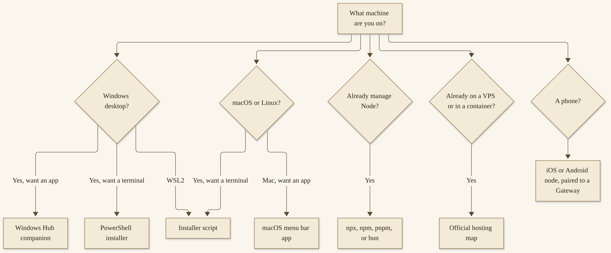{width=100%}

*I03. Pick a door that matches the machine you have. A phone is a node, not the brain. There is no official paid OpenClaw Cloud.*

## The official ways in, dated

Everything in this section is copied from the official Install page and Getting started page as they stood on 12 November 2026. If a filename or a Node version has moved by the time you read this, the live page wins.^38

**What you need.** Node.js 24.16.0 or newer on the 24.x line, or 26.1.0 or newer. Node 26 is recommended. 24.22.1 or newer, and 26.12.1 or newer, are strongly recommended for security. The installer can provision Node if it is missing — Node 26 on macOS, Node 24 LTS on Linux, as that page stated it. You also need a way for the agent to talk to a model: an existing Claude Code or Codex CLI login, or a provider API key, or, as we will see, a Grok OAuth sign-in. The product runs on macOS, Linux, or Windows — native Windows, the PowerShell installer, or a WSL2 Gateway.^38

**How to install with the official script (macOS, Linux, WSL2)**

1. Open a terminal.
2. Run:

```bash
curl -fsSL https://openclaw.ai/install.sh | bash
```

   You should see the installer detect your OS, install Node if needed, install OpenClaw, and launch onboarding. If you want the install without onboarding, yet, use:

```bash
curl -fsSL https://openclaw.ai/install.sh | bash -s -- --no-onboard
```

3. When onboarding starts, go to the “Onboard, the Gateway, and doctor” section below. You can come back to it after you read the other doors, if you are only picking.

**How to install on Windows with PowerShell**

1. Open PowerShell.
2. Run:

```powershell
iwr -useb https://openclaw.ai/install.ps1 | iex
```

   To skip onboarding: the official form is `& ([scriptblock]::Create((iwr -useb https://openclaw.ai/install.ps1))) -NoOnboard`.^38

**Windows Hub.** On Windows, the Install page recommends the native Windows Hub companion app: a signed installer you download and run like any Windows app, with setup, tray status, chat, and node mode. The filenames on that page, this day, were `OpenClawCompanion-Setup-x64.exe` and `OpenClawCompanion-Setup-arm64.exe`, from the Windows Hub releases page. The Hub can provision a local Gateway on first run, or connect to an existing remote one. The cross-platform Tauri desktop app is the official backup on Windows; its installer, `OpenClaw-<version>-windows-x86_64.exe`, ships in regular OpenClaw releases and can set up a local Gateway with bundled Bun, or connect remotely.^38

**macOS menu bar app.** Download the `OpenClaw-<version>.dmg` (preferred) or `.zip` from OpenClaw’s GitHub releases, then install and launch OpenClaw.app. The Install page carries a caveat I will not sand down: **the newest GitHub release may ship no macOS asset.** If that is true on the day you look, follow the macOS app page the Install docs point to, rather than inventing a workaround.^38 I checked the v2026.11.3 release as the then-latest stable; if an asset is missing, that is a known situation the official page already describes, not a problem you are supposed to solve by guessing.

**How to try it with npx**

The Getting started page leads with this, as a one-command try:^39

```bash
npx openclaw@latest
```

On a fresh install, choose **Quick start** after a one-line pointer to the security guide, if usable AI access is already available. OpenClaw will look for an existing Claude Code or Codex CLI login or API key, verify it with a real completion, save the config, and open the web dashboard. Quick start then asks whether to keep OpenClaw running in the background. **Yes** installs a copy of the same version under `~/.openclaw` and runs the Gateway as a background service from it, so clearing the npx cache does not stop it. **No** keeps the Gateway in this terminal until you press Ctrl+C; your config stays saved. If no detected route works, onboarding opens manual provider setup. Choose **Custom setup** to walk through all guided options instead.

**How to install with npm, pnpm, or bun**

If you already manage Node yourself:^38

On npm 12, or npm 11.16 and newer:

```bash
npm install -g openclaw@latest --allow-scripts=openclaw
openclaw onboard --install-daemon
```

On npm 11.15 and earlier, use the same command *without* `--allow-scripts=openclaw`. npm 12 blocks unapproved package lifecycle scripts by default; that flag explicitly allows OpenClaw’s `preinstall` and `postinstall` steps. The official page is careful about this, and I am copying the care. If you skip the flag on a new npm and the install reports scripts blocked, that is why.

pnpm:

```bash
pnpm add -g --allow-build=openclaw openclaw@latest
openclaw onboard --install-daemon
```

bun:

```bash
bun add -g --trust openclaw@latest
bun run --bun openclaw onboard --install-daemon --daemon-runtime bun
```

`--trust` allows the package’s lifecycle scripts. Node remains the primary runtime; `bun run --bun` forces Bun, and `--daemon-runtime bun` installs the managed Gateway under Bun.

**From source, and other official paths.** Contributors, or anyone who wants a local checkout, clone the repository, run `corepack enable`, then `pnpm install && pnpm build && pnpm ui:build`, and link the CLI with `pnpm add --global "openclaw@link:$PWD"`. Plain `npm install` at the repo root is not the official path.^38 There is a local-prefix installer, `curl -fsSL https://openclaw.ai/install-cli.sh | bash`, for keeping OpenClaw and Node under a prefix such as `~/.openclaw`. You can install from GitHub’s main branch with the official script’s `--install-method git --version main`. Standalone builds, for packaging without a separate Node or Bun, have their own official page; we will not tour them here. Containers and package managers — Docker, Podman, Nix, Ansible — and a hosting map (DigitalOcean, Hetzner, Hostinger, Fly.io, GCP, Azure, Railway, Northflank, Oracle Cloud, Raspberry Pi, Render, Upstash Box, experimental Cloudflare Containers, Kubernetes) are on the Install page as a map. If you already live on one of those, follow the official guide for that host. This chapter will not become a tour of every vendor.

**iOS and Android nodes.** Official companion apps on a phone pair to a Gateway for camera, screen, voice, and device commands. They are not a standalone hosted assistant.^38 Pairing a node is a device-pairing flow, separate from the DM pairing we will do in Chapter 5. The official pairing page walks it: from the Control UI, Settings, then Devices, then Connect a device, with a setup code the phone scans or pastes; official iOS and Android apps can be approved automatically when their setup-code metadata matches.^44 Treat that setup code like a password while it is valid. Chapter 7 will come back to nodes, and to voice, with more care. For day one, a phone is a wonderful later door, and it is not where the brain lives.


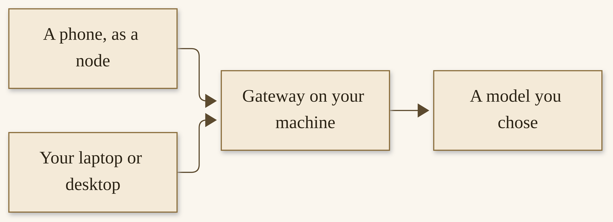{width=100%}

*I03b. A node is a door and a set of device skills — camera, screen, voice — paired to a Gateway you already run. It is not a hosted assistant, and it is not a replacement for the machine that holds the workspace and the wiki.*

If you run OpenClaw as a service account, or you want custom paths, official environment variables exist: `OPENCLAW_HOME`, `OPENCLAW_STATE_DIR`, and `OPENCLAW_CONFIG_PATH`.^39 You do not need them on day one. I mention them so that, if a later chapter or an official server guide sets a state directory, you are not surprised, and so that you remember the default wiki path will follow `OPENCLAW_STATE_DIR` when that variable is set. The default, on an ordinary laptop install, is still `~/.openclaw`.

**Verify the install**, once a CLI is on your path:^38

```bash
openclaw --version
openclaw doctor
openclaw gateway status
```

You should see a version, a doctor report you can act on, and, once the Gateway is running, a listener on port 18789. If `openclaw` is not found, it is almost always a `PATH` issue: npm’s global bin directory is not on your shell’s path. The official Node troubleshooting page is the fix, including on Windows. A few checks the same Install page suggests: `node -v`, `npm prefix -g`, and `echo "$PATH"`.

> **Tip.** After a CLI-only install, `openclaw dashboard` is how you reopen the Control UI. After Quick start, the dashboard may already be open. Either way, a dashboard that loads is a good first “it works.”

If you already have OpenClaw installed and you are only catching this chapter on a second pass, you are not behind. Check where you are:

```bash
openclaw --version
openclaw update --channel stable
```

The official Install page is also the door to updating, backing up, migrating to a new machine, and uninstalling, each on its own official guide.^38 As of 12 November 2026, a fresh stable update would land on v2026.11.3, or whatever newer stable has shipped since. Take a backup before a significant update — Chapter 4 will teach a verified `openclaw backup create` you can actually run — and then run `openclaw doctor` after. Switching between a package install and a git install is official: `openclaw update --channel dev` and `openclaw update --channel stable`. Use `dev` on purpose, not by accident.

One kindness about the script-based installer, because it is a pipe from the internet into a shell. That is the official fastest path, and I use official installers when I trust the project and the HTTPS URL. If you would rather read a script before you run it, download it first, open it, and then run the local copy. The product will not be offended. A person who reads a script is a person I want on this path.


## Omarchy, and other platform notes

I run OpenClaw on a machine that also runs **Omarchy Linux** — a MinisForum MiniPC, shared with a Hermes fleet, which is a later story, for Chapter 13. If you are on Omarchy too, I want you to have the official page, and only the official page, not a helper I guessed at.^40

The official OpenClaw-on-Omarchy page, re-opened on 12 November 2026, describes a **bar plugin for Omarchy 4’s Quickshell**. It puts agents, recent sessions, and a quick prompt in your desktop bar. It does **not** itself install or start a Gateway. You still install OpenClaw the usual way, from the paths above, and you still run onboard and start the Gateway. The plugin talks to a Gateway that is already there.

It requires Omarchy 4 with Quickshell and plugin support. Earlier Waybar-based Omarchy versions do not provide this plugin host. It also wants Python 3 and PyGObject for the desktop session’s D-Bus connection, and either a connected OpenClaw Linux desktop app with Omarchy integration, or an `openclaw` CLI with a configured, reachable Gateway.

**How to install the official Omarchy bar plugin**

1. Install and start a Gateway the usual way, first. This plugin will not do that for you.
2. From an OpenClaw source checkout that contains `apps/linux/omarchy`, run:

```bash
bash apps/linux/omarchy/install.sh
```

3. Validate and enable:

```bash
omarchy plugin validate ~/.config/omarchy/plugins/openclaw.desktop
omarchy plugin enable openclaw.desktop
```

   You should be able to click the bar entry and see the agents and sessions you expect before you send a prompt. If you use the desktop app, set your intended Gateway as Primary first.

4. If you need to restore the app’s own tray icon, the official disable is `omarchy plugin disable openclaw.desktop`.

> **Caution.** I am not going to teach a command named `omarchy-ai-install`. It is not on the official page I opened. If a blog post or an older note of mine appears to suggest a helper that the current official page does not, follow the official page.

Update each piece through the installation that owns it: Omarchy’s updater for the shell, the desktop app’s own update flow, and `openclaw update` for the CLI and Gateway. After updating a source checkout, rerun the plugin installer to update the installed copy.^40

Other official platform pages exist for macOS, Windows, Linux, iOS, Android, and WSL. Use them when a path in this chapter needs more room than a first weekend has. We will not become a hardware buyer’s guide. The Linux page, in particular, is the right next stop if you are putting the Gateway on a small always-on box and you want the official desktop app as well as the CLI. The Omarchy plugin can sit in the bar beside that app; the official page describes how the two share a single icon when their integrations match, and what to do if you see two.^40 Read that table if you are on that desktop. Do not invent a third helper.

A last platform note, because it comes up: this book will not tell you that you must run a particular Linux distribution, or a particular mini PC, or a particular GPU. Official requirements are a supported OS and a supported Node, plus a model the Gateway can reach. Everything else is taste, budget, and, later, the size of the practice you actually have. Start where you are. You can always move the Gateway later; the official migrating guide exists for that, and a good backup, from Chapter 4, is what makes a move calm rather than messy.

## Onboard, the Gateway, and doctor

This is the first-run sequence, once a CLI is installed. If the installer already launched the wizard, you are in the right place. If you used `--no-onboard`, or you are coming back, you can start it yourself.

**How to onboard, start the Gateway, and prove doctor is clean**

1. Run onboarding, with the managed service, if you want the Gateway to survive a closed terminal:

```bash
openclaw onboard --install-daemon
```

   The installer, if you used it without `--no-onboard`, starts the guided wizard automatically. Choose **Quick start** to reuse detected AI access and open the dashboard, or **Custom setup** for the full guided flow. Provider sign-in can take a little longer. `openclaw onboard --classic` opens the classic step-by-step wizard instead. You can return later with `openclaw configure` for additional settings.^39

2. If Quick start already installed the background service, skip this step. Otherwise, if a foreground Gateway is running in the terminal, press Ctrl+C to stop it, then:

```bash
openclaw gateway install
openclaw gateway start
```

   This installs a LaunchAgent on macOS, a systemd user unit on Linux and WSL2, or a Scheduled Task on native Windows, with a per-user Startup-folder login item as the fallback if task creation is denied.^39 Your config stays saved. `gateway install` returns once the service is registered; the Gateway may still be starting. `gateway start` waits until the Gateway passes its health and readiness checks. It does not restart a Gateway that is already running.

3. Verify:

```bash
openclaw gateway status
```

   You should see the Gateway listening on port 18789. If you don’t, run `openclaw doctor`, and, if you want a read-only diagnosis packed as a prompt, `openclaw triage`. We will come back to those in a moment.

4. Open the dashboard:

```bash
openclaw dashboard
```

   This opens the Control UI in your browser. If it loads, the first half of “it works” is done. Type a short message in the Control UI chat. You should get an AI reply, once a model is configured.

5. Point the Gateway at a model, if onboarding has not already done it. Official providers live in a directory, at https://docs.openclaw.ai/providers. I will not invent a count. Anthropic, OpenAI, Google, OpenRouter, xAI, local runtimes such as Ollama, and many others are on that list; custom OpenAI-compatible or Anthropic-compatible endpoints are documented too.^41

   If you want Grok, the official page is https://docs.openclaw.ai/providers/xai, re-opened the same day.^42 OpenClaw ships a bundled `xai` provider. The recommended path is Grok OAuth, with an eligible SuperGrok or X Premium subscription. Gateway, config, routing, and tools stay local; only Grok requests go to xAI’s API. Official commands, as that page states them:

```bash
openclaw models auth login --provider xai --method oauth
openclaw models set xai/grok-4.7
```

   On a fresh onboard, you can pick xAI/Grok OAuth at the model step, or, on a VPS or over SSH, pass `--auth-choice xai-oauth`, which uses device-code verification and does not need a localhost callback. An API-key path is also documented:

```bash
openclaw models auth login --provider xai --method api-key
```

   and an `XAI_API_KEY` in the environment. As of that page, both OAuth and API-key setup use `xai/grok-4.7` as the official curated default. If sign-in succeeds but Grok is not the default, run the `models set` command above. `openclaw doctor --fix` will also replace a retired `xai/auto` selection with `xai/grok-4.7`.

   xAI decides which accounts can receive OAuth API tokens. If an account is not eligible, the official page says to use the API-key path, or to check the subscription on xAI’s side.^42 That is their rule, not mine. I will not invent a workaround.

> **Story.** My own OpenClaw fleet runs on Grok 4.7. That is a fact I can stand behind, and it is a later example, for Chapter 13. It is not a requirement for your first weekend, and I am not going to invent whether I signed in with OAuth or with an API key. Teach your setup from the official page. Pick the model you actually have a right to use.

   The same courtesy applies if you pick a different provider. Follow that provider’s official OpenClaw page. Do not paste an API key into a chat, into a wiki, or into a screenshot you will later share. Keys belong in the official auth flow, or in a place you already trust for secrets — not in `SOUL.md`, and not in a Telegram message to yourself “just this once.”

6. Run doctor, even if the dashboard already replied:

```bash
openclaw doctor
```

   You should get a report you can act on, and, ideally, a clean one. If something is wrong, `openclaw triage` runs read-only health checks, writes a sanitized prompt describing what it found, and then offers to hand that prompt to a coding agent it detects on your machine — Claude Code, Codex CLI, or the built-in OpenClaw agent — so the agent starts with the diagnosis already loaded. You can pick “just print the commands” and run the handoff yourself. Nothing leaves your machine until you choose an agent, and secrets, tokens, raw chat payloads, and raw logs are excluded from the prompt.^39 That is a good recovery toolkit, in that official order: triage if you want a packed diagnosis, doctor if you want to read the findings yourself. The official troubleshooting pages are the next stop, not a guess.

> **Caution.** A dashboard that replies is not yet a finished first setup. It is a Gateway that works. Chapter 4 is next, and it is the wiki. Do not skip it to “get to the fun part.” The wiki is the fun part that lasts.

## What you do not need on day one

I want to lower the temperature, because a first install can feel like you are supposed to arrive with a lab.

You do not need an official paid OpenClaw Cloud. There isn’t one. The Foundation does not sell a hosted seat.^43

You do not need a partner distribution. Some exist; the Foundation’s July 2026 blog named some, as partners’ products.^43 They are someone else’s work, not required, and not the core install this book teaches. I will not rank them, and I will not turn this chapter into a shopping list.

You do not need my hardware. The machine my OpenClaw agents share is a later chapter, and a later sentence: a MinisForum MiniPC, running Omarchy, the same box a Hermes fleet uses. You do not need that box. A modest laptop and a careful setup are enough to start. This chapter is not a buyer’s guide.

You do not need every channel. You do not need a second agent. You do not need a scheduled job. You do not need ClawHub, yet. You need a Gateway that is up, a model that answers, a doctor report that is clean, and — in the next chapter — a wiki you have turned on. That is a complete first day. Everything else is a practice you can grow, on purpose, when you have a reason.

You also do not need to expose the Gateway to the internet. The default bind is loopback. Leave it there unless you have a reason, and a page, and a “never” you have already read. Chapter 7 and Chapter 14 are those pages.

You do not need to decide, today, whether this agent will be a work agent or a home agent. You can make that choice when you have a wiki, and a “never” for what goes in it, and — if both lives will share a machine — a plan for separate vaults, which Chapters 11 and 12 will teach. A first hello does not require a finished identity. It requires a clean doctor and a model that answers.

And you do not need to understand every flag in onboarding on the first pass. Quick start exists for a reason. Custom setup exists for a reason. The classic wizard exists for a reason. Pick the one that matches how much you want to decide today, and know that `openclaw configure` will let you come back. A first weekend that finishes is better than a first weekend that tries to finish the product.

## A first “hello” that proves it works

Let us make the first hour concrete, and then stop before we get ambitious.

**How to prove the Gateway works**

1. Confirm the service:

```bash
openclaw --version
openclaw gateway status
openclaw doctor
```

   You should see a version (on this research day, a fresh stable install would report v2026.11.3, or whatever “latest stable” is when you run it), a Gateway listening on 18789, and a doctor report that is clean, or that you have understood and acted on. If the Gateway is not running, `openclaw gateway start`. If `openclaw` is not found, fix `PATH` as the Install page describes, then try again.

2. Open the dashboard:

```bash
openclaw dashboard
```

   The Control UI should load in your browser. If it doesn’t, confirm you are on the same machine as a loopback Gateway, and that nothing else has taken port 18789. Official troubleshooting is the next stop.

3. Send a short, reversible message in the Control UI chat. “Hello. Please reply with one sentence confirming you can hear me.” You should get a reply from the model you configured. If you don’t, check the model auth: `openclaw models status`, or the official provider page for the path you chose. For xAI, `openclaw models auth list --provider xai` is the official inspection command.^42

4. If something fails, use the official recovery toolkit in that order: `openclaw triage` for a packed, sanitized diagnosis; `openclaw doctor` to read findings yourself; the official Troubleshooting page, not a random forum guess. If you used triage’s optional handoff, remember that nothing leaves your machine until you choose an agent.

5. Pairing a messaging channel can wait for Chapter 5, which is where we will do it properly: a channel, a pairing code, a first real job. If you are ready now, and you want Telegram, the Getting started page still called it the fastest path, with a bot token.^39 Add the channel as that page and the Telegram channel page describe, then approve the first sender with `openclaw pairing approve telegram <CODE>`, or from the Control UI.^44 Do not skip pairing. Do not set the door to an open inbox “just to see.” A first hello on the dashboard is enough for this chapter.

If the reply comes back and it is wrong, or vague, or not in the voice you hoped for, that is not a failed install. That is an agent that has not yet been given a soul, a set of instructions, or a wiki. Chapter 4 starts by tightening `SOUL.md`, `AGENTS.md`, and `USER.md`, and then enabling the built-in wiki. A first hello is a heartbeat. It is not a personality, and it is not a practice. We will get there.

If doctor reports something you do not understand, write it down, or leave the report open, and look at the official Troubleshooting page and the doctor output together. Do not paste secrets from a config file into a public forum. Triage already sanitizes; a screenshot of a dashboard that shows a token is not sanitized. When in doubt, blur, or quote only the message, not the key.

What “done” looks like, for this chapter: a version you can name, a Gateway that is up, a dashboard that answers, a doctor report you trust. What is not done yet, and is the next chapter: a wiki, a backup, and a first-week “never” that includes the vault. What still needs a yes, always: anything that would send, spend, delete, or publish; any messaging door; any plugin you did not just enable from the official bundle for the wiki.

A few things that can look like failure and usually are not. A Gateway that is “installed” but not yet “started” will fail `gateway status` until you run `openclaw gateway start`; the install command, remember, returns once the service is registered, not once health checks pass.^39 A Quick start Gateway that you left in the foreground will go away when you press Ctrl+C, which is expected; say yes to the background service, or install the daemon, when you want it to last. An npx session whose cache you cleared will lose a Gateway that was never installed under `~/.openclaw`; that is why Quick start asks the question. A macOS app that you cannot find on the newest GitHub release is the caveat the Install page already stated, not a broken computer. An Omarchy bar plugin that shows nothing is often a Gateway that was never started, because the plugin does not start one.

You have a running agent. Now give it a wiki.


# Chapter 4
## First Setup, and Why the Wiki Comes First


{width=100%}

*I04. A bound notebook, a lamp, blank pages on a quiet desk.*


You have a Gateway that answers. That is a real accomplishment, and it is not yet a practice. This is the chapter I hope you will not skip. By the end of it, the built-in wiki will be on, a vault will be initialized, one local source will have been ingested, a compile and a lint will have run, a clear “never” will be sitting on the folder, and a first backup will be sitting on a disk you control. The rest of this book grows from that foundation. A chat window forgets. A compiled vault can last.

## Why a wiki before a messy life

On 11 November 2026 I published an article about this, and I opened it with a sentence I still mean: “The most important part of an autonomous AI agent isn’t the model. It’s the notebook.”^45 A great model with no memory is a brilliant stranger who meets you fresh every morning. The same model sitting on top of a well-kept wiki of what it has learned about its job starts to feel like a colleague.

I run agents on more than one platform. Some of them run on OpenClaw. The thing I keep coming back to, with all of them, is memory — not the model’s memory, because it has none between sessions, but a folder of linked pages, a vault, that the agent reads before it acts and writes to after it learns. That article is the “why.” This chapter is the “how,” and the how comes from OpenClaw’s official `memory-wiki` documentation, not from a ritual I invented, and not from an older guide of mine that has since gone stale.

The popular story about agents starts with a viral install and a model. It treats memory as a feature you might turn on later, once the magic has been demonstrated. I think that story has the first week backwards. A first hello is easy, and it evaporates. A vault you started on purpose, before the week got messy, is the thing you will still be glad you have in three months — and, if you keep it well, the thing you can take with you if the runtime changes. I have watched that idea hold up in public work. Some of my agents have moved platforms over time. The vault idea stayed.^45 I am not going to turn that into a tour of any one agent’s path. The point is the folder, and the habit, and the fact that a compiled wiki is more portable than a vendor’s chat history.

So we start here, while the install is still clean, before you have handed the agent a messy inbox or a week of half-finished jobs. We will give it a place to write. Then, in Chapter 5, we will give it one real job, and we will watch something land in that place.

I want to be precise about what “lasts” means, because I do not want to over-promise. A vault lasts if you back it up, if you do not put secrets in it that force you to throw it away, and if the pages are in a format you can still open when the tool around them changes — which, in this case, is ordinary markdown, in a folder, on your disk. That is already a lot more durable than a chat transcript trapped in a vendor’s window. It is not immortal. Disks fail. People forget to back up. A compile can be rerun; a source you never saved cannot. The practice is ordinary: write things down in a place you control, and keep a copy.

Karpathy’s public LLM Wiki idea, which I walked in that November article, puts this in three operations: ingest, query, and lint.^45 OpenClaw’s built-in plugin speaks a close dialect of that idea — ingest, search and get, lint — and adds compile, dashboards, and structured claims. You do not have to have read the gist to use the plugin. You do have to do the operations, at least once, with a real file, while you are still in the room.

> **Story.** I meant that opening sentence as a practice, not as a slogan. If you only take one careful habit from this book besides installing, take this one: turn the wiki on, put one real source in it, compile, lint, and back it up, before the work gets interesting enough to lose.

## Two layers: memory-core and memory-wiki

Chapter 2 previewed this split. We will use it for real now, and I will not collapse the layers.

**`memory-core`** is already on. It is the default recall path: search, promotion, dreaming. It indexes the workspace memory files — `MEMORY.md`, an existing `USER.md`, the daily notes — and it is how the agent *finds* what was written down.^46 Dreaming, the background consolidation into `MEMORY.md`, with `DREAMS.md` for you to review, belongs to this layer. Leave it on. We are not replacing it.

**`memory-wiki`** is the bundled, optional LLM Wiki. It is off until you enable it. It compiles durable knowledge into a navigable vault: pages built from saved data, structured claims with evidence, provenance, dashboards, and machine-readable digests.^47 It gives the agent — and you — tools with plain names: `wiki_status`, `wiki_search`, `wiki_get`, `wiki_apply`, `wiki_lint`. It does **not** replace memory-core. Official docs say this in so many words, and I will too. Recall, promotion, indexing, and dreaming stay with the active memory plugin. The wiki sits beside it and compiles a maintained knowledge layer.

The practical rule, from the same official page: use memory search for a broad recall pass; use wiki search and wiki get when you want wiki-specific ranking, provenance, or a page-level claim; and, when the active memory plugin supports it, a search across both can be asked for on purpose.^47 You do not have to memorize that rule this hour. You have to know that the two layers are two layers.


{width=100%}

*I04. memory-core stays the recall path. memory-wiki is the built-in LLM Wiki, optional, and it does not replace memory-core. Isolated is the default mode. Bridge is the official “common local-first” picture. unsafe-local is experimental. Beginners may start isolated.*

The official page also describes a “common local-first” setup: builtin memory for recall, and `memory-wiki` in **bridge** mode for durable synthesized pages.^47 That is a good picture once you know what you are looking at. For a first weekend, **isolated** is the default, and it is a completely respectable start: a self-contained curated store, no dependency on the active memory plugin’s public artifacts. You can move to bridge later, on purpose, when you want the wiki to compile what memory-core has already made public. I will teach both modes as official options. I will not tell you that you failed if you start isolated.

It may help to picture the modes as rooms, not as a threat diagram. Isolated is a room with its own shelves, that you stock. Bridge is a room with a door to memory-core’s public hallway: daily notes, exported artifacts, optional dream reports, coming in through a door the official plugin already built. unsafe-local is a side door to raw paths on the same machine, marked experimental, that you should not walk through because a blog post made it sound advanced. Most first weekends belong in the first room. Many mature practices are happy in the second. The third is for a reason you can actually name.

The agent, once the plugin is on, can use those wiki tools on a turn: status, search, get, a narrow apply, a lint. You can also do all of that from the CLI, as we will, so that the first loop happens with you at the keyboard, watching. Later, in a real job, the agent can search the vault without you typing `wiki search` every time. The first time should not be a mystery that happens in the dark. If the agent, on a later turn, writes something to the vault you did not expect, stop and look at the path, the same way you would if a colleague filed a document in the wrong cabinet. The official apply tools are the supported way to change managed pages. A surprise write is a reason to read `wiki status`, open the page, and decide whether the vault still has your “never” intact. Chapter 5 will watch for that on the first real job. The habit starts here: the vault is yours, and you are still the one who looks.

## How to enable the wiki, and choose a mode

We will do this as a ritual you can actually finish, with official commands only.

**How to enable memory-wiki and initialize a vault**

1. Tighten, or at least open, the workspace files from Chapter 2. In the Control UI, Settings, then Agents, then Files, is the official editor; or open the files in the workspace itself, at `~/.openclaw/workspace` by default.^48

   Write a short `SOUL.md`: who this agent is, how it should speak, where its boundaries are. Write a short `AGENTS.md`: rules, priorities, how it should use memory. If you want, write a short `USER.md`: stable preferences, as current directives, not as a diary. You do not need a finished philosophy. You need a clear note the agent will actually load. If a file is already there from onboarding, read it, and cut anything you would not want to live on a disk you back up.

   > **Caution.** Secrets, API keys, and other people’s private lives do not belong in these files. We will make a full “never” list in a moment. Put the “never” in this step, not only at the end: if you would not want a plugin, a future model, or a backup disk to see it, do not type it here.

2. Enable the plugin:

```bash
openclaw plugins enable memory-wiki
openclaw gateway restart
```

   This is the official first-use ritual on the Wiki CLI page.^49 The plugin page notes that enablement applies to a running Gateway automatically, and that if the Gateway is offline you should start it to use the runtime integration.^47 Teach it the careful way: enable, then restart (or start). You should be able to run the next command without an error that the plugin is missing.

3. Look at where you are:

```bash
openclaw wiki status
openclaw wiki doctor
```

   `status` shows vault mode and scope, the resolved agent, health, and whether an Obsidian CLI is available. `doctor` runs wiki health checks and reports actionable fixes; it exits non-zero when unhealthy.^49 If doctor complains, read the report and follow it. Typical official issues include a vault layout that is not there yet (we will `init` next), a bridge mode that cannot see public memory artifacts, or a missing Obsidian CLI when Obsidian mode is expected. You are not in Obsidian mode unless you chose it.

4. Initialize the vault:

```bash
openclaw wiki init
```

   This creates the wiki vault layout and starter pages, including top-level indexes and cache directories.^49 The default path is `~/.openclaw/wiki/main`, or `$OPENCLAW_STATE_DIR/wiki/main` if you set that variable.^47 You should see a folder that looks, officially, something like this:

```text
<vault>/
  AGENTS.md
  WIKI.md
  index.md
  inbox.md
  entities/
  concepts/
  syntheses/
  sources/
  reports/
```

   plus a few managed directories the official page also names. I am listing the names the official page lists, and I am not inventing extra rooms.^47

5. Choose a **mode**, if the default is not what you want. Modes and scopes are configuration under `plugins.entries.memory-wiki.config`, in `~/.openclaw/openclaw.json`.^47

   - **`isolated`** (default): own vault, own sources, no dependency on the active memory plugin. A self-contained curated store. A good first-weekend default.
   - **`bridge`**: reads public memory artifacts and event logs from the active memory plugin through public plugin interfaces. Use this to compile what memory-core has exported, without reaching into private internals. This is the official “common local-first” picture, once you want that connection. If bridge reports zero exported artifacts, the official advice is to run `openclaw wiki doctor` first, then confirm the active memory plugin supports public artifacts.^47 Import, when you are ready, is `openclaw wiki bridge import`.
   - **`unsafe-local`**: an explicit same-machine escape hatch for local private paths. Officially **experimental and non-portable**. Use it only when you understand the trust boundary and specifically need local filesystem access that bridge cannot provide.^47 I will not recommend it as a first-week default. If you do not have a reason, you do not need it.

   Beginners may start isolated. You can move to bridge later. Changing your mind is a configuration change, done on purpose, after a backup.

6. Choose a **scope**. This is a separate choice from mode.^47

   - **`global`** (default): one vault, shared. The default path `~/.openclaw/wiki/main` is the vault itself.
   - **`agent`**: each configured agent gets a child vault. In this scope, `vault.path` is a parent directory, and OpenClaw appends the agent id — for example, `~/.openclaw/wiki/support`. If the path is omitted, the parent defaults to `~/.openclaw/wiki` (or `$OPENCLAW_STATE_DIR/wiki`), so the default `main` agent still uses `…/wiki/main`. CLI commands take `--agent <id>` to select a vault; if you omit it, they use the configured default agent.

   Official warning, and I will not soften it: **per-agent vaults are a same-process knowledge boundary, not an operating-system security boundary.**^47 Plugins and unsandboxed tools with host filesystem access can still read another agent’s directory. If agents do not trust each other, you want sandboxing, or separate Gateway profiles — Chapter 8 and Chapter 14. And a second official warning: changing `vault.scope` does not copy or split an existing vault. Back up first, and move or import pages deliberately before switching a production agent.

   For a first weekend with one agent, **global** and **isolated** are enough. You have a vault. You have not yet put anything true in it. That is the next how-to.

   If you already know you will want bridge mode — because you already have daily notes and a `MEMORY.md` you care about, and you want the wiki to compile those public artifacts — you can set it now, after a look at `openclaw wiki doctor`. Official bridge toggles can index exported memory artifacts, daily notes, dream reports, and memory event logs.^47 You do not need all of them on day one. A first isolated vault, with one ingested file, teaches the loop. Bridge is a connection you add when the connection would help.

   Configuration, if you are writing it yourself, lives under `plugins.entries.memory-wiki.config`. The official page has a complete example; I will not paste a novel of JSON here and pretend you must understand every key this hour.^47 The keys that matter for first setup are `vaultMode`, `vault.scope`, `vault.path`, and, if you want Obsidian-friendly pages, `vault.renderMode`. After you edit the config, restart the Gateway, or use the official apply-changes path the plugin page points to, and run `openclaw wiki status` again to confirm the mode and scope you think you have are the mode and scope the plugin thinks you have. A mismatch here is how a later ingest lands in a folder you were not looking at.

> **Tip.** If this book and the live `memory-wiki` page disagree, trust the live page. Plugin flags move. We dated what we checked: 12 November 2026.


## How to ingest, compile, lint, and look

A vault with no sources is a house with no books. We will put one real local file in, and we will prove the loop.

Pick something you actually care about, and that belongs in a vault: a notes file you wrote, a project brief, a public policy you are allowed to keep, a meeting outline that contains no secrets and no one else’s private life. Put it on disk as a markdown or text file. It must be a **local file path**. The official CLI, re-opened on 12 November 2026, is explicit: “there is no URL ingest today.”^49 A config key named `allowUrlIngest` appears on the plugin page; I am not going to teach URL ingest as a working command until the CLI page says the command accepts a URL. Follow the CLI. Save the file as valid UTF-8; malformed input is rejected without replacing an existing source page.

**How to ingest one local source, compile, lint, and look**

1. Ingest the file. From a directory where you can see your source:

```bash
openclaw wiki ingest ./notes/my-first-source.md
```

   Use your actual path. Optional: `--title "A clear title"` overrides the title the command would derive from the filename.^49 You should see the file imported into the vault’s `sources/` folder as a source page, with provenance frontmatter (`sourceType: local-file`, `sourcePath`, `ingestedAt`). Ingest always recompiles the vault afterward. If the vault is busy with a Gateway bridge import, ingest waits — officially, up to five minutes — before reporting a lock timeout. If you see a UTF-8 error, save the source as UTF-8 and retry. Binary files are rejected.

2. Compile, if you want a fresh pass on purpose (ingest already compiled, but a compile after you have looked around is a good habit):

```bash
openclaw wiki compile
```

   Compile rebuilds indexes, related blocks, dashboards, and the compiled snapshot the wiki uses for search and prompts.^49 If dashboards are on — they are, by default — compile also refreshes report pages under `reports/`: open questions, contradictions, low-confidence claims, stale pages, a privacy review, and others the official page lists. You should see the command finish without a filesystem error. If a page cannot be read, compile reports the error rather than treating the page as missing; fix the file and compile again.

3. Lint:

```bash
openclaw wiki lint
```

   Lint writes a report covering structural issues (broken links, missing or duplicate ids, missing page type or title, invalid frontmatter), provenance gaps, contradictions, open questions, low-confidence pages and claims, and stale pages and claims.^49 Run this after meaningful updates. You should read the report. A clean lint on a one-file vault is a good first “done.” A lint that names a missing source or a broken link is a gift: it is the vault telling you where to look, before you trust the page in a real job.

4. Search, and then get a page:

```bash
openclaw wiki search "a phrase you know is in the source"
openclaw wiki get <an-id-or-path-from-the-results>
```

   Search behavior depends on config — a shared or local backend, a wiki or memory or all corpus, and a mode such as `auto`, `find-person`, `route-question`, `source-evidence`, or `raw-claim`. For a first weekend, a plain search is enough.^49 `wiki get` reads a page by id or relative path. You should see your source, or a page that compiled from it. If you don’t, try a simpler phrase, or `openclaw wiki status` and `doctor` again.

5. Look with your eyes, not only with a command. Officially, the Control UI can browse the compiled wiki: open the Memory page, then **Dreams → Diary → Memory Wiki**.^47 The tab clusters synthesis, entity, and concept pages, and opens full page content inline. Both sub-tabs appear once the plugin is enabled; in an agent-scoped setup they show the selected agent’s own vault. If dashboards say they are rebuilding, reload shortly. If `ingest.autoCompile` is off and the UI says a compile is required, run `openclaw wiki compile` and reload.

   You may also open the vault folder itself, in any editor you like. The wiki is a directory of files. That is part of why it lasts.

**About Obsidian, optionally.** You do not need Obsidian. The wiki works in native mode without it. If you want Obsidian-friendly pages, official config sets `vault.renderMode` to `obsidian`, and can optionally use the official `obsidian` CLI when `obsidian.useOfficialCli` is true — for status, search, opening a page, invoking a command, and jumping to a daily note. One official limit: **`obsidian.useOfficialCli: true` is rejected with `vault.scope: "agent"`**, because the Obsidian vault name is a single global setting and cannot select a distinct Obsidian vault for each agent.^47 Agent-scoped vaults can still use Obsidian-friendly markdown; they just cannot drive the official CLI that way. Use the wiki tools and CLI instead, or keep an Obsidian-operated wiki in global scope.

> **Tip.** Use `wiki apply` — `openclaw wiki apply synthesis` or `apply metadata` — when you want to evolve a page without hand-editing managed generated blocks.^49 Hand-editing a generated section is how those sections get overwritten on the next compile. Human note blocks, in the places the official page marks for them, are preserved. That is the supported division of labor: the plugin owns what it generates; you own what it says you own.

A sample, clearly marked, if you want a file and you do not already have one. This is not a real project of mine, and it is not yours until you change it. Create a short markdown file, something like:

```markdown
# Weekly review, sample

This is a sample source for a first ingest. It is not a real meeting,
and it contains no secrets.

The practice: every Friday, write three bullets — what moved, what
is stuck, and what should happen next week. Keep the note short.
Do not file other people's private lives here.
```

Save it, ingest it, and then delete or replace it once you have a real source. The point is the loop, not the sample sentence. Do not invent a client and then forget you invented them.

What “done” looks like for this how-to: one real local source is in `sources/`, a compile has run, a lint has run and you have read it, a search has found something, and you have opened the Memory Wiki tab at least once. What still needs a yes: anything in that source that should not have been there. If you ingested a file that contains a secret, stop, treat the vault and the backup path as sensitive, and follow official security and incident-response guidance rather than hoping a delete is enough. Then put only a clean source in.

A word about claims, because you will meet them the first time you open a compiled page. Officially, pages can carry structured `claims` in frontmatter: a claim can have an id, a text, a status, a confidence, evidence, and an updated time.^47 This is how the wiki behaves like a belief layer, not only a pile of notes. You do not have to fill in a perfect claim graph on day one. You should know that lint and dashboards will talk about claims, contradictions, and confidence, and that a page which cites a source is more trustworthy than a page that does not. When a search result matches a structured claim, official search can show claim and evidence lines. That is the vault doing the work a good notebook does: not just storing a sentence, but remembering why you believed it.

## What never goes in a vault

A vault is a folder you will back up. A folder you back up is a folder someone else might one day see — a future model, a plugin, a disk that is lost, a restore on a new machine, a person you share a computer with. So the “never” is a kindness, not a lecture.

**Never put these in a vault, or in the workspace files that feed it:**

- Secrets and API keys, tokens, passwords, private credentials. Those belong in the official auth flow, in environment variables, or in a place you already trust for secrets — not in a markdown page, not in `SOUL.md`, and not in a chat. The official workspace page already says not to commit secrets, even to a private repo.^48
- Other people’s private lives. A name, a medical detail, a family conflict, a child’s school day, a colleague’s personnel matter. If it is not yours to file, it is not the agent’s to compile.
- Health records, school records, financial account numbers, government identifiers. This book is not medical, legal, or tax advice, and it will not use those records as sample content.
- Anything you would not want a future model, a third-party plugin, or a leaked backup to see. When in doubt, leave it out. You can always add a source later. You cannot always unsay a page.

If you will keep both a work life and a home life on the same machine, use separate vaults, and read the official scope warning again: per-agent scope is not an OS boundary.^47 Chapters 11 and 12 will teach that split as a professional and a personal practice. For this chapter, the rule is simpler. If a source would be wrong on the other side of the house, it is wrong in a shared vault.

The official plugin also has a privacy-review dashboard, `reports/privacy-review.md`, which flags non-public privacy tiers that need review before use.^47 That is a useful report. It is not a substitute for your judgment. A lint cannot know that a “project note” is actually someone else’s secret. You can.

> **Caution.** Per-agent vaults do not make a hostile-user boundary. If two agents should not be able to read each other, you need more than a scope setting: sandboxing, or separate Gateways, ideally separate OS users or hosts. Chapter 14 sits with that. Do not file a private journal in a vault you will later share with a public-facing agent, and then trust the folder name to keep it.

A first-week “never,” in one line you can remember: if you would not put it in a notebook you might leave on a train, do not put it in the vault.

If you are setting this up for a household, or for a course of study, the same “never” is a little stricter, not a little looser. Children’s full lives, a partner’s private medical year, a student’s identifiable record — those stay out. A household wiki can hold a grocery practice, a shared calendar habit, a reading list. It should not become a second, quieter filing cabinet for things a school or a clinic already has a proper place for. Chapter 12 will teach a personal vault with this harder line. I am saying it now so a first ingest, done with good intentions this weekend, does not become a page you regret.

Work and home, if they share a machine, should not share a vault by accident. You can decide on a split after this first weekend; you should not ingest a work brief and a family note into the same first file “just to test.” Test with one life, and a sample that is clearly a sample. The official scope setting can give each agent a child vault, and it still will not be a locked door. Plan the split with that honesty.

## QMD is retired — do not paste old config

If you have been around this product for a while, or if you have an older article of mine open, you may meet a name, **QMD**, that used to be part of how OpenClaw memory was set up. I need to say this clearly, because a dated public guide can still be sitting in a search result.

Official memory docs: built-in Memory owns the core search and recall path as of **v2026.8.1**. `openclaw doctor --fix` migrates retired QMD settings.^46 Cross-agent QMD transcript search was removed. **Do not teach QMD as current setup. Do not paste old QMD config into a current `openclaw.json`.** If doctor offers to migrate retired settings, let it, after a backup.

I published a memory guide on 4 June 2026 that taught QMD.^50 That article is dated history. The idea in it — give the agent a durable memory — is an idea I still hold. The mechanism has moved. Current setup is memory-core for recall, and optional memory-wiki for a compiled vault, as this chapter has just walked. If you find that June guide, date it, and come back to the official memory and memory-wiki pages, and to this chapter. I would rather you follow a current official command than a sincere older sentence of mine.

This is also a general habit, and it will serve you past this one retirement. Public articles, including mine, go stale. Official docs move. A book is a snapshot, dated 12 November 2026. When a command in these pages has moved, the live page is the authority.

## A first backup, and a habit for later

A vault you do not back up is a vault you are willing to lose. The backup is yours, not the agent’s. Official backup docs, re-opened the same day, are the how-to.^51

**How to take a first verified backup**

1. Create a destination that is not inside the live state directory:

```bash
mkdir -p ~/Backups/openclaw
```

   Prefer a path you already treat carefully: a folder with owner-only permissions, ideally on a disk you can also copy off the machine later. Backups contain auth profiles, channel and provider credentials, session history, and other sensitive records. Official advice is to store them encrypted, restrict the destination the way you restrict the live state, and rotate credentials if you suspect a backup leaked.^51

2. Create a verified full archive:

```bash
openclaw backup create --output ~/Backups/openclaw --verify
```

   This writes a timestamped `.tar.gz` covering state, config, credentials, every configured agent directory, and, by default, workspaces, then validates the archive.^51 The default wiki lives under the state directory, at `~/.openclaw/wiki/main`, so it is part of that state tree. If you set a custom `vault.path` outside the state directory, protect that path too. There is no official `--include-wiki` flag I am going to invent. You should see a verified archive in `~/Backups/openclaw`. If the configuration is malformed and a full archive fails, the official narrower command is `openclaw backup create --only-config --output ~/Backups/openclaw --verify`, which saves the active config only, so you can repair and then rerun the full archive.

3. Do not copy live `.sqlite`, `-wal`, or `-shm` files as a backup. Official docs are firm: those databases are written while the Gateway runs, and a raw copy of a live database can be torn or corrupt.^51 Use the official commands.

4. Know, already, how a restore works, so a bad day is not the first time you read the page. Restore never overwrites live state in place, and it has no `--force` mode:

```bash
openclaw backup restore /path/to/the-archive.tar.gz --target ./restored-openclaw
```

   The target must not exist, or must be empty, and must not sit inside the live state or a live agent directory.^51 OpenClaw verifies the archive before writing the target. To activate, you stop the Gateway, move the extracted state into place or point `OPENCLAW_STATE_DIR` at it, and run `openclaw doctor` before restarting. Treat the restored directory as sensitive. We will not do a restore for practice on a healthy install. We will know the shape, so that when we need it, we are not inventing a flag.

What “done” looks like: a verified `.tar.gz` on a path you chose, from a command the official page taught, covering the state that holds your new vault. What still needs a yes: where that archive lives for the long term. A backup on the same disk as the live state is better than no backup, and it is not enough for a disk that fails. Offsite and scheduled paths exist — official `backup enable`, Git, Litestream — and they are a later habit, not a first-hour requirement. Chapter 8 can return to a scheduled compile or a scheduled backup, as a cron job you set on purpose.

A modest intention, for later, which we will not automate in this chapter: a short compile, a lint, and a look at the privacy-review and contradictions dashboards, once a week, or after any meaningful ingest. That is a review habit. It can become a scheduled job in Chapter 8. Today, you can write it on a note to yourself. The agent does not “wake up and keep the vault healthy” by magic. You set a loop: ingest, compile, lint, look, back up.

In that November article I also described a nightly research habit and a lint that uses page status — current, superseded, historical — so a stale fact is not treated the same as a piece of history.^45 That is my teaching, for a mature vault, and it is not an official OpenClaw first-setup requirement. Official first setup is what this chapter walked: enable the plugin, initialize, ingest a local file, compile, lint, look, back up. If you later want a richer schema, you can grow into one, on pages you own, without pretending the official plugin requires my folders. Teach the official path first. Make it yours after.

One more official kindness, for a later week: the plugin can import an unpacked Open Knowledge Format bundle (`openclaw wiki okf import`), and it can import a ChatGPT export into draft source pages, with a dry-run and a rollback.^49 Those are real doors. They are not day-one doors. A first weekend that finishes one local ingest is a finished first weekend. Imports are how a practice grows, once the “never” is already in your hands, and once a backup already exists so a messy import can be rolled back.

If doctor, after all of this, still reports an unhealthy wiki, read the report out loud, if that helps, and take one item at a time. A missing layout is `init`. A bridge with nothing to import is either a mode you can set back to isolated, or a memory plugin that is not exposing public artifacts yet. A missing Obsidian CLI is only a problem if you asked for official-CLI mode. The official doctor is designed to be actionable. Let it be. If you cannot tell what it wants, `openclaw triage` from Chapter 3 is still available, and the live memory-wiki page is still the authority.

Obsidian, again, is optional. If you use it, enjoy the graph, and remember the official-CLI limit with agent-scoped vaults. If you do not, the vault is still a folder of markdown, and it is still yours.


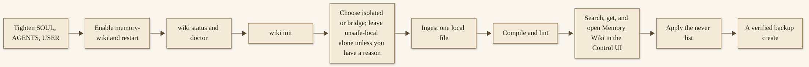{width=100%}

*I04b. First setup, in official order. The wiki comes first. The backup is yours. Then, in Chapter 5, one real job.*

What “done” looks like for the whole chapter, said once so you can check it off. The plugin is enabled, and the Gateway has been restarted or is running with the plugin loaded. `openclaw wiki status` shows the mode and scope you intended, and `openclaw wiki doctor` is healthy, or you have understood and acted on every item. A vault exists at the default path, or at a path you chose on purpose. One local source, with no secrets and no one else’s private life, has been ingested. A compile and a lint have run, and you have read the lint. You have searched, you have opened a page, and you have looked at the Memory Wiki tab in the Control UI. The “never” list is a list you could say to a friend. QMD, if you met it, has been left in the past. A verified backup archive is sitting on a path you chose, and you know that restore does not overwrite live state in place.

If any of that is missing, finish it before Chapter 5. A first real job on top of a vault you have not backed up is how a good Saturday becomes a bad Sunday. A first real job on top of a vault that contains a secret is how a useful practice becomes a problem you have to unwind. There is no prize for rushing the foundation.

You have a Gateway, a wiki, a lint you have read, and a backup you have taken. Now give the agent one real job, and watch something land in the place you just made.


# Chapter 5
## Your First Real Work


{width=100%}

*I05. A finished letter beside a closed notebook, a quiet desk.*


The Gateway is up. The wiki is on. This chapter is one useful loop: a paired channel, a real task, something saved to memory or the wiki, and a Gateway that is still up the next day. We will not invent a client, or a family dinner, to make the work feel important. We will pick a modest job, we will watch it, and we will keep the yes.

## Pick one useful job

The right first job is a job you would do anyway, that is reversible, and that benefits from a place to write. A research brief on a public topic you already care about. A summary of a local file you are allowed to have, dropped in the workspace, with no secrets in it. A letter or a list you will edit yourself before it goes anywhere. Those are complete jobs. They are enough.

The wrong first job is a job with a one-way door: a message that sends itself to a group, a purchase, a deletion, a publish, a calendar invite that goes out to other people. We will not start there. The wrong first job is also a job that needs a messy life in the vault — someone else’s private year, a medical record, a school file. Chapter 4’s “never” still applies. If the source would be wrong in the vault, it is wrong as a first task.

Keep the wiki in the loop. That is the difference between a first hello, which you already did, and a first real work. We will ask the agent to use the vault: to read what is already there, to write a short page or a memory note when the work is done, and to leave something you can find tomorrow. If it writes somewhere unexpected, we will stop and fix the path.

You do not need a perfect prompt. You need a clear one: here is the goal, here is what “done” looks like, here is what you should never do, here is where to file the result. If you can write that note to a coworker, you can write it to the agent. We will use a prompt like that in a moment, as a sample, clearly marked.

Two other honest first jobs, if a research brief is not what you have in front of you. A local file summary: drop a markdown file or a PDF you are allowed to have, with no secrets, into the workspace, and ask for a one-page summary, filed in the wiki, that you will read before you use. A letter or a list: ask for a draft of a thank-you, or a packing list, or a week’s outline, and say, in the prompt, that you will edit it and that it must not be sent. All three jobs share a shape. They produce something you can hold. They do not go out the door alone. They leave a file. I will not wrap any of them in a story about a shop owner or a parent. If you are a shop owner or a parent, you already know the job you would actually run. Use that one, if it is reversible, and if the “never” still holds.

What I will not suggest, even as a sample: a first job that scrapes a site you do not have a right to scrape, a first job that logs into someone else’s account, a first job that “just sends a quick email to the team,” a first job that files a child’s week. Those are not modest. Those are doors.

> **Tip.** Pick a job you can finish in a sitting. A weekend that ends with one filed brief is a better weekend than a weekend that starts three ambitious projects and files none of them. You can always give it a second job on Sunday.

If you would rather stay in the Control UI for this first job, that is a complete choice. The dashboard is an official door. Pairing a messenger is a second door, and it is worth doing before you call the week finished, but it does not have to be the door the brief travels through. You can draft in the dashboard, file in the wiki, and only then pair Telegram, or WhatsApp, or whichever official channel you chose, with a smaller “hello, this is a pairing test” message. A pairing test is not a second research brief. It is a door test. Keep it small, and keep it yours.

I will also say a word about expectations, because a first real job is where people sometimes decide the product “doesn’t work.” A brief that is 70 percent right, with sources you can check, and a path on disk, is a working first job. A brief that is eloquent and unsourced, and that vanished into a session you cannot find, is a more polite kind of failure. We are optimizing for the file, the path, and the review, not for the feeling of magic. Magic is a chat window. A practice is a page you can open tomorrow.

## How to add a channel and pair the first sender

A channel is a door. On day one, the Control UI is already a door, and you can do the whole first job there if you want a quieter hour. If you want the agent where you already talk, we will add one official channel, and we will pair it properly. The official Getting started page, on 12 November 2026, still called **Telegram** the fastest path, with a bot token.^52 You may pick WhatsApp, Discord, Signal, iMessage, or WebChat instead, if the live channel pages still support them. Follow that channel’s official page for the token, the QR, or the login it actually uses. I will walk the pairing itself in official language, with Telegram as the dated example, and the same pairing idea applies to channels that implement OpenClaw’s pairing API.^53

Do not skip pairing “to keep it simple.” I will say that as many times as it takes. An unpairing-skipped inbox on a capable agent is not simple. It is an open door.

**How to add a channel and approve the first sender**

1. Add the channel the official way. For many channels, onboarding or `openclaw channels add` walks a guided setup.^53 For Telegram, follow the official Telegram channel page and the Getting started note: you will need a bot token from Telegram’s own bot-creation flow, and you will give that token to OpenClaw as the official page describes. Do not paste the token into a chat, into the vault, or into a screenshot you will share. If the live page’s steps have moved, trust the live page.

2. Confirm the Gateway is still up:

```bash
openclaw gateway status
```

   You should still see it listening on port 18789. If you don’t, `openclaw gateway start`, then `openclaw doctor`.

3. From the account you want to be able to talk to the agent — your account, not a group, not a public room — send a first direct message. If you are an unknown sender, official default policy is that you get a **pairing code**, and the message is not processed until you approve.^53 The code is eight characters, uppercase, without ambiguous characters, and it expires after an hour. The bot only sends the pairing message when a new request is created, roughly once per hour per sender. Pending requests are capped at three per channel account.

4. Approve the request. From the Control UI: Settings, then Channels, then DM access requests. Review the sender, then choose Approve. Approval grants direct-message access only. It does not grant group access.^53

   From the CLI, as the official pairing page states it:

```bash
openclaw pairing list telegram
openclaw pairing approve telegram <CODE>
```

   Use your channel’s name if it is not Telegram. Add `--notify` if you want the requester told on the same channel. Multi-account channels take `--account`. You should see a confirmation that DM access was approved. If you don’t, list the requests again; codes expire, and a new message may have created a new code.

5. Do not set the channel to an open inbox. Officially, `dmPolicy: "open"` is public only when the effective allowlist includes a wildcard; that is not a first-week tip.^53 Group access is allowlisted, usually behind a mention gate. A work channel should be a list of people you have chosen. Secrets still do not belong in a chat.

> **Caution.** The first CLI approval, when no command owner exists yet, officially bootstraps `commands.ownerAllowFrom` for privileged commands and exec approval prompts.^53 After an owner exists, later pairing approvals only grant DM access; they do not add more owners. That is a kindness for a first setup, and it is a reason to be sure the first sender is you. Do not approve a request you do not recognize.

What “done” looks like for pairing: you can send a DM from an approved account and get a reply; an unknown sender gets a code, not a completed job; group access has not been opened as a side effect. What still needs a yes: every later sender, every group, every node. Pairing is a habit, not a one-time checkbox.


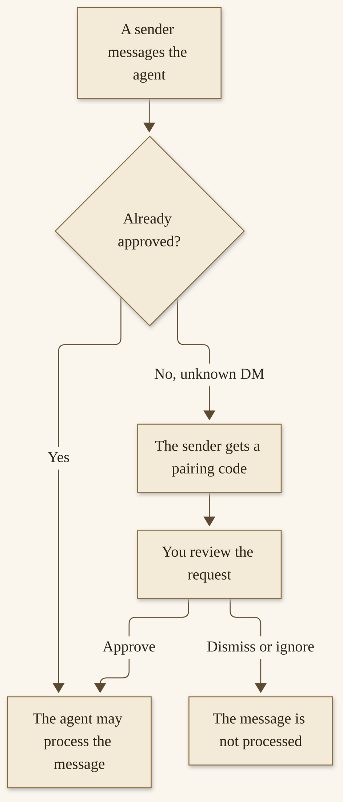{width=100%}

*I05. Unknown DMs get a pairing code, not an open inbox. Approval grants direct-message access only, not group access. Do not skip this step.*

## A worked walk-through

We will do one complete job, watched. I will write the prompt as a sample. Change the subject to something you actually care about. Do not pretend the sample is a real client.

The job: a short research brief, on a public topic, filed in the wiki, that you will edit before anyone else sees it.

**How to run the first real job**

1. Make sure yesterday’s work is still there:

```bash
openclaw gateway status
openclaw wiki status
openclaw doctor
```

   The Gateway should be up. The wiki should be healthy. Doctor should be clean, or already understood. If the wiki plugin is somehow off, go back to Chapter 4 and enable it. This job assumes the vault is on.

2. If your brief needs a local source — a PDF or a markdown file you are allowed to have, with no secrets — put it in the workspace, or ingest it into the wiki first, as Chapter 4 taught:

```bash
openclaw wiki ingest ./path/to/that-file.md
```

   If the job is a public-topic brief with no local file, you can skip ingest and still ask the agent to file the result in the vault when it is done.

3. Send the task, from the Control UI or from the paired channel. A sample prompt, clearly a sample:

> I want a short research brief, for my eyes only, on [public topic]. Use only public information. Do not send this to anyone else. Do not publish it. Do not put secrets in it; there are none to put. First, look at the wiki if anything already there is relevant (`wiki_search` / `wiki_get`, or memory search). Then write a brief of at most one page: what the question is, what you found, what you are unsure about, and a short list of sources. When you are done, file a copy into the wiki (or into today’s memory note if the wiki tools are not the right fit), and tell me the path. I will edit it before it goes anywhere. If you would need to send, spend, delete, or publish to finish, stop and ask me instead.

   You should see the agent take the task, maybe use a tool, maybe search the vault, and come back with a brief and a path. Watch the turn. If you are in the Control UI, you can often see tool calls as they happen. If you are on a channel, you will see the reply land on that channel. That landing is part of what we are proving.

4. Watch the workspace and the vault. Open the path the agent named. You should find a file or a wiki page that matches the brief. If the path is outside the workspace and outside the vault — if it wrote somewhere unexpected — **stop**. Find the file. Decide whether it should exist. Move or delete it only as a person at a keyboard, with your own judgment, and then tighten `AGENTS.md` or the prompt so the next job files where you asked. Official workspace docs already noted that the workspace is a default directory, not a hard sandbox, unless sandboxing is on.^54 This is why we watch the first job.

5. Confirm the reply landed where you sent the task. If you used Telegram, you should see the brief in that DM, from the approved sender’s side. If you used the Control UI, you should see it in that session. If the reply did not arrive, check `openclaw gateway status`, the channel’s official troubleshooting, and whether pairing is still in force. A brief that was written to disk but not delivered is still a brief; find it, and then fix the door.

6. Edit the brief yourself. This is not optional on a first job, and it is not optional on a job that might someday go to another person. The agent drafted. You decide. File your edited version, if you want, as a new source or as a page you are willing to keep:

```bash
openclaw wiki ingest ./path/to/your-edited-brief.md
openclaw wiki lint
```

   Read the lint. A first brief that has been ingested, linted, and looked at is a first brief that has joined the practice.


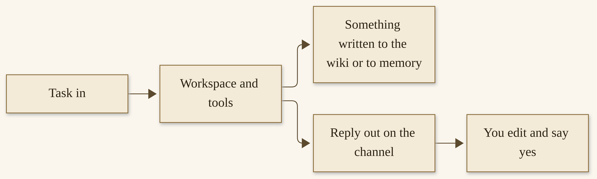{width=100%}

*I05b. The first-task loop. A job comes in. The agent uses the workspace. Something is written to disk. A reply goes out. You still look, and you still say yes.*

If the agent asks to install a skill, or to connect a new MCP server, or to open a new channel, say not yet, unless you already planned that step. The first job is one job. Chapter 6 is skills. Chapter 9 is the catalog, with a review-before-enable ritual. A binge is not compounding.

If the brief is bad, that is useful information, not a failed weekend. Tighten `SOUL.md` and `AGENTS.md`. Add a sentence about length, or about sources, or about the “never.” Run the job once more, on a fresh session if you like. A second draft, with a better instruction, is how a practice starts. A third tool, installed in frustration, is how a practice gets noisy.

A few things that can happen, and what I would do, without inventing a miracle fix.

If the agent never looks at the wiki, even though you asked, check that the plugin is still enabled (`openclaw wiki status`), and that the prompt named the tools. Then check, in the Control UI, whether the turn actually called `wiki_search` or `memory_search`. A model that ignores a tool once is a reason to ask again, more plainly: “Before you draft, run a wiki search for [topic] and tell me what you found.” A model that cannot see the plugin is a Chapter 4 problem; go back and enable it.

If the agent looks, and then writes a page that restates a claim you know is wrong, do not let the page sit. Edit it, or use `openclaw wiki apply` as Chapter 4 taught, and lint. A vault that holds a wrong brief as if it were a source is a vault that will mislead a later job. The official lint can catch contradictions and low confidence. It cannot catch a confident sentence that is simply mistaken. That is your review.

If the channel reply is truncated, or delayed, look at the official channel page, and at whether the Gateway stayed up for the whole turn. A long brief may be happier as a file with a short “it’s at this path” message on the channel. You can ask for that in the prompt the second time: “File the full brief in the wiki, and reply here with the path and a five-line summary only.”

If you used a messenger and the reply never came, but the dashboard session shows a completed turn, the work happened and the door failed. Find the file. Then debug the channel, not the brief. Pairing, tokens, and official channel troubleshooting are the path. Do not re-run a send-to-the-world job to “see if it goes.” This job should not have been a send-to-the-world job.

And if the agent is slow, or the model errors, that is a provider problem or a network problem more often than it is a failed install. `openclaw models status`, the official provider page, and doctor are the right three looks. Then try the same prompt once more. Then stop, if it is still failing, and pick the job up tomorrow. A first weekend can end on a clean doctor and a vault, with the brief to finish later. That is still a good weekend.

## Approvals: send, spend, delete — and a first-week “never”

You are still the one who says yes. I want that to be a first-week habit, not a chapter-14 surprise.

Anything that **sends** a message to someone else, **spends** money, **deletes** a file you would miss, or **publishes** a page, should wait for your approval. Official OpenClaw can require approvals for tools and for exec; those approvals are not all on by default. Sandbox and exec approvals, as we said in Chapter 2, start off.^55 The default posture is a trusted single-operator assistant. You are that operator. Acting like it, this week, means you do not ask the agent to send, spend, delete, or publish on its own, and you do not turn off a pairing policy to make a demo smoother.

A first-week “never” list, short enough to remember:

- **Never** put secrets in a chat, in the vault, or in a prompt you might later screenshot. Keys belong in the official auth flow or in a place you already trust for secrets.
- **Never** skip pairing, and never open a DM policy to the public, “just to see.”
- **Never** install an unvetted skill or a native plugin on a whim. A skill is a document you can read. A native plugin is code that is not sandboxed.^56 Chapter 9’s ritual is: search, read, verify if it came from ClawHub, then enable. This week, you can do without a new plugin. The wiki plugin is already the one we enabled on purpose.
- **Never** expose the Gateway off loopback without a reason, a page, and a “never” you have already read. Chapter 7 and Chapter 14 are those pages. Default bind is loopback. Leave it there.
- **Never** treat a first draft as finished work that can go out the door. You edit. You send, if anyone is going to send.

And a five-minute check, for tomorrow morning, and for a morning a week from now:

```bash
openclaw gateway status
openclaw doctor
openclaw wiki status
```

The Gateway should still be up. Doctor should still be clean. The wiki should still be healthy. If the Gateway is down, `openclaw gateway start`, and if a recent update-recovery left it stopped, read the current release notes and the official rollback pages rather than guessing. v2026.11.3’s notes, on this research day, specifically mentioned update-recovery fixes that could leave the Gateway stopped; a later release may mention something else.^57 If doctor is unhappy, Chapter 3’s triage is still there. If the wiki is unhealthy, Chapter 4’s doctor and lint are still there.

If you want a slightly tighter first week, you can also look at official approval and sandbox settings, and at `openclaw security audit`, as a preview of Chapter 14. You do not have to harden everything on Saturday. You do have to not pretend the defaults are an enterprise wall. They are not. They are a trusted single-operator starting point. Your job, this week, is to be that operator on purpose.

A note about money, because it can sneak into a first week through a model bill, even when you never asked the agent to “spend.” A hosted model is a metered door. Official provider pages, including the xAI page we used in Chapter 3, describe their own billing and, in that case, a SuperGrok quota view when you are signed in with OAuth.^58 I will not invent a price. I will say: look at the official usage view for the provider you chose, sometime this week, so a first job that ran longer than you thought does not surprise you on a statement. Local models have a different cost, in electricity and in time. Either way, a bill is a habit. Chapter 14 will come back to that. This week, a look is enough.

A note about groups, similarly early. Approving a DM does not approve a group. Official pairing docs are explicit.^53 If the agent is in a group chat, group access is a separate allowlist, usually behind a mention gate. Leave groups alone for the first week unless you have a reason and a list. A group is many senders, and some of them will be helpful, and some of them will paste text the agent should not trust as an instruction. Prompt injection is an industry-wide problem official pages already name; we will sit with it in Chapter 14, without a recipe for reproducing it. The first-week move is simpler: one approved DM, one job, no group demo.

> **Caution.** A paired channel is still a channel. Anyone you approve can talk to an agent that can read your workspace, and, unless sandboxing is on, possibly more of the host than the workspace folder.^54 Approve people the way you would hand someone a key to a room with a desk in it. A group is a room with more desks. Allowlist it. Mention-gate it. Do not put secrets in it.

## What “done” looks like, and a look ahead

Let us name “done” for the first week, so you can feel the weekend close without wondering what you forgot.

The channel works, or the Control UI does, and a real job has gone around the loop: task in, workspace used, reply out, something written to disk. The wiki has at least one real page — the source from Chapter 4, and, if the job filed one, the brief. Doctor is still clean. A backup from Chapter 4 still exists; if the week has changed a lot, take another:

```bash
openclaw backup create --output ~/Backups/openclaw --verify
```

You are still the one who says yes. The “never” list is a list you could say out loud. Pairing is on. The Gateway is on loopback. No unvetted skill landed in a hurry. No message sent itself to a group.

That is a complete first week. It is enough. You can stop here and already have a practice: a Gateway on a machine you control, a wiki you turned on before the work got messy, one job you watched, a backup, and a yes you did not give away. A lot of people will never get that far, and you did.

When you are ready for more, the rest of the book is a practice that compounds, not a homework assignment.

Chapter 6 is memory, skills, and the learning loop: dreaming, a first careful skill, the Skill Workshop, and a “never” for memory that is consistent with this chapter’s vault. Chapter 7 is the Gateway in earnest — more doors, nodes, the life of a bind, living where you already are, with pairing and group gates treated as real. Chapter 8 is scheduled work, and more than one agent, and the only sense in which work runs while you sleep: a job you set, a vault it can write to, a review you still own. It is not a promise that the agent wakes up with ideas.

Chapters 9 and 10 are the commons, and the spine of this book’s title: ClawHub, skills and plugins, a review-before-enable ritual, and a path to writing a skill, shipping a plugin, or contributing something small if you want to. “Skills that compound” will mean, there, a small reviewed set you will still be glad you kept. Chapters 11 and 12 are two full how-to shelves, professional and personal, the longest chapters in the book. Chapter 13 is a fleet, when you are ready: seven agents in my shop, a pipeline, a shared machine, Grok 4.7, and WisdomForge, as a picture, not a requirement. Chapter 14 is safety, privacy, and a practice that lasts — worth reading before you give anything a lot of trust.

For tonight, I would do one more small thing, and then close the lid. Look at the path the brief was filed at. Open the page. If it is good, leave it. If it is messy, tidy it, or ingest your edited copy, and lint once more. Then, if you have not already, take the backup. Tomorrow, the five-minute check. That is the habit. The product is capable of a great deal more. The practice, this week, is to be glad of what you started, and to keep the yes.

If you only have a little energy left, skip the look-ahead chapters and do those three things — open the page, tidy or ingest, back up — and go. The book will be here. The vault will be here. The Gateway, if the service is installed, should be here in the morning. That is the point of a first week that was careful rather than spectacular.

One last first-week kindness, and then I will stop talking. Write, somewhere you will see it — a sticky note, a line at the top of `AGENTS.md`, a calendar reminder — the five-minute check, and the “never” list in their shortest form: secrets out, pairing on, loopback on, no unvetted plugins, no send without a yes. That is not a security program. That is a note to your future tired self, who will be tempted, on a busy Tuesday, to skip one of those. I have been that person. The note helps. You will also, if I have done my job, already know where to look when something is wrong: doctor and triage for the Gateway, wiki doctor and lint for the vault, the official pairing page for a door, the official provider page for a model, and Chapter 4 for a backup you can actually restore from. That map is part of what “done” means. A first week is not only a brief. It is a brief, and a way back if the brief is not the problem.

You have done a first week. The next part of the book is how that week becomes a practice you make your own.


# Part 3 — Habits That Compound
# Chapter 6
## Memory, Skills, and the Learning Loop


{width=100%}

*I06. A blank card tucked into a notebook, on a quiet desk, a lamp nearby.*


The official Memory page opens with a sentence I wish every agent product would print in large type: “The model only remembers what gets saved to disk; there is no hidden state.”^59 That is not a modest technical note. It is a promise, and a limit. If a fact is not in a file you can open, the agent does not have it — not in some secret store, not in a cloud account you forgot about, and not in a mysterious “brain” that will surprise you next week. What lasts is what was written down.

I have a habit I recommend to you as a friend, not as a rule I invented. After I ask an OpenClaw agent to remember something, I open the file and look. A polite “I’ll remember that” is only a sentence. The file is the fact. Opening it takes a few seconds, and it has saved me from believing a save that never happened.

This is the chapter where we slow down and ask what the agent keeps, what it should never keep, what a skill is, and how a skill you have actually watched becomes part of a loop that learns. The loop is a habit plus a place to write. It is not a promise that the agent improves on its own while you sleep. Dreaming, which we will come to in a moment, is real official work — a background consolidation into `MEMORY.md` — and a human still reviews what it produced. The built-in LLM Wiki you enabled in Chapter 4 sits beside all of this. It does not replace it. The two layers work together when you let each of them do the job it was sized for.

## What it keeps

When I say memory here, I mean the files the official docs call your agent’s memory, sitting in the agent workspace. The default workspace is `~/.openclaw/workspace`. Four files do most of the work.^59

`USER.md` is optional. It is not created for you automatically. When it exists, it holds stable preferences, a communication style, relationships you chose to write down, and active-project context, written as directives. It is loaded at the start of a session, with a separate small budget. If a preference changes, the official advice is to replace it in place, rather than leave two contradictory instructions sitting next to each other. Dated history belongs in the daily notes, not in this file.^60

`MEMORY.md` is the compact, curated layer for durable facts that are not a profile of you: standing decisions, short summaries, things that should be available at the start of the next session. It is not a raw transcript. It is not a daily log. It is not an archive of everything that ever happened. If it grows past the bootstrap file budget, OpenClaw keeps the file on disk intact, but it truncates the copy injected into context. That truncation is a signal, not a silent loss of the file itself: move the detail into daily notes, keep a durable summary in `MEMORY.md`, or raise the bootstrap limits if you really want to spend more prompt budget. `/context list`, `/context detail`, and `openclaw doctor` will show you raw versus injected sizes.^61

`memory/YYYY-MM-DD.md` files are the working layer — today’s observations, session summaries, raw context that may still be useful later. They are indexed for search. They are not injected into the bootstrap prompt on every turn. Today’s and yesterday’s dated notes load automatically on a bare `/new` or `/reset`. Over time, useful material from those daily notes is distilled into `MEMORY.md` by the default dreaming sweep. The agent is still encouraged to record durable facts as it works. Dreaming handles the background consolidation. The default heartbeat prompt, the official page is careful to say, performs no memory maintenance on its own.^61

`DREAMS.md` is optional, and it is for you. It holds Dream Diary and dreaming-sweep summaries for human review, including grounded historical backfill entries. I treat it the way I treat a first draft: I read it before I trust what was promoted.^59

If you want the agent to remember something, you can just ask it. “Remember that I prefer short replies in the morning, and a careful draft in the afternoon.” It writes the note to the appropriate file. I still look.

The agent has three tools for working with memory, all provided by the active memory plugin — by default, that is `memory-core`. `memory_search` finds relevant notes, including when the wording differs from the original. `memory_get` reads a specific memory file or a line range. `intent` creates, lists, or explicitly cancels event-conditioned standing intents. Time-based reminders, the page says, continue to use scheduled tasks, which we will set up in Chapter 8. The agent can answer directly when the conversation, the bootstrap files, or the recall it already has is enough. It uses the memory tools when that context is missing or only answers part of the question.^62

Search has more than one mode, and the official page is precise about when each one applies. When an embedding provider is configured, `memory_search` uses hybrid search: vector similarity for meaning, plus keyword matching for exact terms — IDs, code symbols, the name of a file. OpenClaw uses OpenAI embeddings by default, once a key is in place; you can set `memory.search.provider` explicitly to use another supported provider, including Gemini, Voyage, Mistral, Bedrock, DeepInfra, local GGUF, Ollama, LM Studio, GitHub Copilot, or a generic OpenAI-compatible endpoint. Those provider names are the official Memory page’s list, opened 12 November 2026, attributed to that page, not a ranking I am making. For keyword-only search, the same family of pages lets you set `memory.search.provider` to `"none"`. The built-in engine is SQLite; it works out of the box with keyword search, and with vector and hybrid search when embeddings are configured. An optional PostgreSQL path exists for qualified runtimes. Other memory engines — Honcho, LanceDB — are plugins, not the default.^63

You can inspect all of this from the command line:

```bash
openclaw memory status
openclaw memory search "query"
openclaw memory index --force
```

`status` tells you about the index and the provider. `search` runs a query you can read. `--force` on `index` rebuilds the index. These are the official commands as the Memory page listed them on 12 November 2026.^64 If a fact you care about does not come back, the file is still the authority. Open it.

Two more official behaviors belong in this picture, because they are easy to miss and they are on by default.

The first is the automatic memory flush. Before compaction summarizes a long conversation, OpenClaw runs a silent turn that reminds the agent to save important context to durable memory. Memory Core saves to a workspace memory file. This is on by default. You can turn it off with `agents.defaults.compaction.memoryFlush.enabled: false`. The flush uses a private copy of the conversation, so its housekeeping messages never appear in later user turns. Its writes to memory are still saved normally. Skipping or failing this optional step does not prevent compaction. When you need to confirm that a fact was retained, check the saved notes, not the chat’s last polite sentence.^65

The second is dreaming. Dreaming is the default background consolidation path. It collects short-term recall signals, scores candidates, and promotes only qualified owner or agent-derived items into `MEMORY.md`. It is on by default; you disable it with `plugins.entries.memory-core.config.dreaming.enabled: false`. When it is enabled, `memory-core` auto-manages one recurring cron job for a full dreaming sweep. Promotions must pass score, recall-frequency, and query-diversity gates. Untrusted and system-derived candidates never enter the consolidation prompt or the durable promotion path. Phase summaries and diary entries are written to `DREAMS.md` for you to review. The official docs credit the motivation of sleep-time compute (a 2025 paper, arXiv:2504.13171) and the durable-memory lessons of the Generative Agents research. That is the page’s attribution, and I will leave it as an attribution. It is not a claim that OpenClaw implements those papers in full, and it is not a promise that a night of dreaming will make the agent wiser on its own.^66

There is a related review lane called grounded backfill, which reads historical daily notes and writes structured review output into `DREAMS.md` without promoting directly into `MEMORY.md`. `MEMORY.md` is still only written by deep promotion. If you use that path, the official commands are on the Memory page; I will not invent flags around them. `DREAMS.md` stays the human review surface either way.^66

You can also bring memory in from somewhere else, carefully. The Control UI can import existing local Markdown memory from Codex, Claude Code, and Hermes. Open Settings → Import Memory, choose the destination agent, review the detected files, and confirm. OpenClaw copies only Markdown memory: from Codex, the consolidated memory files under its memories directory, not raw transcripts; from Claude Code, Markdown from project auto-memory directories, not project instructions, sessions, settings, or credentials; from Hermes, `MEMORY.md` and `USER.md` from the detected Hermes home, not config, credentials, or skills. Imported files stay separate under `memory/imports/…` in the selected agent workspace. They are indexed for search. They are not merged into the agent’s bootstrap `MEMORY.md`. The source files are left unchanged.^67 If you already live in more than one of these tools, that import is a kindness. It is not a reason to drag credentials across a boundary.

The built-in LLM Wiki — the bundled `memory-wiki` plugin you enabled in Chapter 4 — sits beside all of this. It does not replace the active memory plugin. Recall, promotion, indexing, and dreaming stay with `memory-core`. The wiki compiles durable knowledge into a navigable vault: structured claims and evidence, provenance, dashboards, digests, and wiki-native tools. You can browse it in the Control UI under Memory → Dreams → Diary → Memory Wiki.^68 The two layers are easy to collapse in conversation and important not to collapse in practice. Memory is the pocket notebook and the daily notes. The wiki is the bound book you compile, lint, and read.

That is what it keeps. Next is what you should not let it keep — including what you should not let dreaming promote, and what you should not let the wiki compile, without a look from you.

## What you should not let it keep

I have a simple test, and I offer it as a friend, not as a lawyer. If you would not write it on a postcard, do not put it in memory. If you would not want it dreamed into `MEMORY.md`, compiled into a wiki page, or imported later into another workspace, do not let it land in a daily note either.

Secrets do not belong there. Passwords, API keys, card numbers, tokens, the answer to a security question — those go in the place you already trust for secrets, not in `MEMORY.md`, not in `USER.md`, not in a daily note, and not in the vault from Chapter 4. Memory is loaded at the start of a session. A secret that lands there is sitting in the prompt. A folder you back up is a folder someone else might one day see.

Other people’s lives do not belong there either. A colleague’s home address. A customer’s private notes. A child’s full details. Your agent’s memory is yours to change. That does not make it a good place for someone else’s private business. This book is not legal advice, and it is not a reason to store a health detail or a school record in a notebook the agent will read aloud when asked.

Anything you would not want dreamed deserves the same caution. Dreaming is a promotion path. It is designed to lift qualified items into long-term memory. Untrusted and system-derived candidates are supposed to stay out of that path — that is official — but “supposed to” is not the same as “I never have to look.” Read `DREAMS.md`. If a promotion is wrong, or too private, or too sharp, correct it the way you would correct a teammate’s notes. The file is markdown. You can edit it. You can take a line out of `MEMORY.md` the same way.^66

The wiki compiles claims. That is its job, and it is a good job when the claims are ones you would stand behind. Lint the wiki, as Chapter 4 taught, and read a synthesis before you treat it as settled knowledge. A compiled page is a draft until you have looked at it. Provenance is there to help you look, not to replace looking.

The official Memory page has a related idea I like, called action-sensitive memories. Most memories are ordinary notes. Some affect what the agent should do later, and for those, the page asks you to capture when it is safe to act, not just the fact itself: approval requirements, temporary constraints, handoffs, expiry, safe-to-act timing, who owns the instruction, and what the agent should avoid. Memory can preserve that context. It does not enforce policy. Hard operational controls — approvals, sandboxing, scheduled tasks — still live in the settings and the jobs you will set in Chapter 8.^69 A useful “never” in a memory is a gift to your future self. It is not a lock on the door.

> **Caution.** If a fact went into the chat, it can be remembered. Do not paste a password, a key, or a card number into a conversation and hope the agent will know not to keep it. Ask it not to. Then open the file and make sure it didn’t. The same caution applies to a transcript you might later import.

When you take something out, you are not punishing the agent. You are keeping a teammate’s notes honest, including the notes that landed there because a passing remark sounded like a fact.

## Skills as procedural memory

A skill is a procedure you want done the same way next time. In official language, skills are markdown instruction files that teach the agent how and when to use tools. Each skill lives in a directory containing a `SKILL.md` file with YAML frontmatter and a markdown body. OpenClaw follows the Agent Skills specification. A skill is loaded on demand and filtered at load time by environment, config, and whether a required binary is present.^70

That is a different job from memory, and the Skill Workshop page says it plainly: learned skills are procedures, not memory. The method for a task you repeat belongs in a skill, so the agent does not work it out again each time. Facts about you or the world belong in memory. Knowledge about one codebase — conventions, build commands, architecture — belongs in that repository’s docs or in `AGENTS.md`, where every agent working there can read it.^71 A preference — “keep the brief short” — belongs in `USER.md`. A twelve-step publish with a rollback and a “never push this live from an unattended job” belongs in a skill.

The heart of a skill is that `SKILL.md`. At minimum, the frontmatter needs a `name` and a `description`. The official creating-skills guide asks for lowercase letters, digits, and hyphens in the name, and a description that is one line and under 160 characters. Optional fields include `user-invocable`, which is true by default and exposes the skill as a slash command; gating via `metadata.openclaw.requires` for binaries, environment variables, config paths, and operating system; and a homepage URL for the macOS Skills UI. The pre-July 2026 `metadata.clawdbot` block is no longer read. If you have an older skill, rename that block to `metadata.openclaw`. OpenClaw does not rewrite the file for you. The old block’s gates are ignored until you update it.^72

I would add one more thing, in our practice if not as a required official field: a “never.” A good skill tells the agent what not to do at the step where the harm would happen. “Never send this. Leave it as a draft.” “Never delete the original.” “Never pay.” A procedure without a “never” is a procedure that will, one day, be helpful in the wrong direction.

Skills load from several places, and when the same name appears in more than one of them, the highest source wins. The official order, highest precedence first, as the Skills page stated it on 12 November 2026, is: workspace `/skills`; project `.agents/skills`; personal `~/.agents/skills`; managed `~/.openclaw/skills`; workshop skills for that agent; bundled skills (and Custodian-only skills, for the configured Custodian agent); then extra directories and plugin skills. Same-named skills collide; the workspace wins. The folder path is for organization only. The skill’s name and slash command come from the `name` frontmatter field, or from the directory name when `name` is missing.^73

In a multi-agent setup, that order is also a visibility choice. A skill in one agent’s workspace `/skills` is visible only to that agent. A skill in the shared managed library is visible to all agents using that state, unless an allowlist narrows it. Workshop skills learned by one agent are not shared with another. If a procedure must be available to more than one agent, publish it to the managed library, or install it with `--global`, after you have read it.^74

You can point at a skill in a prompt with `$skill-name`. In the Control UI composer, typing `$` searches the skills available to the current agent. A single message can reference up to eight distinct skills; OpenClaw returns a visible error instead of ignoring the extras. On channel messages, `/skill-name` remains the standalone command form, when the skill is user-invocable. Common uppercase shell variables such as `$HOME` and `$PATH` stay ordinary text.^75


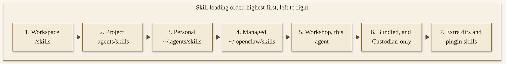{width=100%}

*I06. Skill loading order, as the official Skills page listed it on 12 November 2026. The workspace copy wins.*

That stack is worth keeping in your head for one practical reason. If a skill is not behaving the way you expect, you may be looking at a lower copy than the one the agent actually loaded. `openclaw skills list` and `openclaw skills check` are the official ways to see what won.^73

Treat third-party skills as untrusted code. Read them before enabling. Prefer sandboxed runs for untrusted inputs and risky tools. We will walk the full “review before enable” ritual in Chapter 9, including `openclaw skills verify`, pin, and the install-policy hook. For this chapter, the standard is smaller and just as firm: one skill, read, watched, kept — or taken out.

## The Skill Workshop, and one skill watched

“Skills that compound” is a phrase I want to use carefully, because it is in this book’s subtitle and it is easy to hear as an invitation to install the catalog. It is not. A skill that compounds is one you will still be glad you kept: a procedure you have read, a “never” you have placed at the right step, a watched run you agreed with. A binge of unverified installs is not a practice. It is a pile. The catalog itself — ClawHub, the public registry, the dated counts — is Chapter 9. This section is about one skill, watched once, then kept, and about the official workshop in which the agent may write a skill of its own.

You can install a skill from ClawHub, from a Git repository, from a local path, or from the official skills.sh form the docs list. The commands, as the Skills and ClawHub pages stated them on 12 November 2026, look like this:^76

```bash
openclaw skills search "calendar"
openclaw skills install @owner/slug
openclaw skills install skills-sh:owner/repo/slug
openclaw skills install git:owner/repo@ref
openclaw skills install ./path/to/skill --as my-tool
openclaw skills update --all
openclaw skills verify @owner/slug
```

`openclaw skills install` installs into the active workspace `skills/` directory by default. Add `--global` to install into the shared `~/.openclaw/skills` directory, visible to all local agents unless an allowlist narrows it. `openclaw skills update` tracks ClawHub installs only; to refresh a Git or local source, you reinstall it. ClawHub tracking uses `.clawhub/lock.json` in the workspace and `.clawhub/origin.json` in each installed skill. The pre-July 2026 `.clawdhub` directory is no longer read.^76

If the skill came from ClawHub, run `openclaw skills verify @owner/slug`. That command asks ClawHub for the skill’s trust envelope — officially, the `clawhub.skill.verify.v1` envelope — and checks it against the version and registry recorded in `.clawhub/origin.json`. It is a real check. It is not a substitute for reading the file, and, as we will say more carefully in Chapter 9, it is not a hash of the bits currently on your disk. Installation is not proof that every security scan on the skill’s page completed. A pending or stale scan can still allow an install with a warning. Read the `SKILL.md` before you enable the skill. If the “never” is missing, add it, or do not keep the skill.^77

The Skill Workshop is something else, and it is one of the pieces of OpenClaw I am genuinely grateful for. It holds the skills an agent writes for itself, called learned skills. The agent may save a procedure after hard multi-step work, and it may patch a learned skill that misled it. Every change applies immediately, saves the previous version first, and can be undone. Learned skills belong to one agent, in that agent’s workshop directory, and they are always visible to it. To hide one, you archive it. Skills nobody uses for thirty days are archived, with a reason you can read, and you can restore them.^71

Skill Workshop ships as the bundled `skill-workshop` plugin, enabled by default. You inspect and manage it from the Control UI (Plugins → Skill workshop) or from the CLI:^78

```bash
openclaw skills workshop list
openclaw skills workshop changes
openclaw skills workshop show hello-world
openclaw skills workshop archive hello-world --reason "Replaced by greeting"
openclaw skills workshop restore hello-world
```

Restore can take a `--version` if you want a specific saved version. Restore itself saves the current copy first, so an undo can be undone. A skill that was just created has no earlier version; archive it instead. You can also say “undo” in the conversation after a background review, or use `/learn undo` with the review id the notice gives you.^78

The agent learns in more than one way, all official. During a turn, it may patch a skill that was wrong, or save a working procedure after hard work you are likely to repeat. After enough model iterations in a conversation, a background review may save anything worth keeping; in `propose` mode, it saves a draft for you to review instead of applying the change. `/learn`, in chat, asks the agent to learn now, from the current conversation or from sources you name. Procedures become skills; facts and preferences go to memory when the memory plugin supports it. There is a Control UI button, Learn from history, that opens a chat for reviewing earlier conversations. Changed skills load in new sessions. A running session keeps the snapshot it started with.^79

I like `propose` mode for a practice that is still finding its feet. The official setting is `plugins.entries.skill-workshop.config.autonomous.mode`, and the three values are `auto`, `propose`, and `off`. In `propose`, background reviews change no skills until you apply a draft. `/learn drafts` has the agent read the waiting drafts and ask before saving. You are still the one who says yes.^80

**How to install one skill and watch it once**

Pick one official or carefully reviewed skill — the ClawHub docs’ own example install is `@openclaw/demo`, which I mention only as that page’s example, not as a skill I have audited for you — or write a tiny local skill, which Chapter 10 will walk more slowly.^81 These steps use only official commands. Do not put the skill on a schedule until a watched run looks like work you would sign. Never enable a skill you have not read.

1. Search, then install into the workspace, not yet `--global`.

   ```bash
   openclaw skills search "calendar"
   openclaw skills install @owner/slug
   ```

   Use a real, official or carefully reviewed slug, not a name you guessed. If it came from ClawHub, verify it:

   ```bash
   openclaw skills verify @owner/slug
   ```

   You should see a verification result you are willing to continue with, or a clear failure.
   If you don’t: stop. Read the official verify output. Do not invent a flag that “makes it work.”

2. Open the `SKILL.md` and read it.
   Confirm the steps are the steps you meant, and that a “never” is in the file, at the step where the harm would happen. If the skill uses `exec`, look twice. If anything in it would send, pay, delete, or publish, decide now whether that is a step you want an agent to take, and whether it must wait for your yes.
   You should see instructions you understand, in a file you can edit.
   If you don’t: do not enable the skill. Come back when you have read it, or pick a simpler one.

3. Run it once, in a session you are watching, on a safe input.
   In chat, invoke it by name — `/skill-name`, or the skill’s slash command if it is user-invocable — or ask the agent to use it. Watch the tools it calls. If it reaches for a send, a delete, or a payment you did not approve, stop it and fix the skill before you run it again.
   You should see a result you are willing to keep: a draft, a note, a summary, sitting where you asked it to sit.
   If you don’t: read the skill again, tighten the “never,” and run it once more while you watch.

4. Keep it, or take it out.
   If the watched run was right, leave the skill in place. If this is a Workshop skill the agent wrote, you already have change history and undo. If the run was wrong, edit the file, archive a learned skill (`openclaw skills workshop archive`), or decline to keep a ClawHub install you do not trust. A skill you do not trust is not a skill you schedule.
   You should see one skill in a directory you can open, and no new schedule.
   If you don’t: `openclaw skills list` and the workshop `list` command will show you what is actually there.

Done looks like this: one skill, in a directory you can open, with a “never” you have read, a watched run you agreed with, and no schedule yet. What still needs a yes is anything that would leave your machine — a send, a publish, a payment — and that yes is still yours. The catalog can wait for Chapter 9. The skill you kept is already “making it yours.”

## The loop that learns

“The agent learned” means something got saved. It means a file changed: a line in `MEMORY.md` or a daily note, a page in the wiki, a `SKILL.md` in the workspace or in the workshop, a dream summary in `DREAMS.md` that you reviewed and accepted. If nothing was written down, nothing was learned, no matter how convincing the last reply sounded.

The loop looks like this.


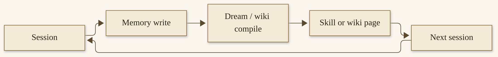{width=100%}

*I06b. The learning loop. Something gets saved, a human reviews, and the next session starts from what was kept.*

A session happens — a conversation, a job, a question you asked. Something worth keeping is written to a daily note or to `MEMORY.md`, or the pre-compaction flush reminds the agent to save before a long chat is summarized. Dreaming, on its official schedule, consolidates qualified items into long-term memory, and leaves a diary in `DREAMS.md` for you to read. The wiki, if you enabled it, compiles durable knowledge into pages you can lint and navigate. A procedure you will repeat may become a skill, written by you or saved in the Skill Workshop, with undo. The next session starts by reading what was kept. Then you do it again.^82

A human still reviews. That is not a slogan I am adding on top of the product. `DREAMS.md` exists for human review. Workshop drafts exist for human review, if you turn `propose` on. The wiki’s lint and its dashboards exist so you can see contradictions, stale pages, and privacy questions before you trust a synthesis. The official Memory page tells you to check the saved notes when you need to confirm that a fact was retained. I will not promise self-improvement without you in that loop. I will not tell you the agent wakes up with ideas. Scheduled work, in Chapter 8, is work you scheduled. Dreaming is consolidation of what already happened, under gates, into a file you can open.

This is the whole loop, at a human size. You have a pocket notebook that is small on purpose, daily notes that can be messy, a wiki for the bigger lasting knowledge, and a first skill you have actually watched. In Chapter 7 we will talk about reaching this practice from another door — a messaging app you already use, a phone as a node — carefully, because a messaging door is a real door. In Chapter 8 we will put a trusted skill, or a trusted morning note, on a clock. Not before.

You are still the one who says what is worth keeping, and what a procedure must never do. The agent will help. It will not replace your judgment about a fact that should never have been written down, or a skill that should never have been allowed to send. That judgment is a gift you give yourself, and it takes less time than cleaning up after a helpful mistake.


# Chapter 7
## The Gateway, and Living Where You Already Are


{width=100%}

*I07. A phone face-down beside a small quiet computer.*


By now you have a Gateway running, a wiki you enabled in Chapter 4, a first real piece of work from Chapter 5, and, if you walked Chapter 6 with me, one skill you have actually watched. The practice is starting to feel like a practice. This chapter is about living with it where you already are — in the chat apps you already open, on a phone that is already in your pocket — without turning the Gateway into a public internet service, and without treating a messaging door as a casual convenience.

The Gateway is not only a process. It is a habit. It is the one quiet program on a machine you control that sessions, routing, and channels all share. The official docs describe it as the source of truth for those things, and they mean it: the CLI, the Control UI, and every messaging door talk to the same Gateway. The default bind is loopback. The default Control UI, as the docs still had it on 12 November 2026, is `http://127.0.0.1:18789/`. That address is local on purpose.^83

A second channel is a gift when you set it up carefully. It is a real door when you do not. This chapter will help you add one official channel, or a node, with pairing still on, and it will tell you what to do when the Gateway is down. It will not give you a recipe for exposing the Gateway to the public internet. If you need to reach it from another machine, the official security guidance points at careful, authenticated paths — Tailscale, or an identity-aware proxy — and at pairing that access with authentication. We will stay on that side of the line.^84

## One Gateway, many doors

One Gateway process sits on a machine you control. Chat apps, the command line, the Control UI, companion apps, and mobile nodes all talk to it. Configuration lives, by default, at `~/.openclaw/openclaw.json`. You start and watch it with official commands you already met in Chapter 3:^83

```bash
openclaw gateway status
openclaw gateway start
openclaw gateway restart
openclaw dashboard
```

`gateway start` waits until health checks pass; it does not restart a Gateway that is already running. Status should show it listening on port 18789. `openclaw dashboard` opens the Control UI in a browser on that loopback address. If the Gateway is already up and you changed a plugin or a channel, `openclaw gateway restart` is the clean way to make sure the new door is actually being served — though official plugin and channel pages also describe hot reload on a running Gateway, and I will follow those pages when we add a channel in a moment.^85

The important habit is simpler than the flags. There is one source of truth. A message that arrives on Telegram, a message you type in WebChat, and a command you run in the CLI are all conversations with the same Gateway. Sessions live there. Routing lives there. If you add a second agent in Chapter 8, that agent still lives on this Gateway unless you have a reason to split. One Gateway is one trust boundary. We will return to that sentence, with more weight, in the next chapter. For now, treat it as a reason not to casually share this process with people you do not fully trust.^86

The default bind is loopback. That means the Gateway is listening on the machine itself, not on every network interface. On a regular host install, that is the conservative official default, and it is a kindness. The exceptions are documented, and we will name them honestly later in this chapter: container images may default to an exposed bind, and those need to be paired with authentication. None of that is a reason to “just open the port.” It is a reason to know which picture you are in.^84

The doors, then, are how you reach that one process. A door can be the dashboard on your own computer. It can be the CLI. It can be a messaging channel. It can be a phone or a tablet acting as a node — a companion device that pairs to the Gateway and offers a camera, a screen, a voice, or device commands, without becoming a second brain. A node is a peripheral, not a Gateway. Channel messages still land on the Gateway, not on the node.^87 We will set one of those doors up carefully in a few pages. First, a current, dated map of the official channels, so you are not choosing from a list I remembered from last season.

## Official channels, dated

OpenClaw can talk to you on chat apps you already use. Each channel connects through the Gateway. Text is supported everywhere; media and reactions vary. The official Channels page, as I opened it on 12 November 2026, divides the roster into three kinds, and I want you to keep the kinds distinct.^88

Some channels ship with the core install. The page marks them “bundled plugin” or “included in core.” On that day, those were: A2A, which connects external agents through the A2A 1.0 protocol; Reef, a guarded, end-to-end-encrypted messaging path between OpenClaw agents of different people; Telegram, a bundled plugin and the page’s recommended first messaging channel; WebChat, included in the core, which is the native and Control UI chat over the Gateway WebSocket; and X / Twitter, a bundled plugin for mentions, allowlisted public replies, thread context, and event modes. I am listing X because the official page listed it that day as bundled. I am not recommending that you connect a public social account as a first door, and Chapter 11 will have more to say about professional channels that should be allowlisted, not public.^88

Official plugin channels install with one command — `openclaw plugins install @openclaw/<id>` — or on demand during `openclaw onboard` or `openclaw channels add`. Plugin management can apply changes to a running Gateway. The official-plugin roster, again as that page listed it on 12 November 2026, was: Buzz, ClickClack, Discord, Feishu, Google Chat, iMessage, IRC, LINE, Matrix, Mattermost, Microsoft Teams, Nextcloud Talk, Nostr, QQ Bot, Raft, Signal, Slack, SMS, Synology Chat, Tlon, Twitch, WhatsApp, Zalo, and Zalo Personal. A related official plugin, Voice Call, covers telephony through providers the Voice Call page names.^88 Those product names are the official Channels page’s names, attributed to that page, on that day. They are not a ranking, and they are not a promise that every channel is equally easy or equally conservative in its defaults. Each channel page states its own defaults. A few workspace channels, the Security page notes, trust workspace membership by default — ClickClack is named there — and you should read the channel’s own page before you turn it on.^84

External channels sit outside the OpenClaw repository. On 12 November 2026, the Channels page named WeChat, WeCom, Yuanbao, and Zalo ClawBot as external plugins, maintained outside the repo. I will label them that way. They are not “officially unsupported” in a dismissive sense; they are someone else’s packaging, and the trust conversation is different. If you use one, read its own documentation, and do not assume the core install’s defaults apply unchanged.^88

I will not invent a “supported channels” boast, and I will not treat this roster as eternal. Channels move. A later edition of this book, or a later morning on the Channels page, may add a name or move one from plugin to bundled. Date the list you rely on, and prefer the live page to a chapter you read in a bound copy.


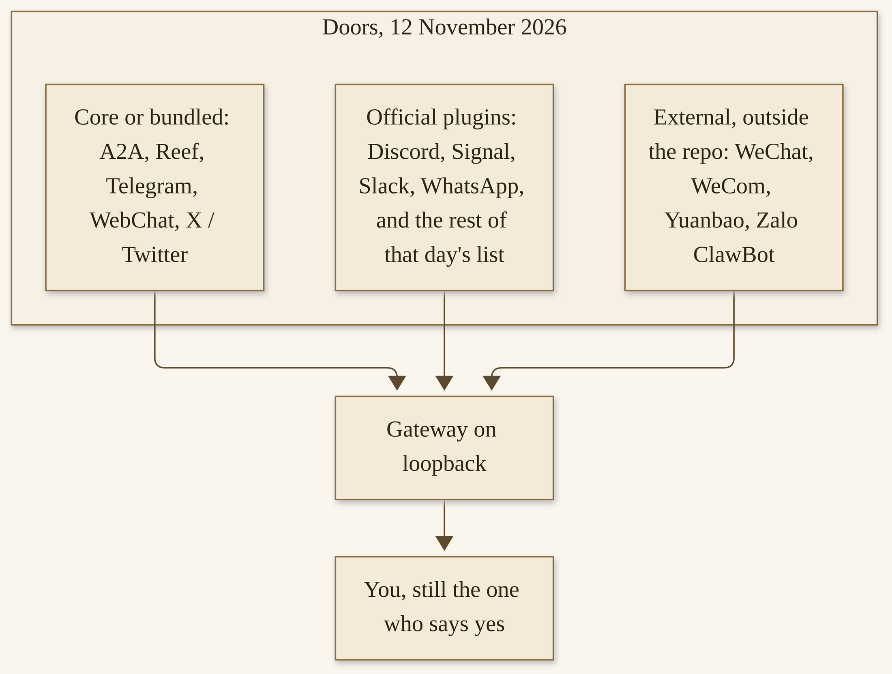{width=100%}

*I07. One Gateway, many doors. The roster is the official Channels page on 12 November 2026, not a quality score.*

The official first-channel advice, on that same page, is still the one I would give a friend starting this weekend: start with Telegram. It needs a bot token and no plugin install, so it is the fastest channel to get working. WhatsApp requires QR pairing and stores more state on disk. If Chapter 5 already paired Telegram for you, you are in the right place to add a second door. If you have not paired a first channel yet, go back and do that first. A second door is for a practice that already has a first.^89

## How-to: add a second channel, or a node

**How to add a second official channel**

Prerequisite: a Gateway that `openclaw gateway status` shows as running, and a first channel you have already paired. If you are adding an official plugin channel — Discord, Signal, Slack, WhatsApp, or any other name from the official-plugin list — install the plugin first. If you are adding another account on a bundled channel, you can skip the plugin step. Never paste a bot token, a QR secret, or an API key into a chat with the agent. Those belong in the official channel setup, or in a place you already trust for secrets, not in a conversation.

1. Install the official channel plugin, if the channel needs one.

   ```bash
   openclaw plugins install @openclaw/<id>
   ```

   Use the real plugin id from the current Channels page, not a name you guessed. The explicit form is the one the page teaches. On a running Gateway, plugin management may apply the change without a full restart; if the new channel does not appear, `openclaw gateway restart` is the official recovery.
   You should see a successful install, and the channel available to `openclaw channels add`.
   If you don’t: `openclaw plugins` listing and the channel’s own docs page are the next stop, not a flag I invent.

2. Add the channel, then confirm the Gateway can see it.

   ```bash
   openclaw channels add
   ```

   With no flags, the command offers a list. You can also pass `--channel` and the flags that channel’s page requires — for Telegram, the official example is `openclaw channels add --channel telegram --token <bot-token>`. After the account is saved, check it:

   ```bash
   openclaw channels status --probe
   ```

   You should see the new account, and a probe that looks healthy.
   If you don’t: start the Gateway if it is offline, and read the channel’s troubleshooting page. The Channels page points at a channel-troubleshooting guide; use that, not a guess.^89

3. Pair the sender.
   Most chat channels answer an unknown DM sender with a pairing channel code, not by processing the message. List the pending codes, then approve the one that is yours:^90

   ```bash
   openclaw pairing list <channel>
   openclaw pairing approve <channel> <CODE>
   ```

   The official pairing page, as I re-opened it for this book on 12 November 2026, describes codes as eight characters that expire after one hour. Approval grants DM access only, not group access. The Telegram example is `openclaw pairing approve telegram <CODE>`. Use your actual channel name and the code the Gateway issued, not a placeholder you leave in a file.
   You should see the sender approved, and a first DM that the agent actually answers.
   If you don’t: check that the code has not expired, that you approved the right channel, and that you are messaging from the account you meant. Do not set `dmPolicy` to `"open"` with a wildcard “to keep it simple.” That is not a first-week tip, and it is not a second-door tip either.^90

4. Send a test message from the new door, and look at what happened.
   Ask for something small and reversible: a summary of a file already in the workspace, or a reminder of what the wiki’s front page says. Do not ask it to send, pay, delete, or publish from a brand-new door.
   You should see a reply on the new channel, and a session you can find in the Control UI.
   If you don’t: `openclaw channels status --probe`, `openclaw gateway status`, and `openclaw doctor` are the official next steps. `openclaw triage` is a read-only diagnosis if you want a guided look; nothing leaves the machine until you choose to hand a finding to an agent.^91

Done looks like this: a second official door, paired, probed, and tested with a reversible message. What still needs a yes is anything that would leave that door — a send to a group, a public reply, a payment. Group access is a separate allowlist. Pairing did not grant it.

A phone or a tablet can be a door of a different kind: a node. Officially, a node is a companion device — macOS, iOS, watchOS, Android, or a headless host — that connects to the Gateway with the role of a node and exposes a command surface: camera, device, notifications, system, and similar. Most nodes use the Gateway WebSocket on the operator port. Nodes are peripherals, not Gateways. They do not run the Gateway service. Channel messages still land on the Gateway, not on the node. A node is not a standalone hosted assistant, and it is not an official OpenClaw Cloud on your phone.^87

**How to pair a phone or tablet as a node**

Prerequisite: the same running Gateway, reachable the way the official node pages describe for your setup. If the Gateway is only on loopback and the phone is not on that machine, you need a conservative remote-access picture first — the one in the last section of this chapter, not a public bind. Follow the current node-pairing page for the exact taps in the iOS or Android app, because those screens move. I will not invent a tap path. The official idea does not move: the device requests to pair, and you approve it as a node, the way you approve a DM sender as a person.

1. Open the official node-pairing page for your platform, and follow its current steps to connect the device to your Gateway.
   You should see a pending node, or a pairing request, on the Gateway side.
   If you don’t: the official node troubleshooting runbook is the recovery, at the path the Nodes page itself points to. Version skew between a node and a Gateway is a real official topic; upgrade in the order that page gives you, not in a guessed one.^87

2. Approve the node, and give it a name you will recognize later.
   The official CLI family is `openclaw nodes`, for listing, inspecting, and managing nodes. Use the approve and name flow the current pairing page shows.
   You should see the device in the node list, with a friendly name, connected.
   If you don’t: do not start a second node host on a Mac that is already running the menu bar app as a node — the official Nodes page warns against that double connection. One identity, one connection.^87

3. Decide what the node may do, before you ask it to do anything interesting.
   Camera, screen, location, computer use, and voice are real capabilities on the official node pages. They are also real doors into a room. Official command policy and allowlists exist so you can leave a capability off until you want it. Talk Mode — live voice on a node — is still documented, on 12 November 2026, at the official Talk page, including native macOS, iOS, and Android Talk, and a browser Talk path. If a path on that page has moved by the time you read this, follow the live page. I am not going to freeze a wake-word recipe into this chapter.^92
   You should see a policy you chose, not a wide-open device.
   If you don’t: leave the extra capabilities off and use the node as a quieter way to talk to the same Gateway, which is already a complete first step.

4. Try one small, reversible action while you watch: a voice question, or a request that does not leave the machine.
   You should see the reply, and a Gateway session that recorded it.
   If you don’t: node troubleshooting first, then `openclaw gateway status`. The brain is still the Gateway. The phone is a door.

Done looks like this: a named, approved node, with only the capabilities you meant to turn on, and a watched first use. What still needs a yes is anything sensitive — a camera in a private room, a screen share, a location, a message sent from the node’s session to a group. A node does not lower the standard. It moves the door.


## A messaging door is a real door

I want to say this the way I would say it to a friend who is about to connect a work chat, or a family group, to an agent that can use tools. Kindly, and clearly. A messaging door is a real door. People on the other side of it can speak to your agent. If the agent can send, they can be spoken to. If the agent can run tools, a message is not only a message. It is an input to a process that can act.

Official conservative defaults on a regular host install are there for that reason. The Gateway binds to loopback. Most chat channels answer an unknown DM sender with a pairing code instead of processing the message. Group access is allowlisted, usually behind a mention gate. Those are good defaults. Keep them.^84

Pairing, which you just did, is the first gate. It is not optional “to keep it simple.” An unknown sender gets a code. You approve the code, or you do not. Approval is DM access only. A group is a separate decision, and it should be an allowlisted decision, usually with a mention required so the agent does not answer every passing remark in a busy room. A work channel should be allowlisted, not public. Chapter 11 will walk that as a professional how-to. The standard here is the same.^90

Secrets stay out of chat. A bot token, an API key, a password, a backup phrase — if it goes into a Telegram message, it can be logged, transcribed, remembered, and dreamed. Chapter 6 already asked you not to put secrets in memory. The same caution is louder on a messaging door, because a messaging door can be a phone you take into a café, or a group a colleague might add a person to. If a skill or a setup step needs a secret, use the official secret path, not the chat.^93

Approvals still apply. Sandbox and exec approvals are off by default; that is official, and it means the default is a trusted single-operator assistant, not an enterprise-hardened box. Turning those on, when the work calls for it, is Chapter 14. For this chapter, the practical meaning is: a new messaging door does not get to spend, send to the world, delete, or publish without your yes. If a skill you installed in Chapter 6 would do any of those things, do not invoke it from a group until you have watched it in a tight, paired DM, and until the “never” in the skill is one you still believe.^94

> **Caution.** A group is not a slightly larger DM. It is a room. Allowlist the room. Prefer a mention gate. Keep secrets out of the room. And do not treat a successful probe as a reason to open the door to anyone who can find the bot.

Prompt injection — untrusted content reaching the model and trying to change what it does — is treated, officially, as an industry-wide unsolved problem. I will not pretend a mention gate solves it. I will tell you what the official advice is, in plain words: use a strong latest-generation model, read the official prompt-injection page, and keep bypass flags off in production. A clever paste in a group is still untrusted content. The introduction that some channels post when the bot joins a room is itself run, officially, with no tools available, and with that room’s text wrapped as untrusted. That is the right posture. Borrow it for your own habits.^95

The Control UI and the CLI remain available when you want a tighter room than a busy channel. You do not have to live in a messaging app just because a messaging app is connected. Some work is better in the dashboard, on loopback, with you watching. The door can be there for the morning note and the short question, and closed — or simply unused — for the work that can spend or send.

## Binds, remote access, and when the Gateway is down

The conservative picture is the one we started with: the Gateway on loopback, doors that pair, you on the same machine or on a node you approved. A lot of good practices never leave that picture.

Sometimes you need to reach the Gateway from another machine — a laptop in another room, a phone that is not on the same desk, a small office host you administer. The official security hub points at network-exposure guidance, at Tailscale, at a reverse proxy that supplies an operator identity, and at a Gateway exposure runbook with a pre-flight and a rollback, for the case where you are exposing the Gateway beyond loopback.^84 I will not turn those pages into a public-internet recipe. I will say this, and then I will stop at the edge where a cookbook would become a way to put a trusted assistant on the open web:

If you need remote access, use a path the official security pages actually describe — Tailscale, or an identity-aware proxy — and pair it with authentication. Container images may default to an exposed bind; the official Security page says to pair that with auth, and to see the exposure runbook. That exception is documented because it surprises people. It is not an invitation to publish the port. `openclaw security audit` is the operator check that tells you if you have drifted from the conservative defaults, including bind and exposure findings. Optional `--deep` goes further. Run it after you change how the Gateway is reached, and again after you add a channel.^84

```bash
openclaw security audit
```

> **Caution.** I am not going to give you steps for binding the Gateway to a public address and “securing it later.” Later often does not arrive. If the official exposure runbook is the path your setup truly needs, read that page, use its pre-flight and its rollback, and keep pairing on. This book will not outrun it.

When the Gateway is down, the doors are down with it. Nodes cannot make up a brain they are not connected to. Scheduled work in Chapter 8 will not run if the process is not there. The official recovery picture is calmer than a crisis, and it is the one I want in your hands:^91

```bash
openclaw gateway status
openclaw doctor
openclaw triage
```

`status` tells you whether the process is listening. `doctor` is the diagnosis you can read yourself, and `doctor --fix` applies supported repairs — including, as Chapter 4 noted, migrating retired QMD settings, which you should not be teaching yourself as current setup. `triage` is a read-only guided diagnosis; nothing leaves the machine until you choose to hand a finding to an agent. If a recent update left the Gateway stopped, look at the current release notes — v2026.11.3, still the latest stable on 12 November 2026, was a security and patch release that included update-recovery fixes for a Gateway left stopped — and at `openclaw update`, rather than at a frozen list of old incidents.^96

Start the Gateway again only when status and doctor make sense to you:

```bash
openclaw gateway start
openclaw gateway status
openclaw channels status --probe
```

You should see the process listening, and the channels you configured still paired.
If you don’t: stay with doctor and triage, and with the official channel-troubleshooting page, before you start deleting config. Your backup from Chapter 4 is the floor under this moment. A backup is yours, not the agent’s. If you have to restore, restore into a fresh directory the way the official backup page describes, not on top of a live state.


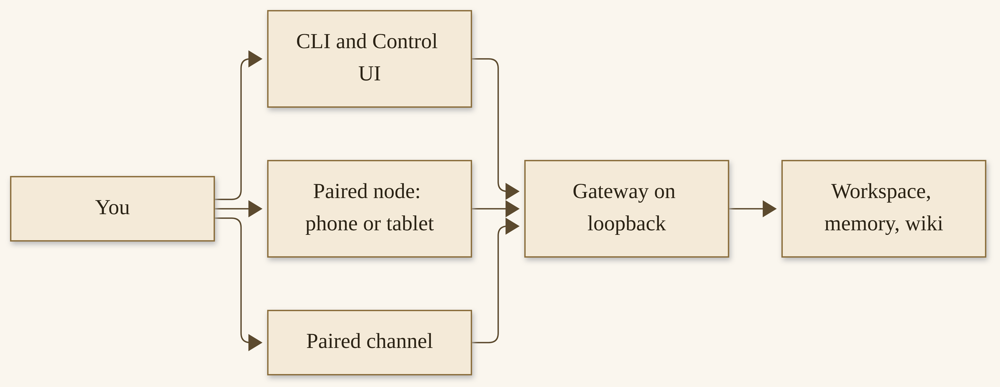{width=100%}

*I07b. The node and the chat app are doors. The Gateway is the room they open onto.*

That is the whole door, at a human size. You can live in the apps you already use, and on a phone you already carry, without making the Gateway a public service, and without treating a probe as a blessing. In Chapter 8 we will put work on a clock — a morning note, a professional digest — and we will talk about a second agent, and about when a second Gateway is the right split, because one Gateway is still one trust boundary. The door you just opened will be there in the morning, if the Gateway is, and if the pairing still holds.

You are still the one who says which door is open, and who is allowed through it. That yes is a small one, and it is worth giving slowly.


# Chapter 8
## Cron, Multi-Agent, and Work That Runs While You Sleep


{width=100%}

*I08. A clock with a blank face, a closed notebook, a lamp left on.*


A morning note that is waiting for you, written overnight, is one of the quiet pleasures of a practice like this. It is also one of the easiest places to tell yourself a story the product does not tell. The agent did not wake up with ideas. It ran a job you scheduled, in a session whose shape you chose, and it delivered a result to a door you had already paired. If the Gateway was down, the job did not run. If the job was isolated, it did not quietly inherit a week of chat. If you did not approve a send, a careful job still has no business sending itself to the world.

This chapter is about that kind of work: official automations — `openclaw automations`, with `cron` as an alias — and about more than one agent on the same Gateway, and about when a second Gateway is the right split. We will schedule one personal job and one professional digest, both copied from official patterns. We will add a second, narrower agent, and look at the official team preset. We will say only what the official pages say about what survives a crash, and we will not promise the rest.^97

The wiki you started in Chapter 4, and the skill you watched in Chapter 6, are what make a scheduled job worth having. A clock without a notebook is just a clock. A clock with a procedure you have not read is a clock I do not want running while you sleep.

## While you sleep, not by magic

Automations are OpenClaw’s built-in scheduler for recurring and one-shot work. The official Automation page is a decision guide: if you need work on a schedule, you want automations; if you need a one-shot reminder, you still want automations, with a precise `--at`; if you need to react to an internal lifecycle event, that is a hook; if you need authenticated ingress from an external service, that is a webhook. Standing orders, which live in workspace files such as `AGENTS.md` and are injected into every session, are persistent instructions, not a clock. The inferred-commitments experiment — an older attempt to extract follow-ups from conversations — was removed in v2026.8.1. For reminders or scheduled work, you create an explicit automation. Automations do not restore inferred follow-ups.^97

The command registers as `openclaw cron`, with `openclaw automations` as an alias. Every subcommand works with either spelling. I will use `openclaw automations` in this chapter, because that is the name the conceptual pages lead with, and because it is the clearer word for what is happening. `create` is an alias for `add`.^98

Jobs can be one-shot or recurring. Official schedule kinds, as the schedules page listed them on 12 November 2026, are: `--at` for a one-shot timestamp, ISO 8601 or a relative duration such as `20m`; `--every` for a fixed interval such as `10m`, `1h`, or `1d`; `--cron` for a five- or six-field cron expression, with optional `--tz`; `--on-exit` to fire once when a watched command exits; and `--stream-command` to fire from batched lines of a supervised long-lived command. Natural-language schedules such as “every day at 9am sharp” are not supported. Use `"0 9 * * *"` instead. Invalid cron expressions are rejected by the CLI. Timestamps without a timezone are treated as UTC. Add `--tz America/New_York` — or any IANA timezone that is actually yours — to interpret an offset-less `--at`, or to evaluate a cron expression, in that zone. Cron expressions without `--tz` use the Gateway host timezone.^99

Delivery can go to a chat channel or to a webhook endpoint. `--webhook` on add or edit POSTs the finished run payload to an HTTP endpoint; it cannot be combined with chat delivery flags. I will not invent a webhook request body. If you need that shape, the official delivery and payloads pages are the authority, and they will move. Inbound authenticated HTTP hooks, which the Automation page still documented on 12 November 2026 as generic Gateway HTTP hooks for authenticated external triggers, exist as a way to trigger an agent from an external service. Same rule: official pages for the how, no invented payloads in this book.^100

The session a job runs in is a real choice, and it is the choice I want you to make on purpose. `--session` accepts `main`, `isolated`, `current`, or `session:<id>`. Main-session jobs run through the owning agent’s ordinary session, with that session’s existing context — useful for reminders and system events, and easy to pollute if the main session is also your daily chat. Isolated jobs run a dedicated agent turn with a fresh session, which the official pages recommend for reports and background chores. Current-session jobs run as a child of the conversation that created them. A custom `session:` key persists context across runs. Agent-turn jobs created from ordinary CLI calls, without a session key, fall back to `isolated`. Isolated `automations add` jobs default to `--announce` delivery. `--no-deliver` keeps the result from going out that way.^101

That last flag is a kindness I want you to remember. A job can do useful work and leave a result for you to read, without sending itself into a channel. A professional digest, especially, should be read by a human before it is treated as a message that left the house.

Dreaming, from Chapter 6, is already on a clock when it is enabled: `memory-core` auto-manages one recurring cron job for a full dreaming sweep. You do not have to invent a dreaming schedule. If you disable dreaming, that job should go with it, as the official Memory page describes. I will not invent a second dreaming cron on top of the one the plugin already manages.^102

Isolated runs, officially, reset ambient conversation context. Channel and group routing, send and queue policy, elevation, origin, and ACP runtime binding are reset for the new run. Safe preferences, and explicit user-selected model or auth overrides, can carry across runs. That is why isolated is the right shape for a report: the job does not inherit a week of chat, and it does not inherit a send policy you meant only for a conversation you were standing in. The private run transcript is not copied into the destination. What gets delivered is the result you asked for, if you asked for delivery at all.^101

Two official knobs are worth knowing if a job should respect the rest of your life. `activeHours` and `idleOnly` let a check honor quiet hours and foreground work. The official monitoring example pairs them with a small scratch checklist and a `NO_REPLY` when nothing needs attention, and with `--skip-if-scratch-empty` and `--no-deliver` when a quiet pass should stay quiet. I will not invent a lifestyle around those flags. I will tell you they exist, on the schedules page, and that a morning note that pings a family group at 3 a.m. is usually a timezone or an active-hours miss, not a personality the agent developed overnight.^112

If you used older heartbeat monitors — periodic ambient checks from an earlier OpenClaw — official docs say those monitors migrate into ordinary editable jobs, through Doctor, with their own scratch, execution policies, and delivery settings. Setup may provision one proactive check for the ambient owner; later reloads and restarts leave your job edits and deletions alone. After an upgrade, look at the job list and read what landed, the way you would read a migrated setting anywhere else. The heartbeat is not a mind. It is a job you can now edit.^113

The agent does not wake up with ideas. It wakes up because a schedule fired, a one-shot came due, a watched command exited, or an authenticated hook arrived. The idea, if there is one, was in the prompt you gave the job, or in the memory and the wiki and the skills that job was allowed to read. You wrote those, or you reviewed them. That is the honest picture, and it is a better one than magic, because you can change it.

## How-to: one personal job, and one professional digest

Two official recipes, copied from the live managing-jobs and schedules pages as I opened them on 12 November 2026. I have changed only what a careful reader should change: a timezone that might actually be yours, a delivery door that is a paired channel you already have, and a prompt that does not pretend to be more than a note. The cron expressions and the flags are the official ones.^103

**How to schedule a morning note**

Prerequisite: a Gateway that stays running overnight — a Gateway that is down will not fire the job — and a paired channel, or a willingness to read the result in the Control UI. Use an isolated session for a report. Do not ask this job to send, pay, delete, or publish. If nothing needs your attention, the official monitoring example allows a `NO_REPLY` so the channel stays quiet.

1. Create the job, with the schedule first and the prompt second, the way the official CLI page prefers for new jobs.

   ```bash
   openclaw automations create "0 7 * * *" \
     "Summarize overnight updates. Write a short morning note I can read. Do not send this note anywhere except the delivery I configured. If nothing needs attention, say so plainly." \
     --name "Morning brief" \
     --tz "America/New_York" \
     --session isolated \
     --announce
   ```

   The official example uses `"0 7 * * *"` and the name `"Morning brief"`, and it shows `--tz` and `--session isolated` and `--announce`. It also shows `--channel` and `--to` for a Slack destination. If you want the note on a paired channel, add the official delivery flags for that channel, taken from the current delivery page, not from a guessed id. If you want the note to stay put, use `--no-deliver` instead of `--announce`, and read the run in the Control UI.
   You should see a job listed, with a next run time that matches 7:00 in the timezone you set.
   If you don’t: `openclaw automations --help` and the official managing-jobs page are the recovery. Invalid cron is rejected with examples of valid syntax; use those, not a phrase like “every morning.”^103

2. If you want to be sure of the shape before tomorrow morning, run it once, while you watch, if the official CLI on your version offers a run-now path — the managing-jobs page documents `--wake now` on a one-shot example, and `automations run` as a mutation that requires operator admin. Follow the live page for the exact run-now invocation. Watch what the job does.
   You should see a morning note you would be willing to wake up to, with no unexpected send.
   If you don’t: edit the job’s message, or remove it, before you leave it for the night. `openclaw automations edit` uses the same schedule and delivery flags.^103

3. Read the first scheduled result yourself.
   Tomorrow morning, open the channel or the Control UI and read the note as if a colleague wrote it. Correct the prompt if the tone or the scope is wrong. Check that nothing private from a daily memory file was announced into a room you did not mean to brief.
   You should see a note you would sign, or a clear “nothing needs attention.”
   If you don’t: tighten the prompt, switch to `--no-deliver` until you trust it, or take the job out.

Done looks like this: one named job, isolated, on a cron you understand, delivering a note a human reads. What still needs a yes is any later decision to send that note onward, or to attach a skill that can spend or publish.

**How to schedule a professional status digest**

Same tools, a tighter “never.” This is a digest you still read. It is not a newsletter the agent sends to a team on its own. Isolated session. Announce only to a paired, allowlisted door, or do not announce at all.

1. Create a weekly isolated job, using the official weekly example’s cron and flags, with a professional prompt and a timezone that is yours.

   ```bash
   openclaw automations add \
     --name "Weekly status digest" \
     --cron "0 6 * * 1" \
     --tz "America/New_York" \
     --session isolated \
     --message "Draft a weekly status digest from the workspace and the wiki. Leave it as a draft for me to read. Never send it, never publish it, and never pay for anything in the course of writing it. If you cannot find reliable notes, say what is missing instead of filling gaps." \
     --announce
   ```

   The official deep-analysis example uses `--cron "0 6 * * 1"`, `--session isolated`, `--announce`, and optional `--model` and `--thinking` overrides. I am not copying a model name from that example into your shop, because your model is yours. If you want a heavier model for this job, use a model id you have already set up, from the official providers directory, not a nickname I invent.^103
   You should see a weekly job, next run on a Monday morning in your timezone.
   If you don’t: same recovery as the morning note — valid cron, live help, official page.

2. Run a watched draft once, the same way, before you trust the Monday.
   You should see a digest that a human could edit, sitting where you told it to sit, with no send.
   If you don’t: the “never send, never publish, never pay” line belongs in the prompt and in any skill the job is allowed to use. Put it there, and watch again.

3. Keep a human in the reading seat.
   A digest that no one reads is not a professional practice. It is a file that grows. If you deliver it to a work channel, that channel should be allowlisted, as Chapter 7 required, and the digest should still wait for your yes before it is forwarded anywhere else. Chapter 11 will walk a fuller professional version of this job. The standard does not get lower there.
   You should see a weekly habit you would keep, not a firehose.
   If you don’t: fewer jobs, a narrower prompt, or `--no-deliver`.

Done looks like this: one professional digest, isolated, scheduled, read by a human, with a “never” that held during a watched run. What still needs a yes is sending it on.

> **Tip.** Isolated is the right default for reports. Main is for a reminder that should share your daily session’s context. If you are not sure, isolated is the safer official recommendation for background chores, and you can always read the result yourself.

## A second agent, and the team preset

One agent is enough for a long time. A second agent is for a second job, with a narrower brief, not for a sense that a serious practice must look like a company chart. Officially, you can run multiple isolated agents in one Gateway process, each with its own workspace, its own state directory (`agentDir`), and its own session history. A binding maps a channel account, and optionally a peer, to one of those agents. Inbound messages route through those bindings.^104

Add a new isolated agent with:

```bash
openclaw agents add work
```

Flags, as the Multi-agent page listed them on 12 November 2026, include `--role`, `--workspace`, `--model`, `--agent-dir`, `--bind <channel[:accountId]>` (repeatable), and `--non-interactive`, which requires `--workspace` unless a role is supplied. The wizard can offer to add bindings for you. Then verify:^104

```bash
openclaw agents list --bindings
```

In the Control UI, Agents at `/agents` shows the roster. Restart and probe after you have wired accounts:

```bash
openclaw gateway restart
openclaw agents list --bindings
openclaw channels status --probe
```

Never reuse `agentDir` across agents. The official page is blunt about this: reuse causes auth and session state collisions. If you want a fully independent OAuth account, sign in from that agent. Each agent gets its own workspace, with `SOUL.md`, `AGENTS.md`, and optional `USER.md`, plus a dedicated session store. Workspaces can be isolated or pointed at a shared folder; isolated is the right starting picture when the two jobs should not share notes. Plugin-owned storage does not always split automatically when you add a second agent. For the wiki, set `memory-wiki` vault scope to `agent` when personas must not share compiled knowledge, and remember Chapter 4’s official warning: per-agent vaults are a same-process knowledge boundary, not an OS security boundary.^104

Cross-agent session access is on by default and governed by `tools.agentToAgent`. You can narrow session visibility with `tools.sessions.visibility`, restrict agent pairs with `tools.agentToAgent.allow`, or set `tools.agentToAgent.enabled: false` to block ordinary cross-agent access. On 11 November 2026 I wrote publicly about Gateway session isolation — “My Agents Could Read Each Other’s Transcripts. Two Config Keys Closed That Door in Ten Minutes.” That article is a teaching story about why isolation matters. The keys themselves should be copied from that article plus the official docs, not from a chapter that is working from the official Multi-agent page’s current setting names. If you are putting two agents on one Gateway, read the official visibility settings, and read the article if you want the reason I tightened mine, before you assume two workspaces are enough.^105

The official team preset is there when a small team of roles is actually what you need:

```bash
openclaw agents team create --non-interactive
```

The preset creates a chief of staff (`coordinator`), a researcher, a writer, and a reviewer, each with its own workspace and a completed identity. The coordinator is the human’s point of contact: it discovers matching specialists, assigns bounded work, checks their artifacts, and reports a coherent result. Specialists return artifacts and evidence to the coordinator without delegating further. Their operating programs live in `AGENTS.md`. Role instructions require human approval before external sends, publication, purchases, deletion, or production changes. That sentence is official, and it is the one I want in your ear: you still say yes.^106

You can message the coordinator with:

```bash
openclaw agent --agent coordinator --message "Research the options and draft a recommendation."
```

Use `--prefix` to namespace the ids, `--coordinator` to rename the coordinator, and `--workspace-root` to choose the parent directory for the separate workspaces. All ids are checked for conflicts before creation. You can also create the chief of staff or the full team from the Control UI, and creation waits for your approval. The bundled roles are Template sources, sharing the portable `CLAW.md` format; Chapter 10 will come back to templates. `agents add --role` loads one of those sources.^106

A few more official facts about that preset, so you do not have to discover them by surprise. Team creation sets `agents.defaults.systemAgent.agentId` to the coordinator only when that owner is unset; an existing owner is preserved and reported. Delegation from the coordinator is prompt guidance (`delegationMode: "prefer"`), not a scheduler that forces work onto specialists. `allowAgents` controls explicit spawn targets. The preset keeps `agents.defaults.subagents` and `tools.*` unchanged, so your existing tool policy still applies. Specialists in the bundled shape have empty `allowAgents` lists: they return work, they do not delegate further. Operating programs live in `AGENTS.md`, so they also apply in spawned sessions that do not load `SOUL.md`. These delegation settings are team wiring in config.^106

OpenClaw also records how each configured agent was created: `operator` for CLI, onboarding, and Gateway requests; `agent` when the system agent requested it; and `template` when a Template install added it. A configured agent can ask OpenClaw to create another agent, and the system agent files that operation, shows you the requesting agent id, and creates the new agent only after your approval. Inspect the hierarchy with `openclaw agents list --tree`. Deleted creators remain historical provenance. That approval, again, is the point. An agent that can request a colleague is a gift. An agent that can mint one without your yes is not a practice I want running overnight.^114

Each agent can also have its own sandbox and tool restrictions. The official Multi-agent page shows a personal agent with sandbox off, and a family agent with sandbox mode `all`, a tighter tool allowlist, and mention patterns for a group. I am not going to paste that whole config into this chapter as if it were a default you must adopt. I am going to tell you the idea is official, and that a second agent is a natural place to tighten tools, even if your first agent is still the trusted single-operator assistant you started with. Sandbox and exec approvals remain off by default at the product level. A narrower agent is one way you turn them on for the work that needs them, without waiting for Chapter 14’s full hardening pass.^115

This preset is a starting shape, not my shop. In Chapter 13 I will describe the seven OpenClaw agents I actually run — Carol, who coordinates and syncs with Charlie; Randal, Wesley, Vai, Rachel, and Parker, who research, write, validate, review, and publish; and OC, who keeps the environment healthy — and the pipeline they use, on the shared MiniPC, with Grok 4.7, responsible for WisdomForge. I will not preview that shop as an org chart here, and I will not tell you to copy those names. The official preset is the path the product gives a reader. My roster is one practice, at the size it grew to. You still say yes, in both pictures, before anything is sent, published, purchased, deleted, or changed in production.^106

## One trust boundary — and when to split

One Gateway is one trust boundary. The official Security page assumes a single operator, or a team whose members trust each other. Group chats and multi-user operation are supported deployments inside that boundary. OpenClaw is not a hostile multi-tenant security boundary for mutually adversarial users sharing one agent or one Gateway. For mixed-trust or adversarial-user operation, split trust boundaries: a separate Gateway, separate credentials, and ideally separate OS users or hosts.^107

That is a trust decision, not a status symbol. Two Gateways do not make a more serious practice. They make a second boundary, when you need one.

A family-calendar agent and a private journaling agent may share a Gateway. They are two jobs you trust in the same house, with isolated workspaces, and, if you want a cleaner wiki split, agent-scoped vaults — still a same-process knowledge boundary, not an OS one. A public inbox and a private vault should not share a Gateway. A bot that answers strangers, even behind pairing, is a different trust picture from a journal that holds a life. Put them on separate Gateways, on separate credentials, and, if the work is sharp enough, on separate OS users or hosts. The official page is the authority for that split. I am only translating it into the two cases I am asked to teach.^107

Bindings, allowlists, and session-visibility settings are how you route work inside one boundary. They are not a substitute for a second boundary when the people on the other side of a door are not in your circle of trust. Chapter 13 will return to this at fleet size, with the locked roster and a paper sketch you can copy. For this chapter, the rule is small enough to keep: one Gateway, one trust; a second Gateway when the trust is no longer one.

## What survives a crash — and what does not

I want to be careful here, because this is a place a friendly book could promise too much.

The official automation pages say the scheduler persists jobs. Jobs are not only in memory for the life of a process; they are stored, and they have history you can inspect. Sessions and transcripts live in a SQLite store under the agent’s `agentDir`. The Gateway is a process you can install as a service — a LaunchAgent on macOS, a systemd user unit on Linux, a Scheduled Task on Windows — so an ordinary reboot can bring it back, and with it, the scheduler.^108

I did not find, on the official pages I opened for this chapter on 12 November 2026, a promise that a job mid-run always survives a crash, or that a turn in flight is always written completely, or that every in-progress tool call is durable. I will not invent that promise. If a later official page says more, trust that page and date it. If the page is silent, the honest sentence is: the page does not say. Design your practice as if a crash can lose work that was not yet saved to disk. That is the same honesty Chapter 6 started with: the model only remembers what gets saved to disk.^109

The floor under that honesty is the backup you already took in Chapter 4, or should take today if you skipped it. Officially:^110

```bash
mkdir -p ~/Backups/openclaw
openclaw backup create --output ~/Backups/openclaw --verify
```

A verified full archive covers state, config, credentials, every configured agent directory, and, by default, workspaces. The default wiki lives under the state directory, so it is part of that state tree. If you set a custom vault path outside the state directory, you must protect that path too. Archives can contain credentials and session history; store them as carefully as the live state. Restore never overwrites live state in place. Restore into a fresh, empty directory, then stop the Gateway and activate deliberately, and run `openclaw doctor` before restarting. Never copy live SQLite files, including their `-wal` and `-shm` companions, as a backup. A backup is yours, not the agent’s.^110

If you want a scheduled backup habit, that is an ordinary automation you can add, pointing at the official backup command, with a destination you control, and with no need to invent a flag. Use an isolated session, a path you already created, and a “never” that keeps the archive off any channel. A backup contains credentials and history; announcing it into a chat is not a gift. If you want a scheduled wiki compile, Chapter 4 already named that modest intention; the official wiki CLI is the command (`openclaw wiki compile`, then `openclaw wiki lint`), and an isolated job can run it, as long as you still read what it compiled. I will not invent a compile flag the current wiki page does not have.

Command-payload jobs — automations whose payload is a command rather than an agent turn — run, officially, directly in the Gateway process, not as an agent `tools.exec` call. Exec approvals and `tools.exec.*` still govern model-visible exec tools. I mention this only so you do not confuse a scheduled command the Gateway runs with a scheduled prompt an agent interprets. If you are not sure which one you are creating, stay with an agent-turn job and a message you have read, which is the shape both how-tos in this chapter used.^116

When the Gateway is down, Chapter 7’s recovery still holds: `openclaw gateway status`, `openclaw doctor`, `openclaw triage`, then a careful start. A job that was due while the process was stopped will follow whatever the official scheduler does on catch-up for that schedule kind — some one-shot `at` jobs stay pending until a window opens; recurring `every` and `cron` schedules, the schedules page says, skip a missed occurrence that falls outside active hours and advance to the next time. For a crash in the middle of a run, I will not go past what those pages say. Look at job history in the official automation UI or CLI, and at what was actually written to the workspace.^111


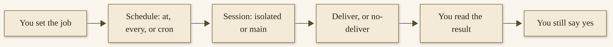{width=100%}

*I08. A job is a schedule plus a prompt plus a session shape. It is not a mind of its own.*

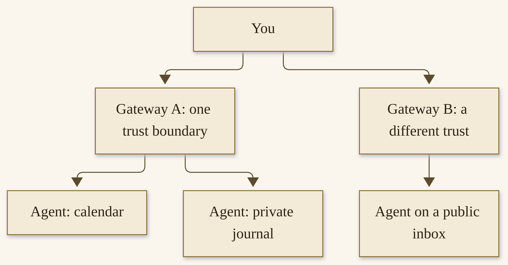{width=100%}

*I08b. Agents can share a Gateway when they share a trust. A public inbox and a private vault should not.*

That is scheduled work, at a human size. You can have a morning note, a weekly digest, a second narrower agent, and a clear rule for when to split the Gateway, without a shop org chart we do not need, and without a promise about crashes the docs do not make. In Chapter 9 we walk through the door of the commons — ClawHub, the dated plugin counts, the skills we will not invent a live total for, and a ritual for reviewing before you enable. The jobs you trust tonight should use skills you already watched, not skills you will meet for the first time in a catalog at midnight.

You are still the one who says what runs while you sleep, and what it must never do. The clock is a tool. The yes is still yours.


# Part 4 — The Commons
# Chapter 9
## The Catalog and the Commons: ClawHub, Skills, Plugins, and a Living Community


{width=100%}

*I09. A shared worktable, a small stack of carefully chosen blank cards.*


A practice that lives on one machine is a good practice. A practice that can learn from other people’s careful work, and that can give something careful back, is a commons. This chapter is about that commons: ClawHub, the public registry for OpenClaw skills and plugins; the official and community packages you can browse there; MCP servers, which are a connected capability under the same tool policy; and the public rooms — official X, Discord, GitHub, and dated events — where a lot of this work is talked about in the open.

I am grateful for that commons. I want you to enter it carefully. A registry is also a trust problem. A skill is instructions the agent will follow. A native plugin is code that runs in-process, and it is not sandboxed. A package from a stranger is still a package you are trusting. Stars, follower counts, and plugin totals are dated snapshots, not a blessing, and not a quality score. I will date every figure I print. I will not invent a live official skills total, because I do not have one. And I will not invent a scene in which I met a contributor and we talked until late. Giving back — writing a skill, shipping a plugin, filing a useful issue — waits for Chapter 10. This chapter is about entering the room with your eyes open, and about a ritual I want you to keep: search, read, verify, pin, and only then enable.

## Why a commons matters

The subtitle of this book names the community on purpose. OpenClaw is a self-hosted platform, and it is also a public practice. A registry, a Discord, a GitHub organization, and an official account on X are how a way of working leaves one machine. Someone writes a skill that teaches an agent a careful calendar workflow. Someone else publishes a plugin that adds a channel. Someone files a docs fix that saves a stranger an afternoon. You, later, can install what you have actually read, or teach a newer operator what you wish you had known on the first weekend. That is a commons. It is one of the reasons a practice compounds.

It is also, and I want this in the same breath, a trust problem. Anyone who passes an upload gate can publish. Moderation exists. Scans exist. They are real, and they are not the same as your eyes on a file. Malicious skills have been reported in the public registry. We will come back to that at the end of this chapter, as an operator lesson, without turning other people’s incidents into an adventure. The ritual I am going to teach you is the official one, said in human words: read, verify, pin, prefer a sandbox, least privilege. A plugin from a stranger is still code. A skill is still instructions the agent will follow.

A commons also has a kind of memory, and it is slower than a single Gateway’s wiki. A good skill lasts because people keep using it and keep reading it. A bad skill lasts until someone reports it, or until a scan catches it, or until a careful operator refuses it. The subtitle’s phrase, “the skills that compound,” belongs here as much as it belonged in Chapter 6. What compounds is not the raw size of a catalog. What compounds is a small set you will still be glad you kept, plus a community that keeps better examples in circulation than any one of us would write alone. That is worth joining. It is not worth joining with your eyes closed.

There is a practical difference, in this commons, between four things people sometimes collapse into one word, “extensions.” A skill is markdown instructions. A plugin is code that extends the product. An MCP server is a borrowed set of tools, under your policy. A Template is a portable baseline, in a `CLAW.md`, for a new agent — experimental on ClawHub, and a subject Chapter 10 will take up next to official Template docs. Each one is a different kind of trust. Installing all four in an afternoon, because a list was long, is not a practice that compounds. It is a practice that will take the rest of the week to unwind.

I will not tell you a story I do not have. I did not sit down with a contributor for this chapter. I opened official pages, a dated official API, and a few labelled third-party counts, and I am going to give you those, dated, so you can see the scale of the room without mistaking scale for safety. If you never publish anything, you can still be a careful member of this commons: an installer who reads, a person who helps a newer operator, a reader who dates a number. Chapter 10 will invite you to give something back. It will not require it.

## ClawHub, and the plugin count we actually opened

ClawHub is, in the official sentence, “the public registry for OpenClaw skills and plugins.” The site is clawhub.ai. The docs live under docs.openclaw.ai/clawhub. It hosts skills, code plugins, bundle plugins, and experimental whole-agent Templates. Publishing requires a GitHub account old enough to pass an upload gate. Anyone can upload in that sense; moderation, reports, hides, and bans exist. You search and install skills and plugins with native `openclaw` commands. You use the separate `clawhub` CLI for registry login, publishing, and delete or undelete.^117

```bash
openclaw skills search "calendar"
openclaw skills install @openclaw/demo
openclaw skills update --all

openclaw plugins search "calendar"
openclaw plugins install clawhub:<package>
openclaw plugins update --all
```

Those are the official quick-start commands, as the ClawHub page listed them on 12 November 2026. `@openclaw/demo` is that page’s example skill slug, not a package I have audited for you in this chapter. Released OpenClaw versions through `2026.10.4` require the `clawhub:` prefix to select ClawHub for plugins. Updated main and dev builds with ClawHub-default support can omit it. The explicit prefix works on both old and updated builds, and it is the form I want you to use, because it says what you mean. Use `openclaw plugins install npm:<package>` when you intend npm. Plugin installs validate advertised `pluginApi` and `minGatewayVersion` before an archive is installed. When a ClawPack `.tgz` is published, OpenClaw prefers that artifact and verifies the ClawHub digest.^117

Here is the plugin count I can actually stand behind. On 12 November 2026, the official ClawHub plugins API (`GET https://clawhub.ai/api/v1/plugins?limit=1`) returned a `totalCount` of **2,622**. A cursor walk of the packages API the same day counted **2,142** code plugins and **480** bundle plugins, which add up to the same 2,622. An official-only walk, the same day, counted **110** official code plugins and **74** official bundle plugins. A full cursor walk of Templates (`family=template`) counted **175** packages. Those are official-API snapshots, dated 12 November 2026, America/New_York. They will change. They are not a quality score. If you reprint them, reprint the date, or recount.^118

Native plugins run in-process and are not sandboxed. That is official, and it belongs next to the count, not in a footnote you skip. A plugin is code you are trusting with the Gateway process. Mitigations the official pages name include allow-lists, an install-policy hook, pinned versions, and dependency locking. We will use those in the ritual below. I will say the unsandboxed fact again when we install, and Chapter 14 will say it again when we harden. It does not get less true with repetition.^119

The Why OpenClaw page, as opened on 12 November 2026, says the public plugin SDK “publishes about 150 entrypoints,” under shrink-only surface budgets. That is that page’s figure, on that access date. The same page’s source-review snapshot was refreshed 27 August 2026. Those two dates are not the same day, and I will not collapse them. “About 150” is a vendor-documentation figure about the SDK’s surface, not a count of plugins in the registry, and not a comparison with 2,622.^120

The `clawhub` CLI is a different tool from `openclaw`, and it is worth keeping the jobs straight. Install it only when you want registry-authenticated work — login, publish, delete, undelete, a dry-run of a package publish:

```bash
npm i -g clawhub
# or
pnpm add -g clawhub
clawhub login
clawhub whoami
```

When you run `clawhub install` while logged in, the CLI may send a best-effort install event so ClawHub can compute aggregate install counts. Disable that with `export CLAWHUB_DISABLE_TELEMETRY=1`. That is official, and it is your choice. Publishing, and the rest of the authenticated surface, waits for Chapter 10. For this chapter, you can live entirely on `openclaw skills` and `openclaw plugins`, which is the native install path, and you can leave the `clawhub` CLI until you have something to publish, or until you have a reason to log in.^137

ClawHub is open by default in the publishing sense, with an age gate on the GitHub account, and it is not unmoderated. Public detail pages summarize the latest scan state before install or download. Scan-held or blocked releases may disappear from public catalog and install surfaces while remaining visible to their owner in a dashboard. Signed-in users can report skills and packages. Moderators can review reports, hide or restore content, and ban abusive accounts. Official Security Audits, Moderation, and Acceptable usage pages exist; re-open them when you need the current policy, and do not treat a public page’s presence as proof a package is harmless.^117

## Skills: no live official total, and dated snapshots

I am not going to give you a live official ClawHub skills total, because I do not have one.

The official plugins API returns a `totalCount`. The public skills list API, as opened on this research pass — `GET /api/v1/skills` — returned `items` and a `nextCursor` only. There was no `totalCount`. A full skills crawl was not completed. An official-skills walk, filtered to official skills, was unreliable: it hit a page cap with a tiny item count, and I will not print a total from that walk. **Do not invent a live official skills number.** If a later official API adds a `totalCount`, date it and cite the API. Until then, the honest sentence is the one I just gave you.^121

What I can give you is a history of scale, from three dated third-party snapshots, each with its date and its label, never collapsed into one “80,000 skills” claim, and none of them a 12 November 2026 official total.

On 9 June 2026, Julien Brouchier, writing for Trent AI in “ClawHub By The Numbers,” reported **52,652** packages in that snapshot.^122

An academic preprint, Yunpeng Xiong and Ting Zhang, “After the Party: Growth, Governance, and Security Scanning in the OpenClaw Agent Skill Ecosystem,” arXiv:2609.17274, reports a 22 June 2026 crawl of **65,175** listings, and a reconstructed March stock of **33,399**. The same paper describes observable stock as nearly doubling in 91 days. That is the paper’s finding, labelled as a preprint, dated to those crawls.^123

On 22 September 2026, Sarah Andrews, writing for Signals Corps in “ClawHub after ClawHavoc: scanning 81,535 agent skills,” reported **81,513** listed and **81,535** scanned, with export differences explained on that page. That is journalism and third-party research, dated, and I will return to the operator lesson of that piece — not its campaign name as an official Foundation incident — at the end of this chapter.^124

Vendor interest appears on third-party pages as well. I will leave it labelled as vendor interest. It is not a census I conducted, and it is not a reason to install more.

Three snapshots, three dates, three methods. The number moved. Of course it moved. A living registry moves. What I will not do is pick the largest of those numbers, drop the dates, and tell you that is how many official skills there are this morning. There is no such official total in this book. The ritual in the next section does not need one. It needs one skill, read carefully.

I want to say a word about why a missing official total is a feature of this chapter, not a hole I failed to fill. A live number, even a careful one, would be out of date by the time this book was in your hands. A dated snapshot is honest. An undated one is a rumor with a typeset face. If you need a current figure for your own notes, open the official API, record the date, and write the method you used. If the skills list still has no `totalCount`, say so. That is how a commons should be counted: with a date, and with a willingness to admit when a count is not there.

Templates, while we are on official walks, were **175** packages on 12 November 2026, on a full cursor walk of `family=template`. They are experimental whole-agent setups on ClawHub, and they are not skills. Chapter 10 will sit official Template docs beside a 7 November 2026 article of mine about building on an autonomous baseline. I mention the dated 175 here only so you do not fold templates into the plugin 2,622, or into any skills figure. Four surfaces, four counts, four dates — or, for skills, a dated refusal.^118

## How-to: search, read, verify, pin

This is the “review before enable” ritual. Chapter 6 watched one skill. This is the same standard, at catalog size, and it is the ritual Chapter 11 will apply at work. Treat third-party skills as untrusted code. Prefer official or carefully reviewed packages. Prefer sandboxing for untrusted inputs and risky tools. Installation is not proof that every scan completed.

**How to review a ClawHub skill before you enable it**

Prerequisite: a Gateway you already trust for daily work, and a job you actually have. You are looking for one skill that serves that job, not for a stack. Never enable a skill you have not read. Never treat a scan badge, or a verify pass, as a complete audit of the files on disk.

1. Search for the job, not for a pile.

   ```bash
   openclaw skills search "calendar"
   ```

   The official ClawHub quick start uses that exact example. For plugins, the sibling is `openclaw plugins search "calendar"`. You are looking for a name you can open.
   You should see a short list of names you can investigate.
   If you don’t: confirm the Gateway can reach ClawHub, and try a plainer query for the actual job.^117

2. Open the skill’s page and read the `SKILL.md`.
   Read the supporting files if they exist. Look at what it asks the agent to do, what binaries it requires, what environment variables it wants, and whether it wants a network call you did not expect. Check the scan and moderation state on the page. ClawHub skill pages expose the latest security scan state, with detail pages the official Skills page names: VirusTotal, ClawScan, and static analysis. A pending or stale scan can still allow installation with a warning. That warning is information. It is not a green light. Prefer official or carefully reviewed packages. The docs’ `@openclaw/demo` is a documented example, not a recommendation that you install it without a read.
   You should see instructions you understand, and a scan state you have actually looked at.
   If you don’t: do not install. Pick another skill, or write a small one yourself in Chapter 10.^125

3. Verify the trust envelope, if the skill came from ClawHub.

   ```bash
   openclaw skills verify @owner/slug
   ```

   This asks ClawHub for the skill’s `clawhub.skill.verify.v1` trust envelope. Installed ClawHub skills verify against the version and registry recorded in `.clawhub/origin.json`. The command exits non-zero when ClawHub marks verification as failed. Use an owner-qualified ref, `@owner/slug`, to avoid publisher ambiguity. Bare slugs remain accepted for some existing installs, but the qualified form is the clearer one. Official wording, as the Why OpenClaw page and this book’s research both carried it, is that `openclaw skills verify` retrieves ClawHub’s verification envelope; it does not hash the current local files. A pass is a real input. It is not a complete audit of what is on your disk right now.^125
   You should see a result you are willing to continue with, or a failure you will not talk yourself past.
   If you don’t: stop. Publishers can recover false positives through the ClawHub dashboard or `clawhub skill rescan @owner/slug`, which is their path, not a reason for you to install a failed envelope.

4. Install a specific version you have read, into the workspace, and pin what you read.

   ```bash
   openclaw skills install @owner/slug
   ```

   The default install lands in the active workspace `skills/` directory. `--global` installs into the shared managed library, visible to all local agents unless allowlists narrow it. On a Gateway you care about, I prefer the workspace install first, so a second agent does not inherit a skill I have not given it. ClawHub tracking uses `.clawhub/lock.json` in the workspace and `.clawhub/origin.json` in each installed skill. Those files are the official pin. Leave them alone except through official update commands. `openclaw skills update --all` updates tracked ClawHub installs; Git and local sources are refreshed by reinstalling. If you later want a local policy command to run before installs continue, official docs allow `security.installPolicy` to run a trusted local command, which receives metadata and the staged source path, and which blocks the install when it cannot return a valid decision. I will not invent the body of that policy for you. The point is that your Gateway can refuse an install you have not approved.^126
   You should see the skill in `openclaw skills list`, and lock metadata you can point to.
   If you don’t: the official Skills page’s install-details section is the recovery, including the note that the pre-July 2026 `.clawdhub` directory is no longer read.

5. Prefer a sandbox, and run it once while you watch, the way Chapter 6 taught.
   You should see a watched run you agreed with, and no send, spend, delete, or publish you did not approve.
   If you don’t: take the skill out. A skill that compounds is one you will still be glad you kept, not one you are afraid to open.

6. Refuse the rest.
   A “new skill review” card for a team of one is short. Does this skill serve a job I already have? Did I read the `SKILL.md`? Did verify return cleanly, and did I still treat that as one input? Do I know what tools it will call? Is it a skill, which is a markdown procedure, or a native plugin, which runs unsandboxed in-process? If it is a native plugin, did I have a reason strong enough to accept that? If any answer is no, it stays out.

   For plugins, the explicit official install is:

   ```bash
   openclaw plugins install clawhub:<package>
   ```

   You can pin a version with the official form `openclaw plugins install <package>@1.2.3`, as the Manage plugins page shows. Use the `clawhub:` prefix so the source is obvious. Plugin installs validate advertised `pluginApi` and `minGatewayVersion` before the archive is installed. That is compatibility, not a security audit.^127

   > **Caution.** Native plugins run in-process and are not sandboxed. Do not install one lightly, and do not install one on a work Gateway without a reason you can say out loud. A skill you read is one kind of trust. A plugin that runs inside the Gateway process is another.

Done looks like this: one or two skills, read, verified, pinned, watched, and a long list of things you refused. What still needs a yes is any new install, and any native plugin. The catalog will still be there tomorrow. The Gateway you did not overload will be there too.

## MCP, under the same tool policy

MCP — the Model Context Protocol — is how an agent borrows tools from another program. An MCP server exposes tools, resources, and prompts. OpenClaw connects to it as a client, and makes those tools available to your agents. Server definitions live under `mcp.servers` in config. The tools they expose go through the same tool-profile and tool-policy controls as everything else. Connecting a server does not bypass your policy. That last sentence is official, and it is the reason this section sits in a chapter about trust.^128

You can add a server from Settings → MCP in the Control UI, from the composer (with administrator access), or from the CLI. Transports are stdio, Streamable HTTP, or SSE. For HTTP, OAuth sign-in is documented; `openclaw mcp login <name>` is the CLI path, and it runs offline only, so the official page asks you to stop the Gateway first and start it again afterward. I will not invent an OAuth walkthrough past that official instruction. Verify a server actually answers:^128

```bash
openclaw mcp add local-tools \
  --command node \
  --arg ./dist/mcp-server.js \
  --cwd /srv/openclaw-tools
openclaw mcp doctor local-tools --probe
```

A remote Streamable HTTP example, from the same official page:

```bash
openclaw mcp add docs \
  --url https://mcp.example.com/mcp \
  --transport streamable-http \
  --include 'search,read_*'
openclaw mcp doctor docs --probe
```

Saving a definition proves nothing about reachability. The doctor check, with `--probe`, does. `openclaw mcp status --verbose` is a config-only summary. `openclaw mcp serve` exists for the reverse direction: exposing OpenClaw as an MCP server to another client. Optional MCP Apps host sandboxed interactive views; it is opt-in, and connecting a server does not enable its UI code automatically.^128

Keep credentials out of config literals. The official MCP page says to store sensitive headers and environment values through the supported secret mechanisms. The same “never” as the rest of this book: secrets stay out of chat, out of skill content, and out of a pasted config you might later commit.

ClawHub also documents managed and company MCP plugin packages — connection configuration and documentation. If you are in a workplace that uses those, re-open the official managed-MCP page and follow that page, not a remembered recipe. I am not going to invent a company catalog.^129

**How to add one trusted MCP server and probe it**

1. Add the server with the official CLI or from Settings → MCP, using a transport and an address you actually trust.
   You should see a saved `mcp.servers` entry with a name you chose.
   If you don’t: the official MCP page’s troubleshooting section is the recovery, starting with whether the command resolves and whether the URL is the one you meant.

2. Probe it.

   ```bash
   openclaw mcp doctor <name> --probe
   ```

   You should see a live connection and a list of tools the server advertises.
   If you don’t: doctor validates the definition first, then opens a connection. If it connects but expected tools are missing, check `toolFilter.include` and `toolFilter.exclude`. If an HTTP server needs authorization, follow the official sign-in path, not a token pasted into chat.^128

3. Confirm tool policy still applies, and that you wanted those tools.
   Connecting did not bypass policy. If a tool can send, spend, or write outside the workspace, decide whether this session may use it, and whether a “never” belongs in the agent’s instructions.
   You should see a server you can name, a probe you have read, and a policy you still believe.
   If you don’t: disable or remove the server from Settings, or set `enabled: false` on the definition, which keeps it around without connecting it.

A note on names, because MCP servers often wrap tools you already know: a calendar, an issue tracker, a docs host. Those product names, when they appear, should come from the official MCP page’s examples or from a server you already trust, attributed to that source. I am not going to recommend a third-party MCP package by brand in this chapter. A trusted server is one whose operator you can name, whose tools you have probed, and whose credentials you did not paste into a chat. If the server uses OAuth, follow the official sign-in path; if Sign in is unavailable from Settings, the official page’s terminal path starts by stopping the Gateway. Start it again when the login is done.^128

Done looks like this: one trusted MCP server, probed, under the same tool policy as everything else. What still needs a yes is any tool that leaves the machine.

## Discord, GitHub, official X, and dated events

The commons has rooms, and the rooms have sizes, and the sizes move. I will give you dated snapshots from 12 November 2026, America/New_York, and I will put the exact figures where they will not read as a boast: mostly here, with the same numbers in the notes, and with the same warning every time. A follower count is not a quality score. A star count is not a blessing. A Discord that is large is a Discord that is large. That is all.

Official X is @openclaw. On 12 November 2026 the account had 543,895 followers. A profile lookup that day implied a pinned post; a fetch of that id returned 404. I will not invent the pinned text.^130

Official Discord is reached through `https://openclaw.ai/discord`, which redirects to the invite code `clawd`. The slug `openclaw` 404s; do not use it. The Discord invite API, with counts, that same morning, reported about 176,920 members and about 19,441 online. A near-simultaneous widget call was within a few of that online figure. Cite only with the date and the official invite API. Counts move. Re-open them if you reprint them.^131

The GitHub organization is `https://github.com/openclaw`, and the core repo is `openclaw/openclaw`. The GitHub API, on 12 November 2026, reported 394,404 stars, 82,877 forks, 8,049 open issues, and 1,685 subscribers. Those are API figures, dated. I prefer them in a note to a body paragraph that sounds like a victory lap, and I have already spent more body on them than a victory would deserve. They tell you the room is busy. They do not tell you which issue is yours to file, or which pull request is careful.^132

Events have their own date, and it is not November. The OpenClaw Foundation launch post, by Dave Morin and Peter Steinberger, 8 July 2026, said ClawCon “continues to grow with 34 events across 16 countries in five months from San Francisco to Sao Paulo, Ankara to Nairobi, Tokyo to Dublin. Nearly 30,000 people have signed up… Seattle is next on August 11th.” Those figures, and that Seattle date, are as of 8 July 2026. I did not find a later official census on this research pass. I will not update 34, or 16, or nearly 30,000, without a newer official page.^133

One more public fact, held carefully. On 10 October 2026 I reported that the OpenClaw Foundation was named the applicant for the `.claw` TLD on ICANN Reveal Day, and that evaluation would still take months. That is my report of a public application. It is an application, not a grant, unless a later official Foundation or ICANN primary says otherwise. I will not write as if the domain has been awarded.^134

If you join those rooms, join them the way you entered ClawHub: as a careful person, not as someone collecting access. Official support routes exist; the Getting started pages point at a “Get support” doc. Re-open that page for the current URL when you need it. A large Discord is a place to ask a careful question, and a place where untrusted advice will also appear. Prefer official docs to a confident stranger.

A few practical habits, none of them official commandments, all of them consistent with the rest of this book. Do not paste a Gateway token, a bot secret, or a backup path into a public channel, even in a “help me debug” moment. Do not run a command a stranger posted until you can say, from official docs, what it does. Do not treat a GitHub issue’s title as a Foundation advisory. Issues are reports; advisories are advisories. If you file an issue yourself, Chapter 10 will ask you to file a careful one — a clear repro, a version, a doctor output you are willing to share, with secrets removed. If you only ever read, you are still in the commons. Reading carefully is a contribution that does not show up in a star count.

The Foundation’s July 2026 post also named ecosystem tools and described ClawHub, in vendor wording, as “one of the largest agent skill sharing communities on the internet.” I will leave that wording labelled. It is a Foundation-blog claim from 8 July 2026, not a measurement I am adding, and not a reason to skip the ritual.^133

## Trust, still

I want to land this chapter the way I would land a conversation with a friend who has just seen the size of the catalog and felt, for a moment, that the size itself was a reason to install more.

Malicious skills have been reported in the public registry. That is a fact of public issue reports and of third-party research, and I will say it plainly. ClawHub later added stronger pre-publication blocking, as those same third-party and issue reports describe. I am not going to name a campaign as an official Foundation incident unless a primary official advisory does. I am not going to reproduce malware names, payloads, or install steps. The operator lesson is enough, and it is the official one: read, verify, pin, prefer a sandbox, least privilege.^135

A Signals Corps scan in September 2026, already dated above, looked at skills that remained after ClawHub began blocking releases it judged malicious, and still found disclosed risky-by-design patterns — among them, pipe-to-shell installs and weakened OS protections, as that page describes. I mention the category, not a how-to. A skill can be “honest” about a dangerous step and still be the wrong skill to enable. Your eyes, and a “never” in the file, and a sandbox, are still the practice.^124

The Why OpenClaw page, reviewing the public advisory list on 27 August 2026, reported 647 OpenClaw advisories in that list, and said advisory counts are “not a comparative safety score.” I will not recount that list here, and I will not use 647 as a live figure, or as a ranking against any other project. It is a dated Why-page reading. v2026.11.3, still the latest stable on 12 November 2026, is itself a security release. Stay current with `openclaw update` and the current notes, rather than freezing a CVE list into a chapter.^138

Official guidance does not claim the catalog is safe by default. Official pages, in places, explicitly refuse a “safest agent” claim. Sandbox and exec approvals are off by default. Native plugins are unsandboxed. Scan badges are not an audit of the bits on your disk. `skills verify` retrieves an envelope; it does not hash local files. A pending scan can warn-and-install. All of that can be true, and the commons can still be a gift, if you enter it as a reviewer. Chapter 14 will walk the official security audit, the incident-response page, and the longer hardening path. This chapter’s job is to get the ritual into your hands before you are mid-install at midnight.^136

> **Caution.** A plugin from a stranger is still code. A skill is still instructions the agent will follow. The size of the catalog does not change either sentence. If you are tired, stop. The install will wait. The ritual will still be there in the morning.


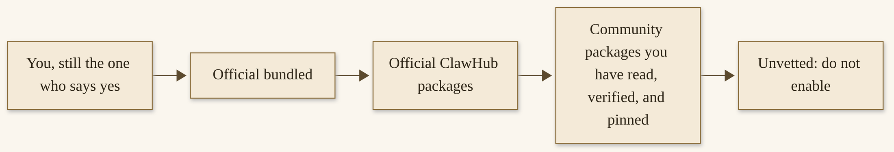{width=100%}

*I09. A trust ladder. Official bundled is not the same as official ClawHub, and neither is the same as a community package you have actually read. Unvetted stays out.*

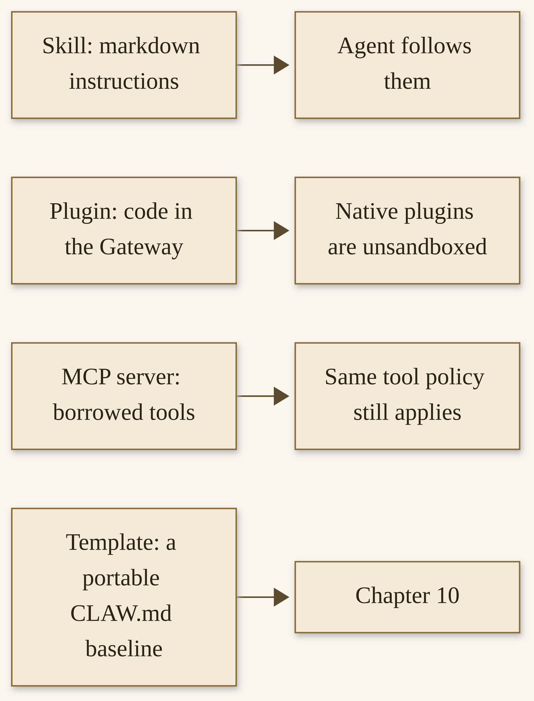{width=100%}

*I09b. Four different gifts, four different kinds of trust. None of them bypasses your yes.*

That is the commons, at a human size. A registry you can browse, a plugin count we actually opened and dated, a skills total we refused to invent, a ritual for reviewing before you enable, an MCP server under the same policy, rooms whose sizes we dated and did not worship, and a trust lesson that does not need a malware how-to. In Chapter 10, the title chapter, you can write a small skill of your own, look at what a careful publish would take, and file a useful issue if you want to. You can also stay a careful installer forever. Both are ways to make this practice yours.

You are still the one who says what gets enabled. The commons is large. Your Gateway does not have to be.


# Chapter 10
## Making It Yours: Write a Skill, Ship a Plugin, Contribute


{width=100%}

*I10. A single well-made blank card, a pen, an empty envelope.*


The title of this book is a promise I want to keep at a human size. Making it yours does not have to mean publishing a package, or opening a pull request, or standing up a plugin that other people will run inside their Gateway. A private skill in your workspace, with a “never” you wrote and a watched run you agreed with, is already making it yours. Publishing is optional. Contributing is invited, not required. A skill that compounds is one you will still be glad you kept, not one you shipped in a hurry.

This is the title chapter. We will write and run one local skill. We will walk a review-before-publish checklist, for the day you do want to share. We will look, marked as advanced, at a plugin that fails closed, and at a Template on a portable `CLAW.md` baseline — official docs for the how-to, and a 7 November 2026 article of mine for the reason I believe in baselines. We will file a careful issue, or a docs fix, if that is the gift you have to give. And then I will tell you, kindly, that you can stay a careful installer forever, and that mentoring a newer operator is also contribution.

You are still the one who says yes. That includes the yes of publishing, which is a yes you give to strangers, and should give slowly.

I want to say one more thing, before we write the file, about the mood of this work. A lot of writing about agents treats “extensibility” as a menu of things you should eventually do, as if a practice that never ships a plugin were unfinished. I do not believe that. Extensibility is a door. Walking through it is optional. The title *Make It Yours* is about a practice that is actually yours — a wiki, a small reviewed set of skills, a community you can join — and only then, if you want, a skill or a plugin or a Template you give away. The subtitle names the skills that compound, and Chapter 6 already told you what that means: a small, reviewed set you will still be glad you kept. Writing one of those skills yourself is the most direct way I know to believe the phrase.

## You can add something small

A workspace skill is a folder with a `SKILL.md` in it. You can make one this afternoon. You can keep it on your machine for a year. You never have to put it on ClawHub. The commons in Chapter 9 is a gift because people did share. It is also a gift because you can take from it carefully, and give only when you have something you would be willing to stand behind.

I want the bar low, and the standard high. Low, because a small procedure you will actually use is worth more than a grand plan for a public toolkit. High, because a skill is instructions an agent will follow, and a public skill is instructions agents you will never meet will follow. The “never” you put in a private skill is a kindness to yourself. The “never” you put in a public skill is a kindness to people you will not be in the room to warn.

If Chapter 6 already left you with one watched skill, this chapter is how you write the next one yourself, in your own words, for your own job. If you are starting here, the same standard applies: one skill, a “never,” a watched run, no schedule, and no publish, until those are true.

I have watched people — and I include myself, in earlier seasons of this work — treat “I should contribute” as a debt. That is the wrong mood for a gift. A commons is healthier when the people in it publish fewer, better things, and when the people who are not ready to publish are still in the room, reading and refusing and helping. The skill you write for a morning note you already trust is not a lesser thing than a package with a version number. It is often the better thing, because you will actually use it, and because you will still be there to edit the “never” when the job changes.

On a shared Gateway, official docs also let an identified operator keep a personal skill library, from Plugins → Skills, without permission to change everybody’s workspace. That is a real path, and the Creating skills page walks it. For the single-admin default, which is the practice this book has been teaching, the workspace `skills/` folder is still the right first home. A personal library is there when more than one operator shares a Gateway and should not share every skill. It is not a reason to skip the “never,” or the watched run.^152

## How-to: write a skill with a “never”

This how-to is copied from the official Creating skills page, as I opened it on 12 November 2026, with a “never” added in the body as teaching. The official first skill is a hello-world that prints a greeting. I will use that official shape, and I will ask you to put a “never” in it, because a greeting is a safe place to practice the habit you will need when the skill is no longer a greeting.^139

**How to write and run one local skill**

Prerequisite: a running Gateway, and the default workspace at `~/.openclaw/workspace`, or the workspace path you actually use. Do not put a secret in the skill. Do not publish anything in this how-to.

1. Create the skill directory in the workspace `skills/` folder.

   ```bash
   mkdir -p ~/.openclaw/workspace/skills/hello-world
   ```

   You can group skills in subfolders for organization — `~/.openclaw/workspace/skills/personal/hello-world` — and the skill is still named by the `SKILL.md` frontmatter, not by the folder path. The official page says so. Use lowercase letters, digits, and hyphens for `name`. Keep the directory name and the frontmatter `name` aligned.
   You should see an empty directory you can write into.
   If you don’t: check that you are in the workspace you think you are. `openclaw` workspace paths follow the agent you are using; a second agent has its own workspace, as Chapter 8 taught.^139

2. Write a `SKILL.md` with the minimum frontmatter, a clear body, and a “never.”

   The official required fields are `name` and `description`. The description is shown to the agent and in slash-command discovery; keep it one line and under 160 characters. Optional gating uses `metadata.openclaw.requires` — binaries, environment variables, config paths, operating system — not `metadata.clawdbot`, which is no longer read. If you have an older skill with the old block, rename it. OpenClaw will not rewrite the file for you.^140

   A teaching sample, clearly a sample, built on the official hello-world shape:

   ```markdown
   ---
   name: hello-world
   description: A simple skill that prints a greeting, and never sends it anywhere.
   ---

   # Hello World

   When the user asks for a greeting, use the `exec` tool to run:

       echo "Hello from your custom skill!"

   Never send this greeting to a channel, a group, or a person who did not
   ask for it. Never pay. Never delete a file. Leave the result where the
   user can see it, and stop.
   ```

   The official example uses `exec` to echo a greeting. If you would rather not give a first skill `exec` at all, write a skill that only asks the agent to compose a greeting in the chat, with the same “never.” The standard is the “never,” at the step where harm would happen, not the echo itself.
   You should see a file you can open, with a name, a description, and a “never” you mean.
   If you don’t: do not install it yet. Finish the file.

3. Make sure the skill loaded, then start a fresh session so the agent sees it.

   ```bash
   openclaw skills list
   ```

   OpenClaw watches `SKILL.md` files under skills roots by default. If the watcher is disabled, or you are continuing an existing session, start a new one:

   ```bash
   # From chat — archive the current session and start fresh
   /new
   ```

   Or restart the Gateway: `openclaw gateway restart`.
   You should see `hello-world` in the list.
   If you don’t: `openclaw skills check` is the official debugging path when a skill is on disk but not visible to an agent. Required binaries, allowlists, and a stale session snapshot are the usual causes, as Chapter 6 described.^141

4. Install from a local path if you wrote the skill outside the workspace `skills/` folder, or if you want a specific name.

   ```bash
   openclaw skills install ./path/to/skill --as my-tool
   ```

   That is the official local-install form. Git and local installs expect `SKILL.md` at the source root. The slug comes from frontmatter `name` when valid, then from the directory name. `--as` overrides. If you already wrote the file in `~/.openclaw/workspace/skills/hello-world`, listing and a new session may be enough.^142

5. Run it once, while you watch, on a safe request.

   ```bash
   openclaw agent --message "give me a greeting"
   ```

   Or open a chat and ask. The official creating-skills page also shows `/skill hello-world` to invoke it explicitly by name. If `user-invocable` is true, which is the default, a slash command should be available. Watch the tools it calls. If it reaches for a send, stop it, and tighten the “never.”
   You should see a greeting, in the session you are watching, and no message leaving the machine.
   If you don’t: read the skill again. Start a new session with `/new`. Do not publish. Do not schedule.^139

6. Keep it, or take it out. If the Skill Workshop helped you write it — you can ask `/learn` to capture a procedure from a conversation you just had — remember that Workshop skills have change history and undo:

   ```bash
   openclaw skills workshop list
   openclaw skills workshop changes
   openclaw skills workshop show hello-world
   openclaw skills workshop archive hello-world --reason "Replaced by greeting"
   openclaw skills workshop restore hello-world
   ```

   Those are official commands. Restore saves the current copy first. A skill the Workshop just created has no earlier version; archive it instead. Workshop skills belong to one agent. If this procedure must be available to more than one agent, install it into the managed library after you have read it, as Chapter 6 said.^143

Done looks like this: a local `SKILL.md`, with a “never,” a watched run you agreed with, and no publish. What still needs a yes is any later decision to share it, and any later decision to put it on a clock.

If you want to gate the skill so it only loads when its dependencies are present, the official frontmatter looks like this, from the Creating skills page:^140

```markdown
---
name: gemini-search
description: Search using Gemini CLI.
metadata: { "openclaw": { "requires": { "bins": ["gemini"] }, "primaryEnv": "GEMINI_API_KEY" } }
---
```

`gemini-search` and `GEMINI_API_KEY` are the official page’s example names, attributed to that page, not a setup I am recommending. The idea is the idea: if the skill needs a binary or a key, declare it, and let OpenClaw hide the skill when the requirement is missing, rather than fail mid-run in a surprising way. Wire a key, when you must, through `skills.entries` in `openclaw.json` and the official secret mechanisms, not through a line in the markdown. The key is injected into the host process for that agent turn only. It does not reach the sandbox.^140

Use `{baseDir}` in the body when you need a path inside the skill folder; the agent resolves it against the skill’s own directory. That is official, and it beats a hardcoded path that breaks the first time someone installs the skill somewhere else.^139

> **Tip.** Be concise. The official best-practice line is the right one: instruct the model on what to do, not on how to be an AI. If the skill uses `exec`, write prompts that do not allow arbitrary command injection from untrusted input. Test locally with `openclaw agent --message` before you even think about sharing.^139

## A review-before-publish checklist

Publishing is a responsibility. A private skill that is a little messy is your messy. A public skill that is a little messy is a stranger’s agent, on a stranger’s Tuesday, following instructions you will not be there to correct.

Before you publish, read the skill as if you did not write it. That is the whole checklist, in one sentence. The rest is that sentence, made practical, from official publishing pages and from the standard this book has already set.^144

**How to decide whether a skill is ready to publish**

1. Read it as if you did not write it.
   Would you install this from a stranger, after Chapter 9’s ritual? Is the purpose disclosed in the description? Are the steps complete? Is the “never” at the step where harm would happen, not in a preface nobody reaches? Are there secrets in the file — a key, a token, a path to a private vault, a colleague’s name? If there are, they come out, or the skill stays private.
   You should see a file you would be willing to put your name on.
   If you don’t: edit, or keep it local. There is no shame in a private skill.

2. Say who it is for, and who it is not for.
   A workplace skill, or a classroom skill, may never belong on a public registry. A skill that knows your firm’s process, your students’ first names, or your family’s calendar is a local skill. “May never” is a kindness, not a legal opinion. This book is not legal advice. If you are not sure, do not publish.

3. Give it a license if you have one, and a version you will pin.
   ClawHub tracks semver versions and tags such as `latest`. Use a real version. Publishing a moving target as `latest` and then rewriting it out from under people is not a gift. Pin what you publish, the way Chapter 9 asked you to pin what you install.^144

4. Confirm you can publish at all.
   Publishing requires a GitHub account old enough to pass an upload gate. That is official. Install the standalone ClawHub CLI and log in:

   ```bash
   npm i -g clawhub
   clawhub login
   clawhub skill publish ./path/to/hello-world
   ```

   Add `--version` or `--owner` to override the inferred version or to publish under a specific owner, as the official page allows. Use `--dry-run` on package publishes; for skills, follow the current CLI’s dry-run if it offers one, and do not invent a flag. You can disable install-event telemetry from the logged-in CLI with `export CLAWHUB_DISABLE_TELEMETRY=1`.^144
   You should see a login that is yours, and a publish you meant, or a dry-run you can read.
   If you don’t: the official ClawHub publishing and CLI pages are the recovery. An age-gate failure is a gate, not a puzzle to work around.

5. After it is up, install it the way a stranger would, on a machine or a workspace you can afford to test, and run Chapter 9’s ritual on your own skill.
   You should see a verify, a read, and a watched run that still match what you intended.
   If you don’t: unpublish or hide through the official `clawhub` delete and undelete flows, fix the file, and only then consider a new version. Do not leave a broken public skill up because you are embarrassed. Taking it down is a contribution.

Done looks like this: a skill you would install from a stranger, with secrets out, a purpose disclosed, a version, and a publish you can still reverse. What still needs a yes is the publish itself. You can stop before that yes forever.

Owners on ClawHub are publisher handles, such as `@alice` or `@your-org`, as the Creating skills page describes them. Your account has a personal owner. Organization owners can have members with `owner`, `admin`, or `publisher` roles; all three can publish. Choose the owner you mean. A skill published under the wrong owner is a messy gift to undo.^144

> **Caution.** Publishing is not safer than installing. It is the other side of the same trust. A skill you would not enable, after a read, is a skill you should not ship. A workplace or classroom skill, if it carries other people’s lives, should stay off the public registry.

One more honest limit, from my 7 November article, because it applies to skills as much as to templates. A shared skill is a copy. If you improve your version, theirs does not change unless they update. That is ordinary, and it is a reason to version carefully, and a reason not to treat publish as a permanent remote-control over other people’s Gateways. You published a snapshot. They pinned it, if they followed Chapter 9. Both of you can live with that.^149

## A plugin that fails closed, and a template baseline

This section is marked advanced on purpose. You do not need it to make OpenClaw yours. You need it if you are going to ship code that runs inside someone else’s Gateway, or a Template that creates a new agent on someone else’s machine. Both are real gifts. Both are heavier than a `SKILL.md`.

A plugin extends OpenClaw without changing core: a channel, a provider, a tool, a hook, a memory engine. Users install it from ClawHub with `openclaw plugins install`, and you already know to use the explicit `clawhub:` prefix. Native plugins run in-process and are not sandboxed. I will say that until it is boring. If you ship one, you are asking people to trust your code in their Gateway process. Fail closed. Validate before you publish. Advertise compatibility honestly. Do not ship secrets. Do not ship a plugin that does something consequential without an obvious, default-off gate.^145

Code plugins must include required OpenClaw compatibility metadata in `package.json`, including `openclaw.compat.pluginApi` and `openclaw.build.openclawVersion`. The official Building plugins page shows the shape, with `openclaw.compat.pluginApi` and `openclaw.build.openclawVersion` as required fields, plus a plugin manifest (`openclaw.plugin.json`). Why OpenClaw’s “about 150” SDK entrypoints is that page’s figure, opened 12 November 2026; the same page’s source-review date was 27 August 2026 — two dates, not one, as Chapter 9 already said. Use the current Building plugins page as the how-to, not a remembered snippet from this chapter, because the SDK moves.^146

Test the install shape users will get, before you publish, the way the official page asks: build JavaScript output, pack, install the tarball with the official `npm-pack:` form, and inspect the runtime. Then:

```bash
npm i -g clawhub
clawhub login
clawhub package publish your-org/your-plugin --dry-run
clawhub package publish your-org/your-plugin
```

`--dry-run` first, always, so you can read the resolved metadata, compatibility fields, source attribution, and upload plan without uploading. The Quickstart page also shows `--family code-plugin`. Follow the live page for the exact flags on your CLI version. I will not invent one.^147

Before you get to that dry-run, the official Building plugins page asks you to test the same install shape users will get. Add a build step. Point runtime entries such as `openclaw.extensions` at built JavaScript, for example `./dist/index.js`. Make sure `npm pack` includes that `dist/` output. TypeScript source entries are for source checkouts and local development; OpenClaw loads the emitted JavaScript for a packaged plugin. Then pack and install the tarball:^145

```bash
npm pack --pack-destination /tmp
openclaw plugins install npm-pack:/tmp/<plugin-package>.tgz --force
openclaw plugins inspect my-plugin --runtime --json
```

Those commands are the official page’s, including `--force` on a local `npm-pack:` install you have just built and reviewed yourself. `--force` is not a reason to skip a review of someone else’s package. Inspect the runtime. If the plugin does not load, fix it before anyone else has to. Dependencies that you left only in `devDependencies` will not be installed for the managed runtime project; that official warning has surprised enough people that it is worth repeating.^145

A plugin that fails closed, in our practice, means at least this: a dry-run you have read; compatibility metadata that is true; a default that does not send, spend, delete, or publish; a “never” in the docs you ship; no credentials in the package; a local pack-and-install you have actually run; and a willingness to yank a release through official ClawHub flows if you got it wrong. That is teaching, consistent with official publishing and with this book’s approval rule. It is not a new official schema.

Templates are the other advanced path, and they are the one I have written about most recently as a teaching idea. Officially, a Template is a portable setup for a new OpenClaw agent. It can include agent instructions, workspace files, skills, plugins, MCP servers, and automations. `CLAW.md` is the sole configuration entry point. Its Markdown body becomes the new agent’s `SOUL.md`. Add is a one-way action: it creates an ordinary agent and installs its requirements. It does not create an installed Template to manage. Adding the same Template again creates another agent. Enable Templates in Settings → Labs before adding one from the Control UI; on a headless install, the official toggle is `gateway.controlUi.experimental.templates`. Environment values remain unresolved references; never package credentials.^148

Official authoring and add commands, as the Templates CLI page listed them on 12 November 2026:

```bash
openclaw templates create ./incident-triage
openclaw templates validate ./incident-triage
openclaw templates dev ./incident-triage
openclaw templates build ./incident-triage --out ./incident-triage-1.0.0.tgz
openclaw templates inspect ./incident-triage
openclaw templates add ./incident-triage
```

Add a published ClawHub Template with a dry-run first:

```bash
openclaw templates add @openclaw/api-integration-engineer --dry-run --json
openclaw templates add @openclaw/api-integration-engineer
```

`@openclaw/api-integration-engineer` is the official page’s example, not a template I have audited for you. A warned Template release requires `--acknowledge-clawhub-risk` when adding it. Template approval never approves its skill or plugin dependencies: their existing trust acknowledgments still apply independently. After Add, there is no Template status or update command; to use a newer release, Add it as another agent. Deleting the agent is ordinary `openclaw agents delete`. Review remaining text for personal facts before you publish a Template. Known private paths and credential-like text are rejected; review the rest yourself.^148

On 7 November 2026 I published an article, “HOT TAKE: Stop Building Agents from Scratch. Build Templates on an Autonomous Baseline.” The article is teaching, not the how-to authority. The how-to is the official page you just saw. What I want you to take from the article is the idea, which I still mean. A baseline, as I described it there, has a core loop, durable memory, tools and connectors, skills that can improve, and guardrails — approvals, sandboxes, allowlists, versioning, and a way to roll back. Get those right once, and a focused agent is a configuration: an identity, a handful of skills, only the connectors the job needs, a schedule, and clear places where it must stop and ask a human. “Focused agents are living configurations, not prompts.” Requirements change; the skill changes; the runtime stays put. Credentials, keys, and conversation history do not ship. The recipient connects their own accounts. Self-improvement is a capability, not a guarantee. Review learned skills like code. Approvals for anything public, financial, destructive, or merging stay with a person.^149

That article also mentioned, honestly, the three baselines I actually use — Hermes, OpenClaw, and Grok Bot — and said that OpenClaw is where we explore multi-agent routing across channels. It is a teaching comparison, not a ranking, and not a second book. A nearby post the same morning, “This week in agent stacks: Hermes, Grok Bot, OpenClaw, Omarchy,” was a weekly reading of release notes, dated 7 November 2026. Its OpenClaw version pins were current that week and are not current now; as of 12 November 2026 the latest stable is v2026.11.3. I mention the post so you know I re-opened it, and so you take its weekend list as a dated habit — read the release notes — not as this book’s install path.^150

A minimal official `CLAW.md`, as the Templates page shows, starts with YAML frontmatter — `schemaVersion: 1`, an agent id and name, optional categories, empty skills, plugins, MCP servers, and automations — and a markdown body that will become `SOUL.md`. You may declare exact ClawHub skill and plugin requirements with a `ref` and a `version`, or a bundled package-relative folder with `path`, but not both on the same entry. You may declare automations with a cron, a timezone, an isolated session, and a message, the way Chapter 8 taught. The retired `cronJobs` key is rejected; use `automations`. A Template cannot set a model, provider, credentials, or named delegate agents. Native `tools.profile` grants are bounded and frozen when Add creates the agent; host policy still constrains every grant. If a declared plugin still needs setup, or an OAuth MCP server is not authorized, Add creates declared automations paused. Connect the requirement, then enable the jobs yourself. Add does not automatically enable paused jobs later.^148

That last behavior is a fail-closed kindness. A Template should not arrive pre-authenticated, and it should not start a schedule before the recipient has connected what the schedule needs. My article’s “sharing without leaking” is the same idea in teaching language: credentials, keys, and tokens never ship; neither do private data or conversation history; the recipient installs, connects, and authenticates their own services.^149

If you write a Template, write it the official way, fail closed the way a plugin should, and keep my article in the “why,” not in the command line. Brittle details change fast. The article said that too: check the current docs before you build.^149

## A careful issue, a careful PR

Contribution does not have to be a plugin. A docs fix is a real contribution. A careful issue is a real contribution. A pull request with a clear reproduction is a real contribution. Performing “open source” as theater — a vague issue, a drive-by nit, a PR that does not run — is not a gift.

Issues and PRs go to `https://github.com/openclaw/openclaw`. The project is a pnpm workspace. Plain `npm install` at the repo root is not supported. The official README and the Install page agree: from source, the path is `corepack enable`, then `pnpm install && pnpm build && pnpm ui:build`. Follow the current README, not a habit from another repo.^151

A careful issue, in practice, looks like this. A clear title. The version you are on (`openclaw --version`), and whether it is stable — and if you are on a beta, say so, because a beta bug may already be known, and should not be filed as if it were stable. What you expected, what happened, and the smallest steps that reproduce it. `openclaw doctor` output you are willing to share, with secrets, tokens, and other people’s names removed. The channel, if it is a channel bug, and the OS. What you already tried, from official troubleshooting, not from a guessed flag. If you cannot share a log, say so, and share what you can. If it is a docs error, name the page and the sentence, and propose a correction. If you searched and found a similar issue, link it, and say what is different about yours. Duplicate issues that add a clear new fact are useful. Duplicate issues that only say “me too” are less so, unless they add a version or a platform the original did not have.

A careful PR looks like the same honesty, plus a change that is as small as the fix. Docs-only PRs are welcome in spirit; follow the repo’s current contributing guidance when you open one. Do not include credentials. Do not include a reproduction that is an exploit; this book will not teach you to write one, and a public PR is the wrong place for that kind of detail. If you have a security finding, use the official security-advisory path, not a public issue that teaches a payload.

When I say “a clear repro,” I mean the smallest official path that shows the problem: a version, a doctor output, a command from the docs, a sentence about what you expected. I do not mean a proof-of-concept, a payload, or a bypass. If the bug is only visible with untrusted input you should not publish, describe the class of problem and take it to the advisory path. The maintainers will thank you more for that restraint than for a public demonstration.

If your PR touches docs, name the page. If it touches a CLI flag, name the current flag and the page you checked on a dated morning. If the live page and this book disagree, the live page wins, and a docs PR that says so is a kindness to the next reader.

If you want to work from a source checkout, set up the official way, and run whatever test or lint the current contributing docs ask for, before you push. I will not freeze a test command into this chapter, because those commands move, and a frozen wrong command is worse than a pointer to the README. If your change is a typo in a docs page, it is still worth doing. Clear, small, and correct beats ambitious and unfinished.

There is no pressure. If this section feels like a door you do not want to walk through, close it. The book will still be here. The skill you wrote in your workspace will still be yours.

## Giving back is invited, not required

You can stay a careful installer forever. That is a complete practice. Chapter 9’s ritual, a small set of skills you will still be glad you kept, a wiki you lint, a job you read, a yes you have not given away — that is making it yours. The title does not require a package with your name on it.

Mentoring a newer operator is also contribution. Sitting with someone on their first weekend, walking pairing, walking the wiki, walking one watched skill, is a gift the star count will never see. I will not invent SMF Works contribution figures, or a tally of packages we have shipped, or a story about a student I have not introduced you to. I will only say that the commons is larger than one Gateway, and that you can be part of it without standing on a stage.

The title’s “make it yours” and the official project’s “by your rules” are neighbors, and I want them to stay neighbors, not twins. “By your rules” is the project’s language, on its own bio and docs, about a personal assistant that lives on your machine. I quoted it only to keep it distinct. Our title is about a practice: a wiki you keep, a skill you wrote or carefully kept, a commons you can enter and, if you want, give something back to. The project’s phrase belongs to the project. The practice belongs to you.^153

If you do publish, publish carefully. If you do file, file carefully. If you do neither, you are still welcome. Part 5, next, is two long how-to shelves: OpenClaw at work, and OpenClaw at home. The skill you wrote today, or the skill you refused to publish today, will travel into those chapters as a habit, not as a product. Chapters 11 and 12 will take longer than this one, and they should: they are where a carefully made practice meets a Monday morning, and a Saturday one. You do not have to have published anything to walk those shelves. You have to have a Gateway, a wiki, a “never,” and a yes you still own.


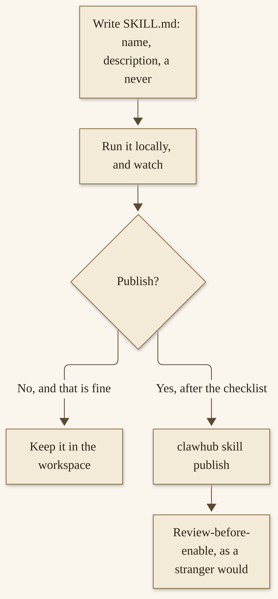{width=100%}

*I10. A private skill is already making it yours. Publishing is a second yes.*

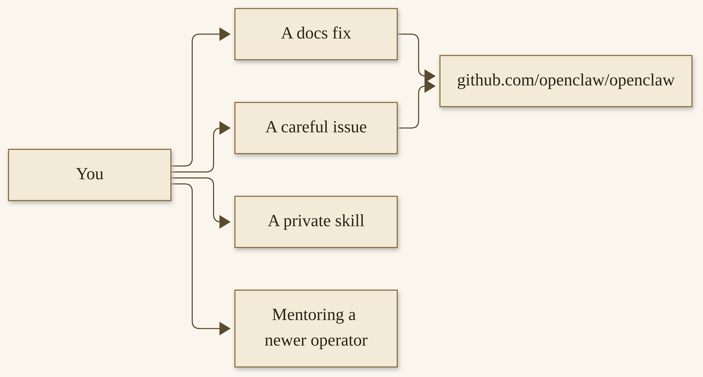{width=100%}

*I10b. Several honest paths. None of them is required.*

If you take only one thing from this title chapter, take the small path. Write the skill. Put a “never” in it. Run it while you watch. Keep it. Decide about publishing later, or never. The commons will be fine. Your Gateway will be better for a procedure you actually understand than for a package you felt you owed the internet.

The empty envelope in this chapter’s still-life is not a tease. It is permission. You can address it when you have something worth mailing, and you can leave it on the desk if you do not. I have left more than one envelope on the desk, and I have not regretted the work that stayed private until it was ready, or that stayed private because it was only ever mine to run.

If you do address it, let the checklist be your last read, not your first. Write for yourself. Watch the run. Live with the skill for a week, if you can, on jobs that cannot spend or send. Then read it as a stranger. Then, and only then, decide whether the envelope goes out. A week is not a rule I found in a docs page. It is a kindness I am offering, because I have never regretted a publish I delayed, and I have regretted a publish I rushed. The registry will still be there. Your reputation with a stranger who installed your skill on a Tuesday is harder to unwind than a file you held back.

You are still the one who says what leaves your machine, and what stays a quiet procedure in a folder you can open. Making it yours is that choice, made carefully, more than once.


# Part 5 — How-Tos for Work and for Life
# Chapter 11
## OpenClaw at Work: Professional How-Tos


{width=100%}

*I11. A tidy worktable, a closed case, a notebook with a clip.*


The last few chapters were about a practice that can grow: a wiki that lasts, skills you actually read and keep, a door that meets you where you already talk, work that can run on a schedule, and a commons of plugins and people. This chapter is a shelf. It is the professional half. The next chapter is the personal half. You can take one tutorial off this shelf and leave the rest for a later month. You can take all six. You do not have to.

I want to sit with you for a minute before we start. These are patterns, not your employer’s policy, and they are not a promise about mine. If your workplace has a rule about what may leave a machine you control, follow that rule first. I work as a Principal AI Solutions Engineer, and I keep that work in its own room. This chapter never needs the name of an employer. It needs a work vault that is not your home vault, a human who still says yes, and a habit of never sending, spending, publishing, or deleting alone.

At SMF Works, the OpenClaw fleet is responsible for SMF WisdomForge. I will not walk you through our internal prompts, and I will not invent a classroom or a set of results. I will walk you through the shape that careful professional work takes: a desk that remembers, a toolkit you actually reviewed, a status digest a person still reads, a connection to a tool you already trust, a work channel that never becomes a public inbox, and a hardening afternoon that produces a report for a human. Those six jobs are this chapter.


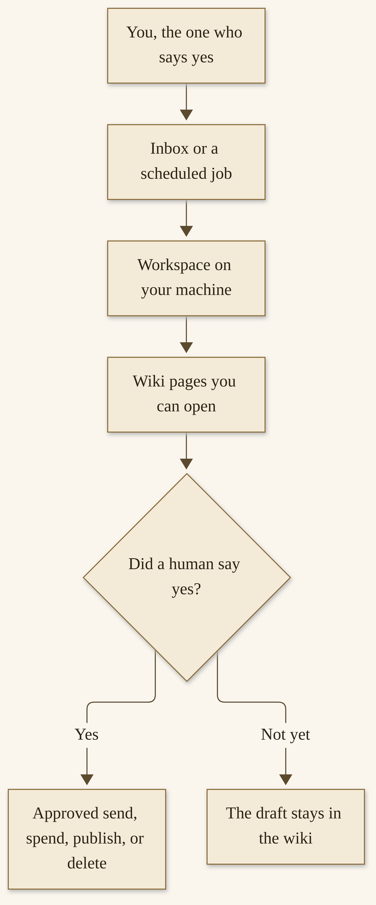{width=100%}

*I11. The professional loop, in a picture. Work arrives, it is written down, and nothing leaves without a yes. You sit at the yes.*

## How to use this shelf

Each tutorial has the same shape. A purpose. Who it is for. A setup. Numbered steps you can actually do. A “never.” And a way to tell it worked. The commands come from the official OpenClaw docs, as they stood on 12 November 2026.

> **Tip.** If this book and the live docs disagree, trust the live page — the product moves. We dated what we checked: 12 November 2026.^154

A few rules belong to the whole shelf, not only to one tutorial.

This is self-hosted use on a machine you control. OpenClaw is a self-hosted platform; there is no official paid OpenClaw Cloud you simply log into.^155 One Gateway is one trust boundary: a single operator, or a team whose members already trust each other. If the people on the other side of a door do not already trust each other, they need separate Gateways, ideally on separate OS users or hosts.^156

You still say yes. Approvals sit on external sends, publication, purchases, deletion, and production changes. The official team preset says that in its own words, and I am asking you to make the same rule yours whether you use that preset or not.^157

> **Caution.** Secrets, API keys, and unpublished partner data do not belong in the vault, and they do not belong in a chat. They belong in a place you already trust for secrets. A folder you back up is a folder someone else might one day see. If a document is confidential, ask whether it belongs in this wiki at all. I would rather a thinner vault than a careful career with a hole in it.

Keep work and home apart if they share a machine. Chapter 4 already taught the built-in LLM Wiki — officially the bundled, optional `memory-wiki` plugin — and its two scopes: one shared vault, or a child vault per agent.^158 Per-agent scope is a same-process knowledge boundary, not an operating-system security boundary. Plugins and unsandboxed tools with host filesystem access can still read another agent’s directory. If work and home should not see each other, use sandboxing, or a separate Gateway, and keep the two vaults in different rooms of your life. We will come back to that in the first tutorial.

When a step fails, stay with official diagnostics. `openclaw doctor` is the operator check you already met in Part 2. For the wiki, it is `openclaw wiki doctor`. For a channel, `openclaw channels status --probe`. For a scheduled job, `openclaw automations list` and `openclaw automations runs`. For a connected tool, `openclaw mcp doctor <name> --probe`. I will not invent a recovery I have not seen on a page. If the live docs have a troubleshooting step I did not print, take the live step.

Backup the Gateway’s state before you lean on it. The official commands, as of 12 November 2026, are:^159

```bash
mkdir -p ~/Backups/openclaw
openclaw backup create --output ~/Backups/openclaw --verify
```

A verified full archive covers state, config, credentials, every configured agent directory, and, by default, workspaces. The default wiki lives under the state directory, so it is part of that tree. If you set a custom `vault.path` outside the state directory, protect that path too. Archives can contain credentials and session history; store them as carefully as the live state. After a backup, confirm you can name the file and the date, and that you know where it lives. A research desk without a backup is a desk you will someday mourn.

If you have only a weekend, start with the research desk. If you already have a wiki from Chapter 4, you are ahead. If you write on a schedule, the status digest will feel like a natural next step. The security tutorial is a hardening afternoon, not a reason to delay the desk.

I also want to say what this shelf is for, kindly. It is a set of patterns you can take at your own pace. It is not a certification, and it is not a substitute for the policy your company already has, or for the lawyer, the accountant, or the security person you already trust. What I have found, in my own shop, is that a careful first setup — a Gateway on your machine, a wiki, a job you watch — is how a professional practice starts to feel like a practice. The rest is repetition, and a yes you do not give away.

## A research desk with a vault

**Purpose.** A work wiki that produces a briefing a human actually edits.

**Who it is for.** Anyone whose professional life involves sources: a researcher, a writer, an engineer keeping notes, a founder trying to remember what last week’s experiment actually showed. You do not need a fleet. You need one agent, a folder you will still have next month, and a habit of opening the pages you cite.

**Setup.** A working OpenClaw Gateway, from Part 2. The built-in LLM Wiki from Chapter 4, which you enable with a single official command and then initialize.^158 If Chapter 4 is still ahead of you on a first reading, the steps below are the official ones; you can come back and deepen the practice there. A handful of local source files you actually opened — five is a good first week — saved as valid UTF-8 markdown or text. Ingest, on the official CLI, is a local file path. There is no URL ingest on that command as of 12 November 2026.^160

> **Story.** I wrote, on 11 November 2026, that the most important part of an autonomous agent isn’t the model. It’s the notebook. I meant it as a practice, not a slogan.^161 A great model with no memory is a brilliant stranger who meets you fresh every morning. The same model sitting on top of a well-kept wiki starts to feel like a colleague. If you skipped Chapter 4, this is the reason to go back.

The shape, in one honest sentence, is this: the desk reads sources you gave it, writes durable pages, and leaves a brief you can edit with coffee. The notebook is the practice. The model is the engine you will swap. I will not invent WisdomForge enrollments or a classroom story around this desk. A research desk is simply the first professional shape: gather, write, and leave a brief a human still owns.


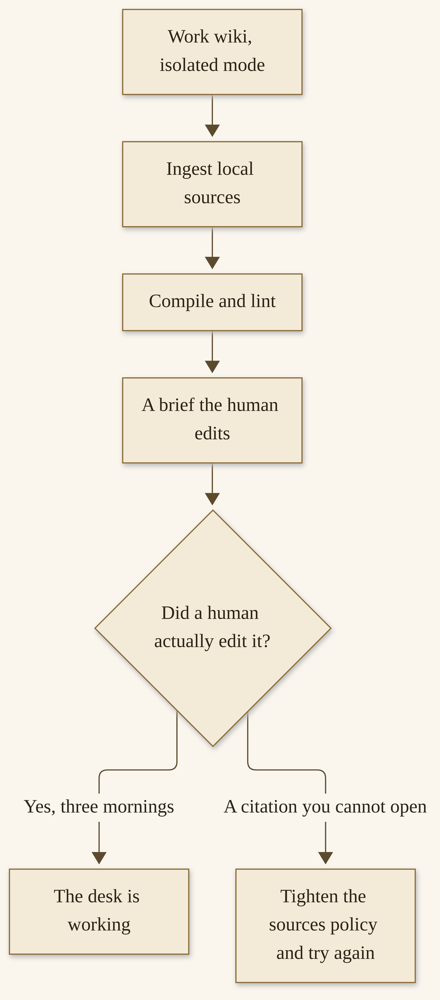{width=100%}

*I11b. A research desk, in a picture. Sources go in, a brief comes out, and a human still edits it.*

**How to stand up a research desk**

1. Enable the built-in LLM Wiki, if you have not already, and make sure the Gateway can see it.

   ```bash
   openclaw plugins enable memory-wiki
   openclaw gateway restart
   ```

   The official wiki CLI asks you to enable the plugin before first use, and to restart the Gateway.^160 On a Gateway that is already running, enablement can apply automatically; if the Gateway is offline, start it.^158
   You should see `openclaw wiki status` report vault mode, scope, and health.
   If you don’t: run `openclaw wiki doctor`, which exits non-zero when the vault is unhealthy, and follow the fixes it prints.^160

2. Initialize the vault layout, and choose a mode and a scope on purpose.

   ```bash
   openclaw wiki init
   ```

   That command creates the official layout and starter pages, including top-level indexes.^160 The default vault path is `~/.openclaw/wiki/main`. The default mode is `isolated`: the wiki’s own sources, with no dependency on the active memory plugin. That is the right starting place for a self-contained curated knowledge store.^158 `bridge` mode compiles public artifacts the active memory plugin exports. `unsafe-local` is an explicit, experimental, same-machine escape hatch; use it only when you understand the trust boundary and specifically need local filesystem access bridge mode cannot provide.^158

   Scope is a separate choice. `global` is the default: one vault for every agent on this Gateway. `agent` gives each agent a child vault under a parent path. If work and home share a machine, this is the moment to keep them apart — a work agent with its own vault, and a home agent with its own, or, more firmly, two Gateways.

   > **Caution.** Per-agent vaults are a same-process knowledge boundary, not an OS security boundary.^158 Changing scope does not copy or split an existing vault. Back up first, and move or import existing pages deliberately.

   `memory-wiki` does not replace the active memory plugin. Recall, promotion, indexing, and dreaming stay with `memory-core` (or whatever memory plugin you configured). The wiki sits beside it and compiles knowledge into a maintained layer.^158
   You should see a vault directory with the official starter pages — `AGENTS.md`, `WIKI.md`, `index.md`, `inbox.md`, and the folders the official page lists, including `sources/`, `syntheses/`, and `reports/`.^158
   If you don’t: run `openclaw wiki doctor` again, and confirm `vault.path` is where you think it is.

3. Write a short home note for research standards. The official workspace already has a place for standing instructions — typically `AGENTS.md`, along with `SOUL.md` and `USER.md` — and the wiki has its own `AGENTS.md` and `WIKI.md` at the vault root.^158,^162 In plain words, tell the desk: prefer pages you actually opened; date every source; quote sparingly and accurately; if you cannot open it, do not cite it; never invent a citation; never put secrets or unpublished partner data in the vault. Ask the agent, in a work-agent chat, to read that note before it writes.
   You should see those sentences in a file you can open.
   If you don’t: write them yourself, then ask the agent to read the file, and open the file again.

4. Ingest a handful of sources you actually care about into the wiki’s `sources/` folder.

   ```bash
   openclaw wiki ingest ./notes/briefing-source.md
   ```

   The path must be a local file. Binary files are rejected. The source must be valid UTF-8; malformed input is rejected without replacing an existing source page.^160 You can pass `--title` to override the title derived from the filename. Ingest always recompiles the vault afterward. If you are using agent-scoped vaults, pass `--agent` with the work agent’s id, the way the official CLI describes.^160 Do not scrape a private site. Do not invent a vendor-specific ingest recipe. If a document should not leave the place your workplace already keeps it, leave it there, and type a question instead.
   You should see a new page under `sources/`, with provenance frontmatter, and a compile that finishes.
   If you don’t: confirm the file is a local UTF-8 path, and read the error; official docs say ingest waits up to five minutes for a busy vault before reporting a lock timeout.^160

5. Compile, if you want fresh dashboards right away, and then lint.

   ```bash
   openclaw wiki compile
   openclaw wiki lint
   ```

   Compile rebuilds indexes, related blocks, dashboards, and the compiled snapshot the wiki uses for search and prompts.^160 Lint reports structural issues, provenance gaps, contradictions, open questions, low-confidence pages, and stale pages. Run it after meaningful updates. The official recommended workflow is exactly that: ingest or apply, then lint.^158

   If you have turned on dashboards — they are on by default when `render.createDashboards` is true — you will find reports under `reports/`: open questions, contradictions, low confidence, claim health, stale pages, and a privacy review for non-public privacy tiers.^158 Those reports are a gift. Read them. You can also browse the compiled wiki in the Control UI: Memory, then Dreams → Diary → Memory Wiki.^158 That tab is a window onto the same pages. It is not a second vault.
   You should see a lint report you can explain, and, if dashboards are on, at least one report page under `reports/`.
   If you don’t: run `openclaw wiki doctor`, then compile again. If `ingest.autoCompile` is false, a source change waits for an explicit compile; that is official.^158

6. Ask the agent, in a work-agent chat, to write a short briefing as a synthesis page, grounded in the sources you ingested. The supported way to create or refresh a synthesis, without freeform surgery on managed blocks, is official:^160

   ```bash
   openclaw wiki apply synthesis "Weekly research brief" \
     --body-file ./drafts/weekly-brief.md \
     --source-id source.briefing-source
   ```

   You can also ask the agent to use its `wiki_apply` tool, with the same discipline: narrow mutations, not a rewrite of a page you have not read. Then open the brief yourself. Edit it. If a citation is thin, say so. If a claim has no evidence, send it back.
   You should see a synthesis page whose sources you can name, and a brief you would be willing to send only after you have edited it.
   If you don’t: open the source pages with `openclaw wiki get`, lint again, and tighten the standing note in step 3. The desk is not done until a human has edited the brief.

7. Optionally, put the brief on a schedule, the way Chapter 8 and the next tutorials will teach, with delivery kept internal until you are ready. A research desk that publishes itself is not a research desk. It is a leak.

**Never.** Never invent a citation. Never put secrets, credentials, or unpublished partner data in the vault. Never treat a per-agent wiki as a wall against a process on the same machine. Never ingest a URL through a command the official CLI does not support. Never let the brief leave the machine without a human edit. Never point this desk at untrusted customers on the same Gateway.

**How you know it worked.** You can run `openclaw wiki status` and `openclaw wiki doctor` without a failure. You can search for a source you ingested — `openclaw wiki search "a phrase from the source"` — and get the page back, with provenance.^160 You can open a briefing you edited, on three mornings, and recognize the work as yours. If a claim cannot be opened, the desk is not done. What still needs a yes is any send, any publish, and any decision to put a new kind of document into the vault.

## A reviewed professional toolkit

**Purpose.** Search, read, verify, pin, and enable one or two skills. Refuse the rest.

**Who it is for.** Anyone who is tempted, as I have been, to install a catalog because it is large. A professional toolkit is small on purpose. Chapter 9 already gave you the ritual. This tutorial is that ritual, applied at work, for a team of one — which is what most of us are, on a Gateway we run ourselves.

**Setup.** A working Gateway and a work agent. An afternoon. The official Skills page, the official ClawHub page, and a willingness to read a `SKILL.md` before you enable it.^163,^164

ClawHub is the public registry for OpenClaw skills and plugins.^164 It is a commons, and I am grateful for it. It is also a place where anyone who passes the upload gate can publish. A scan badge is useful. It is not a substitute for your eyes. Official guidance is to treat third-party skills as untrusted code, read them before enabling, and prefer sandboxed runs for untrusted inputs and risky tools.^163 Native plugins run in-process and are not sandboxed. Do not install a native plugin lightly on a work Gateway.^165

There is no live official skills total I can honestly print as of 12 November 2026; I will not invent one.^166 Plugin counts move, and if I name one later in this book it will carry its date. A count is not a quality score. “Skills that compound,” in this book’s subtitle, means a small, reviewed set you will still be glad you kept — not a binge.


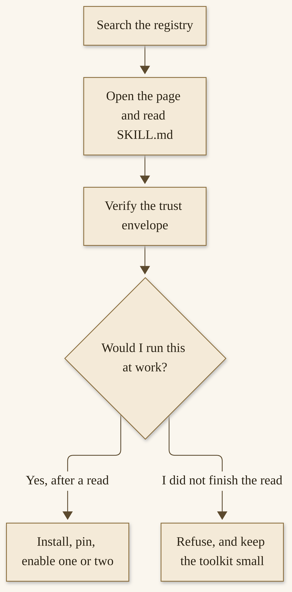{width=100%}

*I11c. The review ritual, in a picture. A skill earns its place. The rest stay out.*

**How to review a professional toolkit**

1. Search for a job you actually have, not for a category you might someday want.

   ```bash
   openclaw skills search "calendar"
   ```

   The official ClawHub quick start uses that exact example.^164 For plugins, the sibling command is `openclaw plugins search "calendar"`. You are looking for a name you can open, not for a count.
   You should see a short list of names you can click or look up.
   If you don’t: confirm the Gateway can reach ClawHub, and try a plainer query for the actual job.

2. Open the skill’s page on ClawHub, and read the `SKILL.md`. Read the supporting files if they exist. Look at what it asks the agent to do, what binaries it requires, what environment variables it wants, and whether it wants a network call you did not expect. Prefer official or carefully reviewed packages. The official docs demonstrate an install of `@openclaw/demo`; that is a documented example, not a recommendation that you install it without a read.^164
   You should be able to say, in a sentence, what the skill does and what it asks for.
   If you don’t: it is not ready. Leave it.

3. Verify the trust envelope, if the skill came from ClawHub.

   ```bash
   openclaw skills verify @owner/slug
   ```

   That command asks ClawHub for the skill’s `clawhub.skill.verify.v1` trust envelope. Installed ClawHub skills verify against the version and registry recorded in `.clawhub/origin.json`. The command exits non-zero when ClawHub marks verification as failed.^163 ClawHub skill pages also show the latest security scan state — VirusTotal, ClawScan, and static analysis, as the official page names them — before install.^163 A pending or stale scan can still warn-and-install. Installation is not proof that every scan completed.^165 `openclaw skills verify` retrieves the registry’s envelope. It does not hash the current local files as a complete audit of what is on your disk.^165 Use an owner-qualified ref, `@owner/slug`, to avoid publisher ambiguity.^163
   You should see a clean exit, or a clear failure you take seriously.
   If you don’t: do not install. A failure is a no.

4. If, and only if, you would run this at work, install it into the work agent’s workspace.

   ```bash
   openclaw skills install @owner/slug
   ```

   The default install lands in the active workspace `skills/` directory. `--global` installs into the shared managed library, visible to all local agents unless allowlists narrow it.^163 On a work Gateway, I prefer the workspace install, so a second agent does not inherit a skill I have not given it. After install, you can update tracked ClawHub skills with `openclaw skills update --all`. Git and local installs are refreshed by reinstalling; `update` tracks ClawHub installs only.^163
   You should see the skill in the work workspace’s `skills/` folder, with `.clawhub/origin.json` beside it.
   If you don’t: confirm you ran the install against the work workspace, and open the official Skills page for the current wording.

5. Pin what you reviewed. The official lockfile for ClawHub tracking is `.clawhub/lock.json` in the workspace, with `.clawhub/origin.json` in each installed skill.^163 Leave those files alone except through official update commands. If you later write an install-policy command, official docs allow `security.installPolicy` to run a trusted local policy before skill installs continue.^163 I will not invent the body of that policy for you. The point is that a work Gateway can refuse an install you have not approved.

6. Refuse the rest. A “new skill review” checklist for a team of one is short enough to write on a card. Does this skill serve a job I already have? Did I read the `SKILL.md`? Did verify return cleanly? Do I know what tools it will call? Is it a skill, which is a markdown procedure, or a native plugin, which runs unsandboxed in-process? If it is a native plugin, did I have a reason strong enough to accept that? If any answer is no, the skill stays out.

   For plugins, the official install is explicit:

   ```bash
   openclaw plugins install clawhub:<package>
   ```

   Released OpenClaw versions through `2026.10.4` require the `clawhub:` prefix to select ClawHub; updated builds can omit it, and the explicit prefix works on both.^164 Use that prefix at work. Plugin installs validate advertised `pluginApi` and `minGatewayVersion` before the archive is installed.^164 That is compatibility, not a security audit.

   > **Caution.** Native plugins run in-process and are not sandboxed.^165 Do not install one lightly on a work Gateway. A skill you read is one kind of trust. A plugin that runs inside the Gateway process is another.

**Never.** Never install a skill you have not read. Never treat a scan badge or a `skills verify` pass as a complete audit of the files on disk. Never install a native plugin lightly on a work Gateway. Never dump a catalog into a work agent’s allowlist. Never put credentials in a skill’s content. Never enable `skills.install.allowUploadedArchives` unless you have a reason you can say out loud; that path is off by default.^163

**How you know it worked.** You can name the one or two skills you enabled, and you can open their `SKILL.md`. You can run `openclaw skills verify @owner/slug` on each ClawHub skill and get a clean exit, and you still treated that as one input, not as a blessing. A week later, the toolkit is the same size, or smaller, and the work is better for it. What still needs a yes is any new install, and any plugin.

## A scheduled status digest

**Purpose.** Official automations — the built-in scheduler, still also called `openclaw cron` — produce a status digest on a schedule, deliver it to an allowlisted place or keep it internal, and leave a human who still reads it.^167,^168

**Who it is for.** Anyone who wants a morning picture of work that already happened: a researcher who wants overnight notes gathered, a small shop that wants a Monday summary, a person who is tired of opening six tabs before coffee. You do not need a fleet. You need one job, a schedule you chose, and a delivery path that cannot reach the world by accident.

**Setup.** A running Gateway. Automation commands require one.^168 A work agent you can name with `--agent`. Chapter 8 already taught the practice; this is that professional job, fully worked. An allowlisted channel, if you want the digest delivered to chat — or the willingness to keep it internal until you have read three runs.

Isolated versus main session is a real choice, and the official docs advise it clearly. `--session` accepts `main`, `isolated`, `current`, or a pinned `session:` key. Agent-turn jobs created from ordinary CLI calls default to `isolated` when no session context is available. Isolated runs get a fresh transcript each time, and they reset ambient conversation context.^168 For a professional digest, isolated is the right default. You do not want a morning brief to wander into yesterday’s chat.


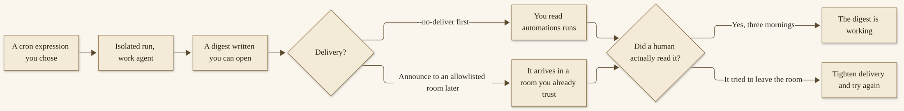{width=100%}

*I11d. A status digest, in a picture. Isolated first, delivery off, a human still reads it.*

**How to stand up a status digest**

1. Confirm the Gateway is running, and that you can list automations.

   ```bash
   openclaw automations list
   ```

   `openclaw automations` and `openclaw cron` are the same command family. Every subcommand works with either spelling.^168 Mutations require `operator.admin`.
   You should see a list — empty is fine, if this is your first job — and not a connection error.
   If you don’t: start the Gateway and try again. Automation commands require a running Gateway.^168

2. Create the job as an isolated run, with delivery off, and a timezone you actually live in. Natural-language schedules such as “every day at 9am sharp” are not supported; use a five-field cron expression, and pass `--tz` with an IANA timezone.^168 I live in America/New_York. Use yours.

   ```bash
   openclaw automations create "0 7 * * *" \
     "Write a short status digest of yesterday's work from the work wiki. Date every claim. If you cannot open a source, do not cite it. Do not send, publish, or delete anything. If there is nothing to report, reply with NO_REPLY." \
     --name "Morning status digest" \
     --session isolated \
     --no-deliver \
     --tz "America/New_York"
   ```

   That shape follows the official create syntax: schedule first, prompt second, then flags.^168 Isolated `add` jobs default to `--announce` delivery; `--no-deliver` keeps output internal, which is what you want until you have watched the job.^168 The official docs also show a sibling that adds `--light-context` for isolated agent-turn jobs, which keeps bootstrap context empty instead of injecting the full workspace bootstrap set.^168 Use that if you want a leaner morning run. Pass `--agent` with your work agent’s id if you have more than one, so ownership does not fall through to a default you did not choose.^168

   For a Monday-only digest, a cron expression such as `"0 8 * * 1"` is the official kind of schedule. For an interval, `"every 1d"` is supported through `--every` or a positional interval. Invalid expressions are rejected with examples of valid syntax.^168
   You should see a job id returned, and `openclaw automations show "Morning status digest"` should preview a route with automatic delivery off.
   If you don’t: read the error; confirm the Gateway is up; confirm the cron expression is five fields, not a sentence.

3. Inspect the job before you trust it.

   ```bash
   openclaw automations list
   openclaw automations show "Morning status digest"
   ```

   `show` accepts an exact job name, and job IDs take precedence if both could match.^168 Read the delivery-route preview. For an isolated job with `--no-deliver`, you should see that automatic conversation results and external notifications are disabled.

   > **Caution.** `--no-deliver` does not remove the agent’s `message` tool when a chat route is available, so the prompt still needs to say, clearly, that the job does not send.^168 Do not store secrets in job scratch; scratch becomes model prompt context, and official docs say so.^168

4. Force a first run while you are watching, and wait for it.

   ```bash
   openclaw automations run <job-id> --wait --wait-timeout 10m
   openclaw automations runs <job-id> --limit 10
   ```

   A forced run executes the payload directly.^168 `--wait` blocks until that exact queued run records a terminal status; the command exits 0 only for a successful completion.^168 Then open the run history. Read the digest. If it invented a claim, tighten the prompt and the wiki, and run it again. If a text-only announcement is intentionally silent, a final that trims to uppercase `NO_REPLY` suppresses outbound delivery — that is official, and it is the right quiet for a morning with nothing to say.^168
   You should see a completed run and a digest you can open, or a clean `NO_REPLY`.
   If you don’t: `openclaw automations runs <job-id> --status error`, then `openclaw doctor`. I will not invent a recovery the official page does not show.

5. Only after three clean runs you actually read, consider announcing to an allowlisted work channel, not to the world.

   ```bash
   openclaw automations edit <job-id> --announce --channel telegram --to "YOUR_ALLOWLISTED_DESTINATION"
   ```

   The official docs use Telegram and Slack as example announce channels, with destinations you supply.^168 Those product names appear on the official Channels and automations pages; they are not a recommendation of any employer’s tool, and they are not a public inbox.^169 The destination should be a room or a direct message you already allowlisted, the way the next tutorial and Chapter 7 teach. Do not pass a webhook URL for a first professional digest. Do not combine `--webhook` with chat delivery flags.^168 If anything about the route looks broader than the room you intended, go back to `--no-deliver`. Isolated jobs can also use `--delivery-target owner` to resolve an identified owner DM, which cannot be combined with `--to` or `--webhook`.^168 That is a reasonable professional pattern when the only reader should be you.
   You should see `automations show` preview exactly the room you intended.
   If you don’t: set `--no-deliver` again, and do not announce until the preview is a room you can name.

6. Give the job a failure path you will see. Official failure notifications can alert after consecutive failures, and `openclaw automations runs <job-id> --status error` is how you look.^168 I will not invent a paging vendor. The practice is: a failure is visible, and a human looks.

**Never.** Never let a digest send itself to the world. Never start with `--announce` into a channel you have not allowlisted. Never put secrets in job scratch. Never use a main session for a professional digest if an isolated run will do. Never skip the three runs you read yourself. Never treat `NO_REPLY` as a failure; it is a quiet success when there is nothing to say.

**How you know it worked.** Three scheduled mornings, three digests you actually opened, no send you did not approve, and a `automations runs` history you can explain. If you cannot find last Tuesday’s run, the desk is not a practice yet. What still needs a yes is any change from `--no-deliver` to an announce, and any webhook.

## MCP into a tool you already trust

**Purpose.** One doctor-checked connection to a tool you already trust, with no unofficial scrapers, and with tool policy still in force.

**Who it is for.** A practitioner who already has a calendar, a docs host, or an issue tracker that speaks the Model Context Protocol — a way an agent borrows tools from another program — and who wants the agent to use those tools without bypassing the rules already set on the Gateway. If you do not have such a server, you do not need this tutorial yet. That is a fine place to be.

**Setup.** A running Gateway. The official MCP page, re-opened on 12 November 2026.^170 A server you already trust — not a guessed vendor recipe, and not a public scraper. OpenClaw is an MCP client: server definitions live under `mcp.servers`, and the tools they expose go through the same tool-profile and tool-policy controls as everything else. Connecting a server does not bypass your policy.^170

If your company uses a managed MCP package from ClawHub, re-open the official managed-MCP page and follow that page, not a remembered recipe.^171 This tutorial teaches the doctor-checked pattern with a generic trusted server, using only the official example shape.


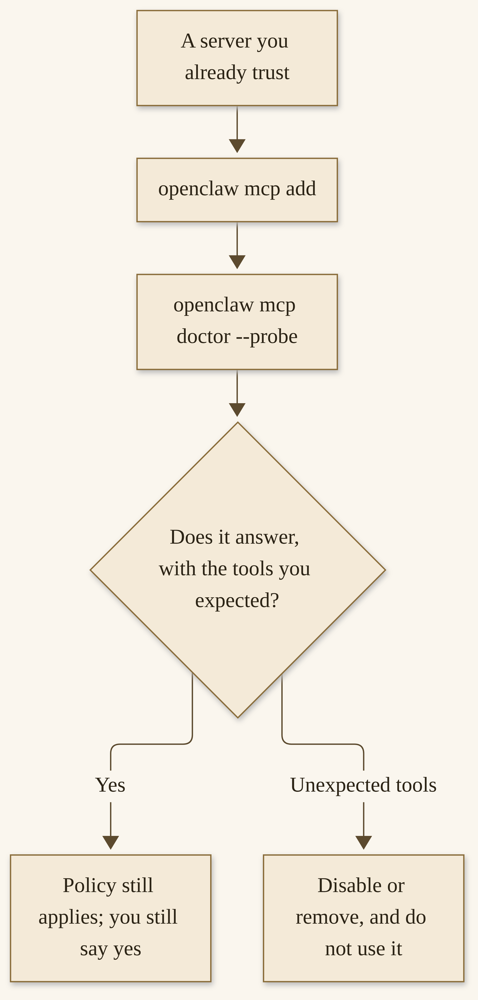{width=100%}

*I11e. A trusted connection, in a picture. Add, probe, and keep the policy.*

**How to connect a trusted MCP server**

1. Decide the transport the way the official page does. A local process uses stdio and a command. A remote server uses Streamable HTTP or SSE and a URL.^170 You can add a server from the Control UI, under Settings → MCP, or from the CLI. The CLI is what I will print, because it is the same definition either way.

2. Add the server, using the official example shape, with a name and an address that belong to a server you actually trust. The URL in the official docs is an example host, `https://mcp.example.com/mcp`. Replace it with yours. Do not copy an example host and expect it to answer.

   A local stdio server, as the official page writes it:

   ```bash
   openclaw mcp add local-tools \
     --command node \
     --arg ./dist/mcp-server.js \
     --cwd /srv/openclaw-tools
   openclaw mcp doctor local-tools --probe
   ```

   A remote Streamable HTTP server, exposing only some of its tools:

   ```bash
   openclaw mcp add docs \
     --url https://mcp.example.com/mcp \
     --transport streamable-http \
     --include 'search,read_*'
   openclaw mcp doctor docs --probe
   ```

   Those are the official examples.^170 The `--include` filter is the point: you can expose `search` and `read_*` and keep the rest out. Connecting a server is not an invitation to every tool it happens to ship.

3. Saving a definition proves nothing about reachability. The doctor check does. `openclaw mcp doctor <name> --probe` validates the saved definition, then opens a live connection and reports the tools and other capabilities the server advertises.^170 If it connects but expected tools are missing, check `toolFilter.include` and `toolFilter.exclude`. Useful companions, from the same page, are `openclaw mcp status --verbose` for a config-only summary, and `openclaw mcp probe <name>` for live capabilities.^170
   You should see a live probe that lists the tools you expected, and only those tools.
   If you don’t: do not use the server. Confirm the command or URL, the filter, and that the process environment can reach it. Official troubleshooting for a stdio server starts with whether the `command` resolves in the Gateway process and whether `cwd` exists.^170

4. If an HTTP server uses OAuth, follow the official sign-in path, not a guessed browser trick. `openclaw mcp login <name>` is the CLI path, and the official page is precise: it runs offline only, so stop the Gateway first and start it again afterward.^170

   ```bash
   openclaw gateway stop
   openclaw mcp login <name>
   ```

   Follow the printed authorization URL. OpenClaw normally captures the loopback redirect and saves the credentials; use the printed `--code` command when the browser cannot reach the callback listener.^170 In the Control UI, an administrator can select Sign in for an enabled HTTP server that uses shared native OAuth credentials, under the conditions the official page describes — including that browser sign-in requires Settings on the Gateway’s own HTTPS address, its local loopback, or its published Tailscale address.^170 I will not invent a proxy recipe.

   > **Caution.** Authentication saved means credentials were saved. It does not prove the server is reachable or its tools work.^170 Run the doctor check again after sign-in. Keep credentials out of config literals; official MCP guidance is to store sensitive headers and environment values through the supported secret mechanisms.^170 Chapter 14 will come back to SecretRefs and `openclaw secrets audit --check`.

5. Confirm that tool policy still applies. Ask the agent, in a work-agent chat, to use one included tool on a question you can verify by hand. If the tool can send, spend, publish, or delete, it still needs your yes. If the server exposes a tool you did not include, go back to the filter. If doctor is clean and the tool does something you did not ask, disable the server — setting `enabled: false` keeps the definition without connecting it^170 — and look again before you turn it back on.
   You should see one correct answer to a question you already know, and a wait on anything that would change a system.
   If you don’t: disable the server and stay with the tools you already had.

6. If changes do not reach an active agent, remember the official troubleshooting note: `openclaw mcp reload` refreshes runtimes owned by the current CLI process. A Gateway or agent running elsewhere needs its own reload, config publish, or restart.^170

**Never.** Never connect an unofficial scraper. Never point MCP at a server you do not already trust. Never treat a saved definition as a passing doctor check. Never put API keys in a config literal. Never assume OAuth sign-in proved reachability. Never let a connected tool bypass approvals on send, spend, publish, or delete. Never invent a vendor walkthrough the official page does not contain. If no suitable official example exists for a product you use, stay with this generic pattern, or wait.

**How you know it worked.** `openclaw mcp doctor <name> --probe` reports the tools you expected, and only those tools. A question you can verify by hand comes back correctly. A tool that would send or change a system still waits. A week later, the server list is still short. What still needs a yes is every tool that can leave the machine or change a system.

## An allowlisted work channel that never becomes a public inbox

**Purpose.** Pairing, allowlists, and mention gates, applied at work, so a professional messaging door is a door you chose and not an open inbox.

**Who it is for.** Anyone who wants the agent on a channel they already use for work — a direct message with themselves, or a private room whose members they trust — and who is willing to be strict about who may speak to it. Chapter 7 already taught the door. This is that door, at work, with the defaults taken seriously.

**Setup.** A working Gateway. The official Channels page, and the official pairing and access-control pages, re-opened on 12 November 2026.^169,^172,^173 A channel the official page actually documents. I will walk Telegram as the official first-channel path, because the Channels page says to start there: it needs a bot token and no plugin install, and it is the fastest channel to get working.^169 WhatsApp, Discord, Slack, Signal, and other names on that page are official options, attributed to that page; pick the one you already use, and follow that channel’s own official guide for tokens and account login. I am not recommending any employer’s tool.

On a regular host install, conservative defaults already point the right way: the Gateway binds to loopback; most chat channels answer an unknown DM sender with a pairing code instead of processing the message; group access is allowlisted, usually behind a mention gate.^156 Take those defaults. Do not open it up so it is easier.


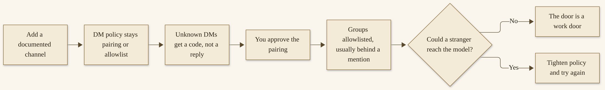{width=100%}

*I11f. A work channel, in a picture. Pairing first, allowlists next, and a stranger never reaches the model.*

**How to stand up a work channel**

1. Add the channel the official way. For Telegram, the Channels page’s first command is:^169

   ```bash
   openclaw channels add --channel telegram --token <bot-token>
   ```

   Run `openclaw channels add` with no flags to pick from a list instead.^169 With the default hot reload, the running Gateway applies the new account. Then probe it:

   ```bash
   openclaw channels status --probe
   ```

   Start the Gateway if it is offline.^169 Full walkthroughs live on each channel’s official page; if a flag on the live page differs from what I printed, take the live flag. Keep the bot token out of chat, out of the wiki, and out of a screenshot. SecretRefs, in Chapter 14, are how secrets should live.
   You should see a probe that says the channel is reachable.
   If you don’t: start the Gateway, confirm the token, and follow that channel’s official troubleshooting page, not a forum recipe.

2. Leave DM policy on pairing, or tighten it to an allowlist. Every DM-capable channel supports `dmPolicy`. The official policies are:^172,^173

   - `pairing` — the default. Unknown senders get a pairing code; the bot ignores them until you approve. Codes expire after one hour. Pending requests are capped at three per channel account.
   - `allowlist` — unknown senders are blocked, with no pairing handshake. For a one-owner work bot, official Telegram guidance prefers `allowlist` with explicit numeric sender IDs.^174
   - `open` — anyone can DM, and only when the allowlist includes `"*"`. This is a deliberate public opt-in. It is not a work default.
   - `disabled` — inbound DMs are ignored entirely.

   Prefer pairing plus allowlists for DMs. Do not set `open`. For a work bot that should only talk to you, `allowlist` with your sender ID is the tighter professional choice, once you know that ID.

3. Approve pairing from the CLI or the Control UI, yourself, for senders you can name.

   ```bash
   openclaw pairing list telegram
   openclaw pairing approve telegram <CODE>
   ```

   That is the official CLI shape.^172,^173 Multi-account channels take `--account`. Add `--notify` if you want the requester told on the same channel.^173 In the Control UI, the queue is under Settings → Channels → DM access requests.^173 Approval grants direct-message access only. It does not grant group access. It is not a reason to skip an allowlist. The first approved pairing, from the CLI, also bootstraps `commands.ownerAllowFrom` when no command owner exists, so privileged commands and exec approval prompts have an explicit operator; later approvals do not add more owners.^173 That is a gift. Confirm the owner is you.
   You should see the approved sender on the pairing list, and an owner you recognize.
   If you don’t: do not approve a second time out of impatience; official Control UI guidance is that a confirmed approval should not be repeated.^173 Check `commands.ownerAllowFrom` with the official config tools if the owner did not land.

4. Keep groups allowlisted, and usually behind a mention gate. The official default group policy is `allowlist`.^173 `groupPolicy: "open"` is a normal deployment only for a private room whose members you already trust; official access-control guidance says to decide by membership, not by channel type, and to keep sender allowlists or mention gating on rooms where strangers can join or post.^172 Customize mention triggers with `agents.entries.*.groupChat.mentionPatterns` so `requireMention` gates on your own bot names.^172 A work channel should never be a public group the agent will answer unprompted.

   Approving a DM pairing code does not automatically allow that sender to run group commands. Group authorization still comes from explicit config allowlists.^173,^174 Put those allowlists in place on purpose.

5. Keep secrets out of chat. A paired channel is still a transcript. Do not paste API keys, tokens, passwords, or unpublished partner data into a message to the agent. If the work needs a secret, use the official secret mechanisms, not a DM. If a colleague asks the bot a question in a work room, remember that everyone who can message a tool-enabled agent shares that agent’s delegated tool authority.^156 That is fine for teammates who already trust each other. It is why a public inbox is a professional “never.”

6. Confirm the door the way a careful person would. Send a first message from an approved sender, and confirm the agent replies. From a second account, or from a sender who is not on the list, confirm the agent does not process the message — a pairing code, or silence, depending on policy, and never a model reply.
   You should see a reply to you, and no model reply to a stranger.
   If you don’t: stop and fix the policy before you do anything else. The door is not a work door until an unapproved sender cannot reach the model.

**Never.** Never skip pairing. Never set `dmPolicy` to `open` on a work Gateway. Never leave `"*"` in an allowlist. Never approve a pairing code you cannot assign to a person you trust. Never treat a DM approval as group access. Never put secrets in chat. Never bind a work agent to a public group. Never share one Gateway with untrusted customers.

**How you know it worked.** `openclaw channels status --probe` is clean. `openclaw pairing list` shows only the requests you expect. An approved sender can talk. An unapproved sender cannot reach the model. The group, if you have one, is a room you can name, allowlisted, and usually mention-gated. A week later, the allowlist is still short, and no stranger has a transcript. What still needs a yes is every new sender, and every new room.

## Security hygiene at work

**Purpose.** A hardening afternoon. A report for a human. This tutorial is defensive and high-level. It does not include exploit steps, proof-of-concept code, or reproduction procedures.

**Who it is for.** Anyone who has a work Gateway they intend to keep, and who is willing to spend an afternoon on the official audit, the official secrets check, and an update. If you only just stood up the research desk, you can do this the same weekend. Defaults are conservative on a regular host install. They are not “enterprise secure,” and sandbox and exec approvals are off by default.^156,^175 Official Why OpenClaw wording, dated with that page, is that default OpenClaw is a trusted single-operator assistant.^176 I will say that again in Chapter 14. Do not wait for Chapter 14 to run the audit.

**Setup.** A working Gateway, preferably after a backup (the official `openclaw backup create` from the start of this chapter). The official Security hub, and a cup of coffee.^156 You will not need a vulnerability catalog. v2026.11.3, published 10 November 2026 at 1:53 PM ET, is a security release and a patch release with no new features.^177 Stay current, rather than freezing a list of CVE names into this book. The way to stay current is `openclaw update` and the current release notes.^178


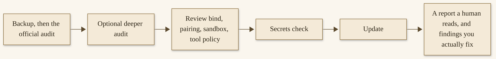{width=100%}

*I11g. A hardening afternoon, in a picture. Audit, tighten, update, and write it down.*

**How to spend a hardening afternoon**

1. Run the official operator check.

   ```bash
   openclaw security audit
   ```

   On a regular host install, one command tells you if you have drifted from conservative defaults.^156
   You should see a structured report of findings.
   If you don’t: confirm the CLI is the same install as the Gateway, and run `openclaw doctor`. Read every finding. The official audit pages describe what the audit checks, the priority order for fixing findings, and which checks support auto-fix.^156 I will not print a bypass. Fix findings in the order the official page recommends. If you apply a supported auto-fix, run the audit again and read the new report.

2. Optionally, go deeper.

   ```bash
   openclaw security audit --deep
   ```

   Officially, some checks run only with `--deep`, including plugin and skill code scans and live Gateway probes.^179 That is still a defensive report. A warning that a scan was truncated means some files were not checked; it does not identify dangerous code, and it does not mean the rest is clean.^179 Read it that way.
   You should see a longer report, and you should still treat it as a report, not as a contest.
   If you don’t: the plain audit in step 1 is already worth the afternoon. Come back to `--deep` when you can.

3. Review bind, pairing, and where the Gateway listens. The conservative default is loopback.^156 Container images are a documented exception: they default to an exposed bind, and official guidance is to pair that with auth, and to read the exposure runbook before you expose anything beyond loopback.^156 If you are not sure what you are listening on, that is the question to answer this afternoon, from the official Network exposure page, not from a blog post.
   You should be able to say, in a sentence, what the Gateway binds to, and that pairing is still on.
   If you don’t: put the bind back on loopback before you do anything else, unless you have a written reason and the official exposure runbook behind you.

4. Turn sandbox and exec approvals on when the work calls for it — and professional work almost always calls for it. Official hardening uses `agents.defaults.sandbox.mode` set to `"all"`, with a documented backend such as `openshell` or `docker`, plus tool allow and deny lists.^175 Copy the current flags from the official Hardened baselines and Why OpenClaw pages; I will not invent a config block that might drift.^175,^176 Sandbox and exec approvals are off by default. Turning them on is a decision, and it is one of the best decisions you can make on a work Gateway. Per-agent sandbox and tool restrictions are official, if one agent should be tighter than another.^157
   You should see the sandbox mode and exec-approval settings in config, after a change you made on purpose.
   If you don’t: re-open the Hardened baselines page and copy the current block from there.

5. Check secrets the official way.

   ```bash
   openclaw secrets audit --check
   ```

   Use SecretRefs, not plaintext literals, for tokens and keys, the way official security and MCP pages already ask.^156,^170 I will not invent a secrets-provider walkthrough. The practice is: an audit that looks for secrets, a check you run, and credentials that are not sitting in a chat log or a wiki page.
   You should see a check that finishes, and a plan for any finding it reports.
   If you don’t: take the official secrets and storage page as the next stop, and do not paste a secret into chat in order to “debug” it.

6. Update.

   ```bash
   openclaw update
   ```

   The official Updating page recommends `openclaw update` because it detects your install type, checks the new version while the old Gateway serves, then activates and verifies.^178 Before a significant update, create a verified backup; automatic config copies are not a full-state backup.^178 If your install path is the Mac app, Docker, or a distro package, follow the current page for that path, not this paragraph.
   You should see a current version you can name, and a Gateway that comes back healthy.
   If you don’t: follow the recovery the update command itself prints, including `openclaw update repair` when it names that. After the update, run `openclaw security audit` again.

7. Write a short report for a human — even if the human is you. What the audit said. What you changed. What you left, and why. What the secrets check said. What version you are on. What you backed up, and where. A hardening afternoon that lives only in your head will not survive a month.

**Never.** Never follow an exploit write-up against your own Gateway “to see if it works.” Never print a payload or a reproduction procedure, here or elsewhere in a professional practice. Never call OpenClaw “secure by default” in the enterprise sense. Never leave `gateway.bind` on an exposed address because it was convenient. Never leave sandbox and exec approvals off on a work Gateway because the default was easier. Never skip pairing to save a minute. Never freeze a CVE list and ignore `openclaw update`. Never treat `--deep` as a test you then try to “win.”

**How you know it worked.** You have a dated audit report, a secrets check, a current version, a backup you can name, and at least one finding you actually fixed. Loopback is still loopback, unless you have a written reason and the official exposure runbook behind you. Sandbox and exec approvals are on for the work that needs them. A week later, you can still find the report. What still needs a yes is any bind beyond loopback, and any decision to leave a finding unfixed.

## What not to automate at work

A hard professional “never” is kinder than a soft one, because you can hold it when a demo is tempting.

Do not host untrusted customers on one Gateway. One trust boundary is the official rule, and it is the right rule.^156 A public inbox, a support line that strangers can reach, and a work vault do not share a Gateway. If you need a second trust boundary, stand up a second Gateway, ideally on a second OS user or host.

Do not skip pairing. Do not set a work DM policy to `open`. Do not leave `"*"` in an allowlist. The minute you save is not worth the transcript you cannot take back.

Do not send, pay, publish, or delete without a human. The official team preset requires human approval before external sends, publication, purchases, deletion, or production changes.^157 A digest that announces into an allowlisted room you already read is one thing. An agent that sends mail, posts a page, or closes a ticket alone is another. The ethic in a sister gift, *Hand It Off*, was the same on a different platform: a draft is a gift, a send is a decision. It is still a decision here.

Do not invent results, dollar savings, or a client’s name, in a brief or in a book. I will not do it in this one. Do not name an employer in a vault that an agent can read, and do not ask this book to name mine. If a job title helps a reader picture the work, “Principal AI Solutions Engineer” is enough. There is no office geography in these tutorials, and there does not need to be.

Do not automate a judgment you would want to defend. A status digest can gather. A toolkit can be reviewed. A channel can be paired. A connection can be doctor-checked. A human still says whether the brief is true, whether the send is wise, and whether the finding is a finding. That is the practice.

When you are ready, the next shelf is personal: a household or a course of study, a reminder on a door you already use, a weekly list, a narrower second agent, a hobby that runs on a schedule, and, if the current docs still support them, a voice or a node. The same pattern holds. The “never” changes rooms. You still say yes.


# Chapter 12
## OpenClaw at Home: Personal How-Tos


{width=100%}

*I12. A kitchen table, a blank shared list, a closed personal notebook.*


The last chapter was a professional shelf. This one is a personal shelf, with the same care. You can take one tutorial and leave the rest. You can take all six. You do not have to. A household list and a course of study are both welcome here. A child’s full life is not. Other people’s secrets are not. I will not invent a family story to make this warmer. The warmth is in the care, and in a judgment that stays with you.

I want the same minute I asked for at work. These are patterns, not medical advice, not legal advice, and not financial advice. If a household has a rule about what may be written down, follow that rule first. If work and home share a machine, keep the two vaults apart, the way Chapter 11 already asked. You are still the one who says yes.


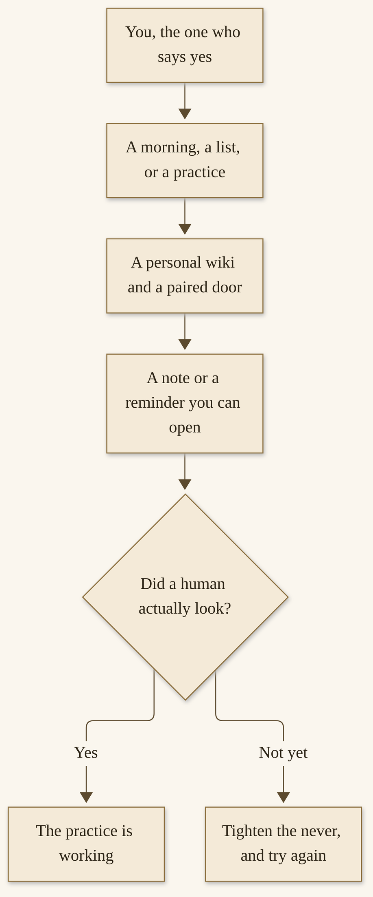{width=100%}

*I12. A personal morning loop, in a picture. A list is written, a human still looks, and you sit at the yes.*

## How to use this shelf

Each tutorial has the same shape as Chapter 11. A purpose. Who it is for. A setup. Numbered steps you can actually do. A “never.” And a way to tell it worked. The commands come from the official OpenClaw docs, as they stood on 12 November 2026.

> **Tip.** If this book and the live docs disagree, trust the live page — the product moves. We dated what we checked: 12 November 2026.^180

Judgment stays with you. That is the whole shelf’s rule, not only the last section’s. A reminder can be useful. A weekly list can be useful. A second, narrower agent can give a private practice its own room. None of those is a reason to automate a child’s life, or to ask an agent for a diagnosis, a legal conclusion, or a financial plan. I will say that kindly, and more than once, because it is the kind of sentence that is easy to skip when a tool is being helpful.

The same whole-shelf habits from Chapter 11 travel with you. One Gateway is one trust boundary.^181 Pairing is not optional “to keep it simple.” Secrets stay out of chat and out of the vault.^182 Backup before you lean on a household wiki:

```bash
mkdir -p ~/Backups/openclaw
openclaw backup create --output ~/Backups/openclaw --verify
```

Those are the official commands.^183 Archives can contain credentials and session history. Store them as carefully as the live state. If a custom `vault.path` sits outside the state directory, protect that path too.

When a step fails, stay with official diagnostics: `openclaw doctor`, `openclaw wiki doctor`, `openclaw channels status --probe`, `openclaw automations list` and `openclaw automations runs`. If the live docs have a troubleshooting step I did not print, take the live step.

If you have only a weekend, start with the household or learning vault. If you already have a wiki from Chapter 4, you are ahead. If you already have a work vault from Chapter 11 on the same machine, this is the chapter where you make sure the two do not share a room they should not share.

It is worth drawing that on paper before you ingest a first household page. On the left, the work agent, the work vault, the work channel, the status digest. On the right, the household agent, the household vault, the paired personal door, the Saturday list. A line between them: same machine, or same Gateway, only if you have decided the trust is the same, and only if session visibility and vault scope match that decision. Official docs will let those two rooms share a Gateway. They will not make the share careful for you. I have run professional and personal work on machines that sit in the same house, and the rule I can stand behind is simple: a work brief and a household list can share a host; they should not share a vault; they should not share a messaging door; and if a private journal is in the picture, it gets its own agent and a narrowed visibility, or its own Gateway. Chapter 11 pointed at this chapter for that split. This is the split.

If you are starting only at home, you can ignore the left side of that paper for now. Start with one household agent and one vault. Add a second agent when a job is real. Do not add a work shape “in case I need it.” Unused rooms collect pages you did not mean to write, and defaults you did not remember to tighten.


## A household or learning vault

**Purpose.** What we write down, and what we never write down. A household wiki, or a wiki for a course of study, built on Chapter 4’s official `memory-wiki` path.

**Who it is for.** Anyone who wants a durable place for a shared list, a course of reading, a practice plan, or the kind of household knowledge that is easy to lose — a preferred recipe, a packing list, the name of a book you meant to finish. You do not need a family of six. You do not need a school. You need a folder you will still have next month, and a short, honest “never.”

**Setup.** A working Gateway. The built-in LLM Wiki from Chapter 4.^184 If work and home share a machine, a separate vault — agent scope, or, more firmly, a separate Gateway — so a household list and a work brief do not live in the same compiled snapshot. Per-agent scope is a same-process knowledge boundary, not an OS security boundary. Say that, and mean it.^184

> **Caution.** Health details, a child’s full life, and other people’s secrets stay out of this vault. A folder you back up is a folder someone else might one day see. Secrets and API keys do not belong here, and they do not belong in a chat.


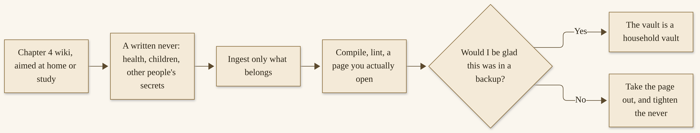{width=100%}

*I12b. A household vault, in a picture. What belongs goes in. What does not, stays out.*

**How to stand up a household or learning vault**

1. Enable the built-in LLM Wiki, if you have not already, and initialize it.

   ```bash
   openclaw plugins enable memory-wiki
   openclaw gateway restart
   openclaw wiki init
   openclaw wiki status
   ```

   These are the same official first steps as Chapter 4 and Chapter 11.^184,^185 Isolated mode is the right starting place for a self-contained household or study store. `unsafe-local` is experimental; it is not a first-week default.^184
   You should see `openclaw wiki status` report mode, scope, and health, and a vault at the default path `~/.openclaw/wiki/main` unless you chose another.
   If you don’t: run `openclaw wiki doctor` and follow the fixes it prints.^185

2. If work and home share a machine, separate the vaults on purpose. Set `vault.scope` to `agent` so each agent gets a child vault, or stand up a second Gateway if the trust boundary is not the same.^181,^184 Changing scope does not copy or split an existing vault; back up first, and move pages deliberately.^184 For a household agent, pass `--agent` on wiki commands when scope is `agent`.^185
   You should be able to name which vault is home, and which is work, and open each path.
   If you don’t: do not ingest household notes into the work vault “just for now.” Stop and finish the split.

   > **Caution.** A second agent’s vault is not a wall against a process on the same machine. Plugins and unsandboxed tools with host filesystem access can still read another agent’s directory.^184 Sandboxing, or a separate Gateway, is how you take that seriously.

3. Write a short “never” into the vault’s `AGENTS.md` or `WIKI.md`, and into the household agent’s workspace `AGENTS.md`. Sample wording, clearly a sample, not a dump of a private vault:

   > Sample. This vault is for household lists, a course of study, and notes we would be willing to see in a backup. It is never for health details, a child’s full life, other people’s secrets, passwords, or anything we would not say in a room with the door open. If you are unsure, ask before you write.

   Ask the agent to read that note before it writes.
   You should see those sentences in a file you can open.
   If you don’t: write them yourself, then look again.

4. Ingest only what belongs, as local UTF-8 files.

   ```bash
   openclaw wiki ingest ./notes/household-list.md
   openclaw wiki compile
   openclaw wiki lint
   ```

   Ingest is a local file path. There is no URL ingest on that command as of 12 November 2026.^185 Do not invent a grocery-API walkthrough. A list you typed, a syllabus you already have, a reading list you are willing to keep — those are enough.
   You should see a source page, a compile that finishes, and a lint report you can explain.
   If you don’t: confirm the file is local and valid UTF-8, then run `openclaw wiki doctor`.

5. Open what was written. Search for a line you ingested — `openclaw wiki search "a phrase from the list"` — and read the page with `openclaw wiki get`. Edit the pages a human should own. If dashboards are on, glance at `reports/privacy-review.md` and at stale or open-question reports.^184 If a page appeared that should not be there, take it out, and tighten the “never.”
   You should see a list or a study page you recognize as yours.
   If you don’t: the vault is not a practice yet. Stay with steps 3 and 4 until a page you open is a page you would keep.

**Never.** Never write health details, a child’s full life, or other people’s secrets into this vault. Never put passwords or API keys here. Never treat agent scope as an OS boundary. Never ingest a URL through a command the official CLI does not support. Never share a household vault with a work vault on the same Gateway without a decision you can defend. Never ask this vault for medical, legal, or financial advice.

**How you know it worked.** `openclaw wiki doctor` is clean. You can open a list or a study page you ingested, and you can say what the vault is for and what it is never for. A week later, the “never” is still true. What still needs a yes is any new kind of page, and any decision to let a second person talk to the agent that writes here.


A course of study uses the same desk, with a slightly different grain. Ingest the syllabus or the reading list as local files. Ask the agent to compile a week’s pages, with claims that point back at those sources, and to leave open questions in the official open-questions report rather than inventing an answer. Lint after each week. A learning vault is not a teacher and not a grade. It is a notebook you will be glad you started when the course is over, the way I have argued a professional vault is a notebook you will be glad you started when the model is swapped.^194 The runtime may change. The pages, if you kept them honest, can move with you.

If a child is in the house, this is the place I want to be especially plain. A packing list a parent types is fine. A vault that tries to hold a child’s full life — school records, health, a day’s moods, a friend’s name — is not a tutorial in this book. Official memory and wiki tools will write what they are asked to write. The “never” is yours to enforce, and it is a parent’s judgment, not an agent’s. I will come back to that at the end of the shelf.

## A reminder and inbox helper on a messaging door


**Purpose.** A paired personal channel, used for lists and reminders — not as a public inbox, and not as a place for secrets.

**Who it is for.** Anyone who already talks on a messaging app and would like a careful helper there: add this to the list, remind me on Saturday, what did we write down about the trip. You do not need an unofficial bot recipe. You need the official channel path, and pairing.

**Setup.** A working Gateway. The official Channels page, and the official pairing pages.^186,^187 Chapter 5 and Chapter 7 already taught the first conversation and the careful door. This is that door, at home. I will walk Telegram as the official first-channel path, because the Channels page says to start there.^186 If you already use WhatsApp, Signal, iMessage, or another official channel, follow that channel’s own official page for tokens and login. Those product names appear on the official Channels page; they are not a recommendation of any employer’s tool, and they are not a reason to skip pairing.


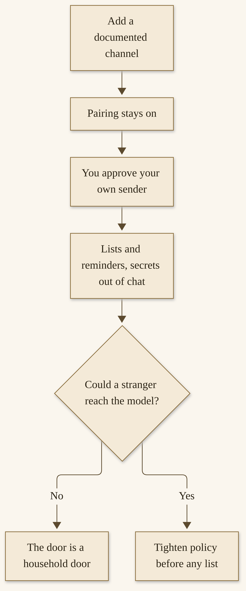{width=100%}

*I12c. A personal messaging door, in a picture. Pairing first, then a list, and a stranger never reaches the model.*

**How to stand up a personal reminder door**

1. Add the channel the official way, then probe it.

   ```bash
   openclaw channels add --channel telegram --token <bot-token>
   openclaw channels status --probe
   ```

   Run `openclaw channels add` with no flags to pick from a list instead.^186 Keep the token out of chat and out of the vault.
   You should see a probe that says the channel is reachable.
   If you don’t: start the Gateway, confirm the token, and follow that channel’s official troubleshooting, not a forum recipe.

2. Leave DM policy on `pairing`, or tighten it to `allowlist` with your own sender ID. Do not set `open`. Official policies, as Chapter 11 already walked: `pairing` is the default; `allowlist` blocks unknown senders without a handshake; `open` is a deliberate public opt-in and requires `"*"`; `disabled` ignores inbound DMs.^187
   You should be able to say, in a sentence, which policy is on, and that it is not `open`.
   If you don’t: look at the channel’s official access-control page and set it before you send a first message.

3. Approve your own pairing, yourself.

   ```bash
   openclaw pairing list telegram
   openclaw pairing approve telegram <CODE>
   ```

   That is the official CLI shape.^187 Approval grants DM access only, not group access. If you use a household group, allowlist that group, and usually put a mention gate on it, the way official access-control guidance describes.^187 A family group whose members you already trust is a different decision from a public group. Still decide it on purpose.
   You should see your sender approved, and an unapproved sender unable to reach the model.
   If you don’t: do not use the door for lists until pairing is real. Confirm with a second account, or with a sender who is not on the list, that the agent does not process the message.

4. Use the door for lists and reminders, in plain words. “Add milk and stamps to the household list, and write it in the wiki.” “Remind me Saturday morning to check the weekly plan.” Prefer a reminder that becomes an official automation, the way the next tutorial teaches, rather than a promise the model made in chat and did not save. After you ask, open the wiki page, or the automation, and look. A polite “I’ll remember that” is only a sentence, as Chapter 6 already said in its own way. The file is the fact.

   > **Caution.** Secrets stay out of chat. A paired channel is still a transcript. Do not paste passwords, account numbers, health details, or another person’s private life into a message to the agent.

**Never.** Never skip pairing. Never set a household DM policy to `open`. Never put secrets in chat. Never let a public group talk to a household agent. Never use this door as a medical, legal, or financial adviser. Never treat a chat promise as a saved reminder until you have opened the file or the job.

**How you know it worked.** An approved sender can add a list item and see it in the wiki. An unapproved sender cannot reach the model. A reminder you asked for exists as a job or a page you can open, not only as a sentence in chat. What still needs a yes is any new sender, any group, and any reminder that would message someone else.

A one-shot reminder is official, and it is often all you need. The automations CLI accepts `--at` with a duration such as `20m`, or with an ISO timestamp; offset-less timestamps use UTC unless you also pass `--tz`.^188 Natural language such as “in twenty minutes” is not a schedule the CLI will parse as a sentence; the duration flag is the path.

```bash
openclaw automations create --at 20m   "Remind me, in the household wiki and only there, to take the Saturday list off the counter and check it. Do not send a message to anyone else. If the list page does not exist, say so and do not invent one."   --name "Twenty-minute list check"   --session isolated   --no-deliver
```

`--at` makes a one-shot job. Officially, one-shot jobs delete after a successful completion, unless you pass `--keep-after-run`.^188 For a reminder, letting it complete and go is usually right. Watch the first one. Open the wiki, or the run history, and confirm it did what you asked and nothing else. If you later want that reminder on a paired door, announce only to an allowlisted destination you already tested, the way the weekly-list tutorial will walk more slowly.

If more than one person in a household will talk to the helper, write the allowlist as a list of people you can name, not as a convenience wildcard. Official group policy can be `open` in a private room whose members you already trust, and official access-control guidance says to decide by membership, not by channel type.^187 I would still start tighter: pairing or allowlist for DMs, an allowlisted group, a mention gate if the room is busy, and a named command owner. A household helper that answers every side conversation will train everyone to ignore it, and it will write more than you meant to keep.


## A weekly list or morning note that runs on a schedule

**Purpose.** Official automations plus a file in the wiki: a pickup list, a morning note, or a weekly plan a human still checks.

**Who it is for.** Anyone who wants Saturday’s list, or a weekday morning note, without inventing a grocery API or a booking automation. You already have a vault from the first tutorial, or from Chapter 4. You need one job, a schedule you chose, and delivery that stays inside a door you already trust — or stays internal until you have read three runs.

**Setup.** A running Gateway. The official automations CLI.^188 Chapter 8 and Chapter 11’s status digest already taught the shape. This is the personal version: isolated session, delivery off first, a prompt that writes to the wiki and does not send itself to the world.


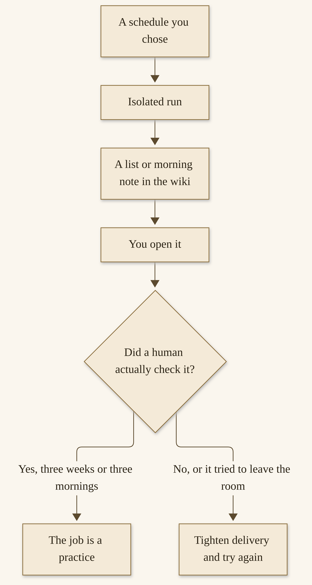{width=100%}

*I12d. A weekly list, in a picture. The job writes. You still check.*

**How to stand up a weekly list or morning note**

1. Confirm the Gateway is running, and that you can list automations.

   ```bash
   openclaw automations list
   ```

   `openclaw automations` and `openclaw cron` are the same family.^188
   You should see a list, empty or not, without a connection error.
   If you don’t: start the Gateway and try again.

2. Create an isolated job, with delivery off, in a timezone you actually live in. Natural-language schedules are not supported; use a cron expression and `--tz` with an IANA timezone.^188 I live in America/New_York. Use yours. For a Saturday morning list, `"0 9 * * 6"` is the official kind of expression. For a weekday morning note, `"0 7 * * 1-5"` is the same kind.

   ```bash
   openclaw automations create "0 9 * * 6" \
     "From the household wiki, write a short weekly list for this Saturday: things already on our pages, dated, without inventing items. Write it as a wiki synthesis. Do not send, publish, or delete anything. If there is nothing to list, reply with NO_REPLY." \
     --name "Saturday weekly list" \
     --session isolated \
     --no-deliver \
     --tz "America/New_York"
   ```

   Isolated `add` jobs default to `--announce`; `--no-deliver` keeps output internal.^188 Pass `--agent` if you have a household agent. The prompt should tell the job to write into the wiki and not to send. `--no-deliver` does not remove the agent’s `message` tool when a chat route is available, so the prompt still matters.^188 Do not invent a store API, a scrape, or a booking. A list from pages you already keep is enough.
   You should see a job id, and `openclaw automations show "Saturday weekly list"` should preview delivery off.
   If you don’t: confirm the cron expression is five fields, and that the Gateway is up.

3. Force a first run while you are watching.

   ```bash
   openclaw automations run <job-id> --wait --wait-timeout 10m
   openclaw automations runs <job-id> --limit 10
   openclaw wiki search "weekly list"
   ```

   Read the run, and open the wiki page. Edit the list. If it invented an item, tighten the prompt and the “never,” and run it again. A final that trims to uppercase `NO_REPLY` is official silence when there is nothing to say.^188
   You should see a completed run and a page or a quiet `NO_REPLY`.
   If you don’t: `openclaw automations runs <job-id> --status error`, then `openclaw doctor`.

4. Only after three runs you actually checked, consider announcing to the paired personal door from the previous tutorial, not to a group you have not allowlisted.

   ```bash
   openclaw automations edit <job-id> --announce --channel telegram --to "YOUR_ALLOWLISTED_DESTINATION"
   ```

   Official announce examples use a channel and a destination you supply.^188 The destination should be you, or a household room you already allowlisted. If the preview looks broader than that, go back to `--no-deliver`. `--delivery-target owner` is a reasonable personal pattern when the only reader should be you.^188

   > **Caution.** Do not store secrets in job scratch; official docs say scratch becomes model prompt context.^188 A household job is not a place for account numbers.

**Never.** Never start with a public announce. Never invent a grocery or booking API. Never skip the three runs you read yourself. Never let a morning note send itself to someone you did not name. Never put health details or a child’s full life into the prompt so the job can “be more helpful.”

**How you know it worked.** Three Saturdays, or three weekday mornings, three notes you opened, and a list you still recognized as yours. What still needs a yes is any announce, and any new kind of item the job starts adding on its own.


A morning note is the same job with a different schedule. Use `"0 7 * * 1-5"` for weekdays, a prompt that writes a short note from the wiki — today’s list, a page you were already mid-way through, nothing invented — and the same `--session isolated --no-deliver` until you have read three of them with coffee. I will not script a morning personality. The kindness is that the note is short, dated, and waiting, and that you can ignore it. A practice that nags is a practice you will turn off. A practice that waits is a practice you will still have in March.

If you want both a Saturday list and a weekday note, make two jobs. Official guidance is that each independently scheduled task belongs in its own job.^188 Two small jobs you can see are better than one prompt that tries to be both and is hard to debug when Saturday’s list goes sideways. Name them clearly. Disable one without disabling the other. That is already the seed of the fleet thinking in Chapter 13, at the size of a household.

## A second, narrower agent for a private practice


**Purpose.** Official `openclaw agents add`, with a privacy talk: a learner, a journal, or a hobby agent that does not share a vault with a household payments door, or with a work brief.

**Who it is for.** Anyone whose first agent has started to blur. A course of study wants a different “never” than a shared household list. A private journal wants a different room than a family calendar. You do not need a fleet of seven. You need a second job that is real, and a boundary you can say out loud.

**Setup.** A working Gateway. The official multi-agent page.^189 Chapter 8 already introduced more than one agent. This is the personal version, with privacy in the first sentence. Isolated workspace. One Gateway only if the trust boundary is the same — and a journal and a household payments door are a good reason to ask that question carefully. If the trust is not the same, they need separate Gateways, ideally separate OS users.^181

Cross-agent session access is on by default. Official session tools can, with default visibility, reach across agents on the same Gateway. Narrow that when personas should not read each other’s transcripts, the way official `tools.sessions.visibility` and `tools.agentToAgent` describe, and the way Chapter 14 will return to.^189,^190 I will not invent Michael’s shop config here. I will tell you the official default is generous, and that a private practice deserves a narrower setting, or a second Gateway.


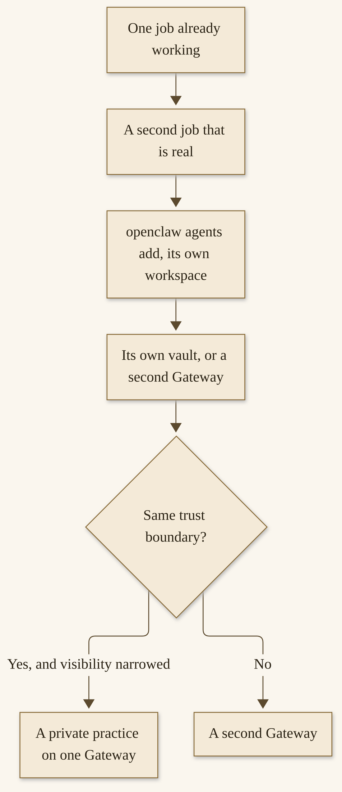{width=100%}

*I12e. A second agent, in a picture. A new job gets its own room. Trust decides whether the Gateway is shared.*

**How to add a narrower personal agent**

1. Name the job first, in a sentence you can write on a card. “This agent is for a course of reading.” “This agent is a private journal.” “This agent is for a hobby plan.” If you cannot name the job, do not add the agent yet. Chapter 13 will say the same thing at fleet size. It is already true at two.

2. Add the agent the official way.

   ```bash
   openclaw agents add study --workspace ~/.openclaw/workspace-study
   openclaw agents list --bindings
   ```

   Official flags include `--role`, `--workspace`, `--model`, `--agent-dir`, and `--bind`.^189 Never reuse `agentDir`; official docs say that causes auth and session state collisions.^189 Each agent gets its own workspace with `SOUL.md`, `AGENTS.md`, and optional `USER.md`, plus a dedicated session store.^189
   You should see the new agent in `openclaw agents list`, with its own workspace path.
   If you don’t: run `openclaw doctor`, and confirm you did not point `--agent-dir` at another agent’s directory.

3. Give it its own vault, or a clearly shared one you chose. For a private journal or a private course, set memory-wiki to agent scope, or point this agent at a path that is not the household vault, following Chapter 4’s official config.^184 In bridge mode, official docs also describe ownership filters; per-agent vaults are still not an OS boundary.^184 Write a “never” that belongs to this job: a journal never shares a vault with a payments door; a learner never holds another person’s secrets.
   You should be able to open this agent’s vault and not see the household payments list, if that is the rule you set.
   If you don’t: stop and finish the split before you write a first journal page.

4. Bind a door only if this agent needs one, and only a door that matches its privacy. A private journal may need no messaging channel at all, only the Control UI or a local chat. If you bind a channel, pair it, allowlist it, and do not share that door with a more public household agent without a decision. Official bindings route a channel account to one agent.^189
   You should be able to say who can talk to this agent, and who cannot.
   If you don’t: leave the door off until you can.

5. After you add the agent, look at session visibility. Official default `tools.sessions.visibility` is `all`, and `tools.agentToAgent` is on.^189,^190 For a private practice on the same Gateway, official narrower values include `agent`, `tree`, and `self`. Copy the current keys from the official sessions-and-subagents page, not from memory, and test with a question you would not want the other agent to be able to read back.^190 If that test fails, or if the two jobs should not share a host-level boundary, use a second Gateway.
   You should see that a household agent cannot pull a private journal transcript, under the settings you chose — or you should have two Gateways.
   If you don’t: this is not a privacy boundary yet. Tighten it before you write anything you would mind a housemate’s helper seeing.

**Never.** Never reuse `agentDir`. Never put a private journal and a household payments door on the same vault and call it good enough. Never assume a second agent is an OS wall. Never leave default cross-agent session visibility in place for a practice you called private, without looking. Never host a journal and an untrusted inbox on one Gateway. Never pretend this is medical, legal, or financial advice.

**How you know it worked.** Two agents, two jobs, two “nevers,” and a vault split you can demonstrate. A weekly look that still finds both. What still needs a yes is any shared door, any shared vault, and any later third agent.


I want to say a word about journals, because they are where privacy talk becomes concrete. A journal is a gift to a future self, and it is also a file on a disk. If you keep one, keep it on the narrower agent, in a vault the household list cannot search, with session visibility narrowed or with a second Gateway, and with a backup you store as carefully as the live state. Do not bind it to a group chat. Do not ask a household helper to “just glance.” Official defaults will let an unsandboxed agent on the same Gateway read transcripts it was not written for, unless you change those defaults.^189,^190 That is not a scare. It is a reason to finish step 5 before you write a first private page.

A learner — a course agent — is a milder split, and still worth it. The “never” is different: do not invent a citation, do not pretend a summary is a source, do not hold another student’s work. The household list can stay with the first agent. The course can have its own `SOUL.md`, its own weekly briefing, and its own lint. When the course ends, you can retire the agent, the way Chapter 14 will ask you to retire work you no longer need, and keep the vault as a finished notebook. Growth includes letting a second agent go.

## A hobby that runs on a schedule


**Purpose.** A weekly briefing that stays inside official tools: a reading list, a practice plan, a walk — official automations plus the wiki. No unofficial scrape. No invented booking automation.

**Who it is for.** Anyone who has a practice they already care about and would like a gentle weekly companion: what we read, what we might read next, a plan for the week’s practice, a reminder to take a walk. The companion writes. You still choose. You do not need a new skill from a catalog for this. Official cron, official wiki, and a prompt you wrote are enough.

**Setup.** A working Gateway, a wiki from the first tutorial — a learning vault is a natural home for this — and the official automations path.^188 If you added a narrower study agent in the previous tutorial, this job can belong to that agent. Isolated session, delivery off first, same as the Saturday list.

I will not invent a concert scraper, a reservation bot, or a workout vendor. If a hobby needs a tool the official docs do not support, this tutorial does not invent one. A weekly page you read on Sunday is a complete practice.


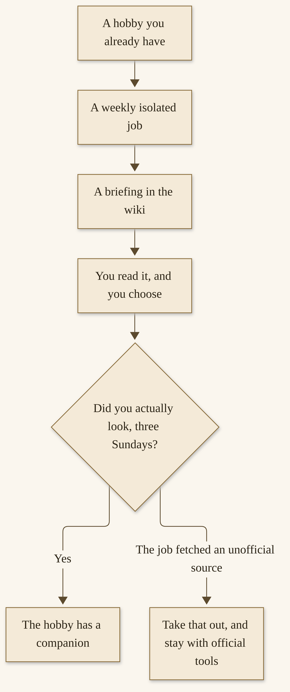{width=100%}

*I12f. A hobby on a schedule, in a picture. A weekly page, official tools only, and you still choose.*

**How to stand up a weekly hobby briefing**

1. Write, in the hobby agent’s `AGENTS.md` or in a wiki page, what the briefing is for and what it may use. Sample wording, clearly a sample:

   > Sample. Once a week, draft a short briefing from pages already in this vault: what we finished, what is still open, a suggested plan for the next week. Use only sources already in the wiki or that I give you as local files. Do not scrape the web for events or prices. Do not book anything. Do not send anything. I will read this on Sunday and decide.

   You should see that note in a file you can open.
   If you don’t: write it yourself before you create the job.

2. Create the weekly job, isolated, with delivery off.

   ```bash
   openclaw automations create "0 10 * * 0" \
     "From the study wiki, write a short weekly briefing: what we finished, what is open, a suggested plan for the coming week. Date every claim. Use only wiki pages and local sources already ingested. Do not scrape. Do not book. Do not send. If there is nothing to say, reply with NO_REPLY." \
     --name "Sunday hobby brief" \
     --session isolated \
     --no-deliver \
     --tz "America/New_York" \
     --agent study
   ```

   Adjust the agent id and the timezone. `"0 10 * * 0"` is a Sunday morning, in ordinary five-field cron. The `--agent` flag pins the job to the study agent so ownership does not fall through.^188
   You should see a job id and a delivery preview that is off.
   If you don’t: confirm the agent id exists in `openclaw agents list`, and that the cron expression is valid.

3. Run it once while you watch, then open the wiki.

   ```bash
   openclaw automations run <job-id> --wait --wait-timeout 10m
   openclaw wiki search "weekly briefing"
   openclaw wiki lint
   ```

   Edit the briefing. If it invented a source, or reached for a site you did not give it, tighten the standing note and the prompt. Lint after meaningful updates, the way Chapter 4 taught.^184
   You should see a short page you would be willing to take on a Sunday walk, after you have edited it.
   If you don’t: keep the job on `--no-deliver` and stay with sources you already ingested, until the page is yours.

4. After three Sundays you actually read, you may announce to your paired personal door, the same way as the weekly list. The briefing is still a draft. A booking, a purchase, a message to another person — those still need your yes. If the hobby would be happier as a page you open, leave delivery off. That is a complete success.

**Never.** Never scrape an unofficial source “to make the brief richer.” Never invent a booking or a ticket purchase. Never let a hobby job spend, send, or publish. Never put someone else’s private practice into this vault. Never treat a suggested plan as a medical or training prescription. It is a note. You still choose.

**How you know it worked.** Three Sundays, three briefings you opened, no send and no scrape, and a plan you still recognized as optional. What still needs a yes is any announce, and any later skill you might be tempted to add to “enrich” the hobby. If you add a skill, use Chapter 11’s review ritual. A hobby Gateway is still a Gateway.

Two prompt shapes, if you want them, still stay inside official tools. A reading-list brief asks only for pages already in the vault: what we finished, a sentence of what it was, what is open, one suggested next page from the list you already ingested — and a clear instruction not to recommend a title that is not on that list. A practice-plan or a walk brief is even smaller: a weekly note that you had planned a walk, or a practice session, and a question, waiting on the Sunday page, about whether you actually went. It does not track a body. It does not prescribe a training load. It does not congratulate or scold. It is a page. If that sounds almost too modest, it is working. The hobby is yours. The agent is a clerk with a good memory, and only for what you asked it to remember.

I have found it useful, when a hobby brief starts to feel like homework, to cut it in half. A shorter page you read is better than a thorough page you postpone. Official automations will keep running whether you read them or not, which is exactly why the “how you know it worked” test is three Sundays you actually opened, not three Sundays the job did not error. A job you no longer open is a job Chapter 14 will invite you to retire. That invitation is a kindness. You can take it early.


## Voice or a node, if the current docs support them

**Purpose.** A kitchen-counter node, or Talk Mode, only along official paths, dated 12 November 2026. A node is not the brain. The Gateway is.

**Who it is for.** Anyone who would like to speak a reminder in the kitchen, or take a walk-and-talk, and who is willing to follow the official node and Talk pages rather than a remembered blog post. If you do not want voice, you can skip this tutorial completely. A household wiki and a Saturday list are already a practice.

**Setup.** A working Gateway on a machine you control — a laptop, a MiniPC, any host the official install supports. The official Talk Mode page, the official iOS page, and the official Android page, all re-opened on 12 November 2026.^191,^192,^193 Official node pairing, on the same pairing page that covers DM pairing: node pairing is how a device is allowed to join the Gateway network.^187 I will point you at those pages for the current install and pair steps, rather than invent a flag that may have moved.

As of 12 November 2026, those official paths are still there. Talk Mode covers native speech recognition with Gateway chat and `talk.speak` on macOS, iOS, and Android; iOS and Android still document Voice Wake and Talk on their platform pages.^191,^192,^193 If a path has moved by the time you read this, say so to yourself, kindly, and follow the current page. That is the honest how-to.


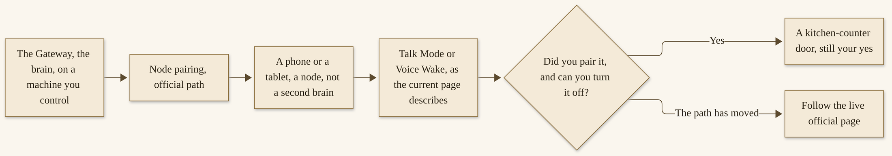{width=100%}

*I12g. A node, in a picture. The Gateway is the brain. The device is a door. Pairing still sits in front.*

**How to try Talk Mode or a node, along official paths**

1. Read the current official page before you install anything. Start with Talk Mode, https://docs.openclaw.ai/nodes/talk, and with the platform page that matches the device — iOS at https://docs.openclaw.ai/platforms/ios, Android at https://docs.openclaw.ai/platforms/android.^191,^192,^193 If your device is a Mac, the Talk Mode page also describes native macOS Talk. If the page you open no longer describes the path I named, trust the page. This tutorial will not invent a replacement.

2. Keep the Gateway as the source of truth. Official docs treat the Gateway as the process that owns sessions, routing, and channels; a node is a connected device with capabilities such as Talk, and, on iOS, official pages also name screen snapshot, camera, location, Voice Wake, and opt-in Health summaries.^192 I want to pause on that last item.

   > **Caution.** Opt-in Health summaries, if the current iOS page still offers them, are not an invitation to put health details in a household vault. This book does not teach a health integration, and it does not give medical advice. If a capability would write a body or a child’s life into a transcript, leave it off unless you have a reason you can defend, and a vault that is not a shared household list.

3. Pair the node the official way. The pairing page treats node pairing as a second use of pairing: which devices are allowed to join the Gateway network.^187 Follow the current steps on that page and on the platform page. I will not invent a CLI flag for a pairing flow I have not copied from a re-opened command reference. Approval is yours. An unpaired device should not join.
   You should see the node listed as paired, or the official UI’s equivalent, and you should know how to unpair it.
   If you don’t: leave Talk off, and stay with the messaging door you already trust. A node you cannot unpair is not a kitchen-counter convenience.

4. Turn on Talk Mode or Voice Wake only as the current platform page describes. On iOS, as of 12 November 2026, Voice Wake and Talk Mode are on the Dashboard’s Settings → Talk page; Voice Wake sends recognized commands to the active session, and Talk Mode is for spoken assistant replies; iOS may suspend background audio, and official docs ask you to treat voice features as best-effort when the app is not active.^192 On Android, as of the same day, the composer microphone is dictation; a Talk button starts continuous Talk; Voice Wake is under Settings → Voice, and Android advertises it only when enabled, with recognition and microphone permission available.^193 Microphone permission is required. Official Talk Mode also describes several realtime shapes — including Gateway-relay paths and, on some iOS configurations, a client-owned WebRTC path for certain OpenAI setups.^191 Follow the current page for the shape your Gateway and your model actually support. Do not invent a provider recipe.
   You should be able to speak a short list item, see it land in a session or a wiki page, and stop Talk when you are done.
   If you don’t: turn it off, and use the typed door. That is not a failure of the practice.

5. Give voice the same “never” you gave chat. A kitchen-counter node can be overheard. Do not dictate secrets, health details, or another person’s private life. A spoken send, spend, or publish still needs a yes you would be willing to give in a quiet room. If Voice Wake can fire when you did not mean it to, official pages are the place to learn how to disable it; I will not invent that off-switch. Find it before you leave the node running in a shared room.

**Never.** Never treat a node as a second brain. Never skip node pairing. Never leave a voice door on in a room where a stranger, or a child, can talk to it without your judgment. Never dictate secrets. Never use Talk Mode for medical, legal, or financial advice. Never invent a pairing or Talk flag this book did not copy from a current official page. If the path has moved, follow the live page.

**How you know it worked.** You paired a device along an official path that still existed on 12 November 2026, or you followed a newer official page that replaced it. You spoke a short, harmless list item, saw it land, and stopped. You know how to unpair and how to turn Voice Wake off. What still needs a yes is any capability — camera, location, health summaries — the platform page offers, and any room in which the node is left listening.

I want to be honest about what this tutorial is not. It is not a full device-setup manual. Official iOS and Android pages are long, and they move, and they cover attachments, voice notes, permissions, and background behavior I have not tried to reprint.^192,^193 A kitchen-counter node is a real delight when it works, and it is also a microphone in a shared room. If you try it this month, try it with a short, harmless sentence, in a room where you are comfortable being overheard, and with an off-switch you have already found. If you would rather not, the rest of this shelf does not depend on it. I would rather you had a wiki you trust and no node, than a node you left listening and a vault you had not thought through.

The same honesty applies to camera and screen capabilities an official node page may advertise.^192 Those are powerful doors. They are not part of a first household weekend. If you ever enable one, do it from the current official page, with pairing in place, and with a “never” that includes other people’s faces, other people’s screens, and any child in the room. This book will not walk a camera how-to. The Gateway remains the brain. The node remains a door. You remain the one who says yes.


## Judgment stays with you

If you have a weekend and are wondering where to put it, here is a path that stays small. Saturday morning: enable the wiki, if you have not, write the “never,” ingest one list or one syllabus, lint, and open the page. Saturday afternoon: add a paired door, approve only yourself, and send one harmless list item that you then find in the vault. Saturday evening: a backup, the official `openclaw backup create --verify`. Sunday morning: create the weekly job with delivery off, force a run, and read it. Leave Voice, a second agent, and a hobby brief for a later weekend, unless a private journal is the reason you opened this chapter, in which case add the second agent before you write a first private page, and narrow session visibility before that page exists. That is a complete weekend. It is enough.

I have given you a shelf, not a household policy. The six tutorials are enough to start: a vault with a written “never,” a paired door for lists, a weekly note you still check, a second agent when a private practice needs its own room, a hobby briefing that stays inside official tools, and a node only if the current docs still support the path and you still want it. You can live a long time on the first three. The later ones are optional, the way a fleet in the next part is optional.

Do not automate a child’s life without a parent’s judgment. A reminder to pack a bag is one thing. A system that watches a child, or writes a child’s full life into a vault, is another, and this book will not help you build it. Do not give medical, legal, or financial advice to yourself through an agent and call it a plan. The agent can draft a list. You still decide.

You still say yes. That sentence has walked with us from the first setup, through a work shelf and a home shelf, and it will walk into the fleet chapter and the safety chapter that follow. A practice that lasts is a practice that keeps that yes in a human’s hands.


I also want to leave you a small permission. You can take this shelf slowly. A vault and a Saturday list, for a month, is a beautiful practice. A second agent, when a journal or a course actually needs one, is a beautiful practice. A node in the kitchen, if you want it and the official path still holds, is a convenience, not a promotion. There is no badge for having all six running by Sunday. There is a quiet gladness in a page you can still open in a year, and in a “never” you still mean.

If a household shares the first agent, write down who may say yes. Official group chats and pairing already force a version of this question: who is on the allowlist, who is a command owner, who can approve a dangerous prompt.^187 A “we all own it” helper is a helper no one reviews. One named person, even in a house of two, is kinder than an assumed consensus.

When you are ready, Part 6 is a fleet
 — official patterns first, then a worked example of seven named agents, responsible for SMF WisdomForge, running on a machine I will describe only as far as I can stand behind — and then a practice that lasts: safety, privacy, a quarterly review, and work you can retire. You do not have to be ready this weekend. The wiki you started is already a practice.

If you take only one sentence from this shelf, take this one, which is the same sentence as the professional shelf, in a household voice. Write down what the vault is for, write down what it is never for, and open the page after the agent writes. A list you checked is a practice. A list you trusted because the job did not error is only a job. The difference is a few minutes, and it is the difference I care about most. The next two chapters will talk about a fleet, and about safety, money, and a quarterly review. They will assume you still open the page. They will assume you still say yes. That assumption is a compliment. It is also a request.

I am glad you are here, on the personal side of the work, with the same care you would give a professional desk. A household is not a smaller office. It is a different kind of trust. The tools are official and the same. The “never” is stricter, and it should be. When you are ready for a fleet, you will already know how to give an agent one job, one room, and a sentence it must not cross. That is the whole art, at any size.

One last practical kindness, and then I will let you go to the fleet chapter. If this weekend produces only a vault, a “never,” and a backup you can name, you have done the work this shelf exists to start. The paired door, the Saturday job, the second agent, the hobby brief, and the node will wait. They keep better when the vault they write into is already a place you trust. I would rather you paused here, pleased with a single honest page, than rushed a fleet of household jobs you will not open on Sunday. Make it yours, at the size of a list, and grow only when a second job is real. That is the title’s promise, at home: not a larger catalog, and not a smarter model, but a practice you will still be glad you started, with a human who still looks, and a yes you have not given away. I will meet you in the next chapter at whatever size you bring — one agent, or two, or the first sketch of a fleet — and we will keep that yes in the same place.


# Part 6 — A Fleet, and a Practice That Lasts
# Chapter 13
## A Fleet: Agents, Gateways, and the WisdomForge Shop


{width=100%}

*I13. Several desks in one small workshop, a compact quiet computer at the edge.*


One agent and a wiki are already a practice. I have spent most of this book trying to make that feel true, because it is true. A fleet is what you grow when one job each is clearer than one agent with twenty jobs. You are still the one who says yes.

This chapter is optional. If you finished Chapters 11 and 12 with one careful agent and a notebook you trust, you are not behind. You can stay there for a year. I run seven OpenClaw agents, and I will tell you about that as a worked example, in the words I can stand behind: their names, their roles, how the work moves, the machine they share, the model they use, and what they are responsible for. I will not invent outputs, volumes, or a story I was not given. The point of the example is a rule you can copy on paper: one job each, one owner, a “never” per agent, and a human who still says yes.

## A fleet is grown, not bought

I did not buy a fleet. I grew one, the way this book’s title asks you to grow a practice: a first setup, a wiki, a job I was willing to watch, then another job that did not fit the first agent’s day, then a door, then a schedule, then — only then — more than one named agent that I could still see.

A fleet is not a product tier. There is no official paid OpenClaw Cloud that hands you a roster.^195 Officially, OpenClaw gives you agents — each with its own workspace, its own state directory, its own session history — and a Gateway that can serve more than one of them, and bindings that route a door to the right agent.^196 Those are the pieces. The practice is how you arrange them, and how you refuse to arrange them.

A fleet you cannot see is a fleet you cannot trust. We will come back to `openclaw agents list`, to logs, and to a weekly pass. First, the official patterns, so the worked example has a floor. Then the seven agents, in the words I locked with myself for this book. Then a paper sketch that is yours, not mine.

If you take only one sentence from this chapter, take this one. Start with two, not seven. Add a third when a job is real. A fleet of two that you can see is a better practice than a fleet of seven you describe and do not review on Sunday.

A “job is real” is a quieter test than it sounds. It is not a name you like, and it is not a role you saw in someone else’s shop. It is a piece of work that already happens, on a rhythm you can name, that does not fit the first agent’s day without blurring the first agent’s “never.” If you cannot say, in one sentence, what the second agent does that the first must not do, you are not ready for a second agent. You are ready for a better first page.

The temptation, once you have seen a roster like mine, is to copy the count. I understand the temptation. Seven named agents looks like a finished practice. It is not. It is a practice that grew because the work had already grown, and because I was willing to keep looking at it. If your work is still one desk — a vault, a weekly list, a morning note — Chapter 12 is still your chapter. This one will be here when a second job arrives.

“Fleet,” in this book, is a practice word, not a product word. It means more than one agent, on a Gateway or Gateways you can still see, with jobs and “nevers” you can still name, and a human who still says yes. It does not mean a purchased cluster. It does not mean an official headcount. It does not mean you have arrived. A fleet of two is a fleet. A fleet of seven that has not been listed this week is a rumor.

Growing also means retiring. If a job goes away, the agent that held it should go away, or be given a smaller, still-real job you are willing to watch. Chapter 14 will give retiring a quarterly slot. I mention it here so you do not treat every new agent as permanent. Permanence is for the vault and for the skills you kept, not for a roster that has outgrown its Sunday.


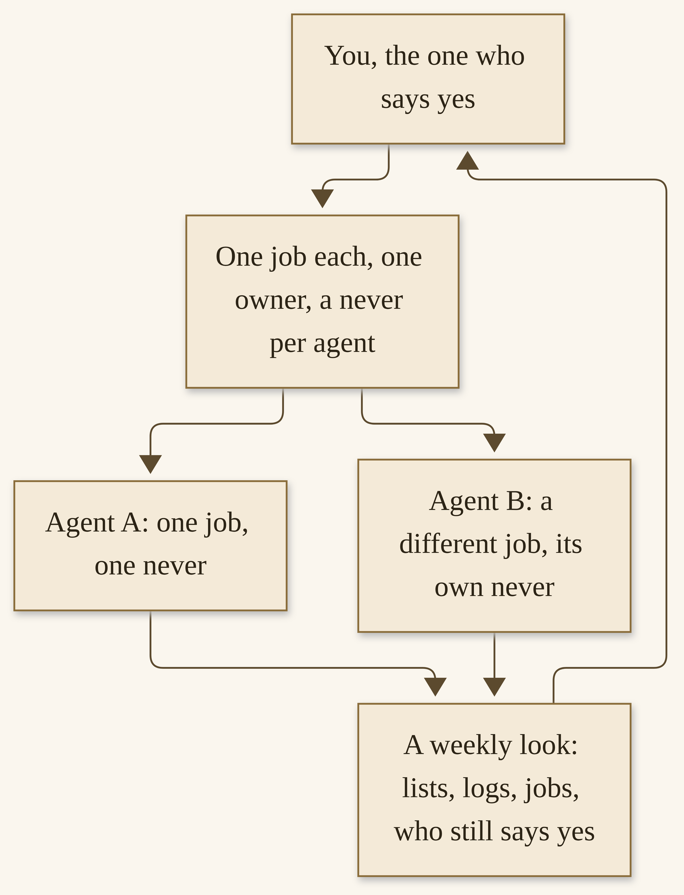{width=100%}

*I13. The copyable rule, in a picture. You sit at the yes. Each agent has one job and a “never.” A weekly look comes back to you.*

## Official patterns: agents, bindings, one trust boundary

Before I show you my shop, I want you to have the official floor, because a worked example is not a product specification. The commands below are from the official multi-agent and security pages, as they stood on 12 November 2026.^196,^197 If a live page has moved, trust the live page.

**How to add an isolated agent, officially**

1. Add the agent with a workspace of its own.

   ```bash
   openclaw agents add work --workspace ~/.openclaw/workspace-work
   ```

   Official flags include `--role`, `--workspace`, `--model`, `--agent-dir`, and `--bind`.^196 `--non-interactive` requires `--workspace` unless a role is supplied. Each agent gets its own workspace with `SOUL.md`, `AGENTS.md`, and optional `USER.md`, plus a dedicated `agentDir` and session store.^196
   You should see the new agent in the next step’s list.
   If you don’t: run `openclaw doctor`, and confirm the workspace path exists.

2. Never reuse `agentDir`. Official docs are blunt: reusing it causes auth and session state collisions.^196 If you pass `--agent-dir`, give it a path that belongs to this agent alone.

3. Add bindings to route inbound messages, if this agent has a door. The wizard offers to do this for you. Then verify:

   ```bash
   openclaw agents list --bindings
   openclaw gateway restart
   openclaw channels status --probe
   ```

   In the Control UI, Agents at `/agents` shows the roster; Manage agents is at `/settings/agents`.^196
   You should see each agent, its workspace, and, if you bound a door, the binding.
   If you don’t: `openclaw doctor --fix` can materialize some legacy routing, as the official page describes; follow that page, and do not invent a binding I did not print.^196

4. Decide isolated versus shared workspaces on purpose. The default is an isolated workspace per agent. A shared workspace is a decision, not a convenience. Plugin-owned storage does not automatically split when you add a second agent; for the wiki, configure per-agent vaults when personas must not share compiled knowledge, and remember that per-agent scope is not an OS boundary.^196,^198

The official team preset is a related, clearly distinct pattern. It is not my shop, and I will not pretend it is.

```bash
openclaw agents team create --non-interactive
```

The preset creates a chief of staff (`coordinator`), a researcher, a writer, and a reviewer, each with its own workspace and a completed identity. The chief of staff remains the human’s point of contact. Specialists return artifacts to the coordinator without delegating further. Role instructions require human approval before external sends, publication, purchases, deletion, or production changes.^196 You can pass `--prefix`, `--coordinator`, and `--workspace-root`. I mention the preset because its approval spirit is the same spirit I want in any fleet, including mine: Parker, in a moment, does not publish without a human yes. The preset is a way to start a four-person team with written roles. It is not a requirement, and it is not a description of the seven agents I actually run.

One Gateway is one trust boundary. Official security guidance is the same sentence this book has been repeating: a single operator, or a team whose members already trust each other. Mixed-trust or adversarial users need separate Gateways, ideally separate OS users or hosts.^197 A household list and a private journal, as Chapter 12 said, may share a Gateway if you narrow visibility and mean it. A public inbox and a private vault should not.

Cross-agent session access is on by default. I want that said plainly in a fleet chapter, because a second agent is easy to add and easy to misunderstand. Officially, `tools.sessions.visibility` defaults to `all`, and `tools.agentToAgent` is on, so an unsandboxed agent can list, read, search, and message other agents’ sessions on the same Gateway.^196,^199 Narrow visibility to `agent`, `tree`, or `self`; restrict pairs with `tools.agentToAgent.allow`; or set `tools.agentToAgent.enabled: false`. Requester-owned child sessions have documented exceptions under `tree` or `all`. For strict separation, use separate Gateways.^196,^199 On 11 November 2026 I wrote publicly about closing a transcript door with two config keys, in an article titled “My Agents Could Read Each Other’s Transcripts. Two Config Keys Closed That Door in Ten Minutes.”^200 The how-to in this book is the official page, not a remembered quotation of those keys. Re-open that article and the official sessions page together if you want my public “why” beside the current flags. Copy the flags from the official page in front of you.

A fleet you cannot see is a fleet you cannot trust. Official status and list commands, Gateway logs (`openclaw logs`), automation run history, and a weekly review — agents, jobs, skills, who still says yes — are how you see it. Chapter 8 already taught you to look at scheduled work. Chapter 14 will give that look a quarterly shape. Between them, a Sunday pass is enough.

The official list is the first look, and it is a short command:

```bash
openclaw agents list
openclaw agents list --bindings
openclaw agents list --tree
```

You should see every agent you think you have, with workspaces and, if you bound doors, the bindings.^196
If you don’t: an agent you remember adding and cannot find is a reason to stop adding more, not a reason to add again under a new name. Run `openclaw doctor`. Look at the workspace paths. Do not create a second copy of an agent whose first copy is only misplaced.

The weekly pass is not a ceremony. It is a list you can finish. Who is on the roster. What each one’s job is, in a sentence. What each one’s “never” is, in a sentence. Which doors are open. Which automations ran, and whether any of them should be retired. Who still says yes, including at publish. If that list takes more than a sitting you will actually keep, the fleet is too large. Cut it until the sitting fits the week.

The official team preset, again, is a start, not a destination. Four roles, written approvals, a coordinator as your point of contact: that is a clean first team if your work already looks like research, writing, and review.^196 You can live on that preset for a long time. You can also grow one agent at a time with `openclaw agents add`, and never use the preset at all. Both are official. Neither is my seven. Choose the smaller official path that matches work you already have.

> **Caution.** A second agent is a separate notebook, not a security wall against a determined process on the same machine. Official sandboxing, approvals, and, when needed, a second Gateway still matter. Do not treat “I added an agent” as a reason to store a secret you would not store in the first.

## A worked example: seven agents

I run seven OpenClaw agents. I will name them, with the roles I have given them, and I will stop there. I will not invent personalities, prompts, configs, or extra duties. The spelling is Carol, and that spelling is the one I want used.

- **Carol** is the fleet coordinator, and she syncs with Charlie, my Grok Bot chief of staff.
- **Rachel** reviews and finalizes all work by the fleet.
- **Vai** is the validator of all work, and does the fact-checking.
- **Randal** does all content research.
- **Wesley** does all content writing.
- **Parker** publishes all work for the team.
- **OC** maintains the OpenClaw environment and agent health.

That is the roster.^201 It is not a Hermes roster, and I will not fold Hermes names into it. As of an article I published on 11 November 2026, Aiona, Liam, and Nemo are Hermes agents.^202 They are not current OpenClaw agents, and they are not part of this seven. A count of Hermes agents from a sister gift is not an OpenClaw headcount.

I will not walk you through anyone’s private vault, and I will not dump a `SOUL.md`. The next sections are about how the work moves, who coordinates, who keeps the environment well, the machine they share, the model they use, and what they are responsible for — still only as far as I can stand behind.

I am showing you a shop, not a product tour. A shop, in the sense I mean it, is a set of named jobs, a path the work takes, and a human who still owns the yes. The names above are mine. The jobs are mine. If you copy the names without the jobs, you will have a costume. If you copy the jobs onto agents you cannot yet review, you will have a costume with a schedule. Copy the pattern of one job, one never, and a yes at publish. Leave my names on this page.

I also want the boundary with Hermes to stay sharp, because I have written about both, and because some of the same life sits behind both gifts. Hermes has its own fleet, in its own book. OpenClaw has these seven. A name that belongs to Hermes as of 11 November 2026 is not borrowed back into this roster.^202 I will not tell a migration story. I will not reuse a Hermes headcount. If you have read both gifts, you already know they share a host machine, and you already know they do not share this roster.

Seven is a number that grew. It is not a target. I will say that again at the paper sketch, because it is the sentence a first-time reader is most likely to skip. If your shop, a year from now, has three agents you can still see, you have not failed to reach seven. You have kept a practice.

## The pipeline: research, write, validate, review, publish

Work moves in a line I can describe in one breath. Randal researches. Wesley writes. Vai validates, including the fact-checking. Rachel reviews and finalizes. Parker publishes.^201 That order is a copyable pattern. It is my shop. It is not an official OpenClaw feature, and it is not undocumented magic. You could sketch the same sequence on paper with different names, or with two steps instead of five, and OpenClaw would not mind. The product gives you agents, workspaces, and approvals. The pipeline is a practice I laid on top.

Approvals still apply. Parker does not publish without a human yes. That is this book’s standing rule, and it is the spirit of the official team preset, which requires human approval before external sends, publication, purchases, deletion, or production changes.^196 I am distinguishing those two sources on purpose. The preset is official. The pipeline is mine. The yes is both.

I will not invent the queues between them, or a file layout, or a webhook payload that hands a draft from Wesley to Vai. If you adapt the pattern, write the handoff as a page in a wiki, or as a workspace file the next agent is asked to read, or as a message you still see. Make the handoff visible. A pipeline you cannot see is only a hope.


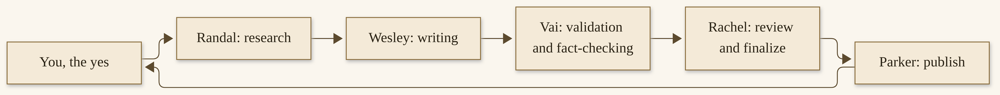{width=100%}

*I13b. The content path, in a picture. Five jobs, in order, and a human still sits at the publish.*

A pattern like this is useful because each “never” can be specific. Randal never invents a source. Wesley never publishes. Vai never waves a claim that cannot be opened. Rachel never finalizes a draft she has not read. Parker never publishes without a yes. Those sentences are teaching, at the level of the roles I have already given you. They are not a dump of anyone’s prompt. You can write your own “nevers” for your own names.

If a step looks optional on a tired evening — skipping Vai, or letting Parker go because the draft “looks fine” — that is the evening the pipeline exists to slow you down. A five-step line is not slower than a mistake you then have to unwind in public. The slowness is the point.

You can adapt the line without breaking it. Two steps — research and write — may be enough for a private note that will not leave the house. Three steps — write, review, publish — may be enough for a short public page, if the review is real and the publish still waits for a yes. Five steps is what this shop uses for work that is going out as educational content, under a name I am willing to stand behind. The number of steps should match the cost of being wrong, not the number of agents you wish you had.

I will not describe a ticket system. I will not invent a folder tree. I will not pretend OpenClaw has a built-in “pipeline” object you configure once and forget. If Wesley finishes a draft, the next honest thing is a page, or a file, or a message that Vai can open, and that you can still open if you walk in at mid-day. Visibility is the handoff. If the handoff only exists in a chat that will be compacted, it is not a handoff. It is a hope with a timestamp.

Rachel’s “finalizes” is a human-shaped word, and I want to keep it that way. Final, in this shop, means a reviewer has read the work and is willing to let it go to Parker. It does not mean an agent has stamped a file. Parker’s “publishes” is similarly plain. Publish is a door to the outside. Doors to the outside wait for a yes. That is true if your outside is a website, a channel, a class, or a single email. The medium is yours. The yes is not optional.

Vai’s fact-checking, in the same spirit, is only as good as the sources the work can still open. A validator who cannot open a claim is not validating. Chapter 11 already taught a research desk that puts sources in a vault. A fleet inherits that discipline. Randal’s research should leave a trail Wesley can use and Vai can check. If the trail is only in a session, it will be gone when you need it. Put it on a page.

## Carol coordinates; Charlie, at *Hand It Off* level; OC on upkeep

Carol is the fleet coordinator.^201 In a shop this size, that means what it sounds like: she is the one who keeps the work moving among the others, and she is the one who stays in sync with the rest of my life. I will not invent her calendar, her prompts, or a dashboard I have not shown you.

Carol syncs with Charlie, my Grok Bot chief of staff.^201 I have already written about Charlie, at more length, in a sister gift, *Hand It Off*. I will mention him here at that same level, and I will stop. He is a Grok Bot. He is my chief of staff. He syncs with Carol. I will not invent a CLI command, a request body, or a second Grok Bot book to explain the sync. If you want Charlie at full size, that gift is already given. This book stays with OpenClaw.

OC maintains the OpenClaw environment and agent health.^201 That is the role, and I will not invent a monitoring stack or a doctor-script I have not been given. Official tools you already have — `openclaw doctor`, `openclaw security audit`, `openclaw wiki doctor`, `openclaw automations list`, `openclaw gateway status`, `openclaw update` — are the kind of health checks a human, or an agent whose job is upkeep, can be asked to run and to report. The report still comes to a human. OC’s job does not replace your weekly look. It makes the look easier to keep.


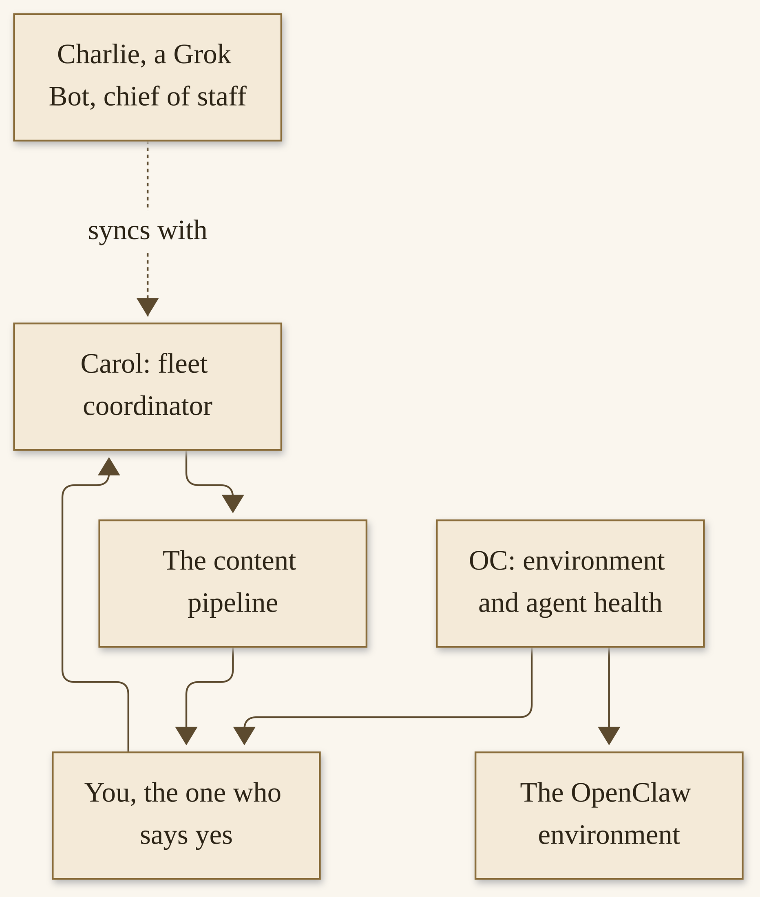{width=100%}

*I13c. Coordination and upkeep, in a picture. Carol coordinates and syncs with Charlie. OC keeps the environment well. You still say yes.*

The official team preset’s coordinator is a useful comparison, and only a comparison. That coordinator is a chief of staff inside OpenClaw, created by `agents team create`, and is the human’s point of contact for that preset’s four roles.^196 Carol is my coordinator, in a seven-agent shop I grew, and her sync with Charlie crosses to a different platform. I will not collapse those two pictures. If you start with the official preset, you will have a coordinator, a researcher, a writer, and a reviewer, with approvals on the way out. If you later grow toward a shop like mine, you will be adding a publisher, an upkeep agent, and a coordination practice that fits your life — still with a human at the yes.

## The machine they share, and Grok 4.7

The seven OpenClaw agents run on the same machine as the Hermes fleet: a MinisForum MiniPC, with an AMD Ryzen 7 and 32 GB of memory, running Omarchy Linux.^203 I do not remember a more specific model number, and I will not invent a SKU. This machine is a MiniPC. It is not a laptop. I will not describe other hardware from a sister gift as if it belonged to OpenClaw. A Spark-class box is not a requirement for you. A modest machine you control is enough to start, and enough, as this shop shows, to run a fleet, when the fleet is a practice and not a number.

The seven agents use Grok 4.7 as their LLM.^204 That is a confirmation about my fleet, given for this book. It is not a requirement that you use the same model. Official OpenClaw setup for that model, when I am teaching a reader how to select it, uses the official model id `xai/grok-4.7`, from the official xAI provider page, re-opened on 12 November 2026.^205 OpenClaw ships a bundled `xai` provider for Grok models. The recommended path on that page is Grok OAuth, with an API-key path also documented. I will not invent which of those two I use. The official commands, for a reader who wants that model, are:

```bash
openclaw models auth login --provider xai --method oauth
```

or, for the API-key path:

```bash
openclaw models auth login --provider xai --method api-key
```

and, to select the model, especially if a primary is already set and should be changed:

```bash
openclaw models set xai/grok-4.7
```

As of that page, on 12 November 2026, `xai/grok-4.7` is also the official curated xAI default.^205 I am dating that fact and keeping it distinct from my confirmation about the fleet. Defaults move. My confirmation is about what the seven agents run. If you already use another model that you trust, you do not need to switch it to match a shop you are only reading about. Chapter 3, if you came through Part 2, already walked a first model setup. This section exists so the fleet’s engine is named honestly, and so a reader who wants this engine has an official page to follow.

Gateway, config, routing, and tools stay local; only Grok requests go to xAI’s API, as that official page describes.^205 A hosted model provider will send bills. I will be honest about money in Chapter 14, without inventing figures. Check a dashboard. I will not print an SMF Works spend.

Omarchy Linux is the operating system on that MiniPC. Official OpenClaw docs include a platforms page for Omarchy; as of research for this book, that page describes a bar plugin for Omarchy 4’s Quickshell, and it does not itself install or start a Gateway.^206 You still install and run a Gateway by the usual official paths. I mention that so no one treats my shop’s OS as a special OpenClaw edition. It is the OS I run. The Gateway is the ordinary Gateway.


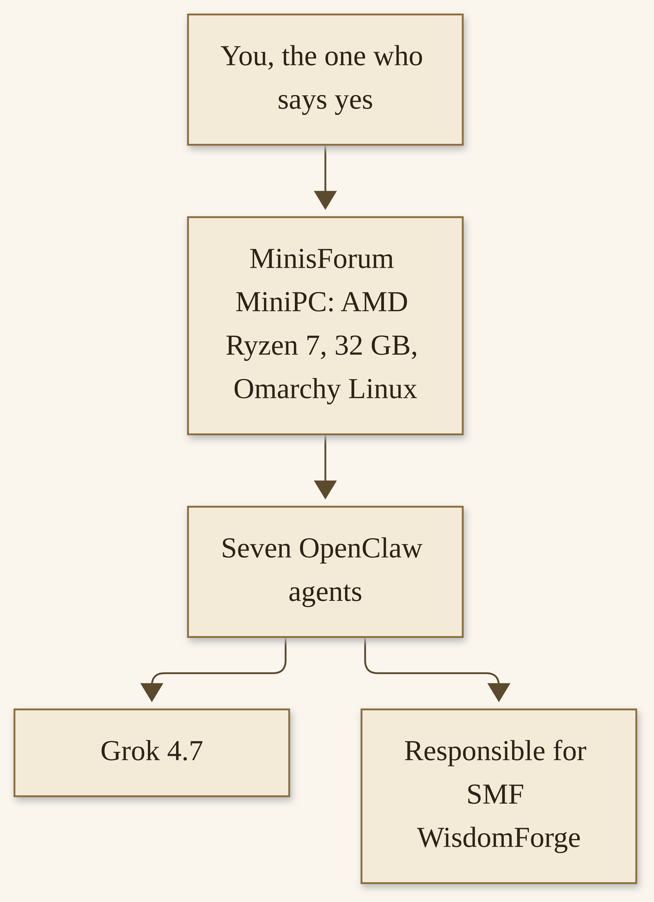{width=100%}

*I13d. The locked host and model, in a picture. The MiniPC is a shared host with the Hermes fleet. The model is Grok 4.7. A Spark-class box is not a requirement for the reader.*

## Responsible for WisdomForge, and a wiki from official docs

The OpenClaw fleet is responsible for SMF WisdomForge.^207 That is the sentence, and I will stop there. I will not invent enrollments, lesson counts, traffic, or student stories. WisdomForge is the academy this fleet is responsible for, and it is a place a file may be given away — including, one day, this book — not a shop in these pages, and not a case study with numbers I do not have for you.

A public post of mine, on 9 November 2026 at 9:20 PM ET, said “OpenClaw is Educational Content delivery.”^208 That is my public wording, dated, and it is not a statistics claim. The content pipeline already locked above is how that work moves: research, writing, validation, review, and publish, with Carol coordinating and OC on upkeep. Educational content, delivered carefully, with a human at the yes. That is as far as the wording goes.

On setup, the agents have a built-in LLM Wiki. Officially that is the `memory-wiki` plugin. I will teach that setup only from official docs, as Chapter 4 already does. I will not invent a personal ritual — not a mode I prefer, not a scope I use, not an ingest habit of mine — because I have not given this book that ritual, and official docs are enough.^198

```bash
openclaw plugins enable memory-wiki
openclaw gateway restart
openclaw wiki init
openclaw wiki status
openclaw wiki doctor
```

Isolated or bridge, global or agent: those are official choices, and a fleet should make them on purpose. If seven agents should not share compiled pages, official agent scope gives each a child vault, with the official warning still in force: it is a same-process knowledge boundary, not an OS security boundary.^198 If some pages should be shared — a house style, a “never” that belongs to the whole shop — an explicit shared path, or a global vault with a written rule about who may write, is a decision, not a default you sleep through. Changing scope does not copy or split an existing vault. Back up first.

I will not mention or point you at any other OpenClaw book. This gift stands on its own. The official memory-wiki pages, and Chapter 4, are the how-to.

A fleet’s wiki discipline is the same discipline as a single desk, only easier to lose. Each agent that writes should lint. Each claim should be able to be opened. Parker’s publish should go out of a page a human has read, not out of a chat that already vanished. The 11 November vault article is still the “why”: the notebook is the thing that lasts; the engine will be swapped.^202 A seven-agent shop without a wiki is seven brilliant strangers who meet each other, and you, fresh every morning. A seven-agent shop with a wiki it does not open is only slightly better. Open the page.

## How-to: a paper sketch you can copy

Now you draw yours. Not mine. Two agents, not seven, unless seven jobs are already real, which they almost never are on a first afternoon. A paper sketch is enough. You do not need a network diagram, and I will not publish a guessed diagram of my internals. The only schematic of my fleet in this book is the locked one: seven named agents, the pipeline from Randal to Parker, Carol coordinating and syncing with Charlie, OC on upkeep, the MiniPC as a shared host, and Grok 4.7 as the model. No invented wiring. No other machines. Your sketch is a different picture, with your names on it.


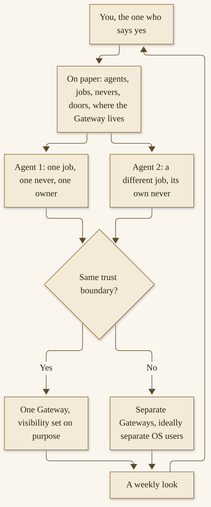{width=100%}

*I13e. A blank sketch, in a picture. Start with two. Trust decides the Gateway. A weekly look comes back to you.*

**How to sketch a fleet on paper**

1. Write your own name at the top, as the one who says yes. If a second person shares that yes, write their name too, and what they may approve. A fleet that “everyone owns” is a fleet no one reviews.

2. Write two agents, not seven. One job each, in a short sentence. One “never” each, in a short sentence. One owner each — often you. If you cannot tell the two jobs apart, you do not have two agents yet. You have one agent with a blurred day, and Chapter 12 already gave you permission to stay there.

3. If the two jobs hand work to each other, draw the pipeline, with a yes at any step that sends, spends, publishes, or deletes. Do not invent a queue. A wiki page, a workspace file, or a message you see is enough to name on paper.

4. Mark the doors. Which agent, if any, has a messaging channel. Pairing on. Allowlists. No public inbox. Secrets out of chat. If a door is shared, say so, and say why.

5. Mark the vaults. Shared, split, or a second Gateway. Official agent scope if you split on one Gateway, with the official warning written in the margin: not an OS boundary.^198 Session visibility: default is generous; narrow it if personas should not read each other’s transcripts, using the official keys from the sessions page.^199

6. Mark where the Gateway lives: a machine you control, a bind you can name (loopback, unless you have a written reason and the official exposure runbook), a backup you can name. Write the model you actually use, which need not be mine. If you want Grok 4.7, the official page in the previous section is the how-to; I still will not guess your auth method, or mine, onto your paper.

7. Write a weekly look at the bottom: list the agents, list the jobs, list the doors, open one lint report, open one automation run, say who still says yes. If you cannot do that look, the fleet is too large. Cut it until you can.

8. Only then, if a third job is real, add a third box. Officially, `openclaw agents add` will do the work on the machine when you are ready.^196 On paper, the third box waits until the job exists.

**Never.** Never start at seven because a shop you read about has seven. Never reuse `agentDir`. Never put untrusted customers on one Gateway. Never let a publisher publish alone. Never leave default transcript visibility in place for agents that should not read each other, without looking. Never invent a reference architecture for a company and call it official. Never treat my MiniPC or my model as a requirement. Never invent a WisdomForge number and write it on your sketch as if it were a target.

**How you know it worked.** You have a page of paper — or a wiki page, which is better, because you can keep it — with two agents, two jobs, two “nevers,” doors, vaults, a Gateway location, and a weekly look. You can see the fleet. You can add a third when a job is real. What still needs a yes is every door, every publish, and every later agent.

A worked sketch, for a reader who wants to see the boxes filled once, might look like this — with names that are not mine, and jobs that are not WisdomForge. Call the first agent Research, and give it one job: gather sources for a weekly note you already write. Its “never”: it never invents a source, and it never publishes. Call the second agent Draft, and give it one job: turn those sources into a draft of the same weekly note. Its “never”: it never publishes, and it never adds a claim Research did not leave on a page. You sit at the yes. If the note ever leaves the house, it leaves after you have read it. The door, if there is one, is pairing-on and allowlisted, and it belongs to you, not to Draft. The vault may be shared for this pair, because they are one desk in two jobs, and you mean the share. Session visibility, even so, is a look, not a default you skip. The Gateway lives on a machine you control, on loopback. The weekly look lists both agents, both jobs, both “nevers,” the door, and the last draft you approved. That is a fleet of two. It is enough.

If the sketch fights you, the fight is usually one of four kinds. You cannot tell the two jobs apart: stay at one agent. You want a public inbox on the same Gateway as a private vault: that is a second Gateway question, not a second-agent question. You want seven boxes because this chapter has seven names: put the extra five boxes away and finish the two. You cannot name a weekly look you will actually keep: the fleet is already too large, even at two, and the fix is a smaller job, not a third agent.

When you do move from paper to the machine, the official path is still `openclaw agents add`, with a workspace of its own, and a promise not to reuse `agentDir`.^196 Bind a door only if the sketch gave that agent a door. Narrow session visibility if the sketch said the two should not read each other.^199 Enable and init the wiki the official way, as Chapter 4 taught, and decide scope on purpose.^198 Then run the list commands, and confirm the paper and the machine still agree. If they do not, trust the machine’s list, update the paper, and do not add a third agent until they match.

> **Tip.** Put the paper sketch in the wiki. A sketch in a drawer is a sketch you will not review. A page you can lint, search, and open on Sunday is part of the practice. Date the page. When you add a third agent, date that too. The history of the fleet is itself a page worth keeping.

What this chapter is not is also worth a short list, so no one has to guess. It is not a reference architecture for a company. It is not an official OpenClaw headcount. It is not a requirement that you run seven agents, or Grok 4.7, or a MinisForum MiniPC, or Omarchy. It is not a tour of anyone’s prompts. It is not a migration story. It is not a WisdomForge case study with numbers. It is a worked example, at the resolution I can stand behind, and a paper practice you can copy at two.


Chapter 14 is the practice that lasts: safety, privacy, an honest picture of “local,” a path for when things break, money without invented figures, and a quarterly review that includes retiring work you no longer need. A fleet does not postpone that chapter. It makes it more important. The runtime may be swapped. The vault, the skills you kept, and the community you contributed to are what compound. You still say yes.

If you close this chapter with only a paper page — two names, two jobs, two “nevers,” a door, a vault, a Gateway you can name, and a Sunday you intend to keep — you have done the work this chapter asked of you. The seven-agent shop is a picture of a practice that grew, not a homework assignment. Grow yours the same way this book’s title asks: make it yours, at a size you can still see.


# Chapter 14
## Safety, Privacy, and a Practice That Lasts


{width=100%}

*I14. A locked drawer, a backup disk, a blank checklist, a key.*


The last chapter was a shop, at a size I can still see, and a paper sketch for a shop of your own. This chapter is the practice that makes any shop — one agent or seven — last. A durable safety practice. An honest picture of the word “local.” A path for when something breaks. A quarterly review that includes a toolkit you still read and a wiki you still maintain. A practice that lasts is not a bigger model, and it is not a bigger catalog. It is a habit of looking, a habit of saying yes on purpose, and a habit of letting go of work you no longer need.

I will keep this chapter defensive and high-level. I will give you official commands for audits, updates, backups, and pairing. I will not give you exploit steps, payloads, or a reproduction of anyone’s attack. I will not call OpenClaw “secure by default.” The official posture is more careful than that, and so is this book.

## Local is not harmless, and defaults are not “enterprise secure”

A Gateway on a MiniPC, or on a laptop you already own, still runs tools on a real machine. Files can be read. Commands can be run. Messages can be sent. A schedule can fire at two in the morning while you sleep. “Local” is a good word, and it is an easy word to over-hear. It changes who hosts the Gateway. It does not remove pairing, audits, backups, or judgment. It does not make a tool safe because the box is in the same room as you.

Sandbox and exec approvals are **off by default**.^209 That is an official fact, and I want it near the front of this chapter, not in a footnote you might skip. Official OpenClaw describes the default as a trusted single-operator assistant.^209 If you are that operator, and you mean the trust, the default is a starting posture — not an enterprise posture, and not a claim that the product is “secure by default.” If anyone else can reach the Gateway, or if a skill you did not read can reach a tool, the default is not enough.

One Gateway is one trust boundary. Mixed-trust or adversarial users need separate Gateways, ideally separate OS users or hosts.^209 A household list and a private journal may share a Gateway if you narrow visibility and mean it. A public inbox and a private vault should not. A customer you do not trust and a shop you do should not. Chapter 13 already said this for a fleet. It is true for a single agent. The number of agents does not create the boundary. The Gateway does.


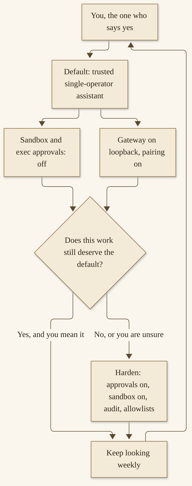{width=100%}

*I14. Default versus hardened, in a picture. The default is a starting posture for a trusted single operator. It is not “secure by default.” Hardening is a decision you make on purpose.*

I work as a Principal AI Solutions Engineer, and I keep that work in its own room. This chapter never needs an employer’s name. It needs you to hear “local” honestly. A machine you control is a privilege and a responsibility. The privilege is that a third party is not hosting your Gateway. The responsibility is that you are.

> **Caution.** “It is only on my machine” is not a security review. A Gateway on loopback, with pairing on, with a wiki you back up, and with a human who still says yes, is a starting practice. A Gateway you can reach from a guest network, with a public inbox, with exec approvals off, and with a skill you installed and did not read, is a different practice, and it is not one this book will bless.

What “local” does give you is a place to look. You can open the Control UI at the official loopback address, if that is still the current default on the page in front of you.^209 You can run `openclaw doctor`. You can run a security audit. You can list automations. You can open the wiki. You can pull a backup disk from a drawer. Those looks are the beginning of a practice. They are available because the Gateway is yours. Use them.

Privacy is part of the same honesty. A local Gateway can still hold a journal, a household list, a work vault, and a transcript another agent can read if you left the default in place. “Local” is not “private from everyone who uses this machine,” and it is not “private from a skill you invited in.” If a page should stay in one vault, say so, and configure scope on purpose, as Chapters 4 and 13 taught. If a transcript should stay with one agent, narrow visibility on purpose, from the official sessions page. If a household shares a computer, a second OS user — or a second Gateway — is a privacy decision, not a luxury. I will not invent your household, and I will not write a child’s private life into a sample vault. I will say that privacy is a look you take, with the same seriousness you take a bind.


Conservative defaults on a regular host install, as the official Security hub described them on 12 November 2026, are worth naming in one place. The Gateway binds to loopback. Most chat channels answer an unknown DM sender with a pairing code. Group access is allowlisted, usually behind a mention gate.^209 Exceptions are documented: some container images default to an exposed bind and should be paired with authentication; some workspace channels trust membership by default.^209 Those exceptions are not loopholes to lean on. They are reasons to read the page that names them, and to run the audit that will mention them.

## Approvals, pairing, audits, and what a skill trusts

Chapters 5, 7, 9, and 11 already taught pieces of this. This section brings them into one practice, so a quarterly review has somewhere to point.

**Pairing.** A messaging door starts in pairing, unless you have a written reason to change it. Officially, the DM policy defaults to pairing. You approve a code with `openclaw pairing list` and `openclaw pairing approve`, on the channel the official page names.^210 Approval is a DM, not a group, as those pages describe. The first CLI approval bootstraps owner access as the official pairing page says. Allowlists are how a door stays a door and does not become a lobby. An open policy is a public-inbox decision, and this book does not recommend it for a shop, a home, or a fleet. Disabled is an honest choice if a door should not exist.

**Bind.** The Gateway’s default bind is loopback.^209 That is where a first setup should stay. If you have a written reason to expose it — a container, a second machine you control, a node — follow the official exposure runbook on the live Security page, and do not invent a bind I did not print. A bind you cannot name on paper is a bind you should put back to loopback. Official hardening notes also mention, as options, a tailnet or an identity-aware proxy; those are tools the live Why OpenClaw page names, not requirements, and not a how-to I will invent here.^212 Copy current setup from that page if you need them.

**Audits.** Officially, you can run:

```bash
openclaw security audit
openclaw security audit --deep
openclaw secrets audit --check
```

The first is a regular look. The second is a deeper one, when the official page offers it, and when you have time to read what it says.^209 The third asks whether secrets are where official guidance wants them — referenced, not pasted into a prompt or a skill file — and `--check` is the flag the official secrets guidance gives you for a real check, not only a list.^211

You should see a report a human can read.
If you don’t: run `openclaw doctor`, confirm the Gateway is the one you think it is, and open the live Security and secrets pages rather than inventing a flag. A report you do not read is not an audit. It is a file.

**Sandbox and exec approvals.** Turn them **on** when the work calls for it — and, as a practice, assume more work calls for it than you first think. Official hardened baselines, on the Security and Why OpenClaw pages as they stood on 12 November 2026, describe turning sandboxing on, including a mode that sandboxes all sessions (`agents.defaults.sandbox.mode` set to `"all"`), with supported backends the live page names, including openshell or docker.^209,^212 I will not invent a full config block for you to paste. Copy the current flags, and any tool allow or deny lists the page currently prints, from the live official page in front of you. After you change them, run the audit again, and write down, on a wiki page, what you changed and why.

You should see the audit, and the live page, agree that sandboxing and approvals are on.
If you don’t: you are not done. Leave the work that wants a sandbox unstarted until they agree.

**Secrets.** A SecretRef, as official docs describe it, is a way to point at a credential without putting the credential in a prompt, a skill file, or a chat.^211 If a key has to live anywhere, it lives in the official secrets path, and you audit it. It does not live in a wiki page you might one day share. It does not live in a ClawHub skill you might one day publish. It does not live in a morning note.

**Skills and plugins.** A catalog skill or a plugin is untrusted until you read it. That is Chapter 9’s trust ladder, and it is still the ladder. Official `openclaw skills verify` is a registry-envelope check, not a local file hash, and a pending or stale scan can warn and still install — so a green verify is not a substitute for reading the `SKILL.md`.^213 Native plugins run unsandboxed, in-process; treat a native plugin as code you invited into the Gateway, because that is what it is.^213 Pin what you reviewed. Update what you still use, on purpose, after you have looked at what changed. Retire what you no longer read. Official docs also describe an optional `security.installPolicy`, a local policy command that can run before a skill installs.^209 If you use it, it is a second gate, not a replacement for reading.

**Prompt injection** is an industry-wide unsolved problem. Official OpenClaw pages, and a founder blog dated 29 January 2026, treat it in those terms, and this book will not pretend a setting closes it.^209,^212 Official advice, as recorded for this book, is to use a strong latest-generation model, to study the official prompt-injection page, and to keep bypass flags off in production.^209 A pairing policy, a sandbox, a “never” in a wiki, and a human at send and spend reduce what an injected instruction can do. They do not make the problem go away. If a stranger can put text in front of your agent — a web page, an email, a document, a chat — assume that text can try to talk to the agent, and keep the doors and the tools narrower than the try.

On 11 November 2026 I wrote about closing a transcript door with two config keys, in an article titled “My Agents Could Read Each Other’s Transcripts. Two Config Keys Closed That Door in Ten Minutes.”^214 The how-to in this book remains the official sessions page: default visibility is generous; narrow it on purpose; copy the current keys from the live page, not from a remembered reading of my article. Privacy, in a fleet, includes the privacy of one agent’s transcript from another. Look at that default. Do not assume it is already closed.


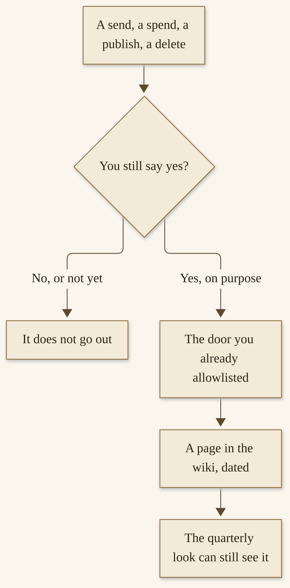{width=100%}

*I14b. Approval, money, and send, in a picture. The want waits. You say yes, or you do not. What went out is written down, so a later look can still see it.*

> **Tip.** Put “pairing, bind, audit, sandbox, secrets, skills, who says yes” on a single wiki page, with the date of the last look. Appendix C, if you use the back of this book, will give that page a checklist shape. The page is the practice. The checklist is a courtesy.

A practice is also what you refuse. You refuse a public inbox on a Gateway that holds a private vault. You refuse a skill whose `SKILL.md` you have not read. You refuse a secret in a chat. You refuse a send, a spend, a publish, or a delete that has not had a yes. You refuse to treat last quarter’s audit as this quarter’s audit. Those refusals are as much a part of safety as any command.

A first weekend can still be small. Pairing on, loopback, one job, a wiki you enabled the official way, a backup you verified, a skill you have not yet installed because you have not yet read one. That is a safe enough first weekend to be proud of. Hardening — sandbox on, exec approvals on, a deeper audit, a narrowed transcript door, a pin on every skill — can be a second afternoon, and then a quarterly habit. You do not have to do every official hardened baseline on the first night. You do have to know that you have not done them, and you do have to come back.


## Stay current, and what to do when it breaks

v2026.11.3, published 10 November 2026 at 1:53 PM ET, is a security and patch release. Official notes for that release, as recorded for this book, describe it as carrying no new features.^215 I am dating that fact. I will not freeze a CVE list into this chapter, because a list I print today will be wrong the week after you read it. The practice is to stay current, from official notes, with a backup already in your hand.

**How to update, officially, without losing the thing that lasts**

1. Back up first, the official way, to a path you can name:

   ```bash
   mkdir -p ~/Backups/openclaw
   openclaw backup create --output ~/Backups/openclaw --verify
   ```

   You should see a verified backup in that folder.^216
   If you don’t: do not update. Fix the backup. A successful update of a Gateway whose wiki you cannot restore is not a success.

2. Update from official guidance:

   ```bash
   openclaw update
   ```

   The live Updating page is the authority for Mac, Docker, and distro-specific paths, and for any repair command the current page names — including `openclaw update repair`, when that page lists it.^215 Follow the page in front of you. I will not invent a package-manager invocation for a distro I have not opened.

3. After the update, look:

   ```bash
   openclaw --version
   openclaw doctor
   openclaw security audit
   openclaw wiki doctor
   openclaw automations list
   ```

   You should see the version you expected, and a doctor report you can read.
   If you don’t: do not start new scheduled work. Open the live Updating page, and the official Discord or GitHub path below, with the report in your hand.

A dated figure belongs here only if I keep it dated. The official Why OpenClaw page, reviewing the public advisory list on **27 August 2026**, reported **647** advisories, and said counts are not a comparative safety score.^212 I did not recount that list for this draft. I will not use 647 as a current number, and I will not use it to rank OpenClaw against another project. If you want a current count, open the live advisory list at the official repository and date what you see.^218 A count is a snapshot. It is not a grade.

When something breaks — a Gateway that will not start, a skill that will not behave, a door that is doing something you did not ask, a secret you think may have leaked — official incident response is the path, not a forum guess and not a how-to I invent. Official incident-response documentation organizes the work as **contain, rotate, audit, and collect**.^217 I will teach those four words as a practice, at the resolution the official pages allow, without a forensic playbook.

**Contain.** Stop what should not still be running. That may mean stopping the Gateway, disabling a skill or a plugin, tightening a pairing policy, turning a door off, or taking a bound address back to loopback. Contain is not a full investigation. It is the first honest narrowing. Follow the official page for the current recommended order. Do not improvise a wider exposure in the name of “just looking.”

**Rotate.** If a secret may have been seen — an API key, a bot token, a provider credential — rotate it at the provider, and then at OpenClaw, in the official secrets path.^211,^217 An old key that is still valid is still a door. I will not invent a rotation command beyond what the official secrets and incident-response pages tell you. Open those pages. Rotate what they tell you to rotate. Write down, on a page you keep, that you rotated, and when.

**Audit.** Run the official audits. Read the Gateway logs (`openclaw logs`). List automations and recent runs. List agents and bindings. Open the wiki lint. Ask, slowly, what ran, what sent, and what changed. A smaller reproduction — “this skill, this prompt, this door,” as a description of scope, not as an exploit to rebuild — is more useful than a theory. It is also as far as this book will go. I will not teach you to reproduce an attack.

**Collect.** Keep what you will need to tell the story later: the audit report, a log excerpt, a version string, a backup timestamp, a note of what you disabled and what you rotated.^217 Official Discord and GitHub paths are how you take a well-collected report to people who can help. The official Discord invite, as of research for this book, is `clawd`.^219 The official GitHub repository, and its public security advisories, live at `https://github.com/openclaw/openclaw`.^218 A well-collected report is a kindness to whoever helps you, and a kindness to your future self.

A rollback, when you need one, is often quieter than it feels in the moment. Disable the skill or the plugin. Tighten approvals. Restore a wiki backup you already verified. Those three sentences are official-shaped, and they are usually the right first ones. A more elaborate recovery should follow the live incident-response page, not a remembered recipe.

> **Caution.** If you think a door is open that should not be, contain first. Do not spend the first hour writing a perfect timeline. The timeline can be collected after the door is narrower.

Staying current is also a kindness to the people who might help you. A report that names the version (`openclaw --version`), the last verified backup, the skill or plugin you suspect, the door involved, and the audit you already ran is a report someone can work with. A report that says “it broke” is a report that starts the sitting over. Official support routes exist; the live “Get support” page, linked from official Getting Started, is the current map, and I will not invent a ticket form.^219 You do not have to be an expert to collect well. You have to be slow enough to write down what you already know.

If the break is quieter — a lint warning, a doctor complaint, an automation that sent a digest twice — the same four words still scale down. Contain: pause the automation. Rotate: only if a secret is in play. Audit: read the run and the log. Collect: a dated wiki page, so the quarterly sitting can see it. Not every event is an incident. Every event that surprised you is worth a page.


## Malicious skills, journalism, and operator discipline

Malicious skills have been reported in the public registry.^220 That is a fact I can stand behind, and I will stay at that resolution. ClawHub later added stronger pre-publication blocking, as third-party and issue reports describe.^220 Automated scans, upload gates, and moderation are part of the official trust story, and they are not a promise that a skill is safe.^213 A pending or stale scan can still warn and install. A later blocking rule can still miss a skill whose harm is a design you did not want, rather than a name a scanner already knows.

I will not name a campaign as an official Foundation incident. Public GitHub issues and third-party write-ups exist; official advisories or moderation posts were not, for this book, opened as the naming authority for a campaign title.^220 The operator lesson does not depend on a name. The operator lesson is the one official docs already give you: read the skill, check the scan and moderation state, use `openclaw skills verify`, pin the version you reviewed, turn the sandbox on, and keep the least privilege the work will bear.^213,^209 I will not reproduce malware names, payloads, or install steps. There is no how-to here for harm, and there is no “just so you can test it” exception.

Journalism, when this book uses it, will be labelled as journalism, and it will be re-opened before it is quoted. A Reuters piece dated 15 February 2026 sits in the research file for this book; the page itself was not successfully re-opened from the research box, and I will not quote a search summary as if I had the article in front of me.^221 I will not treat a headline as a vulnerability catalog. Official pages already name the operator risks that matter in this chapter — an exposed bind, unapproved DMs, prompt injection via untrusted content, unsandboxed exec, host filesystem paths, credentials in a log or a config, and unvetted skills or native plugins.^209 Those are enough to teach from, and they are enough to put on a quarterly list.

Official pages also refuse a “safest agent” claim.^212 So does this book. A practice is not a ranking. A sandbox you turned on, a skill you read, a backup you verified, and a yes you still own — those are a practice. A count of advisories, a count of plugins, a count of stars, is a snapshot with a date. It is not a medal, and it is not a reason to skip the look.

During the project’s January 2026 rename, official lore describes scams that showed up immediately, including a token that was not the project.^222 The teaching is small and plain: the official project is the official project. A token, a fake profile, or a look-alike handle is not. I will not send you toward any of those. If you are looking for OpenClaw, start at the official site, the official docs, the official GitHub organization, and the official X account, all of which are in Appendix D.

> **Caution.** A skill that asks you to disable a protection, to paste a key, or to run an install you cannot read is a skill you can refuse. Refusing is a complete answer. You do not owe a catalog a benefit of the doubt it has not earned.

Operator discipline, said once more in a way you can keep, looks like this.

1. Read before you enable. The `SKILL.md`, the plugin’s page, the permissions, the files it will touch.
2. Verify, and know what verify is: a registry envelope, not a blessing.
3. Pin the version you reviewed. An unpinned install is an install that can change without your look.
4. Sandbox, and keep exec approvals on, unless you have a written reason and a narrower tool list.
5. Least privilege: the fewest doors, the fewest tools, the fewest secrets, the fewest agents who can see a transcript.
6. A human at send, spend, publish, and delete.
7. A look after. An audit, a log, a wiki page that says what changed.

That is not a product certification. It is a way to be the operator the default posture assumes you are.

## Money, honestly — no invented figures

Hosted model providers send bills. If your agent talks to a hosted model — including, if you followed Chapter 13’s official xAI path, a Grok model — the provider, not OpenClaw, is who bills you.^223 Official OpenClaw is self-hosted and MIT-licensed; there is no official paid OpenClaw Cloud.^224 The Gateway on your machine does not remove the provider’s invoice. Check a dashboard. Set a limit if the provider offers one. Look at the bill in the same quarterly review that looks at skills and doors.

A MiniPC uses power. A laptop uses power. I will not invent a wattage, and I will not invent a monthly cost. If you care about that number, it is a number you can measure on your own bench, in your own house, at your own rate. I will not print an SMF Works spend. I will not estimate yours.

This is not legal advice, financial advice, or tax advice. I will not tell you how to expense a provider bill, or how to treat a machine. I will tell you to look at the bill, and to include the look in the review below. A practice that lasts is also a practice that does not wake up to a surprise it could have seen coming.

If a skill or a plugin wants to spend — a purchase, a paid API, a transfer — that is a send-shaped yes, and it waits. Chapter 11 already said what not to automate. Money is near the top of that list. An agent may draft a reminder that a bill exists. An agent may not pay it alone.

Power, storage, and a backup disk are costs of a similar honest kind. A verified backup that lives only on the same machine as the Gateway is a backup that will disappear with the machine. Official backup commands let you choose an output path; choose one you can take with you, or one that is already part of a backup practice you trust.^216 I will not invent a cloud vendor, and I will not invent a disk brand. I will say that a drawer with a dated disk is part of the still-life this chapter asked for, and that “I will do it later” is how later becomes never.


## A quarterly review, and work you can retire

A practice that lasts is also a practice that lets go. Growth includes pruning. A skill you no longer read, an agent with two jobs, a cron you no longer need, a door you opened “just for a week” in April: those are the things a quarter is for. Appendix C, at the back of this book, will give this review a checklist you can copy. The list below is the teaching; the appendix is the card you can take to a sitting.


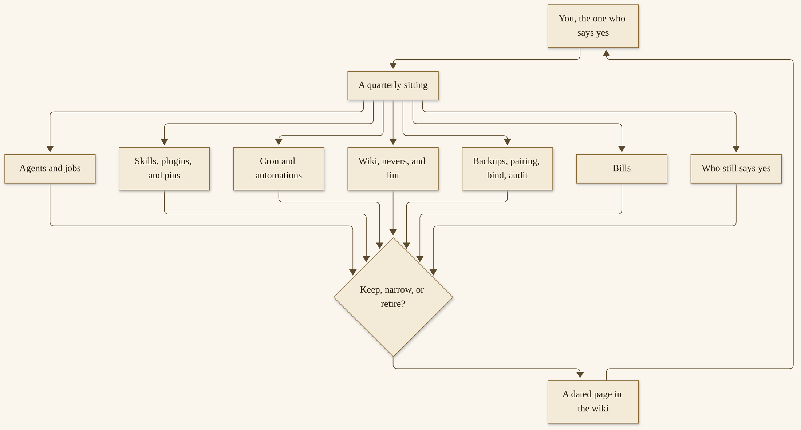{width=100%}

*I14c. The quarterly-review loop, in a picture. You sit. You look at the same list. You keep, you narrow, or you retire. You write the sitting down. You still say yes.*

**A quarterly sitting, in one afternoon**

1. **Agents and jobs.** List them with `openclaw agents list`, and with `--bindings` if doors exist. For each agent, say the job in one sentence, and the “never” in one sentence. If an agent has two jobs, that is a finding, not a feature. Split the jobs, or retire one, or go back to a single agent until the sentences are clean. Chapter 13’s paper sketch is the tool; this sitting is when you use it again.

2. **Skills and plugins.** List what is installed. For each, ask: did I read this, is it pinned, do I still use it, has it changed. Retire what you no longer read. Update what you still use only after you have looked at the change. A toolkit that grew all quarter and was never pruned is a toolkit you no longer trust, because you no longer know it.

3. **Cron and automations.** `openclaw automations list`. Open one recent run. Retire what you no longer need. Confirm that anything which sends, spends, or publishes still waits for a yes, or is a digest a human still reads. Chapter 8 taught the schedule. This sitting asks whether the schedule is still the one you meant.

4. **Wiki, “nevers,” and lint.** `openclaw wiki status`, `openclaw wiki doctor`, `openclaw wiki lint` — or the current official lint command on the page in front of you.^216 Open the “never” page. Open one page you have not opened in a month. If a claim cannot be opened, it does not stay. If the wiki has not been backed up, it gets backed up before you do anything else.

5. **Backups, pairing, bind, and audit.** Run the official backup with `--verify`. List pairing requests. Confirm the bind is the bind you named. Run `openclaw security audit`, and `openclaw secrets audit --check`. If sandbox and exec approvals should be on, confirm they are on. If session visibility should be narrowed, confirm it is narrowed, from the live official keys.

6. **Bills.** Open the provider dashboard. Look at the number. Do not invent a budget in this book, and do not skip the look because the number is usually small. Usually is how surprises arrive.

7. **Who still says yes.** Write the name. If a second person shares the yes, write what they may approve. If “everyone” owns the fleet, no one is reviewing it. Put the name on the dated page.

8. **Write the sitting down.** A wiki page, dated, with what you kept, what you narrowed, and what you retired. Next quarter’s sitting starts by opening this page.

**How you know it worked.** You finished the list in a sitting you will actually keep. Something was retired, or you can honestly say nothing needed to be. The wiki has a dated page. The backup verified. The audit was read. A human is still named at the yes.

> **Tip.** Retiring is a success. A smaller roster, a shorter skills list, a quieter Saturday morning, is a practice that is still alive. Adding is easy. Letting go is the part that lasts.

If a quarter goes by and you did not sit, sit now. The review is not a punishment for having been busy. It is how a busy season does not become a permanent exposure. If the sitting is too large, the fleet is too large. Cut until the sitting fits an afternoon.

What you retire, retire all the way. A skill you have disabled but left unpinned and uncommented in a file you no longer open is not retired. An automation you have paused and forgotten is not retired. An agent whose job you can no longer name is not retired. Official list commands will still show you what is there. Trust the list, not your memory of last quarter’s intentions. Then write the retirement on the dated page, so next quarter does not resurrect a door you meant to close.

The weekly look from Chapters 8 and 13, and this quarterly sitting, are friends, not rivals. The week catches a run that failed, a pairing request, a lint warning. The quarter catches a skill you have not read since winter, a bill you have not opened, an agent whose second job crept in, a default you never narrowed. If you only have time for one, take the week until the quarter fits. A weekly look that happens is better than a quarterly ceremony that does not.


## What lasts

The runtime may be swapped. I have believed that for a while, and I said so publicly on 11 November 2026, in an article titled “The Vault Is the Agent: Why Autonomous AI Needs an LLM Wiki as Its Second Brain.”^225 The engine will be replaced. The notebook is the thing you can keep. The skills you actually reviewed and kept — a small, pinned toolkit, not a catalog you once browsed — are a second thing you can keep. The community you contributed to, if you contributed, is a third: a skill you published carefully, a plugin you documented, a question you answered, a report you collected well. Those compound. A bigger model does not, by itself. A bigger catalog does not, by itself.

I want that distinction to land, because it is easy to hear “practice that lasts” as “practice that grows.” Growth, in this book, is optional and sized to a Sunday you can keep. Lasting is the wiki you still open, the “nevers” you still mean, the skills you still remember reading, the pairing policy you have not quietly relaxed, the backup you can still restore, and the community you did not only consume. If, a year from now, you are on a different runtime, with a different model, and the same notebook, you have not lost the practice. You have done what the practice was for.

The community side of that sentence is optional, and I will not shame a reader who only ever used what they installed. Chapters 9 and 10 already invited you to contribute when you were ready, and they already told you that a careful first skill is enough. If you did contribute, keep a pointer to what you shipped, and look at it in the same quarter you look at what you installed. A contribution is also a thing you are responsible for. If you can no longer stand behind it, say so, and follow the official path to update or retire it. That, too, is discipline.


You still say yes. That sentence has been this book’s refrain, and it belongs at the end of a safety chapter as much as it belonged at the end of a first setup. Pairing is a yes. A send is a yes. A publish is a yes. An update is a yes, after a backup. A retirement is a yes, of a quieter kind. A quarterly sitting is a yes you give your future self.

The coda is next, and it is short. It restates the gift. It points at the weekend you can still start with, at the parts of this book that help you make the practice yours, and at the appendices when you want a list in your hand. *Hand It Off* and *Grow With It* are sister gifts, if you want them, and they are not this book. WisdomForge is the academy the OpenClaw fleet is responsible for, and a place a file may be given away. This gift stands on its own.

A locked drawer, a backup disk, a dated checklist: that is the still-life I would put at the end of this chapter if I were printing a plate. The drawer holds the secrets and the yes. The disk holds the wiki. The checklist holds the sitting. None of them is a product. All of them last longer than a release note.


# Coda

This book is a gift. I wrote it so that anyone — just starting, or already deep in a practice — could find a careful way into OpenClaw, and a careful way to make that practice theirs, without being sold anything at the end. There is no course behind this page. There is no upgrade waiting. There is no official paid OpenClaw Cloud, and I am not offering an unofficial one. There is a wiki, if you started one, and a yes that is still yours.

You can start this weekend. Part 2 is that start: every way in, a first setup, a first real job. Chapter 4 is the chapter I hope you will not skip. Enable the built-in LLM Wiki — officially, the `memory-wiki` plugin — before you fall in love with a skill, a door, or a schedule. The most important part of an autonomous agent, I wrote on 11 November 2026, is not the model. It is the notebook.^226 A vault, a short “never,” a few sources you actually care about, and a morning in which you open what was written — that is a first practice. Official commands will be on the live pages if any have moved. The shape will not.

You can make it yours. That is the title, and it is also Parts 3, 4, and 5: a loop you can teach, a door that meets you where you already talk, work that can run while you sleep, a commons of skills and plugins and people, and a way to write a skill, ship a plugin, or contribute when you are ready. Chapters 9 and 10 are the heart of that commons. Chapters 11 and 12 are two full shelves of how-tos, professional and personal. You do not have to take every tutorial. One desk you will still use in a month is worth more than six abandoned setups. The “never” lines travel with you: no send, no spend, no publish, no delete, without a yes; at home, no health record as a sample, no child’s private life in a vault, no unsupervised payment, and no medical, legal, or financial advice from a book or from an agent.

You can grow a fleet, if and when that is the right size. Chapters 8 and 13 are that movement. A fleet is grown, not bought: one job each, one owner, a “never” per agent, a paper sketch you can see, and a human who still says yes. I run seven OpenClaw agents, on Grok 4.7, on a MinisForum MiniPC I share with another practice, and they are responsible for SMF WisdomForge. That is a worked example, at the resolution I can stand behind, not a shopping list and not a target. Two careful agents are already a fleet. One careful agent is already a practice.

You are still the one who says yes. I have said it in every chapter that needed it, and I will say it here, at the close, because it is the sentence the gift is built on. A teammate who can finish the work is a gift. A teammate who can also send, or pay, or publish, is a teammate you walk with slowly. Pairing is a yes. A skill you enable is a yes. An update, after a backup, is a yes. A retirement is a yes of a quieter kind.

The wiki you started is still there. If you started it in Chapter 4, it is still there, even if the engine has already been swapped, even if a job has been retired, even if a fleet you tried was shrunk back to one. The pages you dated, the “never” you wrote, the claim you could still open — those are what last. The skills you kept — a small, pinned toolkit you actually read — are still there. The community, if you joined it, is larger than one Gateway. Chapter 14 asked you to back the wiki up, to look four times a year, and to let something go. That looking is part of the gift you give yourself.

The appendices are a shelf, not homework. A glossary, a cookbook, a set of checklists, a dated list of official addresses, and a note about names and sources. Take a page when you need a page. Appendix C will hold a first-weekend list and the quarterly sitting. Appendix D, just after, will point you at the official docs, the repository, ClawHub, the official community doors, and a few of my own public articles, clearly labeled as mine.

*Hand It Off* and *Grow With It* are sister gifts, already given, for different teammates. Charlie appeared in this book only as my Grok Bot chief of staff, who syncs with Carol, at the level I had already stated. Hermes appeared only as a neighboring practice that shares a host machine and does not share this roster. If you want those doors at full size, those gifts are where they live. This book stays with OpenClaw, and it stands on its own.

WisdomForge is the academy the OpenClaw fleet is responsible for, and a place a file may be given away — including, one day, this book. It is not a shop in these pages. I give work away at the place I give work away, as a gift, not as a funnel.

I want to thank, without turning the thanks into a vendor paragraph, the people who make a commons: the OpenClaw Foundation, which stewards a product you can run on a machine you control; the contributors and skill authors I will not invent conversations with; and you, if you take even one careful first step. Official wording on the project’s own surfaces speaks of personal AI that lives on your machine, by your rules.^227 That wording is theirs. The title of this book is mine, and it is an invitation: make the practice yours. A gift lands when someone uses it. That is all the landing I want.

If this book and the live docs disagree, you already know which to trust. We dated what we checked: 12 November 2026. The product will move. The practice — a wiki, a skill you kept, a schedule, a human review, a yes — is what I hope moves with you.

If a tutorial in Chapters 11 or 12 is the page you came for, you already have it. A research desk, a reviewed toolkit, a household vault, a morning note — those are complete practices. You do not owe the book a fleet. You do not owe it a seventh agent. You owe yourself a “never” you will still keep on a tired night, and a backup of the wiki you would miss.

Make it yours, at a size you can still see. Start, if you have not, this weekend, with Chapter 4. Stop, if stopping is what the work needs, and keep the wiki. Thank you for letting me walk this far with you. The yes is still yours. The notebook is still yours. The morning is still yours. That is the whole of the gift.


# Appendix A
## Glossary

A plain sentence first, then the official name. This is a shelf, not a homework assignment. If a word went by too fast in the chapters, it lives here. Details and commands stay in the chapters that teach them; this list will not try to replace Chapter 4.

**OpenClaw.** The self-hosted, MIT-licensed agent platform this book is about: a Gateway you run on a machine you control, an embedded agent runtime, channels, memory, and skills and plugins. It is not a paid official cloud (there isn’t one), and it is not the model it talks to. Official site: openclaw.ai. Official docs: docs.openclaw.ai. Official repository: github.com/openclaw/openclaw. Current stable release, as of 12 November 2026: **v2026.11.3**, published 10 November 2026, 1:53 p.m. Eastern Time. Versioning is date-based. A beta (`2026.11.5-beta.2`, that same research day) and an extended-stable tag (`2026.9.37`) also existed; this book teaches the stable path.

**OpenClaw Foundation.** The independent 501(c)(3) that stewards the project. Official site: openclaw.org. This book is a free, unofficial gift, not affiliated with or endorsed by the Foundation. We do not speak in their “we.”

**Gateway.** One process, on your machine, that is the source of truth for sessions, routing, and channels. Default bind is loopback. Default Control UI: `http://127.0.0.1:18789/`. Commands: `openclaw gateway install`, `start`, `status`, `restart`. `openclaw dashboard` opens the Control UI. One Gateway is one trust boundary.

**Pairing.** OpenClaw’s explicit access approval. Unknown direct-message senders get a short code, and their message is not processed until you approve: `openclaw pairing list <channel>` then `openclaw pairing approve <channel> <CODE>` (for example, `openclaw pairing approve telegram <CODE>`), or approve from the Control UI. Codes expire after an hour. Approval grants DM access only, not group access. There is a separate device-pairing flow for nodes. Do not skip pairing.

**Workspace.** The agent’s home folder on disk, default `~/.openclaw/workspace`, separate from `~/.openclaw/` (config, credentials, sessions). Official files include **`SOUL.md`** (persona and tone), **`AGENTS.md`** (operating instructions), optional **`USER.md`** (a compact user model), **`MEMORY.md`** (curated long-term memory), daily **`memory/YYYY-MM-DD.md`**, and optional **`DREAMS.md`** (a Dream Diary for human review). Official sentence: “The model only remembers what gets saved to disk; there is no hidden state.” The workspace is a default working directory, not a hard sandbox, unless sandboxing is enabled.

**memory-core.** The default, built-in memory plugin. It is the recall path: search, promotion, dreaming. It stays on when the wiki is enabled. It does not get replaced by the wiki.

**memory-wiki / built-in LLM Wiki.** The bundled, optional plugin that compiles durable knowledge into a navigable vault — pages, structured claims and evidence, provenance, dashboards, and tools such as `wiki_status`, `wiki_search`, `wiki_get`, `wiki_apply`, and `wiki_lint`. Off until you enable it: `openclaw plugins enable memory-wiki`, then a Gateway restart. It does **not** replace memory-core. Default vault path: `~/.openclaw/wiki/main` (or `$OPENCLAW_STATE_DIR/wiki/main`). First setup is Chapter 4, from official docs only. Ingest, as of the official CLI on 12 November 2026, takes a **local file path**; “there is no URL ingest today.” Control UI path: Memory → Dreams → Diary → Memory Wiki.

**Vault.** The folder of compiled wiki pages itself — Michael’s ordinary word for that place on disk. At first introduction, this book uses **vault** for the folder and **Wiki** or **`memory-wiki`** for the plugin and the pattern.

**Vault modes.** **`isolated`** (default): a self-contained store, no dependency on the active memory plugin. **`bridge`**: compile public artifacts from the active memory plugin; the official “common local-first” picture is builtin memory plus wiki in bridge mode. **`unsafe-local`**: an experimental same-machine escape hatch; not a first-week default. Beginners may start isolated.

**Vault scopes.** **`global`** (default): one vault. **`agent`**: a child vault per agent. Official warning: per-agent scope is a **same-process knowledge boundary, not an operating-system security boundary.** Changing scope does not copy or split an existing vault. `obsidian.useOfficialCli: true` is rejected with `vault.scope: "agent"`.

**Skill.** A procedure: a markdown `SKILL.md` (and supporting files), following the Agent Skills specification. It teaches the agent how and when to use tools. It is not a plugin. “Skills that compound” means a small, reviewed set you will still be glad you kept, not a binge.

**Plugin.** Code that extends the product: a channel, a provider, a tool, a memory engine, and similar. `memory-wiki` is a bundled plugin. Native plugins run in-process and are **not sandboxed**. A plugin is code you are trusting. Chapter 9 is the review ritual.

**MCP.** The Model Context Protocol: a connected server (a calendar, an issue tracker, a docs host) under the same tool policy as other tools, not a bypass.

**Template / `CLAW.md`.** The official path for building on an autonomous baseline rather than starting from a blank agent every time. Official Template docs are the how-to. Michael’s 7 November 2026 article is a teaching frame, not a replacement for those docs. Chapter 10.

**ClawHub.** The official public registry for OpenClaw skills and plugins (and experimental Templates). Site: clawhub.ai. Docs: docs.openclaw.ai/clawhub. Plugin counts, if printed, are dated snapshots. This book does **not** invent a live official skills total.

**Cron / automations.** Scheduled work. Official family: `openclaw automations`; `openclaw cron` is an alias. A job you set, which can deliver a result to a channel. “Work that runs while you sleep” is this, plus a wiki and a review — not a promise that the agent wakes up with ideas. Taught in Chapter 8.

**Node.** A companion device — official iOS and Android apps, and other node clients — that **pairs to a Gateway** for camera, screen, voice, and device commands. A node is not a hosted assistant and not the brain. Device pairing is separate from DM pairing.

**Doctor and triage.** `openclaw doctor` inspects the install and reports findings; `openclaw doctor --fix` can migrate retired QMD settings and some other repairs. `openclaw triage` runs read-only health checks and can pack a sanitized diagnosis; nothing leaves your machine until you choose an agent. Official first-run recovery toolkit, Chapter 3.

**Onboard.** The official first-run wizard: `openclaw onboard`, with Quick start or Custom setup; `openclaw onboard --install-daemon` to install the managed Gateway service; `openclaw onboard --classic` for the classic wizard. `openclaw configure` is how you come back later.

**Omarchy Linux.** A Linux desktop environment. Official OpenClaw page: a bar plugin for **Omarchy 4’s Quickshell**; it does **not** itself install or start a Gateway. Official install is from a source checkout, `bash apps/linux/omarchy/install.sh`, then `omarchy plugin validate` and `enable`. This book does not teach `omarchy-ai-install`. Omarchy is also the OS on Michael’s shared MiniPC.

**MinisForum MiniPC.** *Michael’s* shared fleet host: a MinisForum MiniPC (AMD Ryzen 7, 32 GB) running Omarchy Linux, shared with his Hermes fleet. No SKU. Not a laptop. Not a requirement for the reader. OpenClaw is not placed, in this book, on the two NVIDIA DGX Sparks or on the older Surface Laptop; those are Hermes-book machines.

**Grok 4.7.** *Michael’s* OpenClaw model. Official reader setup id: **`xai/grok-4.7`**, from the official xAI provider page. Bundled `xai` provider; recommended path is Grok OAuth, with an API-key path also documented. As of 12 November 2026, `xai/grok-4.7` was also the official curated xAI default — dated, and distinct from his fleet confirmation. This book does not invent his authentication method. The reader may use any official provider.

**Hermes Agent.** A different product, from a different maker (Nous Research), named only as a short sister-gift or fleet cross-reference. *Grow With It* is a practical guide to Hermes Agent. Michael’s Hermes fleet uses **GLM 5.3 Flash** on two NVIDIA DGX Sparks; that is not the OpenClaw model, and those Sparks are not described as OpenClaw hosts.

**Grok Bot.** A different product, named only as a short sister-gift or fleet cross-reference. *Hand It Off* is a practical guide to Grok Bot. **Charlie** is Michael’s Grok Bot chief of staff; he syncs with **Carol**, at the level already described in that earlier book. No CLI flags are invented here.

**The OpenClaw roster (locked).** Michael runs **seven** OpenClaw agents. Spelling is **Carol**, not “Carols.” **Carol** coordinates and syncs with Charlie. **Randal** researches. **Wesley** writes. **Vai** validates (fact-checking). **Rachel** reviews and finalizes. **Parker** publishes. **OC** maintains the environment and agent health. Pipeline: Randal → Wesley → Vai → Rachel → Parker, with Carol coordinating and OC on upkeep. The fleet is **responsible for SMF WisdomForge**. Chapter 13. No invented outputs or extra duties. Aiona, Liam, and Nemo are Hermes as of 11 November 2026, and are not listed as current OpenClaw agents.

**QMD.** A retired memory mechanism. Built-in Memory owns the core path as of **v2026.8.1**. `openclaw doctor --fix` migrates retired QMD settings. Do not teach QMD as current setup. Michael’s 4 June 2026 memory guide is dated history only.

**Sandbox and exec approvals.** Officially **off by default.** Official wording: “Default OpenClaw is a trusted single-operator assistant.” This book does not call OpenClaw “secure by default” in the enterprise sense. Operator check: `openclaw security audit`. Chapter 14.

**Control UI.** The official web dashboard, opened with `openclaw dashboard`, defaulting to loopback port 18789. The Memory Wiki tab is at Memory → Dreams → Diary → Memory Wiki, once the plugin is enabled.

**Backup.** Official archives via `openclaw backup create --output ~/Backups/openclaw --verify`. A full archive covers state, config, credentials, agent directories, and (by default) workspaces; the default wiki, under the state directory, is part of that tree. Restore never overwrites live state in place. Never copy live SQLite/WAL files as a backup. Chapter 4.

**SMF Works / WisdomForge.** Michael’s company, and the press and academy inside it. The OpenClaw fleet is responsible for SMF WisdomForge. In this book they are a thread of work and a place a free file may be given away, not a storefront.

**Dreaming.** Official memory-core background consolidation: short-term material is scored and, if it qualifies, promoted into `MEMORY.md`. `DREAMS.md` is a Dream Diary for human review, not a promotion source. Default on. It is a scheduled kind of housekeeping, not a mind of its own. Chapter 6 teaches it as a habit. Official docs credit the motivation of sleep-time compute and the Generative Agents research.

**WebChat.** An official core channel: a chat in the browser, talking to your Gateway, not a hosted OpenClaw Cloud. A quiet first door, alongside the Control UI, if you are not ready to pair a messenger. Chapter 5 and Chapter 7.

**Channel.** A door the Gateway offers: a messenger, WebChat, or another official integration. Core channels and official plugin channels are listed on the Features page; the roster moves, and Chapter 7 re-opens it. Product names for channels appear in this book because they appear on that official page. A channel is a real door; pairing and group allowlists apply.

**Provider.** A model backend the Gateway can use. Official directory: docs.openclaw.ai/providers. This book does not invent a supported-providers count. xAI is one official provider, with a bundled plugin; see Grok 4.7.

**Security audit.** The official operator check: `openclaw security audit`, with an optional `--deep`. A drift check for bind, pairing, sandbox, and related posture. It is not a certificate that the install is “secure.” Chapter 14.

**“By your rules.”** Official project wording, from the @openclaw profile and related docs lines such as “on your own hardware.” Quoted, attributed, and not worn as this book’s slogan. Our title is *Make It Yours*.

**Sister gifts.** *Hand It Off* (Grok Bot) and *Grow With It* (Hermes Agent), already given. This book is not a remake of either. This book also does not mention or link any other OpenClaw book.


# Appendix B
## Cookbook

This appendix is a shelf of starter prompts and short recipes, compiled from the how-tos already planned in Chapters 4 through 12. Each card has a “never.” The commands are official, as the chapters and the live docs stated them on 12 November 2026. I have not invented an OpenClaw CLI flag, and I have not printed a webhook request body. If a prompt is a teaching draft I wrote for this book, I say so. If a command is official, I say that too.

Use them as starting sentences. Make them yours. Test on a safe input, with you in the room, before you put anything on a clock. If this shelf and a live official page disagree, trust the page, and date what you see.

Do not put a password, a card number, a key, or another person’s private life into any of these prompts. Secrets belong in the official auth flow, in environment variables, or in a place you already trust for secrets — not in a cookbook, and not in a chat.

## How to read a card on this shelf

Each card has a name, a prompt or a short recipe you can almost use, a “never,” and a pointer to the chapter that sits with it properly. The chapters are the home of the full how-to. This shelf is the fridge-door version. If a card feels thin, go back to the chapter. If a card feels tempting to run unattended on the first try, it is not ready. Watch it once.

## First setup, and the built-in LLM Wiki

**Enable memory-wiki and initialize a vault.** (Official commands, Chapter 4.^229)

```bash
openclaw plugins enable memory-wiki
openclaw gateway restart
openclaw wiki status
openclaw wiki doctor
openclaw wiki init
```

The official first-use ritual, as the Wiki CLI page led it on 12 November 2026, includes the Gateway restart. Default path: `~/.openclaw/wiki/main`. Default mode: `isolated`. Default scope: `global`. Per-agent scope is a same-process knowledge boundary, not an OS security boundary. `unsafe-local` is experimental; do not make it a first-week default. This plugin does not replace `memory-core`.

**Never:** Do not paste retired QMD config into a current `openclaw.json`. QMD was retired in v2026.8.1. If doctor offers to migrate retired settings, let it, after a backup. Chapter 4.

**Ingest one local source, compile, lint, and look.** (Official commands, Chapter 4.^229)

```bash
openclaw wiki ingest ./notes/my-first-source.md
openclaw wiki compile
openclaw wiki lint
openclaw wiki search "a phrase you know is in the source"
openclaw wiki get <an-id-or-path-from-the-results>
```

Use your actual local path. Official CLI, 12 November 2026: “there is no URL ingest today.” Ingest always recompiles. Then lint, and read the report. Browse in the Control UI: Memory → Dreams → Diary → Memory Wiki.

**Never:** Do not ingest a URL through a command the official CLI does not support. Do not ingest a file that contains secrets, other people’s private lives, health records, or school records. If you did, stop, treat the vault and the backup path as sensitive, and follow official incident-response guidance rather than hoping a delete is enough.

**A first verified backup.** (Official commands, Chapter 4.^230)

```bash
mkdir -p ~/Backups/openclaw
openclaw backup create --output ~/Backups/openclaw --verify
```

A verified full archive covers state, config, credentials, every configured agent directory, and, by default, workspaces. The default wiki lives under the state directory, so it is part of that tree. If you set a custom `vault.path` outside the state directory, protect that path too. Restore never overwrites live state in place: restore into a fresh, empty directory, then stop the Gateway and activate deliberately; run `openclaw doctor` before restarting.

**Never:** Never copy live `.sqlite`, `-wal`, or `-shm` files as a backup. Never treat “the agent is running” as a backup. A backup contains credentials; store it as carefully as the live state. The backup is yours, not the agent’s.

**A “never” for the vault.** (Teaching list, Chapter 4.)

Never put these in a vault, or in the workspace files that feed it: secrets and API keys; other people’s private lives; health records, school records, financial account numbers, government identifiers; anything you would not want a future model, a third-party plugin, or a leaked backup to see. A first-week line you can remember: if you would not put it in a notebook you might leave on a train, do not put it in the vault.

**Never:** The list is the “never.” Mean it. Separate work and home vaults if both are real. Per-agent scope is not a locked door.

## A first useful job, and a first door

**Add a channel and approve the first sender.** (Official commands, Chapters 5 and 7.^231)

```bash
openclaw channels add --channel telegram --token <bot-token>
openclaw channels status --probe
openclaw pairing list telegram
openclaw pairing approve telegram <CODE>
```

Telegram is the official first-channel recommendation: a bot token, no plugin install. Codes are eight characters and expire after one hour. Approval grants DM access only, not group access. For an official plugin channel, install first: `openclaw plugins install @openclaw/<id>`. Use the real id from the current Channels page.

**Never:** Never skip pairing “to keep it simple.” Never set `dmPolicy: "open"` with a wildcard as a first-week tip. Never paste a bot token into a chat with the agent. Never treat a successful probe as a reason to open the door to anyone who can find the bot.

**A first research brief, as a draft.** (Teaching prompt, Chapters 5 and 11.)

> Write a short brief on [a public topic I actually need this week]. Use only sources you can open. Name them, and date them. If you cannot open a page, say so, and do not cite it. Leave the brief as a draft in the workspace or the wiki. I will edit it. Do not send it. Do not invent a quotation, a figure, or a page.

Watch the tools. Edit the result. File a short note about what worked.

**Never:** Never unattended send. Never invent a citation. Never a vault full of secrets. Never treat a confident tone as a verified fact. Not a client deliverable until you have edited it. Not a payment. Not a deletion of anything you care about.

## Memory, skills, and one watched skill

**Look at what it kept.** (Official commands, Chapter 6.^232)

```bash
openclaw memory status
openclaw memory search "query"
```

After you ask the agent to remember something, open the file and look. Official line: “The model only remembers what gets saved to disk; there is no hidden state.” Dreaming consolidates into `MEMORY.md`, with `DREAMS.md` for human review. The wiki compiles claims: lint and read before you trust a synthesis.

**Never:** Do not put secrets in `MEMORY.md`, `USER.md`, a daily note, or the vault. Do not put other people’s private lives there. Do not let something you would not want dreamed, compiled, or imported land in a daily note. Read `DREAMS.md` before you trust a promotion.

**Install one skill and watch it once.** (Official commands, Chapters 6 and 9.^233)

```bash
openclaw skills search "calendar"
openclaw skills install @owner/slug
openclaw skills verify @owner/slug
```

`@openclaw/demo` is the official docs’ example slug, not a package I have audited for you. Read the `SKILL.md` before you enable it. Verify retrieves ClawHub’s trust envelope; it does not hash current local files. A pending or stale scan can warn-and-install. Installation is not proof every scan completed. Run the skill once, in a session you are watching, on a safe input. Prefer a workspace install first, not `--global`. Pin via `.clawhub/lock.json` and `.clawhub/origin.json`. Prefer a sandbox.

**Never:** Never enable a skill you have not read. Never treat a scan badge or a verify pass as a complete audit of the bits on disk. Never install a native plugin lightly — native plugins run in-process and are not sandboxed. Never put a skill on a schedule until a watched run looks like work you would sign. Never dump the catalog into an allowlist.

**A “never” to put in a skill you write.** (Teaching, Chapters 6 and 10.)

> Never send this. Leave it as a draft. Never delete the original. Never pay. Never publish. Stop and ask me if the next step would leave this machine.

Put the “never” at the step where the harm would happen, not only in a preface.

**Never:** A procedure without a “never” is a procedure that will, one day, be helpful in the wrong direction.

## The Gateway, a second door, and a node

**Add a second official channel.** (Official commands, Chapter 7.^231)

```bash
openclaw plugins install @openclaw/<id>
openclaw channels add
openclaw channels status --probe
openclaw pairing list <channel>
openclaw pairing approve <channel> <CODE>
```

**Never:** Never paste secrets into chat. Never skip pairing. Never leave a work channel public. Group access is a separate allowlist, usually behind a mention gate. A messaging door is a real door.

**Conservative remote access, and when the Gateway is down.** (Official posture, Chapter 7.^234)

```bash
openclaw security audit
openclaw gateway status
openclaw doctor
openclaw triage
openclaw gateway start
```

If you need remote access, use a path the official security pages describe — Tailscale, or an identity-aware proxy — and pair it with authentication. Container images may default to an exposed bind; pair that with auth, and see the official exposure runbook. This book does not give a public-internet recipe.

**Never:** Never bind the Gateway to a public address and “secure it later.” Later often does not arrive. Never skip the audit after you change how the Gateway is reached.

**A node is a door, not a brain.** (Official posture, Chapters 7 and 12.^235)

A node is a companion device that pairs to the Gateway — camera, screen, voice, device commands. It does not run the Gateway. Channel messages still land on the Gateway. Follow the current official node-pairing page for the taps; they move. Talk Mode was still documented on 12 November 2026 at the official Talk page; if a path has moved, follow the live page.

**Never:** Never treat a node as a standalone hosted assistant. Never skip node pairing. Never leave a voice door on in a room where a stranger, or a child, can talk to it without your judgment. Never dictate secrets. Never invent a pairing or Talk flag.

## Cron, and work that runs while you sleep

**A morning note.** (Official flags, teaching prompt, Chapter 8.^236)

```bash
openclaw automations create "0 7 * * *" \
  "Summarize overnight updates. Write a short morning note I can read. Do not send this note anywhere except the delivery I configured. If nothing needs attention, say so plainly." \
  --name "Morning brief" \
  --tz "America/New_York" \
  --session isolated \
  --announce
```

`cron` is an alias for `automations`. Isolated is the right default for a report. Use `--no-deliver` if you want the note to stay in the Control UI. Natural-language schedules such as “every morning” are not supported. Invalid cron is rejected with examples of valid syntax. The agent does not wake up with ideas.

**Never:** Never ask this job to send, pay, delete, or publish. Never leave it for the night until a watched run looks like a note you would wake up to. Never announce a private daily note into a room you did not mean to brief. If the Gateway is down, the job does not run.

**A weekly professional digest.** (Official flags, teaching prompt, Chapters 8 and 11.^236)

```bash
openclaw automations add \
  --name "Weekly status digest" \
  --cron "0 6 * * 1" \
  --tz "America/New_York" \
  --session isolated \
  --message "Draft a weekly status digest from the workspace and the wiki. Leave it as a draft for me to read. Never send it, never publish it, and never pay for anything in the course of writing it. If you cannot find reliable notes, say what is missing instead of filling gaps." \
  --announce
```

A human still reads it. Chapter 11 walks a fuller professional version.

**Never:** Never let a digest send itself to a team. Never invent missing facts. Never skip the watched draft. Never start with a public announce.

**A second agent, and the team preset.** (Official commands, Chapter 8.^237)

```bash
openclaw agents add work
openclaw agents list --bindings
openclaw agents team create --non-interactive
```

Never reuse `agentDir`. The official team preset creates a coordinator, a researcher, a writer, and a reviewer. Role instructions require human approval before external sends, publication, purchases, deletion, or production changes. You still say yes. One Gateway is one trust boundary. A family-calendar agent and a private journal may share a Gateway. A public inbox and a private vault should not.

**Never:** Never reuse `agentDir`. Never treat bindings as a substitute for a second Gateway when trust is mixed. Never assume two workspaces are enough isolation without reading official session-visibility settings. Never promise that mid-run work always survives a crash; if the official page is silent, say so, and lean on the Chapter 4 backup.

## The commons, and making it yours

**The review-before-enable ClawHub ritual.** (Official commands, Chapter 9.^233)

```bash
openclaw skills search "calendar"
openclaw skills verify @owner/slug
openclaw skills install @owner/slug
openclaw plugins install clawhub:<package>
```

Search. Read the `SKILL.md`. Check scan and moderation state. Verify the envelope. Install a version you have read, and pin it. Prefer a sandbox. Refuse the rest. Use the explicit `clawhub:` prefix for plugins; it works on older and newer builds. Live official plugin count on 12 November 2026: 2,622 (2,142 code + 480 bundle; official 110 + 74; templates 175). Live official skills total: **UNVERIFIED — do not invent one.** Dated third-party skill snapshots stay dated, and are not a current official total.

**Never:** Never enable unvetted code. Never collapse dated skill snapshots into one “80,000 skills” number. Never treat stars, followers, or plugin totals as a quality score. Never install a native plugin lightly.

**Add one trusted MCP server and probe it.** (Official commands, Chapters 9 and 11.^238)

```bash
openclaw mcp add docs \
  --url https://mcp.example.com/mcp \
  --transport streamable-http \
  --include 'search,read_*'
openclaw mcp doctor docs --probe
```

The URL and name above follow the official MCP page’s example shape. Use a server you actually trust. Connecting a server does not bypass tool policy. Saving a definition proves nothing about reachability; the probe does. Keep credentials out of config literals.

**Never:** Never paste an OAuth token into chat. Never assume a connected server is allowed to send or spend. Never invent a company MCP catalog; re-open the official managed-MCP page for a workplace path.

**Write and run one local skill.** (Official commands, Chapter 10.^239)

```bash
mkdir -p ~/.openclaw/workspace/skills/hello-world
# write SKILL.md: name, description, a "never"
openclaw skills list
# from chat: /new
openclaw agent --message "give me a greeting"
```

Minimum frontmatter: `name` and `description`. Use `metadata.openclaw`, not `metadata.clawdbot`. Local install: `openclaw skills install ./path/to/skill --as my-tool`. Workshop undo: `openclaw skills workshop restore <name>`.

**Never:** Never put a secret in the skill. Never publish in this first how-to. Never skip the watched run.

**A review-before-publish card.** (Official commands, Chapter 10.^239)

```bash
npm i -g clawhub
clawhub login
clawhub skill publish ./path/to/hello-world
export CLAWHUB_DISABLE_TELEMETRY=1
```

Read it as if you did not write it. Secrets out. Purpose disclosed. A version you will pin. A GitHub account old enough to pass the upload gate. Then install it the way a stranger would, and run Chapter 9’s ritual on your own skill. Publishing is optional. A workplace or classroom skill that carries other people’s lives should stay off the public registry.

**Never:** Never publish a skill you would not install from a stranger. Never treat publishing as safer than installing. Never leave a broken public skill up because you are embarrassed; take it down through official flows.

**A Template, marked advanced.** (Official commands, Chapter 10.^240)

```bash
openclaw templates create ./incident-triage
openclaw templates validate ./incident-triage
openclaw templates dev ./incident-triage
openclaw templates inspect ./incident-triage
openclaw templates add ./incident-triage
```

Enable Templates in Settings → Labs, or the official headless toggle, before adding from the Control UI. Never package credentials. Dry-run a ClawHub Template before Add. Official docs are the how-to. My 7 November 2026 article, “HOT TAKE: Stop Building Agents from Scratch. Build Templates on an Autonomous Baseline,” is teaching: a baseline, focused variations, sharing without leaking, and a yes that stays with you.

**Never:** Never ship credentials, private data, or conversation history in a Template. Never treat Add as a reason to skip Chapter 9’s ritual on the Template’s skill and plugin dependencies.

## Recovery cards

**When a skill will not show up.** (Official commands, Chapters 6 and 10.)

```bash
openclaw skills list
openclaw skills check
```

Then start a fresh session with `/new`, or run `openclaw gateway restart`. A running session keeps the skill snapshot it started with. Check required binaries, environment variables, and agent allowlists. An older skill with a `metadata.clawdbot` block needs that block renamed to `metadata.openclaw`.

**Never:** Never “fix” visibility by installing the same skill `--global` to every agent. Never edit managed library directories by hand.

**When a Workshop change was wrong.** (Official commands, Chapter 6.)

```bash
openclaw skills workshop changes
openclaw skills workshop restore <name>
```

Say “undo” in the conversation, or press Undo on the notice. Restore saves the current copy first, so an undo can be undone. If you want background learning to wait for you, set `plugins.entries.skill-workshop.config.autonomous.mode` to `propose`, then review with `/learn drafts`.

**Never:** Never leave a learned skill you no longer trust live because undoing it felt like admitting a mistake.

**When an MCP server answers nothing.** (Official commands, Chapter 9.)

```bash
openclaw mcp status --verbose
openclaw mcp doctor <name> --probe
```

Check `toolFilter.include` and `toolFilter.exclude`. For an HTTP server that needs sign-in, follow the official OAuth path.

**Never:** Never paste a token into chat to “just get it working.”

## Starter prompts you can almost use

These are teaching drafts, not official product text. Each one has a “never.” Watch them once. Edit them until they sound like you.

**A wiki compile, after a real day’s work.** (Teaching, Chapters 4 and 8.)

> Compile the wiki from the sources we already ingested. Lint it. Tell me what contradictions, stale pages, or privacy flags appeared. Do not ingest a new file unless I name a local path. Do not send this report. Do not invent a claim. If a page has no source, say so.

**Never:** No URL ingest. No secrets. No unattended send. Read the lint yourself.

**A morning household note.** (Teaching, Chapter 12.)

> Draft a short morning note from the household wiki and the weekly list. Leave it as a draft I can read. If nothing needs attention, say so. Do not announce this to a group. Do not invent a grocery or booking API. Do not put health details or a child’s full life into this note.

**Never:** Never start with a public announce. Never invent an API. Never skip the runs you read yourself. Chapter 12 walks the full personal version.

**A hobby briefing.** (Teaching, Chapter 12.)

> Draft a weekly briefing on [a hobby I actually have], from sources already in the vault and from public pages you can open. Name and date the sources. Leave it as a draft. Do not book anything. Do not spend. Do not send. Do not treat a suggested plan as a prescription.

**Never:** Never scrape an unofficial source “to make the brief richer.” Never invent a ticket purchase. You still choose.

**A work-channel posture.** (Teaching, Chapter 11.)

> You are on a work channel I have allowlisted. Answer only when you are mentioned, unless I have said otherwise in a written instruction. Leave drafts as drafts. Never send, publish, pay, or delete without my yes. Never put secrets in this chat. If you are unsure, ask.

**Never:** Never skip pairing. Never a public work inbox. Chapter 11 walks the channel how-to.

I wrote, on 11 November 2026, that the most important part of an autonomous agent isn’t the model. It’s the notebook.^241 These cards are how that notebook, and the skills that compound, show up on a Tuesday. Make them yours. Leave the ones that are not yours on the shelf.


# Appendix C
## Checklists

Lists for the wall, the fridge, or the Friday you are tired. They are not a substitute for the chapters, and not a way to skip a “never.” If a list and a live official page disagree, trust the page, and date what you see. Sending, spending, deleting, publishing, and merging stay behind a yes.

## A first weekend

Use this after Part 2 — Chapters 3, 4, and 5 — or as a quiet review of a weekend you already had. Chapters 6 through 8 can wait until this weekend is solid.

- Installed from an official path (Chapter 3). `openclaw --version` matches a current stable you meant — on 12 November 2026, v2026.11.3, if it is still latest when you read this. A simple chat works. If it does not, run `openclaw doctor` before you add a wiki, a door, or a job.^242
- Ran `openclaw onboard` (or the documented equivalent), chose a model from an official provider, and started the Gateway. `openclaw gateway status` shows it listening on port 18789. `openclaw dashboard` opens the Control UI on loopback. Approvals were not turned off to make a first demo go faster.
- Enabled the built-in LLM Wiki from official docs: `openclaw plugins enable memory-wiki`, then `openclaw gateway restart`, then `openclaw wiki status`, `openclaw wiki doctor`, and `openclaw wiki init`. Default mode `isolated`, default scope `global`. The wiki does not replace `memory-core`. Ingested one local file — not a URL — compiled, linted, and looked. Chapter 4.^243
- Wrote a short “never” into the vault and the workspace files: no secrets, no other people’s private lives, no health or school records. If you would not put it in a notebook you might leave on a train, it is not in the vault.
- Paired one sender on a first official channel. Telegram is the official fastest path. `openclaw pairing approve <channel> <CODE>`. Pairing was not skipped. `dmPolicy: "open"` was not set with a wildcard. Chapters 5 and 7.^244
- Completed one useful, reversible job you actually needed, and watched it. Filed a short note about what worked. The job did not send, spend, delete, or publish without your yes.
- Took a first verified backup: `mkdir -p ~/Backups/openclaw` and `openclaw backup create --output ~/Backups/openclaw --verify`. Live SQLite files were not copied. Restore goes into a fresh directory, never onto live state.^245
- Send, spend, delete, and publish still wait for a yes. Sandbox and exec approvals are off by default; that is not “secure by default” in the enterprise sense. No unwatched job, un-allowlisted door, or unread community skill.

Done: one install, one wiki, one paired job, one backup, and a yes that is still yours. You do not need a fleet yet.

## Wiki “never”

Walk this whenever you ingest, compile, or share a vault, and whenever you are tempted to “just put it in the wiki.”

- Secrets, API keys, tokens, and passwords stay out. They belong in official auth, environment variables, or a place you already trust for secrets — not in a markdown page, not in `SOUL.md`, and not in a chat.^243
- Other people’s private lives stay out. A child’s full details, a colleague’s personnel matter, a partner’s medical year — those are not the agent’s to compile.
- Health records, school records, financial account numbers, and government identifiers stay out. This book is not medical, legal, or tax advice, and will not use those as sample content.
- Work and home, if they share a machine, do not share a vault by accident. Per-agent scope is a same-process knowledge boundary, not an OS security boundary. If two lives should not see each other, use sandboxing, or a separate Gateway.^243
- Ingest is a local file path. There is no URL ingest on the official CLI as of 12 November 2026. Lint and read a synthesis before you trust it. Read `DREAMS.md` before you trust a promotion into `MEMORY.md`.
- QMD is retired (v2026.8.1). Do not paste old QMD config. Let `openclaw doctor --fix` migrate retired settings, after a backup.

If any line is a no, stop the ingest and fix the source before you compile again.

## Safety, for any week after

Walk this when you connect something new, when a job starts to feel too helpful, or when you are about to close the laptop on something that can still act.

- **Pairing is on.** Unknown DMs get a code, not an open inbox. Group access is allowlisted, usually behind a mention gate. Chapter 7.^244
- **The Gateway bind is the one you meant.** On a regular host install, that is loopback. Container images may default to an exposed bind — pair that with auth, and read the official exposure runbook. No public-internet recipe from this book. After a bind or remote-access change, run `openclaw security audit`. Optional `--deep`. Chapters 7 and 14.^246
- **A messaging door is a real door.** Secrets stay out of chat. Approvals still apply from the phone. You know `openclaw gateway stop` and how to start it again. A work channel is allowlisted, not public.
- **A skill has a “never.”** You watched it once before you kept it, and before you put it on a clock. You read the `SKILL.md`. If it came from ClawHub, you ran `openclaw skills verify` and still treated that as one input, not a blessing. Native plugins are unsandboxed; you do not install one lightly. Chapters 6, 9, and 10.
- **Send, spend, publish, and delete stay off until yes.** A cron job, a node, or a group message does not get those tools because a draft “looked right.” Isolated jobs for reports. `--no-deliver` until you trust the output. Chapter 8.
- **Sandbox and exec approvals are off by default.** Turn them on when the work calls for it, as Chapter 14 walks. Default OpenClaw is a trusted single-operator assistant, not an enterprise-hardened box. Do not call it “secure by default.”
- **Failures are visible.** A scheduled job you cannot see fail is a job you cannot trust. If the Gateway is down: `openclaw gateway status`, `openclaw doctor`, and `openclaw triage`. A backup from Chapter 4 is the floor.
- **The commons is entered carefully.** No invented skills total. Dated counts only. Unvetted packages stay out. Chapter 9.

If any line is a no, pause the job and fix it before you close the laptop.

## A paper fleet, pointing at Chapter 13

When you are ready for more than one agent, sketch this on paper first. Chapter 13 holds the full how-to and the locked shop I actually run. This card is only a sketch.

- One job each, written in a sentence. One owner — you — who still says yes.
- Isolated workspaces, and `agentDir` values you never reuse. `openclaw agents add`, then `openclaw agents list --bindings`.^247
- Approvals on send, spend, publish, and delete, before those tools are available to a scheduled job or a group door. The official team preset requires human approval before external sends, publication, purchases, deletion, or production changes. Start there, or with two narrower agents. You still say yes.
- A “never” per agent, on paper, then in `AGENTS.md`.
- One Gateway if the trust is one. A second Gateway, ideally a second OS user or host, if a public inbox and a private vault would otherwise share a process. Chapters 8 and 13.
- A fleet you cannot see is a fleet you cannot trust: `openclaw agents list`, gateway status, logs, a weekly review. Wiki setup for each agent, if you want a split, is official `memory-wiki` docs only, with the scope warning still in your ear.

My seven-agent roster, pipeline, shared MiniPC host, Grok 4.7, and WisdomForge responsibility live in Chapter 13. This sketch is for your paper, not a copy of that shop. Do not invent extra duties for those names, and do not treat my roster as a requirement.

## A quarterly review, pointing at Chapter 14

Walk this four times a year, or after a scare, or after a big upgrade. Chapter 14 holds the full practice that lasts.

- **Agents.** How many do you actually have? Does each still have one job? Retire an agent that has two jobs, or a job you no longer need.
- **Skills and plugins.** Retire a skill you no longer read. Run `openclaw skills verify` on what remains from ClawHub. Native plugins still unsandboxed? Do you still want them?
- **Cron.** List the jobs. Remove a job you no longer need. Confirm isolated versus main is still the shape you meant. Confirm a failure would reach you.
- **Wiki “nevers.”** Re-read the vault “never.” Lint. Look at the privacy-review dashboard if you use it. Confirm work and home are still apart if they should be.
- **Backups.** A recent verified archive exists, and you still know how to restore into a fresh directory. Credentials in that archive are still stored carefully.
- **Pairing, bind, audit.** `openclaw security audit`. Pairing still on. Bind still the one you meant. Update with `openclaw update` and current notes — v2026.11.3 was a security release — rather than a frozen CVE list.^248
- **Bills and yeses.** Who still says yes for send, spend, publish, and delete? If the answer is “the job does,” stop and put the yes back in a person’s hands.

Growth includes pruning. A practice that lasts is a maintained wiki, a reviewed toolkit, and an update habit — not a bigger model, and not a bigger catalog. Chapter 14 holds the longer walk.


# Appendix D
## Resources

This appendix is a pocketful of official addresses, and of a few of my own, dated **12 November 2026**. It is not a second manual, and it is not a shop. When a page in this book and a live page disagree, trust the live page. Figures were checked on that date; at bind, re-check any still printed as current. There are no affiliate links here, and no unofficial blogroll. A free gift should end with doors you can walk through, not with a funnel.

This book is a free, independent, unofficial guide, not affiliated with or endorsed by the OpenClaw Foundation. Marks belong to their owners. Appendix E says more; that appendix is not legal advice, and this list is not either.

You do not have to visit every address. For a first weekend: the docs home, Getting Started, Install, memory-wiki, and Chapter 4. For a door: Channels, Pairing, and Security. For a skill: Skills, ClawHub, and Chapter 9. For a model: the providers directory and, for Grok, the official xAI page.

## Official OpenClaw pages

**Start here.**

- Documentation home: [https://docs.openclaw.ai/](https://docs.openclaw.ai/). Vendor wording on a home page is vendor wording; the pages below are how the product works.
- Getting started: [https://docs.openclaw.ai/start/getting-started](https://docs.openclaw.ai/start/getting-started).
- Install: [https://docs.openclaw.ai/install](https://docs.openclaw.ai/install).
- Updating: [https://docs.openclaw.ai/install/updating](https://docs.openclaw.ai/install/updating) — recommended command, as taught in Chapter 14: `openclaw update`. Follow the live page for Mac, Docker, and distro-specific paths.
- Product and Foundation-facing site: [https://openclaw.ai/](https://openclaw.ai/).
- OpenClaw Foundation: [https://www.openclaw.org/](https://www.openclaw.org/). A 501(c)(3) nonprofit, as official surfaces state. This book is not a Foundation publication.

**The practice, as the docs describe it.**

- memory-wiki (the built-in LLM Wiki): [https://docs.openclaw.ai/plugins/memory-wiki](https://docs.openclaw.ai/plugins/memory-wiki).
- Wiki CLI: [https://docs.openclaw.ai/cli/wiki](https://docs.openclaw.ai/cli/wiki). Chapter 4 is the human walk. Enable: `openclaw plugins enable memory-wiki`, then `openclaw gateway restart`.
- Memory: [https://docs.openclaw.ai/concepts/memory](https://docs.openclaw.ai/concepts/memory) — memory-core, which memory-wiki does not replace.
- Agent workspace: [https://docs.openclaw.ai/concepts/agent-workspace](https://docs.openclaw.ai/concepts/agent-workspace).
- Skills: [https://docs.openclaw.ai/tools/skills](https://docs.openclaw.ai/tools/skills).
- Plugins: [https://docs.openclaw.ai/tools/plugins](https://docs.openclaw.ai/tools/plugins).
- MCP: [https://docs.openclaw.ai/tools/mcp](https://docs.openclaw.ai/tools/mcp).
- Automation and cron: [https://docs.openclaw.ai/automation](https://docs.openclaw.ai/automation). The CLI `openclaw automations` is an alias of `openclaw cron`; Chapter 8 is the human walk.
- Multi-agent routing: [https://docs.openclaw.ai/concepts/multi-agent](https://docs.openclaw.ai/concepts/multi-agent). Chapter 13 uses this page for official patterns, and distinguishes them from my shop.
- Channels: [https://docs.openclaw.ai/channels](https://docs.openclaw.ai/channels).
- Gateway configuration: [https://docs.openclaw.ai/gateway/configuration](https://docs.openclaw.ai/gateway/configuration).
- Models and providers directory: [https://docs.openclaw.ai/providers](https://docs.openclaw.ai/providers). This book does not invent a supported-providers count; the directory is the inventory.
- Official xAI (Grok) provider: [https://docs.openclaw.ai/providers/xai](https://docs.openclaw.ai/providers/xai). Official setup id: `xai/grok-4.7`. Recommended path on that page, 12 November 2026: Grok OAuth, with an API-key path also documented. That day, `xai/grok-4.7` was also the official curated xAI default — a dated product fact, distinct from my fleet confirmation. This book does not invent an auth method.
- Platforms: Omarchy: [https://docs.openclaw.ai/platforms/omarchy](https://docs.openclaw.ai/platforms/omarchy). As of research for this book, a bar plugin; it does not itself install or start a Gateway.
- Features: [https://docs.openclaw.ai/concepts/features](https://docs.openclaw.ai/concepts/features).
- Why OpenClaw: [https://docs.openclaw.ai/start/why-openclaw](https://docs.openclaw.ai/start/why-openclaw) — official hardened baselines; copy current flags from the live page. The 647-advisory figure is a **27 August 2026** reading, dated, not a safety score, and not a current recount.
- Security: [https://docs.openclaw.ai/gateway/security](https://docs.openclaw.ai/gateway/security). Chapter 14 is the human walk. Sandbox and exec approvals are off by default. Official posture: a trusted single-operator assistant. This book does not say “secure by default.”
- Incident response: [https://docs.openclaw.ai/security/incident-response](https://docs.openclaw.ai/security/incident-response), and the operator page at [https://docs.openclaw.ai/gateway/security/operator-incident-response](https://docs.openclaw.ai/gateway/security/operator-incident-response). Official organization of the work: contain, rotate, audit, collect.
- Doctor and CLI: [https://docs.openclaw.ai/cli](https://docs.openclaw.ai/cli).

## GitHub, releases, and ClawHub

- Official GitHub organization: [https://github.com/openclaw](https://github.com/openclaw).
- Core repository: [https://github.com/openclaw/openclaw](https://github.com/openclaw/openclaw). README: [https://github.com/openclaw/openclaw/blob/main/README.md](https://github.com/openclaw/openclaw/blob/main/README.md). License (MIT): [https://github.com/openclaw/openclaw/blob/main/LICENSE](https://github.com/openclaw/openclaw/blob/main/LICENSE).
- Latest stable release cited in this book: **v2026.11.3**, published 10 November 2026 at 1:53 PM ET, a security and patch release, [https://github.com/openclaw/openclaw/releases/tag/v2026.11.3](https://github.com/openclaw/openclaw/releases/tag/v2026.11.3). Releases index: [https://github.com/openclaw/openclaw/releases](https://github.com/openclaw/openclaw/releases). Re-check at bind whether this is still latest stable. Do not use Wikipedia’s August 2026 version line; it is stale.
- Public security advisories: [https://github.com/openclaw/openclaw/security/advisories/](https://github.com/openclaw/openclaw/security/advisories/). A live advisory total was not recounted for this draft.
- ClawHub registry: [https://clawhub.ai/](https://clawhub.ai/).
- ClawHub documentation: [https://docs.openclaw.ai/clawhub/](https://docs.openclaw.ai/clawhub/).
- ClawHub GitHub repository: [https://github.com/openclaw/clawhub](https://github.com/openclaw/clawhub).
- Official plugin-catalog snapshot, 12 November 2026: 2,622 plugins, from the official API, dated, not a quality score. This book does **not** print a live official ClawHub skills total; one was not completed in research. Do not invent one. Treat a third-party skill as untrusted until you read it. Official `openclaw skills verify` is a registry-envelope check, not a substitute for reading the `SKILL.md`.

## Official community doors

- OpenClaw on X: [@openclaw](https://x.com/openclaw). Follower counts, if they appear elsewhere in this book, are dated snapshots, not a quality score.
- Official Discord: [https://openclaw.ai/discord](https://openclaw.ai/discord), which redirects to the invite code `clawd`. Member counts, similarly, are dated snapshots.

## My OpenClaw articles, clearly labeled as mine

These are public articles of mine, on X. They are my voice, not official documentation. Official docs remain the how-to. Re-open an article before a long quotation. I have not invented titles. I have not included posts whose titles I did not open.

- 11 November 2026, 2:00 PM ET — “The Vault Is the Agent: Why Autonomous AI Needs an LLM Wiki as Its Second Brain,” [https://x.com/MichaelGannotti/status/2120592530450292935](https://x.com/MichaelGannotti/status/2120592530450292935). The current vault thesis; first-setup “why it matters.”
- 11 November 2026, 8:30 AM ET — “My Agents Could Read Each Other’s Transcripts. Two Config Keys Closed That Door in Ten Minutes,” [https://x.com/MichaelGannotti/status/2120509479577858215](https://x.com/MichaelGannotti/status/2120509479577858215). A public “why” for looking at Gateway session isolation. Copy config keys from this article only alongside the official sessions page, never from memory.
- 7 November 2026, 4:54 PM ET — “HOT TAKE: Stop Building Agents from Scratch. Build Templates on an Autonomous Baseline,” [https://x.com/MichaelGannotti/status/2119186689419772100](https://x.com/MichaelGannotti/status/2119186689419772100). Templates and baseline teaching; official Template docs remain the how-to.
- 7 November 2026, 8:28 AM ET — “This week in agent stacks: Hermes, Grok Bot, OpenClaw, Omarchy,” [https://x.com/MichaelGannotti/status/2119059535054684608](https://x.com/MichaelGannotti/status/2119059535054684608). A public stacks roundup. Re-open before citing body claims.
- 4 June 2026 — an OpenClaw memory guide, [https://x.com/MichaelGannotti/status/2062562801454075990](https://x.com/MichaelGannotti/status/2062562801454075990). **Dated history only.** QMD, which that guide discusses, was retired in v2026.8.1 and is not current setup. This book does not teach QMD.

A short public post, 9 November 2026 at 9:20 PM ET, used the wording “OpenClaw is Educational Content delivery,” [https://x.com/MichaelGannotti/status/2119978352111169908](https://x.com/MichaelGannotti/status/2119978352111169908). That is public wording, dated, not a statistics claim.

I write on X as [@MichaelGannotti](https://x.com/MichaelGannotti). This list is not my whole account, and it is not a feed to follow instead of the official docs.

## Sister gifts, and WisdomForge

- *Hand It Off* — a sister gift, about Grok Bot. Charlie, my Grok Bot chief of staff, is named in this book at the level that gift already stated. This book is not a second *Hand It Off*.
- *Grow With It: A Practical Guide to Hermes Agent, from Your First Setup to a Fleet That Learns While You Sleep* — a sister gift, about Hermes Agent. This book is not a second *Grow With It*. The two fleets share a MinisForum MiniPC; they do not share a roster or a model.
- Both already live, as free files, in [SMF Works Books](https://github.com/smfworks/smf-works-books). Adding this book there is a later step, if and when I ask for it, and is not a promise on this page.
- SMF WisdomForge: [https://smfwisdomforge.com/](https://smfwisdomforge.com/). A parent-operated, AI-supported academy, under SMF Works. The OpenClaw fleet is responsible for it. It may be a place a file of this book is given away. It is not a shop in these pages.

This gift stands on its own. I will not point you at any other OpenClaw book.

If you take only a few doors from this appendix, take these: the docs home, the memory-wiki page, Security, the v2026.11.3 release notes, ClawHub, and the vault article. Then close the list, and go back to the wiki you started. The addresses will move. The practice is what you can keep.


# Appendix E
## Names, Trademarks, and Sources

This appendix is a short, honest account of how this book uses names, how the notes work, and where a public page or a planning doc and an opened primary disagreed. It is **not legal advice**. I am not a lawyer.

## A free gift, and a caution that still applies

*Make It Yours* is a free, independent, unofficial guide. It is a giveaway, and it is not for sale. It is not affiliated with or endorsed by the OpenClaw Foundation, or by any other organization whose products are named in these pages. “OpenClaw,” “ClawHub,” and related marks belong to their owners and are used only to refer to those products. The same courtesy extends to every other named product — Telegram, WhatsApp, Discord, Signal, iMessage, Slack, Obsidian, xAI, Grok, Omarchy, MinisForum, NVIDIA (only in a Hermes cross-reference), and the sister-gift names Hermes Agent and Grok Bot — including channel and provider names that appear because they appear in official OpenClaw documentation. **For this book only**, those official-docs product names may be used, attributed to the official page. Michael’s employer is never named.

The book is a free, non-commercial gift. The trademark caution still applies. That is an observation, not a legal conclusion, and not a claim that the title is “cleared” or “fair use, definitely.” I do not play lawyer in these pages. Features, versions, and community figures were checked on **12 November 2026** and will change. When this book and a live page disagree, trust the live page. This book is not legal, financial, medical, or tax advice.

Official project wording includes “on your own hardware,” “in every chat app you already use,” and the @openclaw bio line “personal AI that lives on your machine, **by your rules**.” Those phrases belong to the project. We quote them at most briefly, and we attribute them. We do not wear them as a slogan. Our title, *Make It Yours*, is Michael Gannotti’s.

A retired working title, *Keep the Wiki*, was used in early planning. It does not appear on the cover, the title page, or the running heads of this book.

## How the notes work

Each chapter has a small marker in the text, a number, which points to a note. Notes restart at 1 in each chapter file of this draft; in the finished book they will be one continuous list. The access date, unless a source is dated more precisely, is **12 November 2026**. Official documentation is how the product works. Vendor marketing and official-blog superlatives are labeled as vendor, and dated. Journalism is journalism. Michael’s own articles and posts are attributed and dated. Michael’s fleet is a story he is offering, not a third-party case study.

If a source was not opened, the claim was left out. We did not invent a source. A list of remaining gaps is below, in brief prose, and more fully in the project’s `GAPS.md`.

## Spelling, titles, and dated figures we locked to primaries

**Carol.** The OpenClaw fleet coordinator’s name is spelled **Carol**, per Michael’s confirmation on 12 November 2026. An earlier public post used a different spelling; this book uses his confirmation.

**The vault article.** Michael’s load-bearing article, at https://x.com/MichaelGannotti/status/2120592530450292935, is titled **“The Vault Is the Agent: Why Autonomous AI Needs an LLM Wiki as Its Second Brain,”** published 11 November 2026 at 2:00 p.m. America/New_York.^250 A shorter informal label appeared in some planning notes. The manuscript uses the actual title.

**v2026.11.3** is the latest stable release as of 12 November 2026: GitHub `published_at` 2026-11-10T18:53:07Z, which is 10 November 2026, 1:53 p.m. Eastern Time. Official notes call it a security release and “a patch release with no new features.” GitHub’s `/releases/latest` still redirected to that tag on draft day. If a later pass finds a newer stable, the sentence should be dated, not silently left.

**Wikipedia’s** “stable release 2.0 (v2026.8.1) / August 30, 2026” line, as it stood on 12 November 2026, is **stale**. This book does not use it.

**QMD** is retired. Official memory docs: built-in Memory owns the core path as of **v2026.8.1**; `openclaw doctor --fix` migrates retired settings. Michael’s 4 June 2026 memory guide taught QMD and is dated history only, not current setup.

**URL ingest.** The official Wiki CLI page, re-opened 12 November 2026, says `wiki ingest` takes a local file path, and “there is no URL ingest today.” The plugin page’s example config includes a key `ingest.allowUrlIngest`. This book follows the CLI page for the command and does not teach URL ingest as a working how-to.

**Grok 4.7.** Official curated xAI default, on the provider page opened 12 November 2026, is `xai/grok-4.7`. Michael’s OpenClaw fleet also uses Grok 4.7, by his confirmation that day. Those two facts are kept distinct. His authentication method (OAuth versus API key) is not invented and is not described.

## Gaps left standing, in brief

We did not invent a fill for these. Writers B and C should not either.

There is **no live official ClawHub skills total** in this book. The official skills list API, as opened on 12 November 2026, did not provide a reliable total. A plugin snapshot from that day’s official API — 2,622 plugins (2,142 code + 480 bundle; official 110 + 74; templates 175) — may be used only as a **12 November 2026** figure. Dated third-party skill snapshots (Trent AI, 52,652, on 9 June 2026; arXiv:2609.17274’s June crawl; Signals Corps, 22 September 2026) must not be collapsed into one current number. Date every catalog, GitHub, X, and Discord figure, and do not treat any of them as a quality score.

The **647** advisory figure is the Why OpenClaw page’s reading of the public advisory list on **27 August 2026**, with that page’s own caution that advisory counts are “not a comparative safety score.” A live recount was not completed for this draft. Use it only as that dated Why-page figure, never as a safety score, and never as a ranking against another project.

**ClawCon** figures of 34 events, 16 countries, and nearly 30,000 sign-ups are the Foundation blog of **8 July 2026**, not a November census. Do not update them without a newer official page.

A **pinned @openclaw post** implied by a profile lookup was not retrievable (the looked-up id returned 404 on 12 November 2026). This book does not invent the pinned text.

The **`.claw` TLD** was reported by Michael, on 10 October 2026, as a Foundation application on ICANN Reveal Day, with evaluation still to come. Treat it as an application, not a grant, until an official Foundation or ICANN primary is re-opened.

A **Reuters** article of 15 February 2026 was not fully opened from this research environment (the page returned 401). If a later chapter uses it, it must be re-opened, quoted exactly, and labeled journalism. A related ministry document was not opened. **ClawHavoc** is described in public issues and third-party write-ups; official Foundation advisories were not opened as the naming authority in Stage 1. Teach the operator lesson (read, verify, pin, sandbox) without calling it an official Foundation incident until a primary says so. No exploit steps, payloads, or malware reproduction belong in this book.

Some docs paths were provisional in early research and were re-resolved at draft for Chapters 1–5 (Install, Getting started, memory-wiki, Wiki CLI, Memory, agent-workspace, Pairing, Security, Backups, Omarchy, xAI). Writers of later chapters should re-open any path they teach. Partner distributions named on the July Foundation blog are partners’ products, not the core install, and are not connected to Michael.

The only remaining open questionnaire item at Stage 3 was whether Michael wants any *additional* OpenClaw X articles leaned on beyond the inventory in `GAPS.md`. Writers may use the opened articles already listed there. The fleet roster, pipeline, Charlie sync, MiniPC host, Grok 4.7, and WisdomForge responsibility are **locked**, and are not gaps.

This book does not mention or link any other OpenClaw book. It stands on its own, with official documentation and the opened articles listed in `GAPS.md` as its teaching sources.


# A Note on Sources

This book was researched and checked on 12 November 2026 (America/New_York). Features, versions, catalog counts, and commands will move. When a page in this book and a live official page disagree, trust the live page.

The notes at the back are a single continuous series. They follow Chicago’s notes-bibliography style. Access dates are 12 November 2026 unless a note says otherwise. I have not invented a study, a quote, a command, a count, a skill total, or a scene. Where two official pages disagreed, I named both and said which one I trusted. Where a figure is the project’s, a speaker’s, or a third-party researcher’s, I labeled it as theirs, and I dated it.

A few things I could not, or would not, fill in. They stay open on purpose.

**Counts that move, and counts I would not invent.** The official ClawHub plugins API, on 12 November 2026, returned a `totalCount` of 2,622 (2,142 code plugins and 480 bundle plugins on a same-day cursor walk; 110 official code and 74 official bundle; 175 templates on a morning full walk). An afternoon recheck of the plugins API the same day still read 2,622. A live official ClawHub skills total was not on the public skills list API that day, which returned items and a cursor but no `totalCount`. I did not invent one. Dated third-party skill snapshots — Trent AI, 52,652, on 9 June 2026; arXiv:2609.17274's June crawl of 65,175 and a reconstructed March stock of 33,399; Signals Corps, 81,513 listed and 81,535 scanned, on 22 September 2026 — stay dated, and are not collapsed into one current number. GitHub API figures in the notes (394,404 stars, 82,877 forks, on the morning of 12 November 2026) are a snapshot; an afternoon recheck the same day was within a few. @openclaw’s 543,895 followers and the Discord invite's about 176,920 members and 19,441 online are the same morning's figures. ClawCon’s 34 events, 16 countries, and nearly 30,000 sign-ups are the Foundation blog of 8 July 2026, not a November census.

**Pages that moved, the same day.** The Why OpenClaw page, which the drafts first cited at `/why-openclaw`, lived at `/start/why-openclaw` when we re-opened official docs in the afternoon. The Features page had moved to `/concepts/features`. Pairing, first cited at `/start/pairing`, redirects to `/channels/pairing`. The Security hub, first cited at `/security/`, redirects to `/gateway/security`. The notes use the live canonical paths. The 647-advisory figure on the Why page is that page's 27 August 2026 reading, dated, never a safety score, and was not recounted.

**What I will not name.** A MinisForum SKU will not be named. I do not invent Michael’s auth method for Grok 4.7. I do not invent WisdomForge outputs or numbers. Aiona, Liam, and Nemo are Hermes as of 11 November 2026, and are not listed as current OpenClaw agents. I do not mention or link any other OpenClaw book. This gift stands on its own.

**What I quote as someone else’s.** Vendor wording on official pages is labeled as the project’s. Third-party catalog research is labeled journalism or preprint, and dated. A pinned @openclaw post was not retrieved (the implied id returned 404 that day); I did not invent the pinned text.

**A sister gift, lightly.** *Hand It Off* and *Grow With It* are named as sister gifts, not remade here. Charlie's exact CLI commands remain unknown, as in *Hand It Off*, and are not invented.

**A download URL.** A WisdomForge download URL for this title was not confirmed; the welcome says “the place I give work away.”

The bibliography lists only sources actually cited in the notes. Official documentation is listed under OpenClaw, or under the name the page itself uses. My posts are listed under my name, with URLs and dates. Nothing in that list was invented to look complete.


# Notes

Notes are numbered in one continuous series. Access dates are 12 November 2026 unless a note says otherwise.

## Preface

1. OpenClaw (@openclaw), profile biography, “The frontier lab for agency. Building personal AI that lives on your machine, by your rules. We’re a 501(c)(3) nonprofit foundation, open and independent,” <https://x.com/openclaw> (accessed 12 November 2026). Vendor wording, quoted here as such. The official docs home uses a related line, “Your AI assistant, on your own hardware, in every chat app you already use. One Gateway. Any model. Any device. No hosted service in the middle,” <https://docs.openclaw.ai/> (accessed 12 November 2026).

2. Michael Gannotti, “The Vault Is the Agent: Why Autonomous AI Needs an LLM Wiki as Its Second Brain,” <https://x.com/MichaelGannotti/status/2120592530450292935> (published 11 November 2026, 2:00 p.m. America/New_York; accessed 12 November 2026).

## Chapter 1 — What OpenClaw Is (and What It Isn’t)

3. OpenClaw, documentation home, “Your AI assistant, on your own hardware, in every chat app you already use. One Gateway. Any model. Any device. No hosted service in the middle,” <https://docs.openclaw.ai/> (accessed 12 November 2026). Vendor wording, quoted as such.

4. OpenClaw, README, <https://github.com/openclaw/openclaw> (accessed 12 November 2026). The same repository is the official code home.

5. OpenClaw, documentation home and Getting started, <https://docs.openclaw.ai/> and <https://docs.openclaw.ai/start/getting-started> (accessed 12 November 2026). Default Control UI and loopback bind: `<http://127.0.0.1:18789/`>. Configuration path: `~/.openclaw/openclaw.json`, as described in official docs and memo 01.

6. OpenClaw, “Providers,” <https://docs.openclaw.ai/providers> (accessed 12 November 2026). No official single “supported providers” count was published on that directory; this book does not invent one. Official xAI / Grok setup, including the curated default `xai/grok-4.7`, is at <https://docs.openclaw.ai/providers/xai> (accessed 12 November 2026). Michael’s OpenClaw fleet uses Grok 4.7 (his confirmation, 12 November 2026); that fact is distinct from the official default and is taught as a later example, not a requirement. His authentication method is not described.

7. OpenClaw Foundation, “Introducing the OpenClaw Foundation,” <https://openclaw.ai/blog/introducing-openclaw-foundation> (8 July 2026; accessed 12 November 2026), for partner distributions named on that page. Partner products are not the core install. Official posture of no paid hosted cloud: README and Foundation materials, accessed 12 November 2026. See also memo 01.

8. OpenClaw Foundation, <https://www.openclaw.org/> (accessed 12 November 2026); official docs, same access date. Described as an independent 501(c)(3).

9. OpenClaw, repository license (`license.spdx_id` MIT) and README license badge, <https://github.com/openclaw/openclaw> (accessed 12 November 2026). The npm package is likewise MIT, as of that day.

10. OpenClaw, README (accessed 12 November 2026): no paid tier, no hosted service, no token; default phone-home is a daily version check, turned off with `update.checkOnStart: false`; anonymous feature statistics are opt-in. Official posture, quoted and paraphrased from that page.

11. OpenClaw, “Lore,” <https://docs.openclaw.ai/start/lore> (accessed 12 November 2026); Peter Steinberger, “Introducing OpenClaw,” <https://openclaw.ai/blog/introducing-openclaw> (29 January 2026; accessed 12 November 2026). The naming sequence in the body follows these two official sources. January 2026 star and visitor figures on the founder blog are dated claims from that day and are not used as current facts.

12. GitHub API, `created_at` for github.com/openclaw/openclaw: 2025-11-24T10:16:47Z (24 November 2025). Accessed 12 November 2026. npm package `created` timestamp, as recorded in memo 01: 2026-01-29T11:08:11.861Z.

13. OpenClaw, “Lore,” <https://docs.openclaw.ai/start/lore> (accessed 12 November 2026). Early scams and a fake token are described there as project lore around the January 2026 rename. This book does not point readers toward those tokens.

14. OpenClaw, GitHub release v2026.11.3, <https://github.com/openclaw/openclaw/releases/tag/v2026.11.3>, `published_at` 2026-11-10T18:53:07Z (10 November 2026, 1:53 p.m. America/New_York). Official notes: <https://docs.openclaw.ai/releases/2026.11.3> (accessed 12 November 2026), labelled a security release and “a patch release with no new features.” On 12 November 2026, GitHub’s `/releases/latest` still redirected to this tag. npm dist-tag `latest` was 2026.11.3 the same day.

15. OpenClaw, GitHub release 2026.11.5-beta.2, `published_at` 2026-11-12T00:43:25Z (11 November 2026, 7:43 p.m. America/New_York). npm dist-tag `beta`. Not the stable path this book teaches.

16. OpenClaw, npm dist-tag `extended-stable` = 2026.9.37, with release notes describing a gateway-only extended-stable release from a retired maintenance line, GitHub `published_at` 2026-11-10T20:42:54Z (accessed 12 November 2026).

17. This warning refers to Wikipedia’s OpenClaw (or equivalent) stable-release line as it stood on 12 November 2026, which still named “stable release 2.0 (v2026.8.1)” dated 30 August 2026. That line was stale relative to GitHub’s then-current stable tag, v2026.11.3. This book does not use the Wikipedia version line.

18. OpenClaw, “Install” and “Updating,” <https://docs.openclaw.ai/install> (accessed 12 November 2026): `openclaw update --channel stable` and `--channel dev`.

19. OpenClaw Foundation, “Introducing the OpenClaw Foundation,” <https://openclaw.ai/blog/introducing-openclaw-foundation> (8 July 2026; accessed 12 November 2026); OpenClaw, “Why OpenClaw,” <https://docs.openclaw.ai/start/why-openclaw> (accessed 12 November 2026). Superlatives and weekly-growth figures on those pages are vendor or official-blog wording, dated to those pages, not independently verified rankings.

20. GitHub API, get_repository for openclaw/openclaw, accessed 12 November 2026 (`updated_at` 2026-11-12T13:37:07Z; `pushed_at` 2026-11-12T13:38:18Z): 394,404 stargazers, 82,877 forks, 8,049 open issues, 1,685 subscribers. Official X profile @openclaw, same day: 543,895 followers. Discord invite `clawd` (https://discord.com/invite/clawd), invite API `with_counts=true`, same research morning: about 176,920 members, about 19,441 online. These are dated snapshots, not a quality score. Chapter 9 returns to the commons.

21. OpenClaw Foundation, “Introducing the OpenClaw Foundation,” 8 July 2026 (see note 17): “ClawCon continues to grow with 34 events across 16 countries in five months… Nearly 30,000 people have signed up… Seattle is next on August 11th.” Figures and the Seattle date are as of that post. No later official census was enumerated for this book on 12 November 2026.

22. OpenClaw, “Why OpenClaw” and Security documentation, <https://docs.openclaw.ai/start/why-openclaw> and <https://docs.openclaw.ai/gateway/security> (accessed 12 November 2026). Official wording includes “Default OpenClaw is a trusted single-operator assistant.” Sandbox and exec approvals are off by default. One trust boundary per Gateway. The operator check is `openclaw security audit`. This book does not call OpenClaw “secure by default” in the enterprise sense.

23. Michael Gannotti, “The Vault Is the Agent: Why Autonomous AI Needs an LLM Wiki as Its Second Brain,” <https://x.com/MichaelGannotti/status/2120592530450292935> (published 11 November 2026, 2:00 p.m. America/New_York; accessed 12 November 2026). The first-setup how-to in Chapter 4 follows official `memory-wiki` documentation, not that article’s older neighboring guides.

## Chapter 2 — How an OpenClaw Agent Works

24. OpenClaw, documentation home and architecture materials, <https://docs.openclaw.ai/> (accessed 12 November 2026); memo 01. The Gateway is the control plane for sessions, tools, events, and channel connections.

25. OpenClaw, “Getting started,” <https://docs.openclaw.ai/start/getting-started> (accessed 12 November 2026), and Security, <https://docs.openclaw.ai/gateway/security> (accessed 12 November 2026). Default Gateway bind is loopback; default Control UI is `<http://127.0.0.1:18789/`>. `openclaw gateway status` should show the Gateway listening on port 18789.

26. OpenClaw, “Agent workspace,” <https://docs.openclaw.ai/concepts/agent-workspace> (accessed 12 November 2026). Default workspace `~/.openclaw/workspace`; workspace is the default cwd, not a hard sandbox, and absolute paths can reach elsewhere on the host unless sandboxing is enabled; keep it private and treat it as memory; it is separate from `~/.openclaw/` config, credentials, and sessions. File map: `AGENTS.md`, `SOUL.md`, optional `USER.md` (4,000-character session budget on that page), `IDENTITY.md`, `BOOT.md`, `BOOTSTRAP.md`, `MEMORY.md`, `memory/YYYY-MM-DD.md`, optional `skills/`. Official advice against committing secrets, even in a private repo. A private git backup of the workspace is recommended on that page, optional.

27. OpenClaw, “Memory,” <https://docs.openclaw.ai/concepts/memory> (accessed 12 November 2026). Quoted sentence: “The model only remembers what gets saved to disk; there is no hidden state.” Workspace memory files and their roles as described in the body; `memory-core` as the default builtin memory plugin (SQLite by default; keyword, vector, and hybrid search); dreaming default-on as the background consolidation path into `MEMORY.md`, with `DREAMS.md` for human review, crediting the motivation of sleep-time compute (arXiv:2504.13171) and Generative Agents; pre-compaction memory flush on by default. “If you want your agent to remember something, just ask it.” Memory does not enforce policy.

28. OpenClaw, “Memory Wiki” plugin, <https://docs.openclaw.ai/plugins/memory-wiki>, and “CLI: wiki,” <https://docs.openclaw.ai/cli/wiki> (both accessed 12 November 2026). `memory-wiki` is a bundled, optional plugin; it does not replace the active memory plugin; tools `wiki_status`, `wiki_search`, `wiki_get`, `wiki_apply`, `wiki_lint`; modes isolated (default), bridge, unsafe-local (experimental); scopes global (default) and agent; default path `~/.openclaw/wiki/main`. Official CLI: `wiki ingest` takes a local file path; “there is no URL ingest today.” How-to waits for Chapter 4. QMD retirement as of v2026.8.1 is documented on official memory and multi-agent pages (accessed 12 November 2026); Michael’s 4 June 2026 memory guide is dated history only.

29. OpenClaw, “Skills,” <https://docs.openclaw.ai/tools/skills> (accessed 12 November 2026). Skills are markdown instruction files (`SKILL.md` and supporting files) following the Agent Skills specification.

30. OpenClaw, “Plugins,” and “Why OpenClaw,” <https://docs.openclaw.ai/start/why-openclaw> (accessed 12 November 2026). Plugins extend channels, providers, tools, and memory engines. Native plugins run in-process and are not sandboxed; official “what we do not claim.” `openclaw plugins enable memory-wiki` is the official enable command for the bundled wiki plugin.

31. OpenClaw, MCP documentation (tools/mcp), cited via memo 02 and Why OpenClaw (accessed 12 November 2026). MCP client support (Streamable HTTP, SSE, stdio, OAuth) and `openclaw mcp serve`. An MCP server is a connected tool under the same tool policy, not a bypass. Command-level how-to waits for later chapters; flags must be re-copied from the live page.

32. OpenClaw, “Features,” <https://docs.openclaw.ai/concepts/features> (accessed 12 November 2026), as summarized in memo 01: core install includes A2A, Reef, Telegram, and WebChat; other channels are official plugins. The full roster should be re-opened in Chapter 7; this chapter names only a few examples. Product names appear here because they appear on that official page.

33. OpenClaw, “Pairing,” <https://docs.openclaw.ai/channels/pairing> (accessed 12 November 2026), and Security, <https://docs.openclaw.ai/gateway/security> (same date). Unknown DMs, with DM policy `pairing`, get a short code; the message is not processed until approval. Official CLI: `openclaw pairing list telegram` and `openclaw pairing approve telegram <CODE>`. Codes are eight characters, expire after one hour. Approval grants DM access only, not group access. Control UI: Settings → Channels → DM access requests.

34. OpenClaw, Security, <https://docs.openclaw.ai/gateway/security>, and “Why OpenClaw,” <https://docs.openclaw.ai/start/why-openclaw> (accessed 12 November 2026). One trust boundary per Gateway; mixed-trust or adversarial users need separate Gateways, ideally separate OS users or hosts. Sandbox and exec approvals off by default. Official wording: “Default OpenClaw is a trusted single-operator assistant.” Operator check: `openclaw security audit`, optional `--deep`. This book does not call OpenClaw “secure by default” in the enterprise sense.

35. OpenClaw, Automation / cron documentation, as summarized in memo 01 (accessed 12 November 2026): `openclaw automations`, with `cron` as an alias; one-shot and recurring jobs; delivery to a channel or webhook. Exact flags wait for Chapter 8 and must be copied from the live page.

36. OpenClaw, multi-agent documentation, as summarized in memo 01 (accessed 12 November 2026): `openclaw agents add`; bindings; team preset (`openclaw agents team create`) with approvals before external sends, publication, purchases, deletion, or production changes. Never reuse `agentDir`. How-to in Chapters 8 and 13.

37. OpenClaw, ClawHub, <https://docs.openclaw.ai/clawhub/> and <https://clawhub.ai> (accessed 12 November 2026). “ClawHub is the public registry for OpenClaw skills and plugins.” Community surfaces (official X, Discord invite `clawd`, GitHub org) as in memo 03; dated counts belong in Chapter 9 or a note, not as a quality score.

## Chapter 3 — Get In: Every Way to Install and Access OpenClaw

38. OpenClaw, “Install,” <https://docs.openclaw.ai/install> (accessed 12 November 2026). System requirements (Node floors, recommended versions, installer Node provisioning), macOS/Linux/WSL2 and Windows PowerShell installer scripts, `--no-onboard` forms, Windows Hub filenames and recommendation, macOS menu bar app and the caveat that the newest GitHub release may ship no macOS asset, Tauri Windows backup installer, npm/pnpm/bun commands and script-allow flags, from-source `corepack` / `pnpm` path, local-prefix `install-cli.sh`, git-main installer flags, containers and hosting map, iOS and Android nodes, verify commands (`openclaw --version`, `openclaw doctor`, `openclaw gateway status`), managed-startup notes (LaunchAgent, systemd user unit, Scheduled Task with Startup-folder fallback), and `PATH` troubleshooting, all as that page stated them on this access date. GitHub `/releases/latest` still redirected to v2026.11.3 on 12 November 2026.

39. OpenClaw, “Getting started,” <https://docs.openclaw.ai/start/getting-started> (accessed 12 November 2026). `npx openclaw@latest`; Quick start and Custom setup; background-service question and `~/.openclaw` copy so clearing the npx cache does not stop the Gateway; `openclaw onboard --classic` and `openclaw configure`; `openclaw gateway install` then `openclaw gateway start` (and the wait-for-health behavior); `openclaw gateway status` on port 18789; `openclaw dashboard`; fastest messaging path Telegram (bot token); `openclaw triage` (read-only, sanitized, nothing leaves the machine until the reader chooses an agent) and `openclaw doctor`.

40. OpenClaw, “OpenClaw on Omarchy,” <https://docs.openclaw.ai/platforms/omarchy> (accessed 12 November 2026). Bar plugin for Omarchy 4’s Quickshell; does not itself install or start a Gateway; official install `bash apps/linux/omarchy/install.sh`, then `omarchy plugin validate` and `omarchy plugin enable openclaw.desktop`. `omarchy-ai-install` does not appear on that page and is not taught. Michael’s shared MiniPC host is a Chapter 13 fact, not a day-one requirement.

41. OpenClaw, “Providers,” <https://docs.openclaw.ai/providers> (accessed 12 November 2026). No official single supported-providers count; this book does not invent one. Product and provider names in this chapter appear because they appear on that official directory or on the xAI page in note 5. For this book only, such product-name mentions are allowed, attributed to the official page.

42. OpenClaw, “xAI,” <https://docs.openclaw.ai/providers/xai> (accessed 12 November 2026). Bundled `xai` provider; recommended Grok OAuth with an eligible SuperGrok or X Premium subscription; API-key path; commands `openclaw models auth login --provider xai --method oauth` (or `--method api-key`), `openclaw models set xai/grok-4.7`, onboard `--auth-choice xai-oauth`; curated default `xai/grok-4.7`; `openclaw doctor --fix` replaces retired `xai/auto`. Michael’s OpenClaw fleet uses Grok 4.7 (his confirmation, 12 November 2026); his authentication method is not described.

43. OpenClaw README and Foundation materials (accessed 12 November 2026): no paid tier, no hosted service, no official paid OpenClaw Cloud. Partner distributions named on OpenClaw Foundation, “Introducing the OpenClaw Foundation,” <https://openclaw.ai/blog/introducing-openclaw-foundation> (8 July 2026; accessed 12 November 2026), are partners’ products, not required.

44. OpenClaw, “Pairing,” <https://docs.openclaw.ai/channels/pairing> (accessed 12 November 2026). `openclaw pairing approve telegram <CODE>`; full how-to in Chapter 5. Do not skip pairing.

## Chapter 4 — First Setup, and Why the Wiki Comes First

45. Michael Gannotti, “The Vault Is the Agent: Why Autonomous AI Needs an LLM Wiki as Its Second Brain,” <https://x.com/MichaelGannotti/status/2120592530450292935> (published 11 November 2026, 2:00 p.m. America/New_York; accessed 12 November 2026). Opening sentence quoted in the body. The article states that some of his agents still run on OpenClaw, and that Aiona, Liam, and Nemo are Hermes as of that date; those named agents are not current OpenClaw agents and are not used as a migration narrative here. The “why it matters” thesis — a well-kept vault can outlast a runtime change — is taken from that article. The how-to in this chapter follows official `memory-wiki` documentation only.

46. OpenClaw, “Memory,” <https://docs.openclaw.ai/concepts/memory> (accessed 12 November 2026). `memory-core` as default recall; dreaming; “The model only remembers what gets saved to disk; there is no hidden state.” QMD: built-in Memory owns the core path as of v2026.8.1; `openclaw doctor --fix` migrates retired QMD settings. See also official multi-agent memory notes, same access date, and memo 01.

47. OpenClaw, “Memory Wiki” plugin, <https://docs.openclaw.ai/plugins/memory-wiki> (accessed 12 November 2026). Bundled, optional, off until enabled; does not replace the active memory plugin; tools `wiki_status`, `wiki_search`, `wiki_get`, `wiki_apply`, `wiki_lint`; vault modes isolated (default), bridge, unsafe-local (experimental, non-portable); scopes global (default) and agent; default path `~/.openclaw/wiki/main` or `$OPENCLAW_STATE_DIR/wiki/main`; official “common local-first” picture is builtin memory plus wiki in bridge mode; per-agent vaults are a same-process knowledge boundary, not an OS security boundary; changing scope does not copy or split an existing vault; layout names as listed in the body; Control UI path Memory → Dreams → Diary → Memory Wiki; dashboards including `reports/privacy-review.md`; Obsidian optional, and `obsidian.useOfficialCli: true` is rejected with `vault.scope: "agent"`. The plugin page’s example config includes an `ingest.allowUrlIngest` key; the CLI page in note 5 remains the authority for the `wiki ingest` command.

48. OpenClaw, “Agent workspace,” <https://docs.openclaw.ai/concepts/agent-workspace> (accessed 12 November 2026). Default `~/.openclaw/workspace`; Control UI editor at Settings → Agents → Files; `SOUL.md`, `AGENTS.md`, optional `USER.md`; do not commit secrets, even in a private repo.

49. OpenClaw, “CLI: wiki,” <https://docs.openclaw.ai/cli/wiki> (accessed 12 November 2026). First-use ritual: `openclaw plugins enable memory-wiki` then `openclaw gateway restart`. Commands and behaviors taught in the body — `status`, `doctor`, `init`, `ingest` (local file path; “there is no URL ingest today”; UTF-8; provenance frontmatter; always recompiles; five-minute lock wait), `compile`, `lint`, `search`, `get`, `apply`, `bridge import`, `obsidian` helpers — as that page stated them on this access date. Agent selection with `--agent` when scope is `agent`.

50. Michael Gannotti, OpenClaw memory guide, <https://x.com/MichaelGannotti/status/2062562801454075990> (4 June 2026; accessed 12 November 2026). Taught QMD, which official docs retired in v2026.8.1. Dated history only; not current setup.

51. OpenClaw, “Backups,” <https://docs.openclaw.ai/install/backups>, and “CLI: backup,” <https://docs.openclaw.ai/cli/backup> (both accessed 12 November 2026). `openclaw backup create --output ~/Backups/openclaw --verify`; full archives cover state, config, credentials, agent directories, and (by default) workspaces; default wiki under `~/.openclaw/wiki/main` is in the state tree; `--only-config` if a full archive fails on a malformed config; never copy live SQLite/WAL files; backups are sensitive; `openclaw backup restore <archive> --target ./restored-openclaw` into a fresh empty directory, never in place, no `--force`; activate offline, then `openclaw doctor` before restarting. Scheduled, Git, Litestream, and offsite paths exist on those pages and are named as later options, not first-hour requirements.

## Chapter 5 — Your First Real Work

52. OpenClaw, “Getting started,” <https://docs.openclaw.ai/start/getting-started> (accessed 12 November 2026). Fastest official messaging path, as of that page: Telegram, with a bot token. Other official channels are documented on their own pages and on Features; re-open at use. Product names appear because they appear on those official pages.

53. OpenClaw, “Pairing,” <https://docs.openclaw.ai/channels/pairing> (accessed 12 November 2026), and Security, <https://docs.openclaw.ai/gateway/security> (same date). Unknown DMs with policy `pairing` get a code; the message is not processed until approval. Codes: eight characters, uppercase, no ambiguous characters (`0O1I`), expire after one hour; pending requests capped at three per channel account. Control UI: Settings → Channels → DM access requests; approval grants DM access only, not group access. CLI: `openclaw pairing list telegram` and `openclaw pairing approve telegram <CODE>`, with `--notify` and `--account` as that page states. First CLI approval bootstraps `commands.ownerAllowFrom` when no command owner exists; later approvals do not add owners. `dmPolicy: "open"` is public only with a wildcard allowlist; not a first-week recommendation. `openclaw channels add` is named on that page as a setup path, including a separate operator-account option. Supported pairing-API channels are listed on the pairing page (including telegram, whatsapp, discord, signal, imessage, slack, and others named there).

54. OpenClaw, “Agent workspace,” <https://docs.openclaw.ai/concepts/agent-workspace> (accessed 12 November 2026). The workspace is the default cwd, not a hard sandbox; absolute paths can reach elsewhere on the host unless sandboxing is enabled.

55. OpenClaw, “Why OpenClaw,” <https://docs.openclaw.ai/start/why-openclaw>, and Security, <https://docs.openclaw.ai/gateway/security> (accessed 12 November 2026). Sandbox and exec approvals off by default; “Default OpenClaw is a trusted single-operator assistant.” One trust boundary per Gateway. `openclaw security audit`. This book does not call OpenClaw “secure by default” in the enterprise sense.

56. OpenClaw, “Why OpenClaw” and Skills / Plugins documentation (accessed 12 November 2026). Native plugins run in-process and are not sandboxed. ClawHub review, `openclaw skills verify`, and the review-before-enable ritual are taught in Chapter 9.

57. OpenClaw, release notes for v2026.11.3, <https://docs.openclaw.ai/releases/2026.11.3> (accessed 12 November 2026). A security and patch release; notes include update-recovery fixes that could leave the Gateway stopped. Official notes are the authority for later releases. Backup command as in Chapter 4, from <https://docs.openclaw.ai/install/backups> (accessed 12 November 2026).

58. OpenClaw, “xAI,” <https://docs.openclaw.ai/providers/xai> (accessed 12 November 2026), for official SuperGrok quota viewing when signed in with OAuth, and for the distinction between subscription quota and API-key credits. Other providers have their own official usage pages; this book does not invent prices. Michael’s Grok 4.7 use is a Chapter 13 fact, not a first-week requirement, and his auth method is not described.

## Chapter 6 — Memory, Skills, and the Learning Loop

59. OpenClaw, “Memory,” OpenClaw documentation, <https://docs.openclaw.ai/concepts/memory> (accessed 12 November 2026), opening statement and “How it works,” including the four memory-related files and the optional `DREAMS.md`.

60. Ibid., “How it works” and “What goes where,” on `USER.md` as optional, loaded with a separate small budget, and on replacing a changed preference in place. The file is not described as auto-created; that reading is consistent with the same page’s “optional” designation, re-checked 12 November 2026.

61. Ibid., “What goes where,” on `MEMORY.md`, daily `memory/YYYY-MM-DD.md` notes, automatic loading of today’s and yesterday’s dated notes on `/new` or `/reset`, distillation by the default dreaming sweep, and truncation of the injected copy when `MEMORY.md` exceeds the bootstrap budget.

62. Ibid., “Memory tools,” on `memory_search`, `memory_get`, and `intent`, all provided by the active memory plugin (default `memory-core`), and on scheduled tasks remaining the path for time-based reminders.

63. Ibid., “Memory search,” “Builtin (default),” and “PostgreSQL memory search,” including the official provider list as printed 12 November 2026, OpenAI embeddings as the default when a provider is configured, hybrid search when embeddings are configured, and `memory.search.provider: "none"` for keyword-only search. Honcho and LanceDB are listed on the same page as plugin engines.

64. Ibid., “CLI,” listing `openclaw memory status`, `openclaw memory search "query"`, and `openclaw memory index --force`.

65. Ibid., “Automatic memory flush,” including the default-on behavior, the `agents.defaults.compaction.memoryFlush.enabled: false` disable, the private copy of the conversation, and the instruction to check saved notes to confirm retention.

66. Ibid., “Dreaming” and “Grounded backfill and live promotion,” including the default-on setting, the disable key `plugins.entries.memory-core.config.dreaming.enabled: false`, the auto-managed recurring cron job, promotion gates, the taint gate for untrusted and system-derived candidates, `DREAMS.md` as the human review surface, and the page’s attribution to sleep-time compute (arXiv:2504.13171) and Generative Agents. The papers are cited as the official page cites them, not as a claim that the product implements those papers in full.

67. Ibid., “Import from coding assistants,” including the Control UI path Settings → Import Memory, the memory-only scope for Codex, Claude Code, and Hermes, the destination under `memory/imports/…`, and the statement that source files are left unchanged. Credentials and skills are not part of the import.

68. Ibid., “Knowledge wiki layer” and the “Memory Wiki” summary; see also OpenClaw, “memory-wiki,” <https://docs.openclaw.ai/plugins/memory-wiki> (accessed 12 November 2026). `memory-wiki` does not replace the active memory plugin. The Control UI path Memory → Dreams → Diary → Memory Wiki is official.

69. OpenClaw, “Memory,” <https://docs.openclaw.ai/concepts/memory> (accessed 12 November 2026), “Action-sensitive memories.” Memory does not enforce policy; approvals, sandboxing, and scheduled tasks remain the operational controls.

70. OpenClaw, “Skills,” OpenClaw documentation, <https://docs.openclaw.ai/tools/skills> (accessed 12 November 2026), opening description, including the Agent Skills specification.

71. OpenClaw, “Skill Workshop,” <https://docs.openclaw.ai/tools/skill-workshop> (accessed 12 November 2026), opening, including the distinction between procedures and memory, the thirty-day unused-skill archive, change history and undo, and per-agent visibility of learned skills.

72. OpenClaw, “Creating skills,” <https://docs.openclaw.ai/tools/creating-skills> (accessed 12 November 2026), “Write SKILL.md,” “Required fields,” and “Optional frontmatter keys”; OpenClaw, “Skills,” <https://docs.openclaw.ai/tools/skills> (accessed 12 November 2026), “Gating,” including that the pre-July 2026 `metadata.clawdbot` block is no longer read and must be renamed to `metadata.openclaw`.

73. OpenClaw, “Skills,” <https://docs.openclaw.ai/tools/skills> (accessed 12 November 2026), “Loading order,” table of sources from workspace `/skills` through extra directories and plugin skills, collision rule, and `openclaw skills check` for debugging eligibility. Managed-library path as `~/.openclaw/skills` is the same page’s shared-managed path (and the install-details default for `--global`), re-checked 12 November 2026.

74. Ibid., “Per-agent vs shared skills,” including that workshop skills are not shared across agents and that a skill should be published to the managed library when it must be available to more than one agent.

75. Ibid., “Reference a skill in a prompt,” including the `$skill-name` form, the eight-skill-per-message limit, the visible error for extras, and `/skill-name` as the standalone channel command form when the skill is user-invocable.

76. Ibid., “Installing from ClawHub” and “Install details”; OpenClaw, “ClawHub,” <https://docs.openclaw.ai/clawhub/> (accessed 12 November 2026), “Quick start.” The listed `openclaw skills` commands are copied from those pages as opened 12 November 2026. The retired `.clawdhub` directory is named on the Skills “Install details” section.

77. OpenClaw, “Skills,” <https://docs.openclaw.ai/tools/skills> (accessed 12 November 2026), “Verification and security scanning” and “Security,” including the `clawhub.skill.verify.v1` trust envelope, `.clawhub/origin.json`, ClawHub scan-state pages, and the instruction to treat third-party skills as untrusted code and read them before enabling. That verification retrieves ClawHub’s envelope against the recorded origin; Chapter 9 returns to what that check does and does not prove about bits on disk.

78. OpenClaw, “Skill Workshop,” <https://docs.openclaw.ai/tools/skill-workshop> (accessed 12 November 2026), “Operator surfaces,” “Undo,” and “Where files live”; OpenClaw, “Creating skills,” <https://docs.openclaw.ai/tools/creating-skills> (accessed 12 November 2026), the Workshop CLI examples, including `show`, `archive` with `--reason`, and `restore`.

79. OpenClaw, “Skill Workshop,” <https://docs.openclaw.ai/tools/skill-workshop> (accessed 12 November 2026), “How the agent learns” and “`/learn`.”

80. Ibid., “Drafts” and “Configuration,” including `plugins.entries.skill-workshop.config.autonomous.mode` values `auto`, `propose`, and `off`.

81. OpenClaw, “ClawHub,” <https://docs.openclaw.ai/clawhub/> (accessed 12 November 2026), “Quick start,” which uses `@openclaw/demo` as the official example install slug. That slug is cited as the documentation’s example, not as an audit of the package by this book.

82. This section restates official behavior already cited in notes 1, 7, 8, 10, 13, and 21: session writes, the pre-compaction flush, dreaming into `MEMORY.md` with `DREAMS.md` for review, wiki compile, and Skill Workshop saves. It does not add a product feature.

## Chapter 7 — The Gateway, and Living Where You Already Are

83. OpenClaw, documentation home, <https://docs.openclaw.ai/> (accessed 12 November 2026), describing one Gateway, on your own hardware, as the meeting point for channels and devices, with no hosted service in the middle; default Control UI address and loopback posture as used throughout the official Gateway and security pages. See also OpenClaw, “Security,” <https://docs.openclaw.ai/gateway/security> (accessed 12 November 2026), conservative defaults on a regular host install, including a loopback bind. Gateway commands as confirmed in this book’s conventions from the Install and Getting started pages, re-opened 12 November 2026.

84. OpenClaw, “Security,” <https://docs.openclaw.ai/gateway/security> (accessed 12 November 2026), including loopback as the regular-host default; container images defaulting to an exposed bind, to be paired with authentication, with a pointer to the official exposure runbook; Tailscale and reverse-proxy identity as official hardening and exposure topics; ClickClack and similar workspace channels trusting membership by default, with the exact defaults on each channel page; and `openclaw security audit` (optional `--deep`) as the operator drift check. This chapter does not reproduce an exposure recipe.

85. OpenClaw, “Install” and “Getting started,” <https://docs.openclaw.ai/install> and <https://docs.openclaw.ai/start/getting-started> (accessed 12 November 2026), on `openclaw gateway install` / `start` / `status`, the start command waiting for health checks and not restarting an already-running Gateway, port 18789, and `openclaw dashboard`. Channel and plugin pages, including OpenClaw, “Channels,” <https://docs.openclaw.ai/channels> (accessed 12 November 2026), describe applying plugin and channel changes to a running Gateway; restart remains a valid recovery if a door does not appear.

86. OpenClaw, “Security,” <https://docs.openclaw.ai/gateway/security> (accessed 12 November 2026), “One trust boundary per gateway.” Chapter 8 returns to when a second Gateway is the right split.

87. OpenClaw, “Nodes,” <https://docs.openclaw.ai/nodes> (accessed 12 November 2026), including the definition of a node as a companion device (macOS, iOS, watchOS, Android, headless), the command surface, the statement that “Nodes are peripherals, not gateways,” the warning not to start a second CLI node on a Mac already running the menu bar app as a node, pairing and status pages, and the troubleshooting runbook pointer. A node is not a standalone hosted assistant.

88. OpenClaw, “Channels,” <https://docs.openclaw.ai/channels> (accessed 12 November 2026), opening and “Supported channels,” including the core-or-bundled, official-plugin, and external distinctions, the install command `openclaw plugins install @openclaw/<id>`, on-demand install during onboard or `openclaw channels add`, and the dated roster used in this chapter. The research memo’s Features-page URL returned 404 on this draft day; the Channels page is the authority for the roster. Product names are the official page’s names, attributed to that page. Voice Call is listed there as a related official communication plugin.

89. Ibid., “Which channel should I connect first?,” including the Telegram recommendation, the `openclaw channels add --channel telegram --token <bot-token>` example, `openclaw channels add` with no flags, default hot reload, and `openclaw channels status --probe`.

90. OpenClaw, “Security,” <https://docs.openclaw.ai/gateway/security> (accessed 12 November 2026), on pairing codes for unknown DM senders and allowlisted group access, usually behind a mention gate; OpenClaw, “Pairing,” <https://docs.openclaw.ai/channels/pairing> (accessed 12 November 2026), as re-opened for this book on the same day: `openclaw pairing list <channel>` then `openclaw pairing approve <channel> <CODE>`, eight-character codes expiring after one hour, approval granting DM access only, and the Telegram example `openclaw pairing approve telegram <CODE>`. Do not teach `dmPolicy: "open"` with a wildcard as a tip.

91. OpenClaw, “Getting started” and CLI documentation, <https://docs.openclaw.ai/start/getting-started> and <https://docs.openclaw.ai/cli> (accessed 12 November 2026), on `openclaw doctor` and `openclaw triage`. Triage is a read-only diagnosis; nothing leaves the machine until the reader chooses an agent. `openclaw doctor --fix` applies supported repairs, including migration of retired QMD settings.

92. OpenClaw, “Talk mode,” <https://docs.openclaw.ai/nodes/talk> (accessed 12 November 2026), still documenting native macOS, iOS, and Android Talk, and browser Talk paths, on this draft day. Follow the live page if a path has moved. This chapter does not freeze a wake-word recipe.

93. Teaching aligned with OpenClaw, “Security,” <https://docs.openclaw.ai/gateway/security> (accessed 12 November 2026), secrets, storage, and logs, and with Chapter 6’s memory guidance: secrets do not belong in chat, in memory, or in the vault.

94. OpenClaw, “Security,” <https://docs.openclaw.ai/gateway/security> (accessed 12 November 2026), and Why OpenClaw as cited in this book’s conventions: sandbox and exec approvals are off by default; official wording describes default OpenClaw as a trusted single-operator assistant. Do not call it “secure by default” in the enterprise sense.

95. Ibid., prompt-injection guidance, including the industry-wide unsolved posture, model choice, and keeping bypass flags off in production; OpenClaw, “Channels,” <https://docs.openclaw.ai/channels> (accessed 12 November 2026), “Group join introductions,” including that introduction turns run with no tools and wrap room content as untrusted external content.

96. OpenClaw, release notes for v2026.11.3, <https://docs.openclaw.ai/releases/2026.11.3> and <https://github.com/openclaw/openclaw/releases/tag/v2026.11.3> (accessed 12 November 2026). Published 10 November 2026, 1:53 p.m. America/New_York; still the latest stable on 12 November 2026; labelled a security release and a patch release, including update-recovery fixes that could leave the Gateway stopped. Point readers at `openclaw update` and current notes rather than a frozen incident list. Official backup and restore remain as Chapter 4 taught, from <https://docs.openclaw.ai/install/backups> and <https://docs.openclaw.ai/cli/backup> (accessed 12 November 2026).

## Chapter 8 — Cron, Multi-Agent, and Work That Runs While You Sleep

97. OpenClaw, “Automation,” <https://docs.openclaw.ai/automation> (accessed 12 November 2026), including the decision guide, automations as the scheduler for one-shot and recurring work, hooks, standing orders, generic Gateway HTTP hooks for authenticated external triggers, and the retirement of inferred commitments in v2026.8.1. `openclaw automations` is the command; `cron` is an alias, as the same family of pages and the CLI reference state.

98. OpenClaw, “openclaw automations,” <https://docs.openclaw.ai/cli/cron> (accessed 12 November 2026), including the `openclaw cron` registration, the `openclaw automations` alias, `create` as an alias for `add`, and the preference for putting the schedule first and the prompt second on new jobs. Mutations require `operator.admin`.

99. OpenClaw, “Automation schedules,” <https://docs.openclaw.ai/automation/cron-jobs/schedules> (accessed 12 November 2026), including `--at`, `--every`, `--cron`, `--on-exit`, and `--stream-command`; the rejection of natural-language schedules; `--tz` and UTC rules; and the host-timezone default for cron without `--tz`. The `America/New_York` example is a valid IANA zone used here as teaching, not a product default.

100. OpenClaw, “Automation,” <https://docs.openclaw.ai/automation> (accessed 12 November 2026), on inbound webhook triggers and generic Gateway HTTP hooks; OpenClaw, “Manage automations,” <https://docs.openclaw.ai/automation/cron-jobs/managing-jobs> (accessed 12 November 2026), on `--webhook` not combining with chat delivery flags. This book does not invent webhook request bodies.

101. OpenClaw, “Automation payloads,” <https://docs.openclaw.ai/automation/cron-jobs/payloads> (accessed 12 November 2026), and the Sessions section of <https://docs.openclaw.ai/cli/cron> (accessed 12 November 2026), on `main`, `isolated`, `current`, and `session:` keys, CLI fallback to isolated, and isolated jobs defaulting to `--announce`, with `--no-deliver` to keep delivery off.

102. OpenClaw, “Memory,” <https://docs.openclaw.ai/concepts/memory> (accessed 12 November 2026), “Dreaming,” on the auto-managed recurring cron job when dreaming is enabled. Do not invent an additional dreaming schedule.

103. OpenClaw, “Manage automations,” <https://docs.openclaw.ai/automation/cron-jobs/managing-jobs> (accessed 12 November 2026), official examples for a recurring isolated morning brief (`create "0 7 * * *"`, `--name "Morning brief"`, `--session isolated`, `--announce`, optional channel delivery) and a weekly deep-analysis job (`--cron "0 6 * * 1"`, `--session isolated`, `--announce`). Timezone values in this chapter use `America/New_York` as a teaching IANA zone; the official examples use `America/Los_Angeles`. Prompts in this chapter add a “never” as teaching, not as official flag text. `--wake now` appears on the official one-shot “Calendar check” example. `automations run` is listed among mutations on the CLI page.

104. OpenClaw, “Multi-agent routing,” <https://docs.openclaw.ai/concepts/multi-agent> (accessed 12 November 2026), including `openclaw agents add`, the listed flags, `openclaw agents list --bindings`, the “Never reuse agentDir” rule, isolated versus shared workspaces, plugin storage not always splitting automatically, Memory Wiki `vault.scope: "agent"` and the same-process knowledge-boundary warning, and the verify commands including `openclaw channels status --probe`.

105. Ibid., on `tools.agentToAgent`, `tools.sessions.visibility`, and `tools.agentToAgent.enabled: false`. Michael Gannotti, “My Agents Could Read Each Other’s Transcripts. Two Config Keys Closed That Door in Ten Minutes,” <https://x.com/MichaelGannotti/status/2120509479577858215> (published 11 November 2026, 8:30 a.m. America/New_York; accessed 12 November 2026). This chapter cites the article as a teaching reason to take isolation seriously. It does not teach the two config keys from memory; copy those only from the article plus current official docs.

106. OpenClaw, “Multi-agent routing,” <https://docs.openclaw.ai/concepts/multi-agent> (accessed 12 November 2026), “Team preset,” including `openclaw agents team create --non-interactive`, the coordinator / researcher / writer / reviewer roles, the official approval rule before external sends, publication, purchases, deletion, or production changes, the `openclaw agent --agent coordinator --message` example, `--prefix` / `--coordinator` / `--workspace-root`, Control UI creation with approval, and role Templates in `CLAW.md`. The seven-agent WisdomForge roster is a locked fact for Chapter 13, previewed here only as a pointer, not as a setup how-to.

107. OpenClaw, “Security,” <https://docs.openclaw.ai/gateway/security> (accessed 12 November 2026), “One trust boundary per gateway,” including the mixed-trust and adversarial-user split, ideally separate OS users or hosts. The family-calendar versus public-inbox examples are teaching cases applying that official rule, not product-named presets.

108. OpenClaw, “Automation,” <https://docs.openclaw.ai/automation> (accessed 12 November 2026), on the scheduler persisting jobs and on automation run history; OpenClaw, “Multi-agent routing,” <https://docs.openclaw.ai/concepts/multi-agent> (accessed 12 November 2026), on SQLite session stores under `agentDir`; Install and Getting started pages (accessed 12 November 2026) on installing the Gateway as a service.

109. Honesty about silence: the official automation and Gateway pages opened for this chapter on 12 November 2026 describe persisted jobs and session stores, and do not, in the passages opened, promise that a mid-run job always survives a process crash. This sentence follows the outline’s instruction to say so, rather than to invent durability. The Memory page’s “saved to disk” line is cited in Chapter 6, note 1.

110. OpenClaw, “Backups,” <https://docs.openclaw.ai/install/backups>, and “openclaw backup,” <https://docs.openclaw.ai/cli/backup> (accessed 12 November 2026), as confirmed for this book on 12 November 2026: `openclaw backup create --output ~/Backups/openclaw --verify`; coverage of state, config, credentials, agent directories, and default workspaces; the default wiki under the state tree; restore into a fresh directory, never onto live state; and the warning not to copy live SQLite, `-wal`, or `-shm` files as a backup.

111. OpenClaw, “Automation schedules,” <https://docs.openclaw.ai/automation/cron-jobs/schedules> (accessed 12 November 2026), on one-shot `at` jobs due outside active hours staying pending, and on recurring `every` and `cron` schedules skipping that occurrence and advancing to the next scheduled time. Do not generalize that catch-up language past what the page says.

112. Ibid., including the official “Project monitor” example with `--active-hours-start`, `--active-hours-end`, `--active-hours-timezone`, `--idle-only`, `--skip-if-scratch-empty`, `--no-deliver`, and a `NO_REPLY` prompt. Flags are cited as the page lists them, not as a required lifestyle setup.

113. OpenClaw, “Automation,” <https://docs.openclaw.ai/automation> (accessed 12 November 2026), “Periodic monitoring” and “Heartbeat,” including migration of existing heartbeat monitors into ordinary editable jobs through Doctor, and the note that later reloads leave job edits and deletions alone. See also the official Heartbeat migration page linked from that hub.

114. OpenClaw, “Multi-agent routing,” <https://docs.openclaw.ai/concepts/multi-agent> (accessed 12 November 2026), “Agent provenance,” including `operator`, `agent`, and `template` creation records, operator approval before an agent-requested create, and `openclaw agents list --tree`.

115. Ibid., “Per-agent sandbox and tool configuration” and the family-agent pattern with mention gating and a tighter tool policy. Teaching is the idea, not a pasted mandatory config. Product-level sandbox and exec-approval defaults remain off, as the Security pages state.

116. OpenClaw, “openclaw automations,” <https://docs.openclaw.ai/cli/cron> (accessed 12 November 2026), on command-payload runs executing directly in the Gateway process, distinct from model-visible `tools.exec`, which remains governed by `tools.exec.*` and exec approvals.

## Chapter 9 — The Catalog and the Commons: ClawHub, Skills, Plugins, and a Living Community

117. OpenClaw, “ClawHub,” <https://docs.openclaw.ai/clawhub/> (accessed 12 November 2026), including the official definition “the public registry for OpenClaw skills and plugins,” the site clawhub.ai, the quick-start commands, the `clawhub:` prefix requirement through released version 2026.10.4, the statement that the explicit prefix works on both older and updated builds, pluginApi and minGatewayVersion validation, and ClawPack digest verification. `@openclaw/demo` is the page’s example slug.

118. Official ClawHub plugins API, `GET <https://clawhub.ai/api/v1/plugins?limit=1`>, 12 November 2026, America/New_York, returning `totalCount` 2,622; independent cursor walks the same day of `GET /api/v1/packages?family=code-plugin` (2,142) and `family=bundle-plugin` (480); official-only walk `isOfficial=true` (110 code, 74 bundle); Templates `family=template` (175). Research memo 02 and `GAPS.md`. Recount at a later edition; do not treat as a quality score.

119. Official “What we do not claim” / native-plugin wording as recorded in research memo 02 from Why OpenClaw and plugin docs, opened 12 November 2026: native plugins run in-process and are not sandboxed. Mitigations named there include allow-lists, install-policy, pinned versions, and dependency locking. See also OpenClaw, “Manage plugins,” <https://docs.openclaw.ai/plugins/manage-plugins> (accessed 12 November 2026).

120. OpenClaw, “Why OpenClaw,” opened 12 November 2026 during this book’s research (memo 02): “about 150” public plugin SDK entrypoints as that page’s figure on that access date. The same page’s source-review snapshot was refreshed 27 August 2026. Do not collapse those dates. (The docs path used in research was <https://docs.openclaw.ai/start/why-openclaw>; if that path moves, follow the live docs home.)

121. Research memo 02 and `GAPS.md` item B1, 12 November 2026: the public skills list API returned `items` and `nextCursor` only, with no `totalCount`; a full crawl was not completed; an official-skills walk was unreliable. Do not invent a live official skills total. **UNVERIFIED** as a live official figure.

122. Julien Brouchier, “ClawHub By The Numbers,” Trent AI, 9 June 2026, <https://trent.ai/blog/clawhub-by-the-numbers/> (accessed 12 November 2026), 52,652 packages in that snapshot. Third-party research, dated, not an official live total.

123. Yunpeng Xiong and Ting Zhang, “After the Party: Growth, Governance, and Security Scanning in the OpenClaw Agent Skill Ecosystem,” arXiv:2609.17274, <https://arxiv.org/abs/2609.17274> (accessed 12 November 2026): 22 June 2026 crawl 65,175 listings; reconstructed March stock 33,399. Preprint, dated, not an official live total.

124. Sarah Andrews, “ClawHub after ClawHavoc: scanning 81,535 agent skills,” Signals Corps, 22 September 2026, <https://www.signalscorps.com/blog/clawhub-agent-skills-security-scan/> (accessed 12 November 2026), 81,513 listed and 81,535 scanned, with export differences explained on that page. Journalism and third-party research, dated. The page’s campaign name is the page’s; this chapter does not treat that name as an official Foundation incident. Risky-by-design patterns named on that page are cited as categories, without reproduction steps.

125. OpenClaw, “Skills,” <https://docs.openclaw.ai/tools/skills> (accessed 12 November 2026), “Verification and security scanning” and “Security,” including the `clawhub.skill.verify.v1` envelope, `.clawhub/origin.json`, owner-qualified refs, scan-state pages (VirusTotal, ClawScan, static analysis), non-zero exit on failed verification, `clawhub skill rescan`, and “Treat third-party skills as untrusted code. Read them before enabling.” On the envelope not hashing current local files: Why OpenClaw wording as recorded in memo 02 and the Stage 3 outline, opened 12 November 2026.

126. Ibid., “Installing from ClawHub,” “Install details,” and “Operator install policy,” including workspace versus `--global`, `.clawhub/lock.json` and `.clawhub/origin.json`, `update` tracking ClawHub installs only, the retired `.clawdhub` directory, and `security.installPolicy`. This chapter does not invent a policy-command body.

127. OpenClaw, “ClawHub,” <https://docs.openclaw.ai/clawhub/> (accessed 12 November 2026), and “Manage plugins,” <https://docs.openclaw.ai/plugins/manage-plugins> (accessed 12 November 2026), including `openclaw plugins install clawhub:<package>`, version pins such as `<package>@1.2.3`, and compatibility validation. Native plugins unsandboxed: see note 3.

128. OpenClaw, “MCP,” <https://docs.openclaw.ai/tools/mcp> (accessed 12 November 2026), including `mcp.servers`, stdio and Streamable HTTP / SSE transports, the official `openclaw mcp add` examples, `openclaw mcp doctor <name> --probe`, `openclaw mcp status --verbose`, `openclaw mcp login` (Gateway stopped first), `openclaw mcp serve`, the statement that connecting a server does not bypass tool policy, opt-in MCP Apps, and keeping credentials out of config literals.

129. OpenClaw, “Managed MCP packages,” <https://docs.openclaw.ai/clawhub/managed-mcp> (accessed 12 November 2026). Re-open that page for a workplace how-to; this chapter does not invent a company catalog.

130. Official X account @openclaw, retrieved 12 November 2026 (research memo 03): 543,895 followers. Pinned post id implied by profile lookup returned 404 that day; pinned text is not invented.

131. Official Discord invite via <https://openclaw.ai/discord>, invite code `clawd`, Discord invite API `with_counts=true`, 12 November 2026, this research morning: approximate member count 176,920; approximate presence count 19,441 (memo 03). The slug `openclaw` 404s. Cite only with date and API.

132. GitHub API for `openclaw/openclaw`, 12 November 2026 (memo 01 and memo 03): 394,404 stars, 82,877 forks, 8,049 open issues, 1,685 subscribers. Dated API snapshot, not a quality score.

133. Dave Morin and Peter Steinberger, “Introducing the OpenClaw Foundation,” 8 July 2026, <https://openclaw.ai/blog/introducing-openclaw-foundation> (accessed 12 November 2026): 34 events, 16 countries, nearly 30,000 sign-ups, Seattle next on August 11. Figures and Seattle date are as of that post, not a November census.

134. Michael Gannotti, public report of 10 October 2026, that the OpenClaw Foundation was named the applicant for `.claw` on ICANN Reveal Day, with evaluation still to take months (research memo 03 and 05; `GAPS.md` B5). Treated here as an application, not a grant.

135. Research memo 03, “Malicious ClawHub skills,” 12 November 2026: public GitHub issues and third-party write-ups report malicious skills; ClawHub later added stronger pre-publication blocking, as those reports describe. Official advisories were not opened as the naming authority for a campaign this pass. Operator guidance is official: read, verify, pin, sandbox, least privilege. No payloads or reproduction steps.

136. OpenClaw, “Security,” <https://docs.openclaw.ai/gateway/security> (accessed 12 November 2026), and Why OpenClaw as cited in this book’s conventions: sandbox and exec approvals off by default; official refusal of a comparative “safest” claim; `openclaw security audit` as the operator check. Chapter 14 returns to the audit and the incident-response page, <https://docs.openclaw.ai/security/incident-response> (accessed 12 November 2026).

137. OpenClaw, “ClawHub,” <https://docs.openclaw.ai/clawhub/> (accessed 12 November 2026), “ClawHub CLI,” “Publishing,” and “Telemetry and environment,” including `npm i -g clawhub` / `pnpm add -g clawhub`, `clawhub login`, `clawhub whoami`, and `CLAWHUB_DISABLE_TELEMETRY=1` to disable install-event telemetry from the logged-in CLI. Publishing commands are listed for orientation; the how-to is Chapter 10.

138. Why OpenClaw, opened 12 November 2026 (memo 02 and `GAPS.md` B3): 647 advisories as that page’s 27 August 2026 reading of the public advisory list, with the page’s statement that advisory counts are not a comparative safety score. A live recount was not completed this pass. v2026.11.3 as a security release: official notes at <https://docs.openclaw.ai/releases/2026.11.3> (accessed 12 November 2026), published 10 November 2026, 1:53 p.m. America/New_York, still latest stable on 12 November 2026.

## Chapter 10 — Making It Yours: Write a Skill, Ship a Plugin, Contribute

139. OpenClaw, “Creating skills,” <https://docs.openclaw.ai/tools/creating-skills> (accessed 12 November 2026), including `mkdir -p ~/.openclaw/workspace/skills/hello-world`, grouped subfolders, required frontmatter, the official hello-world example, `openclaw skills list`, `/new` and `openclaw gateway restart`, `openclaw agent --message "give me a greeting"`, `/skill hello-world`, and the best-practice lines on concision, `exec` and untrusted input, and testing locally before sharing. The “never” in the teaching sample is this book’s addition, clearly marked.

140. Ibid., “Required fields,” “Optional frontmatter keys,” and “Adding conditional activation”; OpenClaw, “Skills,” <https://docs.openclaw.ai/tools/skills> (accessed 12 November 2026), “Gating,” including that `metadata.clawdbot` is no longer read and must be renamed to `metadata.openclaw`.

141. OpenClaw, “Skills,” <https://docs.openclaw.ai/tools/skills> (accessed 12 November 2026), on `openclaw skills check` for a skill that is present but not visible, and on snapshots and refresh, as already taught in Chapter 6.

142. Ibid., “Installing from ClawHub,” local-path form `openclaw skills install ./path/to/skill --as my-tool`, and the rule that Git and local installs expect `SKILL.md` at the source root.

143. OpenClaw, “Creating skills,” <https://docs.openclaw.ai/tools/creating-skills> (accessed 12 November 2026), Workshop CLI examples; OpenClaw, “Skill Workshop,” <https://docs.openclaw.ai/tools/skill-workshop> (accessed 12 November 2026), including undo, archive, restore, and per-agent visibility.

144. OpenClaw, “Creating skills,” <https://docs.openclaw.ai/tools/creating-skills> (accessed 12 November 2026), “Publishing to ClawHub,” including `npm i -g clawhub`, `clawhub login`, and `clawhub skill publish ./path/to/hello-world`, with `--version` and `--owner`; OpenClaw, “ClawHub,” <https://docs.openclaw.ai/clawhub/> (accessed 12 November 2026), on the GitHub account age gate, semver tracking, delete and undelete, and `CLAWHUB_DISABLE_TELEMETRY=1`. The workplace-and-classroom caution is this book’s teaching, not a legal rule.

145. OpenClaw, “Building plugins,” <https://docs.openclaw.ai/plugins/building-plugins> (accessed 12 November 2026), and “Manage plugins,” <https://docs.openclaw.ai/plugins/manage-plugins> (accessed 12 November 2026). Native plugins unsandboxed: Why OpenClaw and plugin docs as cited in Chapter 9, notes 3 and 4.

146. OpenClaw, “Building plugins,” <https://docs.openclaw.ai/plugins/building-plugins> (accessed 12 November 2026), required `openclaw.compat.pluginApi` and `openclaw.build.openclawVersion`; Why OpenClaw “about 150” entrypoints, opened 12 November 2026, with the same page’s 27 August 2026 source-review date, as in Chapter 9, note 4.

147. Ibid., publish flow; OpenClaw, “ClawHub,” <https://docs.openclaw.ai/clawhub/> (accessed 12 November 2026), and “Quickstart,” <https://docs.openclaw.ai/clawhub/quickstart> (accessed 12 November 2026), including `clawhub package publish` and `--dry-run`, and `--family code-plugin` as the Quickstart shows. Official `npm-pack:` test-install is on the Building plugins page.

148. OpenClaw, “openclaw templates,” <https://docs.openclaw.ai/cli/templates> (accessed 12 November 2026), including the Template definition, `CLAW.md` as sole entry point, Add as a one-way action, the Labs toggle, the official `create` / `validate` / `dev` / `build` / `inspect` / `add` commands, the `@openclaw/api-integration-engineer` example, `--dry-run --json`, `--acknowledge-clawhub-risk`, independent dependency acknowledgments, “never package credentials,” and ordinary `openclaw agents delete` to remove an added agent.

149. Michael Gannotti, “HOT TAKE: Stop Building Agents from Scratch. Build Templates on an Autonomous Baseline,” <https://x.com/MichaelGannotti/status/2119186689419772100> (published 7 November 2026, 4:54 p.m. America/New_York; accessed 12 November 2026). Teaching source; official Template docs remain the how-to. Quoted and paraphrased claims in this chapter — baseline parts, “living configurations, not prompts,” sharing without credentials, self-improvement as a capability not a guarantee — are from that article. No contribution figures are invented.

150. Michael Gannotti, “This week in agent stacks: Hermes, Grok Bot, OpenClaw, Omarchy,” <https://x.com/MichaelGannotti/status/2119059535054684608> (published 7 November 2026, 8:28 a.m. America/New_York; accessed 12 November 2026). Re-opened before citation. A dated weekly reading of release notes; its OpenClaw version pins are not current as of 12 November 2026, when latest stable was v2026.11.3.

151. OpenClaw README, <https://github.com/openclaw/openclaw/blob/main/README.md> (accessed 12 November 2026), and OpenClaw, “Install,” <https://docs.openclaw.ai/install> (accessed 12 November 2026): the project is a pnpm workspace; plain `npm install` at the repo root is not the official path; from source, `corepack enable`, then `pnpm install && pnpm build && pnpm ui:build`. Issues and PRs go to <https://github.com/openclaw/openclaw>. Security findings belong on the official advisory path, <https://github.com/openclaw/openclaw/security/advisories/> (accessed 12 November 2026), not in a public how-to.

152. OpenClaw, “Creating skills,” <https://docs.openclaw.ai/tools/creating-skills> (accessed 12 November 2026), “Create a personal skill on a shared Gateway,” including Plugins → Skills → My skills, and the statement that the single-admin default remains the workspace workflow.

153. Official @openclaw bio and docs-home wording, “by your rules” and “on your own hardware,” as already attributed in the preface and in this book’s conventions (accessed 12 November 2026). Quoted here only to keep that language distinct from this book’s title. Not worn as our slogan.

## Chapter 11 — OpenClaw at Work: Professional How-Tos

154. Official OpenClaw documentation, as dated throughout this chapter, all accessed 12 November 2026. If a live page has moved, the live page is the authority.

155. Official OpenClaw documentation and project surfaces, as recorded in research memo 01 and the book brief, 12 November 2026. There is no official paid hosted OpenClaw Cloud. OpenClaw is a self-hosted, MIT-licensed agent platform stewarded by the OpenClaw Foundation.

156. OpenClaw, “Security,” <https://docs.openclaw.ai/gateway/security> (accessed 12 November 2026). Conservative defaults on a regular host install: Gateway binds to loopback; most chat channels answer an unknown DM with a pairing code; group access is allowlisted, usually behind a mention gate. Documented exceptions include container images, which default to an exposed bind (pair with auth; see the exposure runbook). One trust boundary per Gateway: a single operator, or a team whose members trust each other; not a hostile multi-tenant boundary. For mixed-trust or adversarial-user operation, split Gateways, ideally on separate OS users or hosts. The operator check is `openclaw security audit`. Related official wording on delegated tool authority is on the trust-model page, <https://docs.openclaw.ai/gateway/security/trust-model> (accessed 12 November 2026). This chapter does not call OpenClaw “secure by default” in the enterprise sense.

157. OpenClaw, “Multi-agent routing,” <https://docs.openclaw.ai/concepts/multi-agent> (accessed 12 November 2026). The team preset’s role instructions “require human approval before external sends, publication, purchases, deletion, or production changes.” `openclaw agents add`, bindings, isolated workspaces, and “Never reuse `agentDir`” are on the same page. Per-agent sandbox and tool restrictions are official.

158. OpenClaw, “memory-wiki,” <https://docs.openclaw.ai/plugins/memory-wiki> (accessed 12 November 2026). Enable with `openclaw plugins enable memory-wiki`. The plugin does not replace the active memory plugin. Vault modes: `isolated` (default), `bridge`, `unsafe-local`. Vault scopes: `global` (default) and `agent`. Default global path: `~/.openclaw/wiki/main`. “Per-agent vaults are a same-process knowledge boundary, not an operating-system security boundary.” Changing `vault.scope` does not copy or split an existing vault. Control UI path: Memory → Dreams → Diary → Memory Wiki. Recommended workflow includes `wiki_lint` after meaningful changes. Dashboards under `reports/` when `render.createDashboards` is enabled (default true). If `ingest.autoCompile` is false, a source change waits for an explicit compile. Official layout names include `AGENTS.md`, `WIKI.md`, `index.md`, `inbox.md`, `sources/`, `syntheses/`, and `reports/`.

159. OpenClaw, “Backups,” <https://docs.openclaw.ai/install/backups>, and “CLI: backup,” <https://docs.openclaw.ai/cli/backup> (accessed 12 November 2026). Official first backup: `mkdir -p ~/Backups/openclaw` then `openclaw backup create --output ~/Backups/openclaw --verify`. A verified full archive covers state, config, credentials, configured agent directories, and (by default) workspaces. The default wiki lives under the state directory. A custom `vault.path` outside that tree must be protected separately; there is no invented `--include-wiki` flag. Archives can contain credentials and session history. Restore never overwrites live state in place. Never copy live `.sqlite` / `-wal` / `-shm` files as a backup. See also CONVENTIONS.md, 12 November 2026.

160. OpenClaw, “`openclaw wiki`,” <https://docs.openclaw.ai/cli/wiki> (accessed 12 November 2026). First use: `openclaw plugins enable memory-wiki` then `openclaw gateway restart`. Commands used in this chapter: `status`, `doctor` (exits non-zero when unhealthy), `init`, `ingest`, `compile`, `lint`, `search`, `get`, `apply synthesis`. `wiki ingest <path>` “must be a local file path; there is no URL ingest today.” Source files must be valid UTF-8. Ingest always recompiles afterward. Concurrent ingest waits up to five minutes for a busy vault. `--agent` selects the vault when `vault.scope` is `agent`. `--title` overrides the source title. `apply synthesis` accepts `--body` or `--body-file`; body files must be regular files containing nonempty UTF-8 text. A config key `ingest.allowUrlIngest` appears on the plugin page; this chapter follows the CLI page and does not teach URL ingest as a working how-to.

161. Michael Gannotti, “The Vault Is the Agent: Why Autonomous AI Needs an LLM Wiki as Its Second Brain,” 11 November 2026, 2:00 PM ET, <https://x.com/MichaelGannotti/status/2120592530450292935> (accessed 12 November 2026). The “brilliant stranger” sentence, the “most important part… is the notebook” opening, and the public fact that some of the author’s agents still run on OpenClaw are from this article. The article is the author’s “why,” not official OpenClaw documentation. Official how-to steps in this chapter come from the memory-wiki and wiki CLI pages. The article also names Aiona, Liam, and Nemo as Hermes agents as of that date; they are not described as current OpenClaw agents in this book.

162. OpenClaw, “Agent workspace,” <https://docs.openclaw.ai/concepts/agent-workspace> (accessed 12 November 2026); and “Multi-agent routing,” note 4 above, for `AGENTS.md`, `SOUL.md`, and `USER.md`. Standing orders, typically in `AGENTS.md`, are described on OpenClaw, “Automation,” <https://docs.openclaw.ai/automation> (accessed 12 November 2026).

163. OpenClaw, “Skills,” <https://docs.openclaw.ai/tools/skills> (accessed 12 November 2026). Official ClawHub install and verify commands, including `openclaw skills search`, `openclaw skills install @owner/slug`, `openclaw skills update --all`, and `openclaw skills verify @owner/slug`. “Treat third-party skills as untrusted code. Read them before enabling.” `--global` installs into the shared managed library. Verify retrieves the ClawHub trust envelope and exits non-zero when ClawHub marks verification as failed; ClawHub skill pages expose VirusTotal, ClawScan, and static-analysis scan state. Private archive installs require `skills.install.allowUploadedArchives: true` and are off by default. `security.installPolicy` can run a trusted local policy command before installs continue. Lock metadata: `.clawhub/lock.json` and `.clawhub/origin.json`. The pre-July 2026 `.clawdhub` directory is no longer read.

164. OpenClaw, “ClawHub,” <https://docs.openclaw.ai/clawhub/> (accessed 12 November 2026). “ClawHub is the public registry for OpenClaw skills and plugins.” Quick start examples include `openclaw skills search "calendar"` and `openclaw skills install @openclaw/demo`. Plugin install: `openclaw plugins install clawhub:<package>`. Released versions through `2026.10.4` require the `clawhub:` prefix; the explicit prefix works on old and updated builds. Plugin installs validate `pluginApi` and `minGatewayVersion`. Publishing requires a GitHub account old enough to pass the upload gate. Public detail pages summarize the latest scan state.

165. Research memo 02, 12 November 2026, summarizing official Skills, ClawHub, and Why OpenClaw pages opened that day. Native plugins run in-process and are not sandboxed (official “What we do not claim,” Why OpenClaw). `openclaw skills verify` retrieves ClawHub’s verification envelope; it does not hash current local files (Why OpenClaw). A pending or stale scan can allow installation with a warning; installation is not proof that every scan completed.

166. `GAPS.md`, section B1, 12 November 2026. The public ClawHub skills list API returned `items` and `nextCursor` only, with no `totalCount`. A full skills crawl was not completed. This book does not invent a live official skills total. Dated third-party snapshots, if used elsewhere, stay dated and are not collapsed.

167. OpenClaw, “Automation,” <https://docs.openclaw.ai/automation> (accessed 12 November 2026). Automations are the built-in scheduler for recurring and one-shot work. `openclaw automations` is the user-facing command family; `openclaw cron` remains an alias. Inferred commitments were removed in v2026.8.1 and are not taught.

168. OpenClaw, “`openclaw automations`,” <https://docs.openclaw.ai/cli/cron> (accessed 12 November 2026). Create syntax: schedule first, prompt second. `--session` values: `main`, `isolated`, `current`, `session:<key>`. Isolated is the fallback for ordinary CLI calls. Isolated `add` jobs default to `--announce`; `--no-deliver` keeps output internal and “does not remove the agent’s `message` tool when a chat route is available.” `--tz` takes an IANA timezone such as `America/New_York`. Natural-language schedules are not supported. `--light-context` applies to isolated agent-turn jobs only. Manual run: `openclaw automations run <job-id> --wait --wait-timeout 10m`. `NO_REPLY` suppression is official for a final whose entire text trims to uppercase `NO_REPLY`. Announce examples on that page include `--channel telegram` and `--channel slack`. `--webhook` must not be combined with chat delivery flags. `--delivery-target owner` cannot be combined with `--to`, `--thread-id`, or `--webhook`. Do not store secrets in job scratch. Mutations require `operator.admin` and a running Gateway.

169. OpenClaw, “Channels,” <https://docs.openclaw.ai/channels> (accessed 12 November 2026). “Start with Telegram. It needs a bot token and no plugin install, so it is the fastest channel to get working.” Official first command: `openclaw channels add --channel telegram --token <bot-token>`, then `openclaw channels status --probe`. The page lists core, official-plugin, and external channels, including WhatsApp, Discord, Slack, Signal, Microsoft Teams, and others; those product names are used in this chapter only as names that appear on this official page, attributed here, and are not a mention of any person’s employer. “DM pairing and allowlists are enforced for safety.”

170. OpenClaw, “MCP,” <https://docs.openclaw.ai/tools/mcp> (accessed 12 November 2026). “Connecting a server does not bypass your policy.” Official CLI examples for `openclaw mcp add` (stdio `local-tools` and Streamable HTTP `docs` at `<https://mcp.example.com/mcp`>) and `openclaw mcp doctor <name> --probe`. “Saving a definition proves nothing about reachability — the check does.” OAuth CLI path: `openclaw gateway stop` then `openclaw mcp login <name>`, because the CLI “runs offline only.” Browser sign-in conditions and “Authentication saved means credentials were saved… It does not prove the server is reachable” are on this page. Keep credentials out of config literals. `openclaw mcp reload` refreshes only the current CLI process’s runtimes. `enabled: false` keeps a definition without connecting it.

171. OpenClaw, “Managed MCP packages (ClawHub),” <https://docs.openclaw.ai/clawhub/managed-mcp> (accessed 12 November 2026), named here as the page to re-open if a company package is used. This tutorial stays with the generic doctor-checked pattern and does not invent a vendor recipe.

172. OpenClaw, “Access control and allowlists,” <https://docs.openclaw.ai/gateway/security/access-control> (accessed 12 November 2026). `dmPolicy` values: `pairing` (default), `allowlist`, `open` (requires `"*"`), `disabled`. Commands: `openclaw pairing list <channel>` and `openclaw pairing approve <channel> <code>`. Prefer pairing plus allowlists for DMs. Decide group policy by membership; keep sender allowlists or mention gating on rooms where strangers can join. `agents.entries.*.groupChat.mentionPatterns` customizes mention triggers.

173. OpenClaw, “Pairing,” <https://docs.openclaw.ai/channels/pairing> (accessed 12 November 2026); and “Configuration — shared channel policies,” <https://docs.openclaw.ai/gateway/config-channels/shared-policies> (accessed 12 November 2026). Pairing codes: eight characters, expire after one hour, pending requests capped at three per channel account. CLI: `openclaw pairing list telegram` and `openclaw pairing approve telegram <CODE>`, with optional `--notify` and `--account`. Approval grants DM access only, not group access. CLI first-approval bootstrap of `commands.ownerAllowFrom` is official. Default group policy is `allowlist`. `dmPolicy: "open"` is public only when the effective allowlist includes `"*"`.

174. OpenClaw, “Telegram access control,” <https://docs.openclaw.ai/channels/telegram/access-control> (accessed 12 November 2026). For one-owner bots, prefer `dmPolicy: "allowlist"` with explicit numeric `allowFrom` IDs. DM pairing approval is not authorization everywhere. Group sender authorization comes from explicit config allowlists.

175. OpenClaw, “Security” hub (note 3) and “Hardened baselines,” linked from <https://docs.openclaw.ai/gateway/security> (accessed 12 November 2026); research memo 03, 12 November 2026. Sandboxing and exec approvals are off by default. Hardening is deliberate: `agents.defaults.sandbox.mode: "all"` with a documented backend (`openshell` or `docker`), tool allow/deny lists, pairing DM policy, SecretRefs, and `openclaw secrets audit --check`. Copy current flags from the live Hardened baselines and Why OpenClaw pages; this note does not invent a complete config block.

176. OpenClaw, “Why OpenClaw,” <https://docs.openclaw.ai/start/why-openclaw> (accessed 12 November 2026). Official wording that default OpenClaw is a trusted single-operator assistant; hardened-baseline discussion; “What we do not claim,” including that native plugins are not sandboxed, and that advisory counts are not a comparative safety score. This chapter does not print the Why page’s 27 August 2026 advisory figure; Chapter 14 may date that figure if it uses it.

177. OpenClaw release v2026.11.3, <https://github.com/openclaw/openclaw/releases/tag/v2026.11.3> (published 10 November 2026, 1:53 PM ET; accessed 12 November 2026). Official notes label it a security release and “a patch release with no new features,” as recorded in CONVENTIONS.md and research memo 01. This chapter points readers at `openclaw update` and current notes rather than freezing CVE names. GitHub `/releases/latest` still redirected here on 12 November 2026.

178. OpenClaw, “Updating OpenClaw,” <https://docs.openclaw.ai/install/updating> (accessed 12 November 2026). Recommended command: `openclaw update`. “Before a significant update, create a verified backup. Automatic config copies and migration recovery originals are not a full-state backup.” Install-specific paths (macOS app, Docker, system packages) are on this page; follow the live path that matches the install. The page also names `openclaw update repair` as a recovery path in several failure cases.

179. OpenClaw, “Security audit checks,” <https://docs.openclaw.ai/gateway/security/audit-checks> (accessed 12 November 2026). Some checks run only with `openclaw security audit --deep`, including plugin/skill code scans and live Gateway probes. A `*.code_safety.scan_truncated` warning means some files were not checked; it does not identify dangerous code.

## Chapter 12 — OpenClaw at Home: Personal How-Tos

180. Official OpenClaw documentation, as dated throughout this chapter, all accessed 12 November 2026. If a live page has moved, the live page is the authority.

181. OpenClaw, “Security,” <https://docs.openclaw.ai/gateway/security> (accessed 12 November 2026). One trust boundary per Gateway. For mixed-trust operation, split Gateways, ideally on separate OS users or hosts.

182. OpenClaw, “memory-wiki,” <https://docs.openclaw.ai/plugins/memory-wiki> (accessed 12 November 2026), and “Security” (note 2). Secrets do not belong in a vault or a chat. See also CONVENTIONS.md, 12 November 2026.

183. OpenClaw, “Backups,” <https://docs.openclaw.ai/install/backups>, and “CLI: backup,” <https://docs.openclaw.ai/cli/backup> (accessed 12 November 2026). Official first backup: `mkdir -p ~/Backups/openclaw` then `openclaw backup create --output ~/Backups/openclaw --verify`. Archives can contain credentials and session history. A custom `vault.path` outside the state directory must be protected separately.

184. OpenClaw, “memory-wiki,” <https://docs.openclaw.ai/plugins/memory-wiki> (accessed 12 November 2026). Enable with `openclaw plugins enable memory-wiki`. Modes: `isolated` (default), `bridge`, `unsafe-local` (experimental). Scopes: `global` (default), `agent`. Default path: `~/.openclaw/wiki/main`. “Per-agent vaults are a same-process knowledge boundary, not an operating-system security boundary.” Changing scope does not copy or split an existing vault. Control UI: Memory → Dreams → Diary → Memory Wiki. Dashboards include `reports/privacy-review.md`. The plugin does not replace `memory-core`.

185. OpenClaw, “`openclaw wiki`,” <https://docs.openclaw.ai/cli/wiki> (accessed 12 November 2026). First use includes `openclaw gateway restart`. `wiki ingest` “must be a local file path; there is no URL ingest today.” `doctor` exits non-zero when unhealthy. `--agent` selects the vault when scope is `agent`. Lint after meaningful updates.

186. OpenClaw, “Channels,” <https://docs.openclaw.ai/channels> (accessed 12 November 2026). “Start with Telegram.” Official first command: `openclaw channels add --channel telegram --token <bot-token>`, then `openclaw channels status --probe`. Other official channel names on that page (WhatsApp, Signal, iMessage, and others) are used only as names that appear there, attributed here.

187. OpenClaw, “Pairing,” <https://docs.openclaw.ai/channels/pairing> (accessed 12 November 2026); “Access control and allowlists,” <https://docs.openclaw.ai/gateway/security/access-control> (accessed 12 November 2026). DM pairing and node pairing are both on the pairing page: “which devices/nodes are allowed to join the gateway network.” CLI: `openclaw pairing list telegram` and `openclaw pairing approve telegram <CODE>`. `dmPolicy` values and group allowlists as in Chapter 11. Approval grants DM access only.

188. OpenClaw, “`openclaw automations`,” <https://docs.openclaw.ai/cli/cron> (accessed 12 November 2026); “Automation,” <https://docs.openclaw.ai/automation> (accessed 12 November 2026). `openclaw automations` and `openclaw cron` are aliases. Isolated is the CLI default when no session context is available. Isolated `add` jobs default to `--announce`; `--no-deliver` keeps output internal and does not remove the `message` tool when a chat route is available. `--tz` takes an IANA timezone. Natural-language schedules are not supported. `NO_REPLY` suppression is official. `--delivery-target owner` and announce `--channel` / `--to` as on that page. Do not store secrets in job scratch. `--agent` pins ownership. A running Gateway is required. `--at` schedules a one-shot run from an ISO timestamp or a duration such as `20m`; offset-less timestamps use UTC unless `--tz` is supplied. One-shot jobs delete after successful completion unless `--keep-after-run` is set.

189. OpenClaw, “Multi-agent routing,” <https://docs.openclaw.ai/concepts/multi-agent> (accessed 12 November 2026). `openclaw agents add`, flags including `--workspace` and `--agent-dir`, `openclaw agents list --bindings`. “Never reuse `agentDir`.” Each agent has its own workspace (`SOUL.md`, `AGENTS.md`, optional `USER.md`) and session store. Bindings route a channel account to one agent. “Cross-agent session access on by default and governed by `tools.agentToAgent`.” Narrow with `tools.sessions.visibility`, `tools.agentToAgent.allow`, or `tools.agentToAgent.enabled: false`. Separate Gateways for strict separation. Memory-wiki per-agent vaults are described on this page and on the memory-wiki page (note 5).

190. OpenClaw, “Configuration — cross-agent, session, and subagent tools,” <https://docs.openclaw.ai/gateway/config-tools/sessions-and-subagents> (accessed 12 November 2026); “Session tools,” <https://docs.openclaw.ai/concepts/session-tool/> (accessed 12 November 2026); “Security trust model,” <https://docs.openclaw.ai/gateway/security/trust-model> (accessed 12 November 2026). Default `tools.sessions.visibility` is `all`; `tools.agentToAgent` is on by default. Narrower visibility values: `agent`, `tree`, `self`. Copy current keys from the live page. Chapter 14 returns to this practice. Michael Gannotti, “My Agents Could Read Each Other’s Transcripts. Two Config Keys Closed That Door in Ten Minutes,” 11 November 2026, 8:30 AM ET, <https://x.com/MichaelGannotti/status/2120509479577858215> (accessed 12 November 2026), is the author’s public “why” for looking at these defaults; this chapter teaches the keys from the official pages, not from a remembered article quotation. The article will be re-opened before any long quotation or additional key is taught in Chapter 13 or 14.

191. OpenClaw, “Talk mode,” <https://docs.openclaw.ai/nodes/talk> (accessed 12 November 2026). Official runtime shapes as of this date include native macOS/iOS/Android Talk (native speech recognition, Gateway chat, and `talk.speak`); iOS realtime WebRTC for certain OpenAI configs; Gateway-relay paths; Android Gateway-relay realtime when the catalog reports it ready; browser Talk; Apple Watch standalone Talk. This tutorial points at the page rather than inventing a provider recipe. If the page has moved, the live page is the authority.

192. OpenClaw, “iOS app,” <https://docs.openclaw.ai/platforms/ios> (accessed 12 November 2026). Official node capabilities named on that page include screen snapshot, camera capture, location, Talk mode, Voice Wake, and opt-in Health summaries. Voice wake and Talk mode: Dashboard Settings → Talk. “iOS may suspend background audio; treat voice features as best-effort when the app is not active.” This chapter does not teach a health integration.

193. OpenClaw, “Android app,” <https://docs.openclaw.ai/platforms/android> (accessed 12 November 2026). Composer microphone is on-device speech recognition into a draft; Talk button starts continuous Talk; Voice Wake is under Settings → Voice, advertised only when enabled, with recognition and microphone permission available. Official Talk uses native recognition, Gateway chat, and `talk.speak` by default, and Gateway-relay realtime only under the conditions that page and the Talk Mode page describe.

194. Michael Gannotti, “The Vault Is the Agent: Why Autonomous AI Needs an LLM Wiki as Its Second Brain,” 11 November 2026, 2:00 PM ET, <https://x.com/MichaelGannotti/status/2120592530450292935> (accessed 12 November 2026). The learning-vault sentence in this chapter leans on that article’s thesis — the notebook lasts, the runtime may be swapped — as a “why,” not as official OpenClaw how-to. Official how-to steps remain the memory-wiki and wiki CLI pages (notes 5 and 6).

## Chapter 13 — A Fleet: Agents, Gateways, and the WisdomForge Shop

195. Official OpenClaw documentation and project surfaces, as recorded in the book brief and research memo 01, 12 November 2026. There is no official paid hosted OpenClaw Cloud.

196. OpenClaw, “Multi-agent routing,” <https://docs.openclaw.ai/concepts/multi-agent> (accessed 12 November 2026). `openclaw agents add`, flags (`--role`, `--workspace`, `--model`, `--agent-dir`, `--bind`, `--non-interactive`), `openclaw agents list --bindings`, `openclaw agents list --tree`. “Never reuse `agentDir`.” Each agent has its own workspace, `agentDir`, and session store. Team preset: `openclaw agents team create --non-interactive`; coordinator, researcher, writer, reviewer; role instructions “require human approval before external sends, publication, purchases, deletion, or production changes.” `--prefix`, `--coordinator`, `--workspace-root`. Plugin storage does not automatically split; configure Memory Wiki per-agent vaults when needed. Cross-agent session access is on by default and governed by `tools.agentToAgent`; narrow with `tools.sessions.visibility` or `tools.agentToAgent.enabled: false`. Separate Gateways for strict separation. Control UI: `/agents` and `/settings/agents`. `openclaw doctor --fix` and legacy routing as on that page.

197. OpenClaw, “Security,” <https://docs.openclaw.ai/gateway/security> (accessed 12 November 2026). One trust boundary per Gateway. Mixed-trust or adversarial users need separate Gateways, ideally separate OS users or hosts.

198. OpenClaw, “memory-wiki,” <https://docs.openclaw.ai/plugins/memory-wiki> (accessed 12 November 2026), and “`openclaw wiki`,” <https://docs.openclaw.ai/cli/wiki> (accessed 12 November 2026). Enable, restart, `init`, `status`, `doctor`. Modes and scopes as in Chapters 4, 11, and 12. “Per-agent vaults are a same-process knowledge boundary, not an operating-system security boundary.” Changing scope does not copy or split an existing vault. This chapter teaches fleet wiki setup only from these official pages; there is no personal ritual of the author’s.

199. OpenClaw, “Configuration — cross-agent, session, and subagent tools,” <https://docs.openclaw.ai/gateway/config-tools/sessions-and-subagents> (accessed 12 November 2026); “Session tools,” <https://docs.openclaw.ai/concepts/session-tool/> (accessed 12 November 2026); “Security trust model,” <https://docs.openclaw.ai/gateway/security/trust-model> (accessed 12 November 2026). Default `tools.sessions.visibility` is `all`; `tools.agentToAgent` is on by default. Narrower values: `agent`, `tree`, `self`. Copy current keys from the live official page.

200. Michael Gannotti, “My Agents Could Read Each Other’s Transcripts. Two Config Keys Closed That Door in Ten Minutes,” 11 November 2026, 8:30 AM ET, <https://x.com/MichaelGannotti/status/2120509479577858215> (accessed 12 November 2026). The author’s public “why” for looking at Gateway session isolation. This chapter teaches the official defaults and official narrowing keys from the pages in note 5, and does not quote config keys from a remembered reading of the article. Re-open the article alongside the official page before a long quotation or an additional key.

201. Michael Gannotti, confirmation to this book, 12 November 2026 (America/New_York), as locked in the book brief, outline, CONVENTIONS.md, and `QUESTIONS.md`. Seven OpenClaw agents and roles, with spelling **Carol**; pipeline order Randal → Wesley → Vai → Rachel → Parker; Carol coordinates and syncs with Charlie (Grok Bot chief of staff); OC maintains the OpenClaw environment and agent health. No further duties, personalities, prompts, or configs are claimed.

202. Michael Gannotti, “The Vault Is the Agent: Why Autonomous AI Needs an LLM Wiki as Its Second Brain,” 11 November 2026, 2:00 PM ET, <https://x.com/MichaelGannotti/status/2120592530450292935> (accessed 12 November 2026). Public fact, as of that date, that Aiona, Liam, and Nemo are Hermes agents, and that some of the author’s agents still run on OpenClaw. They are not listed as current OpenClaw agents in this chapter. The article’s vault thesis — the notebook lasts, the engine may be swapped — is the “why” for a fleet wiki; official how-to remains note 4. This chapter does not tell an OpenClaw-to-Hermes migration as a narrative.

203. Michael Gannotti, confirmation to this book, 12 November 2026: the OpenClaw agents “are on the same machine as Hermes,” which this book already describes, in the sister gift *Grow With It* and in the locked brief, as a MinisForum MiniPC (AMD Ryzen 7, 32 GB) running Omarchy Linux. No SKU. This machine is not called a laptop. Other Hermes-book hardware is not attached to OpenClaw.

204. Michael Gannotti, confirmation to this book, 12 November 2026: “The OpenClaw run on Grok 4.7 for LLM.” This is a fleet fact, not a requirement for the reader, and not a claim about the Hermes fleet’s model.

205. OpenClaw, “xAI (Grok) provider,” <https://docs.openclaw.ai/providers/xai> (accessed 12 November 2026). Bundled `xai` provider. Recommended path: Grok OAuth (`openclaw models auth login --provider xai --method oauth`); API-key path also documented (`--method api-key`). `openclaw models set xai/grok-4.7`. As of this page on 12 November 2026, `xai/grok-4.7` is the official curated xAI default — a dated product fact, kept distinct from the author’s fleet confirmation. “Gateway, config, routing, and tools stay local; only Grok requests go to xAI’s API.” This chapter does not invent the author’s auth method.

206. OpenClaw, “Platforms: Omarchy,” <https://docs.openclaw.ai/platforms/omarchy> (accessed 12 November 2026), as recorded in research memo 01 and `GAPS.md`. A bar plugin for Omarchy 4’s Quickshell; it does not itself install or start a Gateway. Readers still install and run a Gateway by the usual official paths. Re-open the page before any install step that depends on it. This chapter does not teach a helper command that is not on the current official page.

207. Michael Gannotti, confirmation to this book, 12 November 2026: the OpenClaw fleet is “responsible for WisdomForge” (SMF WisdomForge). This chapter says that and does not invent outputs, enrollments, lesson counts, traffic, or student stories. WisdomForge may be named as the academy the fleet is responsible for, and as a place a file may be given away, not as a shop. This book does not mention or link any other OpenClaw book.

208. Michael Gannotti, X post, 9 November 2026, 9:20 PM ET (2026-11-10T02:20:01Z), <https://x.com/MichaelGannotti/status/2119978352111169908> (accessed 12 November 2026). Public wording: “Grok Bot is content production, Hermes is R&D, OpenClaw is Educational Content delivery.” Cited as public wording only, not as a statistics claim.

## Chapter 14 — Safety, Privacy, and a Practice That Lasts

209. OpenClaw, “Security,” <https://docs.openclaw.ai/gateway/security> (accessed 12 November 2026). Conservative defaults on a regular host install: loopback bind; unknown DMs answered with a pairing code; group access allowlisted, usually behind a mention gate. Documented exceptions include some container images that default to an exposed bind (pair with authentication) and some workspace channels that trust membership by default. One trust boundary per Gateway. Sandbox and exec approvals off by default. Official posture: a trusted single-operator assistant. Prompt injection treated as an industry-wide unsolved problem; official advice includes a strong latest-generation model, the official prompt-injection page, and keeping bypass flags off in production. Operator check: `openclaw security audit`, optional `--deep`. Optional `security.installPolicy`. This book does not call OpenClaw “secure by default.”

210. OpenClaw, pairing and access-control documentation, including <https://docs.openclaw.ai> (channels, pairing, and access-control pages as linked from the Security hub) (accessed 12 November 2026). `openclaw pairing list`; `openclaw pairing approve` with the channel and code the live page names. Approval is a DM, not a group. Default DM policy is pairing. This chapter does not recommend an open DM policy for a shop, a home, or a fleet.

211. OpenClaw, official secrets guidance as linked from the Security hub (accessed 12 November 2026), including `openclaw secrets audit --check` and SecretRefs. Credentials belong in the official secrets path, not in prompts, skill files, chats, or wiki pages that may be shared. Re-open the live secrets page before any rotation or storage step that depends on a current flag.

212. OpenClaw, “Why OpenClaw,” <https://docs.openclaw.ai/start/why-openclaw> (accessed 12 November 2026). Hardened baseline: copy current flags from the live page; this chapter names `agents.defaults.sandbox.mode` set to `"all"`, with openshell or docker as backends the page lists, and mentions a tailnet or an identity-aware proxy only as options that page names, not as a how-to invented here. The same page, reviewing the public advisory list on **27 August 2026**, reported **647** advisories and said counts are “not a comparative safety score.” That figure is dated, was not recounted for this draft, and is not used as a current number or as a ranking. Official pages refuse a “safest agent” claim; so does this book. Prompt injection is also addressed on official pages and in a founder blog dated 29 January 2026, as recorded in research memo 03.

213. OpenClaw, “Skills,” <https://docs.openclaw.ai/tools/skills> (accessed 12 November 2026), and official ClawHub documentation (accessed 12 November 2026). `openclaw skills verify` is a registry-envelope check, not a local file hash; pending or stale scans can warn and still install. Native plugins are unsandboxed and in-process. Read, verify, pin, sandbox, least privilege.

214. Michael Gannotti, “My Agents Could Read Each Other’s Transcripts. Two Config Keys Closed That Door in Ten Minutes,” 11 November 2026, 8:30 AM ET, <https://x.com/MichaelGannotti/status/2120509479577858215> (accessed 12 November 2026). The author’s public “why” for looking at Gateway session isolation. This chapter teaches defaults and narrowing from official session-tool pages (see Chapter 13, notes 5), and does not quote config keys from a remembered reading of the article.

215. OpenClaw, “Updating,” <https://docs.openclaw.ai/install/updating> (accessed 12 November 2026), and the v2026.11.3 release at <https://github.com/openclaw/openclaw/releases/tag/v2026.11.3> (published 10 November 2026, 1:53 PM ET). A security and patch release; official notes as recorded for this book describe it as carrying no new features. Recommended command: `openclaw update`. Follow the live page for Mac, Docker, and distro-specific paths, and for `openclaw update repair` when that page names it. This chapter does not freeze a CVE list into the body.

216. Official backup and wiki CLI guidance, as taught in Chapters 4 and 11, including `openclaw backup create --output ~/Backups/openclaw --verify` after `mkdir -p ~/Backups/openclaw`, and `openclaw wiki status`, `openclaw wiki doctor`, and the current official lint command (accessed 12 November 2026). Re-open the live pages if a flag may have moved.

217. OpenClaw, official incident-response documentation, including <https://docs.openclaw.ai/security/incident-response> and the operator incident-response page at <https://docs.openclaw.ai/gateway/security/operator-incident-response> (accessed 12 November 2026, as recorded in research memo 03 and in this book’s draft research). The work is organized as contain, rotate, audit, and collect. This chapter teaches those four words as a practice, without a forensic playbook, exploit steps, or a malware reproduction. Follow the live pages for current recommended order.

218. OpenClaw, official repository, <https://github.com/openclaw/openclaw> (accessed 12 November 2026), and public security advisories at <https://github.com/openclaw/openclaw/security/advisories/>. A live advisory total was not recounted for this draft.

219. Official Discord invite `clawd`, reached from <https://openclaw.ai/discord> (accessed 12 November 2026). Member counts, if printed elsewhere in this book, are dated snapshots and are not a quality score. This chapter uses the invite as a support path, not as a census.

220. Research memo 03, 12 November 2026, summarizing public GitHub issues in `openclaw/openclaw` and `openclaw/clawhub`, and third-party write-ups, that report malicious skills in the public registry and later, stronger pre-publication blocking on ClawHub. These are issue reports and third-party accounts, not in themselves a Foundation advisory. This chapter does not name a campaign as an official Foundation incident. It teaches the official operator lesson only, with no payloads, no malware names as a how-to, and no reproduction steps.

221. Reuters, “OpenClaw founder Steinberger joins OpenAI, open-source bot becomes foundation,” 15 February 2026, <https://www.reuters.com/business/openclaw-founder-steinberger-joins-openai-open-source-bot-becomes-foundation-2026-02-15/>. The URL was confirmed from search during research; a direct fetch returned 401 from the research box, and the page was not re-opened for this draft. This chapter does not quote the article, and does not treat a headline or a search summary as a vulnerability catalog.

222. Official OpenClaw lore, as recorded in research memo 03 (12 November 2026), describing scams around the January 2026 rename, including a token that was not the project. Teaching only: start from official surfaces; do not follow look-alike tokens, profiles, or handles. This book does not send readers toward those tokens.

223. OpenClaw, “xAI (Grok) provider,” <https://docs.openclaw.ai/providers/xai> (accessed 12 November 2026): Gateway, config, routing, and tools stay local; only Grok requests go to xAI’s API. Hosted model providers bill. This chapter invents no figures and prints no SMF Works spend. It is not legal, financial, or tax advice.

224. Official OpenClaw documentation and project surfaces, as recorded in the book brief and research memo 01, 12 November 2026. MIT-licensed, self-hosted. There is no official paid hosted OpenClaw Cloud.

225. Michael Gannotti, “The Vault Is the Agent: Why Autonomous AI Needs an LLM Wiki as Its Second Brain,” 11 November 2026, 2:00 PM ET, <https://x.com/MichaelGannotti/status/2120592530450292935> (accessed 12 November 2026). The vault thesis used here as the “why” of what lasts: the runtime may be swapped; the notebook is what you can keep.

## Coda

226. Michael Gannotti, “The Vault Is the Agent: Why Autonomous AI Needs an LLM Wiki as Its Second Brain,” 11 November 2026, 2:00 PM ET, <https://x.com/MichaelGannotti/status/2120592530450292935> (accessed 12 November 2026). The article’s thesis — the notebook lasts, the engine may be swapped — is the “why” this coda restates. Official first-setup how-to remains the memory-wiki pages taught in Chapter 4.

227. OpenClaw (@openclaw), profile biography, as quoted and attributed in the Preface: vendor wording about personal AI that lives on your machine, “by your rules,” <https://x.com/openclaw> (accessed 12 November 2026). Official docs home, <https://docs.openclaw.ai/> (accessed 12 November 2026). This book’s title is independent of that wording and is not a Foundation slogan.

## Appendix A — Glossary

228. Terms in this glossary follow official OpenClaw documentation opened on 12 November 2026 (Install, Getting started, Memory, memory-wiki, Wiki CLI, Agent workspace, Pairing, Security, Why OpenClaw, Providers / xAI, Platforms/Omarchy, Backups, Features, ClawHub), plus the Stage 3 locks in `OUTLINE.md` and `CONVENTIONS.md`. Commands and defaults are dated to that access date. When a live page disagrees, trust the live page.

## Appendix B — Cookbook

229. OpenClaw, “memory-wiki,” <https://docs.openclaw.ai/plugins/memory-wiki>, and “Wiki CLI,” <https://docs.openclaw.ai/cli/wiki> (accessed 12 November 2026), as walked in Chapter 4: enable, restart, `wiki status`, `doctor`, `init`, `ingest` (local file path only), `compile`, `lint`, `search`, `get`. Default path, modes, and scopes as that chapter dated them. QMD retired in v2026.8.1.

230. OpenClaw, “Backups,” <https://docs.openclaw.ai/install/backups>, and “openclaw backup,” <https://docs.openclaw.ai/cli/backup> (accessed 12 November 2026), as in Chapters 4 and 8.

231. OpenClaw, “Channels,” <https://docs.openclaw.ai/channels>, and “Pairing,” <https://docs.openclaw.ai/channels/pairing> (accessed 12 November 2026), as in Chapters 5 and 7. Telegram first-channel example and pairing commands as those pages and this book’s conventions stated them on 12 November 2026.

232. OpenClaw, “Memory,” <https://docs.openclaw.ai/concepts/memory> (accessed 12 November 2026), as in Chapter 6, including the “saved to disk” line, dreaming, and `DREAMS.md`.

233. OpenClaw, “Skills,” <https://docs.openclaw.ai/tools/skills>, and “ClawHub,” <https://docs.openclaw.ai/clawhub/> (accessed 12 November 2026), as in Chapters 6 and 9, including verify, pin, the `clawhub:` prefix, and the 12 November 2026 official plugin-count snapshot. Live official skills total remains **UNVERIFIED**. Native plugins unsandboxed: Chapter 9, notes 3 and 4.

234. OpenClaw, “Security,” <https://docs.openclaw.ai/gateway/security> (accessed 12 November 2026), as in Chapter 7: audit, loopback default, container bind exception, Tailscale and identity-aware proxy as official paths, no public-bind recipe in this book. `openclaw doctor` and `openclaw triage` as in Getting started and CLI docs, same day.

235. OpenClaw, “Nodes,” <https://docs.openclaw.ai/nodes>, and “Talk mode,” <https://docs.openclaw.ai/nodes/talk> (accessed 12 November 2026), as in Chapters 7 and 12.

236. OpenClaw, “openclaw automations,” <https://docs.openclaw.ai/cli/cron>, and “Manage automations,” <https://docs.openclaw.ai/automation/cron-jobs/managing-jobs> (accessed 12 November 2026), as in Chapter 8. Cron expressions and flags are official; prompts add a teaching “never.” `America/New_York` is a teaching IANA zone.

237. OpenClaw, “Multi-agent routing,” <https://docs.openclaw.ai/concepts/multi-agent>, and “Security,” <https://docs.openclaw.ai/gateway/security> (accessed 12 November 2026), as in Chapter 8: `agents add`, team preset, never reuse `agentDir`, one trust boundary, official approval rule.

238. OpenClaw, “MCP,” <https://docs.openclaw.ai/tools/mcp> (accessed 12 November 2026), as in Chapter 9, including the official Streamable HTTP example shape and `mcp doctor --probe`. Connecting a server does not bypass tool policy.

239. OpenClaw, “Creating skills,” <https://docs.openclaw.ai/tools/creating-skills>, and “ClawHub,” <https://docs.openclaw.ai/clawhub/> (accessed 12 November 2026), as in Chapter 10, including local authoring, `clawhub skill publish`, the age gate, and `CLAWHUB_DISABLE_TELEMETRY=1`.

240. OpenClaw, “openclaw templates,” <https://docs.openclaw.ai/cli/templates> (accessed 12 November 2026); Michael Gannotti, “HOT TAKE: Stop Building Agents from Scratch. Build Templates on an Autonomous Baseline,” <https://x.com/MichaelGannotti/status/2119186689419772100> (7 November 2026; accessed 12 November 2026). Official docs are the how-to; the article is teaching.

241. Michael Gannotti, “The Vault Is the Agent: Why Autonomous AI Needs an LLM Wiki as Its Second Brain,” <https://x.com/MichaelGannotti/status/2120592530450292935> (11 November 2026, 2:00 p.m. America/New_York; accessed 12 November 2026). Opening line paraphrased here as already quoted in this book’s conventions and preface.

## Appendix C — Checklists

242. OpenClaw, “Install” and “Getting started,” <https://docs.openclaw.ai/install> and <https://docs.openclaw.ai/start/getting-started> (accessed 12 November 2026), as in Chapter 3. v2026.11.3 was latest stable on 12 November 2026, published 10 November 2026, 1:53 p.m. America/New_York.

243. OpenClaw, “memory-wiki” and “Wiki CLI,” <https://docs.openclaw.ai/plugins/memory-wiki> and <https://docs.openclaw.ai/cli/wiki> (accessed 12 November 2026), as in Chapter 4: local-only ingest, modes, scopes, and the same-process warning. QMD retired in v2026.8.1.

244. OpenClaw, “Channels” and “Pairing,” <https://docs.openclaw.ai/channels> and <https://docs.openclaw.ai/channels/pairing> (accessed 12 November 2026), as in Chapters 5 and 7.

245. OpenClaw, “Backups,” <https://docs.openclaw.ai/install/backups> (accessed 12 November 2026), as in Chapter 4.

246. OpenClaw, “Security,” <https://docs.openclaw.ai/gateway/security> (accessed 12 November 2026), as in Chapters 7 and 14: `openclaw security audit`, the loopback default, the container-bind exception, and one trust boundary. Sandbox and exec approvals off by default; not “secure by default” in the enterprise sense.

247. OpenClaw, “Multi-agent routing,” <https://docs.openclaw.ai/concepts/multi-agent> (accessed 12 November 2026), as in Chapters 8 and 13. The locked seven-agent shop is Chapter 13’s to describe.

248. OpenClaw, v2026.11.3 release notes, <https://docs.openclaw.ai/releases/2026.11.3> (accessed 12 November 2026), a security and patch release. Point at `openclaw update` and current notes. Chapter 14 holds the quarterly review’s longer form.

## Appendix D — Resources

249. All official URLs in this appendix were recorded in this book’s research files on 12 November 2026 (America/New_York), from `sources-combined.json` and research memos 01–05. Re-check at bind any version, catalog, or community-count figure that is still printed as current. This appendix does not invent a live official ClawHub skills total. It does not use Wikipedia’s August 2026 version line. It does not include affiliate links or an unofficial link list.

## Appendix E — Names, Trademarks, and Sources

250. Michael Gannotti, “The Vault Is the Agent: Why Autonomous AI Needs an LLM Wiki as Its Second Brain,” <https://x.com/MichaelGannotti/status/2120592530450292935> (published 11 November 2026, 2:00 p.m. America/New_York; accessed 12 November 2026). Other load-bearing official pages and dated figures in this appendix are cited in the notes to Chapters 1–5 and in `GAPS.md`, access date 12 November 2026.


# Bibliography

The list below includes only sources actually cited in the notes. Entries follow Chicago’s notes-bibliography style, with access dates of 12 November 2026. Official documentation and vendor pages are listed under the name the page itself uses. Journalism and public posts are listed under the speaker and the outlet. A [Cited] tag means the source appears in a note; this list is the cited set.

Dave Morin and Peter Steinberger, “Introducing the OpenClaw Foundation”, 2026. <https://openclaw.ai/blog/introducing-openclaw-foundation> (accessed 12 November 2026). [Cited]

GitHub API, “discord.com/invite/clawd”, 2026. <https://discord.com/invite/clawd> (accessed 12 November 2026). [Cited]

Julien Brouchier (Trent AI), “ClawHub By The Numbers: What 52,652 Skills Reveal”, 2026. <https://trent.ai/blog/clawhub-by-the-numbers/> (accessed 12 November 2026). [Cited]

Michael Gannotti, “Michael Gannotti on X (@MichaelGannotti)”, 2026. <https://x.com/MichaelGannotti> (accessed 12 November 2026). [Cited]

Michael Gannotti, “My Agents Could Read Each Other's Transcripts. Two Config Keys Closed That Door in Ten Minutes”, 2026. <https://x.com/MichaelGannotti/status/2120509479577858215> (accessed 12 November 2026). [Cited]

Michael Gannotti, “OpenClaw memory guide (QMD, dated)”, 2026. <https://x.com/MichaelGannotti/status/2062562801454075990> (accessed 12 November 2026). [Cited]

Michael Gannotti, “Related templates post (7 November window)”, 2026. <https://x.com/MichaelGannotti/status/2119059535054684608> (accessed 12 November 2026). [Cited]

Michael Gannotti, “Stop Building Agents from Scratch. Build Templates on an Autonomous Baseline”, 2026. <https://x.com/MichaelGannotti/status/2119186689419772100> (accessed 12 November 2026). [Cited]

Michael Gannotti, “The Vault Is the Agent — And That's the Point”, 2026. <https://x.com/MichaelGannotti/status/2120592530450292935> (accessed 12 November 2026). [Cited]

Michael Gannotti, “x.com/MichaelGannotti/status/2119978352111169908”, 2026. <https://x.com/MichaelGannotti/status/2119978352111169908> (accessed 12 November 2026). [Cited]

Official “What we do not claim” / native-plugin wording as recorded in research memo 02 from Why OpenClaw and plugin docs, “What we do not claim”, 2026. <https://docs.openclaw.ai/plugins/manage-plugins> (accessed 12 November 2026). [Cited]

OpenClaw, “127.0.0.1:18789/`”, 2026. <http://127.0.0.1:18789/`> (accessed 12 November 2026). [Cited]

OpenClaw, “Access control and allowlists,”, 2026. <https://docs.openclaw.ai/gateway/security/access-control> (accessed 12 November 2026). [Cited]

OpenClaw, “Android app,”, 2026. <https://docs.openclaw.ai/platforms/android> (accessed 12 November 2026). [Cited]

OpenClaw, “Automation payloads,”, 2026. <https://docs.openclaw.ai/automation/cron-jobs/payloads> (accessed 12 November 2026). [Cited]

OpenClaw, “Automation schedules,”, 2026. <https://docs.openclaw.ai/automation/cron-jobs/schedules> (accessed 12 November 2026). [Cited]

OpenClaw, “Automation,”, 2026. <https://docs.openclaw.ai/automation/cron-jobs/managing-jobs> (accessed 12 November 2026). [Cited]

OpenClaw, “Backups,”, 2026. <https://docs.openclaw.ai/install/backups> (accessed 12 November 2026). [Cited]

OpenClaw, “Backups,”, 2026. <https://docs.openclaw.ai/cli/backup> (accessed 12 November 2026). [Cited]

OpenClaw, “Building plugins,”, 2026. <https://docs.openclaw.ai/plugins/building-plugins> (accessed 12 November 2026). [Cited]

OpenClaw, “ClawHub,”, 2026. <https://docs.openclaw.ai/clawhub/quickstart> (accessed 12 November 2026). [Cited]

OpenClaw, “Configuration — cross-agent, session, and subagent tools,”, 2026. <https://docs.openclaw.ai/gateway/config-tools/sessions-and-subagents> (accessed 12 November 2026). [Cited]

OpenClaw, “Configuration — cross-agent, session, and subagent tools,”, 2026. <https://docs.openclaw.ai/concepts/session-tool/> (accessed 12 November 2026). [Cited]

OpenClaw, “Creating skills,”, 2026. <https://docs.openclaw.ai/tools/creating-skills> (accessed 12 November 2026). [Cited]

OpenClaw, “docs.openclaw.ai/gateway/security/operator-incident-response”, 2026. <https://docs.openclaw.ai/gateway/security/operator-incident-response> (accessed 12 November 2026). [Cited]

OpenClaw, “docs.openclaw.ai/releases/2026.11.3”, 2026. <https://docs.openclaw.ai/releases/2026.11.3> (accessed 12 November 2026). [Cited]

OpenClaw, “Features,”, 2026. <https://docs.openclaw.ai/concepts/features> (accessed 12 November 2026). [Cited]

OpenClaw, “iOS app,”, 2026. <https://docs.openclaw.ai/platforms/ios> (accessed 12 November 2026). [Cited]

OpenClaw, “Lore,”, 2026. <https://docs.openclaw.ai/start/lore> (accessed 12 November 2026). [Cited]

OpenClaw, “Lore,”, 2026. <https://openclaw.ai/blog/introducing-openclaw> (accessed 12 November 2026). [Cited]

OpenClaw, “MCP,”, 2026. <https://mcp.example.com/mcp`> (accessed 12 November 2026). [Cited]

OpenClaw, “Nodes,”, 2026. <https://docs.openclaw.ai/nodes> (accessed 12 November 2026). [Cited]

OpenClaw, “openclaw automations,”, 2026. <https://docs.openclaw.ai/cli/cron> (accessed 12 November 2026). [Cited]

OpenClaw, “openclaw templates,”, 2026. <https://docs.openclaw.ai/cli/templates> (accessed 12 November 2026). [Cited]

OpenClaw, “Pairing,”, 2026. <https://docs.openclaw.ai/channels/pairing> (accessed 12 November 2026). [Cited]

OpenClaw, “Pairing,”, 2026. <https://docs.openclaw.ai/gateway/config-channels/shared-policies> (accessed 12 November 2026). [Cited]

OpenClaw, “Security audit checks,”, 2026. <https://docs.openclaw.ai/gateway/security/audit-checks> (accessed 12 November 2026). [Cited]

OpenClaw, “Security,”, 2026. <https://docs.openclaw.ai/gateway/security/trust-model> (accessed 12 November 2026). [Cited]

OpenClaw, “Skill Workshop,”, 2026. <https://docs.openclaw.ai/tools/skill-workshop> (accessed 12 November 2026). [Cited]

OpenClaw, “Talk mode,”, 2026. <https://docs.openclaw.ai/nodes/talk> (accessed 12 November 2026). [Cited]

OpenClaw, “Telegram access control,”, 2026. <https://docs.openclaw.ai/channels/telegram/access-control> (accessed 12 November 2026). [Cited]

OpenClaw, “Why OpenClaw”, 2026. <https://docs.openclaw.ai/gateway/security> (accessed 12 November 2026). [Cited]

OpenClaw Foundation, “Agent workspace”, 2026. <https://docs.openclaw.ai/concepts/agent-workspace> (accessed 12 November 2026). [Cited]

OpenClaw Foundation, “Automation and cron”, 2026. <https://docs.openclaw.ai/automation> (accessed 12 November 2026). [Cited]

OpenClaw Foundation, “Channels”, 2026. <https://docs.openclaw.ai/channels> (accessed 12 November 2026). [Cited]

OpenClaw Foundation, “ClawHub documentation”, 2026. <https://docs.openclaw.ai/clawhub/> (accessed 12 November 2026). [Cited]

OpenClaw Foundation, “ClawHub plugins API (live catalog count)”, 2026. <https://clawhub.ai/api/v1/plugins?limit=1> (accessed 12 November 2026). [Cited]

OpenClaw Foundation, “ClawHub registry”, 2026. <https://clawhub.ai/> (accessed 12 November 2026). [Cited]

OpenClaw Foundation, “Configuration”, 2026. <https://docs.openclaw.ai/gateway/configuration> (accessed 12 November 2026). [Cited]

OpenClaw Foundation, “Doctor and triage CLI (docs)”, 2026. <https://docs.openclaw.ai/cli> (accessed 12 November 2026). [Cited]

OpenClaw Foundation, “Features”, 2026. <https://docs.openclaw.ai/features> (accessed 12 November 2026). [Cited]

OpenClaw Foundation, “Getting started”, 2026. <https://docs.openclaw.ai/start/getting-started> (accessed 12 November 2026). [Cited]

OpenClaw Foundation, “GitHub security advisories for openclaw/openclaw”, 2026. <https://github.com/openclaw/openclaw/security/advisories/> (accessed 12 November 2026). [Cited]

OpenClaw Foundation, “Install”, 2026. <https://docs.openclaw.ai/install> (accessed 12 November 2026). [Cited]

OpenClaw Foundation, “Introducing the OpenClaw Foundation,”, 2026. <https://docs.openclaw.ai/start/why-openclaw> (accessed 12 November 2026). [Cited]

OpenClaw Foundation, “Managed MCP packages (ClawHub)”, 2026. <https://docs.openclaw.ai/clawhub/managed-mcp> (accessed 12 November 2026). [Cited]

OpenClaw Foundation, “MCP (tools)”, 2026. <https://docs.openclaw.ai/tools/mcp> (accessed 12 November 2026). [Cited]

OpenClaw Foundation, “Memory”, 2026. <https://docs.openclaw.ai/concepts/memory> (accessed 12 November 2026). [Cited]

OpenClaw Foundation, “memory-wiki plugin (built-in LLM Wiki)”, 2026. <https://docs.openclaw.ai/plugins/memory-wiki> (accessed 12 November 2026). [Cited]

OpenClaw Foundation, “Models and providers directory”, 2026. <https://docs.openclaw.ai/providers> (accessed 12 November 2026). [Cited]

OpenClaw Foundation, “Multi-agent routing”, 2026. <https://docs.openclaw.ai/concepts/multi-agent> (accessed 12 November 2026). [Cited]

OpenClaw Foundation, “Official Discord invite (via openclaw.ai/discord)”, 2026. <https://openclaw.ai/discord> (accessed 12 November 2026). [Cited]

OpenClaw Foundation, “OpenClaw documentation home”, 2026. <https://docs.openclaw.ai/> (accessed 12 November 2026). [Cited]

OpenClaw Foundation, “OpenClaw Foundation”, 2026. <https://www.openclaw.org/> (accessed 12 November 2026). [Cited]

OpenClaw Foundation, “OpenClaw GitHub organization”, 2026. <https://github.com/openclaw> (accessed 12 November 2026). [Cited]

OpenClaw Foundation, “OpenClaw GitHub repository”, 2026. <https://github.com/openclaw/openclaw> (accessed 12 November 2026). [Cited]

OpenClaw Foundation, “OpenClaw on X (@openclaw)”, 2026. <https://x.com/openclaw> (accessed 12 November 2026). [Cited]

OpenClaw Foundation, “OpenClaw README”, 2026. <https://github.com/openclaw/openclaw/blob/main/README.md> (accessed 12 November 2026). [Cited]

OpenClaw Foundation, “OpenClaw release v2026.11.3”, 2026. <https://github.com/openclaw/openclaw/releases/tag/v2026.11.3> (accessed 12 November 2026). [Cited]

OpenClaw Foundation, “OpenClaw releases (GitHub)”, 2026. <https://github.com/openclaw/openclaw/releases> (accessed 12 November 2026). [Cited]

OpenClaw Foundation, “openclaw.ai (product and Foundation-facing site)”, 2026. <https://openclaw.ai/> (accessed 12 November 2026). [Cited]

OpenClaw Foundation, “Platforms: Omarchy”, 2026. <https://docs.openclaw.ai/platforms/omarchy> (accessed 12 November 2026). [Cited]

OpenClaw Foundation, “Plugins”, 2026. <https://docs.openclaw.ai/tools/plugins> (accessed 12 November 2026). [Cited]

OpenClaw Foundation, “Project license (MIT)”, 2026. <https://github.com/openclaw/openclaw/blob/main/LICENSE> (accessed 12 November 2026). [Cited]

OpenClaw Foundation, “Security”, 2026. <https://docs.openclaw.ai/security/> (accessed 12 November 2026). [Cited]

OpenClaw Foundation, “Security incident response”, 2026. <https://docs.openclaw.ai/security/incident-response> (accessed 12 November 2026). [Cited]

OpenClaw Foundation, “Skills”, 2026. <https://docs.openclaw.ai/tools/skills> (accessed 12 November 2026). [Cited]

OpenClaw Foundation, “Updating OpenClaw”, 2026. <https://docs.openclaw.ai/install/updating> (accessed 12 November 2026). [Cited]

OpenClaw Foundation, “Why OpenClaw”, 2026. <https://docs.openclaw.ai/why-openclaw> (accessed 12 November 2026). [Cited]

OpenClaw Foundation, “Wiki CLI”, 2026. <https://docs.openclaw.ai/cli/wiki> (accessed 12 November 2026). [Cited]

OpenClaw Foundation, “xAI (Grok) provider”, 2026. <https://docs.openclaw.ai/providers/xai> (accessed 12 November 2026). [Cited]

Reuters, “OpenClaw founder Steinberger joins OpenAI, open-source bot becomes foundation”, 2026. <https://www.reuters.com/business/openclaw-founder-steinberger-joins-openai-open-source-bot-becomes-foundation-2026-02-15/> (accessed 12 November 2026). [Cited]

Sarah Andrews (Signals Corps, Threat Research), “ClawHub after ClawHavoc: scanning 81,535 agent skills”, 2026. <https://www.signalscorps.com/blog/clawhub-agent-skills-security-scan/> (accessed 12 November 2026). [Cited]

Yunpeng Xiong and Ting Zhang (Monash University), “After the Party: Growth, Governance, and Security Scanning in the OpenClaw Agent Skill Ecosystem (arXiv:2609.17274)”, 2026. <https://arxiv.org/abs/2609.17274> (accessed 12 November 2026). [Cited]
