# Run With It

**A Practical Guide to Omarchy Linux, Its Community, and the Agent-First Desktop**

Michael Gannotti

A free gift to the community.

Final edition, 12 November 2026. Notes run in one continuous series at the back of the book.


## Copyright
© 2026 Michael Gannotti.

**This book is a free giveaway and is not for sale.**

This is a free, independent, unofficial guide. It is not affiliated with or endorsed by the Omacom Foundation, David Heinemeier Hansson, 37signals, or any other organization whose products are named in these pages. “Omarchy,” “Omacom,” “Omarchy M,” “Omarchy Dragon,” “Omakub,” and related marks are used only to refer to those products. Official logos and official theme art do not appear. MIT-licensed code is attributed; this book’s text is Michael’s gift. Features, versions, catalog counts, and other figures were checked on 12 November 2026, including a bind-day recheck the same afternoon; they will change. This book is not legal, financial, or security-guarantee advice.

You may share this book freely as a gift, the way it was given. Please keep this notice with it, and please do not sell it.

A later appendix, Appendix E, says a little more about names, trademarks, a house rule about some product names, and how the notes at the back of the book, in one continuous series, work. That appendix is not legal advice either.

---

The cover and the still-life illustrations in this edition were created with Grok. Diagrams were drawn for this book from the manuscript’s own descriptions. No official logos are used.


## A welcome, before we begin

This book is a gift. I wrote it for anyone who has wanted a kind companion from a first boot of Omarchy Linux to a machine you can shape — a beginner, a returning Linux user, someone with an old computer, a professional who wants a daily driver, someone curious about an official *agentic* desktop — and who would rather be walked in kindly than sold to. You do not have to buy anything. There is no course at the end, and no upgrade waiting behind a link. If these pages help you install Omarchy this weekend, choose an agent at first setup, and live on the machine for a real week, that is already a complete start.

I already gave three sister gifts. *Hand It Off* is a practical guide to Grok Bot. *Grow With It* is a practical guide to Hermes Agent. *Make It Yours* is a practical guide to OpenClaw. This book is not a remake of any of them. I will name them once or twice, as doors. Then we will stay with Omarchy.

I run a small company called SMF Works, and a press and academy inside it called WisdomForge. I use Omarchy on five SMF Works computers, including the machine that hosts Hermes and OpenClaw fleets. That is a shop, not a shopping list. You are still the one who says yes.

If you only have a weekend, start with Part 2: every official way in, the first agent, and a first real week. Chapter 4 is the chapter I hope you will not skip. Parts 3 and 4 are how you live with the agent and make the desktop yours. Part 5 is for when you pick a machine, including an old one. Part 6 is for work and play. Part 7 is when you stay current, stay safe, or give something back. “Try this now” boxes are invitations, not homework.

You can get a free copy of this book at the place I give work away. That is a place to pick up the file, not a shop. This book is not for sale there or anywhere else.

I am glad you are here. Let’s begin.

---


# Contents

- [A welcome, before we begin](#a-welcome-before-we-begin)
- [Preface](#preface)

**Part 1 — Meet Omarchy**

- [Chapter 1 — What Omarchy Is (and What It Isn’t)](#chapter-1--what-omarchy-is-and-what-it-isnt)
- [Chapter 2 — The Omakase, the Doctrine, and the Keyboard](#chapter-2--the-omakase-the-doctrine-and-the-keyboard)

**Part 2 — Day One Through the First Week**

- [Chapter 3 — Get In: Every Official Way to Install Omarchy](#chapter-3--get-in-every-official-way-to-install-omarchy)
- [Chapter 4 — First Setup: Choose Your Agent](#chapter-4--first-setup-choose-your-agent)
- [Chapter 5 — Your First Real Week](#chapter-5--your-first-real-week)

**Part 3 — The Agent-First Desktop**

- [Chapter 6 — When Something Breaks, and When You Want a Change](#chapter-6--when-something-breaks-and-when-you-want-a-change)
- [Chapter 7 — The Rest of the Agent Family](#chapter-7--the-rest-of-the-agent-family)

**Part 4 — Make It Yours**

- [Chapter 8 — A Theme Is a Whole System](#chapter-8--a-theme-is-a-whole-system)
- [Chapter 9 — Plugins, Apps, Menus, and Hooks](#chapter-9--plugins-apps-menus-and-hooks)

**Part 5 — Hardware, Including a Second Life**

- [Chapter 10 — The Hardware Map](#chapter-10--the-hardware-map)
- [Chapter 11 — Give That Machine a Second Life](#chapter-11--give-that-machine-a-second-life)

**Part 6 — Professional Days and Personal Days**

- [Chapter 12 — Professional Days](#chapter-12--professional-days)
- [Chapter 13 — Personal Days, Including Games](#chapter-13--personal-days-including-games)

**Part 7 — Stay Current, Stay Safe, Give Something Back**

- [Chapter 14 — Stay Current, Stay Safe, Give Something Back](#chapter-14--stay-current-stay-safe-give-something-back)

- [Coda](#coda)

**Appendices**

- [Appendix A — Glossary](#appendix-a--glossary)
- [Appendix B — Cookbook](#appendix-b--cookbook)
- [Appendix C — Checklists](#appendix-c--checklists)
- [Appendix D — Resources](#appendix-d--resources)
- [Appendix E — Names, Trademarks, and Sources](#appendix-e--names-trademarks-and-sources)
- [A Note on Sources](#a-note-on-sources)
- [Notes](#notes)
- [Bibliography](#bibliography)


# Preface

This book is a gift, and it is free. I wrote it because I wanted you to have one thorough, kind companion from a first boot of Omarchy Linux to a machine you can actually shape — a machine you live in, a machine you can tell what you want, a machine that can put old hardware back to work. I wanted that companion to sound like a person sitting next to you, not like a product page, and not like a lecture. If these pages help you install Omarchy this weekend, choose an agent at first setup, and spend a real week at the Super key, that is already a complete start. The rest is there when you are ready.

I already gave three sister gifts. *Hand It Off* is a practical guide to Grok Bot. *Grow With It* is a practical guide to Hermes Agent. *Make It Yours* is a practical guide to OpenClaw. This book is not a remake of any of them, and you do not need them to use this one. I will name them once or twice, the way you would name a tool already on the shelf. Then we will stay with Omarchy.

The official site, on the day I researched these pages, greets you with a short line: “Beautiful, fun & agentic Linux.” The tagline beside it is “The malleable OS for the age of agents.”^1 Those are their words, and they are good ones. I will use *agentic* the way they use it. I will not call Omarchy “the first” of anything. What struck me, the first evening I installed it, is that design: a finished desktop that invites you, officially, to choose an agent and put it to work on the machine itself. That is a view, sitting beside their wording. It is not a ranking, and this book will not pretend to be a history of the industry.

I should say, early, what this book is not. It is not a vendor pitch. It is not an official manual, and it is not affiliated with or endorsed by the Omacom Foundation, David Heinemeier Hansson, 37signals, or anyone else whose products appear in these pages. I use those names because I am talking about those products. I do not speak for the people who made them. Their marks belong to them. Appendix E says a little more about how I have tried to be careful with those names, and about a house rule I follow when official pages name products I refer to only in general terms. That appendix is not a lawyer talking, and this book is not legal, financial, or security-guarantee advice.

What I can offer you is practice.

## The first evening, in my words

On first install, the first thing the OS did was have me configure an AI option. I chose Grok Build.

The first time an application crashed, I got a popup immediately: that application had crashed. I clicked the popup. Grok Build opened and immediately troubleshot the application, made changes to the install, and the app came back. No issues since.^2

That is the whole story, as I told it, and I am going to leave it there. I am not going to dress it up, and I am not going to turn it into a promise about your first crash. A successful fix is what happened for me. It is not a guarantee for you. Chapter 6 will teach the official path — a “Process crashed” notification, a click, your default agent, a skill the project calls `diagnose-crash` — so that when it happens on your machine, it is not a mystery. If the agent cannot fix it, you will still have snapshots, and you will still have official help. We will get to all of that in its time.

What I want you to have, from this first telling, is only the feeling of that evening. A finished desktop. An invitation to choose an agent. And, when something broke, a clear next step that did not ask me to become a detective before I had even finished unpacking the box.

## Five machines, two fleets, and a community

The same desktop now runs on more than one machine in the shop. I have five SMF Works computers running Omarchy, including the machine where our agent fleets for Hermes and OpenClaw reside. That machine is a MinisForum MiniPC, with an AMD Ryzen 7 and 32 GB of memory, running Omarchy. Grok Bot and Grok Build are on all of my Omarchy machines. A collaborator, Patrick, has written applications and plugins for the system — I mention that generally, without a catalog, because the point is the extensibility, not a shopping list. Grok Build has reconfigured layouts for me. That is a sentence I can stand behind, and I will not invent a transcript of what it changed.

I run a small company called SMF Works, and a press and academy inside it called WisdomForge. A good deal of my other hours are spent as a Principal AI Solutions Engineer. None of that is a reason to buy anything. This book is a free giveaway. It is not for sale. SMF Works and WisdomForge are the thread of my own work, and they are here only so you know the shop these pages come from.

The community around Omarchy is large, and it is busy, and it is one of the reasons this book exists as a gift. People are bringing the desktop up on all kinds of hardware, including machines that had started to feel finished. There is an official demonstration on a 2011 ThinkPad X220 with 2 GB of memory. That story gets its own part of the book, because old hardware is not a footnote here. It is part of why I wanted you to have a careful guide. I will not invent a minimum-spec table the project does not publish. I will point you at what the official pages actually say, and at what I can say about my own five machines, and I will leave the rest honestly open.

You do not have to run a fleet. You do not have to have five computers. A single machine, a careful install, and a default agent you chose yourself are enough to start. The shop is a later picture, not a requirement.

## How to use this book (and how not to)

You do not have to read this in one sitting. I would rather you didn’t, if sitting that long would make you skip the part where you actually install something.

Part 1 is a meeting. Chapter 1 names Omarchy in plain language: a complete, MIT-licensed, omakase Linux desktop, officially *agentic*, based on Arch, on the tiling window manager Hyprland, and, since a release the project calls Quattro, on a desktop shell called Quickshell. It gives a dated official history through Omarchy 4.5.0, which is the stable version these pages were written against, and it says what this book is and is not. Chapter 2 is how the desktop thinks: chef’s-choice defaults, a short written Doctrine, a keyboard-first Super key, and, in 4.5, a floating workspace and a dock as an official on-ramp. You can read both with a cup of coffee and nothing running yet.

Part 2 is this weekend. Chapter 3 is every official current way in — the ISO, a free-space install beside another operating system, a native installer for Apple silicon, a preliminary ARM image, a taste in a virtual machine, an unattended install for a fleet or a gift machine — with the honest caveats, including encryption and the firmware settings the installer asks you to handle first. Chapter 4 is first setup: the one-time invitation to choose an agent, the three sign-ins the first-run panel walks you through, and the difference between Grok Build and Grok Bot, which is a naming trap I do not want you to fall into on the first evening. If you only do one careful thing in these pages besides installing, do that chapter. Chapter 5 is your first real week: Super-key practice, the bar, one bundled theme, one package from the menu, a screenshot, a display scale if your panel needs it, and one snapshot-aware update. That is a complete first week. It is enough.

Parts 3 and 4 are how you live with the agent and make the desktop yours. Chapter 6 is what happens when something breaks, and what happens when you simply want a change — including the official way to tell your agent, carefully, with a rollback. Chapter 7 is the rest of the agent family: the longer catalog under Agent > Harness, the desktop apps, and local models with an honest word about memory. Chapters 8 and 9 are themes, plugins, apps, menus, and hooks: a theme that restyles more than a wallpaper, a community gallery, a marketplace without a number I cannot verify, and a clear warning that third-party plugins are unsandboxed. Those chapters are where “make it yours” becomes practical. They are not homework. Come back to them when the first week is behind you.

Part 5 is for when you pick a machine, including an old one. Chapter 10 is a hardware map, as official pages actually describe it, without a compatibility list the project does not publish. Chapter 11 is giving a machine a second life — the official low-end demonstration, the caveats, and a humane path for hardware you thought was finished.

Part 6 is for work and play. Chapter 12 is professional days: a daily driver, a development environment from the official menus, a contained virtual machine for programs that still need another operating system, and, later, a fleet on a MiniPC, without turning this book into a second Hermes or OpenClaw guide. Chapter 13 is personal days, including games, with the official caveats said plainly.

Part 7 is when you stay current, stay safe, or give something back. Chapter 14 is updates, snapshots (including the important limit that a restore does not roll back your home directory), a fair security posture, fair criticisms, and a path to contributing. The coda is a short close, in the same voice as this preface.

The appendices are shelves, not homework: a glossary, a cookbook of the hands-on lessons, checklists, a dated list of official pages, and a short note on names, trademarks, and how the notes work.

“Try this now” boxes in these pages are invitations, not assignments. A checkpoint at the end of a chapter is a kind look in the mirror: you are in good shape if you can do a short list of things. A reflection or a quiz is gentle, with no grades and no shame. If you are unsure, the question will point you back to a section, or, later, to a checklist in Appendix C.

Counts and versions in this book are dated 12 November 2026, and they will be re-checked when the finished files are bound. The current stable on that research day was Omarchy 4.5.0, which the project also calls Quattro RS. A later release the community has talked about, 4.6, was not out on that day, and it is not in this book. If a command in these pages has moved by the time you read them, the official manual is the authority, and Appendix D will point you at it.

I want to be honest about what this book will not do. It will not make you a kernel engineer this weekend. It will not crown Omarchy the winner against every other Linux desktop. Other desktops exist, and people love them, and this is a practical guide to one of them, written by someone who uses it to run real work. It will not invent a story, a number, or a feature to make a chapter feel finished. If something is unverified, I will say so, or I will leave it out.

You will notice a refrain. I will say it in the first chapter, and I will say it again in the last: you are still the one who says yes. The defaults are a chef’s choice, so you can start. The Doctrine, in its own words, still says this is your computer. An agent that can change a configuration is a gift. An agent that can also change one you did not mean to change is an agent you walk with slowly. We will teach that as a first-evening habit, and we will keep teaching it, because the desktop is capable enough that it is easy to forget.

The notes live at the back of each chapter, and, in the finished book, in one list at the back. A little marker in the text points to a source I actually opened. Official documentation is how the product works. Vendor claims stay labeled as vendor. My own shop is a story I am offering, not a third-party case study. If you never look at a note, the book should still read cleanly. If you do look, you should be able to walk to the same page I walked to, on 12 November 2026.

I wrote this as a giveaway because I think a careful guide should not sit behind a cash register. The community that is already building this desktop gave a lot. This is what I can give back. Take what helps. Leave the rest. Install this weekend, if you have a weekend. Choose an agent. Live on the machine for a week. You are still the one who says yes.

> **Reflection.** What machine are you thinking of, and what do you want it to do in a month?

I am glad you opened this. Let’s start by saying what Omarchy is, and what it isn’t.


# Part 1 — Meet Omarchy
# Chapter 1
## What Omarchy Is (and What It Isn’t)


{width=100%}

*I01. A quiet finished desk, an unmarked closed computer, a cloth-bound notebook, a lamp.*


If you have been around Linux for a while, you may have a picture already: a weekend spent choosing a window manager, a font, a bar, a notification daemon, and a set of keybindings, and calling the result a desktop when it finally holds together. That picture has a name in the community. It is a real craft, and it is not what I want to start with.

Omarchy is a finished Linux desktop you can install and live in. You download an official image, or you use an official installer, and you are handed a complete system: a base, a window manager, a shell, a chef’s-choice set of applications, and, at first run, an invitation to choose an agent. You can change all of it later. You do not have to assemble it before you can begin.

The official site, on 12 November 2026, puts it in a short line: “Beautiful, fun & agentic Linux.” The tagline beside that line is “The malleable OS for the age of agents.”^3 Those are their words. I will use *agentic* the way they use it. I will not call Omarchy “the first” of anything, in this chapter or in any other. What struck me is that design — a finished desktop that treats an agent as part of the system, not as a sticker you add afterward. That is my view, sitting next to their wording. It is not a historical ranking, and this book will not invent one.

The first-run invitation itself is Chapter 4. Here I only want you to know that the invitation is part of the design, officially, and that it is waiting for you after a first boot. You can read this chapter, and the next, before you install anything at all.

## A finished desktop, an agentic invitation

It may help to slow down on that word, *agentic*, because it is doing real work on the official pages, and because it is easy to let it swell into a slogan.

The homepage, on the research day, describes the idea in three beats, and the official AI manual documents them in detail.^4 On first boot, Omarchy invites you to set up a default agent: pick one, sign in, and put it to work on your computer. When an application crashes, you can click the notification and send that agent on the case. And the system ships with skills that help an agent make apps, plugins, and themes — describe what you want, try what it builds, share it if you want to. The Doctrine, which we will walk fairly in Chapter 2, has a principle titled “Welcome the agents.” Agents, it says, are welcome everywhere: in the code, in the issues, in the pull requests, and in the infrastructure.^5

That is the official posture. It is ambitious, and it is theirs. This book will teach the mechanisms — the first-run panel, the crash handoff, the experimental skill, the rollback — as the manual actually describes them, with the warnings still on the page. It will not turn “agentic” into a guarantee that every agent always helps, or that every crash is always fixed. My own first evening, which I told you in the preface, is one outcome on one machine. The design is what we can teach. The outcome, on your machine, is still yours.

I also want to say what you meet, in ordinary language, before we get to version numbers. You meet a keyboard-first desktop. You meet a set of defaults someone has already chosen, so you can start. You meet a written promise that this is your computer, and that those defaults are a starting point. You meet, if you take the first-run invitation, an agent that can live on the same machine and, with your yes, help you understand it, fix it, and shape it. That is a lot for a first paragraph, and we will unpack all of it. For now, I want the picture to be concrete, and kind: a finished place to sit down, with an official invitation to bring an agent in.

You may already run agents on other systems. You may have never run one. Either way, you are welcome. This chapter will not ask you to be impressed. It will ask you to know what the thing is, what version these pages were written against, and that this guide is unofficial. That is enough for a first meeting.

## What ships in the box

So what actually ships.

Omarchy is based on Arch Linux. If that name is new to you, Arch is a rolling Linux distribution: packages move forward, rather than arriving in one big release every other year. Omarchy puts its own update wrapper, its own package repository, and its own snapshots around that rolling base, which we will treat carefully in Chapter 14. You do not have to be an Arch expert to install Omarchy. You do have to use Omarchy’s own update command, once you are in, so that snapshots and migrations run with the packages.

The tiling window manager is Hyprland. A tiling window manager places windows for you: open one, and it takes the space; open a second, and they share it. You can still float a window, and in 4.5 you can put a whole workspace into a floating desktop with a dock, which Chapter 2 will teach. The default is tiling. The window manager is Hyprland. Those two sentences will save you a lot of confusion later, when a screenshot or a forum post talks as if “Hyprland” and “Omarchy” were the same thing. Hyprland is the window manager. Omarchy is the complete desktop built around it.

Since Omarchy 4.0 — a release the project calls Quattro, published 14 August 2026, at 12:35 p.m. America/New_York — the desktop shell is Quickshell.^6 The shell is the thing you actually look at besides the windows: the bar, the menus, the notifications, the lock screen, the pieces that make a window manager feel like a desktop. Earlier versions used a stack of other tools for those jobs. From 4.0 on, that work lives in Quickshell, and in Omarchy’s own packaging of it, which you will see referred to as `omarchy-shell`. If you are coming from an older write-up, or from a memory of the project in 2025, this is the change to hold onto. Quickshell is not there from day one of the project. It is there since Quattro.

The official manual’s welcome, opened on the same research day, describes the result as a complete system, designed with both aesthetics and productivity in mind, and not just a grab bag of preinstalled packages. It also says, in its own voice, that a beautiful system is a motivating system, and that productivity has always been downstream from motivation.^6 That is their aesthetic argument, and I will leave it as theirs. I mention it because “what ships” includes a point of view about beauty, not only a list of components. You can agree or disagree and still use the desktop.

The desktop is keyboard-first. The official Navigation chapter puts it more strongly than I will in a first meeting — it says that everything happens via the keyboard — and we will get to the Super key, which is the system key, in Chapter 2.^7 You can use a mouse. In 4.5, on a floating workspace, there is even a dock you can click. The design, though, is that the keyboard is how the system is meant to be driven, and that a first evening spent on the Super key is not a hazing ritual. It is how the desktop was built.

The license is MIT. That is a short, permissive open-source license. The code is yours to use, to change, and to share, under the terms of that license. This book’s text is a separate gift, from me. The code’s license is the project’s. When we get to who holds the trademarks, in a moment, that will be a different sentence again. License, trademarks, and this unofficial guide are three different things, and I will try to keep them that way.

The defaults are a chef’s choice. The project uses the word *omakase* for that, and it is a good word if you have sat at a sushi counter and let the chef decide. The homepage says they pick the tools and tune the details so you can get straight to work — and that this is your computer, and you are free to change everything.^3 The Doctrine, in a principle titled “Own the machine,” says the same idea in its own words: the Perfect Computer may start as omakase, but it is ultimately yours.^5 We will sit with that principle in Chapter 2. I mention it here so that “what ships in the box” is not mistaken for “what you are stuck with.” The box is full on purpose. The kitchen is still yours.

The stack runs on your machine. That sounds obvious, and I want it said. Omarchy is a distribution you install on hardware you control, or in a virtual machine you control. There is not an official paid cloud of Omarchy that you log into instead. The agents you sign in to, in Chapter 4, may be cloud services you already pay for, or may later include models you run locally, with honest limits. The desktop itself is local. Your files are on your disk. That is the setup this book assumes.

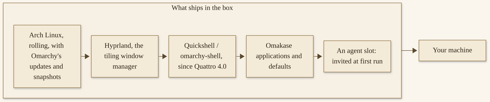{width=100%}

*D01. A finished desktop, not a kit you have to assemble first. Quickshell arrives with Quattro, in August 2026, not on the project’s first day. The agent slot is official; choosing one is Chapter 4.*


The canonical repository, on the research day, is `https://github.com/omacom/omarchy`. The default branch is `quattro`. The language GitHub reports for the repository is Shell. A former-organization URL resolves to the same repository — the same numeric id, 994093166 — and I will treat `omacom/omarchy` as the canonical name. The exact date of that transfer is unverified in our research, and I will not invent one.^8 If you bookmark one place for the code, bookmark that one.

## A short official history

Projects like this collect folklore quickly. I would rather give you a timeline you can trust, with dates, and with the things we did not find left honestly unfound.

It began with Omakub. On 6 June 2024, David Heinemeier Hansson — DHH, the creator of Omarchy, and, in his own public bio, co-owner and CTO of 37signals — published “Introducing Omakub”: an opinionated, one-command developer setup on Ubuntu and GNOME.^9 The official Omarchy page about that earlier project, opened on 12 November 2026, says “It began with Omakub,” and it says Omakub proved a thesis: give developers a beautiful, complete Linux out of the box, and they will show up. The same page is frank about a ceiling. Omakub was a layer of opinion on top of Ubuntu and GNOME, and the ideas he actually cared about — tiling, everything on the keyboard, a system that treats the terminal as the center — kept fighting the platform. So the omakase moved from Ubuntu to Arch, from GNOME to Hyprland, and became Omarchy: “Not a layer on top of somebody else’s distribution, but the whole meal.”^9 Omakub is now officially retired. Its repositories are archived. A community fork, Omabuntu, continues that earlier Ubuntu thread, if that is a path you still care about. The “tens of thousands” figure on that official page is vendor wording about Omakub’s reception; I will date it and I will not treat it as a current census.

Omarchy itself was announced on 26 June 2025, in a post titled “Omarchy is out.” At announcement it was “an opinionated setup of the Arch Linux distribution and the Hyprland tiling window manager,” with everything configured out of the box, and it was described then as a sister project to Omakub, not a replacement of it.^10 That sister-project posture is historical. Omakub has since been retired. The June 2025 post is still the right place to date the announcement.

The repository was created on 1 June 2025, at 3:26 a.m. America/New_York.^8 The earliest GitHub release object we found is v1.1.1, published 4 July 2025, at 8:02 p.m. America/New_York (the GitHub timestamp is 5 July 2025, 00:02 UTC). Tags for a v1.0.0 or a v1.1.0 release were not there. I will not invent a v1.0.0 release to make the numbering feel tidier. The announcement is 26 June 2025. The first release object we can point at is v1.1.1.

From there, a few versions matter for everything that follows, and I will give them with times in America/New_York, converted from the GitHub release timestamps.

v2.0.0, published 25 August 2025, at 10:11 a.m.: the first ISO installer, the Omarchy Package Repository, and Limine and Snapper for boot and snapshots. If you have an older memory of Omarchy as a setup you applied to an existing Arch system, that memory is from the early months. From 2.0 on, the official path is an ISO. There is, as of the research day, no official current path that layers Omarchy onto an existing Arch system, and this book will not teach one.

v3.0.0, published 17 September 2025, at 2:53 p.m.: an offline, all-inclusive ISO, and a path for Intel Macs. That Intel path still has known issues, which Chapter 3 will teach honestly. It is also the beginning of a theme this book cares about: older Apple hardware, given another job.

Between 3.0 and 4.0, two named editions are worth a mention so the timeline does not look like a blank stretch. v3.7.0, in May 2026, was called “The Gaming Edition.” v3.8.0, also in May 2026, was called “The Defaults Edition,” and it is the release that introduced hooks directories — a quiet feature that Chapter 9 will treat as part of making the system yours.^11 You do not need those two editions to install 4.5. They are part of how the project got here.

v4.0.0, published 14 August 2026, at 12:35 p.m.: Quattro. The official notes called it the biggest release since the project started. The entire desktop shell was reimagined in Quickshell. A set of earlier tools — the old bar, the old launcher, the old notification daemon, and several neighbors — were replaced. Internals moved from a git-based install to system packages. Free-space dual-boot arrived. A factory reset arrived. Hyprland configurations moved to Lua. If you are coming from a 3.x install, the upgrade path at the time was through the official update menu, then a specific “to Quattro” step. If you are installing fresh, you will land on the 4.x desktop, and Quickshell will already be what you see.

v4.5.0, published 5 November 2026, at 12:36 a.m.: Quattro RS. This is the current stable these pages were written against. The official notes, bylined DHH and dated 4 November 2026, are the right place to read the full list.^11 For this chapter, the headlines that will keep mattering are these. A traditional floating desktop and a dock arrived, as an official on-ramp, beside the tiling default. A native installer, Omarchy M, puts Omarchy beside the existing system on M1, M2, M3, and Neo MacBooks. The desktop speaks fifty languages. The first official ARM ISO shipped, with preliminary support for named NVIDIA machines. A faster installer, which the notes call the F1 installer, unpacks a prebuilt root image. And Grok became a full provider alongside Claude and Codex, with an agent panel that the notes say tracks twenty-three agents and providers. Chapter 4 will teach the first-run three. Chapter 7 will teach the longer list.

The same 4.5 notes say “over 740 pull requests merged from more than 180 contributors in just twelve weeks.” Those are official figures, from those notes, and I would rather they live in a note than in a boast.^11 Earlier community figures should be dated the same way. On 5 August 2025, in a post titled “Omarchy is on the move,” DHH wrote that since the 26 June release he had pushed out eighteen new releases, that the then-current version was 1.11.0, and that the community then included about 3,500 early adopters on the Omarchy Discord, with 250 pull requests processed.^14 Those numbers are 5 August 2025 claims. They are not current, and a current Discord membership was unverified in our research. I include them only so that “early” has a date.

A later release, 4.6, was not out on 12 November 2026. It is not in this book.

{width=100%}

*D02. Dates are in America/New_York, converted from GitHub `published_at` timestamps and from official posts. 4.6 is unreleased, and is not on this figure.*


If you only remember four stops, remember these: Omakub in 2024, as a retired predecessor; the June 2025 announcement; Quattro in August 2026, when the shell became Quickshell; and 4.5.0 in November 2026, which is the desktop this book teaches.

## Who holds it, and on what terms

The code is MIT-licensed, as I said. The README and the GitHub license field both say so.^8 That is the term on which you can use and share the software.

The site footer, on the research day, still said “Incubated at 37signals.”^3 That is their line, and I will leave it as theirs. DHH’s public role at 37signals is a matter of his own bio; this book is about Omarchy, and I will not turn a footer into a corporate tour.

On 21 August 2026, the Omacom Foundation launched. The official Foundation page describes it as the nonprofit funding the development, maintenance, and spread of Omarchy. The launch article, by DHH, is the right source for the date and for the purpose: the Foundation will hold the trademarks, fund the infrastructure, promote the work, and support the open-source projects and developers Omarchy depends on.^12 I will call it what the pages call it: a nonprofit. I will not invent a tax-exempt designation. None was stated on the pages we opened.

The homepage, on 12 November 2026, showed $23,650,000 “pledged to the Omacom Foundation.”^3 That is pledges, not an audited cash balance, and I want that distinction in the body, not only in a note. The launch article’s running updates speak of “approximately $23.7 million” in pledges and donations, and of named patrons I will not list here. If you want the current figure, look at the Foundation page on the day you look. Figures move. These are the ones we saw, on that day, and they are pledges.

Named staff, as official pages and official news listed them, include Krzysztof Wilczyński, Head of Kernel; outfoxxed, the creator of Quickshell, Head of Omarchy Shell; Emir Beganović, Head of Infrastructure; and HANCORE, Head of Design and Community.^13 ThePrimeagen joined the Core team to lead Agentic QA. On 5 November 2026, Marcelo Alcantara and Birk Skyum joined Core as delegates for the M team and the Dragon team — Apple silicon and Snapdragon work, which Chapters 3 and 10 will return to. I give those titles as the official pages stated them. I will not invent a larger org chart.

Governance is stated plainly in the Doctrine, under “Command is service.” I will quote it, because paraphrasing a line like this into something softer would be its own kind of dishonesty: “Excellence is not born out of committee, and Omarchy is not a democracy. It’s a benevolent dictatorship in the grand tradition of Linux, Ruby, and Rails.” The same principle says the dictator’s job is to listen to everyone, and to make the call according to intuition, vision, and experience; that some calls will be wrong and then reverted; that others will be delegated; and that the buck will always have a place to stop.^5 That is official philosophy, said clearly. A reader can love the desktop and still argue with a principle. This book will not pretend otherwise, and it will not turn this chapter into a debate club. It will also not hide the line.

GitHub’s API, on 12 November 2026, reported 46,877 stars, 6,071 forks, 6,685 open issues, and 214 subscribers on the canonical repository.^8 Those are API figures, from that day, and they belong in a note more than they belong in a trumpet. Community size is real, and it is also a number that will have moved by the time you read this. I would rather you meet the project by installing it than by counting stars.

One more stewardship fact, because it will matter when we talk about contributing, and about what this book is. Official sponsorships named on the Foundation page include multi-year sponsorships for Hyprland, for mise, and for work on local AI. Those are the project’s own relationships. This book is not part of them.

## What this book is, and what it is not

This book is a free, unofficial, independent guide. I wrote it as a gift to the community. I did not write it for the Foundation, and they have not endorsed it. I did not write it as a rice gallery — a tour of desktops dressed to impress — and I did not write it as a Doctrine manifesto. I did not write it as a review that crowns Omarchy over every other Linux. I did not write it as a sequel that recaps the three sister gifts. Those books are on the shelf if you want them. This one is about Omarchy.

Omarchy’s own word for itself is “agentic,” and that is the word you will find in these pages. What I can tell you is how it felt: an operating system that put an AI agent in my hands before I had done anything else. That is my experience, not a ranking. If a sentence in this book ever sounds as if I am awarding a medal, it has gone wrong, and you should trust the official phrase instead.

The reasons the rest of the book exists are practical ones. There is a community, and it is building themes and plugins and bring-ups on hardware of every kind. There is old hardware that still has work in it, including an official demonstration on a machine from 2011. And there is a real, documented path by which you can tell the desktop what you want — carefully, with a rollback — instead of only editing files by hand. Those three things, together, are why a beginner-to-mastery companion felt worth writing, and worth giving away.

I will be careful with names, and with numbers, and with stories. I will not invent a first-install date I was not given. I will not invent the other four machines in my shop. I will not name a collaborator’s applications as if they were a catalog. I will not print a live plugin total I could not verify, or a current Discord membership I could not verify, or a “year one” download window the homepage did not define. When a manual page is stale — and at least two were, on the research day, including a Coming From line about a dock that 4.5 had already shipped — I will teach the current official notes, and I will tell you about the stale line, rather than quietly copying it.

Who is it for, in one more sentence. Anyone willing can follow it: a student, a returning Linux user, someone with an old computer, a professional who wants a daily driver, a Principal AI Solutions Engineer, someone who is simply curious about an official *agentic* desktop and would rather be walked in kindly than sold to. The language is plain on purpose. You do not need to be an Arch expert. You do need a willingness to practice the Super key for a little while, and a willingness to say yes yourself.

You are still the one who says yes. That will sound, by the end of the book, like a refrain. I mean it as a kindness, and as a limit. The desktop is capable. The agents are capable. A yes you have not given away is still the difference between a tool you live with and a tool that runs ahead of you.

## A map of the road ahead

Here is the road, in one quiet look, so you can decide how to walk it.

Chapter 2 is how the desktop thinks: omakase, the Doctrine’s ten principles stated fairly, the Super key, tiling, and the 4.5 floating workspace and dock. Chapter 3 is every official current way to install, with a decision tree you can put a finger on, and with the unglamorous work of a backup, a keyboard, and the firmware settings the installer requires. Chapter 4 is the first agent: a one-time notification, three sign-ins, a default, and a first-evening ritual that stays small. Chapter 5 is a first real week, at a humane pace.

Then the book goes deeper, when you are ready. Breakage, and telling an agent you want a change, with a rollback. The rest of the agent family, including desktop apps and local models, and a door to the sister gifts if you want a thorough guide to Hermes or OpenClaw or Grok Bot. Themes, and a community gallery, and the rule that a theme installed from a repository can drop files that would run code. Plugins, unsandboxed, with a marketplace I will not invent a total for. A hardware map, and a full chapter on giving an older machine a second life. Professional days and personal days, including games. And a fair ending on updates, snapshots, safety, and contribution.

Counts in this book are dated 12 November 2026 and were re-checked the afternoon of that day. If the live page and these pages disagree on the day you read them, trust the live page.

You do not have to walk the whole road this weekend. Part 2 is enough for a first weekend. The rest will wait.

> **Try this now.** Open https://omarchy.org/ and https://omarchy.org/docs in a browser — even before you install — and notice the word “agentic.” Read it as their word. You do not have to agree with every sentence on the site to notice how they are describing the desktop.

> **Checkpoint.** You are in good shape if you can say, in one sentence, what Omarchy is, what version this book was written against (4.5.0, Quattro RS, as of 12 November 2026), and that this guide is unofficial.

> **Reflection.** What did you think a Linux desktop was, and what is different about the official description?

When you are ready, we will look at how the desktop is meant to feel: a chef’s choice, a written Doctrine, and a key called Super.


# Chapter 2
## The Omakase, the Doctrine, and the Keyboard


{width=100%}

*I02. A compact keyboard with blank keycaps, a small unlettered booklet, a single empty dish.*


A finished desktop still has a way it is meant to feel. This chapter is that feeling, taught as a practice, not as a slogan. The defaults are a chef’s choice, so you can start. The written Doctrine still says this is your computer. The Super key is how you drive the system. The default arrangement of windows is tiling, and in 4.5 a floating workspace and a dock are an official on-ramp, not a rumor. If you are coming from another operating system, or from another Linux, I will translate what will feel different, in plain words, and I will not pretend that every instinct you arrived with is a problem.

You can read this before you install. If you already have Omarchy in front of you, so much the better: you can press Super once, and the chapter will have somewhere to land. If a sentence feels abstract, skip ahead to the Super-key map, try the chord, and come back. The feeling of this desktop is easier to trust once your fingers have been around it, even once. Nothing in this chapter requires a perfect memory. Super, the menu, and a willingness to look something up with Super + K will carry you a long way.

## Omakase, and “this is your computer”

Omakase is a chef’s choice. At a sushi counter, you sit down, and the chef decides what you will eat, in what order, because the chef knows the fish and you have asked to be taken care of. Omarchy uses that word for a complete default: a set of tools, already chosen, already tuned, so you can get straight to work.^15 You are not being asked to design a desktop before you have used one. You are being handed a meal.

The other half of the idea is just as important, and it is official. The Doctrine’s ninth principle is titled “Own the machine.” I will quote it, because it is their sentence, not a slogan I want to wear on a cover: “The Perfect Computer may start as omakase, but it’s ultimately yours. Fully and completely. No tollbooths, no gatekeepers, no platforms that can change the terms on you. Just free and open code that you can turn into whatever you desire.”^16 The homepage, on the research day, said the same thing in a shorter way: they pick the tools and tune the details so you can get straight to work, and this is your computer, and you are free to change everything.^15

Defaults, then, are a starting point, not a cage. That is easy to say and a little harder to live, because a complete default is comfortable, and changing it can feel like tearing out a kitchen you have only just cooked in. Chapters 6, 8, and 9 are how you change things — including by telling an agent, carefully, with a rollback. I mention those chapters now only so you know the exits exist. You do not have to take them this week. You do have to know that “omakase” and “this is your computer” are two halves of one design, and that this book will teach both.

I have watched Grok Build reconfigure layouts for me. That is a sentence I can stand behind, and it is not a transcript. The official path for a change like that, and the official warnings, are Chapter 6. For this chapter, the point is simpler: the chef’s choice is how you start, and it is not a vow of permanence.

If you already have strong opinions about a bar, a font, or a window layout, you are welcome. You can hold those opinions and still give the defaults a fair week. If you already love every default, you are welcome too. “Own the machine” does not require you to change anything. It requires that you could.

## Keyboard-first, the Super key

Omarchy is keyboard-first. The official Navigation chapter is more emphatic than I will be — it says that everything happens via the keyboard, and that when the system first starts, you cannot do a thing with the mouse alone.^17 I will tell you, in the next section, that 4.5 also gives you a dock on a floating workspace, which you can click. Both things are true. The design is still that the keyboard is the main way in, and that the Super key is the center of it.

Super is the system key. On a typical PC keyboard it sits between Ctrl and Alt, on either side of the space bar. On an Apple keyboard it is the key your thumb already thinks of as Command. The official Coming From page describes Super as the place those older instincts go.^18 I will use the word Super, and I will mean that one key.

A first map, from the official Navigation and Hotkeys manuals as they stood on 12 November 2026, is small enough to learn this weekend, and large enough to live with.^17

`Super + Space` opens the Omarchy menu. From that menu you can do just about everything: launch applications, change settings, install software, capture the screen. Start typing, and the menu filters. If you remember only one chord besides Super itself, remember this one. The Coming From page says that `Super + K`, which shows you the main bindings, is the only hotkey you actually have to memorize, and that whenever you blank on a binding, you can hit it and look.^18 That is a kind rule, and I will repeat it.

`Super + Return` starts a terminal. `Super + Shift + Return` starts a browser. Try one after the other, and you will see tiling happen: the first window takes the space, the second shares it. `Super + J` stacks them top and bottom instead of side by side, and presses again to return them. `Super + Arrow` moves your focus from window to window.

Workspaces are how you keep more than one arrangement. `Super + 1` through `Super + 0` jump to a workspace on the monitor you are on. `Super + Tab` cycles them. `Super + Shift + 2` moves the focused window to workspace 2, and follows it; a variant with Alt moves it without following. You do not have to use all ten on the first evening. Two or three is a real practice.

You close a window with `Super + W` or `Super + Q`. Full screen is `Super + F`. Those are enough to stand up from the table and come back.

Three more chords will keep appearing in later chapters, and I want you to have them on the map even if you do not press them yet. `Super + Shift + Ctrl + A` opens the default agent, once you have one, in a dedicated terminal.^19 `Super + ~` — the same key as Grave, the one under Escape on many keyboards — is the 4.5 Quake-style console: it drops down over a dimmed desktop, and the first time you open it, it starts your default agent. Press it again to tuck the session away.^17 `Super + Ctrl + X` opens the agents panel in the top bar.^19 `Super + Alt + Space`, in 4.5, opens the app grid, the one that sits behind the dock’s apps button. It is not the theming application called Aether. Aether is started from the Omarchy menu, and it belongs to Chapter 8.^20

The official Navigation chapter offers a small sequence you can try, once the machine is in front of you, that makes tiling visible rather than theoretical. Open a terminal with `Super + Return`, then a browser with `Super + Shift + Return`, and watch them share the space. `Super + J` stacks them. `Super + Shift + Arrow Right`, with the browser focused, swaps the two windows. `Super + Shift + T` opens the activity monitor as a floating window; `Super + T` tiles it, and presses again to float it. `Super + Shift + F` opens the file manager. At that point you have a four-way setup, which is exactly the walk the manual describes.^17 You navigate among those windows with `Super + Arrow`. You close one with `Super + W`. That is a ten-minute lesson, and it is enough for a first afternoon.

If you have more than one monitor, every monitor has workspaces 1 through 10 of its own. `Super + 2` goes to the second workspace of the monitor you are on, and each monitor’s top bar shows its own workspaces. `Super + Shift + Ctrl + Arrow` moves the window you are on to the monitor in that direction; `Super + Shift + Alt + Arrow` moves the whole workspace. A monitor keeps its workspaces when you unplug it: they join another screen, and they go back under their old numbers when the monitor returns.^17 You do not need two monitors to start. If you have them, those are the official rules.

You can also use the mouse, with Super held down: left button to rearrange a window, right button to resize it. That is official, and it is a kindness on the first day, not a contradiction of “keyboard-first.”

I will not invent a chord, and I will not give you a wall of them. `Super + K` is there when you need the rest. The important ones will return as they are needed.

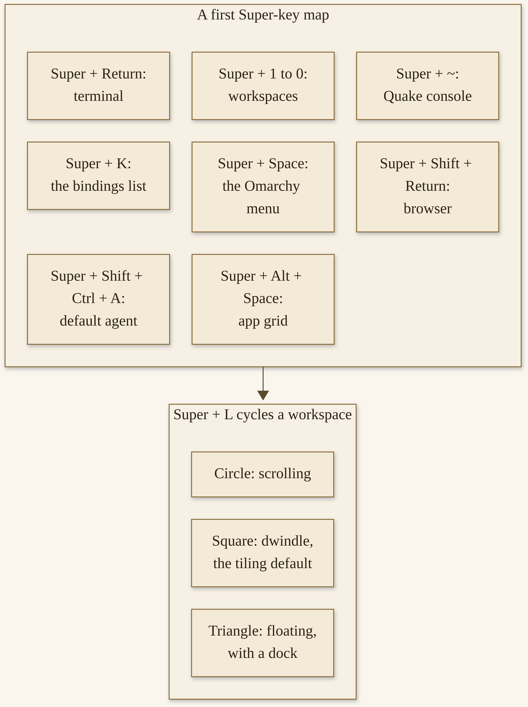{width=100%}

*D03. Bindings as the official Navigation, Hotkeys, and AI manuals listed them on 12 November 2026. Super + L walks the three layouts. The bar marks the one you are on.*


## Tiling, floating, and the 4.5 dock

The default is tiling, with Hyprland. The default tiling layout is called dwindle: every window you open on a workspace stays visible, even if the windows have to shrink to make room.^17 That is the heart of the first evening’s surprise, if you have spent years dragging windows by their title bars. You open a terminal and a browser, and they place themselves. You do not fish one out from under the other, because in dwindle they do not overlap.

There is a second tiling-adjacent layout, called scrolling: windows line up side by side, and they can run past the visible edge of the display, so you scroll along the row. And there is floating, where windows overlap freely and you place them yourself.

In 4.5, `Super + L` cycles a single workspace through those three: dwindle, then scrolling, then floating, then back to dwindle. `Super + Alt + L` goes the other way. The top bar marks the workspace you are on with a small shape: a square for dwindle, a circle for scrolling, a triangle for floating. Clicking that mark cycles the layout too.^17 The choice is per workspace, and it sticks, including after a restart. You can keep workspace 1 on dwindle for reading and workspace 2 on floating for a more familiar desk, and they will come back that way.

A floating workspace, in 4.5, works like a traditional desktop. The windows overlap. Each window gets a title bar in your theme’s colors, with buttons to minimize, maximize, and close. `Super + M` minimizes the focused window. A minimized window waits in the dock. And there is a dock: pinned apps, running apps, and a grid of every app behind an apps button, which `Super + Alt + Space` opens as well.^17 You can drag icons, pin them, and, if you want, hide the dock until the pointer reaches its edge.

I want to say this next part carefully, because an official page had not caught up on the research day. The Coming From page, which is otherwise a useful translation for people arriving from another system, still had a heading that read “There’s no dock and no desktop icons.”^18 That line is stale after 4.5. I will not copy it as current. 4.5 added a floating desktop and a dock as an official on-ramp, and the 4.5 notes are explicit about why: it is a wonderful on-ramp for anyone who is not ready to go all-in on tiling yet, or for anyone who just wants one workspace where windows can sprawl.^21 You can live in tiling, try floating, and switch. Neither is a moral victory. The default is still dwindle. The dock is there when you want it.

A few related habits, so the first week is not a scavenger hunt. `Super + T` toggles a single window between tiling and floating, even on a dwindle workspace, which is useful for a small utility you want on top. `Super + O` pops a window out and pins it so it follows you across workspaces — the official example is a video player. `Super + S` is a scratchpad workspace that overlays the one you are on; `Super + Alt + S` places a window there. The Quake console we already put on the Super-key map, `Super + ~`, is a half-height drop-down over the current workspace, and in 4.5 it opens with your default agent ready to go. While it holds a single window, the Navigation manual says it drops down as a centered panel rather than spanning the screen; a second app on it takes it back to full width.^17

You can also group windows, with `Super + G`, so that several windows share one tile and you move among them with `Super + Ctrl + Arrow` or with `Super + Alt + 1` and its neighbors. You can take a window out of a group, or disassemble the group, with chords the same manual lists. I mention grouping so you know it exists. I would not start a first week by grouping everything. Tiling, a workspace or two, and a willingness to press `Super + L` once are a better foundation.

You do not need all of these on day one. You need to know that tiling is the default, that floating and a dock are official in 4.5, and that `Super + L` is how you walk between them.

New workspaces, and any you have not given a layout of their own, use the default. You can change that default later, under Appearance > Workspace Layout, or from a terminal command the Navigation manual lists. I will not push you to change the default this week. Trying `Super + L` once, and looking at the mark on the bar, is enough.

## The Doctrine, all ten, fairly

There is a written Doctrine, by DHH, on the official site.^16 It has ten principles. I am going to walk all ten, including the ones a reader may disagree with, because hiding a line would be its own kind of editorial, and amplifying one into a culture-war chapter would be another. This is their philosophy, attributed. It is not ours to wear as a slogan, and it is not a test you have to pass to use the desktop. A reader can love the desktop and still argue with a principle. I will not pretend otherwise.

**Unite the nerds.** There are amazing nerds everywhere, the page says, spread across a thousand little fiefdoms, and Omarchy is a rallying cry to unite that talent behind a common goal: “Make Linux win the desktop, as the prophecy foretold.”^16 That is a rally, and it is theirs. This book is a gift to people who want to use the desktop, including people who have no interest in a prophecy. You can take the welcome without taking the banner.

**Hold the line.** I will quote this one, and then I will leave it. “The original hacker cred was all about the code. It didn’t care who you were, what your background was, or even if you were legally old enough to operate a three-node elite BBS out of your bedroom. It just cared about the work, the art, the dare. Omarchy is bringing that ethos back, and dropping the Code-of-Conduct struggle sessions and identity-overload nonsense that has plagued open source for far too long. We’re done with all of it. Just be nice and sincere.”^16 That is the official text, as it stood on 12 November 2026. I will not hide it. I will not amplify it. “Just be nice and sincere” is the close they chose. This book will try to be both, and it will not turn the preface — or this section — into a debate club.

**Have some fun.** The page says they are serious people, doing serious work, and that if they cannot laugh at themselves and at “the delusional mission,” it gets stuffy. They want fun, whimsy, cool for its own sake: easter eggs, silly games, funny pun songs. “Serious people have serious fun.”^16 I like that sentence, and I will not make it cuter than it is. A desktop can be serious and still have a little delight in it. The first week does not require you to hunt for easter eggs. It does allow you to enjoy a theme, or a nice terminal, without apologizing.

**Beauty is truth.** Great tools are beautiful because they are right, the page says: the best curve of the blade is also the elegant one. Colors should be coordinated. Padding should be just so. “There’s enough desaturated brutalism in this world already. Make it shine, make it wow, make it art.”^16 This is the aesthetic argument we met in Chapter 1, in a more poetic coat. You will feel it in the bundled themes, and in the way a theme restyles more than a wallpaper, which is Chapter 8. You do not have to become a designer. You can pick one theme, live with it, and decide later.

**Heritage is duty.** The modern history of computers is barely a lifetime old, the page says, and its heritage deserves respect: honoring the people who forged the path, from shipping basic vi fifty years after Bill Joy wrote the first version, to dedicating a theme to von Neumann.^16 This book is not a history of computing. It is a practical guide. I mention the principle because the project’s own sense of itself includes a debt to earlier tools, and because that debt is a kinder frame than “everything before us was a mistake.”

**Command is service.** We quoted the opening already, in Chapter 1, and I will quote it again, because it should be heard in the Doctrine’s own walk, not only in a stewardship section: “Excellence is not born out of committee, and Omarchy is not a democracy. It’s a benevolent dictatorship in the grand tradition of Linux, Ruby, and Rails.” The dictator’s job, the same principle says, is to listen to everyone, and to make the call according to intuition, vision, and experience. Some calls will be wrong, and then they will be reverted. Others will be delegated. “But the buck will always have a place to stop.”^16 That is a clear governance statement. It will matter if you decide to contribute, in Chapter 14. It will matter, in a quieter way, if you wonder why a default is the way it is. A benevolent dictatorship is not a hidden fact. It is on the Doctrine page, in those words. You can find the model inspiring, or you can find it a reason to be watchful, or both. The software is still MIT-licensed, and the machine is still yours.

**Welcome the agents.** “The age of agents is the most important paradigm shift in computing since the microprocessor, and Omarchy is going to take full advantage. Agents are welcome everywhere. In the code, in the issues, in the pull requests, and in the infrastructure. We’re going to lean all the way in, put the new intelligence to work all over, and together We Can Fix Everything!”^16 “We Can Fix Everything” is their line. It is not a guarantee, and it is not this book’s slogan. The mechanisms behind the welcome — a first-run agent, a crash handoff, an experimental skill — are what we will teach, with the manual’s own warnings still attached. Chapter 4 is where that welcome becomes a first evening’s work.

**Perfect the computer.** There is no paper cut too small, the page says, and Omarchy’s mission is nothing less than “The Perfect Computer”: the pursuit of excellence without justification, everything faster, better, prettier, “and be done before ASI.”^16 That is a mission statement, and it is ambitious on purpose. A practical guide can respect a mission without promising that your machine will be perfect by Friday. Paper cuts will still appear. Chapter 14 is how updates and snapshots and official help fit around that fact.

**Own the machine.** We have already sat with this one, and it is the principle I want you to be able to say in your own words at the end of the chapter. The Perfect Computer may start as omakase, but it is ultimately yours.^16 Fully and completely. That is the sentence that makes the chef’s choice ethical, rather than merely convenient.

**You’re somebody now.** “Omarchy is for everyone willing to learn and participate. From billionaires to anons on X. From staff engineers to script kiddies. From China to Malibu. Show up, fix something, or just spread the enthusiasm. You’re somebody now.”^16 I will take the welcome, in that last sentence, as a door, not as a demand. You can show up by installing, by asking a careful question, by writing a theme later, or by simply living on the machine for a week. You do not have to earn the desktop by contributing first. Contributing, when you want to, is Chapter 14.

Those are the ten, as the official page listed them on the research day. If the page has changed by the time you read this, trust the live page. Official slogans and Doctrine lines in this book are always quoted and attributed. They are not our slogans, and they do not imply endorsement.

## Coming from another system

If you are coming from another operating system, or from another Linux, here is what will feel different, said kindly.

The desktop is keyboard-first, and Super is the system key, as we have already practiced. A search-or-start instinct you may have on another system — a key you tapped to open a menu and start typing — is `Super + Space` here.^18 Applications you use every day often have a direct chord, and `Super + K` will show them. In 4.5, there is a dock, on a floating workspace, if you want that kind of on-ramp. Encryption is on by default, which is a good default for a machine that can be lost or stolen, and it means you will have a drive password as well as a user password, which Chapter 3 will walk through.

If you plan to share the disk with another operating system, Chapter 3 will ask you to do two unglamorous things first. You will need to turn the other system’s drive encryption off, before a free-space install, because that kind of encryption is not compatible with the official dual-boot path as the manual describes it. And you will need to turn off firmware secure-boot and related trusted-platform settings, as Getting Started requires, because the installer will not proceed until those firmware settings are off.^22 I will say both of those plainly, in generic words, when we get there. I mention them now so they are not a surprise at the start of an evening.

Copy and paste, if that has been a source of Linux folklore for you, is gentler than the folklore. Omarchy gives you `Super + C`, `Super + X`, and `Super + V`, and the official page says they work everywhere, including the terminal.^18 Clipboard history is `Super + Ctrl + V`. You do not have to believe that until you have tried it. You can try it on the first afternoon.

Settings, many of them, live in text files, and the Setup menu will drop you into the right file. Updates come through one official command, `omarchy update`, which takes a snapshot first. Software comes from a package manager and from official install menus, which Chapter 5 will use once, for one thing you already need. And when you close a window, the application actually quits — there is not a limbo where the program keeps running with no windows. `Super + W`, or `Super + Q` if that is the finger memory you arrived with, means gone.^18

A few more translations, so the first Monday is less of a hunt. A notification history lives on a Super chord the Coming From page lists. System snapshots are taken automatically on every official update, which is the closest thing here to a system-level “go back” for the operating system itself — with a limit, taught in Chapter 14, that a restore does not roll back your home directory. Installing software is a menu, or a package command, rather than a downloaded installer you hope you can trust. Setup in the Omarchy menu is the closest thing to a system-settings panel, and it often opens the actual config file.^18 You will get used to that faster than it sounds.

Applications you still need on the other operating system can wait for the virtual-machine path in Chapter 12, with its official limits. This chapter will not pretend that every program you already own has a perfect native equivalent. Some will. Some will run in a contained virtual machine. Some you may decide you can live without. That is a later, practical conversation, not a first-evening demand.

On Apple hardware, two sentences for orientation. On Intel Macs, the official Mac-support page is still the right source for known issues, which Chapter 3 will teach. On Apple silicon — M1, M2, M3, and Neo — 4.5 ships a native installer that puts Omarchy beside the existing system; M4 and newer were “on the way” on the research day, not “ships today.” The keyboard, on a Mac, already has Super under your thumb, where Command was.

## Give it two weeks

The official Coming From page closes with a heading I am happy to quote, because it is theirs, and because it is humane: “Give it two weeks.” The instincts, the page says, transfer faster than you would think. Skim the hotkeys chapter once, and whenever you blank on a binding, hit `Super + K`.^18

That is official advice, and it is this book’s advice too. Two weeks of Super-key practice is a Chapter 5 lesson, and it starts whenever you first sit down at the machine. You do not have to love every default. You do have to know where the exits and the snapshots are — Chapter 14 will teach them — before you tear the kitchen out. A first week spent living on the desktop, rather than mastering it, is not a delay. It is the point.

Two weeks is not a vow of silence, and it is not a demand that you suffer. It is a request that you give a new set of instincts a little time to form, before you decide the desktop is not for you, and before you decide the defaults are wrong. A notebook helps. Write down the chords you actually use, not the ones you think you ought to use. On day one, that list might be three lines long. On day fourteen, it will be longer, and some of the first three will feel like they were always there.

If you are coming from another Linux desktop — from a more traditional one, or from a window manager you already riced yourself — the same advice holds, with a slightly different emphasis. The surprise may not be tiling. It may be that so much has already been chosen, and that the official way to change it is through `~/.config`, through the `omarchy` command, and, carefully, through an agent, rather than through starting over. Give that finished-ness two weeks too. You can always go back to a setup you already loved. You will know more about this one if you have actually lived in it.

If a layout bothers you on day two, you can try `Super + L` and see whether a floating workspace feels kinder, without changing a single config file. If a chord bothers you later, Chapter 6 will teach a reversible change, with a rollback. The Doctrine will still be there, all ten principles, whether you have made peace with them or not. The machine will still be yours.

> **Try this now.** If you already have Omarchy, press Super and open the menu once with `Super + Space`, without clicking, and type a letter or two to see it filter. If you do not have it yet, write down three Super chords you expect to learn this weekend. A good three: `Super + Space`, `Super + Return`, and `Super + K`.

> **Checkpoint.** You are in good shape if you can explain omakase in a sentence, name the Super key, say that 4.5 has a dock on a floating workspace, and summarize “Own the machine” in your own words.

> **Reflection.** Which Doctrine principle already feels like yours, and which one do you want to read twice?

When you are ready to put this on a disk, Chapter 3 is every official way in, and the work you do before a single download.


# Part 2 — Day One Through the First Week
# Chapter 3
## Get In: Every Official Way to Install Omarchy


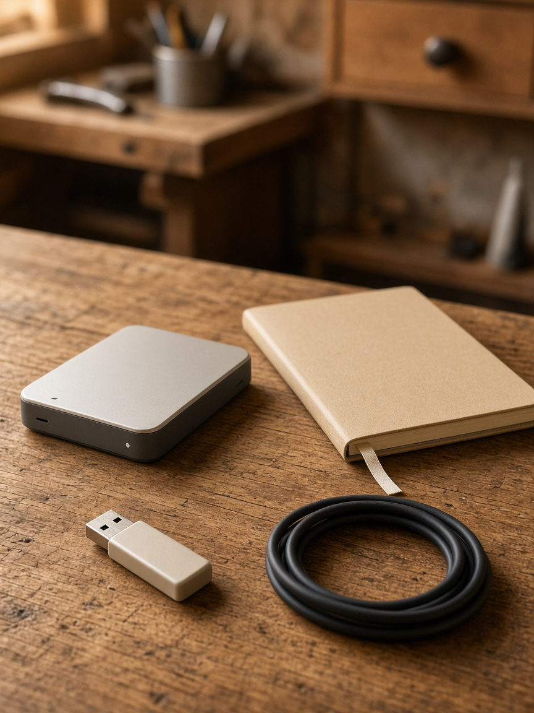{width=100%}

*I03. A plain USB stick, a coiled cable, an unmarked backup disk, a blank notebook.*


This is the chapter where the desktop leaves the page and lands on a disk. I want it to feel kind. There is more than one official way in, and the right one depends on the machine in front of you, and on whether that disk already has a life on it. We will pick a path before we download anything. We will do the unglamorous work — a backup, a keyboard that will work at the encryption prompt, the firmware settings the installer requires — and then we will walk the path you actually have, with the caveats still attached.

Two promises at the door. I will only teach official current paths. There is no official current path that layers Omarchy onto an existing Arch system; an early 2025 script-on-Arch was how the project began, and it is history. And I will not treat a 7-second install as typical. That figure is a named record, on fast hardware, and I will introduce it as one. The manual still says the work can be done in under a minute on the fastest modern machines, and that it should not take more than five minutes even on an older computer.^23 You should plan for the manual’s evening, not for a record.

## A kind decision tree

Before a single download, answer a few questions about the machine you actually have.

Is this the only system you want on the disk, or are you sharing the disk with another operating system that is already there? A full-disk install takes over the entire drive and wipes it. A free-space install puts Omarchy in unallocated space, which is how you dual-boot. Both are official. They are not the same decision, and they are not equally reversible.

Is this everyday x86 hardware, an Intel Mac, Apple silicon, or a preliminary ARM machine? The everyday path is the official ISO. Apple silicon — M1, M2, M3, and Neo — has, in 4.5, a native installer called Omarchy M, which puts Omarchy beside the existing system, without a USB stick. Intel Macs have a supported path with known issues I will not sand down. A first official ARM ISO shipped in 4.5, and it is preliminary, for named NVIDIA machines.

Do you want a taste first, in a virtual machine, on the system you already have? That is official, and it is a good idea if this is your only computer and you are not ready to partition it tonight.

Are you installing for yourself, for a fleet, or for someone else? An unattended install, with configuration on a second drive, is the official path for a base image and for fleet machines. An install-for-another-owner defers the personal questions until first boot, which is the right thing to do when the machine is a gift, or a handoff, and the username should not be yours.

Put a finger on the path that matches. The rest of this chapter is that path, taught carefully, and the work that every path shares.

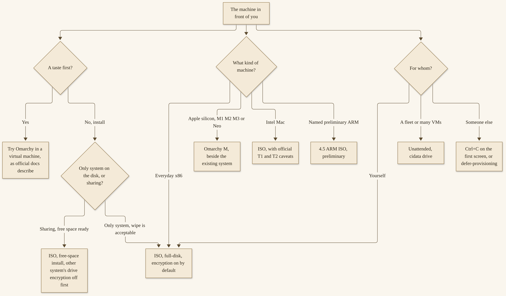{width=100%}

*D04. Official current paths only, as of Omarchy 4.5.0, 12 November 2026. There is no official current path that layers Omarchy onto an existing Arch system. M4 and newer were “on the way,” not “ships today.”.*


If your machine does not sit cleanly on one branch, prefer the more conservative one. A virtual-machine taste, on a computer you already use, will teach you more in an hour than a rushed wipe you are not sure about. A full-disk install is clean and simple, and it is permanent about the previous contents of that drive. A free-space install is how you keep the other system. Omarchy M is how you keep the other system on a supported Apple-silicon machine, without a USB stick. Preliminary means preliminary. We will say that again when we get to the ARM ISO.

People sometimes arrive at this chapter hoping there is a gentle way to “just add Omarchy” to an Arch system they already love, without an ISO and without a new disk layout. I understand the hope. Early in 2025, when Omarchy was still an opinionated setup applied to Arch, that was closer to how it worked. From v2.0.0, on 25 August 2025, the official path has been an ISO.^31 Community issues have asked for an overlay; an overlay is not an official current path, and this book will not teach an unofficial one. That is a kindness, not a slight: an unofficial overlay is how a careful first weekend turns into a unique machine that official updates no longer understand. If you already run Arch, and you want Omarchy, the honest current options are a new official install — full-disk, free-space, or a virtual machine — not a script run on top of a desktop you already configured by hand.

## Before you start: firmware, a keyboard, a backup

This is the unglamorous section, and it is the one that prevents a bad hour.

Back up anything you care about. A full-disk install will wipe the selected drive. A free-space install is not supposed to, and I would still not begin one without a backup of the system you are keeping. If you have never made a backup you could actually restore, this is the evening to do that, on the system you already have, before you reboot from a USB stick. I will not prescribe a backup tool. I will tell you that “I will be careful” is not a backup.

Getting Started requires that you turn off firmware secure-boot and related trusted-platform settings in the firmware setup — the screens you enter before any operating system starts, often with a key at power-on. You have to turn these off to be able to install Omarchy.^23 I will describe them the way this book describes them throughout: as firmware settings the installer requires, in generic words. The official page is more specific, and more charged, about whose schemes they are; I am following a house rule, not softening a requirement. The requirement is real. If those firmware settings are still on, the install will not go as the manual describes. Look up how your particular machine enters firmware setup, turn the relevant settings off, and write down what you changed, so you can change it back if you ever need to.

If you plan to dual-boot, the other system’s drive encryption must be off first.^24 The official dual-boot chapter is explicit that this install method is not compatible with that kind of full-drive encryption, and that if you encounter an error saying it is still on, you go back to the other system and turn it off, and that decrypting the drive may take some time. Do that work before you boot the Omarchy installer, not in the middle of it. Give it the time it takes.

Use a wired keyboard, or a 2.4 GHz one, for the disk-encryption password. The official Getting Started page has a heading for this, and it is worth obeying: full-disk encryption will not allow you to enter the password from a Bluetooth keyboard at startup, any more than you can use a Bluetooth keyboard to enter the firmware setup on many PCs.^23 You will need a keyboard that uses a cable or a 2.4 GHz dongle. If your favorite keyboard is Bluetooth-only, borrow one for the install and for those first-boot prompts, or you will be looking at a password field you cannot type into. Once you are in the desktop, you can use whatever keyboard you like.

From version 3.0, there has been an offline, all-inclusive ISO, so a machine that will not be on a network during the install still has an official path.^31 You still download that image from a machine that is online, and you still verify it. The point is that the install itself does not have to pause for a mirror. If you are bringing up a machine in a place with poor connectivity, or you want the install to be predictable, prefer the current official image from the homepage, and trust what the download page says on the day you fetch it about what is included.

Download the official ISO — or, for Apple silicon, the Omarchy M installer — from the official pages, at omarchy.org. On the research day, the homepage offered Omarchy 4.5.0 for x86, Omarchy 4.5.0 for ARM, each with a SHA-256 link and a signature link, and an Omarchy M installer with its own SHA-256.^25 Verify checksums from that page, on the day you download, against the file you actually received. I am not going to print a hash into this chapter. Hashes go stale, and a printed one that I have not re-fetched on your day would be worse than a pointer. The official page is the authority. If the page publishes a signature, and you know how to check one, check it. If you do not, the SHA-256 comparison, against the page, is already a real step.

Write the image to a USB stick with a USB imaging tool on the system you already have. I will not prescribe a brand. The official Getting Started page names tools for different systems; any reputable imaging tool that writes the image as the page expects will do. Boot the machine from that stick, using whatever firmware boot menu your computer offers. If the machine boots the old system instead, go back into the firmware boot order and choose the stick.

That is the shared work. None of it is glamorous. All of it is kinder than skipping it.

## The ISO, full-disk, encryption on by default

The common path is the official ISO, and a full-disk install. Full-disk takes over the entire drive. It wipes the selected drive. I am going to say that one more time, because it is the sentence people skip: it wipes the selected drive. Be sure of the drive. Be sure of the backup. Then confirm.

The installation defaults to full encryption, with LUKS, which is a standard way of encrypting a Linux disk.^23 That is the safe, responsible choice, the manual says, for any computer that can possibly be lost or stolen. You do not want anyone with access to your hardware to be able to get your data. After the install, two passwords will exist: the drive password, which you enter early, at a prompt that appears before your session, and the user password, which is yours on the desktop. Do not make them identical out of convenience if you can help it, and do not lose the drive password. Without it, the disk is a brick to anyone, including you.

There is a documented no-encryption escape. On the disk-formatting confirmation, you can press `Ctrl + C` and switch to an installation without encryption.^23 The manual describes this as for special circumstances: remote installs on protected computers, or throw-away installations without sensitive data. I will teach it as a choice with a trade-off, not as a tip. If the machine can leave the house, encryption is the default for a reason. Chapter 14 returns to the security posture in more depth. If you take the escape, take it on purpose, and know what you are giving up.

The 4.5 notes describe a faster installer, which they call the F1 installer: it unpacks a prebuilt root image and adds just this machine’s packages on top, rather than installing some 940 packages one by one.^26 That is why install times dropped. It is also why a 7-second record became possible. Anush Elangovan, of AMD, set that record with a full Omarchy install in 7 seconds, on an AMD laptop, as the 4.5 notes tell it.^26 The homepage, on the research day, said you can be up and running “in as little as seven seconds on the fastest machines, and in less than two minutes on the majority of computers.”^25 I will celebrate a record as a record, and I will plan, with you, for the manual’s “under a minute on the fastest modern machines” and “not more than 5 minutes even on an older computer.”^23 If your older machine takes a little longer than five, you have not failed. You have an older machine, and Chapter 11 is for you.

After you download, image, and boot, Getting Started’s path is: answer the configuration questions, confirm them, select a drive, and sit back.^23 The homepage says you answer five questions.^25 I will not invent a list of the five. Answer what the installer asks, carefully, especially the drive, the username, and the passwords. In 4.5, git identity is asked after first login, not in the installer, so you may not see it here.^26 Language can be set later — Omarchy speaks fifty languages in 4.5, with English as the default — under Setup > Language, or with `omarchy language`.^23 You can install in English and change it after, if that is easier tonight.

Then the first boot. You will enter the disk password at the early prompt, with that wired or 2.4 GHz keyboard. You will enter your user session. If a first-run invitation to choose an agent appears, that is Chapter 4, and you can turn the page when you are ready. If an update is offered, we will talk about it at the end of this chapter, and again in Chapter 5.

If you are only installing for yourself, on a drive you are willing to give entirely to Omarchy, you can skip the next section and go to the hardware-specific one that matches you — or, if you are on everyday x86, to the section on a taste, a fleet, or a gift, and then to first boot.

## Dual-boot in free space

You can install Omarchy into free space beside another operating system. The official Dual Boot chapter describes this as a single-partition install, still with LUKS encryption for that partition by default, that simply requires free space to be available on the disk.^24 After you select your disk in the installer, you are given the option of a free-space install. Select that option to prevent wiping the full disk. Confirm that everything looks good, and wait, as you would for a full-disk install. The no-encryption escape, on the formatting confirmation, is available here too, and is still a trade-off.

The other system’s drive encryption must be off first, as I said in the shared work. If it is still on, this path is not compatible with it.^24 Make the free space on the other system, before you boot the Omarchy installer, using whatever disk tool that system already gives you, and leave it unallocated. The official chapter walks a specific other-system tool; I will say only that you need real free space, not a folder, and that the size you leave will be the size of your Omarchy install, including its boot partition. I will not invent a recommended number of gigabytes the official page does not treat as a rule. Leave enough for a system you will actually live in, and for your files.

When the Omarchy install finishes, the boot manager is Limine, which has been the default since Omarchy 2.0. It is not an older bootloader you may remember from other Linux installs, and calling it by the wrong name will only confuse a search later. To add the other operating system to Limine’s menu, run `limine-scan` and follow the prompts to add the entries you want.^24

The boot menu, in 4.5, is quiet. It stays hidden by default and starts Omarchy after one second.^24 To choose the other system, or a snapshot, press any key as soon as Limine starts — the down arrow works — and when the menu appears, use the arrow keys and Enter. If Omarchy starts before you press a key, restart and try again. If you later turn on Setup > Direct Boot, the firmware skips Limine entirely, and getting back to the menu means picking Limine from your firmware boot menu, or running Setup > Direct Boot again to remove that entry. Direct Boot also refuses to run on some firmware, including American Megatrends and Apple, as the snapshots manual states; that is a Chapter 14 detail, previewed here so a quiet menu is not mistaken for a missing one.^27

{width=100%}

*D05. Two rooms and a quiet door. `limine-scan` adds the other system to the menu. This is not a promise that every other system will dual-boot cleanly.*


This is not a promise that every other operating system will dual-boot cleanly with Omarchy. It is the official path, with the official requirements. If a manual page lists a known failure, believe it, and date it. The encryption incompatibility is one. If you hit something the manual does not describe, stop, do not invent a repair, and ask for help in the official channel at the end of this chapter, or go back to a backup. A dual-boot you cannot boot is a very long evening.

## Omarchy M, Intel Macs, and the ARM ISO

Apple silicon, Intel Macs, and the ARM ISO need to be separated, because an official manual page is stale on one of them, and because “preliminary” is a word I want you to hear as a word with a meaning.

**Omarchy M**, in 4.5, is a native installer for Apple silicon. It puts Omarchy right next to the existing system on M1, M2, M3, and Neo MacBooks. No USB stick is needed.^25 The 4.5 notes give a Homebrew line, if you prefer that kind of install: `brew install omacom/mac/omarchy`.^26 The homepage, on the research day, said “M4 and newer are on the way.” The 4.5 notes, a little more specifically, said M4, M5, and M6 were all being worked on.^26 Neither sentence is “ships today.” If your machine is M4 or later, look at the live official pages on the day you look, and do not treat this book as a promise that the installer has arrived.

The Omarchy M path is, in spirit, a dual-boot: Omarchy sits beside the system that was already there. The work of making free space, and of whatever Apple’s own installer asks you to confirm, is work you should do slowly, with a backup of the existing system, even though no USB stick is involved. I will not invent a click-by-click for a macOS installer I am not walking in this paragraph. Follow the official Omarchy M instructions on the day you run them. If a prompt asks you to shrink a volume or to confirm a partition, confirm that you understand what will be left for the system you are keeping. The 4.5 notes’ pride in “no USB stick, no terminal incantations” is fair, and it does not make a backup optional.^26

The Mac-support manual, on the research day, was stale if it still said that installing on an M-series Mac is not directly supported, or that Omarchy only supports being the only operating system, with the drive wiped.^28 Prefer the 4.5 notes and the homepage for Apple silicon. I am telling you about the stale lines so that a search does not lead you to a wipe you did not need.

**Intel Macs** are a different story, and the Mac-support page is still the right source for them.^28 Omarchy has built-in support for Intel Macs. The installer detects Mac hardware and applies needed fixes automatically: Broadcom Wi-Fi drivers and firmware, an SPI keyboard driver, and an NVMe suspend fix, as that page describes. You will still need to handle firmware settings as the page and Getting Started require, including allowing external media where the firmware asks for that, described here as firmware settings, in generic words.

The known issues are real, and they depend on the chip generation. On T1 machines — late-2016 Touch Bar MacBook Pros, as the page lists them — the Touch Bar is non-functional, and sound is not functioning. On T2 machines — a range of 2017–2020 models the page lists, including an iMac Pro and several MacBook and Mac mini years — the installer sets up a `linux-t2` kernel, T2 audio, Broadcom firmware, and fan control, and the Touch Bar has a form of kernel support the page describes. A 2017 27-inch iMac, without T2, has a set of sharper issues on that page: the display not at native resolution, sound not functioning, brightness having no effect, and sleep hanging the machine so that only a power cycle recovers it. A community patcher is named on the page; it is community, and it is not a promise. v3.0.0, in September 2025, first added a path for most pre-M MacBooks, with a frank official caution that there may still be issues and trade-offs, so you should only install this on hardware you are okay experimenting with.^28 I will keep that caution. A 36 percent performance-gain figure on a 2019 machine appears on the same page as “a simple test”; it belongs to Chapter 11, as a dated official claim, not to this chapter as a boast.

**The ARM ISO**, in 4.5, is the first official ARM image, and it is preliminary. The 4.5 notes name preliminary support for NVIDIA’s ARM machines: the DGX Spark desktop, and laptops built on the N1X, such as the Dell XPS 16 Creator Edition and the ASUS ProArt P14.^26 “Expect a few rough edges,” the notes say, and they ask you to report anything that breaks. Preliminary means preliminary. Snapdragon work, under the name Omarchy Dragon, was work in progress, machine by machine, on the research day; Chapter 10 will map it, and will not call a bring-up a certification. If your ARM machine is not one of the named ones, do not treat the ISO as a guarantee.

A short word about sleep, graphics, and expectations, so a first boot on unusual hardware is not a shock. Official pages, as we researched them, do not publish a complete GPU compatibility matrix, and this book will not invent one. Graphics drivers and configuration, including NVIDIA on supported hardware, are described on the homepage as sorted during installation.^25 Some NVIDIA machines have sleep caveats that Chapter 10 will teach: on some GB10 machines, suspend and hibernation are turned off because sleep has not been shown to work on that hardware yet. Intel Mac sleep issues, where the Mac-support page states them, are real. If your first evening is on preliminary or vintage hardware, treat sleep as something to test, not as something to assume, and do not close the lid on a long install unattended until you know what this machine does. That is caution, not a prediction of failure.

## A taste in a VM; unattended and gift-machine installs

Not every evening has to be “wipe my only laptop tonight.” Three official paths exist for a taste, for a fleet, and for a machine you are preparing for someone else.

**Try Omarchy** in a virtual machine, on the system you already have. The homepage, on the research day, offered “All of Omarchy running in a virtual machine, so you can get a taste first,” and pointed at official companion paths for that taste.^25 The manual’s “Omarchy on...” chapter also covers user-driven virtual-machine setups. I am not going to invent a step-by-step for a hypervisor I have not re-walked in this chapter. Use the official Try Omarchy page, and the official manual, for the exact clicks on the system you already have. A virtual machine is a good place to meet the Super key, and a good place, later, to practice a snapshot restore, which Chapter 14 will ask you to do in a VM rather than on an only-copy disk. It is also a place with limits: performance, graphics, and devices will not feel exactly like bare metal. For a first look, that is fine.

**Unattended installs** are how the ISO installs itself with nobody at the keyboard. If the installer finds a second drive labeled `cidata` — that is the cloud-init NoCloud label, which a lot of virtualization tooling already knows — it copies the configuration off that drive, skips the setup wizard, and reboots into the finished system.^29 With no such drive attached, nothing changes, and you get the normal wizard. The official manual describes this as a way to treat Omarchy as a base image for virtual machines and fleet machines.

The files on that drive are exactly what the installer’s own wizard writes. The easiest way to get a starting set, the manual says, is to run one interactive install — in a virtual machine, say — and copy what it wrote into `/root`. Two files are required: `user_configuration.json`, for disk, hostname, timezone, and keyboard; and `user_credentials.json`, for username and a password hash. Optional files are `user_encrypt_installation.txt`, which is `true` when the configuration carries a `disk_encryption` block; `authorized_keys`, SSH public keys, one per line; and `tailscale_authkey`, a Tailscale auth key for joining a tailnet on first boot.^29 I will not invent fields the manual does not list. Generate the password hash with the documented command: `openssl passwd -6 "yourpassword"`. The name and email for git commits are not part of the install; set them once the machine is up, over SSH for example, with `omarchy setup git --name "Jane Doe" --email jane@example.com`.^29

You can also drop in an empty file named `defer-provisioning` in place of `user_credentials.json`. That runs the same prepare-for-another-owner install you can trigger interactively: the machine installs with no personal details, and whoever boots it first picks their keyboard and creates their user. That is the mode for imaging rigs, the manual says, where the drive should not carry anyone’s credentials at all.^29

When `authorized_keys` is present, the install sets those keys up, enables the SSH service, and opens the firewall for it. A stock Omarchy install, the same page notes, ships that service disabled and the port closed, so an unattended machine would otherwise be unreachable. The install only adds your keys. It does not loosen the rest of the SSH daemon’s authentication settings.^29 When a Tailscale auth key is present, the machine joins your tailnet on first boot, and the manual recommends a reusable, pre-authorized key so one drive image can serve many machines.

Building the `cidata` drive, as the manual describes it, is ordinary: any filesystem with the right label works. A tiny ISO is the easy way, and the official page shows a short sequence — a folder, a copy of the required files, and `genisoimage` with `-volid cidata` — then attach that image to the virtual machine alongside the Omarchy ISO.^29 The page also includes a full example for Proxmox, which I will not reprint as if it were the only environment that works. The idea is the same on any tooling that can attach a second drive with that label. The boot order, in the official example, lists the empty disk first on purpose, so the empty disk falls through to the ISO on the first boot, and the installed system boots from disk ever after.

Two caveats, and I want them in the same breath as the convenience. Encrypted unattended installs are not fully unattended. Someone still has to type the LUKS passphrase at the first boot. And the `disk_encryption` block in `user_configuration.json` carries that passphrase in plaintext, so a `cidata` drive built from an encrypted install is a secret, and should be treated as one.^29 Always teach that risk. Always treat that drive as you would treat a password written on a card. If you are imaging many machines and you do not want a passphrase sitting on the second drive, use `defer-provisioning`, or install without encryption only in the special circumstances the Getting Started page already named, and know the trade-off in either case.

**Install-for-another-owner** can also be done at the keyboard. If you are setting up a machine for someone else — a family member, a new employee, a buyer — you should not be answering the personal questions on their behalf. Hit `Ctrl + C` on the very first screen of the installer, the keyboard selection, and Omarchy will offer to prepare the machine for another owner instead.^23 The system installs right away, but all the personal setup — keyboard layout, username, password — is deferred until the machine boots for the first time. The drive is still encrypted by default, and the password the new owner picks on that first boot becomes the encryption password too. A machine you have already been using can be handed over without a reinstall, the same page notes, through a reset we will treat in Chapter 14. These paths matter for fleets, which Chapter 12 will return to, and for gift machines, which Chapter 13 will return to.

## After the first boot, and when to ask for help

You are in. The disk password worked. The session started. Take a breath. The first minutes of a new desktop are often when people rush — to change a theme, to install a long list, to open an agent and give it a broad instruction. You do not have to rush. Look at the top bar. Press `Super + Space` and just look at the menu. Open a terminal with `Super + Return`. Confirm that the keyboard layout is the one you meant. If it is not, Setup in the menu is the place, and you can fix it before you teach your fingers the wrong thing.

If the screen looks enormous, or tiny, you may be on a display that is not a high-resolution default. Omarchy assumes a 2x-capable display until you tell it otherwise, and Chapter 5 will teach a 1x scale for ordinary 1080p and 1440p panels. You can, if the desktop is already hard to use, open the monitor panel in the top bar and pick 1x now. That is a comfort, not a customization binge.

If something is already wrong — the session will not start, the password field will not take input, the machine will not boot the stick — stop and use official help, rather than a forum tip from a different version. Confirm the keyboard is wired or 2.4 GHz if the problem is the encryption prompt. Confirm the firmware settings if the stick will not boot. Confirm you selected the drive you meant if the installer is asking you to. A reinstall from the stick, on a drive you were already willing to wipe, is sometimes the cleanest recovery at this stage. A dual-boot that has gone wrong is not the place to invent a repair; it is the place to stop, and to ask.

If an update is offered, you can take it, with the official command or the official menu: `omarchy update`, or Update > Omarchy.^30 New installations start on the stable channel. A circle-arrow icon to the right of the clock is the official sign that a new release is waiting; clicking it starts the update. Snapshots are already being taken on update. That is a comfort, and it comes with a preview I want you to hear now, before Chapter 14 teaches the full restore: a snapshot restore restores the root filesystem, and it does not roll back `/home`. It is for reverting a broken system update, not for recovering lost personal files.^27 A first update, this evening, is a good time to notice that a snapshot happened, and not yet a time to practice a restore on an only-copy disk.

Git identity, in 4.5, is asked after first login.^26 That is `omarchy setup git`, and it is worth doing once, if you will commit code on this machine, so you do not invent an identity later in a hurry.

If you get stuck, the official Getting Started page points you at the `#omarchy-help` channel on the community Discord.^23 That is the right first place. A current membership figure for that Discord was unverified in our research; I will not invent one. The last official figure we found was dated, and it is a later chapter’s concern. For tonight, the channel name is enough.

If the first-run agent notification appears — a one-time invitation to set up a default agent — that is Chapter 4. You can turn the page now. You can also sit with the desktop for a few minutes, press `Super + Space`, and look around, and then turn the page. The invitation will wait, and if you dismiss it, Chapter 4 will tell you how to find the agents panel later. You have not missed your chance.

You have also not, by installing, agreed to love every default, or to turn on every agent feature, or to give an agent the run of the machine. You have a finished desktop, on a disk you chose, with encryption as you chose it, and a path back to help. That is a complete arrival.

> **Try this now.** On the decision tree in this chapter, put a finger on the path that matches the machine in front of you, and write down one backup you will take first. If the path is a wipe, write down what you are wiping. If the path is a dual-boot, write down that the other system’s drive encryption is off, or that turning it off is the next step. If the path is a virtual-machine taste, write down that, and take the backup anyway, because a taste is easier when you are not frightened for the host.

> **Checkpoint.** You are in good shape if you can name your official path, say whether the disk will be wiped, and say that firmware settings and — for a dual-boot — the other system’s drive encryption have to be handled first.

> **Quiz.** Does an encrypted unattended install ever ask you for a passphrase? Yes: at first boot, and the passphrase may also sit in plaintext on the `cidata` drive, which is a secret. Is a 7-second install typical? No: it is a named record on fast hardware; the manual still says under a minute on the fastest machines, and not more than five even on an older computer. Is there an official current path that layers Omarchy onto an existing Arch system? No. If your Apple-silicon machine is M4 or newer, does this book promise that Omarchy M already ships for it? No: “on the way” is not “ships today.”

The first-run invitation is next, and it is the load-bearing chapter of this book’s first weekend.


# Chapter 4
## First Setup: Choose Your Agent


{width=100%}

*I04. A closed cream envelope, three blank cards, a lamp, a faint glow from a closed lid.*


You have a desktop that boots. That is a real arrival, and it is not yet a first setup. This is the chapter I hope you will not skip. By the end of it, you will have met the official one-time invitation, walked the three sign-ins the first-run panel actually offers, understood what “default” means, told Grok Build apart from Grok Bot, and — if you want to, tonight — signed in to one agent and asked it a small, safe question. The rest of the agent family can wait. A first evening that stays small is a first evening you will still be glad you had.

This is official *agentic* design, not a third-party add-on. The homepage’s first beat, and the AI manual’s first lesson, is that a fresh Omarchy invites you to set up a default agent.^32 We are going to take that invitation seriously, and we are going to take it slowly.

## The one-time invitation

A fresh Omarchy, the official AI manual says, “will invite you to make this choice with a one-time notification.”^32 You can take it now, or you can find the agents panel later. You have not failed if you dismissed the notification in the first minutes after install, or if you are reading this on a machine that has already been running for a week. The panel is still there. The choice is still yours.

The agents panel lives behind an icon in the top bar. Before you have set up an agent, that panel walks you through signing in, and we will look at the three names it offers in the next section. After you have a default, a left-click on the bar icon opens the panel, and a right-click launches the default agent.^32 The hotkey for the panel is `Super + Ctrl + X`. If you cannot find the notification, that chord, or a click on the bar icon, is the door.

I want the sequence to be visible, because a first evening is easier when you can see the next step.

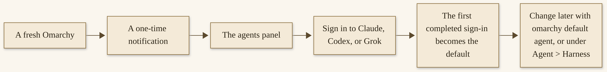{width=100%}

*D06. The first-run walkthrough is three sign-ins, not the full harness catalog. You can take the invitation now or open the panel later with Super + Ctrl + X.*


The invitation does not choose a default for you. The same manual is explicit: Omarchy includes launchers for a longer list of coding agents “without choosing a default for you.”^32 The one-time notification is an invitation, not a pre-selection. The first of the three that you complete becomes the default, and that is a choice you make, by finishing a sign-in, not a choice the installer made on the way in.

You can already pay for one of these. You can already have an account. The book will not steer a purchase. If you have no account yet, and you are not ready to create one tonight, you can still read the rest of this chapter, write down which of the three you would choose first and why, and come back. The desktop works without an agent. It is *agentic* in its design, and you are still the one who says yes.

It may help to say, in ordinary words, what you are being invited to install. A coding agent, in the sense this desktop uses the phrase, is a program that can read a project, propose changes, and — if you let it — run commands and edit files. It is not only a chat window, though you talk to it in sentences. It lives in a terminal, or in a console, and it has opinions about a working directory. That is why the first-run three are Claude, Codex, and Grok as coding agents, and why Grok Bot, a chat app, is a different seat. If you have only ever used a chat website, the first launch of a coding agent can feel a little more serious, because it is a little more serious. That is also why a small, safe question is the right first move, and why a broad “improve everything” is not.

The notification is one-time, and “one-time” is a kindness and a limit. It will not nag you every morning. If you dismiss it, you are not locked out; you are only being trusted to come back when you are ready, through the panel. If you have already chosen a default on this machine, the notification will not reappear, and you can skip ahead to the ritual’s later steps, or to the distinction between Grok Build and Grok Bot if that naming has already confused a launch. If you are setting up a second Omarchy machine, the invitation will appear again on that machine. Sign-ins do not travel on their own, unless you later use the official, trust-bounded way to copy accounts, which Chapter 7 will teach, with the manual’s own warning to copy only to machines you trust.

## Claude, Codex, or Grok — and what “default” means

The panel, before you have set up an agent, “walks you through signing in to Claude, Codex, or Grok, and the first one becomes your default agent.”^32 Those are the three, at that step. I am going to repeat that, because it is the most common confusion I want to prevent: the first-run panel offers three sign-ins, not twenty-three.

The 4.5 notes say that the agents panel tracks twenty-three agents and providers, up from six, and that Grok is now a full provider alongside Claude and Codex.^33 That longer list lives under Agent > Harness, in the Omarchy menu, and it is Chapter 7’s map. You can open it when you want to. You do not have to open it tonight. A default is one agent, chosen from the first-run three, that `Super + Shift + Ctrl + A` will launch, that the crash handoff in Chapter 6 will use, and that the Quake console will start the first time you open it.

If you finish a sign-in and realize it is not the one you meant — you were testing, or a browser was already signed in to an account you did not plan to use — you have not broken anything. Set the default to the one you actually want, with `omarchy default agent` and the name, or under Agent > Harness. The first completed sign-in becomes the default; it does not become a prison. If a browser-based sign-in grabbed the wrong account, the official multi-account path, later, uses a private window for every account after the first, so the account the browser is already signed in to is not picked up by mistake.^32 That is Chapter 7’s care. Tonight, if the wrong account is signed in and you only want one, use that agent’s official sign-out and sign-in, carefully, and do not stack a workaround you will forget.

To pick a default later, or to change one, the official ways are `omarchy default agent` with the name, or Agent > Harness in the Omarchy menu, which is `Super + Space`. If the agent is not installed yet, picking it installs it first.^32 Except for Hermes, which Chapter 7 will treat as a special case, these command-line agents use mise’s lazy installation: the first launch installs the CLI, and later launches reuse it. That is the official path, and it is the one I want you on.

Why three at first run, and twenty-three later? Because a first evening needs a door, not a catalog. Claude, Codex, and Grok are the three the panel walks you through, and in 4.5 Grok is a full provider alongside the other two, which is the official reason it sits in that first-run company.^33 The longer list is for people who already know they want a particular harness, or who are curious after a week, or who have a provider’s account that is not one of the three. A catalog at first run is how a beginner ends up installing five tools and trusting none of them. A door at first run is how a beginner ends up with a default, and a chord, and a question that got an answer.

A few words about the three, as the manual names them, without a sales close. `claude` is Claude Code. `codex` is OpenAI Codex. `grok` is Grok Build from xAI.^32 Each will ask you to authenticate when the time comes, in the way that agent asks. If you already have a subscription, you can use it. If you have more than one subscription for the same provider, Omarchy can keep several signed in, which is a later convenience, under `omarchy agent account`, and not a first-evening task. If you already pay for one of the three, that is a perfectly good reason to sign in to that one first. It is not a reason for me to tell you to. If you pay for none of them yet, you are not behind. You can read, you can decide, and you can wait. A desktop without a default agent is still a finished desktop. The invitation is a welcome, not a toll.

Choosing Claude also attempts to set up a browser extension for several Chromium-based browsers; the extension setup may ask for your system password, and cancelling or a failed extension install still selects and launches Claude.^32 Firefox and Zen do not support that extension. If that paragraph is more than you wanted on a first evening, you can ignore the extension tonight. The agent will still be your default. Restart the browser and finish the extension later, if you want it, as the manual describes.

mise, since I have used the name, deserves one plain paragraph. It is a version and installation tool this desktop uses for command-line agents and for other development tools. The first time you launch `grok`, or `claude`, or `codex`, mise can install that CLI, and later launches reuse it. It also checks, from time to time, whether an installed agent has a new release. `omarchy update` updates installed agents with the rest of Omarchy.^32 You do not have to become a mise expert tonight. You do have to let Omarchy install the agent its way, rather than pasting a vendor’s installer over the top. If an update of an agent fails, or you are offline, the installed version still runs, as the manual describes. That is a comfort on a first evening with a flaky network.

An agent’s own updater — a command like an in-app “update,” or a vendor’s `update` subcommand — is not a substitute for that path. The manual is specific: some of those commands fail, and some can report success while installing a separate copy that mise does not track.^32 If you would rather use an agent’s native installer and updater on purpose, the manual has a documented escape, under a `disable_tools` setting, which is a later, informed choice, not a first-evening experiment. Tonight, use the official launch, and let mise do the first install.

“Default” is a practical word. It means: this is the agent the system will hand a crash to; this is the agent the dedicated-terminal chord will open; this is the agent the Quake console will start with; this is the agent a “make something” starter prompt in the panel will hand a task to. It does not mean you cannot install another. It does not mean you cannot change your mind. It does not mean the other twenty-something harnesses have vanished. It means you have a starting partner, and the rest of the family is a menu away.

## Grok Build is not Grok Bot

This is a naming trap, and I want it cleared before the first evening goes sideways.

The command `grok` is officially “Grok Build from xAI.” It is a coding agent. It is installed through mise’s first-party `grok` package, the same way as `claude` and `codex`. You run `grok`, or you pick it under Agent > Harness. The manual is explicit about a path you should skip: skip the `curl | bash` installer on x.ai. That path puts a second copy in `~/.grok/bin`, prepends it on `PATH`, and overwrites Omarchy’s wrapper.^32 Use the project’s mise path. If a web page or a memory from another machine tells you to pipe a script to bash, that is not the Omarchy way, and it will fight the wrapper this desktop already gave you.

Grok Bot is a different product, in the same manual, a few sections later. It lives under Install > AI, with the other graphical AI apps, and it is “Grok Bot for chatting with xAI’s models.” The manual’s own clarification is the one I want you to remember: “Grok Bot is the desktop chat app. The coding agent is the `grok` command.”^32

Both can live on the same machine. They do on mine. Grok Bot and Grok Build are on every Omarchy machine I run. That is a fact about my shop, not an instruction that you must install both tonight. A first evening needs a default agent. A desktop chat client is a different seat, and it can wait, or it can be installed from Install > AI whenever you want a conversation that is not a coding session in a terminal.

Two other seats sit in the same Install > AI menu, and I will name them so the picture has four clear chairs, not a blur. Hermes Desktop is Nous Research’s agent, as a desktop app; choosing Hermes as a default installs that app, and it is a special case the manual is careful about. OpenClaw’s desktop experience is its Control UI, a web app backed by a local gateway. Both are official Install > AI entries.^32 If you want a thorough guide to Hermes, *Grow With It* is already a free gift. If you want a thorough guide to OpenClaw, *Make It Yours* is already a free gift. *Hand It Off* is the Grok Bot companion, similarly a door. This chapter will not recap those books. It will not give you a roster. It will tell you that the seats exist, that they are clearly labelled, and that tonight is not the night you have to sit in all of them.

The agents panel, in passing, also mentions other products’ allowances and subscriptions among the plans it can meter. I will not confuse any of those with Omarchy’s own Grok Bot desktop app, or with Grok Build. If a name on a meter is not one of the four seats, it is a subscription or a harness, and Chapter 7 will sort it.

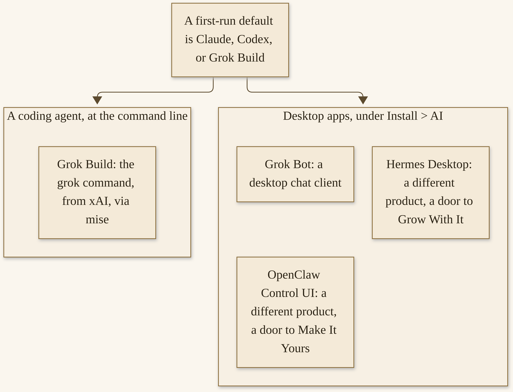{width=100%}

*D07. Four seats, clearly labelled. Grok Build is not Grok Bot. Hermes and OpenClaw are official Install > AI entries and are not this chapter’s work. Sister gifts are doors, not homework.*


There is one more naming trap, smaller, and worth a short light. Some Super chords open web apps, not coding agents. The official Hotkeys chapter lists a chord that opens an AI chat website, and another that opens Grok as a web chat, which are not Grok Build and not Grok Bot the desktop app.^35 If you press a Super chord and a browser appears, you have opened a web seat, not your default coding agent. The default-agent chord is `Super + Shift + Ctrl + A`. The panel is `Super + Ctrl + X`. The Quake console is `Super + ~`. Those three are the agent-family keys I want in your first-evening hand. Web chats can be pleasant; they are not the first-run default.

If you sign in to Grok at first run, you are signing in to Grok Build. If you later install Grok Bot from the menu, you are installing a chat app. You can use both. You should not hunt for one and launch the other, and then decide the system is confused. The system is not confused. The names are close, and now you know.

## A first-evening ritual

This is the chapter’s hands-on lesson. It is small on purpose.

**A first-evening ritual, from the official manual.**

1. Take the one-time notification, or open the agents panel with `Super + Ctrl + X`, or from the agents icon in the top bar.

2. Sign in to one of the three: Claude, Codex, or Grok. Complete the sign-in the way that agent asks. The first one you complete becomes the default. You do not have to sign in to all three. You do not have to open Agent > Harness tonight.

3. Confirm the default. You can look at the panel, or run `omarchy default agent` in a terminal and see what it reports, or simply try the next step and notice what opens. If it is not the one you meant, change it with `omarchy default agent` and the name, or under Agent > Harness, before you go further.

4. Open the default agent with `Super + Shift + Ctrl + A`. It launches in a dedicated terminal window. If you have not chosen yet, that chord brings up the picker.^32 In 4.5, you can also try `Super + ~`, the Quake-style console: it drops down over a dimmed desktop, the first open starts the default agent, and a second press tucks the session away, with the conversation still there.^33 Either opening is enough. I would start with `Super + Shift + Ctrl + A`, so you can see a full terminal, and try the console after, as a pleasure.

5. Ask a small, safe question about the machine. A good one: “What version of Omarchy is this?” A bad one, tonight: “Rewrite my window-manager configuration,” or “Change whatever you think should be different,” or any broad instruction that would actually do things to the system before you have a rollback habit. We will get to telling the agent you want a change, carefully, in Chapter 6. Tonight is a conversation, not a renovation.

6. Look at the shared instructions file, `~/.agents/AGENTS.md`. Personal rules for every agent go there, next to shared skills in `~/.agents/skills`. You can open it under Agent > Instructions, which also links it into each harness’s own global file.^32 I am going to show you that the file exists. I am not going to invent a template for it. If there is already something in it, read it. If it is empty, you can leave it empty tonight, or write one plain sentence you would actually want every agent to see, such as a note that you prefer to be asked before files are changed. Do not put secrets, passwords, or other people’s private lives in this file. It is a shared instruction, and it is on your disk, and it will be linked into more than one tool.

If you open Agent > Instructions and see a chain of links into other tools’ files, that is official, and it is how a single shared note can reach more than one harness.^32 You do not have to visit every linked file tonight. You do have to know that what you write in `~/.agents/AGENTS.md` is not a private diary. It is a note with a wider audience, on this machine, than it may look. Write accordingly. If you already had a long instructions file from another computer, and it was promoted to the shared file, read it before you assume it is the short note you meant to write tonight. Trim what you would not want sitting on a disk you back up.

7. Notice where launches start. Agents, the manual says, “refuse to remember trust for your home directory,” so launches from `$HOME` start in `~/Work` instead.^32 If you open an agent and find yourself in `~/Work`, that is not a bug. That is the official starting room. You can move to a project directory on purpose, later, when you have a project you want the agent to see.

What you will see will vary a little with which of the three you chose, and with whether this is the first time that agent has been installed on this machine. You may see mise working, the first time. You may see a browser open for a sign-in. You may be asked to paste a code, or to approve access, in a tab. Stay on official pages. If a sign-in fails, cancel, and try again from the panel, rather than stacking half-finished logins. If the agent is installed and the default is set, but the first message looks like a greeting rather than an answer, ask the version question anyway, and wait. A first launch can be slower than a second.

If `~/Work` does not yet exist, the desktop’s launch path still uses it as the starting room; let the official launch create what it needs, and do not invent a second work directory “for safety” tonight. You can look inside `~/Work` after, with the file manager (`Super + Shift + F`) or with a terminal, and you should see an ordinary folder. It is not a vault, and it is not a secret. It is a starting place that agents are willing to treat as a project root, which your home directory is not.

That is the ritual. It should take a few minutes, plus however long a sign-in takes. If you get stuck on authentication, use that agent’s official account pages, and do not paste tokens into a chat you do not trust. If a page asks for permissions that sound broader than “sign in to this coding agent,” stop and read them. You can finish tomorrow. If the agent answers your version question, you are done for tonight, and you have a default. That is a complete first setup.

A few things I am asking you not to do on this first evening, even though the manual documents them, because they are easy to run ahead of yourself. Do not, tonight, use `omarchy agent prompt "Review this project"` as a first move. Agents launched that way “run unattended in their respective don’t-stop-to-ask modes, so be ready for them to actually do things!”^32 That is the manual’s own warning, with the manual’s own emphasis, and it is a warning I want you to hear before you have a recovery habit. Do not, tonight, lean on the terminal shortcuts `c`, `cx`, and `cy`, which start certain agents “in their auto-approving modes.”^32 The shortcut `a`, which runs the default agent inline in the current terminal, is milder, and even that can wait until you have done the dedicated-window chord once. Do not, tonight, turn on the experimental Omarchy Skill and ask it to tailoring the system. That skill is Chapter 6, and it is experimental, and it is not a first-evening toy.

If you are still on another system, and you have not installed yet, the ritual becomes a decision: write down which of the three you would choose first, and why. “I already pay for this one” is a good why. “I have used this one before” is a good why. “The person who wrote this book chose Grok Build” is a weak why, and I will tell you why in a moment, when I tell you what I chose.

## Shared memory, unattended modes, and going carefully

Honesty before enthusiasm, while the first evening is still small.

Unattended modes “actually do things.” I have quoted the manual already, and I will quote the idea again, in my own voice, because it is the one that protects a first week. An agent with permission to change files, to run commands, and to keep going without asking is an agent that can help you quickly, and an agent that can make a mess quickly. Be ready, the manual says in a later section about the Omarchy Skill, to roll back changes, or even to invoke `omarchy reinstall configs`, if the agent makes a mess of everything.^32 The full lesson in that command, and in snapshots, is Chapter 6 and Chapter 14. I mention it here so you know a rollback exists before you are tempted to skip the “small question” and go straight to “make it better.” If a first-evening conversation somehow goes further than you meant, `omarchy reinstall configs` is the name to remember, and Chapter 6 is the place to use it with care.

The Omarchy Skill itself — a default skill for tailoring the system, “like tweaking your Hyprland config, adjusting the bar, or even creating a new theme from scratch” — is officially experimental.^32 Different models will use it to different effect. It is best, the manual says, to run in plan mode first, so you have an idea of what the agent would like to change. We will not treat it as a finished product in this chapter. We will not turn it on as a demonstration. You do not have to turn on every switch tonight.

Shared instructions, as I said, live in `~/.agents/AGENTS.md`. The Agent > Instructions item links that file into each harness that keeps its own global file, and `omarchy agent instructions` relinks after you install another agent.^32 An instructions file you already had becomes the shared one if there was none yet; otherwise it is kept beside the link as a `.bak`. That is good to know if you have used one of these agents on another machine and already have a file. Read the `.bak` before you decide anything has been lost. Do not invent a long constitution tonight. One clear “please ask before you change files” is worth more than a manifesto you will not look at again.

The panel, once you have a default, becomes a richer place: plans, meters for session and weekly limits, a “Make something” set of starter prompts for a new theme, a plugin, or an app, handed to your default agent.^32 Those starter prompts are official, and they are not tonight’s work. Making a theme is Chapter 8. Making a plugin is Chapter 9. An app is a later pleasure. If you click “Make something” out of curiosity, read what the agent proposes, in plan mode if you can, before you let it write. You can also just not click it tonight. The panel will still be there in the morning.

`Super + Ctrl + X` is the panel’s hotkey, as the manual lists it.^32 You already used it, or you can use it now, to see what the panel looks like after a default is set. You can close it again. Looking is not committing.

Theme changes, the manual notes, sync to some of the agents once they are installed — Claude Code, Pi, OpenCode, and Hermes, once Omarchy has installed it, follow along when you switch the Omarchy theme.^32 That is a pleasant later fact. It is not a reason to install four agents tonight so their colors match. One bundled theme, in Chapter 5, is enough for a first week, and the agents you actually use can follow.

Usage meters in the panel — plans, session and weekly limits, a rotating line of what you have used — are official, and they regenerate on a schedule the manual describes.^32 They are useful once you have a subscription that has limits you care about. They are not a first-evening dashboard you have to understand before you ask a question. If the panel looks busier than you expected after a sign-in, you can close it. The default remains the default.

Several subscriptions, Autoswitch near a limit, and `omarchy agent account copy` over SSH are real, and they have a trust warning I will not soften: credentials travel through SSH and are stored in private files on the destination, so copy only to machines you trust.^32 Chapter 7 will teach that path. Tonight, do not copy anything. A second machine can have its own sign-in, in its own first-evening ritual, and that is a completely respectable way to live.

Local models — `omarchy agent local use best`, and recipes that can use on the order of 100 GiB of memory — are official, and they are not for tonight, and they are not for every machine.^32 Chapter 7 will be honest about memory. A 32 GB MiniPC is a real professional machine in my shop, and it is not the machine for a 100 GiB recipe. An older laptop, which Chapter 11 cares about, is even less so. Cloud and local can coexist later. They do not have to start together.

You do not have to sign in to the other two of the three. You do not have to install Grok Bot, or Hermes, or OpenClaw, tonight. You do not have to set up a local model. You do not have to copy accounts to another machine. You do not have to turn on Autoswitch, or usage merging, or any of the careful multi-account machinery the manual also documents. Those are real features, for a later Tuesday. Tonight is one default and a small conversation.

## I chose Grok Build

I chose Grok Build. That is my choice, on my machines, with Grok Bot beside it. It is not a requirement of this book, and it is not a promise about your sign-in.^34

I will not dress that paragraph up. I will not tell you that my choice should be yours. I will not invent a first-install date, or a reason that sounds like a product page. Chapter 6 tells what happened when something crashed, only as I told it, and teaches the official handoff so yours is not a mystery. Chapter 7 tells how a MiniPC can host more than one kind of agent, including Hermes and OpenClaw fleets, without this chapter becoming a second book about those products. For tonight, the only thing my choice should do is make it clear that a real person, on a real machine, picked one of the three and went on with the evening. You can pick a different one. You can pick the same one. You are still the one who says yes.

## A look at the rest of the family

Agent > Harness is there when you want it. The 4.5 notes’ twenty-three agents and providers live there, dated, and Chapter 7 will re-open the official table and list what is actually on it. Local models, with honest memory costs — including recipes that are not for a 32 GB machine — wait for that chapter. Extra accounts, and a way to copy logins over a trusted link, wait for that chapter. Desktop apps wait for that chapter. Tonight is one default agent and a small conversation.

If you already know you will want Hermes or OpenClaw, you can smile at the Install > AI menu and still finish this ritual first. A default from the first-run three does not prevent you from installing those later. A first evening spent collecting seats is a first evening that never asks a small question, and never confirms that the default chord works.

A word about what “the rest of the family” will look like, so Chapter 7 is a door and not a fog. There will be a table of command-line harnesses, with official names, dated to the day we re-open it. There will be desktop apps, including the four seats we already labelled. There will be local models, with official recipes and honest “this will not fit” sentences. There will be one shop paragraph about a MinisForum MiniPC that hosts two fleets, which is a real professional use and not a homework assignment. None of that changes tonight’s work. If you close this book after the ritual and do not come back for a week, you will still have a default agent, a chord, and a first conversation. That is a practice already.

If the small question goes well, and you want one more, ask something else that is small and true: what is the default theme, or how do I take a screenshot, or where does the official manual live. Prefer questions the agent can answer by looking at the system, over instructions that change it. If the answer is wrong, you have learned something about checking, which Chapter 5 and Chapter 6 will need. If the answer is right, enjoy it. Then close the terminal, or tuck the Quake console away, and go do something that is not an agent. A first evening that ends on time is a first evening that can happen again tomorrow.

If you want a way to confirm, after the conversation, that the default is what you think it is, open a new terminal and type the command you chose — `claude`, or `codex`, or `grok` — and see that it launches, or type `omarchy default agent` and read what it says. Then close those sessions too. Two launches that agree are better than one launch you are already unsure about. If they disagree, Agent > Harness is the place to look, and the official set command is the place to fix it. Do not edit a random config in `~/.config` to “set the default” by hand tonight. The official command exists so you do not have to.

The sister gifts I named as doors are free, and they are optional, and they are not a reading list for this weekend. If you already have *Hand It Off* on the shelf, you already know Grok Bot as a product in more depth than this chapter will go. If you already have *Grow With It* or *Make It Yours*, you already know Hermes or OpenClaw in more depth than Install > AI will show you. Use those books if you want those products. Use this chapter to give Omarchy a default agent of its own, on this machine, with this desktop’s chords and this desktop’s warnings. The products can be friends. They do not have to be merged into one first evening, and this book will not merge them.

One last practical kindness. If you share this machine with someone else, or if you will hand it over, remember that a signed-in agent is a signed-in account. A default agent on a shared computer is an account on a shared computer. Sign out, or use a separate user, or do not complete the ritual on a machine that is not yours to bind to an account. The official install-for-another-owner path exists in part so that this decision belongs to the person who will live with it. That is not a legal lecture. It is ordinary courtesy, and ordinary security, of the same kind as not leaving a mailbox open on a guest laptop.

If you are tired, stop. A half-finished sign-in can wait. The notification, if you have not taken it, may have been one-time; the panel will still be there in the morning, behind the bar icon and behind `Super + Ctrl + X`. A first setup is not a test with a clock. It is a door you can walk through when you have the password you need, the attention you need, and the willingness to ask a small question and then close the window. I would rather you did that well tomorrow than poorly at midnight. The machine will boot again. The invitation, in one form or another, will be there. You will still be the one who says yes. And if you already finished the ritual, and you are only reading this last page to be sure, you can close the book for the night. Chapter 5 will still be here: a first real week, at a humane pace, with the Super key, one theme, and one careful update. You have done the load-bearing work of the first weekend already, and you can be glad of that. That is enough.

If this machine was prepared for another owner — the `Ctrl + C` path, or `defer-provisioning`, from Chapter 3 — the first-run invitation belongs to that owner, on first boot, along with the username and the drive password. If you are the person who imaged the machine, do not complete the agent sign-in on their behalf, any more than you should have chosen their password. Leave the notification for them. If you are the person who just created your user on a gift machine, this chapter is yours; the ritual is the same.

A crash may already have happened, on a first evening, because software does that. If a “Process crashed” notification appears, you may click it, and the default agent will be handed the crash with the official `diagnose-crash` skill, which is Chapter 6’s lesson.^32 If you do not yet have a default, set one before you depend on that handoff, or wait, and come back. Do not force a crash to test it. There is no prize for a first-evening core dump. If you are curious, Chapter 6 will also teach a manual command, against a PID from a list the system already keeps, and a way to confirm that crash capture is on, without breaking anything on purpose.

You have, if you followed the ritual, a partner on the machine. You have a chord that opens it. You have a file where shared instructions can live. You have a warning about unattended modes, and a name for a configs rollback. You have not, yet, given the agent the kitchen. That is exactly right.

You are still the one who says yes. I will keep saying it, because a first setup is the moment it is easiest to forget. The panel is friendly. The agent is fluent. A fluent yes, given early, to a broad instruction, is how a careful person ends up with a desktop they no longer recognize before they have learned `omarchy reinstall configs`. A small question, a read of the reply, a closed terminal, and a night’s sleep is how a careful person still recognizes the desktop in the morning, and still wants to open the agent again. That is the first-evening practice I want for you. The mastery comes later, and it is made of many evenings like this, not of one evening that tried to be mastery in advance.

> **Try this now.** Complete one official sign-in, of the first-run three, and open the default agent with `Super + Shift + Ctrl + A`. Ask it what version of Omarchy this is. If you are still on another system, write down which of the three you would choose first, and why, in a sentence that does not mention this book’s author.

> **Checkpoint.** You are in good shape if you can tell Grok Build from Grok Bot, name the first-run three — Claude, Codex, and Grok — and name the chord that opens the default agent: `Super + Shift + Ctrl + A`. Bonus, if you want it: you know that `Super + ~` is the 4.5 Quake console, and that `Super + Ctrl + X` opens the panel.

> **Quiz.** Does the first-run panel offer all twenty-three harnesses? No: it walks you through Claude, Codex, or Grok, and the first completed sign-in becomes the default. The longer list is under Agent > Harness. Where do launches from your home directory start? In `~/Work`, as the manual says, because agents refuse to remember trust for your home directory. Should you skip Omarchy’s mise install and use a vendor’s `curl | bash` installer for `grok`? No: that path puts a second copy on your `PATH` and overwrites Omarchy’s wrapper. Is the Omarchy Skill a finished product you should turn on tonight? No: it is officially experimental, and it waits for Chapter 6, in plan mode, with a rollback.

The first real week is next: living on the machine, at a humane pace, with the Super key, one theme, and one careful update.


# Chapter 5
## Your First Real Week


{width=100%}

*I05. Morning light, a mug of coffee, a blank open notebook, a compact keyboard.*


The first week is for living, not for mastery. That is this book’s advice, and it sits beside the official Coming From heading we already quoted: “Give it two weeks.”^36 The two weeks of Super-key practice start now, whenever you first sit down at a machine that boots Omarchy and has, if you took Chapter 4, a default agent. You do not have to love every default. You do have to live here long enough for a few chords to become ordinary, for one theme to feel like a room you chose, and for one official update to happen while you are watching.

Keep a small notebook. Write down the chords you actually use, not the ones you think you ought to memorize. The list will be short at the beginning. That is a good list.

If something is already wrong — a crash, a broken desktop after a change, a display that looks enormous — there is a first-aid section at the end of this chapter, and Chapter 6 is next. You can go there now. This chapter will still be here when the machine is calm again. Do not start the experimental Omarchy Skill this week. Do not start a plugin binge. A first week that stays small is a first week that can become a second.

## Live here for a week

A week, in the sense I mean it, is a weekend and the workdays around it, or any stretch of days in which this machine is the one you actually use. A virtual-machine taste counts, at a smaller scale: live there for a few sessions, not for one launch and a shutdown. An install you have not logged into since Friday is not yet a first week. Opening the terminal, writing a note, reading the web, taking a screenshot, and shutting down the way you would on any other desktop — those are the motions.

The Super key is the habit that makes the rest of the week easier. If you only practice one thing, practice that. `Super + K` is the official way to look a chord up when you blank.^36 You do not have to be proud of looking it up. Looking it up is the practice.

A first-week ritual, if you want one written down, is ordinary on purpose.

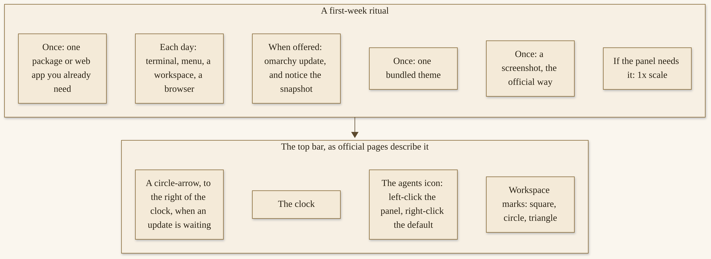{width=100%}

*D08. Live here. The bar pieces are only the ones official pages name: a clock, an agents icon, an update arrow, and the layout marks from Chapter 2. No invented icons.*


You are allowed to use this machine for real work this week, if real work is what you have. A first week does not mean a toy week. It means you do not also decide, on Monday, to rewrite the window manager, install a dozen community plugins, and turn on every agent feature in the panel. Real work, on a finished desktop, with the defaults, is the test that matters. The customization can come after you know what you actually reach for.

A humane week has a daily shape, and I will not invent a diary. In the morning, unlock the machine, glance at the bar, and open the thing you actually need — a terminal, a browser, a file manager — with a Super chord if you can, with the menu if you cannot. In the middle of the day, when you blank on a binding, press `Super + K` instead of opening a search engine. In the evening, shut the machine down, or suspend it, from the official system menu, `Super + Escape`, rather than by holding the power button and hoping.^37 Locking, when you stand up, is `Super + Ctrl + L`. Those two chords are ordinary life, and they belong in the notebook next to the terminal and the menu.

If you take this laptop to a hotel, an airport, or a café, 4.5 has a kindness I want you to know about in the first week, because first weeks often happen on the road. Omarchy notices when a network wants you to sign in or accept terms before it lets you online. The network icon warns you, and the network panel shows a button that opens the captive portal.^41 `Super + Ctrl + N` opens the network panel, as of 4.5.^41 Sign in, or accept the terms, and then go back to your week. If the portal is not the problem — if you simply cannot see a network — the same panel is the place, and `#omarchy-help` is the next place, not a random driver from a website.

If you have five machines, as I do, you do not have to make this week identical on all of them. One machine, lived on, will teach you more than five machines hurriedly themed. My own shop has Grok Bot and Grok Build on every Omarchy machine, and that is a later state, not a first-week assignment.

## Super-key practice

Here is a short daily drill, from the official bindings we already mapped in Chapter 2, worth doing once a day this week, even on a day you are busy.^37

Open a terminal with `Super + Return`. Open the Omarchy menu with `Super + Space`, and type a letter or two, then close it. Open a browser with `Super + Shift + Return`. Move between the two windows with `Super + Arrow`. Move the browser to workspace 2 with `Super + Shift + 2`, go back to workspace 1 with `Super + 1`, and return with `Super + Tab` or `Super + 2`. Close a window with `Super + W` or `Super + Q`. That is one drill. It takes two minutes. If you do it five days in a row, the Super key will feel less like a secret and more like a handhold.

On one of those days, add `Super + L`, and watch the bar’s mark cycle: square for dwindle, circle for scrolling, triangle for floating. If floating appears, you will see a dock. Spend a minute there if you want, and cycle back. You are not choosing a camp. You are learning the three rooms.

On another day, open the default agent with `Super + Shift + Ctrl + A`, or tuck and untuck the Quake console with `Super + ~`, and ask one small question, or none. The point is the chord, not a new project. Then close it.

Do not start rebinding keys this week. If a chord bothers you, write it down in the notebook, with a sentence about what you wish it did. Chapter 6 will teach a reversible change, with a rollback, and with the official way to rebind. A first-week rebind, without a snapshot and without a way back, is how a careful person spends Thursday evening trying to remember what they changed on Tuesday.

If you have two monitors, practice once the official multi-monitor facts from Chapter 2: each monitor has its own workspaces, and `Super + 2` is the second workspace of the monitor you are on. If you have one monitor, you have plenty.

If your fingers still reach for a different system’s chords, that is normal. The Coming From page promised that the instincts transfer faster than you would think.^36 Give them the week. `Super + C`, `Super + V`, and `Super + X` are there for copy, paste, and cut, including in the terminal, and clipboard history is `Super + Ctrl + V`. Try those in a place where a mistake is harmless: a note, a terminal prompt, a sentence in a browser’s search bar.

A slightly longer drill, once this week, is the official Navigation sequence we already walked in Chapter 2: terminal, browser, activity monitor (`Super + Shift + T`), file manager (`Super + Shift + F`), a four-way layout, and a close.^37 Do it slowly. The point is not speed. The point is that tiling becomes something you have seen, on your screen, with your files, and not only something you have read about. If four windows feels crowded on a small panel, do three, or do two, and call it a drill. On a small older panel, two tiled windows and a good 1x scale will teach you more than a four-way that you cannot read.

Write, in the notebook, one sentence at the end of each of the first three days: what you reached for, and what you could not find. On day four, look at those sentences before you install anything new. Often the thing you could not find is a chord that already exists, and `Super + K` will show it. Sometimes it is a package, and that is what the one official-menu install is for. Sometimes it is a habit that two weeks will ease. The notebook is how you tell those three apart, instead of treating every friction as a reason to reconfigure.

## The bar, a theme, a first package

The top bar is the one persistent piece of interface you will look at all week, and I will only name the pieces official pages actually describe. There is a clock. There is an agents icon: a left-click opens the panel you met in Chapter 4, and a right-click launches the default agent.^38 When a new release is waiting, a circle-arrow icon appears to the right of the clock; clicking it starts the official update.^39 Workspace marks, as we said, show the layout. Nearly every widget, the Coming From page says, does something on left, right, and middle click.^36 You can explore a click or two, gently. You can also leave the bar alone and come back.

Pick **one** bundled theme. Omarchy, the official Themes chapter says, comes with twenty-two, and you can select among them under Appearance > Theme in the Omarchy menu, or hop directly to the theme selector with `Super + Ctrl + T`.^40 Chapter 8 will recount the set, name it, and walk the community gallery. This week, just pick. Open the picker, look, choose one, and live with it for a few days. Twenty-two in an afternoon is how none of them becomes yours. One, lived with, is how a desktop starts to feel chosen. If you already like the default, you can keep the default, and that counts as a pick. A theme restyles more than a wallpaper — the desktop, the terminal, the bar, the notifications, the lock screen, as the Themes chapter lists those surfaces — which is why a pick is already a real customization, and why Chapter 8 will treat a theme as a system.^40

Backgrounds, if you want a smaller nudge than a whole theme, can be picked with `Super + Ctrl + W`. 4.5 also allowed video backgrounds, and theme intros; if an intro is more motion than you want, the 4.5 notes say you can turn intros off under Appearance > Animations.^41 You do not have to. You can, if the first login feels louder than you like.

Install one package, or one web app, from the official menu — something you already need, not a tour of the archive. Open `Super + Space`, go to Install, and pick a category that matches a tool you came to this machine to use. The official menus cover packages, the Arch User Repository, web apps, terminal UIs, and editors, among other things; where an official menu lists a reserved editor name, this book will say “a popular code editor,” and you can still install the one you actually use, from the menu, under its official listing.^42 One item. Install it, open it, and confirm it works. If you need a second, you can have a second tomorrow. A first week that installs thirty packages is a first week that cannot tell which one caused a problem, and a first week that has not yet learned `omarchy update` as a single, snapshot-aware path.

A web app, if that is the thing you need, is a way this desktop can give a site its own window and its own launcher entry. The official menus include office web apps as an example of that idea, and I will not turn them into a catalog here. If you need one such app to do your actual week’s work, install that one, from the official Install menu, and leave the rest. Chapter 12 will talk about professional days, including programs that still need another operating system, in a contained virtual machine, with official limits.

If git identity was offered after first login, and you have not set it, and you will commit code this week, set it, with `omarchy setup git`, as Chapter 3 already noted.^41 If you will not commit code this week, it can wait. A half-filled identity is less useful than a later, accurate one.

Language, if the desktop is not in the language you want to live in, is Setup > Language, or `omarchy language`, and fifty languages shipped in 4.5.^41 The menu, the desktop, and Omarchy’s notifications change immediately; applications already open follow when you restart them. This is a first-week kindness if you installed in English because it was easier at midnight, and you would rather live in another language in the morning. It is not a required step.

Sound, brightness, and the rest of ordinary physical life have panels and keys, as you would expect. `Super + Ctrl + A` is the audio panel, on the same “panels” plane as the network one.^37 I will not make a tour of every panel. If a key you already use for volume or brightness works, good. If it does not, the official menu and `#omarchy-help` are better than a downloaded mixer from the web. On some laptops, official notes have mentioned firmware that silently disables Super-key bindings; if every Super chord is dead, and you are on a machine the Troubleshooting or release notes mention for that, look at those official pages before you assume the install failed. I will not invent a hardware list here. Chapter 10 is the hardware map.

## Screenshots, displays, a careful first update

Three practical skills, each official, each worth doing once this week.

**Take a screenshot the official way.** Everything you can grab off the screen, the Screenshots manual says, hangs off the Print Screen key. One key on its own takes a picture. If your keyboard does not have a Print Screen key, `Super + Ctrl + Alt + C` takes the same screenshot, and `Super + Ctrl + C` opens the whole set as a menu.^43 Press the chord, and you will get an overlay: drag a region, click a window, or click open space for the whole monitor. The capture is saved, by default, to `~/Pictures/Screenshots`, and copied to the clipboard, and a notification offers Open and Edit.^43 That is enough for a first week. Recordings, a color picker, and text extraction have their own chords on the same page; they can wait. From a terminal, `omarchy screenshot` opens the same overlay, if you prefer a command.

**If the display is not a high-resolution default, set a 1x scale.** Omarchy assumes you are running on a 2x-capable, retina-class display by default.^44 That default can look wrong on many older panels, and on many 1080p or 1440p screens: everything is huge, or a few applications are huge. For a 1080p or 1440p display, the Monitors manual says you will probably just want 1x scaling. You can pick 1x from the monitor panel in the top bar, or step through major ratios with `Super + /` (higher) and `Super + Alt + /` (lower), which change only the monitor you are focused on.^44 You can also, as that page describes, set it in `~/.config/hypr/monitors.lua`, including a `GDK_SCALE` of 1 for GTK and X11 applications that would otherwise come out oversized. If you change `GDK_SCALE`, applications started after the change pick it up; quit the ones that are already oversized, or close all windows with `Ctrl + Alt + Delete`. The Troubleshooting page says the same thing in first-aid language: if you are on a 1x display and some apps come out oversized, pick 1x in the monitor panel, or add the official `GDK_SCALE` line, and restart those apps.^45 This week, use the panel if you can. It is the gentler path, and your choice is saved for that physical monitor.

If all you want is bigger or smaller text, rather than a scale change for everything, the same Monitors chapter offers a single knob: `omarchy display text size 14`, with a pixel size between 9 and 20, and a reset command if you want to go back.^44 That is a comfort, especially on a machine you are still getting used to, and it is not a rewrite of the desktop.

**When an update is offered, take it with `omarchy update`**, or with Update > Omarchy in the menu, which is the same path.^39 Do not run a raw system-upgrade command as your path. Omarchy will actually stop a direct upgrade of that kind and point you to `omarchy update`, because the official command is what runs the snapshot, the migrations, and the configuration updates together with the packages.^39 New installs start on the stable channel, which tracks official releases and a stable Arch mirror that runs one month behind the latest. Stay on stable this week. The other official channels, including `edge`, are for people who know how to recover a system, and they are Chapter 14.

When you update, a snapshot is taken. This week, notice that it happened. You do not have to restore one. You should not practice a restore on an only-copy disk; Chapter 14 will ask you to practice in a virtual machine, and will teach the important limit that a restore does not roll back `/home`.^46 For this week, the comfort is enough: if an update goes wrong, a snapshot from before the update exists, and official Troubleshooting’s first move is to try rolling back to it.^45 The circle-arrow by the clock is how many people will first notice that an update is waiting. After the update, the arrow goes away. That disappearance is a small ceremony. Let it be one.

If an update asks for a reboot, give it the reboot, and give yourself the disk password at the next early prompt, with the wired or 2.4 GHz keyboard if that is still the one that works there. A first-week update that sits half-finished because you postponed a reboot is a first-week update that has not really happened. After the reboot, confirm that you can still open the terminal, the menu, and the agent. That three-chord check is a complete “it worked.”

Firmware updates, under Update > Firmware, are a separate official path, using a Linux vendor firmware service, and they can ask for a reboot.^39 They are not this week’s assignment, unless your machine is already telling you that firmware is waiting and you know what you are applying. Packages first, from `omarchy update`. Firmware when you are ready, and when you can spare a reboot.

I want to say a word about patience, and about the feeling that a first week is “not doing enough.” You have installed a desktop. You have chosen an agent. You are practicing a new set of instincts. You are taking official updates the official way. That is a lot. Mastery, in this book, is not a first-week prize. It is a later fluency: telling an agent, carefully; making a theme; writing a small plugin; putting an old machine back to work; running a professional day and a personal day; staying current and giving something back. All of that is built on a week that was allowed to be a week. If you skip this chapter’s pace, those later chapters will still be readable, and they will be harder to live. Stay here long enough that `Super + Space` happens without a pause. Then go deeper.

## If something is already wrong

First aid, then a pointer, with only documented first moves.

If you broke the system with an update, official Troubleshooting’s first move is to roll back to the snapshot from before that update.^45 Restart, and at the quiet Limine door, press a key so the menu appears, and pick the snapshot by date and version, as Chapter 14 will teach in full. If that does not work, use `omarchy-debug` and share the output in `#omarchy-help` on the community Discord. If all that fails, you can reinstall default configs and packages; the Troubleshooting page names `omarchy-reinstall`, and the Updates chapter describes `omarchy reinstall` as a reinstall of default packages, a return to stable, and a reset of configuration files, with a clear warning that your user-config changes to the defaults will be overwritten.^39 10 Read the official page before you run a reinstall, so you know what you are resetting. It is a real tool, and it is not a casual one.

If some applications are enormous on the display, that is the scale issue we just taught: pick 1x in the monitor panel, or set `GDK_SCALE` as the Monitors chapter describes, and restart those apps.^45

If a process crashed, Chapter 6 is next, and you can go there now. The official handoff is a “Process crashed” notification, a click, and your default agent with the `diagnose-crash` skill. Do not force a crash to test it. If you do not yet have a default agent, Chapter 4 is the missing step.

If the desktop is broken after a change you already made — a config you edited, an agent you asked, a little too early, to “fix” something — `omarchy reinstall configs` is the name to remember, and Chapter 6 is the place it is taught in full, with the official warnings. It resets configuration, as the name says. It is not a time machine for your home directory. If you are not sure which command you need, do not guess; take the official Troubleshooting page, and `#omarchy-help`, over a forum post from a different version.

Do not start the experimental Omarchy Skill this week, even if — especially if — something is wrong. An experimental skill, pointed at a broken desktop, is how a messy evening gets messier. Plan mode and a rollback are Chapter 6’s care, for a week when the machine is otherwise calm.

If the password prompt at boot does not take input, go back to Chapter 3’s keyboard warning before you assume the disk is lost: a Bluetooth keyboard is the usual reason, and a wired or 2.4 GHz one is the usual fix. If the machine will not return from sleep, especially on hardware Chapter 3 already flagged as having sleep caveats, treat that as a hardware-and-docs question, not as a first-week configuration puzzle; do not close the lid unattended until you know this machine’s habits. If the time is wrong, official 4.5 work put the clock on the project’s own time service, and a first check is whether you are on a network; I will not invent a time-fix recipe the Troubleshooting page does not lead with.^41 If you are simply lost, `#omarchy-help` is still the right room, and a calm description of what you see — plus, if you can, `omarchy-debug` — is worth more than a frustrated one.

If the problem is that you cannot remember a chord, that is not a problem. `Super + K` is the list. If the problem is that you do not like a default, write it down, and live with it until Chapter 6 and Chapters 8 and 9, unless it is a scale issue or a crash, which you can fix now.

A last first-aid attitude, because first weeks are emotional as well as technical. Frustration is allowed. Shame is not useful. This desktop is new, and you are new to it, and a chord you have not learned yet is not a failure of character. The official manuals were written by people who wanted you to get in, and the help channel is there because people get stuck. Ask. Then come back to the drill, and to the one theme, and to the ordinary work you came to this machine to do.

## A checkpoint for the weekend

You have, if the first weekend went as I hoped, installed — or tasted this in a virtual machine — chosen a default agent, practiced the Super key, picked a theme, and taken an update, or at least noticed how an update will arrive. Parts 3 and 4 will go deeper: breakage and telling an agent, the rest of the family, themes as a system, plugins, the hardware map. You are allowed to stay here a while. A second week on the same ritual is not a delay. It is how a desktop becomes yours.

A first week also has a short “not yet” list, which I will put in one place so you do not have to hunt for it. Not yet: the experimental Omarchy Skill. Not yet: unattended agent prompts that “actually do things.” Not yet: a raw system-upgrade command. Not yet: editing files under `/usr/share/omarchy` in place, which updates will overwrite; your changes belong in `~/.config`, and Chapter 6 will teach that hygiene. Not yet: a third-party plugin from a marketplace, unsandboxed, before you have learned to read one, which is Chapter 9. Not yet: a community theme from a repository, before you have learned that a theme can drop files that would run code, which is Chapter 8. Not yet: a huge local model. Not yet: tearing out the defaults because a first Tuesday felt unfamiliar. The “not yet” is not a “never.” It is a first-week kindness, to a future you who will have snapshots, and a rollback, and a better sense of what you actually want.

What already feels like yours might be a small thing: a theme, a chord, a terminal you like opening. What still feels like someone else’s kitchen might be a larger thing: tiling, the Doctrine, an agent you have only asked a version question. Both feelings are allowed. The kitchen is still yours, as the Doctrine said. You do not have to remodel it this week. You do have to cook in it, at least a little, before you decide the layout is wrong. A week of real meals, in a kitchen you did not design, is how you find out whether the chef’s choice was close, and what you will change, on purpose, later.

> **Try this now.** The weekend checklist, all of it small: run the Super-key drill once (terminal, menu, workspaces, browser). Pick one bundled theme, or confirm that you are keeping the default, with `Super + Ctrl + T`. Take one screenshot, with Print Screen or `Super + Ctrl + Alt + C`. If an update is offered, take it with `omarchy update`, and notice that a snapshot happened. If the display looks wrong, pick 1x in the monitor panel.

> **Checkpoint.** You are in good shape if you can open the agent, move between workspaces, and name `omarchy update` as the way you take updates — not a raw system-upgrade command.

> **Reflection.** What already feels like yours, and what still feels like someone else’s kitchen?

If you only have a weekend, not a week, do the checklist in the box below, and call it a start. A weekend is enough to install, to choose an agent, to feel the Super key, to pick a theme, and to take one update. The workdays, if you have them, are how those motions become ordinary. If you only have a weekend, you have not failed the chapter. Come back on a Tuesday and run the drill again. The two weeks are a horizon, not a gate.

When something breaks, or when you simply want a change, Chapter 6 is the official path: a crash handoff, a careful way to tell your agent, and a rollback. You can turn the page when the week has had a chance to be a week. You can also turn it sooner, if something has already broken, and then come back and finish the checklist when the machine is calm. Either way, you are in the first real stretch of living here, and that is the right place to be at this point in the book. The rest will wait, and it will make more sense because you waited. I am glad you gave the Super key a chance. I am glad you picked a theme, or decided to keep one. I am glad, if an update was waiting, that you took it the official way, and that you noticed a snapshot happen in the background, like a quiet courtesy from the machine to its future self. That courtesy is one you will be glad of later, on a day that does not go as well as this week. For now, it is enough that the snapshot is sitting there quietly, and that you already know its name when you need it later.


# Part 3 — The Agent-First Desktop
# Chapter 6
## When Something Breaks, and When You Want a Change


{width=100%}

*I06. An older compact laptop just attended to, a screwdriver, a cloth, a blank card.*


Something will break. That is not a verdict on your week, and it is not a verdict on the machine. A process will crash. A default will feel almost right, and not quite. You will want a key to do something slightly different from the chef’s choice you have been living with. The useful question is what happens next, and whether you still know how to get back.

Omarchy has an official answer for both halves of that question. When a process crashes, the desktop can hand the facts to your default agent. When you want a change, there is a documented way to tell that agent what you wish were different, and a documented way to roll the change back if the wish goes sideways. Neither path is magic. The official manual is careful about that, and I will be careful too. A successful fix is something that happened for me. It is not a promise I can make for you.

This is the chapter where we walk those paths slowly, in the order the desktop itself uses them. The crash handoff first, so the story I will tell you later is an illustration and not the procedure. Then the official skill, the `omarchy` command line, the files that are yours to change, and one small reversible lesson you can run in an afternoon. By the end you should be able to describe the click that starts a diagnosis, name the command that puts your configs back, and say, in your own words, where your changes ought to live.


## When a process crashes

Omarchy watches for a certain kind of failure. When a process segfaults, the crash can go through systemd-coredump, which is the system’s ordinary way of keeping a record of a program that died badly. You do not have to set that up. The watching is on by default.^47

What you see is simpler than the machinery. A notification appears, and it says “Process crashed.” You click it. The crash is handed to your default agent — the one you chose in Chapter 4, or the one you set later with `omarchy default agent` — along with Omarchy’s `diagnose-crash` skill. That skill walks the agent through establishing the facts from the core dump and deciding whether the crash is worth reporting upstream. That last clause is the official wording, and I like it. The agent is asked to establish facts, and then to decide whether a report is warranted. It is not asked to perform a miracle.^47

You can also run the same path by hand. If you have a process identifier from `coredumpctl list`, this is the official command:

```bash
omarchy agent crash <pid>
```

Replace `<pid>` with the identifier you actually have. Do not invent a number, and do not go hunting through log directories I have not named. The manual points you at `coredumpctl list` and at this command. That is enough.^47

If you would rather not be notified, you can turn the watching off. The official path is Trigger > Toggle > Crash Capture, or the same switch from the terminal:

```bash
omarchy toggle crash-capture
```

Turning it off stops the notifications. The hand command still works. You can also silence one program at a time, which is what the diagnosis offers you at the end. `omarchy crash mute hyprland` stops the notifications for that program only. `omarchy crash mute hyprland off` brings them back. `omarchy crash mute` on its own lists what you have muted. It will take a binary’s path as happily as its name. Quote a name that has a space in it. Everything else still notifies. The muted program still crashes. The official page is plain about that last point: this hides the reminder, it does not fix anything.^47

That is the whole official handoff. A crash is recorded. A notification appears. You click, or you run the command. The default agent opens with a skill that is built for this. You can mute a noisy program, or turn the watching off, without pretending that silence is a repair.

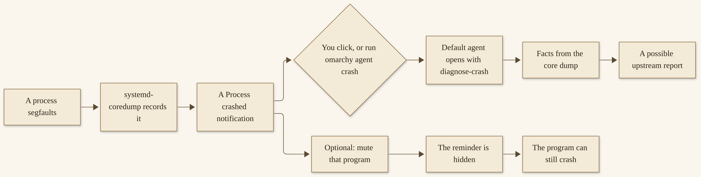{width=100%}

*D09. The official crash handoff, as the AI manual described it on 12 November 2026. A click starts a diagnosis. A mute is not a fix.*


I want you to have this picture before I tell you what happened on my machine. The procedure is the authority. My afternoon is one afternoon.

A few practical notes, still from the same official page, because they save people from inventing a ritual that is not there. You do not have to find a log file I have not named. You do not have to write a bug report by hand before you click. You do not have to force a crash in order to practice: the “Try this now” at the end of this chapter is a look at the switch, not a request that you break something on purpose. And if a program crashes often enough that the notification itself becomes the problem, muting that program is a kindness to your attention, not a repair of the program. I have been tempted, on other desktops, to treat a silenced warning as a solved problem. It is not. The official page says so in so many words, and I am glad it does.^47

The skill’s job, as the manual describes it, is to walk the agent through two questions: what are the facts in the core dump, and is this worth reporting upstream? That is a smaller, better job than “make it as if the crash never happened.” Sometimes those facts will point at a fix you, or the agent, can apply. Sometimes they will point at a report. Sometimes they will point at “we do not know yet, and the application should be started again carefully.” All three of those are honest outcomes. Only the first one feels like a victory. The other two are still the path working.

## My first crash, only as I told it

Here is what happened, in the words I used on 12 November 2026, and not a word more.

The first time an application crashed, I got a popup immediately. I clicked the popup. Grok Build opened, and immediately troubleshot the application, and made changes to the install, and the app came back. No issues since.^48

That is the whole telling. I did not name the application in that telling, and I will not name one here to make the scene feel complete. I did not give a date for the first install, and I will not invent one. I did not keep a transcript of what Grok Build said, and I will not write one from memory dressed as a quotation.

I have a contemporaneous public post from 31 August 2026, at 7:05 PM ET, with the id 2094562371549225357. That post has its own wording, and in that wording I named a specific application. It is a first-person note from that evening, and I will leave it as that evening’s note. I will not stitch the August post and the November telling into one embellished scene.^49

A successful fix is what happened for me. It is not a guarantee for you. The official path can examine a dump and help decide whether a report is worth making. It can, in my experience, also change an install and bring an application back. Your default agent may do that. It may not. Different models will use the same skill to different effect, which is something the manual says in a neighboring section, about a different official skill, and which I have found to be true of helpful machines in general.^50

If the agent cannot fix it, you are not out of roads. Chapter 14 will teach system snapshots properly: they are taken automatically on `omarchy update`, you can make one yourself with `omarchy-snapshot create`, and a restore puts the root filesystem back — and, this matters, it does not roll back `/home`. Official help is still there: the `#omarchy-help` channel on the community Discord, as Chapter 3 already pointed you toward. A crash that does not yield is a moment for those tools, not a moment to pretend the notification was a warranty card.^51

I tell you the story because it is why this chapter exists in a gift book at all. I clicked. The agent I had chosen opened. The application came back. I have not had trouble with it since. I also tell you the limit, in the same breath, because a gift that promises every crash will end that way is not a gift. It is an advertisement.

What I want to pass along, as a habit rather than as a guarantee, is how ordinary the click felt. I did not open a terminal first. I did not search a forum. I clicked the notification the machine had put in front of me, and the agent I had already chosen — Grok Build, from that first-run invitation in Chapter 4 — was the one that opened. The official handoff did what the official page said it would do: it put the diagnosis in the hands of the default agent. The rest, the troubleshooting and the change to the install and the application coming back, is my outcome on that day. I have been glad of it every day since. I still will not write it into a promise with your name on it.^48

If you have a crash of your own this week, walk the official path. Click, or run the hand command. Read what the agent says. If it proposes a change, read the change. If the application comes back, good. If it does not, you still have snapshots, `omarchy reinstall configs` when the mess is in your configs, and official help. You have not failed the chapter. You have used it.

Breakage is one half of this chapter. Wanting a change is the other. The same agent that can be handed a crash can also be asked to shape the desktop. That path has a name, a status, and a rollback. We will take them in that order.

## Tell your AI: the official skill, carefully

There is an official way to ask the default agent to change the system. Omarchy ships with a default skill for tailoring the desktop: tweaking your Hyprland config, adjusting the bar, or even creating a new theme from scratch. The skill is symlinked into the skill directories of several harnesses — Claude Code, Codex, Pi, Antigravity, Hermes, and the shared `~/.agents/skills` location — so most of them pick it up automatically. You do not have to install it as a separate product. It is already on the machine, waiting to be used carefully.^50

The official status is the word I want you to hear first. Treat this skill as experimental. That is the manual’s word, not mine. Different models will use it to different effect. The official advice is to run in plan mode first, so you have an idea of what the agent would like to change. And then be ready to roll back those changes, or even to invoke `omarchy reinstall configs`, if the agent makes a mess of everything.^50

I will say that again, because it is the sentence this chapter earns. If you do not like a configuration, or you wish the operating system did something slightly different, you can tell your AI. That is real, and it is documented. You tell it in plan mode. You read the plan. You keep a rollback in your pocket. You are still the one who says yes.

The agents panel has a kindness for getting started. Under “Make something,” it offers starter prompts for a new theme, a plugin, or an app, and those prompts hand the task to your default agent. Apps built that way follow the official `omarchy-app` skill, in C++ and Qt Quick, the way Omarchy’s own Hype, Monologue, and Omacut are built, and the compiler and Qt pieces they need come installed.^52 Those starters are official starting points. They are not a reason to skip the reading. If the agent writes files, you open the files. If the plan names a change you did not ask for, you say no, or you say “smaller,” and you try again.

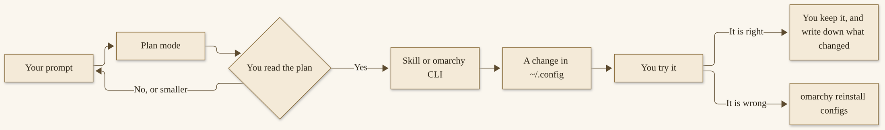{width=100%}

*D10. Prompt, plan, change, try, rollback. The loop is official. The yes is yours.*


I have used this path. Grok Build has reconfigured layouts for me. That is the whole sentence I will give that work. I will not invent a before-and-after, and I will not pretend I have a transcript of the prompts. The point is not my layout. The point is that the official door is there, it is experimental, and it is usable when you keep a hand on the latch.^53

Plan mode, in practice, is a conversation with a pause in it. You ask. The agent describes what it would like to change: which file, which line of a thought, which command it would run. You read that description as if it were a note from a careful colleague, not as if it were already done. If the plan is too large, you shrink it. If the plan is unclear, you ask it to name the files again. If the plan is right, you say yes, and you watch. The official skill will not make that pause for you unless you start in a mode that asks it to. That is why the manual puts plan mode first, and why I am putting it first in this chapter’s lesson.

There is a related official file I want you to know about, even though it is not the skill itself. Personal rules for every agent can live in `~/.agents/AGENTS.md`, next to the shared skills in `~/.agents/skills`. The agents panel can open it under Agent > Instructions, and `omarchy agent instructions` will relink it after you install another agent. If you want a standing sentence in that file — “Prefer plan mode for config changes. Prefer the `omarchy` CLI to editing package files. Do not touch `/usr/share/omarchy`.” — that is a reasonable use of a file the manual already gives you. It is not a sandbox. It is a reminder the agent can read.^60

One more official caution, which belongs in the same breath as the skill. When you launch an agent straight into a task with `omarchy agent prompt`, the agent runs unattended in its respective don’t-stop-to-ask mode. The manual’s wording is the one I want you to keep: be ready for them to actually do things. We will come back to that at the end of the chapter. For a first change, plan mode is the room I want you in.^54

## The `omarchy` CLI as an agent’s API

The usual way to drive Omarchy is the keyboard and the menu (`Super + Space`). You can also drive it from the terminal, with the `omarchy` command. The official CLI page opens with a sentence I have come to treat as a working definition: this is particularly helpful when you’re having an AI agent work with you on customization or configuration.^55

That is the documented “just tell your AI” path, said from the other side. The agent is not a hidden second control plane. It uses the same command center you can use, the same skills, and the same config files. An agent that calls `omarchy theme set` or `omarchy reinstall configs` is leaving a trail you can read. An agent that quietly edits a file under `/usr/share/omarchy` is working in a place the next update will overwrite. I know which one I would rather review.

You can see what is available by running `omarchy` with no arguments. The page’s own sample, opened on 12 November 2026, looks like a command center: a usage line, a `commands` listing, help on any group, and a short list of common verbs. I will only name the ones the manual actually shows, and the neighbors we have already met in this chapter or will meet in the ones after it.^55

```bash
omarchy
omarchy commands --all
omarchy <group> --help
```

Common commands the official page lists include `omarchy update`, for updating Omarchy and system packages; `omarchy theme list` and `omarchy theme set <name>`; `omarchy font list`; `omarchy screenshot`; and `omarchy debug`, which prints debugging information. Groups on that same sample include `agent`, `audio`, `bar`, `battery`, `bluetooth`, `branch`, `branding`, `brightness`, `capture`, `channel`, `clipboard`, `cmd`, `config`, and `debug`, with an ellipsis the page itself prints, because the list is longer than the sample. Every command takes `--help`, whether you ask a whole group or a single command.^55

The agent-related verbs we already have from the AI manual are part of this same family: `omarchy default agent`, `omarchy agent prompt`, `omarchy agent crash`, `omarchy agent account` (Chapter 7), `omarchy agent local` (Chapter 7), `omarchy agent instructions`. Crash watching is `omarchy toggle crash-capture`. Config reset is `omarchy reinstall configs`. Plugins, in Chapter 9, are `omarchy plugin` with `list`, `add`, `clone`, `validate`, and their neighbors. Hooks, in a moment, are `omarchy hook install`. A snapshot you make yourself is `omarchy-snapshot create`. I will not invent a subcommand that is not on a page I opened.^56

The menu is scriptable too, which is handy for your own keybindings and for an agent that needs to open a precise place in the tree. `omarchy menu` opens it at the root. `omarchy menu summon appearance.theme` goes right to the theme picker. `omarchy menu toggle system` opens the system menu and closes it again if it is already up. `omarchy menu close` puts it away. Those are the official examples, and they are enough to show the shape.^55

When I ask an agent to help me customize the machine, I would rather it speak this language. The commands are documented. The help is on the machine. A plan that says “run `omarchy theme set` and then we will look” is a plan I can follow with my own eyes. A plan that says “I will just patch a package file” is a plan I send back.

A good review habit, if an agent proposes a command you have not seen before, is to run the help yourself:

```bash
omarchy <group> --help
omarchy <group> <command> --help
```

If the help exists, you are looking at a real verb. If it does not, or if the proposed command sits outside the `omarchy` family and points at a package path, you have a reason to pause. I will not invent a complete catalog of every group and every verb in this chapter. The catalog is on your machine, and it moves. The practice is to look it up, dated, the way we looked it up on 12 November 2026.^55

## Your configs, not the package

Omarchy is configured, primarily, through the files that live in `~/.config`. Those are considered your files, for your changes. The files that live in `/usr/share/omarchy` belong to Omarchy itself. You should not be messing with those. If you need to change something that ships in the package, you overwrite the value in `~/.config` instead.^57

I will be a little firm about this, because it is the hygiene that keeps updates from fighting you. The next `omarchy update` is allowed to refresh the package. It is not supposed to have to wrestle with a file you edited in place under `/usr/share/omarchy`. The Dotfiles page says this twice, in different tones, and the second tone is the Doctrine’s: this is your computer, you can do what you want, and the advice is still not to edit the package files directly, because your changes will simply be overwritten.^57

The key files, as the official table lists them, are worth knowing by name.^57

`~/.config/hypr/hyprland.lua` is the main Hyprland config. It loads the Omarchy defaults plus your override files. `~/.config/hypr/bindings.lua` is your own keybindings, and your overrides of the defaults. `~/.config/hypr/monitors.lua` is for monitor settings the monitor panel does not cover. `~/.config/hypr/input.lua` is the keyboard, the mouse, and the trackpad. `~/.config/hypr/looknfeel.lua` is gaps, borders, animations, and the rest of the look. `~/.config/hypr/autostart.lua` is extra processes started with the session. `~/.config/omarchy/shell.json` is the Omarchy shell: the bar’s position, layout, and widgets, plus screensaver, lock, and idle timings. The default terminal has its own file. There is a compose file for emoji and name-or-email shortcuts, which wants a documented restart command after you edit it.

You can open several of these straight from the Omarchy menu: Setup > Keyboard > Keybindings, Setup > Input, and Setup > Config, with a file picker. When you do it that way, any process that needs restarting after the edit is restarted when you quit the editor. Neovim is the default editor for that path. You can change the default under Setup > Defaults > Editor.^57

If you want a binding replaced, the official helper is `o.rebind`. It removes the existing binding before adding its replacement, and it takes the same arguments as `o.bind`, including launch helpers and binding options. `o.bind` adds a binding. `hl.unbind` removes one without replacing it. The Dotfiles page’s own example replaces a writing-app shortcut with a different application, using `o.rebind` in `~/.config/hypr/bindings.lua`. I will not invent “the one binding everyone changes.” Change the one you already wish were different, and put the change in that file.^57

Hooks are the other official place for your own scripts. Omarchy fires hooks at a handful of moments, and you can hang a script on them. They live in `~/.config/omarchy/hooks/<event>.d/`, one directory per event, and every executable file in that directory runs when the event happens. The official events, as the Dotfiles page listed them on 12 November 2026, are:^58

- `post-boot`, right after the desktop has started
- `post-update`, near the end of `omarchy update`, after packages, migrations, and service restarts, and before mise tools are updated
- `pre-refresh-pacman`, after `omarchy refresh pacman` re-syncs the package config and before it updates packages — a channel switch runs it during that same refresh step
- `theme-set`, after a theme change, with the theme name in `$1`
- `font-set`, after a font change, with the font name in `$1`
- `battery-low`, when the battery gets low, with the percentage in `$1`

The `pre-refresh-pacman` hook is where custom repositories or `IgnorePkg` lines belong, because it runs before the package transaction. Both update-related hooks run as your user after Omarchy has cleared its cached sudo authorization, so a hook that uses `sudo` needs its own authorization and may ask for your password. Each of those directories already holds a `.sample` file. To install a script you have written elsewhere:^58

```bash
omarchy hook install post-boot ~/my-hook
```

That copies it in and makes it executable. Use the event you actually want, and the path to the script you actually wrote.

You can also extend the menu itself, with entries in `~/.config/omarchy/extensions/omarchy-menu.jsonc`. You can add aliases and functions in `~/.bashrc`, which will not be overwritten on updates. Desktop session environment variables belong in `~/.config/uwsm/env.d/`, and the official warning on that folder is one I will not soften: those files run before the desktop starts, so a shell error can send you back to the login screen. Keep a working terminal open while you edit them.^57

The Dotfiles page also offers a quiet piece of advice that I will pass along as advice, not as a ritual I invented: if you end up making a lot of changes, it is a good idea to back those dotfiles up. The page names Stow as a great way to do that. I will not write a Stow tutorial here. I will say that a copy of `~/.config` you can get back to is a kindness you do your future self, and it sits beside `omarchy reinstall configs`, not in place of it. The reinstall puts the defaults back. A backup of your own files puts *your* changes back, if you liked them and then lost them.^57

If you end up making a mess, you can revert the configurations to the defaults with Update > Config in the Omarchy menu, or by running:

```bash
omarchy reinstall configs
```

That is the command I want in your pocket for the rest of this book.^57

## One reversible change, with a rollback

This is the afternoon’s lesson. It is small on purpose.

Pick one thing you already wish were slightly different: a keybinding that fights the muscle memory you brought with you, or a layout nudge, or a bar setting you have been meaning to try. Do not ask for a new desktop. Do not ask the agent to “just make it better.” One change. A change you can see, and a change you can undo.

Before you apply anything, take a manual snapshot:

```bash
omarchy-snapshot create
```

Snapshots are also taken automatically on `omarchy update`. A snapshot is a comfort, and it has a limit you should hear now, even though Chapter 14 will teach it properly. Restoring a snapshot restores the root filesystem. It does not restore `/home`. Your `~/.config` directory is kept as-is. That means a snapshot will help you if an update or a package change has gone wrong. It will not, by itself, undo a messy edit in your own configs. For that, the command is `omarchy reinstall configs`, or a careful hand edit back to what you had. I want both tools in the lesson, and I want you to know which one does which job.^51

Then open the default agent in plan mode. If you are using the official Omarchy Skill, that is the mode the manual asks you to start in. Ask for the one change, in plain language. Something like: “Please propose a plan, and only a plan, for moving this one keybinding in `~/.config/hypr/bindings.lua`. Do not apply it until I say yes. Use `o.rebind` if that is the official helper for a replacement.” Use your actual wish, not my sentence. The sentence is a shape.^50

Read the plan. If it touches a file you did not name, or a package directory, or a second binding you did not ask about, send it back. If it looks like the change you wanted, apply it, and try it. Press the key. Look at the layout. Live with it for a few minutes, not a few seconds.

If it is wrong, roll it back. For a config mess:

```bash
omarchy reinstall configs
```

For a root-filesystem problem you can see after a broader change, restore the snapshot the way Chapter 14 will walk: from the Limine boot menu, or with `omarchy-snapshot restore`, remembering again that `/home` will not come back with it.^51

Then write down, in plain language, what you asked and what it changed. A sentence in a note is enough. “I asked for this binding to move. It edited `bindings.lua`. I kept it.” Or, “I asked, I did not like it, I ran `omarchy reinstall configs`.” The note is for you, next Tuesday, when you will not remember which of those two things you did.

I will not tell you which binding to change. There is no official “the one everyone changes,” and I will not invent one. The lesson is the loop, not my taste.

**Try this now.** You do not need a crash, and you should not force one. Open the crash-capture setting and confirm it is in the state you want. The official path is Trigger > Toggle > Crash Capture, or `omarchy toggle crash-capture` run once to see the switch, and once more if you need to put it back. If you have muted a program, `omarchy crash mute` will list what you muted. Look, confirm, and leave the machine as you found it unless you meant to change it. The point is to know where the switch lives, not to produce a core dump for practice.

## When not to let it run unattended

Unattended modes actually do things. That is the official warning, and it is a kind one. When you launch an agent with `omarchy agent prompt "Review this project"`, the agent runs in its don’t-stop-to-ask mode. Freebuff and DeepSeek Harness take no starting prompt, so they open with the prompt on your clipboard instead. MiniMax Code asks for permissions as usual. The rest, in that launch path, are ready to act. Be ready for that.^54

A first week is a bad time to give a broad, unsupervised instruction. “Fix whatever is wrong.” “Make the desktop mine.” “Just handle it.” Those are generous sentences, and they are not plans. They give an experimental skill a lot of room, and they give you very little to review. The skill will do its best. Its best, on a vague wish, can be a mess. The mess is recoverable — that is why `omarchy reinstall configs` exists — and recovery is more pleasant when the wish was small.

Passwordless sudo, if you ever turn it on, is a Chapter 14 risk, not a Chapter 6 convenience. The official pages treat it as a high risk, offered for agent work, with a visible warning. We will take it there, in those terms. Do not turn it on this afternoon because a prompt would be easier without a password.^59

You are still the one who says yes. That is true of the first-run invitation in Chapter 4, and it is true of a crash diagnosis, and it is true of a layout change. The Doctrine’s welcome to agents is a welcome, attributed to the project, not a promise that every agent always helps. A welcome still leaves you at the door, deciding who comes in and what they are allowed to touch.

If you remember only four things from this chapter, remember these. A “Process crashed” notification is a handoff, and a click starts it. The Omarchy Skill is officially experimental, and plan mode is the right first room. Your changes live in `~/.config`, not in the package. `omarchy reinstall configs` puts the defaults back, and a snapshot restore does not roll back `/home`.

The rest of the agent family is next: the official harness list, more than one account, the desktop seats, and the honest cost of a model that runs on the machine itself. You do not need all of them. You need a default you already trust, and a clear idea of what else is a click away. Chapter 7 is that map.

**You are in good shape if you can…**

- describe the click-to-agent handoff: a “Process crashed” notification, your default agent, the `diagnose-crash` skill, or `omarchy agent crash` by hand
- name `omarchy reinstall configs` as the way to put configs back to the defaults
- say that your changes live in `~/.config`, and that files under `/usr/share/omarchy` belong to the package and will be overwritten on update
- say that a snapshot restore does not roll back `/home`, so it is not, by itself, an undo for a messy config edit

**A few questions, with no grade.** If you are unsure, the section is in parentheses, and Appendix C collects the factual answers.

1. Is the Omarchy Skill officially experimental? (Section: Tell your AI.)
2. Does a successful fix, once, mean every crash will be fixed? (Section: My first crash.)
3. If you mute a program’s crash notifications, is the crash itself fixed? (Section: When a process crashes.)
4. Will restoring a system snapshot undo a change you made in `~/.config`? (Section: One reversible change.)


# Chapter 7
## The Rest of the Agent Family


{width=100%}

*I07. Several empty chairs around a small table, a lamp, a notebook, a plain mini-computer.*


The first-run panel, in Chapter 4, walked you through three sign-ins: Claude, Codex, or Grok. The first one you completed became your default. That is still the right place to start, and it is still only three doors. Behind those doors is a larger family. The 4.5 notes, dated 4 November 2026, said the agents panel tracks twenty-three agents and providers, up from six, and that Grok is now a full provider alongside Claude and Codex. The first-run invitation did not try to make you choose among twenty-three things on a first evening, and I am grateful for that. This chapter is the map of what else is a click away, once you have a default you trust.^61

You do not need the whole family. You need a clear picture of it. A CLI harness is not a desktop chat app, and a desktop chat app is not a model running on the machine itself. Those three seats can coexist. They do not have to. By the end of this chapter I want you to be able to tell them apart, to say why a recipe written for a 128 GB-class machine is not a recommendation for a 32 GB one, and to choose enough for a Tuesday morning rather than everything for a catalog.


## The official map

I re-opened the official harness table on the AI manual on 12 November 2026. What follows is that table, dated, not a ranking, and not a promise that every entry will still be there when you read this. If the page has moved, trust the page, and write the date you opened it.^62

The table lists a command and an agent, in the manual’s own wording. Omarchy includes launchers for these coding agents without choosing a default for you. On first use, running the command installs the CLI (mise takes care of that lazy install, with Hermes as the exception we will come to), and then you authenticate when prompted.

Here is the family, as the page named it that day, with one exception I must handle as a house rule. The official table includes a popular coding-assistant CLI, listed among the harnesses. In this book I will refer to it that way, and I will not copy the reserved product name into this chapter. The other entries, in the manual’s wording, were:^62

- `claude` — Claude Code
- `codex` — OpenAI Codex
- `opencode` — OpenCode
- `agy` — Google Antigravity CLI
- `amp` — Amp
- `commandcode` — Command Code
- `crush` — Crush
- `cursor-agent` — Cursor CLI
- `devin` — Devin CLI from Cognition
- `dsh` — DeepSeek Harness
- `freebuff` — Freebuff, Codebuff’s free, ad-supported coding agent
- `grok` — Grok Build from xAI
- `hermes` — Hermes, Nous Research’s agent
- `kilo` — Kilo, an OpenCode-based coding agent
- `kimi` — Kimi Code
- `kiro-cli` — Kiro CLI
- `mcode` — MiniMax Code, MiniMax’s coding agent
- `muse` — Muse Code, Meta’s coding agent
- `omp` — Oh My Pi
- `ori` — Ori, OpenRouter’s harness
- `pi` — Mario Zechner’s Pi
- `qwen` — Qwen Code, Alibaba’s coding agent

Together with the coding-assistant CLI I referred to generically, that is the twenty-three the 4.5 notes were pointing at, on the page I opened. Count them on your machine, or on the live page, and date your count. I will not pretend this list is eternal.^61

`ori` is the odd one out, and the manual says so. It can run the other harnesses against OpenRouter’s model catalog: `ori claude`, `ori codex`, or `ori opencode` start those agents on whichever model you point them at, and `ori code` is Ori’s own agent. In 4.5, Google’s Antigravity replaces the obsolete Gemini CLI, and `gemini` still works as an alias. Kimi and Ori join the choices under Setup > Defaults > Agent.^62

Except for Hermes, these agents use mise’s lazy installation: the first launch installs the CLI, later launches reuse it, and mise checks for a new release at most once every four hours. `omarchy update` updates installed agents with the rest of Omarchy. An agent’s own updater — `claude update`, `codex update`, or an update button in an app — does not update the mise-managed install, and can even leave you with a second copy. The official advice, for `grok` in particular, is to use the project’s mise path and to skip a vendor’s `curl | bash` installer, which would put a second copy on your `PATH` and overwrite Omarchy’s wrapper. Chapter 4 already asked you to skip that path. The advice still holds.^62

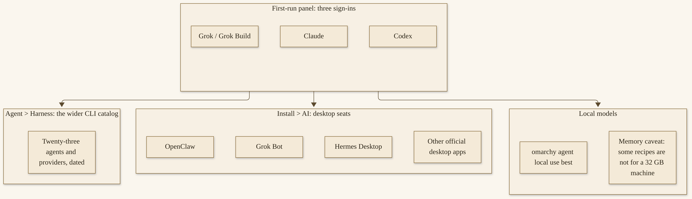{width=100%}

*D11. The official family, as of the AI manual and the 4.5 notes, opened 12 November 2026. The first-run panel is still only three doors. The catalog is under Agent > Harness.*


Installing and picking a default is the same path Chapter 4 taught: `omarchy default agent <name>`, or Agent > Harness in the Omarchy menu. If the agent is not installed yet, picking it installs it first. Once you have a default, `Super + Shift + Ctrl + A` launches it in a dedicated terminal. `Super + ~`, in 4.5, drops a Quake-style console over a dimmed desktop, and the first open starts the default agent; press it again to tuck the session away. Theme changes sync to some of the harnesses — Claude Code, Pi, OpenCode, and Hermes, once Omarchy has installed it — when you switch the Omarchy theme.^62

A few official launch habits are worth knowing, because they will surprise you if you meet them cold. You can also launch the default agent straight into a task with `omarchy agent prompt "Review this project"`, and — as Chapter 6 already warned — agents launched that way run unattended in their don’t-stop-to-ask modes. Launches from `$HOME` start in `~/Work` instead, because, the manual says, agents refuse to remember trust for your home directory. In the terminal, `a` runs the default agent inline; `c`, `cx`, and `cy` start OpenCode, Claude Code, and Codex directly, again in their auto-approving modes. Those shortcuts are convenient. They are also a reason to be awake when you use them.^62

The agents panel itself is a seat of its own. After you have a default, left-click the bar icon for the panel; right-click launches the default agent. The panel puts subscriptions on one page: each agent and account with its plan, and a meter for limits. Usage records are regenerated every fifteen minutes by `omarchy agent usage-update`, and the panel can merge usage from your other machines via a synced folder. I will not walk every meter and every provider the panel can show. The AI manual’s “agents panel” section is the authority for that surface, and it moves. What I want you to take is the idea: the panel is how you see the family you already have, not a scoreboard you have to fill.^68

That is the map of the CLI family. The next question is whether you can have more than one account inside a single provider, and what it means to copy those logins to another machine.

## More than one account, a trusted copy

If you pay for more than one Claude, Codex, or Grok plan — a personal one and a work one, say — Omarchy can keep them all signed in and move between them. You add a subscription with the + in the agents panel, or with a command such as `omarchy agent account add claude Work` (or `codex`, or `grok`). The first account for a provider signs in through your normal browser. Every one after that signs in through a private window, so the account your browser is already signed in to does not get picked up by mistake. The official page is specific about a mistake people make here: never log out of the CLI to add another account. Logging out revokes the saved sign-in, and that account would have to be added again.^63

One account per provider is active, and every new session starts as that account. You switch with `omarchy agent account use work`, and back with `omarchy agent account use main`, or from the panel. Sessions that are already running stay on the account they started with. Conversation history, settings, skills, and plugins are shared across accounts, so a continue in the same folder picks up where you left off, on the new account. `omarchy agent account list` shows every account and its latest limits. `remove` forgets one. `rename` renames one. With more than one account, the panel can notify you when the active account passes a limit, and Autoswitch can move new sessions to the account with the most headroom. Those are official conveniences. They are not a reason to treat two plans as one identity.^63

You can also copy your subscription logins to another Omarchy machine over SSH:

```bash
omarchy agent account copy user@laptop
```

You can add provider names to select them, as in `omarchy agent account copy laptop claude`. This copies Claude, Codex, and Grok subscriptions. It is a one-time copy, not ongoing synchronization. Credentials travel through SSH and are stored in private files on the destination. The official warning is the one I will not soften: copy only to machines you trust.^63

I want that sentence to sit by itself for a moment. This is for your own machines, or a machine you administrate. It is not a casual share. It is not a way to hand a friend a login. It is not a way to move a work subscription onto a laptop you do not control. The manual says “copy only to machines you trust,” and I am going to leave it in those words. A copied Codex login can even be left in need of renewal if another machine rotates a refresh token; the same page says that separate sign-ins remain the most reliable choice for simultaneous use on several machines.^63

Existing destination credentials are kept, unless you pass `--replace` after quitting that account’s sessions on the destination. A fresh destination also gets the source’s active account and switching preferences; an established destination keeps its own. Settings, skills, plugins, and conversation history stay local to each machine. The copy is the login, not the life of the agent.^63

If you only have one account, and only one machine, you can let this whole section wait. It will still be here when a second machine, or a second plan, becomes real.

I will add one judgment of my own, sitting next to the official warning rather than on top of it. A trusted copy is a kindness when you are setting up a machine you already administrate, and you would rather not walk through every sign-in again. It is a risk when the destination is a laptop that travels, a machine someone else can sit down at, or a host whose disk you do not control. The credentials are the same credentials you would type in a browser. Treat the copy with that seriousness. If you are unsure, sign in separately on the second machine. The manual already says that separate sign-ins remain the most reliable choice for simultaneous use. Unsure is a good reason to take that advice.^63

## Desktop seats: Grok Bot, Hermes, OpenClaw

The Install > AI menu carries a few graphical AI apps, and three of them matter especially in this book, because they are seats I actually use and because two of them already have sister gifts you can walk through if you want a thorough guide.^64

Grok Bot is the desktop chat app, for chatting with xAI’s models. It is not Grok Build. Chapter 4 already drew that line, and I will draw it again, because the names sit close together and because I run both on every Omarchy machine I have. The coding agent is the `grok` command — Grok Build from xAI. Grok Bot is the chat app under Install > AI. If you want a companion for that chat app, *Hand It Off* is already a free gift. It is a door, not a homework assignment, and not a summary I will repeat here.^64

Hermes Desktop is the one to know about for a particular reason: a machine has one Hermes, and it is the app’s. Hermes is only ever installed through the app, and the `hermes` command the default agent runs is the app’s. Choosing Hermes as the default agent installs the same thing the Install > AI entry does: the package, and a Hermes runtime under `~/.hermes`, which takes a few minutes the first time. That runtime is the one the terminal command, the default agent, and the app all use, and it updates itself with `hermes update` rather than waiting on an Omarchy release. Installing it also hands Hermes the Omarchy theme as a skin named `omarchy`. Removing the app under Remove > AI closes Hermes first, gateway included, takes that runtime with it, and asks — defaulting to no — whether your chats, memories, skills, and connection settings should go too.^64

If you want a thorough guide to Hermes, *Grow With It* is already a free gift. A door, again. I will not recap that book’s roster here, and I will not invent a count of agents I have not given this chapter permission to list.

OpenClaw’s desktop experience is its Control UI, which opens as a web app backed by its own local gateway. OpenClaw lives in `~/.openclaw` and updates itself: the Control UI’s “Update Gateway” button, or `openclaw update`, and the gateway restarts on the new version. Omarchy only chooses the release a fresh install starts from. Removing OpenClaw under Remove > AI takes the gateway service and the app with it, and then asks whether `~/.openclaw` should go too, because that directory holds your chats and credentials alongside OpenClaw itself. The default keeps it. Installing OpenClaw again picks it back up.^64

If you want a thorough guide to OpenClaw, *Make It Yours* is already a free gift. Same rule: a door, not a recap.

The same Install > AI menu also offers, as of the page I opened on 12 November 2026, the ChatGPT desktop app, the Claude desktop app (a Linux beta, with Chat, Cowork, and Claude Code tabs), Herdr Desktop, the Perplexity desktop app, and T3 Code. Herdr Desktop sits beside the `herdr` command Omarchy ships on `Super + Ctrl + Return`, rather than replacing it. I will not write a full Herdr manual here. The AI page is the authority if that seat is the one you want.^64

Three distinctions I want you to leave this section with, because they have already caused confusion in my own shop, and they will cause it in yours if we let the names blur. Grok Build is not Grok Bot. Hermes the default-agent choice is the same install as Hermes Desktop. OpenClaw on Omarchy is a Control UI and a local gateway, and Omarchy is not the project that owns OpenClaw’s release clock after that first install.

A practical word about removal, because these seats hold chats and credentials, and because the official page is careful about what happens when you take them out. Removing Hermes under Remove > AI closes it first, takes the runtime, and asks — defaulting to no — whether the data and the connection settings should go too. Removing OpenClaw takes the gateway and the app, and then asks whether `~/.openclaw` should go, with the default to keep it. Those defaults are conservative, and I like them. If you are only trying a seat, you can remove the app and keep the data until you are sure. If you are leaving a seat for good, you can answer the question yes, and you should answer it on purpose, not because a prompt was in a hurry. I will not invent a third path. The official prompts are the path.^64

You do not have to install all of these. I did not, on every machine. Grok Bot and Grok Build are on all my Omarchy machines, as I have already said. Hermes and OpenClaw have a particular home on the MiniPC we will come to in a moment. A desktop seat is a choice, the way a default agent is a choice. Install the one you will open. Leave the others on the menu.

## Local models, and what they cost in memory

You can run an open model on your own machine, for your coding agents. The official promise of that path, as the AI manual states it, is this: your prompts and code stay on the machine; nothing sent to the model leaves it. Third-party runtimes are labeled with their publisher. Omarchy runs every model with no network access.^65

The starting command is:

```bash
omarchy agent local use best
```

Or, in the agents panel, + and then Local AI, which shows up when a model fits this machine. The first time, this installs Podman, which runs the models, and on an NVIDIA machine NVIDIA’s container toolkit, which gives them the GPU. That toolkit is installed on NVIDIA machines, as the manual states it. It is not a general demand that every reader buy a particular card. Omarchy then picks the recommended model for this machine, downloads it, and starts it.^65

Here is the caveat I will not bury. Expect a download of tens of GB, and expect most of the machine’s memory to be in use while the model runs. Flash Next uses about 100 GiB with its full 256K context. On the page I re-opened on 12 November 2026, two recipes were available for 128 GB Strix Halo-class machines: `qwen3.8-flash-next-gufo` and `qwen3.8-27b-gufo`. The 27B takes about 40 GiB, so it leaves room for other work. Those numbers are the manual’s, dated that day. They are not recommendations for a 32 GB MiniPC, and they are not recommendations for the older hardware Chapter 11 will sit with. If a model does not fit, `omarchy agent local list` shows the options and explains why some don’t. If other models already hold the memory a new one needs, it is set up stopped, ready to start once you stop one.^65

I want to say this in a plain sentence, because a gift book that walked you into a 100 GiB download on a 32 GB machine would not be a gift. A recipe written for a 128 GB-class machine is a recipe for that class of machine. It is not a dare. It is not a compliment you earn by trying. On a smaller machine, a cloud agent — the default you already chose in Chapter 4 — is often the kinder path. Local and cloud can coexist. They do not have to.

If a model does fit, treat its memory the way you would treat a guest who needs a whole room. Start it when you need it. Stop it when you need the room for something else. The panel gives you a play control and a pause control for that, and the terminal verbs do the same. The model already stops at logout, which is a mercy on a laptop you close at the end of the day. Do not assume two large models will share a machine just because both are on the list; the official page will tell you which running model to stop if a new one does not fit. That message is a kindness. Listen to it.^65

I will also say what this section is not. It is not a review of which local model is “best.” It is not a benchmark. “Best,” in the official command `omarchy agent local use best`, means the recommended model for this machine, as Omarchy currently picks it. That pick can change when `omarchy update` brings new recipes. Date what you have. Do not treat my 12 November 2026 recipe names as a shopping list you must hunt down if the page has moved on.

The rest of the official local-model verbs, for when a recipe does fit: `omarchy agent local start` and `stop`, `status`, `remove`, and `omarchy agent --local` to open your default agent on the last model you started. pi, OpenCode, and Qwen Code can use one; with any other default, that launch opens in pi. The model stops at logout. You can stop it yourself when you need the memory for something else. Several can run at once when they fit in memory together. Any OpenAI-compatible client can connect: `status` shows each model’s address (the first is `http://127.0.0.1:11435/v1), the recipe name is the model, and the key is in `~/.config/omarchy/agent-local/key`. I am naming that loopback address because the official page names it. It is a local address, on the machine itself.^65

New recipes and recommendations arrive with `omarchy update`, through the package. What does not arrive, in this book, is 4.6. As of 12 November 2026, 4.6 was unreleased. I will not teach unreleased local-AI remarks as if they already shipped.^66

Omarchy also recommends two other ways of running local models: LM Studio and Ollama, both under Install > AI. The manual’s own advice, if you are new to local models, is to start with LM Studio. Those are official alternatives, sitting beside the `omarchy agent local` path, and I will leave them as the page leaves them.^65

## Two fleets on one MiniPC

I will give this shop one honest paragraph, and then I will leave it.

The MinisForum MiniPC — an AMD Ryzen 7, with 32 GB of memory — hosts my Hermes and OpenClaw fleets, on Omarchy, with Grok Bot and Grok Build also there. That is a real professional use, and Chapter 12 will return to it. This is one of five SMF Works computers I have running Omarchy. I will not name the other four in this chapter, because I have not named them for this book. I will not recap those fleets’ rosters or models. I will not invent a gateway path or a disk layout beyond what official Omarchy docs, plus the sister gifts at door-level, already say. The machine is a MiniPC, it is on Omarchy, and the fleets live there. That is the fact.^67

I mention it here for two reasons. The first is honesty: when I talk about choosing enough, I am talking from a machine that already runs more than one seat. The second is the memory caveat you just read. Thirty-two GB is a solid amount of memory for a desktop, and for the fleets I actually run. It is not 128 GB. I do not treat a Flash Next recipe as a recommendation for that MiniPC, and I will not recommend it for yours if your memory is in the same neighborhood.

The MiniPC sits on the same Omarchy as my other machines, with the same first-run invitation, the same default-agent path, and the same crash handoff Chapter 6 just taught. What is different is the work: two fleets, two sister projects, and a professional day we will return to in Chapter 12. What is not different is the judgment. I still chose a default. I still kept Grok Bot for chat. I still declined to treat a huge local-model recipe as a requirement. The machine is capable, and the operating system is agentic in the project’s own wording, and the yes is still mine.

If you want the thorough guides to those fleets’ own work, the doors are the ones I already named: *Grow With It* for Hermes, *Make It Yours* for OpenClaw, *Hand It Off* for Grok Bot. This chapter will not walk you through them a second time. Those books are gifts, the way this one is a gift, and they assume you will walk through the door when the work is theirs. Until then, what Omarchy itself offers is the Install > AI entry, the update path each project owns, and the official caution about what is kept or removed when you take a seat out. That is enough of a landing for this map.

## Choosing enough, not everything

You do not need twenty-three harnesses. You need a default you trust, a clear idea of what else is a click away, and a memory budget.

A default you trust is the one you signed in to on the first evening, or the one you set later with `omarchy default agent`. For me, that is Grok Build. That is my choice, as Chapter 4 already said, and not an endorsement dressed as a requirement. Your default might be Claude, or Codex, or, later, one of the other harnesses. The right test is not “is this the one the book likes.” The right test is “is this the one I will actually open on a Tuesday morning.”

A clear idea of what else is a click away is what this chapter was for. The catalog is under Agent > Harness. The desktop seats are under Install > AI. A second account, if you have one, is `omarchy agent account`. A trusted copy, if you have a second machine you administrate, is `omarchy agent account copy`, with the trust warning still in your ear. A local model, if one fits, is `omarchy agent local use best`, with the memory numbers still in your ear.

A memory budget is the honest part. Cloud and local can sit on the same desk. A 100 GiB-class recipe cannot sit comfortably in 32 GB. A fleet of desktop seats can share a MiniPC. A huge local model on that same MiniPC is a different kind of guest, and it will want a room you may not have.

I have Grok Bot and Grok Build on all my Omarchy machines. That is enough of a family for most mornings, with Hermes and OpenClaw on the MiniPC for the work those fleets already do. I did not install twenty-three harnesses in order to feel complete. Completeness, in this family, is a menu you can open, not a menu you have to empty.

If a new harness appears on the live page after the date on this chapter, date it, and decide whether you want it the same way you decided about the first one: one seat, a reason, a yes. Do not collect them because the number went up.

A Tuesday-morning test I use, and which you can take or leave, is this. Open the machine as you would on an ordinary day. Which agent do you reach for before you have thought about it? That is your default, whether or not it is the one with the longest list of features. If you also want a chat app for a question that is not a coding task, that is a second seat, and you know where it lives. If you also want a fleet for work that runs in the background, that is a third conversation, and the sister gifts are the doors. If you also want a model that never leaves the machine, look at the memory numbers first, and only then at the command. Enough is a shape, not a total.

I have been a person who installed one of everything, on other desktops, because the menu made it look easy. The menu here is easy, and that is a genuine kindness. The kindness after the menu is knowing what you will not open. An unused harness is not a failure. It is a row you can leave alone.

**Try this now.** Open Agent > Harness and count what is actually listed on your 4.5 (or current) machine. If you have not installed Omarchy yet, open the AI manual’s harness table instead. Write the number, and write the date. If the number is not twenty-three, you have not made a mistake. You have a dated count, which is better than a remembered one.

**You are in good shape if you can…**

- tell a CLI harness from a desktop app from a local model
- say that the first-run panel is still only Claude, Codex, or Grok, and that the wider catalog lives under Agent > Harness
- say why a recipe on the order of ~100 GiB, written for a 128 GB-class machine, is not a recommendation for a 32 GB machine
- repeat the official trust warning on `omarchy agent account copy` in your own words: copy only to machines you trust

**A few questions, with no grade.** Appendix C has the factual answers, and a pointer back.

1. Which seat do you actually want open on a Tuesday morning? (This one is a reflection. There is no official correct answer. Mine is Grok Build, and yours is yours.)
2. Is Grok Bot the same product as Grok Build? (Section: Desktop seats.)
3. Does choosing Hermes as the default agent install a different thing from Install > AI > Hermes Desktop? (Section: Desktop seats.)
4. Is a 4.6 local-AI recommendation something this book will teach as shipping? (Section: Local models.)

The next turn is outward: making the desktop look like yours. A theme, on Omarchy, is not a wallpaper pack. It is a whole system. Chapter 8 is that system, including the community gallery, and including a safety rule I will not leave for a footnote.


# Part 4 — Make It Yours
# Chapter 8
## A Theme Is a Whole System


{width=100%}

*I08. Paint chips and fabric swatches in coordinated greens and ambers, a lamp, a vial of ink.*


If you came to Linux from a place where a “theme” meant a wallpaper and a window color, I need to reset that idea before we pick one. On Omarchy, a theme restyles the whole system at once. The official Themes manual, opened on 12 November 2026, puts it this way: each theme styles the desktop, the terminal, Neovim, the activity screen (btop), Chromium, and the entire Omarchy shell — the top bar, the menu, notifications, the OSD, and the lock screen. For one bundled note-taking app, you still have to select the Omarchy theme inside the app itself. The rest follows when you pick a theme.^69

That is why a theme is a system, not a wallpaper pack. A background is part of it — themes have a set of background images, and you can pick among them with `Super + Ctrl + W` — and the background is not the whole thing. When you change themes, a lot of surfaces change together. That is the pleasure of it. It is also why a theme you did not read deserves a careful look, which we will come to in the same breath as how to make one.

I want to linger on that pleasure for a moment, because it is easy, in a careful book, to sound as if a theme were only a safety briefing. It is not. A coherent desktop is a kindness to your attention. The bar, the menu, the terminal, the lock screen, and the editor agreeing with each other is a small daily relief. Official wording on the project’s own site has said that a theme restyles the whole system at once, and that you can pick one and even see the public site wear it. That last part is a website feature, and I mention it only as the project’s own demonstration, not as something I will teach you to reproduce. The point is the idea: one choice, many surfaces, a room that holds together.^75

You can make that room yourself. You can ask your default agent to draft one. You can install one that someone in the community already made. All three of those are official paths. All three are more fun when you know what a theme actually is, and when you know which files would run if you applied them carelessly.


## What a theme actually restyles

The surfaces I just named are the official list from the Themes manual, and I will stay with that list rather than invent a prettier one. Desktop. Terminal. Neovim. The activity screen. The browser the manual names. The whole Omarchy shell: top bar, menu, notifications, OSD, lock screen. Backgrounds as a set you can pick from. An unlock image, if the theme supplies one, which we will meet in a moment.^69

The Making-your-own-theme page, opened the same day, tells you where those colors actually live. The main file you tweak is `colors.toml`. That file defines the color set that is then used to generate configurations for the terminal — Foot is the default, and Alacritty, Ghostty, and Kitty are integrated — for btop, for the browser the manual names, for Hyprland, for Neovim, for other editors the page lists, and for the entire Omarchy shell. One file, many surfaces. That is the architecture, and it is why a small, careful change to `colors.toml` can be enough, and why a careless one can be loud.^70

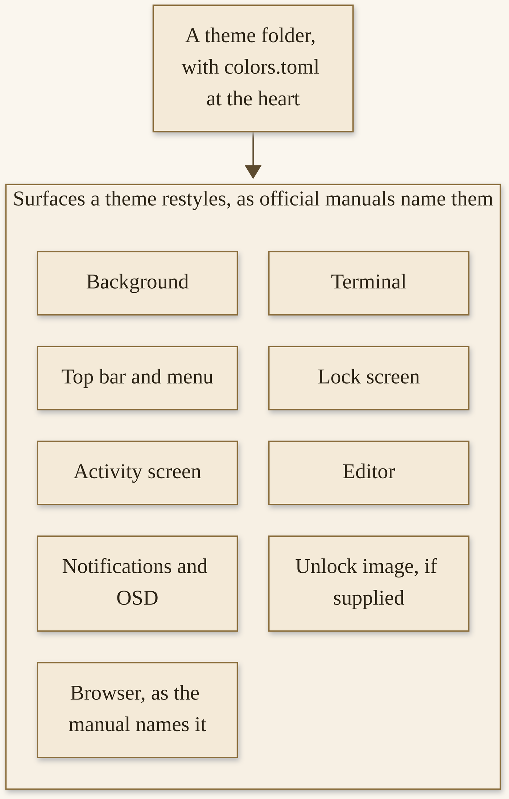{width=100%}

*D12. One theme, many surfaces. The official list, not an invented one. A wallpaper is part of this, and it is not the whole of this.*


Light mode is part of the format. If you are making a light theme, you set `mode = "light"` at the top of your `colors.toml`, and it is automatically paired with light mode for the apps. The old way, dropping an empty file called `light.mode` in the root of the theme, still works too. Unlock art is part of the format as well: themes that supply `unlock.png` and `preview-unlock.png` are listed under Appearance > Unlock. The official preference is a transparent PNG for `unlock.png`, and you can create the preview with `omarchy plymouth preview`.^70

User templates live in `~/.config/omarchy/themed/*.tpl`. If you use an app Omarchy does not already theme, you can teach it: drop a file named after the config it generates, plus a `.tpl` extension, and write the config with placeholders such as `{{ background }}`, `{{ foreground }}`, `{{ accent }}`, `{{ red }}`, and `{{ color0 }}` through `{{ color15 }}`. Every time you switch themes, the file is regenerated with that theme’s colors. A fully commented sample ships in that folder. Your templates take priority over Omarchy’s own, so you can also use this to override how a built-in app gets themed.^70

If you only remember one architectural fact from this section, remember that. Colors live in one file, and many surfaces are generated from it. When an agent offers to “just tweak the bar color,” the careful question is whether it is tweaking `colors.toml` — which will ripple — or a generated file that the next theme switch will overwrite. Prefer the heart of the theme. Let the generation do the ripple. That is the official design, and it is kinder than chasing copies.^70

That is the system. Once you can see it, the bundled set and the community gallery make more sense. You are not browsing wallpapers. You are browsing whole rooms.

## The bundled set, and 4.5’s extras

Omarchy comes with twenty-two bundled themes. That is the official wording on the Themes manual, re-opened on 12 November 2026. You select among them via Appearance > Theme in the Omarchy menu (`Super + Space`), or hop directly to the theme selector with `Super + Ctrl + T`.^69

I will name the ones that were visible on that page the day I opened it, and I will not invent the ones the fetch did not show. The heading said twenty-two. The visible list was: Tokyo Night, Catppuccin, Lumon, Ethereal, Everforest, Gruvbox, Miasma, Hackerman, Jade Horse, Kanagawa, Nord, Matte Black, Vantablack, Ristretto, Retro 82, Flexoki Light, Rose Pine, Catppuccin Latte, and White. That is nineteen names. The 4.5 notes, dated 4 November 2026, also name Starship as a new default theme, alongside Jade Horse. I will not invent the remaining names to force the arithmetic to close. If you are sitting at a 4.5 machine, open Appearance > Theme and count them yourself. If the official count has moved by the time you read this, use the new official count, and date it.^69

4.5 added pleasures I want to describe as the notes describe them, without marketing flourish. Backgrounds can now be videos. Drop one in, and the desktop can play it, while the lock screen shows a still frame from it. Themes can also make an entrance: each one can play a short, silent intro when you log in or switch to it. If you would rather keep it calm, you can turn intros off under Appearance > Animations.^71

Jade Horse is one of the new bundled defaults. The 4.5 notes describe it as misty greens, with carved-jade backgrounds. It replaces Osaka Jade among the bundled themes. If you were already on Osaka Jade, you keep your copy, and Osaka Jade continues as a third-party theme for anyone who wants to install it fresh. Starship is the other new default. Liftoff is the new default background for Tokyo Night on new installs, made by Tom Ballard, who first created it for his Liftoff theme. The notes thank him by name, and so will I.^71

Unlock designs, as the Themes manual shows them, can be selected under Appearance > Unlock. The visible unlock variants on the page I opened included Catppuccin, Catppuccin Latte, Ethereal, Everforest, Flexoki Light, and Matte Black. That is a visible list, not a claim that those are the only ones.^69

A word about those 4.5 extras, as a judgment rather than as a feature tour. Video backgrounds are a pleasure, and they are also motion on a desktop you may want to be quiet. Intros are a pleasure, and they are also a moment of animation every time you switch. The notes are kind enough to give you a way to turn intros off. Use it if you want calm. I will not tell you which is correct. I will tell you that a default can be delightful and still be optional.^71

Live with a bundled theme for a few days before you go hunting. Twenty-two official rooms is already a lot of rooms. Tokyo Night is the one many new installs will meet first, now with Liftoff behind it. Jade Horse and Starship are new defaults with a story in the notes. A light theme is already in the bundled set — Flexoki Light, Catppuccin Latte, and White were visible on the page I opened — so you do not have to go to the gallery just to get out of the dark. Try one. Sit with it while you write, or while you compile, or while you read. The test is not “is this impressive for a screenshot.” The test is “can I live here until Thursday.” The gallery we are about to open is much larger, and it is not a score.

## The community gallery

The official extra-themes page, https://omarchy.org/themes/, displayed the number 851 on 12 November 2026. I re-opened that page at draft, the same day, and the heading still showed 851. That is a dated census, not a quality score, and not a promise that every one of those themes was reviewed by the Omacom Foundation. Community themes are community themes. Some will be beautiful. Some will be odd. Some will be a good afternoon, and some will not. The number is a count of what was listed that day.^72

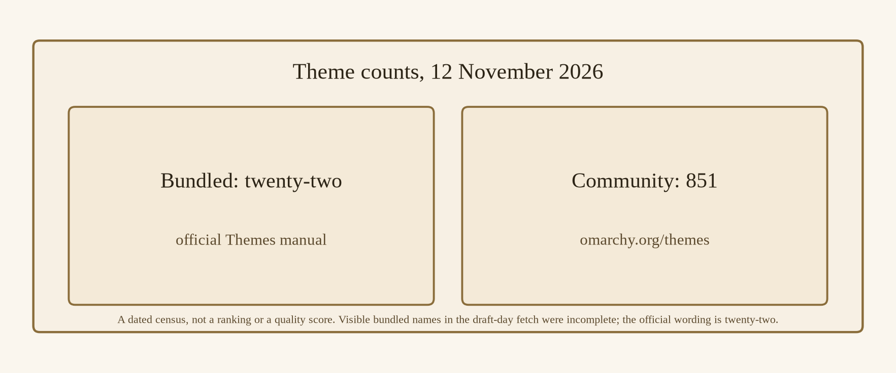{width=100%}

*D13. A dated census, not a ranking. Sources: the Themes manual and the extra-themes page, both opened 12 November 2026. 851 is a count, not a score.*


How to install one from the official gallery is a short official path. The extra-themes page itself points you at Install → Style → Themes, and the Making-your-own-theme page describes the same family of action: people can install a distributed theme using Install > Style > Theme in the Omarchy menu, from a public git URL. The command-line neighbor is `omarchy theme install`, which we will treat carefully in the next section, because of what that command does with certain files.^70

I will not walk 851 names. I will not pick a favorite and pretend it is official. I will not treat a large gallery as a homework assignment. If you want one, pick one, install it from the official gallery path, and live with it for a few days, the way I asked you to live with a bundled theme. If you want to make one, the next section is yours.

A census this large is a sign of a living commons, and it is also a reason to go slowly. You could spend a whole Saturday flipping through previews and end the day with a desktop you would not want on Monday. I have done versions of that, on other systems, and the Monday was always more honest than the Saturday. Pick with a use in mind. A theme for long writing is a different wish from a theme for a dim evening, and both are allowed. A theme that looks like a film you love is allowed too, and it still has to be readable in a terminal at eleven in the morning. If a preview is dark on dark, or light on light, believe the preview. Your eyes will not invent contrast that is not there.

The count will move. 851 is a 12 November 2026 number. If you open the page later and the number is different, you have a new dated count, not a contradiction. Write the number and the date, the way Chapter 7 asked you to write a harness count. This book will not invent a later figure in a reprint unless someone opens the page again and writes what it actually said.^72

The Foundation does not, on the pages I opened, claim to have reviewed every community theme. I will not claim it either. A count is a count. Your eyes, and a look at the files, are the review.

How you look, practically, is ordinary. If the theme is in a public repository, open the repository before you install it. Look at `colors.toml`. Look for `.lua` files, terminal configs, and editor theme files, even though the official install command will drop them: you should know they were there. Look at the backgrounds, and at whether a video background is part of the offer, and at whether you want that. Look at the README, if there is one, as a letter from the author, not as a certificate. Then, if you still want it, use the official Install > Style > Theme path, or `omarchy theme install`, so the drop-the-code-files rule is the one that applies. If you instead copy a folder by hand into `~/.config/omarchy/themes`, you have chosen the other rule, and you should choose it with your eyes open.^70

4.5 also lets you delete extra themes from the theme picker. That is a small official kindness, and it is the right kindness after an afternoon of trying things: take one out you will not live in, keep the one you will.^71

## Making a theme, and files that would run code

You can add your own themes to `~/.config/omarchy/themes`. The official how-to is: copy one of the existing ones as a base — look in `/usr/share/omarchy/themes` — then tweak to your delight. As long as your theme is inside that folder, it is included in the theme selection menu. The heart of the tweak, as I already said, is `colors.toml`.^70

You can also use Aether, which is a theming application that can extract colors from a background image and turn them into a complete theme. The GUIs manual, opened the same day, says you start Aether via the application launcher (`Super + Space`), and calls it the easiest way to make your own theme. The Making-your-own-theme page says to start it from the app grid on `Super + Alt + Space`. The 4.5 notes, for their part, say that `Super + Alt + Space` opens Apps from the dock. I will leave those official pages next to each other, dated, rather than invent a single exclusive chord. Start Aether from the launcher or the app grid, as those pages describe, and play with colors and backgrounds there if a GUI is how you like to work.^73

To distribute a theme so others can use it, put it on a public git server. People can then install it from that URL, through Install > Style > Theme. The recommended naming convention is `omarchy-[themename]-theme`, so the theme shows as just `[themename]` in the selection menu after installation. The leftover name becomes the theme’s directory, and it has to be one Omarchy can hand around safely: it must start with a letter, a digit, or an underscore, and the rest may hold letters, digits, `.`, `_`, `+`, and `-`. Capitals are lowercased for you. A space, a quote, or a non-English character is refused at install time rather than turned into a directory name. The manual’s own examples of names that install fine include `omarchy-tokyo-night-theme`, `omarchy-flexoki_light-theme`, and `omarchy-c++-theme`. Use a name you would be happy to see in a list, and that the rules will accept.^70

You can have your theme added to the extra-themes page by sending a pull request to the omarchy-site repository, as the manual describes. That is the official path onto the 851 — or onto whatever the count is on the day your pull request lands — and Chapter 14 will talk more generally about how to offer work back. For now, the important companion sentence is the one the same page already gave you: once a theme is installed from a repository, the files that would run are dropped, so do not build the theme around those files. Build it around `colors.toml`, the backgrounds, the unlock art if you have it, and the surfaces that are kept. A theme that only looks right because of a Lua file you shipped will not look right after a careful install, and that is by design.^70

Now the safety rule, and I want it in the same breath as the how-to, because a gift book that teaches you to install a stranger’s theme without this paragraph is not being careful enough.

A theme you write yourself in `~/.config/omarchy/themes` can contain whatever you like. It is your machine and your file, and Omarchy applies all of it. That includes files that would run code: a Hyprland Lua file is Lua your compositor runs at login; a terminal config can name the program your terminal starts; an editor theme file the official page names can name an extension to install.^70

A theme you install from someone else’s repository with `omarchy theme install` is treated differently. I re-opened the Making-your-own-theme page on 12 November 2026, and this is what it said that day, which is more precise than a shorter caution I had from earlier notes, and which I will teach as current. The official command keeps everything that is color, and loses the handful of files that would run code on your machine: any `.lua` file, the terminal configs (the official page names the terminal config files), and an editor theme file the page names. Installing someone’s theme, the manual says, should change what your desktop looks like, never what it runs. Everything else still works as the theme author wrote it — activity-screen theme files, browser theme files, editor files the page says are kept, `shell.toml`, the backgrounds and the previews. Only what was dropped gets regenerated from `colors.toml` on your machine.^70

Omarchy tells the two apart by whether the theme has its own git repository inside it, which is what `omarchy theme install` leaves behind when it clones. A theme you wrote stays yours, and one you pulled off the internet stays colors. If you copy a theme into `~/.config` by hand, rather than through that official install command, you are on the “your machine and your file” side, and everything applies — including files that would run. That is the path where looking before you trust a stranger’s theme matters most, and it still matters on the official path, because you should know what you are installing, even if some of it will be dropped.^70

I will say that in a shorter line, for the Tuesday you are tired. A theme can include files that would run code. A theme you wrote will apply them. The official `omarchy theme install`, as of the page opened on 12 November 2026, drops those files and keeps the colors. Look first, especially if you are not using that official command. Do not build a distributed theme around the files that will be dropped, and do not pretend a pretty preview is a review of the files.

Reserved editor names that appear on the official page are referred to here only as “an editor theme file the official page names.” That is a house rule, not a slight against those editors.^70

A short walkthrough, if you want to make a minimal theme this afternoon, without an agent and without a gallery. Copy a bundled theme you already like into `~/.config/omarchy/themes`, under a new directory name. Open `colors.toml`. Change one or two colors — an accent, a background — and leave the rest alone. If you want a light theme, set `mode = "light"` at the top. Save. Open Appearance > Theme, or run `omarchy theme list` and `omarchy theme set` with your new name, and look. That is a complete first theme. It does not need a public repository yet. It does not need a pull request yet. It needs to be a room you can sit in. If you later want to share it, the naming rules and the PR path are already in this section, and you will already have a `colors.toml` that is yours.^70

I will not print a finished `colors.toml` and call it a house theme. Your colors are yours. The format is official. The pleasure is in the tweak, and in the fact that one file can restyle the system.

## Asking the agent, then reading what it wrote

Chapter 6 already taught the official “tell your AI” path: the Omarchy Skill, experimental, in plan mode, with `omarchy reinstall configs` and a snapshot in your pocket. This section is that path, applied to a theme.

The agents panel’s “Make something” starters include a starter prompt for a new theme, handed to your default agent. That is an official starting point. Use it, if you want, in plan mode. Ask for a theme, not for a rewritten desktop. Read the plan. If you say yes, read the files it writes, especially any that would run. Keep the two rollback tools in reach: `omarchy reinstall configs` for a config mess, and a snapshot for a root-filesystem problem, with Chapter 6’s reminder that a snapshot restore does not roll back `/home`.^74

What I want you to read, if the agent writes a theme, is at least this: the folder it created under `~/.config/omarchy/themes`; the `colors.toml`, including whether `mode = "light"` is set if you asked for a light theme; whether there is an `unlock.png`; whether there are `.lua` files, terminal configs, or editor theme files; and whether the name would be a legal `omarchy-[themename]-theme` if you later wanted to share it. If the agent wrote files you did not ask for, ask it to take them out, or take them out yourself, or roll back and start smaller.

The skill is still experimental. A lovely preview is not a review. The yes is still yours.

A prompt shape that has worked for me, as a teaching draft and not as official required wording, is this: “Please propose a plan for a new theme in `~/.config/omarchy/themes`, named something legal, with a `colors.toml` I can read. Do not apply it until I say yes. Do not edit package files under `/usr/share/omarchy`. If you want to include an unlock image or a light mode, say so in the plan. Prefer colors and backgrounds. Flag any file that would run code.” Then I read the plan, and then I read the files. Appendix B will reprint a shorter version of that shape, with a “never” next to it. The “never” is: never skip the reading, and never let an experimental skill write in the package directory.^74

If the theme is wonderful, live with it. If it is almost wonderful, you can open `colors.toml` yourself and change the almost. That is the point of a file you own. The agent got you into the room. You still arrange the furniture.

## Pick one, keep a rollback

One bundled theme, or one community theme, lived with for a few days, is better than ten in an afternoon. I mean that as a kindness, not as a rule. The pleasure of 851 community rooms is real. The pleasure of knowing which room you are actually sitting in is also real, and it is the one that lasts past Friday.

Write down the name of the theme you are leaving, before you install a new one. If you do not like the new one, you can go back, and you will be glad you wrote the name down. `omarchy theme set <name>` is the official command for applying a theme you already have. Appearance > Theme is the menu path. The previous name, on a scrap of paper or in a note, is the rollback that does not need a snapshot.^69

If a community theme misbehaves, or if an agent-written theme is a mess, you already know the deeper rollbacks. You also know, now, what a theme is allowed to contain, and what the official install command will drop. That knowledge is part of picking one, not a footnote after the pick.

I have switched themes because a morning wanted something quieter, and I have switched back because the quieter thing made a terminal harder to read. That is a legitimate reason. Contrast is not a matter of taste only; it is whether you can work until dinner. If a community theme is lovely in a screenshot and muddy in a long file, it is allowed to be a theme you tried, and not a theme you kept. The gallery will still be there. The bundled set will still be there. Your note with the previous name will still be there.

One bundled, or one community, for a few days. A rollback you can name. A look at the files before a trust. That is the whole lesson of this chapter, and it is enough. The extensibility we turn to next — plugins, apps, menus, hooks — will ask for the same look, and for a plainer warning still.

If Aether gets you close and `colors.toml` gets you the rest, that is a complete craft. You do not owe the gallery a contribution on the first afternoon, and you do not owe an agent the last word on your colors. A room you made, even a small one, is already yours in the Doctrine sense: this is your computer, and the defaults were a starting point.

Write the previous theme name down before you start that try. I have skipped that step and regretted it for longer than it would have taken to write the name. The picker will still list what you have, and a written name is faster than wondering which of last week’s experiments you actually liked.

**Try this now.** Install one community theme from the official gallery at https://omarchy.org/themes/, or walk Aether once from the application launcher, and keep the previous theme’s name written down. Do not install ten. Do not skip the look at the files, especially if you are copying by hand rather than using `omarchy theme install`. Live with the one you picked until at least tomorrow.

**You are in good shape if you can…**

- say what a theme restyles, from the official list, and say why that makes it a system rather than a wallpaper pack
- give a dated community count: 851 on 12 November 2026, on the official extra-themes page, and say that the number is a count, not a quality score
- explain the current official safety rule: a theme you write yourself can apply files that would run code; `omarchy theme install`, as of the Making-your-own-theme page opened 12 November 2026, drops those files and keeps the colors
- name `colors.toml` as the heart of a theme, and Aether as a GUI for people who want a picker

**A few questions, with no grade.** Answers that are factual are in Appendix C, with a pointer back.

1. Can a theme you write yourself contain files that would run code, and will Omarchy apply them? (Section: Making a theme. Yes.)
2. Does `omarchy theme install`, as of the official page opened 12 November 2026, keep those files or drop them? (Section: Making a theme. It drops them, and keeps the colors.)
3. Is 851 a quality score? (Section: The community gallery. No. It is a 12 November 2026 count.)
4. How many bundled themes does the official Themes manual say Omarchy comes with? (Section: The bundled set. Twenty-two, as of that page on 12 November 2026.)

Plugins, apps, menus, and hooks are next. A theme changes how the desktop looks. A plugin can change what it is. That is a different kind of power, and it comes with a warning I will not bury: third-party plugins are unsandboxed. Chapter 9 says that plainly, early, and then teaches you how to add one after you have read it, and how to write a small one of your own.


# Chapter 9
## Plugins, Apps, Menus, and Hooks


{width=100%}

*I09. A small wooden toolbox with unlabeled drawers, hooks on a wall, unmarked boxes.*


A theme, in Chapter 8, changed how the desktop looks. A plugin can change what the desktop is. Since Omarchy 4 — Quattro, on 14 August 2026 — the desktop runs as a single long-lived Quickshell process called `omarchy-shell`, and almost everything you see on screen is a plugin inside it. The official Shell Plugins manual, opened on 12 November 2026, is plain about the list: the bar is a plugin. So are the panels that drop down from it, the fullscreen overlays, the Omarchy menu itself, the lock screen, the polkit dialog, and the headless services that watch your battery and warm your screen up at night.^76

That is not just an implementation detail. It means you can turn pieces of the desktop off, swap them out, or write your own, without touching a line of Omarchy’s source. It also means a third-party plugin runs inside that long-lived process, with your user’s authority, unsandboxed. I will say that early, and I will say it plainly, and then I will teach you how to add one after you have read it, and how to write a small one of your own. The warning and the craft belong in the same chapter. A gift book that buries the warning is not being careful enough, and a gift book that only warns, and never teaches, is not being generous enough.

I have come to think of this chapter as the commons’ spine, which is a slightly grand phrase for a very practical set of folders and commands. The spine is this: the shell is made of plugins, you can add one, you can write one, you can take one out, and you are responsible for what you enable. Around that spine sit the first-party apps 4.5 shipped, the install menus, the development environments mise manages, the menu you can extend, and the hooks you can hang a script on. None of those require you to become a Quickshell developer. All of them are official, and all of them are how a finished desktop stays a desktop you can shape. The Doctrine’s “this is your computer” is not, here, a slogan I am borrowing for a heading. It is a description of where the files go.

If you are a person who only wants to add one community plugin and get back to work, you can. If you are a person who wants to clone a clock and change a label, you can. If you are a person who wants to ship a one-file widget and list it on the marketplace, you can, and the official path is already written. The chapter will walk all three of those afternoons, at a human pace, with the unsandboxed fact sitting near the door so you do not have to trip over it later.


## Plugins, first-party and third-party

First-party plugins ship with Omarchy and live in `$OMARCHY_PATH/shell/plugins/`. They receive trusted shell interfaces. Their identifiers all start with `omarchy.` — `omarchy.clock`, `omarchy.network`, `omarchy.notifications` — and that namespace is reserved. A third-party plugin can never claim it.^76

Anything you add yourself — your own experiments, or something you found — lives in `~/.config/omarchy/plugins/`. Third-party plugins receive a limited interface, scoped to their own service and lifecycle. Both kinds are discovered the same way at startup. The difference is the trust and the interface, and, as we will see in a moment, the fact that the third-party kind runs as arbitrary code inside your shell process.^76

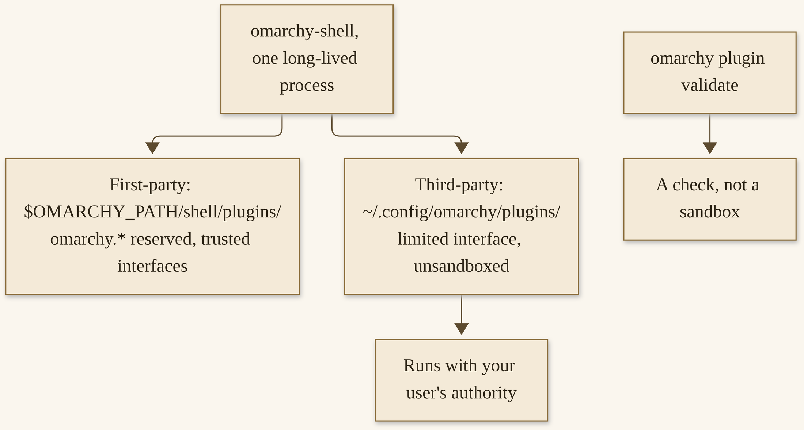{width=100%}

*D14. First-party and third-party, as the Shell Plugins manual described them on 12 November 2026. The boundary is real. It is not a sandbox.*


To see what you have:

```bash
omarchy plugin list
```

That prints every discovered plugin with its id, whether it is enabled, whether it is first-party or third-party, its kinds, and its display name. Add `--json` if you are feeding it to something else. This is a good first command, and it is the one I want you to run before you add anything. Know what is already there.^76

Turning plugins on and off is official and ordinary:

```bash
omarchy plugin enable omarchy.tailscale
omarchy plugin disable omarchy.weather
```

Or use the menu: Setup > Plugins has Enable, Disable, Add, Clone, and Remove, each with a picker that only offers the plugins that make sense for that action. Enabled state is stored in `~/.config/omarchy/shell.json`, and the rule differs slightly for the two kinds. A third-party plugin is enabled exactly when its id appears somewhere in that file. First-party plugins that are not bar widgets are the other way around: they are on by default and only turn off by being listed in `disabledPlugins[]`. A full bar plugin has no off state at all. There is always exactly one bar, so you replace it by enabling another one.^76

Adding a plugin from git is a third-party plugin in a git repository, with a `manifest.json` at its root:

```bash
omarchy plugin add https://github.com/acme/omarchy-weather.git --enable
```

That URL is the official page’s example, not a plugin I am recommending, and not a plugin I have audited. Before the command does anything, it tells you plainly that plugins run as arbitrary, unsandboxed code inside your long-lived shell process, shows you the URL, and asks you to confirm. Without `--enable`, it asks whether you want it on now, and you can say no and go read the code first. It never runs anything from the plugin at add time, never executes an install hook, and never asks for sudo. It clones files, checks the manifest, and flips a bit. Then, when you enable it, the code runs.^76

Updating is a fast-forward pull of that same checkout: `omarchy plugin update <id>`, or `omarchy plugin update` with no id to update every git-managed plugin you have. It shows you the diff before applying it, refuses to update if you have local changes it cannot fast-forward past, and rolls back if the new revision fails validation. Removal disables the plugin first, then deletes it if it is a git checkout, or unlinks it if it is a symlink. A hand-made plugin folder with no git repository gets moved to a timestamped backup inside the plugins directory, rather than being deleted outright.^76

Cloning a built-in is the official way to change one without losing the change on the next package update. Do not edit the files under `$OMARCHY_PATH`. Those belong to the package, and the next update will overwrite them. Clone instead:

```bash
omarchy plugin clone omarchy.clock
```

That copies the whole plugin into `~/.config/omarchy/plugins/<your-username>.clock`, renames it to “My Clock,” enables it, and switches the shell over from the built-in to your copy, keeping an existing bar widget’s position and settings. The official page’s example uses `dhh.clock` as the author’s username, not yours. Your username is the prefix, so sharing the clone does not collide with anyone else’s. Calls made to the original built-in id get routed to your clone, so nothing that referred to `omarchy.clock` needs updating. If you make a mess of it, `omarchy plugin remove <your-username>.clock` puts the built-in back. Saving a file anywhere under `~/.config/omarchy/plugins/` reloads the plugin code automatically, so you can leave the editor open and watch your changes land. Add `--edit` to open the new directory in your `$EDITOR` right away, which is what the menu’s Setup > Plugins > Clone Plugin does for you.^76

A practical habit, before we get to the warning’s full weight: treat `$OMARCHY_PATH` the way Chapter 6 asked you to treat `/usr/share/omarchy`. It belongs to the package. Your experiments belong in `~/.config/omarchy/plugins/`. A clone puts a built-in on your side of that line. A hand-made folder starts on your side. An edit in the package tree starts on the wrong side, and the next update will tell you so by overwriting you.^76

If you are only exploring this afternoon, `omarchy plugin list` and a single clone of `omarchy.clock` are enough. You do not need to add a third-party plugin in order to understand the architecture. The warning in the next section is for the day you do, and for the day an agent offers to add one for you. Read it before that day, not after.

I will come back to cloning as a lesson. First, the warning, in the same chapter, early, while the architecture is still in your hands.

## Unsandboxed, said plainly

Third-party plugins are unsandboxed. They run as arbitrary code inside your long-lived shell process, with everything your user account can reach. The official add command tells you this plainly and asks you to confirm. Take that seriously. The third-party plugin interface does not directly expose authentication services, and a replacement bar receives only limited capabilities. Visual plugins still share the shell’s QML scene. Authentication state is protected separately, as the manual describes. Those mitigations are real, and they are not a sandbox. All plugin code runs with everything your user account can reach.^76

`omarchy plugin validate` is a check, not a sandbox. It runs the same checks the shell does at load time: the schema version, the required fields, an id that is not reserved, entry points that are safe relative paths and actually exist, an entry point for every kind you claimed, and no symlinks anywhere inside the folder. Those are good checks. They will catch a broken manifest. They will not catch a plugin that is well-formed and unkind. Only add repositories you are willing to run, and read them before you enable them. That last sentence is the official page’s, and I will leave it in those words.^76

This is the same family of caution as Chapter 8’s theme files that would run code, and as Chapter 14’s security posture. A theme you install with the official command, as of the page we opened, drops the files that would run. A plugin you enable is the running. There is no equivalent drop. The code is the point of a plugin. That is why the look comes first, and why a first-week binge of marketplace plugins is a bad idea even when the plugins are wonderful.

I will not invent a sandbox that does not exist. I will not tell you that `validate` is enough. I will tell you to read the plugin, to start with one, and to be ready to `omarchy plugin disable` or `omarchy plugin remove` if you do not like what you got. The official remove path is conservative about hand-made folders, and clean about git checkouts. Use it.

What “read the plugin” means, practically, is ordinary and a little slow, which is the point. Open the repository, or the folder the add command cloned. Open `manifest.json`. Confirm the `id` is not claiming `omarchy.*`. Confirm the `kinds` are what you thought you were installing — a bar widget is a different promise from a full replacement bar, and a `service` has no UI and runs in the background. Open every QML file the `entryPoints` name, and any other script the folder contains. You are not being asked to become a Quickshell expert in an hour. You are being asked to look: does this look like a clock, or a weather widget, or whatever the listing promised, or does it look like something else? If you cannot tell, do not enable it yet. Ask someone you trust, or wait, or choose a smaller plugin. The marketplace will still be there tomorrow.^76

“Everything your user account can reach” is a wide phrase, and I will not turn it into a list of attacks. I will say this: a plugin runs as you. Files you can read, it can be written to read. Things you can run, it can be written to run. That is why the official page asks you to add only repositories you are willing to run, and why I will not treat a pretty marketplace card as a review. Chapter 14 will sit with the rest of the security posture. This chapter’s job is to make sure you hear “unsandboxed” before you hear “just add this, it is fun.” Both things can be true. The fun is real. The authority is yours, and so is the risk.

## The marketplace, without an invented total

https://plugins.omarchy.org/ is the official marketplace for Omarchy shell plugins, and it is the first place to look when you are wondering whether someone has already built the widget you are about to write. The Shell Plugins manual says that, and it says “Browse it before you start.” The page title, on the day I looked, was about browsing community-built plugins for Omarchy Quattro.^76

I will not invent a live total. On 12 November 2026, the live plugin count was UNVERIFIED. The marketplace page, in the fetch we had, did not expose a total in readable text. The project’s homepage, that same day, used the vendor wording “Thousands” of community plugins. A news item on 19 August 2026 said the marketplace was already home to “over 500” plugins. Those are two dated phrases, and they are labeled. They are not a census I will pretend to have taken. If you open the marketplace on the day you read this and a precise total is published, write the number and the date. This book will not invent one in the meantime.^77

How to add one plugin, after you have opened its files, is the path we already have. Find it on the official marketplace, or from a public git URL you have a reason to trust. Open the repository. Read the `manifest.json`. Read the QML. Decide whether you are willing to run this as you. Then:

```bash
omarchy plugin add <git-url>
```

Leave off `--enable` the first time, so you can say no and read, or so you can read after the clone and before the enable. Then `omarchy plugin validate` on the folder, as a check. Then enable, if you still want it. Then live with it for a day, not a minute, before you add a second.^76

The homepage, on 12 November 2026, showed a few marketing-card examples: a Radio Atlas, a 1-bit desktop pet “in the spirit of the 1997 originals,” Omasweeper, Time Machine. Those are homepage examples, not an exhaustive catalog, and not a review I conducted. I name them only as the project named them, as examples of the kind of thing the commons already holds.^77

A living marketplace will have wonderful work in it, and work you would not want, and work that was wonderful in August and is unmaintained in November. The dated “over 500” from 19 August 2026 is already a historical number by the time you read this. The homepage’s “Thousands” is vendor wording, and vendor wording is allowed to be proud. What I will not do is translate pride into a precise figure I did not open. What you can do is treat every plugin as a single decision, the way Chapter 8 asked you to treat every community theme as a single decision. One, after a read. A day of living with it. Then, maybe, another.

If an agent offers to “install some useful plugins” as a stack, that is a stack, not a plan. Shrink it. Name one URL. Read that one. The official add command’s confirmation is a pause for one repository, and that is the right grain.^78

## Writing a small one, or reading one

A plugin is a directory with a `manifest.json` and some QML. The manifest declares `schemaVersion: 1`, an `id`, a `name`, a `version`, one or more `kinds`, and an `entryPoints` object pointing at the QML file for each kind. The official kinds, as of the page I opened, are:^76

- `bar-widget` — a component the active bar can drop into a section
- `panel` — a persistent or summoned floating window
- `overlay` — a fullscreen overlay
- `menu` — a summoned menu surface
- `service` — a headless singleton with no UI
- `bar` — a full bar that replaces the built-in one

A plugin can declare several kinds at once. Bar widgets get an extra `barWidget` block with a display name, a category, an optional `defaultSection`, and `allowMultiple`. Most widgets set that last one to false; spacers and indicators set it to true. Before you publish anything, and before you enable anything you wrote:^76

```bash
omarchy plugin validate ./my-plugin
```

This is not a full Quickshell textbook. It is one honest afternoon. The official way into that afternoon, if you would rather read a real plugin than start from a blank folder, is the clone we already have:

```bash
omarchy plugin clone omarchy.clock
```

I re-checked the name on 12 November 2026; `omarchy.clock` was still the official example. Open the copy. Change a label. Save, and watch the bar reload. If you like the change, keep it. If you do not, remove the clone and the built-in comes back. That is a complete first plugin lesson: you have read a manifest, you have touched QML, you have seen a live reload, and you have a removal path.^76

Or ask the default agent, in plan mode, to draft a tiny plugin, then read the manifest and the interface files, and validate before enabling. The “Make something” starters include a plugin prompt, handed to your default agent. The Omarchy Skill is still experimental. The reading is still the work. A plan that proposes a full replacement bar is too large for a first afternoon. A plan that proposes a small bar widget, with a manifest you can read in one sitting, is the right size.^78

When you open a cloned `omarchy.clock`, or a first-party plugin under `$OMARCHY_PATH/shell/plugins/`, look at it the way you would look at a short essay. The manifest is the title page: who it claims to be, what kinds it is, where the entry points are. The QML is the essay. You do not have to agree with every line to learn from the shape. Notice how a bar widget is declared. Notice how a label is drawn. Notice how little is required for something you can actually see. Then change one string — a label, a format — and save. The automatic reload is a teacher. If the bar shows your word, you have made a change that is yours, in a file that will survive the next package update, because it lives in `~/.config`.^76

The official page also points, for deeper plugin development, at a shell reference and a first-party plugin catalog. I will not pretend those pages are this chapter. If you fall in love with this craft, those are the next official doors. This chapter is the honest afternoon, and the safety rule that goes with it. An honest afternoon is allowed to end with a changed label and a smile. It does not have to end with a published repository. Publishing is for the day you would install the thing yourself, which is the same test Chapter 14 will ask of a contribution.

To share what you made, put it in a public git repository. That is the whole distribution mechanism. Anyone can then run `omarchy plugin add` against your URL. To help people find it, list it at plugins.omarchy.org, as the manual describes. Chapter 14 will return to offering work back, in the project’s own style.^76

## Apps, menus, hooks, and development stacks

A plugin is one surface of “make it yours.” The others are first-party apps, the install menus, hooks you already met in Chapter 6, menu extensions, and development environments. I want them on one clear shelf, so you can see the whole commons, not only the widget you just cloned.

**4.5’s first-party apps**, as the 4 November 2026 notes and the GUIs manual describe them, one honest sentence each, no invented features. Hype makes presentations from a single Markdown file, with a visual slide editor beside the source, and exports as the notes describe. Signed is for the paperwork: open a PDF, place your saved signature, text, and dates, and save a signed copy; it replaces a previous PDF-annotation app on new installs, and machines that already have the previous one keep it. Disktree draws a treemap of what is filling your disk, colored by kind, calls out caches that are safe to regenerate, and lets you mark what should go. Monologue records your camera, themed to match your desktop; you choose the camera and microphone once, and you can start and pause from the app. Gliff gives you a remote desktop over SSH: connect to another Omarchy machine and drive its full desktop from a window on yours, with a tab for each machine, and with a remote-session indicator in the bar of the machine being controlled. Elsewhen is a world clock that lives next to the clock in the bar; you can summon it with `Super + Ctrl + Alt + E`. With Monologue for recording and Omacut for trimming, new installs no longer ship two heavier media tools the notes name; machines that already have them keep them. Lazydocker is gone from new installs too, though Docker and Docker Compose are still included.^79

Those are official first-party tools, and they are part of the extensibility story because they show what “an Omarchy app” can be. You do not have to use all of them. I mention all six because 4.5 shipped them as a set, and because a gift book that skipped the first-party shelf in a chapter about extensibility would be telling only the community half of the story. Hype is for a deck. Signed is for a form. Disktree is for a disk that has gotten away from you. Monologue is for a short recording. Gliff is for another Omarchy machine you already have a reason to sit down at, over SSH, with the indicator on so that machine is not being driven in secret. Elsewhen is for the simple question of whether it is a decent hour to call. Each of those sentences is a use, not a review, and not a feature I added.^79

The agents panel’s “Make something” starter for an app follows the official `omarchy-app` skill, in C++ and Qt Quick, the way Hype, Monologue, and Omacut are built, with the compiler and Qt pieces already installed. A first app, like a first plugin, is a plan-mode afternoon and a careful read, not a weekend of unsupervised generation. If you build one, read what it writes, run what you would be willing to run, and keep the rollback habits from Chapter 6. An app is software on your machine. It is not a theme, and it is not a wallpaper.^78

**Install menus** are how most software arrives. You open the Omarchy menu with `Super + Space`, and you walk Install: packages, the Arch User Repository (split out since v2.0, as official notes describe, to protect against AUR fallout), web apps, terminal UIs, development environments, editors, browsers, gaming, AI, and services. Remove mirrors these. Where an official menu lists a reserved editor name, this book says “a popular code editor.” Neovim is the default editor. You can set a system-wide default under Setup > Defaults > Editor. I will not copy a reserved product name from that menu into this chapter.^80

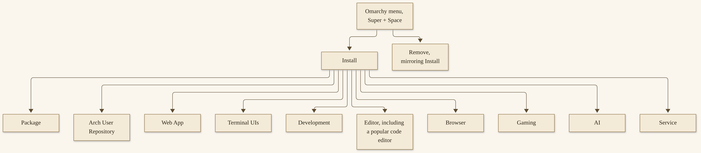{width=100%}

*D15. The install-menu map, as official docs describe the tree. A reserved editor name is not on this figure.*


**mise** is how most of those development environments are managed. The Development Tools manual, opened on 12 November 2026, lists a broad official selection under Install > Development: Ruby on Rails, Laravel, Node.js (and Bun, and Deno), PHP frameworks including Laravel and Symfony, Go, Rust, Python, Java, Elixir with Phoenix, .NET, OCaml, Zig, Clojure, and Scala. To install, say, Ruby, you run `mise use -g ruby`, which installs it and sets it as the global default. If a project has a version file, `mise i` in the project root honors it. `omarchy update` updates installed mise tools with the rest of Omarchy. The `mup` alias updates mise-managed tools only. You can inspect what is configured with `mise ls --current`, install one tool now with `mise install gh`, or install all configured tools, including lazy ones, with `mise install --include-lazy`. Chapter 12 will make a menu-driven development-environment lesson of this, for a professional day. The shelf here is so you know the menu exists, and that mise is the official manager under it.^80

A word about the menu itself, as a daily habit rather than as a map. `Super + Space` is a door I use constantly. Install is one room behind it. Setup is another, and Setup > Plugins is the room this chapter has been walking. Appearance, which 4.5 gathered into one place, is the room Chapter 8 walked. You do not have to memorize the tree. You have to know the door, and you have to know that your own rows can be added, carefully, in a JSONC file that ships with comments. If an agent offers to rewrite that file wholesale, shrink the wish. One row. A dotted id you chose. A look at the file after the write.^81

**Menu JSONC extensions** let you add your own rows to the Omarchy menu by editing `~/.config/omarchy/extensions/omarchy-menu.jsonc`. Entries are keyed by a dotted id, and the id is what places them in the tree. Reuse an existing id and you override that row instead of adding a new one. The file ships with the available fields documented as comments. This is a small, official way to make the menu yours, and it does not require a plugin.^81

**Hooks**, which Chapter 6 already taught, live in `~/.config/omarchy/hooks/<event>.d/`. The events, again, are `post-boot`, `post-update`, `pre-refresh-pacman`, `theme-set`, `font-set`, and `battery-low`. `omarchy hook install post-boot ~/my-hook` copies a script in and makes it executable. A hook is a script at a moment. A plugin is a piece of the shell. You can have both. You do not need both on the first afternoon.^81

A hook I will describe only as a shape, not as a script I wrote for you: after a theme change, you might want a small notification, or a small backup of a file you care about. The `theme-set` event gives you the theme name in `$1`. After an update, you might want a reminder to look at a service you run. The `post-update` event is that moment, and it runs as you, after cached sudo authorization has been cleared, so a hook that needs `sudo` will ask. I will not write those scripts out as if they were official packages. The `.sample` files in each hook directory already show the shape. Copy, rename, and keep them small. A hook that tries to do a whole second update is too large. A hook that writes a line to a log you read is the right size.^81

If an agent offers to install a hook, use plan mode, and read the script before it is executable in that directory. The same rollback instinct from Chapter 6 applies: you know where the file lives, and you can take it out.

## A one-file bar widget

This is the chapter’s flagship hands-on. It should be small enough to read in one sitting, and official enough that I am not pasting a third-party plugin as if it were ours.

Start from the official format. Make a directory of your own, under `~/.config/omarchy/plugins/`, with an id that is not in the `omarchy.*` namespace — your username is a good prefix, the way a clone would prefix you. Put a `manifest.json` in it, with `schemaVersion: 1`, your `id`, a `name`, a `version`, the kind `bar-widget`, and an `entryPoints` object that points at a QML file you will actually write. In that QML file, make the smallest honest widget you can: a label, a word, something you can see on the bar and know is yours. I will not invent a QML textbook in this paragraph. The first-party plugins, and the clone of `omarchy.clock`, are the official examples to read. Copy a shape you have actually opened, and change it until it is yours.^76

Then:

```bash
omarchy plugin validate ~/.config/omarchy/plugins/<your-plugin>
```

Fix what the validator says is wrong. When it is clean, enable the plugin — from Setup > Plugins, or `omarchy plugin enable <your-id>` — and look at the bar. If the widget is in the way, disable it. If it is a mess, remove it; a hand-made folder will be moved to a timestamped backup, not deleted outright. If it is a small delight, keep it, and write down what you made, in a sentence.^76

Appendix B will reprint these steps as a recipe, with a “never” next to them. The “never” is: never enable a plugin you have not read, never claim `omarchy.*` as your id, and never treat `validate` as a sandbox.

If you get stuck, the official first-party plugins are still the best textbook I can point you at, because they are on the machine and they work. Read `omarchy.clock` before you invent a widget from a blank page. Read a small first-party bar widget before you attempt a panel or a service. A service with no UI is a powerful kind, and it is a poor first kind, because you cannot see it working except in its effects. Start with something you can see. The bar is right in front of you. That is why this lesson is a bar widget, and not a headless service, and not a replacement bar. A replacement bar is a whole desktop change. A label is an afternoon.

The official page is also careful about a replacement bar in a way I want you to hear if you ever do try one: a replacement bar can render installed widgets, but service-backed third-party widgets may have reduced functionality there, because the bar is not allowed to request another plugin’s live service object. Switch back to the built-in `omarchy.bar` if such a widget needs its companion service. That is an official limit, not a bug you should fight on a first weekend. Stay with a widget until you have a reason to replace the bar. The built-in bar is already a finished piece of a finished desktop. Your first gift to that desktop can be a small one, and it will still be a gift, which is the right scale for a first afternoon.^76

If the widget does not appear, or appears in a place you did not expect, you have not necessarily failed. Bar widget placement has its own official rules — including, in 4.5, the ability for widgets to live in the tray’s drawer, and the ability to remove a widget by dragging it off the bar. I will not invent a placement tutorial beyond what I have opened. The Shell Plugins manual points at the top-bar documentation for placement, and at Setup > Plugins for enable and disable. Start there, and with `omarchy plugin list`, before you assume the code is wrong.^83

That is a mastery taste, not a mastery certificate. A one-file widget you have read, validated, enabled, and can disable, is a real thing on a real desktop. It is also an invitation, which is the last turn of this chapter. Mastery, in a commons, is less a certificate and more a habit: you can add a small thing, you can read a thing someone else added, and you can take a thing out. The habit is the point. The widget is how you practice it.

## What a collaborator might already have built

A collaborator of mine has written applications and plugins for Omarchy. I am glad the commons has that kind of work in it. I will not name the applications or the plugins here.^82

The point is the invitation. The commons is not only a gallery you consume. It is a place you can add something to, in the same official ways this chapter has been teaching: a public git repository, a marketplace listing, a theme pull request from Chapter 8, a hook, a menu row, a small app. You can add something too. Chapter 14 will tell you how to offer it back, in the project’s own style, after you would install it yourself.

I will not make a catalog of that collaborator’s work, and I will not give you a URL to it, and I will not turn a general gladness into a feature list. The gladness is real. The names stay out. The invitation stays in.

I mention it at all because a book about a commons that never admits work already being done in the author’s own circle would feel a little abstract, and because Michael — I, in the voice of this book — asked that the work be honored this way and no other. Generally, without names. The invitation is the honor: this is a desktop you can add to, and people I work with already have, and you can too. If you add something, add something you would install yourself. That test will serve you better than a list of titles would.

## A checkpoint for the commons

I want to close this spine without turning it into a pep talk. The commons is large enough to delight you and large enough to overwhelm you. The official tools are good enough to start today and careful enough to ask you to read. My own shop has benefited from work other people did in this commons, including work a collaborator of mine has already given it, unnamed. I have also, on other systems, installed too much in a day and spent the next day taking it out. Omarchy makes the taking-out official and relatively kind: disable, remove, a timestamped backup for a hand-made folder, a built-in that returns when a clone is gone. Use those kindnesses. They are part of the craft.

Part 4 of this book has been about making the machine yours: a theme as a whole system, and now the plugins, apps, menus, and hooks that sit under that system. The spine of it, if I can say so in one paragraph, is this. Your changes live in `~/.config`. First-party plugins live with the package; third-party plugins live with you. Third-party plugins are unsandboxed. The official marketplace is real, and this book will not invent a live total for it. A small plugin you have read is better than a stack you have not. A collaborator of mine has already added to that commons, unnamed here, and you can too.

If you remember only four facts, remember these. `omarchy plugin list` shows what you have, and first-party versus third-party is in that listing. Unsandboxed means the plugin runs with your user’s authority, inside the shell process. `validate` is a check, not a sandbox. A live marketplace census is not something I have to give you, and not something you should accept from a book that did not open a number.

Hardware is next. Chapter 10 is a map of official platforms as of 4.5, with a clear key: supported, preliminary, bring-up. It is not a certification, and it will not invent a minimum-spec table. If your machine is old, Chapter 11 is the chapter that sits with you. The map comes first, so the second life has a place on it.

**Try this now.** Run `omarchy plugin list`. Then either add one marketplace plugin after you have opened its files — without `--enable` until you have read them — or clone the official clock example and change a label. One of those two, not both in a rush. Save, look, and know how you would disable or remove it.

**You are in good shape if you can…**

- point at first-party versus third-party paths: `$OMARCHY_PATH/shell/plugins/` and the reserved `omarchy.*` namespace, against `~/.config/omarchy/plugins/`
- say “unsandboxed” in your own words: third-party plugins run as arbitrary code inside your long-lived shell process, with your user’s authority
- refuse to quote a live plugin total this book does not have, and distinguish the homepage’s “Thousands” and the 19 August 2026 “over 500” as dated phrases
- name `omarchy plugin validate` as a check, and not as a sandbox
- name at least two of 4.5’s first-party apps from their official descriptions

**A few questions, with no grade.** Factual answers are in Appendix C.

1. Is `validate` a sandbox? (Section: Unsandboxed. No.)
2. May this book invent a marketplace census? (Section: The marketplace. No.)
3. If you want to change a built-in widget, should you edit the files under `$OMARCHY_PATH`? (Section: Plugins, first-party and third-party. No. Clone it.)
4. Are third-party plugins sandboxed if you skip `--enable` at add time? (Section: Unsandboxed. No. Skipping `--enable` lets you read first. It does not create a sandbox.)


# Part 5 — Hardware, Including a Second Life
# Chapter 10
## The Hardware Map


{width=100%}

*I10. An older laptop, a plain mini-computer, and a thin closed laptop on a worktable, a blank folded paper.*


A map is not a certification. I want that sentence at the top, before any island, because a gift book that draws a tidy chart of machines can start to look like a promise the project did not make. Omarchy’s official posture, on the homepage I opened on 12 November 2026, is that it runs on almost anything, and that you do not need a new machine to try it. That is a posture, and it is a generous one. It is not a test report. There is no official minimum-spec table on the pages we opened — no required generation of processor, no recommended amount of memory, no certified disk size. We will not invent one. The strongest official low-end demonstration is a 2011 ThinkPad X220 with 2 GB of memory, which Chapter 11 will sit with properly. This chapter is the map around that demonstration: what is supported, what is preliminary, and what is still bring-up.^84

The key I want you to use, for the rest of this chapter and for the next, has three official-feeling words and one honest fourth. **Supported** is work the project treats as shipping, with the caveats the pages actually name. **Preliminary** is the word 4.5 uses for its first ARM ISO. **Bring-up** is work in progress, machine by machine, as the Omarchy Dragon news said of Snapdragon computers on 18 September 2026. The fourth is yours: **I need Chapter 11**, for a machine that is old, small, or loved, and that still has work in it. “On the way” is a status, not a ship date. I will say that as many times as the pages require.^85


## A map, not a certification

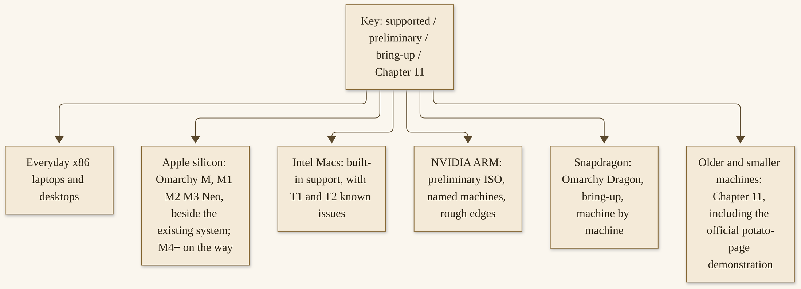{width=100%}

*D16. A map, not a hardware compatibility list. Status words are official. A missing official minimum-spec table is not filled in by this book.*


Support, on the pages I opened, is described by platform teams, by installer detection, and by fixes in release notes. It is not described by a single certified list with stamps on it. Community reports belong in other people’s voices, and I will not turn them into a second official map. If your machine is not named in this chapter, you have not been told “no.” You have been told that I will not invent a yes. The installer, the current notes, and a careful first hour are better evidence than a sentence in a book with a 12 November 2026 access date.

“The latest laptops,” the homepage says, “make amazing Omarchy machines, with our core team helping the newest hardware work properly,” and it names a Dell XPS in that breath. I will leave that as official wording, not as a review I conducted, and not as a recommendation that you buy a particular machine to be taken seriously. Everyday computers, Apple’s two stories, ARM work, graphics and sleep, displays and firmware, and then a way to choose: that is the walk. We will take the everyday island first, because that is where most readers will actually live.

## Everyday machines

Most people who install Omarchy will install it on an everyday x86 laptop or desktop: an AMD or Intel machine, a tower, a mini PC, a laptop they already have. That is a supported kind of story, and it is the least glamorous island on the map, which is why I want it first. You do not need a special platform name to begin. Chapter 3 already walked the official install paths. This section is only to say: this is the ordinary, and the ordinary is allowed.

AMD and Intel appear in release notes as attention, not as a full matrix. The 4.5 notes, for example, name a 7-second install record on an AMD laptop — a named record, not typical, as Chapter 3 already treated it — and they name fixes such as hardware video decode on a particular Intel generation, and a live-ISO crash fix on another. Those are dated official mentions. They are not a support table I will draw and pretend is complete. If your everyday machine works, it works. If it does not, the current notes and `#omarchy-help` are the right next doors, not a matrix I invented.^86

Framework appears in this book only as a dated mention: version 2.1.0, on 31 August 2025, included a fix for a Framework Laptop 13 whose audio input was misconfigured. I did not find a dedicated official Framework support chapter on 12 November 2026. I will not invent a broader certification from a single dated fix. If you have a Framework, that fix is a fact about 2.1.0. It is not a promise about every port and every generation.^87

NVIDIA drivers and configuration, including NVIDIA on supported hardware, are “sorted during installation,” in the homepage’s wording. That wording is for supported hardware. The caveats — sleep turned off on some GB10-class machines, a preliminary ARM ISO, rough edges — are in this chapter’s later section, and they are official. I will not let the homepage sentence travel farther than the caveats allow.^84

Dell XPS is official wording twice: “the latest Dell XPS” on the homepage, speaker tunings for 2026 XPS 14 and 16 in the 4.0 notes, and an N1X XPS 16 Creator Edition on the preliminary ARM list. Those are mentions. They are not a Dell review, and they are not a claim that every XPS, in every year, is a certified Omarchy workstation.^84

The machine I actually run fleets on, as Chapter 7 already said, is a MinisForum MiniPC: an AMD Ryzen 7, 32 GB of memory, on Omarchy. It is one of five SMF Works computers I have on this desktop. I will not name the other four, and I will not turn my MiniPC into a recommended shopping list. It is an everyday x86 machine, and it does the work. That is the kind of sentence this island is for.^88

If your everyday machine is older than you think a “Linux desktop” is allowed to be, you are not in the wrong chapter by accident. You are near the door to Chapter 11. Stay for the rest of the map, and then go through that door with a clearer key.

## Apple silicon, and Intel Macs

Apple has two stories on this map, and I will keep them in separate drawers, because one official page is stale on one of them.

**Apple silicon** is a 4.5 story, and a homepage story, and an Omarchy M story. I will use those, not the older Mac-support lines. In 4.5, the Omarchy M team shipped a native Mac installer. You download an app on the existing system, and it puts Omarchy right alongside it on an M1, M2, M3, or Neo MacBook. No USB stick, no terminal incantations, in the notes’ own wording. Homebrew is also an official one-line path: `brew install omacom/mac/omarchy`. This is beside the existing system, not a wipe of it. The Mac-support manual, which I re-opened on 12 November 2026, still said that installing on an M-series Mac is not directly supported, and that Omarchy only supports being the only operating system, with the drive wiped. Those lines contradict 4.5 and the homepage. I will not teach them as current for Apple silicon. If that manual has been updated by the time you read this, trust the update, and date it. If it has not, trust 4.5 and the homepage for M-series, and use the Mac-support page for Intel known issues, which still apply.^89

M4 and newer are “on the way.” The 4.5 notes say M4, M5, and M6 are all being worked on. “On the way” is a status. It is not a ship date, and it is not a claim that a particular newer machine already runs the native installer today. Official @omarchy, on 5 November 2026, confirmed the M1, M2, and M3 set in a public reply, as this book’s research recorded. Marcelo Alcantara and Birk Skyum joined Omarchy Core on 5 November 2026 as delegates for the M and Dragon work, in 4.5-era news. Those are dated facts about a team, not a promise about a chip that is still on the way.^89

**Intel Macs** are the other drawer, and the Mac-support page is still the right source for them. “Omarchy has built-in support for Intel Macs.” There are known limitations, and as long as you are aware of them and okay with them, the official invitation is that you can breathe some new life into your old Macs. That invitation is Chapter 11’s kind of sentence, and I will not steal its demonstration. I will map the known issues, so you walk in with your eyes open.^90

The page also reports that “in a simple test, we were able to achieve 36% performance gains on a 2019 MacBook Pro just by installing Omarchy.” That is an official simple-test claim. It is not a formal benchmark, and I will not use it as one here. Chapter 11 may point at it in those terms. This chapter will not pretend it is a study.^90

The installer detects Mac hardware and applies needed fixes automatically: Broadcom Wi-Fi drivers and firmware, the SPI keyboard driver on the MacBook models that need it, and an NVMe suspend fix for those same models. Intel Macs have firmware steps of their own, as Getting Started and the Mac-support page describe: you turn off the relevant secure-boot and related settings, and you allow booting from removable media, before the USB will boot. I will leave the exact key-chords on that official page, so I do not invent a step, and so I do not have to dress a firmware setting in a reserved product name.^90

**T1** machines — late-2016 Touch Bar MacBook Pro models, as the page lists them — have two known issues the page still states: the Touch Bar is non-functional, and sound is not functioning. **T2** machines — 2017 through 2020 models the page lists, including an iMac Pro, several MacBook Pro and MacBook Air models, a Mac mini, and a 2020 27-inch iMac — get a more complete official setup: the installer automatically sets up the patched `linux-t2` kernel, T2 audio configuration, Broadcom Wi-Fi and Bluetooth firmware, and fan control via `t2fanrd`. The Touch Bar runs on the kernel’s built-in Boot Camp-style support. I will not reprint every model number as if I had tested it. The page has the list. If you have one of those machines, open the page, and match your model.^90

The 2017 27-inch iMac (model A1419), which has no T2 chip, has a harder official known-issues list: the display does not run at its native 5120×2880, because the panel is two tiles and the stock driver lights only one; sound is not functioning; the brightness control has no effect; and sleep hangs the machine, with only a power cycle recovering it. A community patcher named `omarchy-imac18-3` is mentioned on the official page as fixing the display, sound, and brightness. That is a community patcher, named officially, and it is not a promise I will upgrade into a guarantee.^90

Version 3.0.0, on 17 September 2025, first added the ability to install Omarchy on most pre-M MacBooks, with T1, T2, and a Broadcom Wi-Fi generation from 2013–2015. The official caution from that era still feels like the right tone: there may still be issues and trade-offs, so only install this on hardware that you are okay experimenting with. A second life is a gift. It is also, on some Intel Macs, an experiment, and the known-issues list is part of the gift being honest.^90

## ARM, Snapdragon, and “on the way”

4.5 ships its first ARM ISO, and with it comes **preliminary** support for NVIDIA’s ARM machines: the DGX Spark desktop, and the laptops built on the N1X, such as the Dell XPS 16 Creator Edition and the ASUS ProArt P14. The notes say to expect a few rough edges, and they ask you to report anything that breaks. Preliminary is the word. It is not “fully supported,” and I will not upgrade it.^85

Omarchy Dragon is the Snapdragon story. Official news on 18 September 2026 announced a team “to make Omarchy run beautifully on Snapdragon computers.” The goal, as that page states it, is to turn thin-and-light laptops into dependable everyday Linux machines: not only to boot, but to sleep, wake, play video efficiently, update firmware, and last through a day of work. This is work in progress, with compatibility being worked through machine by machine. That is bring-up. It is not a certification of a named laptop, and this book will not treat it as one.^91

I will name the official team’s machines the way that news page named them, with one house-rule exception. Birk Skyum’s machine is a Lenovo Yoga Slim 7x with Snapdragon X Elite; his work, as the page describes it, looks at battery life, reliable sleep, KVM, hardware-accelerated video, firmware updates from Linux, and USB4. Matt Gilg has gotten a working Omarchy desktop onto a Snapdragon X Yoga and a DGX Spark, and is bringing up an OmniBook X16 with Snapdragon X2 Elite. Bob Prendergast is working with an HP EliteBook 14 G1q and a Lenovo ThinkPad T14s Gen 6. Miguel Cruz is joining with an ASUS Zenbook A16, Snapdragon X2 Elite Extreme, focused on boot, firmware, and the GPU. Jim Martin’s bring-up machine, in that same official news, is a thin-and-light ARM laptop. Official news called a machine like that bring-up. This book does not certify it, and will not use a reserved product name for it.^91

4.5 notes also mention Snapdragon fixes: a laptop keyboard at the disk-unlock prompt, cameras at login, a black screen before unlock on Snapdragon X2, a microphone on an HP EliteBook Ultra G1q. Those are dated fixes, and they are welcome, and they are not the same as a finished lineup. The 4.5 notes’ forward-looking sentence — “Soon we’ll have support for the entire lineup of Snapdragon ARM machines” — is an official hope, not a current guarantee. I will leave it dated, as a sentence from 4 November 2026, and I will not teach it as a fact about your particular laptop today.^85

Raspberry Pi and other ARM boards appear in the Dragon news only as an interest: Jim and Matt are both interested in extending the work there. That is not a shipped official Pi image, as of the pages I opened. Interest is interest. A shipped image is a shipped image. I will not collapse those two.^91

Marcelo Alcantara and Birk Skyum’s joining of Core, on 5 November 2026, is part of this same 4.5-era picture: M and Dragon work has named delegates at the core. That is a staffing fact, and a good one. It is still not a ship date for “on the way.”^89

If your machine is on this island, read the current notes, and read them as preliminary or bring-up until an official page says otherwise. A book with a November 2026 access date cannot certify a laptop for you in March.

## Graphics, sleep, and honest caveats

A gift book has to include the official “won’t” list. This is that list, as of the pages I re-opened.

On NVIDIA GB10 machines, such as the DGX Spark and the ASUS Ascent GX10, suspend and hibernation are turned off, as they are in NVIDIA’s own DGX OS, because sleep has not been shown to work on that hardware yet. The same goes for the ASUS Zenbook A16 (UX3607OA), where suspend does not yet put the chip fully to sleep and can hang overnight. The suspend toggle and hibernation setup do not apply there. The System sleep manual, opened on 12 November 2026, describes a way to turn sleep back on, and a way the hardware-apply command puts the disabling file back. I will point you at that official page rather than copy a removal command into a gift book’s body as if it were a casual tip. If you have one of those machines, open the System sleep page, and follow it on purpose.^92

4.5 also named NVIDIA-related fixes I will record as fixes, not as a claim that NVIDIA is now a finished story: a sluggish desktop on NVIDIA GB10 machines such as the DGX Spark; typing into the lock screen after resume on NVIDIA; install on a Lenovo Pro 9 with NVIDIA N1x; internal speakers and microphones on N1x laptops; and a Vulkan driver mixup on two game launchers the notes name. Those are dated, and they are official, and they sit beside the sleep-off fact rather than erasing it.^85

There is no complete NVIDIA, AMD, or Intel GPU compatibility matrix on the pages I opened. We will not draw one. If you need a machine for a GPU-heavy workload, you should read the current notes, not this paragraph alone. Homepage wording that drivers are “sorted during installation” on supported hardware is still that wording. Preliminary ARM, GB10 sleep, and “expect a few rough edges” are still the official caveats.^84

A smaller, practical caveat, from 4.5 troubleshooting: some ASUS ROG and TUF laptops have a firmware key-lock that silently kills all Super bindings. If Super seems dead on a machine like that, the firmware setting is a place to look, as the notes describe. I will not invent a full key-lock tutorial. The current troubleshooting notes are the authority.^85

Power profiles, on a laptop, are official and ordinary: out of the box, performance on AC and balanced on battery, remembered separately for the two states, and switched as you plug and unplug. `omarchy powerprofiles list` and `omarchy powerprofiles set` are the official verbs. They are not a GPU matrix. They are a daily kindness on an everyday laptop.^92

Hibernation, where it is supported, is a setup step (`omarchy hibernation setup`), it creates a swap subvolume the size of your physical memory, and it requires the default Limine bootloader. On a 32 GB machine, you will need more than 32 GB free for that volume. That is an official size fact, and it is a reason to treat hibernation as a choice, not as a default you owe the machine. The sleep-off machines above do not get this setup until sleep itself is a settled story.^92

## Displays and firmware

Omarchy assumes, by default, that you are running on a 2x-capable retina-class display. That is the Monitors manual’s opening, and it is the default that makes crisp programmer fonts look the way the desktop is designed to look. If you are not running a display with a PPI of 218 or above, you will want to change the scale. For a 1080p or 1440p display, you will probably just want 1x scaling, and the same for the desktop’s toolkit apps, so things are not huge. That 1x move is a Chapter 5 lesson and a Chapter 11 lesson, and it belongs on this map because many older screens, and many ordinary screens, are not retina-class.^93

You can step through major scaling ratios — 1x, 1.25x, 1.6x, 2x, 3x, 4x — with `Super + /` to go higher and `Super + Alt + /` to go lower, or pick one from the monitor panel in the top bar. These change only the monitor you are focused on, so a laptop screen and an external display can each have their own scale. The panel also sets resolution, refresh rate, and rotation, and your choices are saved for that physical monitor so they persist and follow it to whichever port it is plugged into next. If all you want is bigger or smaller text, `omarchy display text size 14` is a single official knob, taking a pixel size between 9 and 20; `omarchy display text size reset` goes back to the default.^93

I will not write a full multi-monitor textbook here. The Monitors page covers extending and mirroring, lid-close behavior, arrangement, brightness, and a few Apple-display notes — including a phantom-screen issue on a 6K XDR display, and cable guidance that depends on whether the machine has Thunderbolt. If you have that hardware, open that page. This section’s job is the two practical knobs: scale, and firmware.^93

Firmware updates travel an official `fwupd` path. Update > Firmware, in the Omarchy menu, fetches and installs BIOS, SSD, and dock firmware your hardware has waiting through the Linux Vendor Firmware Service. It installs `fwupd` the first time you run it. Plenty of firmware can only be written during a reboot, so do not be surprised to be asked for one. I will not invent a firmware-support list. What your machine has waiting is what the service and that menu will show. What they do not show, I will not invent.^94

Those two knobs — a scale that matches the panel you actually have, and a firmware update path that is on the menu — are everyday maintenance, and they are also older-machine kindnesses. Chapter 11 will ask many older screens to take the 1x move. This chapter is where you meet the default that makes that move necessary.

A 2x default on a 1080p panel is not a defect in your hardware, and it is not a defect in you. It is a default chosen for a dense, retina-class screen, applied to a screen that is not one. The fix is a scale, not a purchase. I have watched people, on other desktops, live with huge toolkits for a week because they thought the hugeness was “just Linux.” It was a number. Set the number. If an application you already had open stays huge, the Monitors page says to quit those windows, or to close them the official way it names, so the new scale can apply. Small, boring, and it works, which is the kind of fix I like.^93

## Choosing a machine for the work you have

Pick for the work, not for a leaderboard. That is the whole closing judgment, and it is the one I use.

If the work is an everyday professional or personal day, an everyday x86 machine is a complete answer, and the MiniPC I already named is one such answer, not the only one. If the work is on Apple silicon you already own, Omarchy M is the current official path for M1, M2, M3, and Neo, beside the existing system, and M4+ is on the way. If the work is on an Intel Mac, the known-issues list is part of the decision, and Chapter 11 is waiting with the second-life invitation. If the work is on NVIDIA ARM, the ISO is preliminary, and rough edges are official. If the work is on Snapdragon, the word is bring-up, machine by machine, and a thin-and-light ARM laptop in official news is not a certification. If the work is a GPU-heavy workload, the current notes are the authority, and this book will not draw a fake matrix. If the work is a huge local model, Chapter 7’s memory numbers still apply, and a 128 GB-class recipe is still not a 32 GB recommendation.

If the machine is old, Chapter 11 is next, and it is for you. If the work is professional or personal, the map you just read still applies in Chapters 12 and 13. The map does not choose the work. You do.

I will not tell you to buy a new machine in order to take this book seriously. The official posture is that you do not need a new machine to try Omarchy. The official demonstration in the next chapter is an eleven-year-old ThinkPad with 2 GB of memory. My own fleets run on a MiniPC I already had a reason to run them on. Those are three different true sentences, and they all point at the same judgment: choose the machine you have, place it on the key, and go from there. If the key says preliminary, go carefully. If the key says bring-up, go as an experimenter. If the key says Chapter 11, turn the page with a little hope, and with the caveats still in your ear.

A leaderboard is a tempting way to read a hardware chapter, and it is the wrong way. “Which machine is the fastest Omarchy computer?” is a question this book will not answer, because we did not run a formal benchmark, and because the project did not publish one we could responsibly repeat. “Which machine do I already have, and what is its official status?” is a question you can answer this afternoon. The first question sells machines. The second one puts a computer back to work.

If you are buying, I will still not make a shopping list. I will say: read the current notes for the platform you are considering, especially if that platform is preliminary or bring-up; budget for the work you actually do, including Chapter 7’s memory numbers if a local model is part of the work; and prefer a machine you can get parts for, and sit at, and give a second life to later. That is ordinary advice, and it is all a map-chapter can honestly offer without pretending to be a review site.

**Try this now.** Place your machine on Diagram 16’s key: supported, preliminary, bring-up, or “I need Chapter 11.” Write the word down, and write the machine in ordinary language — “an everyday laptop,” “an M2 beside the existing system,” “an Intel Mac with a T2 chip,” “a preliminary ARM machine,” “a Snapdragon bring-up,” “an older machine.” You do not need a model number I did not give you. You need a status you can defend from this chapter’s sources.

**You are in good shape if you can…**

- name Omarchy M’s current Apple-silicon set: M1, M2, M3, and Neo, with the native installer putting Omarchy beside the existing system, and M4+ on the way
- say that the 4.5 ARM ISO is preliminary, for named NVIDIA machines, with official rough edges
- refuse a fake minimum-RAM table, and point at the official potato-page demonstration as a demonstration, not as a spec you invent
- say that “on the way” is not the same as “ships today,” and that a thin-and-light ARM laptop in official news was called bring-up, not certified

**A few questions, with no grade.** Appendix C has the factual answers.

1. Is “on the way” the same as “ships today”? (Section: Apple silicon, and ARM. No.)
2. Does this book certify a thin-and-light ARM laptop? (Section: ARM, Snapdragon. No. Official news called a machine like that bring-up.)
3. Should you treat the Mac-support manual’s “M-series is not directly supported” line as current for Apple silicon in 4.5? (Section: Apple silicon. No. 4.5 and the homepage are the current sources for M-series; that line is stale.)
4. Is the “36%” figure on a 2019 machine a formal benchmark? (Section: Intel Macs. No. It is official wording for “a simple test.”)

Chapter 11 takes the second-life half of this map and lives there: official revival stories, honest limits, and a practical older-machine install. I am handing that chapter to the next writer’s desk with the key already drawn. If your machine is old, you are not at the end of the book. You are at the beginning of the part that was written for you.


# Chapter 11
## Give That Machine a Second Life


{width=100%}

*I11. An older laptop just cleaned, a linen cloth, a small plant in a clay pot, afternoon light.*


There is a computer in a closet in more houses than we like to admit. It still turns on. The keyboard still feels like yours. A vendor has declared it finished, or a newer machine has arrived, or a quiet feeling has settled in that the world has moved on. I would like to talk you out of that feeling, carefully, and without a fake score.

Omarchy’s own potato page puts it simply: “You don’t need a new computer to try Omarchy. Give the one you already have a second life.”^95 That is official wording, and it is the invitation of this chapter. It is not a promise that every old machine will feel new. It is not a chart of frames per second. It is a practical path, with honest limits, for a machine that still has work in it.

I run five SMF Works computers on Omarchy. One of them is a MinisForum MiniPC — an AMD Ryzen 7 with 32 GB of memory — and that one hosts my Hermes and OpenClaw fleets. I have said in public that I put a six-year-old laptop back to work, and that I have reused a tablet as a client. Those sentences are mine. They are not an official installation guide, and I will not invent the other machines in the five, or give an older laptop a brand name this book has agreed not to use. “Have old hardware? Repurpose it” is the invitation I already posted.^96 Chapters 3 and 10 already taught the official paths. This chapter is about living on the far side of those paths, on hardware you might have written off.

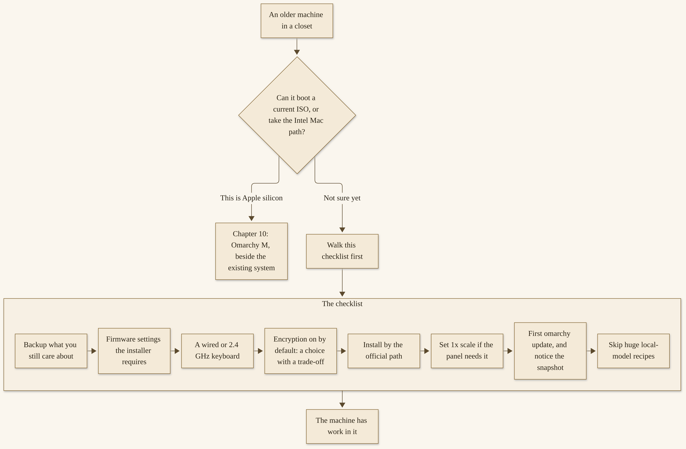{width=100%}

*D17. Diagram 17. An old-machine caveat checklist. It is a set of questions, not a score.*


## Official revival stories

The strongest official low-end claim is not a table, and it is not a number I made up. It is a demonstration. On the official potato page, as it stood on 12 November 2026, you can watch David Heinemeier Hansson take Omarchy for a spin on a 2011 ThinkPad X220 with 2 GB of memory. The page’s own headline is “Runs great on ancient hardware.” The subhead is just as plain: “A 2011 ThinkPad X220. Just 2GB of RAM. Watch Omarchy run with room to spare.”^95

That is an official demonstration, on a machine from 2011, with 2 GB of memory. I will say those words as the project says them. I will not turn them into a minimum-spec table the project did not publish. I will not tell you that your machine will feel the same, or that 2 GB is a floor, or that 2 GB is a recommendation. I will tell you that the project itself has shown Omarchy running on that ThinkPad, and that the page invites you to give the computer you already have a second life.

Vintage Intel Macs appear in official materials in the same spirit. The Mac-support manual, which I re-opened on 12 November 2026, still says: “Omarchy has built-in support for Intel Macs.” It also says you can “breathe some new life into your old Macs” by loading Omarchy, as long as you are aware of the known limitations and are all right with them.^97 That is a kind sentence, and it is also a careful one. The same page lists real limits on certain T1 and T2 machines, and on a 2017 27-inch iMac. We will come back to those when we walk an Intel Mac install. They are not a reason to hide the invitation. They are a reason to read the page before you wipe a drive.

On that same Mac-support page, there is a number that is easy to overclaim, and I will not overclaim it. “In a simple test,” the page says, “we were able to achieve 36% performance gains on a 2019 MacBook Pro just by installing Omarchy.”^97 Those words — “a simple test” — are official. This book will keep them. A simple test is not a formal benchmark, and it is not a study. It is one official observation on one 2019 machine, offered as encouragement, not as a score you should expect to reproduce. If someone quotes the 36 percent without the “simple test,” they are saying more than the page says.

The homepage, on the day I researched this book, carried a hardware invitation in the same family: “You don’t need a new machine to try Omarchy.” It had a card for vintage Macs — “Give that old Intel Mac a second life” — and a card for potato PCs that pointed at the X220 demonstration.^98 Those are official cards, dated by the day I opened them, 12 November 2026. They are a posture: this desktop is willing to meet older hardware. They are not a certified hardware compatibility list. Chapter 10 already gave you the map — supported, preliminary, bring-up — and this chapter will not pretend that map is a lab report.

The homepage also carries testimonials the project itself selected. I will attribute them to the homepage, as I found them on 12 November 2026, and I will not pretend I interviewed those people. One, from an account the card names as David@D_av_id_, is dated late August on the card (the year is not restated there): “Posting this from Omarchy Quattro on my 2012 Mac Mini… Omarchy runs circles around macOS itself on this machine, which had become entirely unusable.”^98 Another, from Dmitrii Kovanikov, says: “I just can’t believe my oldest and least powerful laptop in my home is the machine I’m the most excited to use.”^98 Those are homepage-selected voices. They are color, not evidence that every old machine will feel that way. I like them because they sound like the feeling this chapter is about: a machine you had stopped expecting anything from, doing work again.

The official introduction of Omarchy M, in September 2026, spoke in the same spirit about vintage machines in general. “Millions of vintage laptops out there,” that news page said, “many of them already retired from Apple’s latest macOS ambitions, and every one of them is a wonderful Omarchy computer waiting to happen.”^111 That is official vendor wording, dated, and I will leave it attributed. It is an invitation, not a census I ran, and not a promise about every vintage laptop. I quote it because it is the project’s own way of saying what the potato page says with a ThinkPad: the hardware you already have may still have a desk in it.

I will not turn those testimonials into case studies I invented. I will not add a before-and-after chart. The still-life at the head of this chapter is the before-and-after I am willing to offer: a closed laptop, a key, a plant, afternoon light. The machine is still there. It may have a second life. That is the story the project has already demonstrated, and it is the story I want to help you try, with your eyes open.

## What “old” can mean, without a fake minimum

People ask for a minimum-spec table. How much memory. Which generation of processor. How large a disk. I looked. On the official pages I opened on 12 November 2026, there is no such table.^99 The strongest official low-end claim remains the X220 with 2 GB. “It runs on almost anything,” and “you don’t need a new machine,” are a posture, not a test report I can cite as a census of hardware. I will not invent a floor to make you feel safer. A fake floor would also shut someone out whose machine is below a number I made up, and that would be a worse kindness.

So what can “old” mean, if we will not invent a table? It can mean a machine that can boot a current official ISO, or that can take the official Intel Mac path, and that can live as a desktop without a local model on the order of 100 GiB. It can mean a panel that is not a high-resolution default — many older panels are 1080p or 1440p — and that will want 1x scale, which the display manual describes and which we will set, step by step, in a moment.^100 It can mean a laptop whose vendor has stopped offering a current desktop for it, and which still turns on. It can mean a machine you already have, which is the potato page’s whole point.

It cannot, honestly, mean a promise. Some firmware will be awkward. Some Intel Macs have known issues the Mac-support page still lists. Some NVIDIA systems have sleep turned off, as Chapter 10 already said, because official pages say sleep has not been shown to work on that hardware yet. Preliminary ARM and bring-up machines are not the same as supported everyday x86. If your machine sits on the “bring-up” or “preliminary” side of Diagram 16, this chapter’s invitation still exists, and Chapter 10’s caveats still apply. “On the way” is still not “ships today.”

A useful way to decide, if you have a machine in a closet and a Saturday afternoon, is to walk the checklist in Diagram 17. You do not have to install today. You are only asking:

- Can I take a backup of what I still care about on this drive?
- Can I reach the firmware settings the Getting Started page requires — secure-boot and related trusted-platform settings, described there, which you turn off so the official ISO can install?^101
- Do I have a wired keyboard, or a 2.4 GHz one? The disk-encryption prompt will not take a Bluetooth keyboard. The Getting Started page is blunt about this, and it is right.^101
- Am I prepared for full-disk encryption as the default, and do I understand the documented no-encryption escape as a choice with a trade-off, not as a casual shortcut? Chapter 14 will say more about that trade. For now: encryption is the safe, responsible default for a computer that can be lost or stolen. The no-encryption path is for special circumstances the Getting Started page names, such as a throw-away install without sensitive data.^101
- After first boot, will this panel want 1x scale? If it is 1080p or 1440p, the monitors manual says you will probably just want 1x.^100
- Will I skip official local-AI recipes that assume a 128 GB-class machine, or a model on the order of 100 GiB? Yes, on a small machine, I will. A cloud agent, from Chapter 4, is often the kinder path.
- Do I know that snapshots run on `omarchy update`, and that a restore does not roll back `/home`? Chapter 14 teaches that fully. This week, it is enough to know the snapshot is there, and what it will not save.

If you can answer those questions, you have a candidate. If you cannot answer them yet, you still have a candidate. You just have a little reading to do first, which is what the rest of this chapter is for.

It also helps to say that “old” is not one kind of machine. A 2011 ThinkPad with 2 GB is one kind: the official demonstration, ancient in computer years, and a real proof of posture. A 2012 Mac Mini, in a homepage testimonial, is another. A six-year-old laptop, which is how I have described one of my own in public, is a third kind — older, not ancient, and often still a perfectly capable daily driver once the scale is right and the huge local recipes are left for other hardware. I will not collapse those three into one “old PC” stereotype, and I will not tell you which of them you have. You can see the machine. You can walk the checklist. You can decide what work belongs there.

Disk space is the same kind of honest gap. I have not found an official minimum-disk table, and I will not invent one. You need room for the system, for your files, and — if you ignore my advice and chase a huge local model — for a download measured in tens of gigabytes. On a small disk, that last sentence is the reason to skip the model. On a modest disk, it is the reason to look at free space before you start a download the AI manual has already warned you about.

One more thing “old” does not have to mean. It does not have to mean “the only computer in the house.” A second-life machine can be a writing desk, a fleet box, a gift, a machine that sits next to a newer one and does one job well. It does not have to replace everything. It has to have work in it. That is enough.

## Five computers, and machines I have named in public

I should tell you what I actually run, and stop at the edge of what I have not said.

I run five SMF Works computers on Omarchy. I have Grok Bot and Grok Build on all of them. One of the five is the MinisForum MiniPC I already named: an AMD Ryzen 7, 32 GB of memory, no SKU I will invent. That machine hosts my Hermes and OpenClaw fleets. It is a professional fact, and Chapter 12 will return to it as work. It is not an old potato. It is a small, capable machine that happens to run the same desktop this chapter is about, and I mention it here because it is part of the five, and because “old” and “small” are not the same sentence.

I have also said, in public, that I put a six-year-old laptop back to work. On 9 November 2026, I wrote about Grok Build on my six-year-old Omarchy Linux laptop.^102 I will not complete the rest of that post from memory or from a truncated feed. The wording I am willing to use is the wording I already used: a six-year-old laptop, on Omarchy, with Grok Build. I will not give that laptop a reserved product name. I will not invent a first-install date. I did not give one.

I have also reused a tablet as a client. On 28 August 2026 I wrote that an old tablet — I named the product in that post — was running as a second screen, a first project by Hermes on Omarchy, and that it was a success.^103 On 10 November 2026 I wrote again about using that tablet with Hermes on my Omarchy Linux laptop, and I closed with an invitation I still mean: “Have old hardware? Repurpose it and gain new interactive experiences.”^96 Those posts are mine. They are contemporaneous, dated, and they are not official Omarchy documentation. I will not write a fake tablet-client procedure and put it in your hands as if the official manual had one. If, on the day you read this, an official page teaches that path, follow the official page. If none exists, do what I did in spirit — consider a tablet as a client, on a path you actually have — and do not follow steps I invented.

The other machines in the five, I have not named for this book. I will not invent their types, their hostnames, or their SKUs. That is a quieter sentence than a catalog, and it is the honest one. The invitation does not need a complete inventory of my closet. It needs the official demonstration, the official paths, and a first-person word that I have done this on hardware I already had, including a six-year-old laptop and a tablet reused as a client.

“Have old hardware? Repurpose it.” That is the sentence. Chapters 3 and 10 already taught you how to get the ISO, how to dual-boot with another operating system if that is your path, how Omarchy M sits beside the existing system on current Apple silicon, and how to place a machine on the supported / preliminary / bring-up key. If the machine in your closet is an Intel Mac, the Mac-support path in the next section is for you. If it is everyday x86, Getting Started is for you. If it is Apple silicon, Chapter 10’s Omarchy M path is current as of 4.5, and I will not copy the Mac-support page’s stale “M-series is not directly supported” line as if it were still the whole story.^104

## An older-machine install, step by step

This is the chapter’s flagship tutorial. It follows official pages I re-opened on 12 November 2026. If this book and the live manual disagree on the day you install, trust the live page — the product moves — and date what you did. I dated what I checked: 12 November 2026.

I will walk a common case: an older x86 machine, installed from the official ISO, as Getting Started describes it. I will then add the official Intel Mac steps, because many second-life machines are vintage Macs, and those steps are real. I will not invent a tablet-as-client procedure. I will not invent an overlay onto an existing Arch system; there is no official current path for that.

**Before you touch the drive.**

1. Take a backup of anything you still want. A full-disk install wipes the selected drive. That is not a scare line. It is the Getting Started page, said plainly.^101 If you planned a free-space install beside another operating system, Chapter 3 already asked you to turn the other system’s drive encryption off first, and to leave enough free space. This chapter will assume you have read that, and that you know which path you are on.

2. Get the current official ISO from the project’s download page. Put it on a USB stick with a USB imaging tool on the system you already have. Getting Started names tools for the system you might already be on; you may use the one that matches the machine you are imaging from.^101 I will not print a SHA-256 hash into this book unless it has been re-fetched on the day and dated. Point yourself at the official download page and verify there, on your day.

3. In firmware, turn off secure-boot and the related trusted-platform settings the Getting Started page requires. You have to turn these off to install Omarchy.^101 I will describe them the way this book has agreed to describe them: as firmware settings the installer requires, not as a tour of any vendor’s product names. On an Intel Mac, the Mac-support page has its own sequence, which I will give you in a moment, in Apple’s own terms: “No Security,” and allow booting from external or removable media.^97

4. Have a wired keyboard, or a 2.4 GHz one, ready for the disk-encryption password. Bluetooth will not work at that prompt.^101 This is the step people skip, and then they are looking at a prompt they cannot type into. Put the dongle or the cable where your hand can find it before you reboot.

5. Know that encryption is on by default. You will have two passwords on an encrypted install: the one that unlocks the drive at boot, and the one you log in and `sudo` with. Setup makes them the same at first; both can be changed later, as Chapter 14 will say.^105 If you have a special reason to install without encryption, Getting Started tells you to hit `Ctrl + C` on the disk-formatting confirmation. That is a trade-off. An install without encryption has none of the protection the Security manual describes: anyone holding the drive can read it.^105

**Install, on everyday x86.**

6. Boot from the USB stick. Answer the configuration questions the installer asks — keyboard, user, and the rest, as the live installer presents them. Select the drive. A full-disk install takes over that drive. A free-space install uses unallocated space, as Chapter 3 taught.

7. Sit back. Getting Started says the install can be done in under a minute on the fastest modern machines, and that it should not take more than five minutes even on an older computer.^101 That is the official range. The seven-second record you may have heard about is a named record on fast hardware, from the 4.5 notes; it is not typical, and it is not a promise to an older machine.^106 If your older computer takes a little longer than five minutes, do not panic on my account. Watch the installer. If it fails, the live page and `#omarchy-help` on the official Discord are the right next steps, not a procedure I invent.

8. When it is done, first boot: disk password, then your user session. You are in. Welcome. The desktop may look large. That is the next step, and it is the one older panels almost always need.

**Set 1x scale, if the panel needs it.**

Omarchy assumes, by default, that you are on a 2x-capable, high-resolution display. The monitors manual says so, and the troubleshooting page says the same thing in a different voice: until you choose a scale in the monitor panel, GTK and similar apps can come out oversized on a 1x display.^100 ^107 Many older panels are 1080p or 1440p. For those, the monitors manual says you will probably just want 1x scaling, and the same for GTK and X11 apps.

9. The quickest official path is the monitor panel in the top bar. Pick 1x for the display you are on. You can also step through the major ratios — 1x, 1.25x, 1.6x, 2x, 3x, 4x — with `Super + /` to go higher and `Super + Alt + /` to go lower. Those chords change only the monitor you are focused on.^100

10. If you would rather set a default in a file, the monitors manual gives this for a 1080p or 1440p panel, in `~/.config/hypr/monitors.lua`:

```lua
hl.monitor({ output = "", mode = "preferred", position = "auto", scale = 1 })
hl.env("GDK_SCALE", "1")
```

Changes to `GDK_SCALE` apply to applications started after the change. GTK only honors whole numbers, so keep it at the nearest integer of your monitor scale. Quit the windows that are still oversized, or close all windows with `Ctrl + Alt + Del`, as the manual says.^100 If you only wanted bigger or smaller text, not a different scale for everything, there is a single official knob: `omarchy display text size 14` — a pixel size between 9 and 20 — and `omarchy display text size reset` to go back.^100

This is the step that makes an older panel feel like a desk instead of a magnifying glass. Do it before you decide the machine is “too slow” or “too strange.” Sometimes it was only too big.

**First update, first agent, first week.**

11. Take the first `omarchy update` when it is offered — from Update > Omarchy in the menu (`Super + Space`), or as the update docs describe the command.^108 Snapshots run automatically on that update. Notice that the snapshot happened. You do not have to restore anything today. You do have to know, already, that a restore does not roll back `/home`. Chapter 14 will make you practice that, in a virtual machine, not on an only-copy disk. This week, the comfort is that the snapshot is there.

12. Choose an agent if you want one, as Chapter 4 taught: a one-time notification, Claude or Codex or Grok, and the first completed sign-in becomes the default. You can also live a week without a local model. On a small machine, I recommend that week. A cloud agent is often the kinder path, and the huge local recipes are the next section’s “do not.”

13. Give the Super key a little time, as Chapter 5 asked. Two weeks of practice is a kind number, not a test. On a second-life machine, the joy is often that the machine is doing something again. Let that be enough for the first evening. You do not have to love every default on day one. You do have to know where the snapshots are before you tear the kitchen out.

A few official aftercare notes belong here, because they are easy to miss on an older machine.

As of 4.5, the installer no longer asks for your git identity during the install itself. It asks after first login.^106 If you write software, or if you simply want a name and email on your commits, that prompt is for you. You can also set it later with `omarchy setup git`, which Chapter 12 will use again after an unattended install.^112 If you do not write software, you can let that wait.

If the menu, the desktop, or the notifications are not in the language you want, Setup > Language is official, and `omarchy language` in a terminal is the same door. Getting Started and the 4.5 notes both say Omarchy speaks 50 languages; English is the default. The menu and the desktop switch immediately; the system locale follows on the next login.^101 ^106 Chapter 13 will spend more time on languages and input methods. For a first evening, picking the language you actually read is enough.

If every Super-key binding seems to have vanished, and you are on certain ASUS ROG or TUF laptops, the troubleshooting page describes a firmware system-key lock that is easy to toggle by accident — a chord the page names — with nothing on screen to tell you it happened. The official first step is to press that chord once before you start editing configuration files, and if that does not bring Super back, to press it again so you do not leave the lock on.^107 This is not a general “Linux is broken” moment. It is a documented firmware quirk. Try the documented step first.

If Wi-Fi, Bluetooth, audio, or a trackpad stops after it had been working, the same troubleshooting page asks you to try Update > Hardware in the Omarchy menu, and to reload the one subsystem that is misbehaving, before you reboot.^107 That clears up, the page says, the majority of “it worked five minutes ago” situations. I will leave it at the official advice.

If you get stuck in a way this tutorial does not cover, `#omarchy-help` on the official Discord is the help channel Getting Started names.^101 I will not invent a recovery I have not seen on a page. Chapter 14 will teach snapshots and a factory reset, and `omarchy-debug` is the official troubleshooting companion if you need to share a problem. For a first evening on an older machine, official help is a better friend than a clever workaround you will have to maintain through the next update.

**If this is an Intel Mac.**

The Mac-support manual, re-opened 12 November 2026, is still the right source for Intel Macs, including the T1 and T2 known issues. It is stale on Apple silicon. I will not teach “installing on an M-series Mac is not directly supported” as current, and I will not teach “Omarchy only supports being the only OS” as if it applied to Omarchy M on M1, M2, M3, and Neo. As of 4.5, Omarchy M puts Omarchy beside the existing system on those machines. Chapter 10 already said so.^104

For Intel Macs, the Mac-support page still describes a full-disk install: the drive is wiped, and the existing system is no longer bootable. You can still restore it later via Internet Recovery, as that page says.^97 If that is a trade you are not willing to make, stop here and keep the machine as it is, or wait until an official page offers you a different Intel path. I will not invent one.

The official Intel Mac steps, as that page lists them, after you have reviewed Getting Started and have your USB drive ready:

1. Turn off the Mac. Turn it on and immediately press and hold Command-R until you see the loading screen.
2. Select your user and enter your password if prompted.
3. In the recovery screen, choose Utilities > Startup Security Utility from the menu bar, and authenticate.
4. Choose “No Security” from the Secure Boot options, and “Allow booting from external or removable media” from the External Boot options.^97
5. Insert the USB drive. Restart and immediately press and hold Option until you see a screen of boot devices. Select the orange EFI Boot device, and proceed with the install as normal.

The installer detects Mac hardware and applies needed fixes automatically: Broadcom Wi-Fi drivers and firmware, the SPI keyboard driver on the MacBook models that need it, and an NVMe suspend fix for those same models.^97 After first boot, set 1x scale if the panel needs it, the same as above, and take the first `omarchy update`.

Know the official limits before you wipe the drive. On late-2016 Touch Bar MacBook Pro models with a T1 chip, the Mac-support page says the Touch Bar is non-functional and sound is not functioning. On T2 machines (2017 through 2020, as the page lists them), the installer sets up a patched kernel, T2 audio, Broadcom firmware, and fan control; the Touch Bar runs on the kernel’s built-in support. On the 2017 27-inch iMac (no T2), the page lists a display that does not run at its native resolution, sound that is not functioning, a brightness control with no effect, and sleep that hangs the machine until a power cycle. A community patcher for that iMac is named on the page; it is community work, not a promise I will upgrade into an official guarantee.^97 If those limits are a problem for the work you had in mind, join the official Discord channel the page names and read what is current on your day, or choose a different machine.

**What I will not teach as official steps.**

A tablet as a client is my story. It is a real story, dated in public posts. It is not a procedure in the official manual as I found it on 12 November 2026, and I will not write fake steps around it. If you want to experiment, experiment on a machine you can afford to experiment with, and follow whatever official page exists on your day.

> **Try this now.** Walk Diagram 17’s checklist against the old machine you have in a closet, even if you will not install today. You do not have to wipe anything. Just see whether the machine can take a current ISO or the Intel Mac path, whether the panel is likely to want 1x scale, and which workload you would not put on it. Write those three answers on a scrap of paper. That is a complete first step.

## What not to run on a small machine

Kind limits are part of a second life. A machine that is happy as a writing desk can be miserable as a local-model host, and the failure would not be yours. It would be a recipe meant for different hardware.

The official AI manual, re-opened on 12 November 2026, describes local models you can run on your own machine. The first-time path is `omarchy agent local use best`, or a Local AI choice in the agents panel when a model fits. The same page is honest about the cost: “Expect a download of tens of GB and most of the machine’s memory to be in use while the model runs.” It names a Flash Next recipe that uses about 100 GiB with its full context. The recipes it lists as available “today” for a 128 GB-class machine are not recommendations for a 2 GB ThinkPad, or for a modest older laptop, or even for a 32 GB MiniPC.^109 Skip those official local-AI recipes on a small machine. That is not a slight against the recipes. It is a kindness to the machine and to you.

A cloud agent, from Chapter 4, is often the kinder path on a small machine. You sign in. You ask. The model’s memory is not coming out of your 2 GB, or your 8 GB, or whatever you actually have. You can still do real work. You can still have a default agent, and a crash handoff, and a first-run invitation. You just are not downloading a 100 GiB model onto a disk and a memory bus that did not ask for that job.

Skip GPU-passthrough hopes as well. Chapter 12 will teach the official virtual machine for programs that still need another operating system, and it will teach the official limits: there is no graphics passthrough, and that path is not for games. An older machine is not going to lift a limit the official manual has already set. If you need a guest system for leftover programs, Chapter 12 is the honest chapter. If you need games, Chapter 13 will talk about native titles, a compatibility layer, a cloud-gaming service, and streaming — with official caveats — and it will say again that the virtual-machine path is not for that.

Gaming on old hardware in general waits for Chapter 13’s caveats. I will not promise a title will run. I will not invent a frames-per-second number for an X220. “Tens of thousands of playable titles” is manual wording we will date in Chapter 13, not a census, and not a promise to a 2011 panel.

If you are tempted to turn an older machine into a fleet box, Chapter 12’s unattended path is official, and Chapter 14’s security posture still applies. Passwordless sudo is a high risk, said in those terms, even on a machine you have brought back to life. A second life is not a reason to rush a dangerous default.

What a small machine *is* good for is the kinder half of this section. It is good for writing. It is good for a browser, for mail, for a letter, for a terminal, for a cloud agent you can ask. It is good for learning the Super key without also learning a 100 GiB download. It is good as a gift, once you have read Chapter 13’s reset and install-for-another-owner paths. It is good as a second desk beside a newer machine: one job, done well, on hardware you already owned. I will not invent a week in the life around those sentences. I will say that the official demonstration — Omarchy on a 2011 ThinkPad with 2 GB, “with room to spare” — is already a picture of a desktop that does not need a new computer to be a desktop.^95

My MiniPC, with 32 GB, sits in a different class, and I will not pretend it is a potato. It is a small machine in the furniture sense, and a capable one in the memory sense, and Chapter 12 will treat it as a professional host for fleets. If your “old” machine is closer to that than to the X220, you still get the 1x-scale lesson if the panel needs it, and you still get the advice to read a local-model recipe before you start a tens-of-gigabytes download. Capability is not a reason to skip the checklist. It is a reason to pick the work on purpose.

The short list, if you want it on the same scrap of paper as the checklist: no 128 GB-class local-model recipes; no hope of graphics passthrough; no invented game promises; a cloud agent is often enough; snapshots are for updates, and they will not restore `/home`. That is a fair set of limits. A second-life machine can still be a joy inside them.

## A second life is a gift, not a benchmark

I have not given you a before-and-after score, and I will not. The 36 percent figure is a simple test on a 2019 machine, and it stays a simple test. The X220 demonstration is a demonstration. The homepage testimonials are testimonials. My six-year-old laptop and my tablet-as-client are first-person sentences, dated, not a lab. The still-life is the before-and-after: the machine was in a closet, and now it has work in it.

That is enough. A second life is a gift you give a computer you already have, and sometimes a gift you give a person who will sit at it. Chapter 13 will talk about a machine for someone else, and about a factory reset that is available on ISO installs only. This chapter’s gift is simpler. The machine can boot. The panel is at 1x if it needed to be. The first update has a snapshot behind it. You know one workload you will not put on it. You have not pretended a number.

I still think of Omarchy, in the project’s own words, as an *agentic* Linux — “the malleable OS for the age of agents,” as the official tagline has it — and I still will not call it “the first.”^110 What struck me, on first install, was the invitation to configure an AI option, and I chose Grok Build. On a second-life machine, that invitation is the same invitation. The hardware is older. The agent, if you want one, can still sit there. You are still the one who says yes.

If the person who will sit at that machine is not you, say so on the scrap of paper. A gift machine is a different kindness than a second desk for yourself. You will want the install-for-another-owner path, or a reset, so you are not handing someone your accounts. That is Chapter 13, and it is worth waiting for if the machine is for them. If the person is you, the question is simpler, and it is the one in the reflection box below.

The next chapter is professional days: a desk, a development environment, writing, a contained virtual machine with official limits, unattended fleets, and the MiniPC I already named. If the machine in your closet is for work, you can turn the page with that machine in mind. If it is for play, or for someone else, Chapter 13 is waiting. Either way, the machine does not have to be new to be yours.

> **Checkpoint.** You are in good shape if you can name the official X220 demonstration — a 2011 ThinkPad, 2 GB, on the potato page — set 1x scale on a panel that needs it, and name one workload you will *not* put on a small machine.

> **Reflection.** What would you like that machine to do, and who is it for? There is no grade. If you are unsure about a step, Appendix C will reprint the old-machine checklist, and this chapter is here to walk back to.


# Part 6 — Professional Days and Personal Days
# Chapter 12
## Professional Days


{width=100%}

*I12. A tidy professional desk: a clipped notebook, a coffee cup, a fountain pen, morning light.*


The last chapter was about a machine you might have written off. This one is about a desk you sit at on a Monday. It is the first of two long how-to shelves. The next chapter is personal days, including games. You can take one tutorial off this shelf and leave the rest for a later month. You can take all of them. You do not have to.

I work as a Principal AI Solutions Engineer, and I write and run fleets on this desktop. The rest is the work, not a company tour. This chapter never needs the name of an employer. It needs a picture of a professional desk, a development environment you can install from a menu, a place for writing and ordinary office work, an honest virtual machine for programs that still need another operating system, an unattended path for more than one machine, and a Monday-morning ritual that does not chase a channel that might break before lunch. My MinisForum MiniPC — an AMD Ryzen 7 with 32 GB of memory — hosts my Hermes and OpenClaw fleets on Omarchy, with Grok Bot and Grok Build there too. That is enough shop detail for this book. The sister gifts already walk those fleets as doors, not as homework.

A professional day, on this desktop, is not a hobby that got out of hand. It is a daily driver: keyboard-first, snapshots on update, an agent you can ask. The original audience for Omarchy was people who write software, and we will honor that with a real how-to. A professional day is also not only a compiler. People write, dictate, sign a PDF, look at a disk, and still need a leftover program that lives in another system. Those people are in this chapter too.

{width=100%}

*D18. Diagram 18. A professional desk, and a contained virtual machine as a window on that desk — not a second identity. The guest is “another operating system,” as this book will keep saying. Official limits apply: no graphics passthrough, and this path is not for games.*


## A professional desk on Omarchy

Let me set the picture before I hand you a menu.

You sit down. `Super + Space` opens the Omarchy menu, and you can start typing to filter. `Super + Return` opens a terminal. `Super + Shift + Return` opens a browser. `Super + Shift + Ctrl + A` launches your default agent in a dedicated terminal, if you have chosen one; `Super + ~` is the 4.5 Quake-style console, and the first time you open it, it starts that same agent.^113 The top bar has an agents icon. Left-click it for the panel; right-click it to launch the default agent.^114 Disk space, if you need a picture of it, has a first-party tool in 4.5 called Disktree: a treemap of what is filling the disk, colored by kind, with caches that are safe to regenerate called out.^115 Snapshots, as you already know, run when you take `omarchy update`. That is the furniture of the desk.

The work on the desk is yours. I will not invent a client, a sprint, or a workplace story. I will teach official paths, and I will tell you, once, how I use this desktop in my own shop: fleets on a MiniPC, Grok Bot and Grok Build on every Omarchy machine I run, and a collaborator who has written applications and plugins for the system — mentioned generally, without names, because the point is the invitation, not a catalog.^116 The Doctrine says “Own the machine,” in its own words.^117 A professional desk is one way of owning it. You are still the one who says yes.

If your workplace has a rule about what may leave a machine you control, follow that rule first. This chapter is a set of patterns, not your employer’s policy, and not a promise about mine. Secrets and unpublished work do not belong in a prompt you would not put in an email. Unattended agent modes, as Chapter 6 already warned, “actually do things.” Passwordless sudo is a Chapter 14 risk, and I will say so again when we get to fleets, because a fleet box is exactly where that risk looks convenient.

The picture on Diagram 18 has four seats: an editor, a default agent, a browser, and — if you still need it — a contained virtual machine. You may only need three. Many professional days never open the fourth. The fourth is there because leftover programs are a real reason people delay a switch, and the official manual has an honest path for them, with honest limits. We will teach those limits before we teach the install, so the hope does not get ahead of the page.

A daily driver, not a hobby-only distribution: that is the claim I am willing to make from my own weeks on this desktop, and from the official posture that this is meant to be a system “you can use to do Real Work in the Real World,” as the Security manual puts it in its own voice.^118 Your work may be code. It may be a letter. It may be a fleet. It may be a Monday inbox and a PDF that needs a signature. The desk is the same desk.

## Development, the original audience

Omarchy was announced, in June 2025, as a creator’s “Platonic ideal of what a developer environment should look like.”^119 That is official history, and it is why this section is a full how-to, not a glance. If you do not write software, you can still read it; the git-identity step and the Monday ritual will serve you later. If you do write software, this is the chapter’s hands-on lesson, and Appendix B will reprint it as a recipe.

**The menu, and mise.**

Official development environments live under Install > Development in the Omarchy menu (`Super + Space`). The Development Tools manual, re-opened on 12 November 2026, lists a broad selection: Ruby on Rails; the three major JavaScript runtimes, Node.js, Bun, and Deno; PHP frameworks including Laravel and Symfony; and Go, Rust, Python, Java, Elixir with Phoenix, .NET, OCaml, Zig, Clojure, and Scala.^120 You will, of course, find Ruby on Rails — the project’s own center of gravity is not a secret — and you will also find a lot else. I will not pretend the list is every language. If you do not find what you need, Install > Package and Install > AUR are the official next doors, as the same manual says for editors.

The majority of these environments are managed by mise. Mise lets you install and run multiple versions of a programming language on the same machine. It is like the version managers you may already know for a single language, and it works across many. To install Ruby, for example, the manual says you would run `mise use -g ruby`, which installs Ruby and sets it as the global default. If a project has a `.ruby-version` file, you can run `mise i` in the root of that project.^120 The same shape works for other languages mise manages. You do not have to memorize a different tool for each stack.

Omarchy also makes tools such as `gh` and `uv`, and most coding agents, available through mise’s lazy installation. The first time you run one, mise installs it. Later runs reuse the installed version.^120 Useful official commands, from the same page:

```bash
mise ls --current              # tools configured for this directory
mise install gh                # install one tool now
mise install --include-lazy    # install all configured tools, including lazy ones
```

`omarchy update` updates installed tools with the rest of Omarchy. The `mup` alias updates mise-managed tools only.^120 If you already have your own installation of a tool, and mise’s copy is shadowing it, the manual describes a `disable_tools` setting in `~/.config/mise/config.toml`. Follow that page if you need it. I will not invent a PATH puzzle beyond what it teaches.

**A menu-driven development environment, step by step.**

This is the lesson. It is safe. It does not wipe a drive. It does not require a second machine.

1. Open the Omarchy menu with `Super + Space`. Go to Install > Development. Pick one environment you actually use — Python, Node.js, Rust, Go, Ruby on Rails, or any other official entry that matches your work. If you are following along without a preference, Python is a perfectly kind first choice, and the manual notes that Python setup also installs `uv` through mise.^120 Let the install finish. You should be able to open a terminal (`Super + Return`) and confirm the tool is on your path the way that language normally confirms it — `python --version`, `node --version`, `go version`, and so on. If a command is not found, `mise ls --current` is the official first look.

2. If you have not already set a git identity, set one now:

```bash
omarchy setup git --name "Jane Doe" --email jane@example.com
```

Use your own name and email. This is the official aftercare command on the unattended-installs page, and it is the right command on an attended machine too.^121 As of 4.5, a first login may already have asked you; if you answered then, you can skip this, or run it again to confirm.^115

3. If you work with repositories on GitHub, the GitHub CLI is available as `gh`. The first run installs it through mise. `gh auth login` authenticates; `gh repo clone org/repo` clones; `gh --help` lists commands.^120 For a terminal interface to pull requests, `ghui` is official and also lazy-installed. Lazygit is preinstalled for working with Git itself. None of these are required for a first environment. They are the official shelf once you have an identity.

4. Choose an editor, if Neovim is not what you want. Omarchy ships with Neovim by default, and the original `vi` is available out of the box. Under Install > Editor, the official list includes Cursor, Zed, Sublime Text, Helix, Vim, and Emacs, and it also includes a popular code editor many people already know — I will leave that one in those words, as this book’s house rule requires.^120 If you do not find what you are looking for, Install > Package, and then the AUR, are the documented next steps. Theme matching is offered for several editors the manual names. You can set the system-wide default editor under Setup > Defaults > Editor.

5. Put your default agent where you can reach it. If you chose one in Chapter 4, `Super + Shift + Ctrl + A` is the official chord, and the agents panel is a click on the bar icon.^114 If you want a coding-assistant CLI that is not your first-run default, Agent > Harness is the official catalog — twenty-three agents and providers in the 4.5 notes, to be re-checked against the live panel.^115 A popular coding-assistant CLI listed in that official harness table is a valid choice; I will name it the way this book names it, generally, and I will point you at the table rather than at a command this book has agreed not to print. Agents launched through `omarchy agent prompt` run unattended in their don’t-stop-to-ask modes, “so be ready for them to actually do things,” as the AI manual says.^114 A professional desk is a good place to be ready.

6. Docker is installed, including Docker Compose. By default, your user is not in the `docker` group. The Development Tools manual is blunt about why: that group is “effectively passwordless root.” On the command line you run Docker with `sudo` (`sudo docker ps`, `sudo docker compose up`). Graphical tools that talk to the daemon ask for authorization when they need it. If you want the convenience of a groupless setup and you understand the trade-off, Setup > Security > Sudoless Docker (or `omarchy-setup-security-sudoless-docker`) adds you to the group after a warning.^120 I will not tell you to turn that on as a professional convenience. I will tell you the official warning is the professional fact. You can set up common databases for local development with Install > Development > Docker DB.

That is a complete first development environment: one language from the menu, a git identity, an editor you can live with, an agent you can ask, and Docker used with its default caution. You can do this in a sitting. You can come back later for a second language. mise is built for that.

A few professional habits sit around the lesson, and I will name them without turning them into a workplace policy. Keep work and home in different directories if they share a machine; launches of the default agent from `$HOME` already start in `~/Work`, because agents refuse to remember trust for your home directory.^114 Put personal rules for every agent in `~/.agents/AGENTS.md`, which Agent > Instructions opens, and which the AI manual links into each harness that keeps its own global file.^114 Do not put secrets in that file. Do not put secrets in a prompt. And when an agent offers to change your environment, plan mode first, as Chapter 6 taught, with a snapshot or a clear path back to `omarchy reinstall configs`.

If an official development environment is already installed on your day, the Install menus dim it rather than hiding it, as a 4.5 change records.^115 That is a small kindness: you can see what you already have. If you need a second version of a language for a second project, mise is the official way to keep both, with a project-level version file and `mise i` in that project’s root.^120 You do not have to make a global default of every tool you try.

If the project is one you already have, clone it after `gh auth login`, or copy it into `~/Work`, and run whatever mise already knows how to do in that directory. If the project has a version file mise understands, `mise i` in the project root is the official shape.^120 Open the editor you chose. Open the default agent if you want a second pair of eyes, and keep plan mode for anything that would change the system rather than the project. Run the project’s own tests, or its own dev server, the way you already would. I will not invent a passing test suite for a project I cannot see. The point is that the official environment is there so you can get to that familiar step quickly, which is what the homepage’s “get straight to building” posture is for, in its own vendor wording.^127

If you already have a careful development setup on another system, you do not have to reproduce it in one evening. Install one official environment. Set git. Open a project you actually have. See whether the desk feels like a desk. That is a professional first day, and it is enough.

## Writing and office work

A professional day is not only a compiler. I want that said early, and I want it taught.

Omarchy 4.5 added first-party tools that belong on a writing desk as much as on a development one. Hype makes presentations from a single Markdown file, with a visual slide editor beside the source, and exports to PDF or to a presentation file.^115 Signed is for paperwork: open a PDF, place a saved signature, text, and dates, and save a signed copy.^115 Monologue records your camera with one key, themed to match the desktop — a sentence here, and a fuller personal-use treatment in Chapter 13, where dictation also lives more fully.^115 Disktree, which I already mentioned, is the honest picture of a disk that has filled up on a Thursday afternoon.^115 Gliff gives you a remote desktop over SSH: connect to another Omarchy machine and drive its full desktop from a window on yours, with a tab for each machine, and a remote-session indicator on the machine being controlled.^115 Elsewhen is a world clock in the bar, which is a small professional kindness if you call people in other cities.^115

The install menus also carry writing and related applications as the project lists them — tools for notes, for office documents, for mail as a web app. I will not invent a catalog beyond what the menus and the 4.5 notes describe. Open Install from the Omarchy menu and look at what is actually there on your day. If a page and this book disagree, trust the live menu.

If you need to work with people who live in office web apps, 4.5 added an official install path for those: a set of familiar office and collaboration tools, each as a web app, each with its own window and launcher entry.^115 I will describe them in those generic words, as this book’s house rule requires. They are a way to keep working with people who have not switched, and they are not a slight against anyone’s tools. They sit next to everything else on the desk. If that is the piece that lets you spend a professional day here, take it, and do not apologize for it.

Dictation is a 4.5 default. Superwhisper is set up out of the box. Tap `Alt + Space` to start talking and again to stop, or hold Right Alt for push-to-talk. It starts in the cloud, so it works the moment you install; the first 10,000 words are free; and you can switch to a downloadable model that runs locally, without sending a word to anyone. Voxtype remains on offer as a local alternative.^115 That is the professional-day sentence. Chapter 13 will teach the path more slowly, including the privacy choice between cloud and local. For a Monday morning, knowing the chord is enough: `Alt + Space`, speak, `Alt + Space` again, and the words are in the field you were focused on.

A short, official how-to, if writing is the work today.

For a presentation: open Hype, as 4.5 describes it, and start from a single Markdown file. Use the visual slide editor beside the source until the deck looks like the thing you would actually show. Export to PDF, or to a presentation file, as the official description allows.^115 I will not invent a theme tutorial for Hype beyond that. Markdown in, a deck out, is the whole first sitting.

For paperwork: open Signed, open the PDF, place a signature you have already saved, add text and dates if you need them, and save a signed copy.^115 Do this on a copy of the form, not on the only file you have. That is ordinary professional caution, not an official warning I found on the page, and I will keep it in my own voice.

For a full writing day, pick the editor you already chose in the development section, or a notes application from the install menus, and put dictation next to it: `Alt + Space`, speak, `Alt + Space`. If the words are going to a colleague who lives in office web apps, install those from the official 4.5 path and let the launcher treat them as windows on this desk.^115 You do not have to migrate a whole office in one morning. You have to be able to write, and to send, on the machine you are sitting at.

The point of this section is not a lifestyle brand. It is a practical one. You can write a chapter, a letter, a slide deck, or a signed form on this desktop without first becoming a compiler person. You can dictate a reply. You can look at a disk. You can open office web apps if your colleagues need you there. A professional desk has those seats too.

## A contained virtual machine, and its limits

Some programs still need another operating system. That is a fact about the world, not a failure of this desktop. Official docs describe a virtual machine for that leftover software, installed from the Omarchy menu. I re-opened that manual on 12 November 2026, and I will teach the official path and the official limits. I will describe the guest as “another operating system,” and I will not put a reserved product name on Diagram 18, in this section, or in a caption.^122

**The limits, first, because they change the decision.**

There is no graphics passthrough with this setup. The official manual says it is not suitable for gaming or video editing.^122 Chapter 13 will teach games on other paths — native, a compatibility layer, a cloud-gaming service, streaming — and it will mark this virtual-machine path as not for games. If you were hoping the leftover system would also be a game box, this is the place to let that hope go. Streaming, in Chapter 13, is often the kinder alternative.

Licensing of the guest system is your responsibility. I will say that plainly, and I will not give piracy-adjacent advice. The official manual describes an unactivated guest and tells you that you need your own license key for gated features. If this computer shipped with another operating system, an OEM key may still be in firmware; the manual describes how to print it, and also says that key is bound to this machine — it will activate a reinstall on this hardware, but it usually will not activate the virtual machine.^122 That is the official fact. Treat it as a fact, not as a workaround to stretch.

The virtual machine is a contained window on the desk, not a second identity. Its ports are bound to localhost only, so nothing on your network can reach the guest. A shared folder in your home directory, as the official manual names it, is the place to put files you want the guest to see; the guest has no access to any other part of your file system. The virtual disk lives at a path the same manual names. Those two paths should stay separate. Removal empties the disk directory and preserves the shared one. I will leave the exact path names to the official page, which you should open as you follow along.^122

**The official install path.**

1. Open the Omarchy menu (`Super + Space`) and choose the official virtual-machine entry, as that manual describes it. Your machine needs KVM virtualization, which most have — but it is sometimes switched off in firmware, and the installer will tell you if that is the case.^122

2. You will also want the disk space: whatever you give the guest, plus about 10 GB for the image itself. The installer asks how much RAM, how many CPU cores, and how much disk to hand over. The manual says 64 GB or more is the sensible floor for the guest disk. It then asks for a username and password for the guest; if you leave those blank, you get the defaults the manual describes.^122 Pick a password you will actually remember, or write it down the way you would write down any other professional credential.

3. The download takes a while. The manual says 10–15 minutes is normal. You can follow the progress in a browser at `http://127.0.0.1:8006. The browser prompts for the same username and password before opening the console.^122 This is localhost only. Sit with it. A professional afternoon can afford fifteen minutes.

4. Once it is installed, launch the guest from the app launcher. That starts the virtual machine if it is not already running, and connects you over a remote-desktop session, full screen. Give it 15–30 seconds on a cold start, as the manual says. The session carries sound, your microphone, and a shared clipboard, so copying text between the host and the guest just works. The resolution follows your window, and Omarchy passes your display scaling through, so it is not a blurry mess on a high-resolution screen.^122

5. When you close that session window, the virtual machine shuts down automatically. If you would rather leave it running — something working away in there — the official manual describes a keep-alive launch command. The rest of the controls (status, stop, launch) are on the same official command family. Open the manual for the exact invocations, and use them as printed there.^122

6. Put files you want the guest to see in the official shared folder. Keep anything you care about out of the virtual disk before you remove the whole thing. Removal is in the Omarchy menu, on the matching Remove entry, and it deletes the virtual disk and all its data.^122 You can change resource allocation later by re-running the official installer, which rewrites the configuration from your answers.

That is the path. It is a contained window. It is not a second computer you owe a second life of maintenance to, beyond what the guest itself requires. It is not for games. It has no graphics passthrough. The license is yours to supply. If those sentences are acceptable, this path can be the thing that lets a professional day live here, including the one leftover program you could not otherwise leave. If they are not acceptable, do not install it, and do not invent a passthrough the manual says is not there.

I want to say one more careful sentence. A contained virtual machine is a professional tool. It is also a place where a leftover habit can quietly become the whole day. If you find that every serious task has moved into the guest, that is information. It may mean this desktop is not yet doing the work you needed, or it may mean one program is still worth the window. Either way, you will know. The desk on Diagram 18 still has an editor, an agent, and a browser on the host side. Use them for everything they can do. Save the guest for what it is for.

## Unattended installs and fleets

Chapter 3 already introduced the unattended path. This section is that path as professional practice: a second machine, a lab of virtual machines, a box you will hand to a colleague, a small fleet. The official manual is “Unattended Installs,” re-opened on 12 November 2026.^121 I will teach it as that page teaches it. I will not invent a field. I will not skip the passphrase risk in a chapter that uses the word “professional.”

The Omarchy ISO can install itself with nobody at the keyboard. If the installer finds a second drive labeled `cidata` carrying its configuration files, it copies them off, skips the setup wizard entirely, and reboots into the finished system on its own. No special ISO build, no extra boot menu entry. With no such drive attached, nothing changes: you get the normal wizard.^121 The label `cidata` is the cloud-init NoCloud label, so common virtualization tooling already knows how to attach such a drive. The manual’s own example is a disposable development environment: create a virtual machine in Proxmox, or with Packer, boot it, walk away, SSH in. I will teach Proxmox as the manual’s example, not as a lab report of my own.

**The configuration files.**

The files are exactly what the installer’s own wizard writes. The easiest way to get a starting set, the manual says, is to run one interactive install — in a virtual machine, say — and copy what it wrote into `/root`. Then you know the fields are real.

| File | Required | Purpose |
| --- | --- | --- |
| `user_configuration.json` | Yes | Disk, hostname, timezone, keyboard |
| `user_credentials.json` | Yes | Username and password hash |
| `user_encrypt_installation.txt` | No | `true` when the configuration carries a `disk_encryption` block |
| `authorized_keys` | No | SSH public keys, one per line |
| `tailscale_authkey` | No | A Tailscale auth key for joining your tailnet on first boot |

Generate the password hash for `user_credentials.json` with the official command:^121

```bash
openssl passwd -6 "yourpassword"
```

Use a password you actually intend, and treat the hash as carefully as you would treat the password. The name and email for git commits are not part of the install. Set them once the machine is up, over SSH for example:

```bash
omarchy setup git --name "Jane Doe" --email jane@example.com
```

You can also drop in an empty file named `defer-provisioning` in place of `user_credentials.json`. That runs the same prepare-for-another-owner install you can trigger interactively with `Ctrl + C` on the first installer screen. The machine installs with no personal details, and whoever boots it first picks their keyboard and creates their user. That is the mode for imaging rigs, and for a machine you will hand to a colleague, where the drive should not carry your credentials at all.^121 Chapter 13 will use the same idea as a personal gift. Here, it is professional courtesy: do not answer a colleague’s personal questions for them, and do not leave your password hash on a drive they will own.

**SSH, Tailscale, and a machine you can actually reach.**

A stock Omarchy install ships the SSH server with the service disabled and the port closed. An unattended machine would otherwise be unreachable. When `authorized_keys` is present, the install sets the keys up as the user’s `~/.ssh/authorized_keys`, enables `sshd`, and opens the firewall for it. The install only adds your keys. It does not loosen any of the SSH daemon’s other authentication settings.^121 That is the official posture, and it is the right one: you can walk away from a new box and SSH in, without having opened a password login to the world.

When `tailscale_authkey` is present, the machine joins your tailnet on first boot instead. Tailscale is installed from the ISO’s bundled packages, the firewall allows the tailnet interface, and a background job runs the join as soon as the machine has network, retrying until it succeeds. The manual tells you to use a reusable, pre-authorized key, so one drive image can serve many machines.^121 Treat that key as a secret. A reusable join key in a `cidata` image is a professional convenience and a professional responsibility.

**Building the `cidata` drive.**

Any filesystem with the right label works. A tiny ISO is the easy official way:^121

```bash
mkdir cidata
cp user_configuration.json user_credentials.json authorized_keys cidata/
genisoimage -output cidata.iso -volid cidata -joliet -rock cidata/
```

Then attach it to the virtual machine alongside the Omarchy ISO. The manual’s full Proxmox example, which I am reprinting as the manual’s example, is:

```bash
qm create 101 --name my-omarchy \
  --bios ovmf --machine q35 --cpu host --cores 4 --memory 8192 \
  --ostype l26 --scsihw virtio-scsi-single \
  --efidisk0 local-lvm:0,efitype=4m,pre-enrolled-keys=0 \
  --scsi0 local-lvm:40,discard=on,iothread=1 \
  --net0 virtio,bridge=vmbr0 --vga virtio --serial0 socket \
  --ide2 local:iso/omarchy.iso,media=cdrom \
  --ide3 local:iso/cidata.iso,media=cdrom \
  --boot order='scsi0;ide2'

qm start 101
```

The boot order lists the disk first on purpose: the empty disk falls through to the ISO on the first boot, and the installed system boots from disk ever after.^121 If you are not on Proxmox, the shape is the same: a disk, the Omarchy ISO, a `cidata` volume, and a boot order that prefers the disk once there is something to boot. Follow the live manual for any tool I have not named.

**Two caveats, which a professional chapter will not skip.**

Encrypted unattended installs are not fully unattended. Someone still has to type the LUKS passphrase at the first boot.^121 Plan for that. A “walk away” story that forgets the passphrase prompt is a story that leaves a machine sitting at a screen.

And the `disk_encryption` block in `user_configuration.json` carries that passphrase in plaintext. The manual’s own sentence is the one I want you to keep: treat a `cidata` drive built from an encrypted install as the secret it is.^121 Do not leave that drive in a bag. Do not copy it to a shared folder. Do not put the passphrase at ease because this chapter is about fleets and fleets are supposed to be convenient. Convenience is how plaintext secrets travel. If you can use `defer-provisioning` instead, and let the colleague choose their own encryption password on first boot, that is often the kinder professional path. If you cannot, guard the `cidata` drive the way you would guard the passphrase itself.

**After install, on every unattended machine.**

Once the machine is up: `omarchy setup git`, as above, if this machine is yours or if the colleague wants it set. Take the first `omarchy update`. Snapshots run. Notice that they ran. Choose a default agent if the owner wants one — and if the owner is someone else, let them choose, as Chapter 4 taught. Copying agent subscriptions to another Omarchy machine over SSH is official (`omarchy agent account copy`), and the AI manual’s warning is the professional one: copy only to machines you trust; this is a one-time copy, not ongoing synchronization; credentials travel through SSH and are stored in private files on the destination.^114

A concrete professional sitting, if the machine is for a colleague and not for a lab of your own virtual machines.

1. Decide whether this drive should carry anyone’s credentials. If the answer is no — and for a colleague’s laptop, the answer is usually no — use `defer-provisioning` in place of `user_credentials.json`. Do not put your password hash on that drive. Do not answer their keyboard layout for them.
2. Build a `cidata` volume that has `user_configuration.json` (disk, hostname if you must set one, timezone if you have agreed on one) and the empty `defer-provisioning` file. Skip `authorized_keys` unless the colleague has given you a key and asked you to plant it. Skip a Tailscale auth key unless this machine is joining a tailnet you both already trust, with a key that is meant for this purpose.
3. If you encrypt — and the default is to encrypt — remember that first boot still needs a LUKS passphrase, and that a passphrase in plaintext on `cidata` is a secret. For a colleague, letting them choose the encryption password on first boot, as the interactive install-for-another-owner path does, is the cleaner professional story.^121 The Getting Started page describes that interactive path as `Ctrl + C` on the very first installer screen, with personal setup deferred until first boot, and with the password the new owner picks becoming the encryption password too.^125
4. Hand the machine over before you have signed in as yourself. After they have created their user, they can take a first `omarchy update`, choose a default agent if they want one, and run `omarchy setup git` with their own name. You are not handing them your agent subscriptions, and you are not running `omarchy agent account copy` onto a machine that is no longer yours.^114

That is a fleet practice, and a colleague practice, not a fleet memoir. I will not invent a headcount or a hostname scheme. I will say that the official path is enough to image a lab, and that the passphrase risk is part of the practice.

## Agents as work, on a MiniPC

Here is the honest shop paragraph, and then the practice.

The MinisForum MiniPC — an AMD Ryzen 7, 32 GB of memory, no SKU I will invent — hosts my Hermes and OpenClaw fleets on Omarchy. Grok Bot and Grok Build are there too. I run five SMF Works computers on this desktop, and Grok Bot and Grok Build are on all of them. That is enough detail for this book. *Grow With It* and *Make It Yours* already walk those fleets as doors; *Hand It Off* is the Grok Bot door. I will not recap their rosters or their models. I will not invent a gateway path or a disk layout beyond what official Omarchy docs, and those sister gifts, already say at door-level.^116

The practice is about risk that looks convenient on a fleet box.

Passwordless sudo can be timed or permanent, with a red warning icon in the bar, and a clear official warning. The Security manual is as plain as I can be: while it is on, anything running as your user can do anything as root without being asked. “That’s the whole point, and it’s also the whole risk.”^118 Chapter 14 will teach the timed options — 15 minutes, an hour, a day, or permanently — and the command forms. Here, I only need you to hear that a fleet box is exactly where this looks tempting, especially when an agent is doing a long stretch of system work, and that “tempting” is not the same as “wise.” Unattended agent modes, likewise, “actually do things.” A first week on a machine that has to work on Monday is a bad time to give a broad, unsupervised instruction. You are still the one who says yes.

SSH is off until you enable it. The official path is Setup > Security > SSHD, which opens port 22, rate limited against brute force, as part of the setup.^118 The firewall is on by default, with documented exceptions: port 53317 for LocalSend; some DNS to the computer’s own resolver at the Docker bridge address, from private container ranges; multicast DNS on port 5353; and UFW’s standard allowances for ping, DHCP, and UPnP discovery. Even SSH is off until you turn it on. Docker access is locked down with the ufw-docker setup so containers are not accidentally exposed to the world.^118 On a MiniPC that hosts agents, those defaults are a professional starting point. Enable SSH because you need it, with keys, not because a fleet sounds like it should be open. The unattended path’s `authorized_keys` behavior, which enables SSH for you, is a deliberate exception you chose by putting keys on the `cidata` drive.

I will not tell you how to lay out a Hermes or OpenClaw directory on this MiniPC. I will tell you that Omarchy’s own AI manual already describes Hermes Desktop and OpenClaw’s Control UI as official Install > AI entries, with their own update paths and their own removal questions about data.^114 If you are standing those up, start with that manual, and with the sister gifts if you want a longer walk. This chapter’s contribution is the host: a professional Omarchy machine, updated on a known channel, with SSH off until you need it, with passwordless sudo treated as a high risk, and with a snapshot you know how to restore before you let an agent do a long stretch of system work.

A practical order, on a box that hosts agents, is this. Take a manual snapshot first, `omarchy-snapshot create`, as Chapter 14 will teach, especially if the work is about to touch the system and not only a project directory.^126 Confirm you are on stable, or on a channel you chose on purpose. Confirm SSH is in the state you meant — on, with keys, or off. Confirm passwordless sudo is off unless you are about to start a timed window you will watch. Then let the agent work, preferably in plan mode for anything that touches configuration. If the work goes wrong, you have a snapshot, you have `omarchy reinstall configs`, and you have official help. If the work goes right, turn the timed sudo off, glance at the agents icon, and go on with the day. I will not dress that order up as a shop runbook I cannot show you. It is ordinary professional caution, using official tools.

Gliff, the 4.5 remote-desktop-over-SSH tool, is a professional footnote I like. If you need to drive this MiniPC’s desktop from a window on another Omarchy machine, that is an official path, riding on SSH, with a remote-session indicator in the bar so it is always clear when someone is on it.^115 Nothing extra to expose. The firewall and SSH setup still apply. The indicator is a kindness; leave it visible.

## A Monday-morning ritual

A professional desk needs a repeatable habit, not a heroic upgrade. This is mine, offered as a pattern you can make yours, in three lines you can write down. Appendix B will reprint it. Appendix C will reprint it as a checklist.

**1. Stay on the channel that has to work tomorrow.**

New installations start on the stable channel. Stable tracks official releases, and a stable Omarchy Arch mirror that runs one month behind the latest, so incompatibilities can be caught before they cause problems for people.^123 Edge tracks the latest development builds and the latest Arch packages as soon as they are available; the update manual says you should only do this if you are experienced with Linux and know how to recover a system that has problems. Dev links Omarchy to a git checkout in `~/omarchy`, combined with edge packages, and is for people working directly on Omarchy who are willing to tolerate breakage. RC is for final validation before a major release.^123 Chapter 14 will give you the full tree, as Diagram 20. This morning’s ritual is simpler: do not chase edge or dev on a machine that has to work on Monday. If you want to help with an RC, do it on a machine that is allowed to have a Tuesday.

**2. Take `omarchy update` on a known morning, and know what the snapshot means.**

Use Update > Omarchy in the menu (`Super + Space`), or the official command, `omarchy update`. Do not run a raw system-upgrade command. Omarchy will actually stop a direct system upgrade and point you to `omarchy update`, because a raw upgrade misses the snapshot, the migrations, and the configuration updates.^123 A circle-arrow icon appears to the right of the clock when a new release is waiting; you can click it.^123 After the update, glance at the fact that a snapshot was taken. You do not have to restore it. You do have to know, before you need it, how: Chapter 14, the Limine boot menu, `omarchy-snapshot restore`, and the limit that a restore does not roll back `/home`. A Monday ritual that updates without knowing that limit is a ritual that will surprise you on a bad Tuesday.

Live a day, if you can, before you change channels. Glance at the agents icon. If a default agent should be signed in, and it is not, that is a Monday fact, not a Wednesday surprise. Glance at disk. If you need a picture, open Disktree and look at what is actually filling the drive, including caches that are safe to regenerate.^115 Firmware updates, when you want them, are Update > Firmware, which uses `fwupd` and the Linux Vendor Firmware Service, and may ask for a reboot.^123 They do not have to be every Monday. They have to be intentional.

**3. Write the three lines down.**

Mine, in plain language, look like this:

- Channel: stable, on any machine that has to work today.
- Command: `omarchy update`, from the menu or the terminal, never a raw system-upgrade.
- After: glance at the snapshot, at the agents icon, and at disk; live a day before a channel change.

Yours may add a fourth line — a fleet box checked over SSH, a Disktree look on a machine that fills up, a firmware morning once a month. Keep it short enough that you will actually do it. A ritual you do not do is a paragraph in a book.

I have written, in public, about updating Omarchy on a temporary development laptop to kick off a Monday.^124 That is a first-person habit, dated 9 November 2026, and it is not an official requirement. I mention it only so you know the ritual is one I actually use, not one I invented for a chapter close. Your Monday may start on a Sunday evening. The point is a known morning, a known command, and a known channel.

If an update goes badly, the official first step is a rollback to the snapshot taken before the update, as the Updates and Troubleshooting pages both say. If that does not work, `omarchy-debug` is how you share a problem on `#omarchy-help`. If configuration is the mess, `omarchy reinstall` reinstalls default packages, puts you on stable, downgrades packages that are too new, and resets configuration files — and it will overwrite your user config changes to the Omarchy defaults.^123 Those are Chapter 14’s tools, previewed here so a Monday ritual has an exit. The ritual itself is the update, on stable, with your eyes open.

## A professional checkpoint

You now have a desk, a development environment you can install from a menu, a writing and office path, a contained virtual machine with official limits, an unattended fleet path that does not put a passphrase at ease, a MiniPC paragraph that stops where my facts stop, and a Monday ritual in three lines. That is a professional shelf. You do not have to take every item off it this week.

> **Try this now.** Install one official development environment from Install > Development in the Omarchy menu, or run `omarchy setup git` if you have not yet, and write a three-line Monday ritual for your machine: the channel you will stay on, the command you will use, and the three glances you will take after an update (snapshot, agents, disk). Keep the paper. Appendix B will be happy to meet it.

> **Checkpoint.** You are in good shape if you can describe a professional desk — an editor, a default agent, a browser, and a contained virtual machine only if you need one — name the official virtual-machine limits (no graphics passthrough; not for games; licensing is yours), and describe a `cidata` drive, including the required files, without putting a passphrase at ease.

> **Reflection.** What work has to run here, and what should stay in a contained virtual machine — or not run on this host at all? There is no grade. If you are unsure about a step, Appendix B will reprint the development lesson, the unattended file list, and the Monday ritual, and Appendix C will reprint them as checklists. This chapter is here to walk back to.

The next chapter is personal days, including games: daily-driver delight, media, dictation, languages, a gaming path with official caveats, a cloud-gaming service and streaming, the community, and a machine for someone else. A professional desk and a personal desk can be the same machine. The habits travel. The limits travel too.


# Chapter 13
## Personal Days, Including Games


{width=100%}

*I13. An evening desk: headphones, a cloth-bound book, a cup of tea, a small wooden game.*


A professional desk and a personal desk can be the same machine. Yesterday’s chapter was Monday. This one is the rest of the week, and the weekend, and the evening you sit down to play. It is the second long how-to shelf. You can take one path off it — dictation, a game from an official compatibility path, a gift-machine plan on paper — and leave the rest for later. You can take all of them. You do not have to.

The official homepage, on 12 November 2026, still greets people with “Beautiful, fun & agentic Linux.”^128 Those are their words, and I will leave them as theirs. This chapter is about the “fun” in that line, taught as official tools and official caveats, not worn as our slogan, and not turned into a lifestyle brand I invented. A personal day can be email, photos, a letter, a walk with a podcast, a game, a meetup, or a machine you are preparing for someone else. We will teach the official media and input tools, the official gaming paths with their limits still on the page, and the official way to hand a computer over. We will not invent a family product, and we will not promise a title will run.

{width=100%}

*D19. Diagram 19. Official gaming options, as the gaming manual described them on 12 November 2026. “Tens of thousands of playable modern games” is that manual’s wording, dated, not a census this book ran. The virtual-machine path from Chapter 12 is marked not for this.*


## Daily-driver delight

I want to open with living on the machine, not with a review score.

Omarchy 4.5 — Quattro RS — gave the desktop a floating workspace and a dock. `Super + L` now cycles any workspace between tiling, scrolling, and floating. On a floating workspace, every window gets a titlebar in your theme’s colors, and a dock shows your pinned apps, everything that is running, and a grid of every app installed. Drag to reorder or pin, right-click for more, and `Super + M` minimizes a window down to the dock. You can mix and match per workspace, and the bar shows which layout each one uses.^129 The 4.5 notes call this “a wonderful on-ramp” for anyone arriving from another system who is not ready to go all-in on tiling yet, or for anyone who just wants one workspace where windows can sprawl.^129 Those are official words. I like them because they are kind. Tiling is still the heart of the design, as earlier chapters taught. You do not have to be ready for it on a Sunday evening. You can float a workspace, use the dock, and learn the Super key at your own pace.

A theme you like is part of the same delight. Chapter 8 already taught you how to pick one, how to make one, and how to look at theme files before you install them from a repository. A keyboard you now know is Chapter 5’s weekend. An agent you can ask is Chapter 4’s evening, and Chapter 6’s handoff when something breaks. I will not retell those chapters. I will say that a personal day sits on top of them: the machine looks like yours, the keys do what you expect, and someone — you, or an agent, or a friend in `#omarchy-help` — is there when they do not.

The rest of a personal day is ordinary, and ordinary is the point. Email. Photos. A letter. A walk with a podcast. Captive-portal Wi-Fi, as of 4.5, finally notices when a hotel or a café wants you to sign in, and the network panel offers a button that takes you to the login page.^129 Printing works. LocalSend is the official way to send a file to a nearby machine, and the firewall already allows it on port 53317, as Chapter 12 said.^130 Notifications, rebuilt in 4.5, stack by sender, follow your theme, and collapse identical repeats; `Super + Comma` acts on the newest one.^129 Video backgrounds can live on the desktop, with the lock screen showing a still frame; you can turn theme intros off under Appearance > Animations if you would rather keep it calm.^129 None of that is a brand. It is a finished desktop, on a Saturday.

If you are coming from a page that still says there is no dock and no desktop icons, that line is stale. It was true of an earlier Omarchy. 4.5 added the dock. Trust the 4.5 notes and the desktop in front of you, not a Coming-From sentence that has not caught up.^131

4.5 also gathered “everything about how the desktop looks” into a new Appearance menu: theme, background, font, bar, windows, branding, the dock, workspace layouts, animations, and the unlock screen.^129 You can pick opaque, transparent, or glassy windows, and sharp or rounded corners, from that same official place.^129 I will not walk every slider. I will say that a personal evening spent in Appearance, changing one thing at a time, is a legitimate way to make the machine yours, and that Chapter 8’s caution still applies if the next step is a theme from a repository: look at the files first. Elsewhen, the 4.5 world clock, lives next to the clock in the bar. Tap a city, name the people who live there, and you always know whether it is a decent hour to call; `Super + Ctrl + Alt + E` summons it.^129 That is a small personal kindness, and a small professional one, and it is allowed to be both.

Delight, in this book, is not a reviewer’s score. It is the feeling that the machine is yours, and that a personal day can happen on it without a fight. If that feeling is not here yet, give the Super key the two weeks Chapter 5 asked for, pick a theme you actually like, and try a floating workspace once, just to see. If the feeling is here, the rest of this chapter is how to go further — media, voice, language, a game, a community, a gift — with the official caveats still attached.

## Media, dictation, languages

Three official personal-use shelves. I will teach each one as the pages I re-opened describe them, and I will not invent a catalog.

**Media.**

The install menus and the 4.5 notes are the authority for what ships and what you can add. I re-opened the gaming manual and the 4.5 notes on 12 November 2026; I did not walk every media subsection of the manual as a separate page, and I will not invent applications to fill a shelf. What I can teach, because I opened it, is this.

Screenshots and recordings have first-party tools. 4.5 replaced an earlier screenshot tool with Omasnap; the official screenshot chord, re-checked in the conventions on this draft day, is `Print Screen`, or `Super + Ctrl + Alt + C`, with a capture menu at `Super + Ctrl + C`.^132 Screenshot notifications, in 4.5, have Open and Edit buttons; screen recordings and downloads have Open and Cut.^129 Omacut is the first-party tool for trimming. Monologue records your camera with one key, themed to match the desktop.^129 New installs, as of 4.5, no longer ship two earlier media applications the notes name; machines that already have them keep them.^129 If you need those, the live menus and the notes are the place to look, not a list I reconstruct from memory.

RetroArch, which we will also meet as a gaming path, comes preconfigured with the CRT Royale shader “for that perfect retro look,” as the gaming manual says.^133 Video backgrounds, as I already mentioned, are a 4.5 desktop feature. Spotify is a documented media path — on ARM, the 4.5 notes offer it as a web app — and if a UI comes out oversized, the troubleshooting page even has a `Ctrl + Minus` tip for it.^129 ^134 Community applications appear on the homepage and in the commons: a radio plugin on the homepage, Omarchy Radio at `radio.omarchy.org` from an official organization repository, and community apps I have been glad to see, which I will leave labeled as community, not first-party.^135 If a media tool is not in the official menus, it may still be a plugin or a package. Look first. Do not assume this book’s silence is a judgment.

Video backgrounds, if you want one, are as simple as the 4.5 notes describe: drop a video in, and the desktop uses it, while the lock screen shows a still frame from it.^129 I will not invent the exact folder name if a later live page is the better authority; Appearance, and the backgrounds path the live desktop offers, are the official doors. If you would rather keep the desk calm, you already know where to turn intros off. Monologue, for a camera recording, is a one-key first-party tool themed to your desktop.^129 I will not invent the key. Open Monologue from the menu, or use the official chord as it appears on your day, record a short something that does not need a studio, and stop. That is enough to know the tool is there.

LocalSend is the official way to get a file to a nearby machine without a cloud in the middle. The Security manual already allows it through the firewall, on port 53317.^130 If you are sitting next to someone — a gift-machine first evening, a meetup, a family desk — this is the kind path. I will not invent a pairing tutorial beyond what your live LocalSend window shows. Send a file. Confirm it arrived. That is the sitting.

A practical first media sitting: take a screenshot the official way, open it from the notification, and put it somewhere you will find it. Record thirty seconds with the official recording path, and trim it with Omacut if you have it. If a nearby machine is part of the day, send the result with LocalSend. You do not need a studio.

**Dictation.**

Dictation is a 4.5 default, and it is one of my favorite quiet features on a personal day. Superwhisper is Omarchy’s default dictation engine, and it is set up out of the box. Tap `Alt + Space` to start talking and again to stop, or hold Right Alt for push-to-talk. The 4.5 notes call it “incredibly fast and very accurate,” which is official enthusiasm, and which you can test for yourself.^129

It starts in the cloud, so it works the moment you install, and the first 10,000 words are free.^129 That is a privacy fact as well as a convenience fact, and I want both in the open. Words you dictate in the default setup are going to a cloud service, under that service’s own terms, until you change the setup. If that is acceptable for a first afternoon — a letter that is not sensitive, a draft you would have typed into a similar box — use it, and enjoy how fast it is. If it is not acceptable, or if you would simply rather keep the words on the machine, the same notes tell you that you can switch to a downloadable model that is entirely free and runs completely locally, “without sending a word to anyone.”^129 That is the official privacy wording, and it is the one I want you to have. If you would rather go with another local model, Voxtype is still on offer as an alternative.^129 `Alt + Space` toggles dictation on every backend, as a 4.5 change records.^129

A short how-to:

1. Open a text field you actually want words in — a letter, a notes file, a message you will reread before you send.
2. Tap `Alt + Space`. Speak in a normal voice. Tap `Alt + Space` again. Or hold Right Alt, speak, and release.
3. Read what landed. Dictation is fast. It is not a substitute for a reread, especially if the next step is send.
4. If you want the local model, open the official dictation settings as they appear on your day, and switch to the downloadable model the 4.5 notes describe. Download it when you have the disk and the time. After that, “without sending a word to anyone” is the official claim for that path.^129 I will not invent a settings-menu path I did not re-open as a separate page; if the live control is in a different place on your day, follow the live control.

That is the whole official dictation lesson. Use it on a personal letter. Use it on a professional draft, as Chapter 12 already suggested. Do not use a cloud dictation path for words you would not put in a cloud, and do not treat the 10,000 free words as a reason to skip the privacy choice. The choice is the point.

**Languages.**

Omarchy 4.5 “speaks 50 languages.” That is a 4.5-note figure, dated 4 November 2026, and Getting Started says the same: fifty languages, the same set as omarchy.org, with English as the default.^129 ^136 I did not independently recount the fifty on draft day; I am quoting the official figure and dating it. If you need the live list, `omarchy language list` shows the codes.^136

Pick a language under Setup > Language, or run `omarchy language` with a code in a terminal. The menu, the desktop, and Omarchy’s own notifications switch immediately. The system locale follows on your next login. Applications you open afterwards follow too; applications that were already open switch once you restart them.^136 That is a kind design. You can try a language for an evening and see.

Speaking a language is only half of it. You also need to type it. 4.5 sets up input methods for Japanese (Mozc), Korean (Hangul), Simplified Chinese (Pinyin), Taiwan (Zhuyin), and Hong Kong (Cangjie), from the installer or later under Setup > Keyboard.^129 Each one comes with the right fonts for its character forms, and the candidate window follows your theme. `Super + I` switches between your input languages. Hangul, Zhuyin, and Cangjie keep their keys in the standard positions even if you type Latin on Dvorak, Colemak, or AZERTY, as the notes say, the way they do on other familiar systems. Tapping Shift on its own steps out of an input method into Latin letters and back again, in a habit the 4.5 notes compare to other desktops, including ones this book describes only generally.^129 I will leave those comparisons in that generic form. The habit itself is what you need: Shift, alone, to step out and back.

A short how-to:

1. Run `omarchy language list` and find the code for the language you actually read. Officially there are fifty, as of the 4.5 notes and Getting Started, dated.^129 ^136
2. Set it with Setup > Language, or with `omarchy language` and that code. The menu and the notifications should switch immediately. Restart any application that did not follow, and log in again if you want the locale to follow.^136
3. If you need to type in Japanese, Korean, Simplified Chinese, the Taiwan method, or the Hong Kong method, go to Setup > Keyboard and enable the official input method the 4.5 notes attach to that language — Mozc, Hangul, Pinyin, Zhuyin, or Cangjie.^129
4. Practice `Super + I` to switch, and a tap of Shift, alone, to step out into Latin and back. Type a short real sentence, not a test alphabet: a message to someone, a line of a letter, a search. Then step out, type a Latin word, and step back. Do this until your hands believe it.
5. If you use Dvorak, Colemak, or AZERTY for Latin, remember the official kindness: Hangul, Zhuyin, and Cangjie keep their keys in the standard positions anyway.^129 You should not have to relearn those layouts to live in two scripts.

That is a complete first sitting. The fifty is a figure, dated. The language you live in is the one you picked. If a translation looks wrong, or a string appears as a raw key, that is a kind of bug worth reporting upstream, not a reason to assume the language is not actually there. The 4.5 notes already record a great deal of translation work; the live desktop is the authority on your day.^129

## Games, with official caveats

I want a real gaming section that does not overclaim. The official Gaming manual, re-opened on 12 November 2026, is the authority.^133 All gaming installers live under Install > Gaming in the Omarchy menu (`Super + Space`). If you ever want to undo one, use Remove > Gaming.

The manual’s own opening is cheerful, and I will let it be cheerful, and then I will keep the caveats. “Thanks to Valve’s incredible work on the proton compatibility layer, there are now tens of thousands of playable modern games on Linux.”^133 That sentence is manual wording, dated by the day I opened it. It is not a census this book ran. It is not a promise that a title you care about is in that “tens of thousands,” or that it will run well on your hardware. Steam is a vendor; we may name it as a store the manual discusses. Proton is the official compatibility layer the manual names. I will not promise a title will run.

**Native and retro, step by step.**

Steam: Install > Gaming > Steam. After you have installed it, launch Steam from the menu. The manual’s practical note is worth having in your hands before you click twice: Steam can take 10–20 seconds to start, and it is not going to provide any visual feedback that it is loading.^133 Wait. It is working, or it is about to. If it is not, official help is a better next step than a second click that opens a second copy.

RetroArch: Install > Gaming > RetroArch. It comes with the full set of libretro cores, so the classic systems are covered, and it is preconfigured with CRT Royale.^133 The official getting-going steps are:

1. Drop your BIOS files into `~/Games/bios` and your ROMs into `~/Games/roms`.
2. Launch RetroArch from the menu, by typing `retro`.
3. Scan the `~/Games/roms` directory, and you are ready to play.

You can also give a favorite game its own entry in the app launcher with Install > Gaming > RetroArch Game Launcher, which lets you pick a core and a ROM, and jump straight into the game from `Super + Space`.^133 I will not tell you where to get BIOS files or ROMs. That is your responsibility, on titles you have a right to use, and this book will not say more than that.

Minecraft: Install > Gaming > Minecraft. Like Steam, it can take a while after logging in or starting up for the next screen to appear, with no feedback while you wait.^133 The same patience applies.

**Store fronts, and the official “janky” and anti-cheat limits.**

Battle.net: Install > Gaming > Battle.net. This gives you titles the manual names — Diablo, Starcraft, and World of Warcraft — as a standalone install running under GE-Proton, with no Steam, Lutris, or Heroic needed.^133 That is the official description. It is not a promise that every title in that store will run.

Lutris: Install > Gaming > Lutris. Lutris is, in the manual’s words, the way to play games from stores like EA and Ubisoft Connect that do not have their own installer above.^133 “Installation is a little janky and looks like nothing is happening at times — just be patient, it’s working in the background.”^133 Those are official words, still on the page on 12 November 2026, and I will keep “janky” where the manual put it. Patience is part of the how-to.

Heroic: Install > Gaming > Heroic (Epic Games). Heroic lets you run Epic Games titles that do not rely on anti-cheat, plus games from GOG and Amazon Prime Gaming. “Sadly, that means no Fortnite and no Rocket League — until Tim Sweeney comes to Linux, this is as close as it gets.”^133 That is official wording, including the hope and the names. The anti-cheat limit is the fact I want you to keep. Heroic is not a way around it. Like Lutris, it can feel slow and janky while installing games; the manual says to give it time.^133

**What this path is not.**

The contained virtual machine from Chapter 12 is not for games. There is no graphics passthrough. I will say it every time this hope comes up, because it comes up. Diagram 19 marks that path as a dead end for this purpose, on purpose.

On ARM images, 4.5 hides some of these installs: NVIDIA GeForce NOW, Battle.net, and Lutris are hidden on ARM.^129 If you are on a preliminary ARM machine from Chapter 10, look at the menu you actually have. Do not assume the full x86 gaming shelf is there.

Controllers: the gaming menu offers Bluetooth controller support as an official entry. Pair a controller via Bluetooth (`Super + Ctrl + B`) and it will work in your games, as that page describes. You do not need that extra install if you are hardwiring the controller with a cable.^133 I have described that entry generally, as this book’s house rule requires for a reserved accessory name. The chord and the cable are what you need.

Proton, as the manual honors it, is Valve’s compatibility layer, and it is the reason that “tens of thousands” sentence exists.^133 A practical Steam sitting, if Steam is the path you picked, is this. Install Steam from the menu. Wait the 10–20 seconds on first launch. Sign in with the account you already have, or decline if you do not. Look at a title you actually own. See whether it is marked as playable on Linux, or whether it will go through Proton, or whether it will not. Then try one title, not five. If it runs, good. If it does not, the official next doors are the other branches of Diagram 19 — a cloud-gaming service, GeForce NOW, a Moonlight stream from a host that can play it — and not a contained virtual machine, and not a promise I will invent. Steam’s own compatibility information is a vendor’s information. This book will not outrun it.

The gaming manual also notes, in a cheerful aside, that the Steam Deck actually runs Arch.^133 That is official wording, and it is a kinship, not a claim that Omarchy is a Steam Deck, or that a Deck title will run here, or that this book has tested a Deck. I mention it because the compatibility layer this section relies on comes from that world, and because the manual thought it was worth saying. We will leave it as the manual’s aside.

A first gaming sitting, with its caveat written down: pick one official path — Steam, or RetroArch with a title you have a right to use, or Heroic with the anti-cheat limit in mind. Install it from the menu. Launch it. Wait the 10–20 seconds if the manual asked you to. Play, or notice that you cannot, and believe the official limit rather than a forum promise. Write the caveat on the same scrap of paper Chapter 11 asked you for. That is a complete lesson. The “tens of thousands” will still be manual wording in the morning.

## A cloud-gaming service and streaming

Two official-adjacent paths, for days when a local install is not the right hope. I will keep one of them in generic wording, as this book’s house rule requires. I will name NVIDIA GeForce NOW, because that is an official Install > Gaming entry and a name this book is free to use. I will name Moonlight and Sunshine, because the official manual names them.

**A cloud-gaming service.**

Install > Gaming includes an official entry for a cloud-gaming service, as a web app. The gaming manual describes it as quick to start and as running well at 1080p. It is “just” a web app for the service, in the manual’s own quotation marks, and the page presents it as a solid way to play titles you cannot run natively, including some that an anti-cheat limit would otherwise block on a path like Heroic.^133 I will leave the product’s name off this page. If you already have a subscription to that service, the official entry is how you open it on this desktop. If you do not, this book will not sell you one. Limits are the service’s own: a network that can carry a stream, a subscription the vendor requires, and a resolution the manual mentions at 1080p. I will not invent a higher-resolution claim.

NVIDIA GeForce NOW is the other official cloud entry: Install > Gaming > NVIDIA GeForce NOW. The manual calls it “another great way to play titles that aren’t available natively on Linux.”^133 The same honesty applies. It is a cloud service, with a vendor’s terms and a vendor’s catalog, and it is not a local guarantee. On ARM, as I already said, this install is hidden in 4.5.^129 Look at the menu you have.

A short how-to, for either cloud path: install the official entry from the gaming menu, sign in with the account you already have (or decline, if you do not have one), and play a title the service actually offers you. Write the caveat: this is a stream, not a local install, and it depends on a network and a subscription this book does not control. If the picture is poor, the official page’s 1080p note is a place to start, not a second tool I invent.

**Streaming, with Moonlight and Sunshine.**

Streaming to or from the machine is, on many desks, kinder than a hope of graphics passthrough. The official path is Moonlight as a client, and Sunshine as a host.

Install the Moonlight client with Install > Gaming > Moonlight. You can then stream games from a machine running Sunshine — including a machine that still runs another operating system.^133 The manual’s own enthusiasm, which I will attribute and not upgrade, is this: if both your Omarchy machine and the remote gaming computer are hardwired, “the experience is indistinguishable from playing locally.” It tells you to crank the resolution up to native, set the refresh to 120Hz, and max the bitrate, and it calls this “the best way to play competitive shooters like Fortnite on Linux.”^133 That is official wording, dated. It assumes a wired network, a host that can actually play the title, and a refresh and bitrate your hardware and network can carry. It is not a promise about Wi-Fi, and it is not a promise about a 2011 ThinkPad. On a modest personal machine, streaming a demanding title from a stronger host is often the honest architecture. Chapter 11’s small-machine limits and this paragraph are the same kindness.

You can also turn an Omarchy machine into the host, by running:

```bash
omarchy install service sunshine
```

That official command installs Sunshine and opens the Moonlight streaming ports for your LAN and Tailscale.^133 If this machine is the strong one, and another Omarchy machine — or a laptop on the couch — is the one you want to sit at, that is the path. Open only the ports the official installer opens. Do not invent a wider exposure. Tailscale, if you already use it, is the documented way to carry this beyond a room without opening the machine to the whole internet; treat that as a professional habit from Chapter 12, applied to a personal evening.

Choosing among local, cloud, and stream is easier if you say the constraint out loud. If the title runs natively, or through Proton, on this machine, and the machine is strong enough, local is the simple path. If the title is blocked by an anti-cheat limit on Heroic, a cloud-gaming service the official menu offers may be the path the manual itself suggests for some of those titles.^133 If this machine is a second-life laptop and a stronger host sits in the other room, Moonlight is the kinder architecture. If this machine is the strong one, Sunshine can turn it into that host. If none of those fit, it is allowed to say that this title, on this desk, is not this evening’s work. That is a limit, not a failure.

Limits, as the docs and this book’s other chapters state them: no graphics passthrough in the contained virtual machine; Heroic’s anti-cheat limit still applies to local Epic titles that need it; ARM hides some store and cloud installs; “tens of thousands” is not a census; a stream depends on a host, a network, and a title the host can actually run. Streaming is a path. It is not a magic pass around those sentences.

A first streaming sitting: install Moonlight on the machine you sit at. Install Sunshine on the machine that will host, if that host is Omarchy, or use Sunshine on the host you already have, as the manual describes. Connect them on a wired network if you can. Start with a title the host already plays well. If the experience is good, you have a path. If it is not, believe the network and the official limits before you believe a hope of passthrough.

## Community, meetups, and Discord

The people are part of a personal day, and they are part of how this desktop grew.

The official Discord is the community’s main room. The last official membership figure I opened is “~35,000,” on 24 August 2026, in the news piece that launched Omarchy Meetups.^137 **Current membership is UNVERIFIED.** I will say both, every time. I will not invent a live number, and I will not pretend an August figure is a November census. `#omarchy-help` is still the help channel Getting Started names, and it is still the right first door when you are stuck.^136 If you came for a game and stayed for a question, that channel is for you. Be kind in it. Someone else is on their first evening too.

Official meetups began, as a named project, in that same 24 August 2026 piece, bylined DHH. “These are community-run events. You don’t need permission to organize one, nobody owns a city, and anyone can put one together anywhere.” Talk about Omarchy, Linux, open source, programming, customization, “or whatever adjacent hacker culture gets people excited about making computers fun again.” Keep it open to everyone, disclose any sponsorships, and do not turn the Omarchy name into an events business or a sales pitch. “Beyond that, behave like civilized adults (with child-like wonder), and have a great time.” Bring a laptop. Show off a setup. Swap themes and plugins. Help someone through a first installation. Upcoming meetups, and a path to submit your own, go through the global Omarchy calendar on Luma, as that page describes.^137 I will not invent a chapter calendar of cities and dates. If you want to go, or to host, open the official calendar on your day. A meetup is also a way to give something back, which Chapter 14 will take up as a contribution path.

Artists in Residence, on the official Foundation page, is a program that pays artists a six-month stipend to work freely on themes, plugins, and “whatever else makes the system beautiful.”^138 I will leave it at the official description. If you are an artist and that sentence is about you, the Foundation page is the door. Rangers are an official team set up to help people find their way, announced 27 August 2026, when thousands were arriving at once, many from other desktops, with a lot of first installations and a lot of “where do I even start.” The inaugural three members — and their Discord handles — are named on that news page: Mihai, Mateo Vaz, and Nira, on three continents, which the page says is roughly the point. The Discord does not keep office hours in a single time zone, and neither should the people helping it. If you would like to help new users find their way, the official application address is rangers@omarchy.org.^139 I will not turn those names into a profile I invented. I will say that a personal day can include answering one kind question, and that Rangers is an official way to make that a practice.

If you would rather listen than post, the official news column at omarchy.org/news is the same product voice, bylined, and it is a quieter way to stay current than a social feed. I read both. I do not treat either as a substitute for the manual, or for `#omarchy-help`, when I am actually stuck.

Official X accounts, as a dated snapshot, not as a boast: @omarchy had 45,539 followers on 12 November 2026, and the account was created on 9 October 2026. @dhh, the creator’s account, had 953,590 followers that same day.^140 Those numbers belong in a note, and they belong on Chapter 14’s dated community-numbers chart, with sources on the figure. They were re-checked the afternoon of 12 November 2026. They are not a reason to join, and they are not a reason not to.

If you want to host a meetup, the official rules are short and worth following exactly. You do not need permission. Nobody owns a city. Keep it open to everyone. Disclose any sponsorships. Do not turn the Omarchy name into an events business or a sales pitch. Behave like civilized adults, with child-like wonder, in the page’s own pairing of those two ideas.^137 Submit the gathering through the official Luma calendar, as that page describes, so other people can find it. Bring a spare USB stick with a current ISO, if you can, for someone who is ready to install. Bring patience for a first Super-key evening. That is a host’s whole kit. I will not invent a talk agenda or a sponsor menu.

A personal community sitting: join `#omarchy-help` if you have not, read before you post, and answer one question you actually know the answer to, or simply wait until you have one. Or open the official meetup calendar and see whether anyone is gathering near you. That is enough. The commons is people. It is also themes and plugins, which Chapters 8 and 9 already taught you how to take, and how to offer, carefully.

## A machine for someone else

This is a gift-machine section, and a reset section. It is not an invented family product, and I will not name a “family edition” the project does not ship. It is a personal act: you are handing someone a desktop, and, if they want one, a first-run agent invitation. You are not handing them your accounts.

**Install for another owner.**

Chapter 3 taught the interactive path; Chapter 12 taught it as professional courtesy. Here it is as a gift. If you are setting up a machine for someone else — a family member, a friend, a buyer — you should not be answering the personal questions on their behalf. On the very first screen of the installer, the keyboard selection, hit `Ctrl + C`. Omarchy will offer to prepare the machine for another owner instead. The system installs right away, but all the personal setup — keyboard layout, username, password — is deferred until the machine boots for the first time. The drive is still encrypted by default, and the password the new owner picks on that first boot becomes the encryption password too.^136 The unattended equivalent, as Chapter 12 taught, is an empty `defer-provisioning` file in place of `user_credentials.json`.^141

A short gift-machine plan, on paper, before you touch a drive:

1. Take a backup of anything already on that machine that anyone still wants. A full-disk install wipes the selected drive.^136
2. Decide that this will be their machine, not a machine you have been living on. If you have already been living on it, skip to the reset path below, which exists so you do not have to reinstall.
3. Use `Ctrl + C` on the first installer screen, or `defer-provisioning` on a `cidata` volume. Do not put your password hash on that drive. Do not plant your SSH keys unless they asked. Do not run `omarchy agent account copy` onto a machine you are about to give away.^142
4. Sit with them, if you can, at first boot. Let them pick the keyboard, the username, the password, and the encryption password. Let them take the first `omarchy update`. Let them see the first-run agent invitation and choose, or skip, for themselves. Chapter 4’s invitation is for the person who will sit here. Chapter 7’s trust warning still applies: an agent subscription is a credential, and it is theirs to create, not yours to share as a convenience.

You are handing them a finished desktop and a chance to welcome an agent, in the Doctrine’s official wording.^143 You are not handing them your Grok, your Claude, your Codex, your mail, or your files. That sentence is the whole ethic of a gift machine.

**Factory reset, for a machine you have already used.**

If you are handing over a machine you have already been using, you do not have to reinstall it. Run Setup > Reset Computer in the Omarchy menu, type `reset` to confirm, and reboot. That wipes every user account and everything in `/home`, throws away all the packages and system changes you made since installation, and clears the machine’s identity — network connections, host keys, and all. What comes back up is the setup wizard from the first boot, ready for its new owner to enter their own name, password, and encryption password.^130

Two official limits, which a gift chapter will not skip. This reset works by restoring the baseline snapshot the installer takes, so it is only available on machines installed from the Omarchy ISO.^130 If this machine was not an ISO install, do not expect the menu entry to be your path; a fresh official install is the honest alternative. And on a drive without encryption, a reset is deletion rather than a secure erase. If the data was sensitive, the Security manual tells you to do a fresh install instead.^130 I will repeat that. Deletion is not a secure erase. If you would not want the next person to see what was there, and the drive was not encrypted, a fresh encrypted install is the official advice, and it is the advice I will leave you with.

After a reset, the first-run agent invitation will be theirs, if it appears, as it does on a fresh machine. Your accounts will not be there, if the reset did what the manual says. Confirm, before you hand the machine over, that you are no longer signed in to anything you care about — not because I distrust the reset, but because a gift should be clean, and a second look is cheap.

If the gift machine is an older one — and many gifts are, which is the kindness Chapter 11 was about — sit through two more steps with them, if they want you there. Set 1x scale if the panel is 1080p or 1440p, as Chapter 11 taught, from the monitor panel or with `Super + Alt + /`. Pick their language under Setup > Language, or let them pick it, and set an input method under Setup > Keyboard if they need one. A gift in the wrong scale, or in the wrong language, is a gift that feels like someone else’s computer. Those two official steps are how it starts to feel like theirs.

A first evening, if they want a short path and not a tour:

1. Disk password, then their user session, on a first boot they own.
2. 1x scale if the panel needs it. Language if they want it.
3. `omarchy update`, and a word from you that a snapshot just happened, and that a restore will not bring `/home` back.
4. The first-run agent invitation, their choice: Claude, Codex, or Grok, or a skip. Not your account.
5. A floating workspace, with `Super + L`, if tiling can wait. The dock is for them.
6. `#omarchy-help`, if they want a bookmark, and this book, if they want a companion, as a free unofficial gift.

A gift is also a conversation. Tell them about snapshots, and about `omarchy update`, and about the first-run agent, and about 1x scale if the panel is older. Do not make the machine’s first evening a lecture. Sit nearby, if they want you nearby, and let them drive. If they do not want you nearby, that is also a gift. The machine is theirs. The Doctrine’s “this is your computer,” in its own words, is now about them.^143

## Play, and knowing the limits

I will also say, because a personal chapter can sound as if it is only for people with spare hardware, that a professional machine from Chapter 12 is allowed to have a personal evening. Dictation at the end of a writing day, a floating workspace when you are tired of tiling, a RetroArch title you have a right to use, a meetup on a Thursday: those are not a betrayal of a Monday ritual. They are the same desktop, on a different hour. The snapshot still runs on the update. The caveats still apply. The yes is still yours.

A personal day is play, and it is knowing where play stops. The floating workspace is play. Dictation is play, until the words are sensitive. A game is play, until the official caveat says this title, or this path, is not the one. A meetup is play and contribution at once. A gift machine is play in the older sense: a gift, given carefully.

I want to say, kindly, what this chapter has not been. It has not been a review of every game I have played, because I will not invent a library. It has not been a family program, because the project does not ship one, and a gift machine is already a complete idea. It has not been a promise that a second-life laptop will stream at 120Hz, or that a cloud-gaming service will be enough for every title, or that a meetup will be happening this week in your city. The official calendar is the calendar. The official caveats are the caveats. The official fifty languages are a dated figure. Your personal day is the one you actually have, on the machine in front of you, with the people you actually have.

The limits I want you to take off this shelf are short, and they are official. The virtual-machine path is not for games. “Tens of thousands of playable titles” is manual wording, dated 12 November 2026, not a census we ran. Current Discord membership is unverified; the last official figure we opened is about 35,000, on 24 August 2026. Dictation starts in the cloud, with a local model as an official choice. A factory reset is for ISO installs only, and on an unencrypted drive it is not a secure erase. Heroic will not give you a title that depends on anti-cheat the manual says has not arrived. ARM hides some gaming installs. None of that is a reason not to play. It is a reason to play with your eyes open, which is the same posture this book has asked of a professional Monday and of a second-life machine in a closet.

> **Try this now.** Pick one personal path — dictation once, or one game from an official compatibility path, or a gift-machine plan on paper — and write the official caveat that comes with it. For dictation, the caveat is that the default starts in the cloud, and that a local model is the official way to keep the words on the machine. For a game, it is the limit that belongs to the path you picked: anti-cheat, “janky” installs, a stream’s need for a network, or “not for games” on the virtual-machine path. For a gift machine, it is ISO-only reset, or `Ctrl + C` / `defer-provisioning`, and not handing over your accounts. One path, one caveat, on paper. That is a complete sitting.

> **Checkpoint.** You are in good shape if you can name dictation as a 4.5 default, state one official gaming limit, and say that current Discord membership is unverified, with the last official figure dated 24 August 2026.

> **Quiz.** Is the virtual-machine path for games? No. Is “tens of thousands of playable titles” a census we ran? No; it is manual wording, dated. If you are unsure, this chapter is here, Diagram 19 is here, and Appendix C will reprint the factual answers with a pointer back.

Chapter 14 is next: channels, `omarchy update`, snapshots and what they do not restore, official security, the risks you can turn on, fair criticisms, and how to give something back. A personal day that stays current, and stays safe, is a personal day that can last. The fun in the official line is more fun when the machine is still yours next month.


# Part 7 — Stay Current, Stay Safe, Give Something Back
# Chapter 14
## Stay Current, Stay Safe, Give Something Back


{width=100%}

*I14. A locked drawer slightly open, a brass key, a blank card, a small envelope.*


This is the mastery chapter, and it is also a fair ending. A machine you love still needs updates. A snapshot still has a limit. A security posture still has risks you can turn on. A gift book still has to say what it will not claim, and what a careful person might fairly criticize. Then it has to invite you to give something back, in concrete ways, without a slogan about the future.

The official command at the center of this chapter is `omarchy update`. The official habit is to take it on a known morning, on a known channel, and to know how to restore a snapshot — including what a snapshot will not restore. The official posture is a desktop meant for “Real Work in the Real World,” with full-disk encryption on by default, and a firewall on by default, and a private path for reporting a real vulnerability.^144 I will teach those as the manuals teach them. I will not call Omarchy “secure by default” in an enterprise-certification sense. I will not write exploit steps, payloads, or attack procedures. I will not teach 4.6, which is unreleased. I will not close with a bright-future sentence. The machine is yours. The next page is a short coda. This page is how you keep the machine, and how you help the commons that made it.

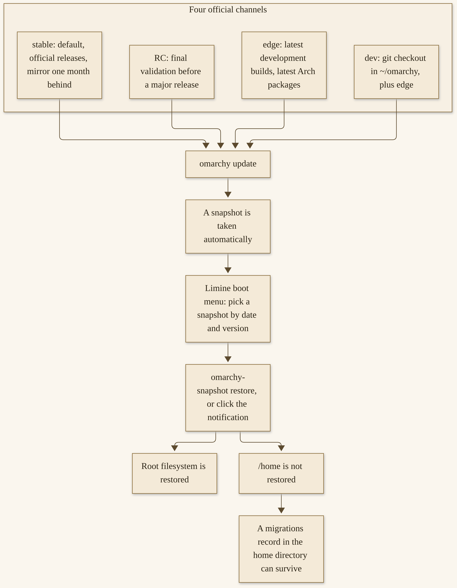{width=100%}

*D20. Diagram 20. The official channel tree, and what a snapshot rollback does and does not do, as the Updates and System snapshots manuals described them on 12 November 2026. Practice the right-hand side in a virtual machine, not on an only-copy disk.*


## Channels and `omarchy update`

Omarchy and your packages are kept up to date through Update > Omarchy in the Omarchy menu (`Super + Space`), or through the official command, `omarchy update`.^145 Omarchy itself is installed as regular packages from the Omarchy Package Repository. An update installs the latest Omarchy release, runs any pending migrations to get your system in sync, and updates all system packages from the Omarchy Arch Mirror, and from the AUR if you have installed any AUR packages.^145 When a new release is waiting, a circle-arrow icon appears to the right of your clock. You can click it, and the update starts.

**Four official channels.**

New installations start on **stable**. Stable tracks official releases, and a stable Omarchy Arch mirror that is running one month behind the latest, so new incompatibilities that require configuration changes can be caught before they cause problems for people.^145 That is the channel for a machine that has to work tomorrow. It is the channel in Chapter 12’s Monday ritual. It is the default on purpose.

**Edge** keeps your Omarchy packages tracking the latest development builds, and lets you update to the latest Arch packages as soon as they are available. The official advice is plain: you should only do this if you are experienced with Linux, and know how to recover a system that has problems.^145 I will not soften that. Edge is a contribution, in a way — you are helping spot issues — and it is a risk. Do not chase it on a Monday machine, or on a gift machine, or on the only disk you have.

**RC** is for final validation before a major release. If you want to help with that polishing, the update manual invites you to `#omarchy-release-candidates` on the official Discord.^145 An RC machine should still be a machine that is allowed to have a strange Tuesday.

**Dev** links Omarchy directly to a git checkout of the source code in `~/omarchy`, combined with the edge packages. You should only use this channel if you are an experienced Linux user, working directly on Omarchy, and willing to tolerate breakage.^145 That is the official audience. It is not a faster stable.

You can switch channels with Update > Channel in the Omarchy menu, or with `omarchy-channel-set` in the terminal.^145 4.5 offers a reboot after a channel switch, which is a kindness; take it.^146 After an update, glance at the snapshot, glance at the agent, and live a day before you change channels. A channel change is a decision. It is not a Monday reflex.

**The command, and the thing you should not run instead.**

Use `omarchy update`. Do not run a raw system-upgrade command. If you are already familiar with Arch, you might be tempted; if you do, you will miss the snapshot, the migrations, and the configuration updates that Omarchy runs together with new packages. That is why Omarchy will actually stop a direct system upgrade and point you to `omarchy update`. If you really know what you are doing, the guard will tell you how to bypass it for a single transaction.^145 I will not teach that bypass as the path. The path is `omarchy update`. The quiz at the end of this chapter will ask you the same question, because it matters.

**Around the update.**

Firmware is a separate official door: Update > Firmware, which fetches and installs what the Linux Vendor Firmware Service has waiting for your hardware. It installs `fwupd` the first time you run it. Plenty of firmware can only be written during a reboot, so do not be surprised to be asked for one.^145 This does not have to be every Monday. It has to be intentional.

You can also keep other kernels installed and pick a default under Update > Kernel, or with `omarchy-kernel`, `omarchy-kernel list`, and `omarchy-kernel set`, as the update manual describes.^145 The other kernels stay in the boot menu if the new default gives you trouble. This is optional. It is not part of the Monday ritual unless you have a reason.

If an update goes badly, the official first step is a rollback to the snapshot taken before the update: restart, and pick that snapshot in the boot menu.^145 The Troubleshooting page’s first heading is “I broke my system with an update!,” and the order there is the same: rollback first, then `omarchy-debug` to share a problem on `#omarchy-help`, then, if you need it, a reinstall of defaults.^147 `omarchy reinstall` reinstalls default Omarchy packages, puts you on stable, downgrades packages that are too new, and resets configuration files. All your user config changes to the Omarchy defaults will be overwritten.^145 Know that before you run it. It is a recovery, not a refresh.

Arch, underneath, is a rolling distribution. The Security manual’s way of saying the benefit is that a patched package is quickly available through `omarchy-update`, and that you are “always running the latest, most secure versions of everything that way.”^144 The cost is the habit this chapter is teaching: take the official command, on a channel you chose, with a snapshot you know how to use. Rolling is not a reason to be afraid. It is a reason to be current, on purpose.

A kernel update on 2 November 2026 is a dated example of that habit in public: official @omarchy told people a Linux kernel update was on stable for a named CVE, and the instruction was “Hit Update > Omarchy.”^160 I will not unpack the vulnerability, and I will not write a reproduction. I mention the post because the official path, even for a security update, is the same path: `omarchy update`, on the channel you are already on, with the snapshot that comes with it. A special emergency command is not the story. The Monday command is the story.

## Snapshots and what they do not restore

This is the rollback section, complete, and it is the chapter’s hands-on lesson. Read it before you need it. Practice it in a virtual machine, not on an only-copy disk.

Snapshots are created automatically on every Omarchy update. If you want to create your own, the command is `omarchy-snapshot create`.^148 That is the command to run before a risky change — an agent doing a long stretch of system work, a configuration experiment, a channel switch — as Chapter 12 already suggested.

To boot and restore a snapshot, you select it from the Limine boot loader. Limine has been the default since Omarchy 2.0. This feature is not available if you are on GRUB or systemd-boot.^148 If you are currently booting straight into the Omarchy decryption screen, you will need to select Limine as a boot option via firmware first. From the Limine screen, choose the snapshot you want based on the date and version. The version of Omarchy at the time of the snapshot can be seen at the bottom left corner.^148

When you arrive inside, a notification will pop up to tell you that you are in a bootable snapshot. If you click it, the restoration process starts. Alternatively, you can run `omarchy-snapshot restore`.^148

**What a restore does, and what it does not.**

A restore restores your root filesystem. It does not restore `/home`. The official manual is as plain as I can be: “So it works for reverting a broken system update, but not for recovering lost personal files.”^148 This also means that your `~/.config` directory is kept as-is. If you are rolling back to an earlier version of a library or an application that stores configuration files in a new format, you will have to sort that out manually.^148

The same goes for Omarchy’s own record of which migrations have already run. That record lives in your home directory, so it survives the restore. Migrations that ran after the snapshot was taken stay marked as done, even though the changes they made to the root filesystem have been rolled back, and the next `omarchy update` will not run them again. If you update again after a restore and something an earlier update had set up is still missing, that is the likely reason.^148 I want that paragraph in your hands before it surprises you. A restore is not a time machine for the whole disk. It is a time machine for the system, and a careful note about your home.

**The quiet boot menu, and Direct Boot.**

As of 4.5, Limine waits just one second and boots quietly. Most of the time you will not see the menu at all. The 4.5 notes say the menu used to stay up for about six seconds, and that almost nobody ever needed it, so the wait is now one second.^146 When you do need a different entry or a snapshot, keep tapping any key — the down arrow works — while the machine starts, and it will stop at the menu. If you would rather keep the menu up longer, you can set your own `timeout:` in `/boot/limine.conf` (for example, `timeout: 5`). Updates will leave a timeout you set alone.^146 On a machine where you expect to practice rollbacks, or where you simply want a calmer hand, a slightly longer timeout is a kindness you give yourself.

If you never touch the boot menu and just want the machine to go straight to the decryption screen, run Setup > Direct Boot in the Omarchy menu. That adds an EFI entry pointing directly at Omarchy, so the firmware boots it without stopping at Limine. The trade-off is the one already mentioned: with Direct Boot on, getting to a snapshot means picking Limine from your firmware boot menu first. Run Setup > Direct Boot again to remove the entry and go back to booting through Limine. Some firmware does not take kindly to custom EFI entries, so the setup refuses to run on American Megatrends and Apple firmware, as the manual states.^148 If the menu refuses, that is the official reason. It is not a broken machine.

**Factory reset, in this chapter’s voice.**

Setup > Reset Computer, as Chapter 13 already taught, is a different tool: it restores the baseline snapshot the installer takes, wipes accounts and `/home`, and is available on ISO installs only. On an unencrypted drive, it is deletion, not a secure erase.^144 I repeat it here so snapshots and reset stay distinct in your mind. A snapshot rollback is how you undo a bad update and keep your home. A factory reset is how you hand a machine over, or start clean, and you lose `/home` on purpose.

**A hands-on lesson, in a virtual machine.**

Do not practice this on the only disk you have. Use a virtual machine — the official Try-Omarchy path from Chapter 3, or any disposable Omarchy virtual machine you already have. The point is to feel the menu, the notification, and the `/home` limit, once, when nothing is at stake.

1. In the virtual machine, run `omarchy-snapshot create`. Wait until it finishes.
2. Create a tiny harmless file in your home directory, after the snapshot, for example:

   ```bash
   echo "this file lives in home" > ~/snapshot-test.txt
   cat ~/snapshot-test.txt
   ```

   This file is the lesson. It is in `/home`. A restore will not take it away.
3. Restart the virtual machine. While it starts, keep tapping a key — the down arrow works — so the quiet one-second menu has a chance to stop. Select Limine if you have to choose a boot loader first. Pick the snapshot you just created, by date and version.
4. When you arrive, you should see a notification that you are in a bootable snapshot. Click it to start the restoration, or run `omarchy-snapshot restore`.
5. When the restore is done, open a terminal and look:

   ```bash
   cat ~/snapshot-test.txt
   ```

   The file should still be there. That is the `/home` limit, in a file you can see. A restore put the root filesystem back. It did not roll back your home. If you had been hoping a snapshot would recover a deleted personal file, this is the moment to believe the manual instead. Personal files need a backup that is actually a backup of `/home`, which this snapshot is not.
6. Remember the migrations note, even if you cannot see it in this small experiment. The record in the home directory can survive. If a later `omarchy update` after a real restore skips a migration you expected, this is why.^148

That is the whole official rollback lesson. Practice it once, in a virtual machine. Then, when a real update goes badly, you already know the menu, the click, and the limit.

## Official security posture, said plainly

The Security manual opens with a serious claim, in its own voice: Omarchy takes security extremely seriously, and this is meant to be an operating system you can use to do “Real Work in the Real World,” where “losing a laptop can’t lead to a security emergency.”^144 That is official wording. I will leave it attributed. I will teach what the page says they do. I will not turn it into an enterprise certification, and I will not say “secure by default” as if a lab had certified this desktop for a kind of work this book has no standing to certify.

**What the project claims, as the manual lists it.**

1. Full-disk encryption is on by default, using standard LUKS. If the computer is lost or stolen, the data is encrypted. The installer lets you opt out for throw-away machines, as Getting Started describes; an install without encryption has none of this protection, and anyone holding the drive can read it.^144
2. A firewall is enabled by default. All incoming traffic is blocked, with a few documented exceptions: port 53317 for LocalSend; DNS queries to the computer’s own resolver at the Docker bridge address (172.17.0.1), accepted from the private address ranges Docker gives its containers; multicast DNS on port 5353, which lets printers and other devices find each other and also announces your computer’s name on the network; and UFW’s standard allowances for ping, DHCP, and UPnP discovery. SSH is off until you turn it on via Setup > Security > SSHD, which opens port 22, rate limited against brute force. Docker access is locked down with the ufw-docker setup so containers are not accidentally exposed to the world.^144
3. Arch is a rolling distribution, and patched packages are available through `omarchy-update`, as I already said.^144
4. Omarchy maintains its own packages and mirror. By default, it relies only on packages from Arch’s own core, extra, and multilib repositories, and on its own Omarchy Package Repository. You can install software from the AUR, but the base install does not; only a few optional installs, such as third-party browsers, pull from the AUR.^144
5. Distribution infrastructure — the ISOs, the Omarchy packages, the Arch mirror — is protected behind Cloudflare’s DDoS shield and hosted on their CDN, as the manual states.^144

You have two passwords on an encrypted install: the one that unlocks the drive at boot, and the one you log in and `sudo` with. Setup makes them the same. Both can be changed under Update > Password in the Omarchy menu — Drive Encryption for the first, User for the second. Changing the drive password asks for the current one first. If a change is interrupted, run Drive Encryption again: it asks for the password that unlocks the drive now, and finishes the change.^144

**Signing, and a key I re-fetched.**

The public key for all ISO signatures and Omarchy repo packages, as the Security manual printed it on 12 November 2026, is `40DFB630FF42BCFFB047046CF0134EE680CAC571`. The same page tells you to verify it at openpgp.org. The `omarchy/omarchy-keyring` package contains this key, and will be used to roll out any potential updates. You can find the signature for any ISO release by adding `.sig` to its URL.^144 I re-fetched that page on draft day, and I am printing the key because I confirmed it. If a later page prints a different key, trust the later page, and date the change.

**Reporting a vulnerability, privately.**

If you believe you have found a security vulnerability, report it privately. The official security site asks you to use the HackerOne program, so the team has a chance to investigate and fix the issue before it is made public. Confirmed vulnerabilities are eligible for bounties paid through HackerOne. If you would rather not create a HackerOne account, you can email security@omarchy.org.^149 Please do not report potential vulnerabilities publicly in GitHub Issues, Discord, or social media before they have been resolved. That is official guidance, and it is good guidance. This book will not tell you how to exploit anything. It will tell you where to report, and that a program exists.

On 2 October 2026, official news announced that program, funded by the Omacom Foundation with $100,000 for bounties, so researchers who find a real vulnerability and report it privately can be paid for their work.^150 That figure is dated, and I will keep it dated. The security page describes what the project considers a vulnerability — a bug that can be used to cross a meaningful security boundary — and what to include in a report: the affected component and version, an explanation of what someone could do before and after, steps to reproduce, and a preferred contact. It also asks researchers to test only systems they own or have permission to test, and to give a reasonable opportunity to fix an issue before publishing details.^149 I will not go further than that. Eligibility, credits, and the difference between a vulnerability and an improvement are on that page.

This is a serious posture, said plainly. It is not a certificate. Encryption is default, and you can turn it off. A firewall is default, and it has documented exceptions you should actually know, including a port that announces your computer’s name on a local network. SSH is off until you need it. Third-party plugins, as the next section will say again, are unsandboxed. A careful professional, or a careful person at home, treats those sentences together.

## Passwordless sudo, plugins, and risk

Some official options are powerful, and they are high risk, and they are not defaults you should rush toward. I want them in the open, in the official words, in a chapter about staying safe.

**Passwordless sudo.**

Sometimes you want `sudo` to stop asking, most often when an AI agent is doing a long stretch of system work for you. Setup > Security > Passwordless Sudo asks how long to allow access: 15 minutes, 1 Hour, 1 Day, or Permanently. A red warning icon appears beside the other menu-bar indicators while access is active. Click it, or run the command again, to turn access off. You can also pass your own number of minutes, from 1 to 1440, with `omarchy-sudo-passwordless 30`, or use `omarchy-sudo-passwordless permanent`.^144

Timed access expires automatically, including immediately after resuming from a suspend that crossed the deadline. Restarting the computer ends it early. Permanent access survives reboots and stays enabled until you disable it.^144 Updating or removing Omarchy’s settings package ends any temporary grant before its expiry support changes. If the command reports an authorization or cleanup error, the manual tells you to resolve it before trying to enable another grant; an error does not mean passwordless access is inactive.^144 That last sentence is easy to misread in the direction of comfort. Do not.

The official warning is the one I will not paraphrase away: “Be clear-eyed about this one: while it’s on, anything running as your user can do anything as root without being asked. That’s the whole point, and it’s also the whole risk.”^144 This is for agent work. It is a **high risk**, said in those terms. A timed window you watch is a different decision from “Permanently” on a machine that also reads mail. Chapter 12 already said a fleet box is where this looks tempting. A personal machine is not a reason to be less clear-eyed. If you turn it on, turn it off when the stretch of work is done, and look for the red icon.

**Plugins, themes, and a `cidata` passphrase.**

Third-party plugins are unsandboxed. They run with your user’s authority. Chapter 9 taught this, and it belongs here again. `omarchy plugin validate` is a check, not a sandbox.^151 Read a plugin before you enable it. A plugin you would not install on a machine you care about is a plugin you should not install on this one.

Theme repositories, as Chapter 8 taught, can drop files that would run — including scripts and editor or terminal configuration. Look at the files first. A beautiful theme is not a reason to skip a read.

An unattended `cidata` drive, as Chapters 3 and 12 taught, can hold a disk-encryption passphrase in plaintext. Treat that drive as the secret it is.^152 A professional fleet, or a personal imaging afternoon, does not put that passphrase at ease.

Sudoless Docker, as Chapter 12 taught, adds you to a group that is “effectively passwordless root.”^153 It is the same family of risk: a convenience that is also a grant. The official path asks you to understand the trade-off and to enable it after a warning. The warning is the professional fact.

Unattended agent modes “actually do things.” The Omarchy Skill is experimental. Be ready to `omarchy reinstall configs`, or to restore a snapshot, if an agent makes a mess.^154 A careful reader treats all of these — passwordless sudo, unsandboxed plugins, theme files that would run, a plaintext passphrase, a Docker group, an unattended agent — as deliberate trades, not as defaults to rush toward. The defaults, in several of these cases, are already the careful ones. You are the one who would turn them off.

## Fair criticisms

A gift book that is still honest has to say what a careful person might fairly criticize. This is not a takedown, and it is not hidden. None of these points require unread journalism, and I will not quote pieces I have not opened. They are grounded in the project’s own posture, or in gaps this book has already flagged.

**Opinionated defaults.** That is the omakase. The project is not trying to be as familiar as possible, and official writing has said so in so many words, in earlier chapters’ sources. You can change everything. You do have to live in someone else’s chef’s choice until you do. For some people, that is the joy. For some, it is a reason to leave. Both reactions are allowed. This book’s posture is that the defaults are a starting point, and that you still say yes.

**Rolling updates.** That is Arch, taken through `omarchy update`. You are current, and you are responsible for a habit. Snapshots make that habit safer. They do not make it optional. The first Troubleshooting heading is about a broken update, which is an official admission that this happens, and that there is a path back.^147 If you wanted a distribution that barely moves, this is not that distribution. If you wanted one that moves with a snapshot and a documented command, this is closer.

**A learning curve.** The Super key, tiling, a new package culture. Official on-ramps have softened this — a floating workspace, a dock, “give it two weeks” — and a first evening can still feel like a new language. That is a real cost. It is also a real gain, once the keys are in your hands. I will not pretend the cost is imaginary, and I will not pretend two weeks is a magic number for every person.

**The Doctrine, including lines a reader may dispute.** “Command is service” says, in official words, that Omarchy is not a democracy. It is “a benevolent dictatorship in the grand tradition of Linux, Ruby, and Rails.” The dictator’s job is to listen to everyone, and to make the call according to intuition, vision, and experience. Some calls will be wrong, and then they will be reverted. Others will be delegated. “But the buck will always have a place to stop.”^155 “Hold the line” says the project is bringing back a hacker ethos “all about the code,” and that it is “dropping the Code-of-Conduct struggle sessions and identity-overload nonsense that has plagued open source for far too long.” “We’re done with all of it. Just be nice and sincere.”^155 Those are official words. I have quoted them. I will not amplify them into a culture-war chapter, and I will not hide them. A reader may dispute them. A reader may agree. This book’s job is to let you see the Doctrine as it is written, and to keep the Doctrine’s own other line about how we talk: quote, don’t amplify — including when we talk about the project in public.

**A foundation-funding debate exists in public.** I will describe it without slurs, and without inventing figures beyond a dated pledge number. The Omacom Foundation is a nonprofit, launched 21 August 2026. I will not invent a tax-exempt designation the pages I opened did not state.^156 On 12 November 2026, the homepage showed **$23,650,000** in pledges. Those are pledges, not an audited cash balance, and I will keep them dated.^156 Official writing has acknowledged public attacks on the size of donations, and official launch wording treated the sum as “a ridiculous sum of money” that was intended to last a long time.^156 Some people think a desktop project with that much pledged money is a wonder. Some people think it is a problem. Both views are part of the public record. This book will not reprint abuse, and it will not pretend the debate is not there. Scrutiny can improve a project. Money can also last a long time, if it is meant to. You can read the Foundation page, and the launch news, and make up your own mind.

**Hardware gaps, and stale lines.** Preliminary ARM. Bring-up machines, including official Snapdragon work, machine by machine. Sleep turned off on some NVIDIA systems, as official pages say, because sleep has not been shown to work on that hardware yet. Intel Mac T1 and T2 limits, and a 2017 iMac’s known issues. Stale manual lines this book has already flagged: the Mac-support page on Apple silicon, the Coming-From “no dock” line after 4.5. These are real gaps. Chapter 10 and Chapter 11 already taught them as official caveats, not as scandals. “On the way” is still not “ships today.”

**The Omarchy Skill is experimental.** Different models will use it to different effect. Plan mode first. Be ready to roll back. That is official, and it is a fair criticism of any posture that sounds like “just tell your AI” without the asterisk. Chapter 6 already put the asterisk on the page.

None of this is a reason I stopped using the desktop. It is a reason I wrote this chapter. A gift that only praises is not a companion. A gift that only dunks is not a companion either. You now have the official posture, the official risks, and the official gaps, in one place. You can stay, and stay with your eyes open.

## Give something back

Contribution is a concrete invitation, not a vibe. Here are official ways to do it.

**Open a pull request**, on the official repository, in the project’s own style. The canonical repository is `https://github.com/omacom/omarchy`.^157 On the day I looked, 12 November 2026, contributor guidance for people and for agents lived in `AGENTS.md` in that repository; I did not find a root `CONTRIBUTING.md`. Follow whatever the repository presents on your day. The guidance I opened asked for atomic commits — one coherent change, not mixed with unrelated work — and for succinct commit messages that describe the change.^157 Search for a duplicate issue or pull request before you start. Target the default branch as the project names it on your day. Run the tests the repository asks you to run. I will not invent a style guide beyond that. The project’s own files are the style guide. If you are not sure whether a change belongs, an issue, or a conversation in the official Discord, can be a better first step than a surprise pull request.

**Share a theme**, as Chapter 8 taught: the official naming, a public git repository, a pull request to the extra-themes list as the themes manual describes. Look at the files you would be asking other people to install, because those files can run. Share a theme you would install yourself.

**Share a plugin**, as Chapter 9 taught, after you would install it yourself. Third-party plugins are unsandboxed. A plugin you offer to the commons is a plugin other people will run with their user’s authority. Read it the way you would want a stranger to have already read it. `omarchy plugin validate` is a check, not a sandbox. The invitation stands. The care stands too.

A collaborator of mine has written applications and plugins for Omarchy. I am glad the commons has that kind of work in it. I will not name the applications or the plugins here. The point is the invitation: you can add something, too.^158

**Help in `#omarchy-help`.** Read before you post. Answer a question you actually know the answer to. Be kind to a first evening. Rangers, as Chapter 13 described, are an official team for this work, and the application address is rangers@omarchy.org.^159 You do not have to be a Ranger to be helpful. You do have to be accurate, and patient.

**Host or attend a meetup**, as Chapter 13 taught, under the official rules: no permission needed, nobody owns a city, keep it open, disclose sponsorships, do not turn the name into an events business.^159 Artists in Residence, on the Foundation page, is an official path for artists, with a six-month stipend, to work on themes, plugins, and whatever else makes the system beautiful.^156 Partner inquiries go to foundation@omarchy.org, as official pages state.^156 Those addresses are doors. Use them for what they are for.

**Hold the line, in the Doctrine’s sense of how we talk.** The Doctrine’s own instruction, as I am willing to carry it here, is to quote and not to amplify — including when we talk about the project in public.^155 A gift book can do that. A social post can do that. A meetup can do that. You do not have to agree with every Doctrine line to talk about this desktop fairly. You do have to let the project’s words be the project’s words, and your words be yours.

A practical first contribution, if a pull request feels large, is smaller than a pull request. Open the official repository. Read the current `AGENTS.md`, or whatever file the project is pointing contributors at on your day. Search issues for a problem you have actually had. If it is already filed, add a careful observation, not a “me too.” If it is not filed, file it with the version you are on, the channel you are on, and the steps you took, after you have tried the official rollback and `omarchy-debug` where they apply. If you do later open a pull request, keep it to one coherent change, and say in plain language what it does and how you tested it.^157 That is a complete first contribution. It is also how you avoid the duplicate work official discussions have already worried about, without this book inventing a process the repository did not publish.

If you never open a pull request, and you never host a meetup, and you only answer one question in `#omarchy-help` this year, that is still something back. The commons is made of those. You are somebody now, as a Doctrine line says in its own voice; I will leave that line as theirs, and I will say that showing up is enough.^155

## What is not released yet, and a fair close

**4.6 is unreleased.** As of 12 November 2026, it is not out. Official posts and first-person reports have mentioned work that may land there. This book will not teach it. If 4.6 is out on the day you read this, open the official notes for that release, and trust those notes over any silence in these pages. Date the change. Do not treat this chapter as a preview of a future desktop.

Figures in this chapter, and in this book, belong on a chart you can see, dated, with sources on the figure. They were re-checked the afternoon of 12 November 2026.

{width=100%}

*D21. Access-dated community-numbers chart, 12 November 2026 (America/New_York), with sources on the figure: GitHub stars and forks; community themes; Foundation pledges (pledges, not audited cash); homepage ISO downloads “in year one,” window undefined; Discord membership, last official figure 24 August 2026, current UNVERIFIED; official X followers. Not a boast. Afternoon recheck recorded in the footnote below.*


*Diagram 21, in part. A bar chart cannot honestly hold every figure we have, because they are not all the same kind of number. The rest, in words, with sources, dated 12 November 2026 (America/New_York): GitHub API — 46,877 stars, 6,071 forks; community themes — 851; Foundation pledges — $23,650,000, pledges, not audited cash; homepage ISO downloads — 1,375,832 “in year one,” and the window for “year one” is undefined on the homepage, so we will not pretend it is a fiscal year; Discord — last official figure about 35,000, on 24 August 2026, current membership UNVERIFIED; official X — @omarchy 45,539 followers, account created 9 October 2026; @dhh 953,590 followers that day. 4.5 notes, dated 4 November 2026: “over 740 pull requests,” “more than 180 contributors,” in twelve weeks, official wording, not an independent census. Sources sit with these figures: the GitHub API, the themes gallery, the homepage, the 24 August 2026 meetups piece, the X API, and the 4.5 notes, all as Chapter 14’s notes record them. An afternoon GitHub API recheck the same day read 46,879 stars and 6,073 forks, a same-day drift of a few, which this book does not treat as a new body figure. The official homepage that afternoon displayed 46,847 GitHub stars, a homepage figure not substituted for the API snapshot. Themes, pledges, and ISO downloads were unchanged.*

The “year one” download window is the gap I want to say one more time. The homepage, on 12 November 2026, showed 1,375,832 ISO downloads “in year one.” It did not define the window. The “numbers” link still pointed, that day, at a 2 September 2026 article about 200,000 downloads in 18 days.^156 I will not invent a start date or an end date, and I will not treat “year one” as a fiscal year I can close. It is a homepage figure, dated, with an undefined window. That is honest, and it is enough.

The machine is yours. The Doctrine says so, in its own words: the Perfect Computer may start as omakase, but it is ultimately yours.^155 This book has tried to make that sentence practical: a channel you chose, a snapshot you know how to restore, a security posture you can describe without turning it into a certificate, risks you would only turn on with your eyes open, criticisms that are not hidden, and a commons you can actually help. The next page is a short coda, and then the appendices — a glossary, a cookbook, checklists, a resources list, and a note on names and sources. You do not have to read them tonight. They will be there when you need a door.

> **Try this now.** In a virtual machine — not on an only-copy disk — create a snapshot with `omarchy-snapshot create`, make a tiny harmless file in your home directory, and restore, as the lesson above describes. Notice that `/home` is not in the restore. The file is still there. That is the whole point of the sitting. If you do not have a virtual machine today, write the five steps on paper, and practice them the next time you do.

> **Checkpoint.** You are in good shape if you can name the four channels, say what a snapshot does not restore, and repeat the passwordless-sudo warning in your own words: while it is on, anything running as your user can do anything as root without being asked.

> **Quiz.** Should you run a raw system-upgrade command instead of `omarchy update`? No. Is 4.6 in this book? No. If you are unsure, this chapter is here, Diagram 20 is here, and Appendix C will reprint the factual answers with a pointer back.


# Coda

I started with a first-run invitation, and I chose Grok Build. The first time an application crashed, a popup appeared; I clicked it; Grok Build opened, troubleshot, changed the install; the app came back; I have had no issues with it since.^161 That is the whole telling, and it is still the beginning of why I wanted this book to exist. A finished desktop invited an agent in, and when something broke, the agent I had chosen was the thing that opened. A successful fix is what happened for me. It is not a promise. It is a first evening, and a reason to go further.

I still run five SMF Works computers on this desktop, including a MinisForum MiniPC — an AMD Ryzen 7, 32 GB of memory — that hosts my Hermes and OpenClaw fleets. Grok Bot and Grok Build are on all five. A collaborator has written applications and plugins for the system; I have been glad of that work, and I have not named it, because the invitation is larger than a catalog. Grok Build has reconfigured layouts for me. I still think of Omarchy, in the project’s own words, as an *agentic* Linux — “Beautiful, fun & agentic Linux,” “the malleable OS for the age of agents,” the Doctrine’s “Welcome the agents” — and I still will not call it “the first.”^162 What struck me is that design, sitting next to those words. The ranking is not a fact I have, and it is not a fact this book will invent.

If you have an old machine, it may have a second life. The official potato page has already demonstrated Omarchy on a 2011 ThinkPad X220 with 2 GB of memory, and it has already said, “Give the one you already have a second life.”^163 Chapter 11 walked that path with honest limits: 1x scale, a cloud agent on a small machine, no fake minimum-spec table, no fake benchmark. If the machine in a closet is for someone else, Chapter 13 walked a gift, and a reset, carefully. The hardware does not have to be new to have work in it.

If you have something to add — a theme, a plugin, a kind answer in `#omarchy-help`, a meetup that follows the official rules — the commons is there. Chapter 14 named the doors: the official repository, in the project’s own style; a theme you would install yourself; a plugin you would run yourself, knowing it is unsandboxed; Rangers, if that is your work; Artists in Residence, if that is yours; foundation@omarchy.org, for the inquiries that address is for. You do not have to do all of it. Showing up once is already something back.

This book was a gift. It is a free, unofficial companion, not for sale, not affiliated with or endorsed by the Omacom Foundation, David Heinemeier Hansson, 37signals, or any other organization whose products are named in these pages.^164 There is no course behind this page. There is no upgrade waiting. There is the official manual, which moves, and which you should trust when this book and a live page disagree. There is the Doctrine, which you can read in its own words, including the lines you may dispute. There is a community — a Discord whose current membership I will not invent, meetups you can find on an official calendar, people who will help, and people you can help. We dated what we checked: 12 November 2026. The product will move. The posture I hope moves with you is smaller than a version number: you are still the one who says yes.

From a first-run invitation to a snapshot you can restore is a complete path, and you do not have to walk all of it in a week. Get in, by the official path you actually have. Choose an agent, if you want one, or live a week without a local model. When something breaks, click the notification, and know that a fix is an outcome, not a warranty. Make the machine yours — a theme, a plugin you actually read, a floating workspace on a Sunday. Give an older computer a second life, if you have one. Sit at a professional desk, or a personal one, or the same desk on different days. Stay current with `omarchy update`. Stay safe without calling the desktop a certificate. Give something back, once, if you can. That is the book, in a walking order, and it is also a week you can start small.

The three sister gifts are doors, not homework. *Hand It Off* is the Grok Bot door. *Grow With It* is the Hermes door. *Make It Yours* is the OpenClaw door. This book stands on its own, as a companion to an official *agentic* desktop, and it does not ask you to read the others first. If a fleet on a MiniPC is a shape you want at full size, those gifts are where that walk lives. If a first-run agent, a crash handoff, a second-life machine, a Monday ritual, and a snapshot you know how to restore are what you came for, you already have them.

The appendices are a shelf, not an assignment. A glossary. A cookbook of the how-tos. Checklists you can print. A resources list, just after this page, of official addresses, dated. A note on names, trademarks, and sources. Take a page when you need a page.

I have tried to keep this companion warm, and practical, and honest about limits. I have not closed any chapter with a sentence about a bright future, and I will not close this one that way either. The machine is yours. The agents are welcome, in the project’s own wording, and they are welcome only with your yes. Old hardware still has work in it. The commons is still there. Thank you for letting me walk this far with you. I have enjoyed the walk: a closet machine, a Monday ritual, a game with its caveat still attached, a snapshot in a virtual machine, a pull request you might one day open. What you run next is yours to choose.

> **Reflection.** What will you run with, this week? There is no command, and there is no grade. A first `omarchy update` on a known channel, a 1x scale on an older panel, a letter dictated with the local model, a snapshot practiced in a virtual machine, a kind answer in a help channel — any one of those is a complete week. The title of this book is an invitation, not a test. Run with it, at a size you can still see.


# Appendix A
## Glossary

This is a shelf, not a chapter. Each entry is a plain-language meaning, then a pointer to the place in the book that teaches it. If a word on a screen is new, look here, then go back to the chapter. Official wording is used for official things. Reserved product names that this book refers to only in general terms are not listed here; Appendix E explains that house rule.

**Omarchy.** A complete, MIT-licensed, omakase Linux desktop, officially *agentic*, based on Arch, on the tiling window manager Hyprland, and, since Quattro, on the desktop shell Quickshell. You install it on a machine you control. Chapter 1.

**Omakase.** A chef’s-choice set of defaults, already chosen so you can start. The Doctrine still says this is your computer; the defaults are a starting point, not a cage. Chapter 2.

**Doctrine.** A written set of ten principles, by David Heinemeier Hansson, on the official Omarchy site, including “Own the machine,” “Welcome the agents,” “Command is service,” and “Hold the line.” This book quotes them and attributes them; they are not our slogans. Chapter 2.

**Omacom Foundation.** The nonprofit that, from 21 August 2026, holds Omarchy’s trademarks, funds infrastructure, and supports the work. This book calls it a nonprofit, as the official pages do, and does not invent a tax-exempt designation. Pledges are pledges, not audited cash. Chapter 1.

**Omakub.** An earlier, opinionated Ubuntu and GNOME setup, announced 6 June 2024, now officially retired. A community fork, **Omabuntu**, continues that Ubuntu thread. Omarchy is the later, complete distribution, not a layer on top of somebody else’s. Chapter 1.

**Arch.** A rolling Linux distribution: packages move forward rather than arriving in one big release. Omarchy is based on Arch, with its own package repository, update wrapper, and snapshots. You do not have to be an Arch expert to install Omarchy. Chapters 1 and 14.

**Hyprland.** The tiling window manager Omarchy uses. Hyprland is the window manager; Omarchy is the complete desktop built around it. Chapter 1.

**Quickshell / `omarchy-shell`.** The desktop shell — bar, menus, notifications, lock screen, and related pieces — since Omarchy 4.0 (Quattro), published 14 August 2026. Earlier versions used a different stack. Chapter 1.

**Quattro / Quattro RS.** Quattro is Omarchy 4.0.0, the Quickshell release. Quattro RS is Omarchy 4.5.0, published 5 November 2026, 12:36 a.m. America/New_York, the current stable these pages were written against: a floating desktop and a dock, Omarchy M, fifty languages, a first ARM ISO, and Grok as a full provider, among other things. 4.6 was unreleased on the research day and is not taught in this book. Chapter 1.

**Limine.** The boot manager, default since Omarchy 2.0. It is the quiet door in a dual-boot, and the place you pick a snapshot. In 4.5 the menu waits one second and is hidden unless you press a key. Chapters 3 and 14.

**Snapper / `omarchy-snapshot`.** The snapshot system. Snapshots are taken automatically on `omarchy update`. You can also create one with `omarchy-snapshot create`, and restore with `omarchy-snapshot restore` or from the Limine menu. A restore restores the root filesystem and does **not** roll back `/home`. Chapters 5 and 14.

**LUKS.** The standard Linux disk-encryption used by Omarchy’s default install. You will have a drive password, at an early prompt, as well as a user password. Chapter 3.

**`omarchy update`.** The official way to take updates. It runs a snapshot, migrations, and configuration updates together with the packages. A raw system-upgrade command is not the path; Omarchy will stop one and point you here. New installs start on the **stable** channel. Chapters 5 and 14.

**Channels (stable, RC, edge, dev).** Four official update channels. New installations start on stable, which tracks official releases and a stable Arch mirror running about a month behind. RC, edge, and dev are for people who know how they will recover; this book’s first week stays on stable. Chapter 14; previewed in Chapter 5.

**Omarchy M.** The native installer, in 4.5, that puts Omarchy beside the existing system on M1, M2, M3, and Neo MacBooks, without a USB stick. Homebrew: `brew install omacom/mac/omarchy`. M4 and newer were “on the way” on the research day, not “ships today.” An older Mac-support page that said M-series was unsupported, or that Omarchy must be the only system, was stale. Chapter 3.

**Omarchy Dragon.** Official Snapdragon bring-up work, announced 18 September 2026, machine by machine. Work in progress, not a certification of a named laptop. Chapter 10.

**Agentic.** Official wording: “Beautiful, fun & agentic Linux,” “the malleable OS for the age of agents,” and the Doctrine’s “Welcome the agents.” This book uses that wording and does not call Omarchy “the first” of anything. Chapter 1 and the preface.

**Default agent.** The first of Claude, Codex, or Grok that you complete a sign-in for, at first run; the agent that `Super + Shift + Ctrl + A` opens, that the Quake console starts, and that a crash handoff is given to. Change it later with `omarchy default agent`, or under Agent > Harness. The first-run panel is three sign-ins, not the full harness catalog. Chapter 4.

**Grok Build / `grok`.** Officially “Grok Build from xAI,” a coding agent, installed through mise. Skip a vendor’s `curl | bash` installer, which fights Omarchy’s wrapper. This is the Grok of the first-run three. Chapter 4.

**Grok Bot.** A different product: a desktop chat app, under Install > AI. “Grok Bot is the desktop chat app. The coding agent is the `grok` command.” Both can live on the same machine. Chapter 4; *Hand It Off* is a sister gift if you want a thorough guide.

**Claude / Codex.** Claude Code and OpenAI Codex, the other two of the first-run three sign-ins. Chapter 4.

**Harness.** An agent under Agent > Harness, the longer official catalog (twenty-three agents and providers in the 4.5 notes; re-check at the live page). Not a synonym for the first-run panel. Chapter 7.

**Omarchy Skill.** An official default skill for tailoring the system — configs, the bar, a new theme. Officially **experimental**. Use plan mode first, and be ready to `omarchy reinstall configs`. Not a first-evening or first-week tool. Chapters 4 and 6.

**`diagnose-crash`.** The official skill handed to your default agent when you click a “Process crashed” notification, or when you run `omarchy agent crash` against a PID. A successful fix is not a guarantee. Chapter 6; previewed in Chapter 4.

**mise.** The version and installation tool Omarchy uses for command-line agents and for other development tools. First launch of an agent can lazy-install it. Use this path, not a vendor’s competing installer. Chapter 4.

**Aether.** A theming application that can extract colors from a background image and turn them into a theme. Start it from the Omarchy menu (`Super + Space`). It is not bound to `Super + Alt + Space`; that chord, in 4.5, opens the app grid. Chapter 8; chord correction in Chapter 2.

**Hooks.** Small scripts in `~/.config/omarchy/hooks/<event>.d/` that run on official events (for example after a boot or an update). Your changes belong in `~/.config`, not under `/usr/share/omarchy`. Chapter 6 and Chapter 9.

**`cidata` / unattended.** A second drive, labeled `cidata` (cloud-init NoCloud), that carries configuration so the ISO can install with nobody at the keyboard. Required files: `user_configuration.json` and `user_credentials.json`. Encrypted unattended is not fully unattended: you still type the LUKS passphrase at first boot, and a passphrase may sit in **plaintext** on that drive, which is a secret. Chapter 3.

**Defer-provisioning.** An empty file, `defer-provisioning`, that can replace `user_credentials.json` on a `cidata` drive, or the interactive equivalent: `Ctrl + C` on the installer’s first screen. The machine installs, and the new owner creates their user and password at first boot. Chapter 3.

**Unsandboxed.** Official status of third-party plugins: they run with your user’s authority. `omarchy plugin validate` is a check, not a sandbox. Chapter 9.

**ISO.** The official install image, downloaded from omarchy.org, written to a USB stick, used for full-disk and free-space installs, and for unattended and virtual-machine paths. From v2.0, this is the official way in. Verify checksums from the live official page; this book does not print a hash. Chapter 3.

**Dual-boot.** An official free-space install beside another operating system already on the disk. The other system’s drive encryption must be off first. Limine is the quiet door; `limine-scan` adds the other system. This is not a promise that every other system will dual-boot cleanly. Chapter 3.

**Free-space install.** The installer option that puts Omarchy in unallocated space rather than wiping the full disk. The way you dual-boot. Chapter 3.

**Full-disk install.** The installer option that takes over the entire selected drive and wipes it. Encryption is still the default. Chapter 3.

**Potato page.** An official low-end demonstration: a 2011 ThinkPad X220 with 2 GB of memory, running Omarchy with room to spare. It is a demonstration, not a minimum-spec table; the project did not publish one we could find. Chapter 11.

**Super.** The system key, the center of Omarchy’s keyboard-first design. `Super + Space` opens the menu; `Super + K` shows bindings. Chapter 2.

**Dwindle, scrolling, floating.** The three workspace layouts, cycled with `Super + L`. Dwindle is the tiling default (bar mark: a square). Scrolling lines windows past the edge of the screen (a circle). Floating is a traditional overlapping desktop with a dock, official in 4.5 (a triangle). Chapter 2.

**Dock.** In 4.5, a dock on a floating workspace, with pinned apps, running apps, and an app grid (`Super + Alt + Space`). An older Coming From line that said there is no dock is stale; this book teaches 4.5. Chapter 2.

**`omarchy reinstall configs`.** An official command to reset configuration if an agent, or a hand edit, has made a mess. It is not a restore of your home directory. Chapter 6; named in Chapters 4 and 5.

**`~/Work`.** The directory where agent launches from your home directory start, because agents refuse to remember trust for `$HOME`. Chapter 4.

**`~/.agents/AGENTS.md`.** The shared instructions file for every agent, next to shared skills in `~/.agents/skills`. Open it under Agent > Instructions. Do not put secrets in it. Chapter 4.

**F1 installer.** The 4.5 installer that unpacks a prebuilt root image and adds this machine’s packages, which is why installs got faster. Named in the 4.5 notes. Chapter 3.

**Quake console.** In 4.5, a drop-down console over a dimmed desktop, toggled with `Super + ~`. The first open starts your default agent; a second press tucks the session away. Chapters 2 and 4.

**`#omarchy-help`.** The official community Discord channel Getting Started points you to if you are stuck. A current membership figure was unverified in our research; this book does not invent one. Chapter 3.

**Omarchy Package Repository (OPR).** Omarchy’s own package repository, from which Omarchy itself is installed as ordinary packages. It is why `omarchy update` is the path, rather than a raw upgrade that would miss snapshots and migrations. Chapters 1 and 14.

**37signals / DHH.** 37signals is the company named on official footers as the place Omarchy was incubated. DHH — David Heinemeier Hansson — is the creator of Omarchy and the author of the Doctrine. This book is not affiliated with either, and does not speak for them. Chapter 1 and Appendix E.

Those are the words this book leans on. If a later official page uses a word differently, trust the live page, and date the change. Appendix D lists official URLs. Appendix E says how names and sources are handled.


# Appendix B
## Cookbook

This appendix is a shelf of short recipes, collected from the how-tos already planned in the chapters. Each card has a name, numbered steps, a “never,” a chapter, and an official source. The commands are official, as those chapters and the live docs stated them on 12 November 2026. I have not invented an `omarchy` subcommand. If a page and this shelf disagree when you read them, trust the page, and date what you see.

Use them as starter cards. Make them yours. Watch a change once, with you in the room, before you let anything run unattended. Do not put a password, a key, or another person’s private life into a prompt. Secrets belong in official sign-in flows, not in a cookbook and not in a chat.

I have arranged the cards in roughly the order the book teaches them: a first evening, a first weekend, a crash you do not force, a reversible change, themes, plugins, a git identity, a development environment, an unattended file list, and a Monday morning. You can start in the middle if the middle is what you need today. You cannot skip a “never” because you started in the middle. The “never” travels with the card, every time.

## How to read a card

Each card is the fridge-door version of a chapter. The chapter is the home of the full how-to, the judgment, and the warnings at full length. If a card feels thin, go back to the chapter. If a card feels tempting to run unsupervised on the first try, it is not ready. Plan mode, a read, and a rollback come first.

## First evening, and a default agent

**Choose a default agent on a fresh machine.** (Official path, Chapter 4.^165)

1. After a fresh install, Omarchy will invite you to make this choice with a one-time notification. You can also pick a default later with `omarchy default agent <name>`, or under Agent > Harness in the Omarchy menu (`Super + Space`). If the agent is not installed yet, picking it installs it first.
2. Before you have set up an agent, the agents panel walks you through signing in to Claude, Codex, or Grok. The first one you complete becomes your default agent. That first-run walkthrough is three sign-ins, not the full harness catalog.
3. For Grok, use the project’s mise path: run `grok`, or pick Grok Build under Agent > Harness. Skip a vendor `curl | bash` installer. That path puts a second copy on your `PATH` and overwrites Omarchy’s wrapper.
4. Once you have a default, `Super + Shift + Ctrl + A` launches it in a dedicated terminal. In 4.5, `Super + ~` drops a Quake-style console; the first open starts the default agent; press again to tuck it away. Left-click the bar’s agents icon for the panel; right-click launches the default.
5. Optional, and kind: open Agent > Instructions, or look at `~/.agents/AGENTS.md`, and write a standing sentence you actually mean — for example, that config changes should start in plan mode. Run `omarchy agent instructions` if you later need to relink.

**Never:** Do not treat the first-run panel as a tour of all twenty-three harnesses. Do not launch `omarchy agent prompt` into a broad unattended task on the first evening; agents launched that way “actually do things.” Do not confuse Grok Build (`grok`) with Grok Bot, which is a desktop chat app under Install > AI.

**A first look at shared instructions.** (Official path, Chapter 4 and Chapter 6.^165)

1. Open `~/.agents/AGENTS.md`, or Agent > Instructions.
2. Write only standing rules you would be happy to see an agent follow: prefer plan mode for configuration, prefer the `omarchy` CLI to editing package files, do not touch `/usr/share/omarchy`.
3. Those sentences are yours, not official required text. Relink with `omarchy agent instructions` after installing another agent.

**Never:** Do not put passwords, keys, or other people’s private lives in `AGENTS.md`.

## A Super-key weekend

**Practice the system key, without inventing a chord.** (Official bindings, Chapter 5; re-check the live Hotkeys page if a chord has moved.^166)

1. Live on the machine for a weekend. Super is the system key.
2. Open the Omarchy menu with `Super + Space`. Walk Install, Appearance, and Setup once, just to see the rooms.
3. Open the default agent with `Super + Shift + Ctrl + A`. Close it and open it again until the chord is in your hands.
4. In 4.5, try `Super + ~` for the Quake-style console, and press it again to tuck the session away.
5. Open the theme picker with `Super + Ctrl + T`. Open backgrounds with `Super + Ctrl + W`. You do not have to change either one this weekend. Knowing where they live is enough.
6. If a chord you expected has moved — 4.5 did move some — trust the current Hotkeys manual and the 4.5 notes’ “Changed hotkeys” list, dated, rather than a memory from an older page.

**Never:** Do not invent a chord this book did not document. Do not treat a stale “no dock” line as current after 4.5’s floating workspace and dock. Do not spend the weekend binge-installing plugins.

## Crash handoff, without forcing a crash

**Confirm crash diagnosis is on, and know the handoff.** (Official path, Chapter 6.^167)

1. Watching is on by default. Confirm the switch under Trigger > Toggle > Crash Capture, or with `omarchy toggle crash-capture`. If you only wanted to look, put the switch back as you found it.
2. Know the handoff, so you do not have to invent it later: a process can go through systemd-coredump; a “Process crashed” notification appears; you click it; the default agent opens with the `diagnose-crash` skill.
3. Know the hand command, for a PID from `coredumpctl list`:

```bash
omarchy agent crash <pid>
```

4. Know the mute, which hides a reminder and does not fix a crash: `omarchy crash mute <name>`, `omarchy crash mute <name> off` to bring it back, and `omarchy crash mute` to list what you have muted.

**Never:** Do not force a crash in order to practice. Do not treat a mute as a repair. Do not treat one successful fix — including mine — as a guarantee that every crash will be fixed.

## One reversible change, with a rollback

**Ask for one small change, in plan mode, and keep an undo.** (Official path, Chapter 6.^168)

1. Pick one thing you already wish were different: a single keybinding, or a small layout nudge. Not “make the desktop mine.”
2. Take a manual snapshot first:

```bash
omarchy-snapshot create
```

3. Remember the snapshot’s limit: a restore puts the root filesystem back and does **not** restore `/home`. Your `~/.config` is kept as-is. A snapshot is comfort for a system-level problem. A config mess wants `omarchy reinstall configs`.
4. Open the default agent in plan mode. Ask for a plan, and only a plan, for that one change. Prefer a change in `~/.config` — for a binding, `~/.config/hypr/bindings.lua` and `o.rebind` as the official helper. Prefer the `omarchy` CLI to editing package files.
5. Read the plan. If it touches a file you did not name, or `/usr/share/omarchy`, send it back.
6. If you say yes, apply it, and try it for more than a few seconds.
7. If it is wrong:

```bash
omarchy reinstall configs
```

Or, for a root-filesystem problem, restore the snapshot the way Chapter 14 walks, from the Limine menu or `omarchy-snapshot restore`, still remembering `/home`.
8. Write down, in a sentence, what you asked and what changed.

**Never:** Do not skip plan mode on a first change. Do not give a broad unsupervised instruction in a first week. Do not turn on passwordless sudo as a Chapter 6 convenience; that is a Chapter 14 high risk. Do not assume a snapshot restore will undo a messy `~/.config`.

## Themes

**Pick and install one community theme.** (Official path, Chapter 8.^169)

1. Write down the name of the theme you are on now. `omarchy theme list` will show what you have; `omarchy theme set <name>` applies one.
2. Open the official gallery: https://omarchy.org/themes/. The community count on 12 November 2026 was 851; that is a dated census, not a quality score. If the number has moved, date what you see.
3. Open the theme’s public repository, if it has one, and look at the files — especially `colors.toml`, and any `.lua`, terminal configs, or editor theme files — before you trust it.
4. Install from the official path: Install > Style > Theme, or `omarchy theme install` with the public git URL. As of the Making-your-own-theme page opened 12 November 2026, that official command keeps colors and drops the files that would run code. A hand copy into `~/.config/omarchy/themes` applies everything, including those files.
5. Live with the one you picked until at least tomorrow. Keep the previous name so you can go back.

**Never:** Do not install ten in an afternoon. Do not skip the look at the files. Do not treat 851 as a score. Do not copy a stranger’s theme by hand unless you mean to apply every file it contains.

**Make a minimal theme from `colors.toml`.** (Official path, Chapter 8.^169)

1. Copy a bundled theme you already like from `/usr/share/omarchy/themes` into `~/.config/omarchy/themes`, under a new directory name.
2. Open `colors.toml`. Change one or two colors. Leave the rest alone. If you want a light theme, set `mode = "light"` at the top.
3. Optional: start Aether from the application launcher (`Super + Space`), or from the app grid as the Making-your-own-theme page describes, and extract colors from a background you already have. Then open `colors.toml` and correct what is almost right.
4. Apply the theme: Appearance > Theme, or `omarchy theme set <your-name>`. Look at the bar, the terminal, the lock screen. Sit with it.
5. If you later want to share it, use a public git repository named `omarchy-[themename]-theme`, following the official directory-name rules, and a pull request to the omarchy-site repository as the manual describes. Do not build a distributed theme around files `omarchy theme install` will drop.

**Never:** Do not edit the bundled copy under `/usr/share/omarchy/themes` in place. Do not skip a rollback name. Do not treat an agent-written theme as finished until you have read the files.

**Ask the agent for a theme, then read.** (Official starter, Chapters 6 and 8.^170)

1. Take a snapshot, and be ready with `omarchy reinstall configs`.
2. In plan mode, use the agents panel’s “Make something” theme starter, or a prompt that asks for a plan only, a legal name, a readable `colors.toml`, and a flag on any file that would run code.
3. Read the plan, then the files, then say yes or shrink the wish.

**Never:** Never skip the reading. Never let the skill write in the package directory. The skill is experimental.

## Plugins

**Add a marketplace plugin after reading it.** (Official path, Chapter 9.^171)

1. Run `omarchy plugin list` and see what you already have, first-party and third-party.
2. Browse https://plugins.omarchy.org/. This book has no live plugin total; do not invent one. “Thousands” is homepage vendor wording; “over 500” is 19 August 2026 news, dated.
3. Open the plugin’s repository. Read `manifest.json` (id, kinds, entry points). Read the QML and any other scripts. Confirm the id does not claim `omarchy.*`.
4. Add without enabling first:

```bash
omarchy plugin add <git-url>
```

5. Validate the folder with `omarchy plugin validate`. That is a check, not a sandbox.
6. If you are still willing to run this as you, enable it: Setup > Plugins, or `omarchy plugin enable <id>`. Live with it a day before adding a second.
7. If you do not want it: `omarchy plugin disable` or `omarchy plugin remove`.

**Never:** Never enable a plugin you have not read. Never treat `validate` as a sandbox. Never accept an invented marketplace census. Never let an agent “install some useful plugins” as a stack; name one URL, and read that one. Third-party plugins are unsandboxed and run with your user’s authority.

**Clone a built-in and change a label.** (Official path, Chapter 9.^171)

1. Do not edit files under `$OMARCHY_PATH`. Clone instead:

```bash
omarchy plugin clone omarchy.clock
```

2. That copies the plugin to `~/.config/omarchy/plugins/<your-username>.clock`, names it “My Clock,” enables it, and routes calls from the original id. Add `--edit` to open it in your editor.
3. Change a label. Save. The plugin reloads automatically.
4. If you make a mess: `omarchy plugin remove <your-username>.clock` puts the built-in back.

**Never:** Never edit the package’s plugin in place. Never claim the `omarchy.*` namespace for your own id.

**Ship a one-file bar widget, validated.** (Official format, Chapter 9.^171)

1. Create a directory under `~/.config/omarchy/plugins/` with an id prefixed by your username, not `omarchy.`.
2. Write a `manifest.json` with `schemaVersion: 1`, your `id`, a `name`, a `version`, the kind `bar-widget`, and `entryPoints` pointing at a QML file you will actually write. Read a first-party widget, or your clock clone, for the shape. Keep it to a label you can see.
3. Validate:

```bash
omarchy plugin validate ~/.config/omarchy/plugins/<your-plugin>
```

4. Enable, look at the bar, and disable if it is in the way. A hand-made folder, if removed, is moved to a timestamped backup rather than deleted outright.
5. Appendix C restates the “never”: read first; no reserved id; `validate` is not a sandbox. A replacement bar is not a first-afternoon project.

**Never:** Do not paste a third-party plugin into this recipe as if it were yours. Do not start with a headless `service` or a replacement `bar`. Do not enable before validate.

## Git identity, and a development environment

**Set your git identity.** (Official path, after first login, and after unattended installs. Chapters 3 and 12.^172)

```bash
omarchy setup git --name "Your Name" --email you@example.com
```

Use your actual name and email. 4.5 asks for this after first login rather than in the installer, and offers a sign-in path the notes describe. This identity is not part of the ISO’s unattended credential files.

**Never:** Do not put a real email into a shared screenshot of a cookbook. Do not skip this if you will make commits; the name and email are not set by the installer.

**Install a development environment from the menu.** (Official path, Chapter 12, previewed in Chapter 9.^173)

1. Open the Omarchy menu (`Super + Space`). Walk Install > Development.
2. Pick the environment you actually need, from the official selection: Ruby on Rails, Laravel, Node.js (and Bun, Deno), PHP frameworks including Symfony, Go, Rust, Python, Java, Elixir with Phoenix, .NET, OCaml, Zig, Clojure, or Scala.
3. Mise is the official manager for most of these. For a global language, as the manual’s example: `mise use -g ruby`. In a project with a version file: `mise i`.
4. Useful inspection: `mise ls --current`. Install one lazy tool now: `mise install gh`. Install all configured tools, including lazy ones: `mise install --include-lazy`. `omarchy update` updates installed mise tools with the rest of Omarchy; `mup` updates mise-managed tools only.
5. Editors: Neovim is the default. Install > Editor offers others; where a reserved name would appear, this book says “a popular code editor.” Set a system-wide default under Setup > Defaults > Editor.

**Never:** Do not install every language on the list because the list is broad. Pick the one you will use this week. Do not treat this card as Chapter 12’s full professional day.

## Unattended `cidata`, with the passphrase warning

**The official file list, for a second drive labeled `cidata`.** (Official path, Chapters 3 and 12.^174)

The installer, if it finds a second drive labeled `cidata` (cloud-init NoCloud), copies the files off, skips the setup wizard, and reboots into the finished system. With no such drive, nothing changes.

Required:

- `user_configuration.json` — disk, hostname, timezone, keyboard
- `user_credentials.json` — username and password hash

Optional:

- `user_encrypt_installation.txt` — `true` when the configuration carries a `disk_encryption` block
- `authorized_keys` — SSH public keys, one per line; when present, the install sets them up, enables `sshd`, and opens the firewall for it
- `tailscale_authkey` — a Tailscale auth key for joining a tailnet on first boot

Generate the password hash with the documented command:

```bash
openssl passwd -6 "yourpassword"
```

After the machine is up, set git identity with `omarchy setup git`, as in the previous card. You can also drop an empty file named `defer-provisioning` in place of `user_credentials.json` for the install-for-another-owner path: the machine installs with no personal details, and the first person who boots it creates their user. That is also reachable interactively with Ctrl+C on the first screen, as Chapter 3 teaches.

**Two official caveats, which this card will not bury.** Encrypted unattended installs are not fully unattended: someone still has to type the LUKS passphrase at first boot. And the `disk_encryption` block in `user_configuration.json` carries that passphrase in **plaintext**, so treat a `cidata` drive built from an encrypted install as the secret it is.

**Never:** Never leave a `cidata` drive with a plaintext passphrase lying around as if it were ordinary install media. Never invent fields the manual does not list. Never treat this card as a reason to skip Chapter 3’s full unattended teaching, or Chapter 12’s professional practice. The official page also has a worked example of building a small ISO and attaching it; use that page, not an invented virtualization recipe, if you need the exact flags.

## A Monday-morning update ritual

**Update on a known morning, after you know how to restore.** (Official path, Chapter 12, with Chapter 14 as the full teaching.^175)

1. Prefer `omarchy update`, or Update > Omarchy in the menu. Do not treat a raw system-upgrade command as the path; Omarchy will stop a direct upgrade and point you here, because the snapshot, the migrations, and the configuration updates travel together.
2. Snapshots are already taken automatically on every Omarchy update. Know how to restore, before you need to: Limine boot menu, or `omarchy-snapshot restore`. Restore does **not** roll back `/home`.
3. Glance at the agents icon in the bar, if you use a default agent, so a limit or a sign-in is not a surprise at 10 a.m.
4. Glance at disk if you need to; 4.5’s Disktree is a first-party tool for that, optional.
5. Do not chase edge or dev channels on a machine that has to work on Monday. Chapter 14’s channel tree is the place for that judgment.

**Never:** Never update an only-copy machine you have not backed up, and never treat a snapshot as a backup of `/home`. Never switch to a dev channel because a Monday morning felt adventurous. If something is wrong after an update, Chapter 14 and the snapshot you already have are the path, not a second experimental skill rewrite.

If a recipe and a live official page disagree, I will say this one more time, because cookbooks get photocopied and pages move: trust the page, and write the date. The recipes on this shelf were checked against pages opened on 12 November 2026, against Omarchy 4.5.0 as the current stable that day. A later stable may add a verb, retire a path, or change a hotkey, as 4.5 already changed some. The chapter named on the card is still the place to go for judgment. This shelf is only the steps.

A recipe you have not watched once, with you in the room, is not a recipe for a clock or for an unattended agent. Watch it. Then, if you want, make it ordinary.

That is the shelf. The chapters are the rooms. Appendix C is the list you can print and put on the wall.


Writer: B
Target: 1,500 words
Status: draft

# Appendix C
## Checklists

Lists for the wall or the Friday you are tired. They are not a substitute for the chapters.^176 If a list and a live official page disagree, trust the page, and date what you see. Destructive steps stay behind a yes you meant.

## Pre-install

Walk this before you write a disk. Chapter 3 holds the full decision tree.

- You have a backup of anything on the disk you cannot afford to lose. A full-disk install **wipes the drive**.
- You have chosen an official current path (ISO full-disk, free-space dual-boot with another operating system, Omarchy M, a preliminary ARM ISO, a VM taste, unattended `cidata`, or install-for-another-owner). There is no official current path that layers Omarchy onto an existing Arch system.
- Firmware settings the installer requires are done, as Getting Started describes them (secure-boot and related trusted-platform settings, in this book’s generic wording).
- If you plan to dual-boot, the other system’s drive encryption is off first.
- You have a wired or 2.4 GHz keyboard for the disk-encryption password. Bluetooth will not help at that prompt.
- Encryption is the default, with a documented no-encryption escape. Two passwords will exist: the drive and the user.
- Intel Mac: you have read the Mac-support known issues. Apple silicon: use 4.5 and the homepage for Omarchy M, not that page’s stale M-series lines.
- Preliminary ARM or Snapdragon bring-up: you are installing as an experimenter, with official rough edges in your ear.

## First boot

- You can unlock the drive and reach a user session.
- You take a first `omarchy update` when offered, knowing a snapshot is taken and that a restore does not roll back `/home`.
- If the one-time agent notification appears (Chapter 4), you may choose Claude, Codex, or Grok — the first completed sign-in becomes the default — or wait a week. You skip a vendor `curl | bash` installer for `grok`.
- You set a git identity when asked, or later with `omarchy setup git --name` and `--email`.
- Help, if you need it: official `#omarchy-help`.

## First-week weekend

Use this after Chapters 3–5. Later chapters can wait until this weekend is solid.

- You lived on the machine for a weekend. Super is the system key: `Super + Space` (menu), `Super + Shift + Ctrl + A` (default agent), `Super + Ctrl + T` (themes). 4.5’s `Super + ~` is optional.
- You tried one bundled theme, or left the default. You did not binge the gallery.
- You installed at most one package from the menu, for something you actually needed.
- You set 1x scale if the panel is 1080p or 1440p, or otherwise not 2x retina-class (Monitors manual; Chapters 5, 10, 11).
- You took a careful first `omarchy update`, knowing the snapshot and `/home` limit.
- If something was already wrong, you used official troubleshooting first, not a plugin binge or an experimental skill rewrite.

**Checkpoint:** you can work here until Monday, and you know the menu, the agent, and the update.

## Crash and rollback

Chapter 6.

- Watching is on, unless you turned it off on purpose (Trigger > Toggle > Crash Capture, or `omarchy toggle crash-capture`).
- You can describe the handoff: “Process crashed,” a click, the default agent, `diagnose-crash`; or `omarchy agent crash <pid>`.
- A mute (`omarchy crash mute`) hides a reminder and does not fix a crash.
- Your changes live in `~/.config`, not under `/usr/share/omarchy`.
- Config undo: `omarchy reinstall configs` (or Update > Config).
- System undo: `omarchy-snapshot create` / `restore`, or the Limine menu. **Restore does not roll back `/home`.**
- The Omarchy Skill is experimental. Plan mode first. Unattended modes “actually do things.” Passwordless sudo waits for Chapter 14.
- A successful fix, once — including mine — is not a guarantee.

**Checkpoint:** you can name the click, `omarchy reinstall configs`, and where your configs live.

## Theme and plugin safety


- A theme restyles a whole system. Heart of a theme: `colors.toml`.
- Community themes: 851 on 12 November 2026, a census, not a score.
- A theme you write in `~/.config/omarchy/themes` is applied in full, including files that would run code.
- `omarchy theme install`, as of 12 November 2026, keeps colors and drops those files. A hand copy does not get that drop. Look first.
- Write down the previous theme’s name before you switch.
- First-party plugins: `$OMARCHY_PATH/shell/plugins/`, `omarchy.*` reserved. Third-party: `~/.config/omarchy/plugins/`.
- Third-party plugins are **unsandboxed**. They run with your user’s authority inside `omarchy-shell`. Read before you enable. `omarchy plugin validate` is a check, not a sandbox. Add without `--enable` until you have read.
- There is no live plugin total in this book. “Thousands” is vendor wording; “over 500” is 19 August 2026 news.
- To change a built-in: `omarchy plugin clone`, not an edit of the package.
- One plugin or one theme, lived with for a day, is better than a stack.

**Checkpoint:** you can say “unsandboxed” in your own words, and explain the official theme-install rule.

## Old-machine caveats, in words

Chapter 11 and Diagram 17. In words:

- No official minimum-spec table. The strongest official low-end demonstration is a 2011 ThinkPad X220 with 2 GB of memory — a demonstration, not a floor we invented.
- Set **1x** scale if the panel needs it.
- Skip local-AI recipes for a 128 GB-class machine or a ~100 GiB model. A cloud agent is often kinder on a small machine.
- Ordinary install caveats still apply: backup, firmware, a wired or 2.4 GHz keyboard, encryption as the default.
- Intel Mac known issues still apply. Apple silicon, as of 4.5: Omarchy M beside the existing system, for M1, M2, M3, and Neo; M4+ is on the way.
- Some machines have sleep officially turned off (NVIDIA GB10-class; an ASUS Zenbook A16 caveat). Read the System sleep page.
- A contained virtual machine has official limits (no graphics passthrough; not for games). Chapter 12.
- A second life is a gift, not a benchmark. The “36%” figure on a 2019 machine is “a simple test.”

**Checkpoint:** you can refuse a fake minimum-RAM table and name the 1x move.

## Professional Monday

Chapter 12 holds the full how-to.

- `omarchy update` on a known morning, after you know how to restore a snapshot — including the `/home` limit.
- Glance at the agents icon, and at disk if you need to (Disktree is optional).
- Do not chase edge or dev channels on a Monday machine.
- Git identity is set (`omarchy setup git`).
- A development environment, if needed, came from Install > Development and mise, for a language you actually use.
- Leftover programs that still need another operating system: the official VM path has limits (no graphics passthrough, not for games); licensing is yours.
- Unattended `cidata` files, if you use them, include the plaintext-passphrase warning.
- You still say yes for anything an agent would do unattended.

**Checkpoint:** Monday can start with an update you understand, a default you trust, and a named rollback.

## Gift-machine and reset

Chapters 3, 13, and 14.

- Install-for-another-owner: Ctrl+C on the first screen, or `defer-provisioning` on a `cidata` drive. The first person who boots it creates their user. You are not handing them your accounts.
- Factory reset: Setup > Reset Computer, **ISO installs only**, as the Security manual says.
- A gift machine can include a first-run agent invitation. It should not include your subscriptions. Chapter 7: copy accounts only to machines you trust — not a casual share, and not a gift with your logins still on it.

## End-of-chapter quiz answers (factual)

No grades. If unsure, go back to the section.

**Chapter 6.** Is the Omarchy Skill officially experimental? **Yes.** Does a successful fix, once, mean every crash will be fixed? **No.** Does muting crash notifications fix the crash? **No.** Will a snapshot restore undo a `~/.config` change? **No** — `/home` is not restored.

**Chapter 7.** Is Grok Bot the same as Grok Build? **No** (chat app vs. the `grok` command). Does choosing Hermes as default install something different from Install > AI > Hermes Desktop? **No.** Is a 4.6 local-AI recommendation taught as shipping? **No** — 4.6 was unreleased as of 12 November 2026.

**Chapter 8.** Can a theme you write contain files that would run code, and will Omarchy apply them? **Yes.** Does `omarchy theme install` (12 November 2026) keep those files? **No** — it drops them and keeps the colors. Is 851 a quality score? **No**; it is a 12 November 2026 count. Official bundled-theme wording? **Twenty-two**, that day.

**Chapter 9.** Is `validate` a sandbox? **No.** May this book invent a marketplace census? **No.** Should you edit `$OMARCHY_PATH` to change a built-in? **No** — clone it. Does skipping `--enable` sandbox a plugin? **No**; it lets you read first.

**Chapter 10.** Is “on the way” the same as “ships today”? **No.** Does this book certify a thin-and-light ARM laptop? **No** — official news called that bring-up. Is the Mac-support “M-series is not directly supported” line current for 4.5 Apple silicon? **No.** Is the “36%” figure a formal benchmark? **No**; it is “a simple test.”

**Chapter 1.** This chapter ends with a reflection, not a factual quiz: *What did you think a Linux desktop was, and what is different about the official description?* There is no grade. The official wording, if you want to look back, is in the opening of Chapter 1: “Beautiful, fun & agentic Linux,” and “The malleable OS for the age of agents.”

**Chapter 2.** A reflection: *Which Doctrine principle already feels like yours, and which one do you want to read twice?* The ten principles are stated in Chapter 2, quoted and attributed. There is no grade.

**Chapter 3.** Does an encrypted unattended install ever ask you for a passphrase? **Yes** — at first boot, and the passphrase may also sit in plaintext on the `cidata` drive, which is a secret. Is a 7-second install typical? **No** — it is a named record on fast hardware; the manual still says under a minute on the fastest machines, and not more than five even on an older computer. Is there an official current path that layers Omarchy onto an existing Arch system? **No.** If your Apple-silicon machine is M4 or newer, does this book promise that Omarchy M already ships for it? **No** — “on the way” is not “ships today.”

**Chapter 4.** Does the first-run panel offer all twenty-three harnesses? **No** — it walks you through Claude, Codex, or Grok, and the first completed sign-in becomes the default. The longer list is under Agent > Harness. Where do launches from your home directory start? In `~/Work`, as the manual says, because agents refuse to remember trust for your home directory. Should you skip Omarchy’s mise install and use a vendor’s `curl | bash` installer for `grok`? **No** — that path puts a second copy on your `PATH` and overwrites Omarchy’s wrapper. Is the Omarchy Skill a finished product you should turn on tonight? **No** — it is officially experimental, and it waits for Chapter 6, in plan mode, with a rollback.

**Chapter 5.** A reflection: *What already feels like yours, and what still feels like someone else’s kitchen?* There is no grade. The first-week ritual, if you want to look back, is in Chapter 5 and in the first-week checklist above.

**Chapter 11.** A reflection: *What would you like that machine to do, and who is it for?* There is no grade. The old-machine checklist above reprints the steps; Chapter 11 is here to walk back to.

**Chapter 12.** A reflection: *What work has to run here, and what should stay in a contained virtual machine — or not run on this host at all?* There is no grade. Appendix B reprints the development lesson, the unattended file list, and the Monday ritual; the professional-day checklist above reprints them as a list.

**Chapter 13.** Is the virtual-machine path for games? **No.** Is “tens of thousands of playable titles” a census we ran? **No** — it is manual wording, dated 12 November 2026. Diagram 19 and Chapter 13 are here if you want to look back.

**Chapter 14.** Should you run a raw system-upgrade command instead of `omarchy update`? **No.** Is 4.6 in this book? **No** — it was unreleased as of 12 November 2026, and is not taught. Diagram 20 and Chapter 14 are here if you want to look back.


# Appendix D
## Resources

This appendix is a pocketful of official addresses, dated **12 November 2026** (America/New_York). It is not a second manual, and it is not a shop. When a page in this book and a live page disagree, trust the live page. Figures were checked on that date; at bind, re-check any still printed as current. There are no affiliate links here, and no unofficial “best of” blogroll. Journalism that was search-found and not fully read at Stage 1 stays out, until it is opened and labeled. A free gift should end with doors you can walk through, not with a funnel.

This book is a free, independent, unofficial guide, not affiliated with or endorsed by the Omacom Foundation, David Heinemeier Hansson, 37signals, or any other organization whose products are named in these pages. Marks belong to their owners. Appendix E says more; that appendix is not legal advice, and this list is not either.

You do not have to visit every address. For a first weekend: the homepage, Getting Started, the first-run agent in the official AI manual, and Chapters 3 and 4. For an older machine: the potato page, Getting Started, Monitors, and Chapter 11. For a professional or personal how-to: Development Tools, the official virtual-machine manual (linked from the Manual’s table of contents), Unattended Installs, Gaming, and Chapters 12 and 13. For staying current: Updates, System snapshots, Security, and Chapter 14.

## Official Omarchy pages

**Start here.**

- Homepage: [https://omarchy.org/](https://omarchy.org/). Official wording, “Beautiful, fun & agentic Linux” and “The malleable OS for the age of agents,” is theirs. Homepage figures — including ISO downloads “in year one” — should be dated; the “year one” window was undefined on 12 November 2026.
- The Omarchy Manual (welcome): [https://omarchy.org/manual/](https://omarchy.org/manual/).
- Getting Started: [https://omarchy.org/manual/getting-started/](https://omarchy.org/manual/getting-started/). Official ISO paths, firmware settings the installer requires, a wired or 2.4 GHz keyboard, encryption default, install-for-another-owner, `#omarchy-help`.
- The Omarchy Doctrine: [https://omarchy.org/doctrine/](https://omarchy.org/doctrine/). Official principles, including “Welcome the agents,” “Own the machine,” “Command is service,” and “Hold the line.” Quoted in this book, not worn as our slogans, not hidden.
- Omarchy 4.5 notes (Quattro RS): [https://omarchy.org/news/2026/11/omarchy-4-5/](https://omarchy.org/news/2026/11/omarchy-4-5/) (4 November 2026). Current stable at research was 4.5.0, published 5 November 2026, 12:36 AM ET. If a newer stable is out on your day, prefer that release’s notes. **4.6 is unreleased as of 12 November 2026, and is not taught in this book.**
- News index: [https://omarchy.org/news/](https://omarchy.org/news/).

**Install, hardware, and a second life.**

- Dual-boot install: [https://omarchy.org/manual/dual-boot-install/](https://omarchy.org/manual/dual-boot-install/). This book describes that path as a free-space install beside another operating system, with the other system’s drive encryption off first.
- Mac support: [https://omarchy.org/manual/mac-support/](https://omarchy.org/manual/mac-support/). Still the right source for Intel Macs, including T1 and T2 known issues, and for the “simple test” wording on a 2019 machine. **Stale on Apple silicon:** as of 4.5, Omarchy M installs beside the existing system on M1, M2, M3, and Neo; do not teach this page’s “M-series is not directly supported” or “only OS” lines as current for those machines. Re-check whether the page has been updated on your day.
- Introducing Omarchy M: [https://omarchy.org/news/2026/09/introducing-omarchy-m/](https://omarchy.org/news/2026/09/introducing-omarchy-m/) (11 September 2026).
- Ancient Hardware (the potato page): [https://omarchy.org/potato/](https://omarchy.org/potato/). Official demonstration: a 2011 ThinkPad X220, 2 GB of memory. There is no official minimum-spec table on the pages we opened.
- Monitors (including 1x scale): [https://omarchy.org/manual/monitors/](https://omarchy.org/manual/monitors/).
- Troubleshooting: [https://omarchy.org/manual/troubleshooting/](https://omarchy.org/manual/troubleshooting/).
- Introducing Omarchy Dragon: [https://omarchy.org/news/2026/09/introducing-omarchy-dragon/](https://omarchy.org/news/2026/09/introducing-omarchy-dragon/) (18 September 2026). Snapdragon work, machine by machine; bring-up, not a certification.
- System sleep: [https://omarchy.org/manual/system-sleep/](https://omarchy.org/manual/system-sleep/). Official sleep caveats, including some NVIDIA systems.

**The agentic desktop, and making it yours.**

- AI manual: [https://omarchy.org/manual/ai/](https://omarchy.org/manual/ai/). First-run agent, default agent, Grok Build (`grok`) as “Grok Build from xAI,” Grok Bot as a different desktop chat app, crash diagnosis, local models and their memory caveats, the Omarchy Skill (experimental), Hermes Desktop and OpenClaw’s Control UI as official Install > AI entries.
- Themes: [https://omarchy.org/manual/themes/](https://omarchy.org/manual/themes/), and the community gallery: [https://omarchy.org/themes/](https://omarchy.org/themes/). Community themes numbered 851 on 12 November 2026; re-count at bind. Look at files before you install a theme from a repository.
- Shell Plugins: [https://omarchy.org/manual/shell-plugins/](https://omarchy.org/manual/shell-plugins/). Third-party plugins are unsandboxed. `omarchy plugin validate` is a check, not a sandbox.
- Plugins marketplace: [https://plugins.omarchy.org/](https://plugins.omarchy.org/). A live plugin total was **UNVERIFIED** on 12 November 2026; this book does not invent one. “Thousands” on the homepage is vendor wording; “over 500” is 19 August 2026 news, dated.
- Development Tools: [https://omarchy.org/manual/development-tools/](https://omarchy.org/manual/development-tools/).
- Gaming: [https://omarchy.org/manual/gaming/](https://omarchy.org/manual/gaming/). Official caveats, including Proton wording dated, Heroic anti-cheat limits, Lutris “janky,” and the virtual-machine path marked not for games. A cloud-gaming service is described in this book in generic wording.
- The official virtual-machine manual is linked from the Omarchy Manual’s table of contents (accessed 12 November 2026). This book cites it without printing a reserved product name in the path. Official limits: no graphics passthrough; not for games; licensing is the reader’s responsibility.
- Navigation and Hotkeys: [https://omarchy.org/manual/navigation/](https://omarchy.org/manual/navigation/), [https://omarchy.org/manual/hotkeys/](https://omarchy.org/manual/hotkeys/). Super-key chords in this book were re-checked on 12 November 2026; if a later page disagrees, trust the later page.

**Updates, snapshots, security, unattended.**

- Updates: [https://omarchy.org/manual/updates/](https://omarchy.org/manual/updates/). The official command is `omarchy update`, not a raw system-upgrade. Four channels: stable (default), RC, edge, dev.
- System snapshots: [https://omarchy.org/manual/system-snapshots/](https://omarchy.org/manual/system-snapshots/). A restore does not roll back `/home`. A migrations record in the home directory can survive.
- Security manual: [https://omarchy.org/manual/security/](https://omarchy.org/manual/security/). LUKS default, firewall default, passwordless sudo as a high risk, factory reset (ISO installs only).
- Security at Omarchy (reporting): [https://omarchy.org/security/](https://omarchy.org/security/). Private reporting through HackerOne, or email to **security@omarchy.org**. Do not report potential vulnerabilities publicly before they have been resolved. This book does not write exploit steps.
- HackerOne program announcement: [https://omarchy.org/news/2026/10/omarchy-launches-bug-bounty-program-on-hackerone/](https://omarchy.org/news/2026/10/omarchy-launches-bug-bounty-program-on-hackerone/) (2 October 2026). Official funding figure, $100,000, dated.
- Unattended Installs: [https://omarchy.org/manual/unattended-installs/](https://omarchy.org/manual/unattended-installs/). A `cidata` drive; required and optional files; a passphrase in plaintext is a secret.

**Foundation, repository, community.**

- Omacom Foundation: [https://omarchy.org/foundation/](https://omarchy.org/foundation/). A nonprofit, launched 21 August 2026. This book does not invent a tax-exempt designation. Partner inquiries: **foundation@omarchy.org**. Artists in Residence is described on this page.
- Foundation launch news: prefer the page, not the URL slug, for the pledged amount. Pledges on the homepage, 12 November 2026: $23,650,000 — pledges, not audited cash.
- Canonical GitHub repository: [https://github.com/omacom/omarchy](https://github.com/omacom/omarchy). MIT license. Contributor guidance, on the day we looked, lived in `AGENTS.md`; follow the live repository on your day. GitHub API, 12 November 2026: 46,877 stars, 6,071 forks — dated, preferably a note.
- Omarchy meetups: [https://omarchy.org/news/2026/08/omarchy-meetups-around-the-world/](https://omarchy.org/news/2026/08/omarchy-meetups-around-the-world/) (24 August 2026). Official Discord figure that day: about 35,000. **Current Discord membership is UNVERIFIED.** Community-run meetups; official calendar on Luma, as that page describes. Help channel: `#omarchy-help`.
- Omarchy Rangers: [https://omarchy.org/news/2026/08/introducing-the-omarchy-rangers/](https://omarchy.org/news/2026/08/introducing-the-omarchy-rangers/) (27 August 2026). Application: **rangers@omarchy.org**.
- Official X: [@omarchy](https://x.com/omarchy) (45,539 followers on 12 November 2026; created 9 October 2026) and [@dhh](https://x.com/dhh) (953,590 followers that day). Dated snapshots, not a boast; re-checked the afternoon of 12 November 2026.

## Sister gifts, as doors

These are free companion books, already given, for neighboring practices. They are doors, not homework, and this book stands on its own.

- *Hand It Off* — Grok Bot.
- *Grow With It* — Hermes.
- *Make It Yours* — OpenClaw.

If you want those practices at full size, those gifts are where the walk lives. This book stays with Omarchy.

## A note on what is not here

I have not added an unofficial blogroll, or journalism Stage 1 did not fully read, or a live plugin total I could not verify, or a defined “year one” window the homepage left undefined. If you need a current how-to, the official manual, dated by your day, is the first door, and the chapters of this book are the companion.


# Appendix E
## Names, Trademarks, and Sources

This is a human appendix, not a legal one, and it is not legal advice. I want to say, plainly, how this book uses names, why some products that appear in official Omarchy documentation are referred to here only in general terms, and how the notes and the sources work.

## Names and marks

I use “Omarchy,” “Omacom,” “Omarchy M,” “Omarchy Dragon,” “Omakub,” and related marks only to refer to those products. I use “37signals” and the name David Heinemeier Hansson, and his initials DHH, only to refer to the company and the person the official pages name. I use “Claude,” “Codex,” “Grok,” “Grok Build,” “Grok Bot,” and “xAI” only to refer to those products and that company, as the official Omarchy manuals name them. I use “Hermes” and “OpenClaw” only to refer to those products, and to point, lightly, at sister gifts already given. I use “Apple,” “NVIDIA,” “AMD,” “Dell,” “ThinkPad,” “Framework” (only as a dated official audio fix, unless a later official page says more), and other hardware marks only as official pages use them, to talk about machines and bring-up work.

Those marks belong to their owners. I do not speak for their makers. This book is a free, independent, unofficial guide. It is not affiliated with or endorsed by the Omacom Foundation, David Heinemeier Hansson, 37signals, or any other organization whose products are named in these pages. Official logos and official theme art do not appear on the cover or in chapter art. Official slogans and Doctrine lines are quoted and attributed. They are not our slogans, and they are not used to imply endorsement.

You may share this book freely as a gift, the way it was given. Please keep the copyright notice with it, and please do not sell it. MIT-licensed code is the project’s, and is attributed as such. This book’s text is my gift.

## A house rule about some product names

Some products that appear in official Omarchy documentation are referred to generically in this book. That is a house rule, not a slight against those products.^178 You will see phrases such as “another operating system,” “the other system’s drive encryption,” “firmware secure-boot and related trusted-platform settings,” “office web apps,” “a popular code editor,” “a popular coding-assistant CLI listed in the official harness table,” “a cloud-gaming service,” “a virtual machine for programs that still need another operating system,” “a thin-and-light ARM laptop,” and “an older laptop.” Those phrases are deliberate. They are how I can teach the official paths — a dual-boot, a first package, a later professional day — without putting a particular vendor’s product names in running prose, in diagrams, in quizzes, or in captions.

The official manuals, if you open them, are often more specific, and they are the authority on those products’ own names. When this book and an official page disagree in specificity, the official page is still the right place to look up a button label or a menu title. This book’s generic wording is a writing rule, not a claim that those products are unimportant, or that they do not work with Omarchy in the ways the official docs describe.

I will not list, in this appendix, the reserved names the writing team used as a checklist. That checklist is a working file, not a printed list, and reprinting it would defeat the rule. If a sentence in the body ever looks as if it is hinting at an employer or dressing a generic phrase in a wink, that sentence has gone wrong, and it should be read as the generic phrase it was meant to be.

My day job, when a day job is needed in these pages, is named only as Principal AI Solutions Engineer. SMF Works and WisdomForge are my company and academy, and they are not a storefront here. This book is not for sale.

## How the notes work

The notes at the back of each chapter, and, in the finished book, in one continuous list at the back, are Chicago-style citations. A little marker in the text points to a source I actually opened. If you never look at a note, the book should still read cleanly. If you do look, you should be able to walk to the same page I walked to.

The default access date is 12 November 2026, America/New_York, which was the research day, unless a source is more precisely dated — a GitHub `published_at` timestamp, converted to America/New_York, or a bylined official note with its own date. Combined Stage 1 research used 56 unique URLs, collected in the project’s source list.^177 Features, versions, and community figures will move. When this book and a live official page disagree, trust the live page.

Vendor marketing copy is labeled as vendor wording. Official pledge figures are pledges, not audited cash. Official community counts — stars, themes, a “year one” download figure whose window the homepage did not define — are dated, and they are not treated as a current census when we could not verify a later number. Journalism that was found in research but not fully read is not quoted. A successful crash fix in my own first-person account is my outcome, not a documented guarantee. Unverified items, including a live plugin-marketplace total and a current Discord membership, are left unverified, or left out, rather than filled with a guess.

I have not invented a study, a quote, a first-install date, a machine I did not name, or a feature that was not on an official page we opened. 4.6 was unreleased on the research day and is not taught. Stale official lines — including a Mac-support claim about Apple silicon, and a Coming From claim about a dock — are taught as stale, with the current official notes preferred.

Sister gifts — *Hand It Off*, *Grow With It*, and *Make It Yours* — are named as doors, not as recaps, and not as homework. They are free, as this book is free.

If a command in these pages has moved, the official manual is the authority, and Appendix D points you at the live URLs. If a binding has moved, `Super + K` on a current machine, and the live Hotkeys page, are better than a printed chord from a research day.

Versions in the body are dated on purpose. Omarchy 4.5.0, Quattro RS, is the stable this book was written against, with a GitHub publication time of 5 November 2026, 12:36 a.m. America/New_York, and official notes bylined 4 November 2026. GitHub star and fork counts, a community theme count, a Foundation pledge figure, and similar numbers are given with that same research day, and they will have moved. I would rather a dated number you can check than a rounded one that looks timeless and is already wrong. If I re-check a figure at bind, the bind date will say so. If I do not, the research date stands.

Diagrams in the manuscript are process drawings and still-lifes, not photographs of official interfaces, not official marks, and not portraits of living people. A dual-boot figure is two rooms and a quiet door, not a threat, and not a labelled guest system with a reserved name. If a figure and the live desktop disagree, the live desktop wins, as the live manual does.

A note about tone, because trademarks and sources can sound colder than I mean. Care with names is a form of respect: for the people who made the products, for the reader who deserves a sentence that will not go stale as a lawsuit, and for a house rule I was given and have tried to keep. It is not a slight, and it is not a mystery. The official pages are generous with names. This gift is careful with them. Both can be true at once.

If you want to cite this book, cite it as a free, unofficial guide, by Michael Gannotti, dated 2026, with the research day 12 November 2026, and with a reminder that the live official manual is the authority on the product. If you want to argue with a claim, argue with the page I cited, or with my first-person sentence, which is only as strong as what I actually said. If you want to update a number, look at the live page, and date what you find.

That is the contract I have tried to keep. It is a writer’s contract, and a teacher’s, and it is the same one the sister gifts tried to keep. Take what helps. Leave the rest. The names in these pages are used with care, and the sources are real, and you are still the one who says yes.


# A Note on Sources

This book was researched and checked on 12 November 2026 (America/New_York). Features, versions, catalog counts, and commands will move. When a page in this book and a live official page disagree, trust the live page.

The notes at the back are a single continuous series. They follow Chicago’s notes-bibliography style. Access dates are 12 November 2026 unless a note says otherwise. I have not invented a study, a quote, a command, a count, or a scene. Where two official pages disagreed, I named both and said which one I trusted. Where a figure is the project’s, a speaker’s, or a homepage’s, I labeled it as theirs, and I dated it.

A few things I could not, or would not, fill in. They stay open on purpose.

**Counts that move, and counts I would not invent.** The GitHub API, on the morning of 12 November 2026, reported 46,877 stars, 6,071 forks, 6,685 open issues, and 214 subscribers on the canonical repository `omacom/omarchy`. An afternoon recheck the same day read 46,879 stars, 6,073 forks, and 6,688 open issues — a same-day drift of a few, which I have not treated as a new body figure. The official homepage that afternoon displayed 46,847 GitHub stars, a homepage figure I have not substituted for the API snapshot. Community themes on the official gallery were 851 that day, at draft and again at bind. Foundation pledges on the homepage were $23,650,000 — pledges, not an audited cash balance — and were confirmed the same afternoon. Homepage ISO downloads were 1,375,832 “in year one”; the window for “year one” is undefined on the page, and I have not invented a start or an end. A live official plugin total was unverified: the marketplace fetch had no total in readable text; “Thousands” is homepage vendor wording; “over 500” is 19 August 2026 news, dated. Current Discord membership is unverified; the last official figure found is about 35,000, on 24 August 2026. Official X snapshots that morning: @omarchy 45,539 followers, account created 9 October 2026; @dhh 953,590 followers. The 4.5 notes’ “over 740 pull requests” and “more than 180 contributors” in twelve weeks are official wording, dated 4 November 2026, not an independent census.

**Pages that had not caught up.** The Coming From page, on the research day, still had a heading that said there is no dock; 4.5 added a floating workspace and a dock, and this book teaches the 4.5 notes and the Navigation manual. The Mac support page still carried stale M-series lines; this book teaches Omarchy M from the 4.5 notes and the homepage for M1, M2, M3, and Neo, and keeps the Intel T1 and T2 caveats. The Foundation launch URL slug still said “8-million” while the title is $23.7 million; notes cite the page, not the slug, as the amount.

**What I will not name.** I do not name a MinisForum SKU. I do not name the other four of five SMF Works machines. I do not invent a first-install date. I mention Patrick’s applications and plugins generally, without names. I do not invent a Foundation tax-exempt designation. I do not invent a live plugin total, a current Discord census, a minimum-spec table, a GPU matrix, or a formal benchmark. I do not invent a v1.0.0 release. I do not teach 4.6, which was unreleased on 12 November 2026. I do not call Omarchy “the first” agentic operating system.

**Aether, and a theme’s files.** The GUIs manual starts Aether from the application launcher (`Super + Space`). The 4.5 notes say `Super + Alt + Space` opens Apps from the dock. The Making-your-own-theme page, the same day, says to start Aether from the app grid. I have left those official wordings side by side, dated, and have not invented a single exclusive chord. The same Making-your-own-theme page, on 12 November 2026, says `omarchy theme install` keeps colors and drops the files that would run code. That is the rule this book teaches.

**A sister gift, lightly.** *Hand It Off*, *Grow With It*, and *Make It Yours* are named as sister gifts, not remade here.

**A download URL.** A WisdomForge download URL for this title was not confirmed; the welcome says “the place I give work away.”

The bibliography lists only sources actually cited in the notes. Official documentation is listed under Omarchy, or under the name the page itself uses. My posts are listed under my name, with URLs and dates. Nothing in that list was invented to look complete.


# Notes

Notes are numbered in one continuous series. Access dates are 12 November 2026 unless a note says otherwise.

## Preface

1. Omarchy, official homepage, “Beautiful, fun & agentic Linux by DHH,” and the tagline “The malleable OS for the age of agents,” <https://omarchy.org/> (accessed 12 November 2026). Vendor wording, quoted here as such. The official AI manual opens the same design in more detail: “On first boot, Omarchy invites you to set up a default agent,” <https://omarchy.org/manual/ai/> (accessed 12 November 2026).

2. Michael Gannotti, first-person account, 12 November 2026, as locked for this book: on first install, the OS invited a configuration of an AI option; he chose Grok Build; on the first application crash, a popup appeared; he clicked it; Grok Build opened, troubleshot, changed the install; the application came back; no issues since. A public post of 31 August 2026, 7:05 p.m. America/New_York, <https://x.com/MichaelGannotti/status/2094562371549225357> (accessed 12 November 2026), is a contemporaneous first-person source on a crash handoff from the same period; its wording is its own and is not fused with the 12 November telling. The official path is taught in Chapter 6 from the AI manual’s “Crash diagnosis” section, <https://omarchy.org/manual/ai/> (accessed 12 November 2026). A successful fix is his outcome, not a documented guarantee.

## Chapter 1 — What Omarchy Is (and What It Isn’t)

3. Omarchy, official homepage, “Beautiful, fun & agentic Linux by DHH,” tagline “The malleable OS for the age of agents,” and the omakase line that they pick the tools and tune the details so you can get straight to work, while “this is your computer,” <https://omarchy.org/> (accessed 12 November 2026). Vendor wording, quoted as such. The footer line “Incubated at 37signals” was present on the same access date. Homepage pledges to the Omacom Foundation on that day: $23,650,000, stated as pledged, not as audited cash.

4. Omarchy, “AI,” official manual, <https://omarchy.org/manual/ai/> (accessed 12 November 2026). The homepage’s three agentic beats — choose your agent on first boot, make sense of a crash, make it your own — are documented in this chapter of the manual.

5. David Heinemeier Hansson, “Doctrine by DHH,” <https://omarchy.org/doctrine/> (accessed 12 November 2026). “Welcome the agents,” including “Agents are welcome everywhere. In the code, in the issues, in the pull requests, and in the infrastructure.” “Own the machine”: “The Perfect Computer may start as omakase, but it’s ultimately yours.” “Command is service”: “Excellence is not born out of committee, and Omarchy is not a democracy. It’s a benevolent dictatorship in the grand tradition of Linux, Ruby, and Rails,” with the further sentences on listening, reverting, delegating, and a place for the buck to stop, as quoted in the body.

6. Omarchy 4.0.0 (Quattro), GitHub release, `published_at` 2026-08-14T16:35:40Z, which is 14 August 2026, 12:35 p.m. America/New_York, <https://github.com/omacom/omarchy/releases/tag/v4.0.0> (accessed 12 November 2026). Official notes describe the Quickshell shell and the replacement of the earlier bar, launcher, notification, and related tools. The official manual’s welcome describes Omarchy as “an omakase Linux distribution based on Arch, the tiling window manager Hyprland, and the desktop construction-kit Quickshell,” <https://omarchy.org/manual/> (accessed 12 November 2026).

7. Omarchy, “Navigation,” official manual, <https://omarchy.org/manual/navigation/> (accessed 12 November 2026). Keyboard-first design; Super as the system key is taught in Chapter 2 from this page and from “Coming From” and “Hotkeys.”

8. GitHub API, repository `omacom/omarchy`, numeric id 994093166, `created_at` 2025-06-01T07:26:22Z (1 June 2025, 3:26 a.m. America/New_York), default branch `quattro`, language Shell, license SPDX MIT, `stargazers_count` 46,877, `forks_count` 6,071, `open_issues_count` 6,685, `subscribers_count` 214, as of 12 November 2026. A request for a former-organization URL resolves to the same repository object; the transfer date is unverified. Canonical URL: <https://github.com/omacom/omarchy>.

9. David Heinemeier Hansson, “Introducing Omakub,” 6 June 2024, <https://world.hey.com/dhh/introducing-omakub-354db366> (accessed 12 November 2026); official Omarchy page “It began with Omakub,” <https://omarchy.org/omakub/> (accessed 12 November 2026), including the retirement, the “whole meal” wording, the community fork Omabuntu, and vendor wording about “tens of thousands,” dated to that page.

10. David Heinemeier Hansson, “Omarchy is out,” 26 June 2025, <https://world.hey.com/dhh/omarchy-is-out-4666dd31> (accessed 12 November 2026). Historical “sister project to Omakub” posture; Omakub has since been retired.

11. David Heinemeier Hansson, “Omarchy 4.5 floats, speaks 50 languages, and runs on your Mac,” 4 November 2026, <https://omarchy.org/news/2026/11/omarchy-4-5/> (accessed 12 November 2026). GitHub release v4.5.0, `published_at` 2026-11-05T05:36:53Z, which is 5 November 2026, 12:36 a.m. America/New_York, <https://github.com/omacom/omarchy/releases/tag/v4.5.0>. The “over 740 pull requests” and “more than 180 contributors” in twelve weeks are official note figures, not an independent census. Intermediate releases used in the timeline — v1.1.1, `published_at` 2025-07-05T00:02:09Z (4 July 2025, 8:02 p.m. America/New_York); v2.0.0, 2025-08-25T14:11:33Z (25 August 2025, 10:11 a.m.); v3.0.0, 2025-09-17T18:53:16Z (17 September 2025, 2:53 p.m.) — are from the GitHub releases API, 12 November 2026. No GitHub release object for v1.0.0 was found.

12. Omarchy, “The Omacom Foundation,” <https://omarchy.org/foundation/> (accessed 12 November 2026); launch news by David Heinemeier Hansson, 21 August 2026, “Omacom Foundation launches with $23.7 million.” The URL slug still contained “8-million” on the research day; this note cites the page, not the slug, as the amount. Legal form is stated as a nonprofit; a specific tax-exempt designation was not on the pages opened.

13. Staff and Core additions as official news stated them, dated: Krzysztof Wilczyński, Head of Kernel (3 September 2026); outfoxxed, Head of Omarchy Shell (9 September 2026); Emir Beganović, Head of Infrastructure (10 September 2026); HANCORE, Head of Design and Community (27 October 2026); ThePrimeagen, Agentic QA on Core (26 September 2026); Marcelo Alcantara and Birk Skyum, Core, 5 November 2026, as M-team and Dragon-team delegates. See the Foundation page and the 4.5 notes for the 5 November additions.

14. David Heinemeier Hansson, “Omarchy is on the move,” 5 August 2025, <https://world.hey.com/dhh/omarchy-is-on-the-move-8f848fa4> (accessed 12 November 2026). Then-current version 1.11.0; “about 3,500 early adopters on the Omarchy Discord, 250 pull requests processed.” Historical only. Current Discord membership unverified as of 12 November 2026. The last official Discord figure found in Stage 1 research was about 35,000 on 24 August 2026, also dated, and also not a current census.

## Chapter 2 — The Omakase, the Doctrine, and the Keyboard

15. Omarchy, official homepage, omakase wording — they pick the tools and tune the details so you can get straight to work; “this is your computer”; “You’re free to change everything” — <https://omarchy.org/> (accessed 12 November 2026). Vendor wording, quoted as such.

16. David Heinemeier Hansson, “Doctrine by DHH,” <https://omarchy.org/doctrine/> (accessed 12 November 2026). All ten principles, titles and quoted sentences, are from this page as it stood on the access date: “Unite the nerds,” “Hold the line” (full paragraph, including “Just be nice and sincere”), “Have some fun” (“Serious people have serious fun”), “Beauty is truth,” “Heritage is duty,” “Command is service” (including “It’s a benevolent dictatorship in the grand tradition of Linux, Ruby, and Rails,” and the sentences on listening, reverting, delegating, and a place for the buck to stop), “Welcome the agents” (including “We Can Fix Everything!”), “Perfect the computer,” “Own the machine” (including “The Perfect Computer may start as omakase, but it’s ultimately yours”), and “You’re somebody now.” Official philosophy, quoted and attributed; not this book’s slogans.

17. Omarchy, “Navigation,” official manual, <https://omarchy.org/manual/navigation/> (accessed 12 November 2026). Keyboard-first opening; `Super + Space`, `Super + Return`, `Super + Shift + Return`, `Super + J`, `Super + Arrow`, workspace chords, `Super + W` / `Super + Q`, `Super + F`, `Super + L` and `Super + Alt + L`, bar marks (square, circle, triangle), floating workspaces and the 4.5 dock, `Super + Alt + Space` as the app grid, `Super + T`, `Super + O`, `Super + S`, `Super + M`, and `Super + Grave` / `Super + ~` as the Quake console. Omarchy, “Hotkeys,” <https://omarchy.org/manual/hotkeys/> (accessed 12 November 2026), for the plane layout and the confirmation of `Super + K`, `Super + Alt + Space` as the app grid, and related chords. Bindings re-checked at draft on that date.

18. Omarchy, “Coming From,” official manual, linked from <https://omarchy.org/manual/> (accessed 12 November 2026). Super as the translation of earlier system-key instincts; `Super + Space`; `Super + Alt + Space` as the app grid; unified clipboard (`Super + C`, `Super + X`, `Super + V`, `Super + Ctrl + V`); the translation table’s other items, taught here in generic wording; closing a window quits the application; “Give it two weeks,” including the advice to use `Super + K`. The heading “There’s no dock and no desktop icons” was still on this page on the access date and is stale after 4.5; this chapter teaches the 4.5 notes and the Navigation manual instead, and does not copy that heading as current. This note cites the official page; running prose in the chapter avoids reserved product names.

19. Omarchy, “AI,” official manual, <https://omarchy.org/manual/ai/> (accessed 12 November 2026). `Super + Shift + Ctrl + A` launches the default agent; `Super + Ctrl + X` is the agents-panel hotkey.

20. Omarchy, “GUIs,” official manual, Aether section, <https://omarchy.org/manual/guis/> (accessed 12 November 2026). Aether is started via the application launcher (`Super + Space`). The 4.5 notes, 4 November 2026, <https://omarchy.org/news/2026/11/omarchy-4-5/> (accessed 12 November 2026), state that `Super + Alt + Space` “opens Apps from the dock instead of the Apps menu.” An earlier association of that chord with Aether is not current and is not taught.

21. David Heinemeier Hansson, “Omarchy 4.5 floats, speaks 50 languages, and runs on your Mac,” 4 November 2026, <https://omarchy.org/news/2026/11/omarchy-4-5/> (accessed 12 November 2026). Floating workspaces with a dock as an official on-ramp; `Super + L` cycles tiling, scrolling, and floating; `Super + M` minimizes to the dock.

22. Omarchy, “Getting Started,” official manual, <https://omarchy.org/manual/getting-started/> (accessed 12 November 2026), for the requirement to turn off firmware secure-boot and related trusted-platform settings, and for encryption as the default. Omarchy, “Dual Boot Install,” <https://omarchy.org/manual/dual-boot-install/> (accessed 12 November 2026), for the requirement that the other system’s drive encryption be off before a free-space install. Both are taught in Chapter 3, in generic wording.

## Chapter 3 — Get In: Every Official Way to Install Omarchy

23. Omarchy, “Getting Started,” official manual, <https://omarchy.org/manual/getting-started/> (accessed 12 November 2026). ISO full-disk or free-space install; encryption default; full-disk wipes the selected drive; the requirement to turn off firmware secure-boot and related trusted-platform settings; “It can be done in under a minute on the fastest modern machines, but it shouldn’t take more than 5 minutes even on an older computer”; wired or 2.4 GHz keyboard for the disk-encryption password, not Bluetooth; `Ctrl + C` on the first screen for install-for-another-owner; `Ctrl + C` on the disk-formatting confirmation for a no-encryption install, “special circumstances”; fifty languages, English default, Setup > Language or `omarchy language`; help in `#omarchy-help` on the community Discord. This chapter describes firmware settings and the other system’s drive encryption in generic wording, as a house rule; the official page is more specific.

24. Omarchy, “Dual Boot Install,” official manual, <https://omarchy.org/manual/dual-boot-install/> (accessed 12 November 2026). Free-space install; LUKS on the partition by default; the other system’s drive encryption must be off first, and decrypting may take time; `limine-scan`; quiet boot menu, one-second timeout, press any key; Direct Boot interaction. Running prose avoids reserved product names that appear on the official page.

25. Omarchy, official homepage, <https://omarchy.org/> (accessed 12 November 2026). “Be up and running in as little as seven seconds on the fastest machines, and in less than two minutes on the majority of computers”; “Write the ISO to a USB stick and answer five questions”; Omarchy 4.5.0 x86 and ARM ISOs with SHA-256 and Signature links; Omarchy M installer, “puts Omarchy right next to macOS on M1, M2, M3, and Neo MacBooks. No USB stick needed”; “M4 and newer are on the way”; “Try it first,” “All of Omarchy running in a virtual machine.” Hashes are not printed in the body; verify from the live page on the day of download.

26. David Heinemeier Hansson, “Omarchy 4.5 floats, speaks 50 languages, and runs on your Mac,” 4 November 2026, <https://omarchy.org/news/2026/11/omarchy-4-5/> (accessed 12 November 2026). F1 installer unpacks a prebuilt root image; Anush Elangovan of AMD, 7-second record on an AMD laptop, not typical; Omarchy M, `brew install omacom/mac/omarchy`; M4, M5, and M6 “are all being worked on”; first ARM ISO, preliminary support for NVIDIA DGX Spark and N1X (Dell XPS 16 Creator Edition, ASUS ProArt P14), “expect a few rough edges”; git identity after first login.

27. Omarchy, “System snapshots,” official manual, <https://omarchy.org/manual/system-snapshots/> (accessed 12 November 2026). Automatic snapshots on every Omarchy update; restore from the Limine menu; restore restores the root filesystem, not `/home`; Limine default since 2.0; 4.5 quiet menu, one-second timeout; Setup > Direct Boot skips the menu and refuses certain firmware (American Megatrends and Apple, as the manual states). Full lesson in Chapter 14.

28. Omarchy, “Mac support,” official manual, <https://omarchy.org/manual/mac-support/> (accessed 12 November 2026). Use this page for Intel Macs: built-in support, installer-applied fixes, T1 and T2 known issues, 2017 27-inch iMac issues, community patcher named and not a promise, v3.0 caution about issues and trade-offs. On the access date the page still said M-series “is not directly supported” and that Omarchy “only supports being the only OS,” with the drive wiped; those lines are stale after 4.5 and the homepage, and are not taught as current. A “36%” simple-test claim on a 2019 machine is reserved for Chapter 11, dated, and not used here as a boast.

29. Omarchy, “Unattended Installs,” official manual, <https://omarchy.org/manual/unattended-installs/> (accessed 12 November 2026). Second drive labeled `cidata` (cloud-init NoCloud); required `user_configuration.json` and `user_credentials.json`; optional `user_encrypt_installation.txt`, `authorized_keys`, `tailscale_authkey`; `openssl passwd -6`; `omarchy setup git`; empty `defer-provisioning` in place of credentials; SSH and Tailscale behavior as the page states; encrypted unattended is not fully unattended, LUKS passphrase at first boot, passphrase may sit in plaintext on the `cidata` drive. File fields only as the manual lists them. Proxmox appears on the page as an example environment; exact hypervisor clicks are left to the official page.

30. Omarchy, “Updates,” official manual, <https://omarchy.org/manual/updates/> (accessed 12 November 2026). Update > Omarchy or `omarchy update`; circle-arrow icon to the right of the clock; four channels, new installs on stable; snapshots with the update; do not teach a raw system-upgrade command as the path.

31. Omarchy v3.0.0, GitHub release, `published_at` 2025-09-17T18:53:16Z (17 September 2025, 2:53 p.m. America/New_York), <https://github.com/omacom/omarchy/releases/tag/v3.0.0> (accessed 12 November 2026). Offline all-inclusive ISO; Intel Mac path. The current official download page is the authority for what the live ISO includes on the day you fetch it.

## Chapter 4 — First Setup: Choose Your Agent

32. Omarchy, “AI,” official manual, <https://omarchy.org/manual/ai/> (accessed 12 November 2026). Re-opened at draft. Load-bearing passages for this chapter include: launchers “without choosing a default for you”; a fresh Omarchy “will invite you to make this choice with a one-time notification”; the agents panel, “Before you’ve set up an agent, its panel walks you through signing in to Claude, Codex, or Grok, and the first one becomes your default agent”; `omarchy default agent` and Agent > Harness (`Super + Space`); mise lazy installation; `grok` as “Grok Build from xAI,” installed through mise, and the instruction to skip the `curl | bash` installer on x.ai; Grok Bot under Desktop apps / Install > AI, “Grok Bot is the desktop chat app. The coding agent is the `grok` command”; Hermes Desktop and OpenClaw’s Control UI in the same Install > AI list; `Super + Shift + Ctrl + A`; `omarchy agent prompt` and the warning that agents launched that way “run unattended in their respective don’t-stop-to-ask modes, so be ready for them to actually do things!”; launches from `$HOME` start in `~/Work`; terminal shortcuts `a`, `c`, `cx`, `cy`; `~/.agents/AGENTS.md` and Agent > Instructions; the agents panel, left-click and right-click, `Super + Ctrl + X`; “Make something” starter prompts; the Omarchy Skill, “treat this skill as experimental,” plan mode, and `omarchy reinstall configs`; Claude’s browser-extension setup, with Firefox and Zen not supported. Where the official table names a reserved product, this chapter refers to it only as needed for the first-run three and for Grok Build / Grok Bot, and leaves other reserved names out of the running prose.

33. David Heinemeier Hansson, “Omarchy 4.5 floats, speaks 50 languages, and runs on your Mac,” 4 November 2026, <https://omarchy.org/news/2026/11/omarchy-4-5/> (accessed 12 November 2026). Agents panel “tracks 23 agents and providers, up from 6”; “Grok is now a full provider alongside Claude and Codex”; `Super + ~` Quake-style console, first open starts the default agent.

34. Michael Gannotti, first-person facts, 12 November 2026, as locked for this book: he chose Grok Build at first install; Grok Bot and Grok Build are on all his Omarchy machines. No first-install date was given, and none is invented here. The crash story is reserved for Chapter 6 and is not retold as a procedure in this chapter.

35. Omarchy, “Hotkeys,” official manual, <https://omarchy.org/manual/hotkeys/> (accessed 12 November 2026), and the Stage 1 reading of web-app bindings in memo 02: `Super + Shift + A` opens a web AI chat, and `Super + Shift + Alt + A` opens Grok as a web chat. Those are web bindings, not Grok Build and not the Grok Bot desktop app. The body teaches the distinction without treating a web chord as the first-run default.

## Chapter 5 — Your First Real Week

36. Omarchy, “Coming From,” official manual, linked from <https://omarchy.org/manual/> (accessed 12 November 2026). “Give it two weeks”; `Super + K` as the bindings list, “the only hotkey you actually have to memorize”; the top bar as the persistent UI, widgets and clicks; unified clipboard. The stale “no dock” heading on this page is not taught as current; Chapter 2 already handled that.

37. Omarchy, “Navigation,” <https://omarchy.org/manual/navigation/>, and “Hotkeys,” <https://omarchy.org/manual/hotkeys/> (both accessed 12 November 2026). Daily-drill chords and layout marks as already taught in Chapter 2, re-checked at draft.

38. Omarchy, “AI,” official manual, <https://omarchy.org/manual/ai/> (accessed 12 November 2026). Agents icon in the top bar; left-click the panel, right-click the default agent.

39. Omarchy, “Updates,” official manual, <https://omarchy.org/manual/updates/> (accessed 12 November 2026). Update > Omarchy and `omarchy update`; circle-arrow icon to the right of the clock; four channels, new installs on stable; the guard against a raw system-upgrade command; `omarchy reinstall` and its warning about overwriting user config changes; Update > Firmware, `fwupd`, possible reboot. Rolling back a bad update by picking the pre-update snapshot at the boot menu.

40. Omarchy, “Themes,” official manual, <https://omarchy.org/manual/themes/> (accessed 12 November 2026). “Omarchy comes with twenty-two beautiful themes”; Appearance > Theme or `Super + Ctrl + T`; `Super + Ctrl + W` for backgrounds; surfaces a theme restyles, as the page lists them. The census and the full name list are Chapter 8’s work; this chapter asks only that the reader pick one. Official wording “twenty-two” re-checked at draft on that date.

41. David Heinemeier Hansson, “Omarchy 4.5 floats, speaks 50 languages, and runs on your Mac,” 4 November 2026, <https://omarchy.org/news/2026/11/omarchy-4-5/> (accessed 12 November 2026). Video backgrounds; theme intros, with Appearance > Animations to turn intros off; 4.5 theme-picker hotkey move (`Super + Ctrl + T` opens themes).

42. Official Install menus, as described in the 4.5 notes and in Stage 1 memo 03 and the outline’s Chapter 5 and Chapter 9 beats: packages, the Arch User Repository, web apps, terminal UIs, editors. Reserved editor names are referred to generically in running prose. Those office web apps are mentioned only as a class.

43. Omarchy, “Screenshots & Recording,” official manual, <https://omarchy.org/manual/screenshots-recording/> (accessed 12 November 2026). Print Screen; `Super + Ctrl + Alt + C`; `Super + Ctrl + C` for the capture menu; overlay behavior; `~/Pictures/Screenshots`; Open and Edit on the notification; `omarchy screenshot`.

44. Omarchy, “Monitors,” official manual, <https://omarchy.org/manual/monitors/> (accessed 12 November 2026). 2x default for retina-class displays; 1x for 1080p and 1440p; monitor panel; `Super + /` and `Super + Alt + /`; `~/.config/hypr/monitors.lua` and `GDK_SCALE`; `omarchy display text size`.

45. Omarchy, “Troubleshooting,” official manual, <https://omarchy.org/manual/troubleshooting/> (accessed 12 November 2026). First moves: rollback a snapshot after a bad update; `omarchy-debug` and `#omarchy-help`; `omarchy-reinstall`; oversized apps and 1x scale / `GDK_SCALE`.

46. Omarchy, “System snapshots,” official manual, <https://omarchy.org/manual/system-snapshots/> (accessed 12 November 2026). Automatic snapshots on update; restore does not roll back `/home`. Full lesson in Chapter 14, including practice in a virtual machine.

## Chapter 6 — When Something Breaks, and When You Want a Change

47. Omarchy, “AI,” Omarchy Manual, <https://omarchy.org/manual/ai/> (accessed 12 November 2026), “Crash diagnosis,” including systemd-coredump, the “Process crashed” notification, the handoff to the default agent with the `diagnose-crash` skill, `omarchy agent crash <pid>` against a PID from `coredumpctl list`, watching on by default, Trigger > Toggle > Crash Capture and `omarchy toggle crash-capture`, and `omarchy crash mute` (including that muting hides the reminder and does not fix the crash).

48. Michael Gannotti, first-person telling, 12 November 2026, America/New_York, as locked in this book’s brief and conventions: a popup; a click; Grok Build opened, troubleshot, changed the install; the app came back; no issues since. That telling does not name the application and does not give a first-install date.

49. Michael Gannotti, public post, 31 August 2026, 7:05 PM ET, id 2094562371549225357. A contemporaneous first-person source with its own wording, including a named application. Cited here as a separate source, not fused with the 12 November 2026 telling.

50. Omarchy, “AI,” <https://omarchy.org/manual/ai/> (accessed 12 November 2026), “The Omarchy Skill,” including the official examples of tailoring Hyprland, the bar, or a new theme; the symlink locations (Claude Code, Codex, Pi, Antigravity, Hermes, and `~/.agents/skills`); the instruction to treat the skill as experimental; plan mode first; and readiness to roll back or to run `omarchy reinstall configs` if the agent makes a mess. “Different models will use it to different effect” is that section’s wording.

51. Omarchy, “System snapshots,” Omarchy Manual, <https://omarchy.org/manual/system-snapshots/> (accessed 12 November 2026), including automatic snapshots on every Omarchy update, `omarchy-snapshot create`, restore from the Limine boot loader or `omarchy-snapshot restore`, and the statement that restore restores the root filesystem and not `/home`, so `~/.config` is kept as-is. Official help in `#omarchy-help` is the Getting Started pointer already used in Chapter 3.

52. Omarchy, “AI,” <https://omarchy.org/manual/ai/> (accessed 12 November 2026), “The agents panel,” including the “Make something” starter prompts for a new theme, plugin, or app, handed to the default agent, and the statement that apps are built the way Omarchy’s own Hype, Monologue, and Omacut are, in C++ and Qt Quick, following the `omarchy-app` agent skill, with the compiler and Qt pieces already installed.

53. Michael Gannotti, 12 November 2026: Grok Build has reconfigured layouts for him. A first-person sentence, not a transcript, as locked in this book’s conventions.

54. Omarchy, “AI,” <https://omarchy.org/manual/ai/> (accessed 12 November 2026), “The default agent,” including `omarchy agent prompt`, the statement that agents launched this way “run unattended in their respective don’t-stop-to-ask modes, so be ready for them to actually do things!,” and the listed exceptions for Freebuff, DeepSeek Harness, and MiniMax Code.

55. Omarchy, “Omarchy CLI,” Omarchy Manual, <https://omarchy.org/manual/omarchy-cli/> (accessed 12 November 2026), including the opening statement that the CLI “is particularly helpful when you’re having an AI agent work with you on customization or configuration,” the `omarchy` command-center sample (common commands and listed groups, with the page’s own ellipsis), `--help` on groups and commands, and the menu examples `omarchy menu`, `omarchy menu summon appearance.theme`, `omarchy menu toggle system`, and `omarchy menu close`.

56. Combined from the AI manual, the Omarchy CLI page, the Dotfiles page, the System snapshots page, and the Shell Plugins page, all opened 12 November 2026. This note does not add a subcommand beyond those pages.

57. Omarchy, “Dotfiles,” Omarchy Manual, <https://omarchy.org/manual/dotfiles/> (accessed 12 November 2026), including `~/.config` as the user’s files, `/usr/share/omarchy` as the package, the official key-file table, menu paths for editing, `o.rebind` / `o.bind` / `hl.unbind`, menu JSONC extensions at `~/.config/omarchy/extensions/omarchy-menu.jsonc`, `~/.bashrc` for aliases, the `~/.config/uwsm/env.d/` login-screen warning, and `omarchy reinstall configs` (or Update > Config) to revert to the defaults.

58. Ibid., “Running scripts on system events,” including the hook events and when they run, the sample files, `omarchy hook install post-boot ~/my-hook`, and the sudo-authorization caution on the update-related hooks. The path form `~/.config/omarchy/hooks/<event>.d/` is the official per-event directory as that section describes it (one directory per event, under hooks).

59. A preview of the official security posture taught in Chapter 14. Passwordless sudo is documented as a high risk, with a visible warning, and is not taught as a Chapter 6 convenience. See the Security manual, to be re-opened in that chapter.

60. Omarchy, “AI,” <https://omarchy.org/manual/ai/> (accessed 12 November 2026), “Your agent instructions,” including `~/.agents/AGENTS.md`, the Agent > Instructions menu path, the linking into each harness’s own global file, and `omarchy agent instructions` to relink. The standing sentences suggested in the body are a teaching example of what a reader might choose to write, not official required text.

## Chapter 7 — The Rest of the Agent Family

61. David Heinemeier Hansson, “Omarchy 4.5 floats, speaks 50 languages, and runs on your Mac,” Omarchy News, 4 November 2026, <https://omarchy.org/news/2026/11/omarchy-4-5/> (accessed 12 November 2026), “Agent upgrades,” including that the agents panel “tracks 23 agents and providers, up from 6,” and that “Grok is now a full provider alongside Claude and Codex,” plus `Super + ~` for the Quake-style console, multi-account support, and `omarchy agent account copy`.

62. Omarchy, “AI,” Omarchy Manual, <https://omarchy.org/manual/ai/> (accessed 12 November 2026), opening and the official harness table as printed that day; “Installing and updating agents,” including mise lazy installation, Hermes as the exception, the warning about an agent’s own updater, and the `grok` mise path (skip the vendor `curl | bash` installer); “The default agent,” including `omarchy default agent`, Agent > Harness, `Super + Shift + Ctrl + A`, and theme sync to Claude Code, Pi, OpenCode, and Hermes; and the `ori` wrapping note, Antigravity replacing the Gemini CLI, with `gemini` as an alias. One official-table entry is referred to in the body only as “a popular coding-assistant CLI listed in the official harness table,” by this book’s product-name house rule; the reserved name is not copied into the chapter.

63. Ibid., “Several subscriptions,” including `omarchy agent account add/use/list/remove/rename`, the private-window sign-in for a second account, the warning never to log out of the CLI to add an account, Autoswitch, and `omarchy agent account copy`, including “Credentials travel through SSH and are stored in private files on the destination, so copy only to machines you trust,” the one-time (not ongoing) nature of the copy, `--replace`, and the Codex refresh-token caution.

64. Ibid., “Desktop apps,” including the Install > AI list as of 12 November 2026 (ChatGPT desktop, Claude desktop, Grok Bot, Herdr Desktop, Hermes Desktop, OpenClaw, Perplexity desktop, T3 Code); the explicit statement “Grok Bot is the desktop chat app. The coding agent is the `grok` command”; Hermes as a single per-machine install under `~/.hermes`, `hermes update`, the `omarchy` skin, and the removal prompt; OpenClaw’s Control UI and local gateway, `~/.openclaw`, `openclaw update` or the Control UI button, and the statement that “Omarchy only chooses the release a fresh install starts from.” Sister gifts *Hand It Off*, *Grow With It*, and *Make It Yours* are named as doors, not summarized, per this book’s conventions. Michael’s use of Grok Bot and Grok Build on all his Omarchy machines: Michael Gannotti, 12 November 2026.

65. Ibid., “Local models” and “Local LLMs,” including `omarchy agent local use best`, Podman, the NVIDIA container toolkit on NVIDIA machines, “Your prompts and code stay on the machine; nothing sent to the model leaves it,” “Omarchy runs every model with no network access,” the Flash Next figure of about 100 GiB with full 256K context, the 12 November 2026 recipes `qwen3.8-flash-next-gufo` and `qwen3.8-27b-gufo` “for 128 GB Strix Halo machines” (27B about 40 GiB), `list` / `start` / `stop` / `status` / `remove` / `--local`, the loopback address `<http://127.0.0.1:11435/v1>, the key path, and LM Studio and Ollama under Install > AI, with LM Studio recommended for newcomers.

66. This book’s Stage 2 brief and writer conventions, 12 November 2026: 4.6 was unreleased as of that date. Unreleased remarks are not taught as shipping features.

67. Michael Gannotti, 12 November 2026, locked first-person facts: five SMF Works computers on Omarchy, including the MinisForum MiniPC (AMD Ryzen 7, 32 GB, no SKU) hosting the Hermes and OpenClaw fleets; Grok Bot and Grok Build also there. No roster recap, no invented disk layout, no named other four machines.

68. Omarchy, “AI,” <https://omarchy.org/manual/ai/> (accessed 12 November 2026), “The agents panel,” including left-click for the panel and right-click to launch the default agent, usage records regenerated every 15 minutes by `omarchy agent usage-update`, and merging usage from other machines via a synced folder. The body does not inventory every provider meter on that page.

## Chapter 8 — A Theme Is a Whole System

69. Omarchy, “Themes,” Omarchy Manual, <https://omarchy.org/manual/themes/> (accessed 12 November 2026), including the official wording “Omarchy comes with twenty-two beautiful themes,” Appearance > Theme and `Super + Ctrl + T`, the official list of surfaces a theme styles (desktop, terminal, neovim, activity screen (btop), Chromium, and the entire Omarchy shell: top bar, menu, notifications, OSD, and the lock screen), the Obsidian-inside-the-app exception, `Super + Ctrl + W` for backgrounds, and the visible theme names and unlock variants as they appeared on the page that day. The visible bundled-name list in that fetch showed nineteen names and is not treated as a complete twenty-two.

70. Omarchy, “Making your own theme,” Omarchy Manual, <https://omarchy.org/manual/making-your-own-theme/> (accessed 12 November 2026), including `~/.config/omarchy/themes`, copying a base from `/usr/share/omarchy/themes`, `colors.toml` as the main file, light mode (`mode = "light"`, and the older `light.mode` file), `unlock.png` and `preview-unlock.png`, user templates in `~/.config/omarchy/themed/*.tpl`, distribution on a public git repository with the `omarchy-[themename]-theme` naming convention and the directory-name rules, a pull request to the omarchy-site repository for the extra-themes list, and the safety rule as printed that day: a self-written theme is applied in full, including files that would run code; `omarchy theme install` from someone else’s repo keeps colors and drops `.lua` files, named terminal configs, and a named editor theme file; “Installing someone’s theme should change what your desktop looks like, never what it runs”; the git-repo-inside-the-theme distinction. Reserved editor product names on that page are referred to in the body only generically.

71. David Heinemeier Hansson, “Omarchy 4.5 floats, speaks 50 languages, and runs on your Mac,” 4 November 2026, <https://omarchy.org/news/2026/11/omarchy-4-5/> (accessed 12 November 2026), “Video backgrounds and theme intros,” “Jade Horse joins the default themes” (including that it replaces Osaka Jade among bundled themes, that existing Osaka Jade users keep a copy, and that Osaka Jade continues as a third-party theme), Starship as the other new default, and “Liftoff is the new default background” (Tom Ballard, for Tokyo Night on new installs). The same notes, “Changed hotkeys,” state that `Super + Alt + Space` opens Apps from the dock.

72. Omarchy, “Community themes,” <https://omarchy.org/themes/> (accessed 12 November 2026), heading “Community themes” and the displayed number 851, with the install path “Install→ then Style→ then Themes.” Re-opened at draft on the same date; the heading still showed 851. This is a dated count, not a Foundation review of every theme, and not a quality score.

73. Omarchy, “GUIs,” Omarchy Manual, <https://omarchy.org/manual/guis/> (accessed 12 November 2026), “Aether,” including that Aether can extract colors from a background image and turn them into a complete theme, that it is “the easiest way to make your own theme,” and that you start it via the application launcher (`Super + Space`). See also “Making your own theme,” same access date, “start it from the app grid on `Super + Alt + Space`,” and the 4.5 notes on that chord cited in note 3. The body leaves those official wordings side by side rather than inventing a single exclusive binding.

74. Omarchy, “AI,” <https://omarchy.org/manual/ai/> (accessed 12 November 2026), “The agents panel,” “Make something” starter prompts for a new theme, plugin, or app; and “The Omarchy Skill,” experimental, plan mode, `omarchy reinstall configs`. Snapshot `/home` limit: “System snapshots,” <https://omarchy.org/manual/system-snapshots/> (accessed 12 November 2026), as already cited in Chapter 6.

75. Official homepage wording as recorded in this book’s Stage 1 research memo 03, from <https://omarchy.org/> (accessed 12 November 2026): “A theme restyles the whole system at once… Pick one and this site wears it too.” Cited as the project’s own demonstration of the idea, not as a tutorial for the public site’s theme switcher.

## Chapter 9 — Plugins, Apps, Menus, and Hooks

76. Omarchy, “Shell Plugins,” Omarchy Manual, <https://omarchy.org/manual/shell-plugins/> (accessed 12 November 2026), including `omarchy-shell` as a long-lived Quickshell process and the official list of what is a plugin; first-party path `$OMARCHY_PATH/shell/plugins/` and the reserved `omarchy.*` namespace; third-party path `~/.config/omarchy/plugins/`; `omarchy plugin list` / `enable` / `disable` / `add` / `update` / `remove` / `validate` / `clone`; Setup > Plugins; enabled state in `~/.config/omarchy/shell.json` and the differing enable rules; the official add-from-git example URL as the page’s example; the unsandboxed warning and confirmation; that add never runs plugin code, never executes an install hook, and never asks for sudo; update and remove behavior; `omarchy plugin clone omarchy.clock` (still the official example on that date), the username prefix, routing from the original id, automatic reload on save, and `--edit`; the manifest fields and kinds; what `validate` checks; and distribution via a public git repository and plugins.omarchy.org. Quattro / Omarchy 4 as 14 August 2026 is this book’s dated 4.0 history, as already used in earlier chapters.

77. Live plugin total UNVERIFIED, 12 November 2026, as recorded in this book’s Stage 1 research and brief: the marketplace fetch had no total in readable text. Homepage vendor wording “Thousands,” <https://omarchy.org/> (accessed 12 November 2026). “Over 500” from official news, 19 August 2026, dated. Homepage marketing-card examples (Radio Atlas, a 1-bit desktop pet, Omasweeper, Time Machine) as recorded in memo 03 from the homepage, same access date, cited as homepage examples, not as a review or an exhaustive catalog.

78. Omarchy, “AI,” <https://omarchy.org/manual/ai/> (accessed 12 November 2026), “Make something” starter prompts for a theme, plugin, or app; the `omarchy-app` skill and the Hype / Monologue / Omacut comparison; the Omarchy Skill as experimental, with plan mode.

79. David Heinemeier Hansson, “Omarchy 4.5 floats, speaks 50 languages, and runs on your Mac,” 4 November 2026, <https://omarchy.org/news/2026/11/omarchy-4-5/> (accessed 12 November 2026), “Five new default apps,” including Hype, Signed (replacing Xournal++ on new installs), Disktree, Monologue, Gliff, and Elsewhen (`Super + Ctrl + Alt + E`), and the note about what new installs no longer ship. Additional Monologue detail from Omarchy, “GUIs,” <https://omarchy.org/manual/guis/> (accessed 12 November 2026). Export formats and other product names that would fall under this book’s house rule are referred to only as “as the notes describe.”

80. Omarchy, “Development Tools,” Omarchy Manual, <https://omarchy.org/manual/development-tools/> (accessed 12 November 2026), including Install > Editor (reserved product names referred to in the body only as “a popular code editor”), Neovim as the default, Setup > Defaults > Editor, Install > Development and the official language list, and mise (`mise use -g ruby`, `mise i`, `omarchy update`, `mup`). Install-menu tree also as recorded in research memo 03 from official Install documentation, including the AUR split since v2.0. `omarchy pkg add` is named in Coming-From as a package path, for chapters that teach it; this chapter stays with the menu tree.

81. Omarchy, “Dotfiles,” <https://omarchy.org/manual/dotfiles/> (accessed 12 November 2026), “Adding your own menu entries” (`~/.config/omarchy/extensions/omarchy-menu.jsonc`) and “Running scripts on system events” (hooks path, events, and `omarchy hook install`), as already cited in Chapter 6.

82. Michael Gannotti, 12 November 2026: a collaborator has coded applications and plugins for Omarchy; mention generally, without naming the applications or the plugins. No titles, no URLs, no catalog, as locked in this book’s conventions. The collaborator is not named in the body by product or plugin.

83. David Heinemeier Hansson, “Omarchy 4.5 floats, speaks 50 languages, and runs on your Mac,” 4 November 2026, <https://omarchy.org/news/2026/11/omarchy-4-5/> (accessed 12 November 2026), “More features,” including that bar widgets may live in the tray’s drawer, and that a bar widget can be removed by dragging it off the bar. Placement detail beyond those notes is left to the official top-bar documentation the Shell Plugins manual points at.

## Chapter 10 — The Hardware Map

84. Official homepage hardware wording as recorded in research memo 04, from <https://omarchy.org/> (accessed 12 November 2026): “You don’t need a new machine to try Omarchy”; “It runs on almost anything” as the memo’s official-claim heading and the page’s posture; “Laptops like the latest Dell XPS make amazing Omarchy machines, with our core team helping the newest hardware work properly”; Apple silicon, vintage Macs, and potato-PC cards; “Graphics drivers and configuration, including NVIDIA on supported hardware, are sorted during installation.” No official minimum-spec table was found on pages opened that day. Dell XPS mentions also from 4.0 and 4.5 notes as cited in memo 04 (speaker tunings; N1X XPS 16 Creator Edition).

85. David Heinemeier Hansson, “Omarchy 4.5 floats, speaks 50 languages, and runs on your Mac,” 4 November 2026, <https://omarchy.org/news/2026/11/omarchy-4-5/> (accessed 12 November 2026), “Omarchy on Apple Silicon” (M1/M2/M3/Neo native installer beside the existing system; `brew install omacom/mac/omarchy`; M4, M5, and M6 “being worked on”) and “ARM support for NVIDIA DGX Spark + N1X (and soon Snapdragon)” (first ARM ISO, preliminary support, Dell XPS 16 Creator Edition and ASUS ProArt P14, “expect a few rough edges,” and the forward-looking Snapdragon sentence, dated). NVIDIA-related 4.5 fixes as in those notes. ASUS ROG/TUF Super-key firmware lock as in 4.5 troubleshooting, per memo 04 and the notes.

86. Ibid., and this book’s Chapter 3 treatment of the 7-second named record (Anush Elangovan, an AMD laptop, 4.5 notes), not typical. Intel Wildcat Lake hardware video decode and Arrow Lake-H live-ISO crash fix: 4.5 notes, as recorded in memo 04, dated mentions, not a matrix.

87. Omarchy v2.1.0 release notes, 31 August 2025, “Fix Framework Laptop 13 audio input was misconfigured,” as recorded in research memo 04. No dedicated official Framework chapter was found on 12 November 2026.

88. Michael Gannotti, 12 November 2026: five SMF Works computers on Omarchy, including the MinisForum MiniPC (AMD Ryzen 7, 32 GB). The other four are not named.

89. 4.5 notes, cited in note 2, for Omarchy M; Introducing Omarchy M and homepage, as recorded in memo 04, for “alongside” the existing system. The Mac-support manual, <https://omarchy.org/manual/mac-support/> (re-opened 12 November 2026), still contained stale M-series and “only OS” lines; those are refused here as current for Apple silicon. Official @omarchy, 5 November 2026, id 2118431055204188494, “Yes. All the M1/M2/M3s,” as recorded in memo 04. Marcelo Alcantara and Birk Skyum joined Omarchy Core, 5 November 2026, <https://omarchy.org/news/2026/11/marcelo-alcantara-and-birk-skyum-join-omarchy-core/> (accessed 12 November 2026), as M and Dragon delegates in 4.5-era news.

90. Omarchy, “Mac support,” <https://omarchy.org/manual/mac-support/> (accessed 12 November 2026), Intel portions only: built-in support, the “simple test” 36% wording on a 2019 MacBook Pro, automatic installer fixes, T1 known issues (Touch Bar, sound), T2 setup (`linux-t2`, audio, Broadcom firmware, `t2fanrd`, Touch Bar support), the 2017 27-inch iMac A1419 known issues and the community patcher `omarchy-imac18-3`. Firmware secure-boot steps are left on that official page, described in this body only generically. v3.0.0 (17 September 2025) pre-M MacBook caution as recorded in memo 04.

91. David Heinemeier Hansson, “Introducing Omarchy Dragon,” 18 September 2026, <https://omarchy.org/news/2026/09/introducing-omarchy-dragon/> (accessed 12 November 2026), including the team’s purpose, “work in progress, with compatibility being worked through machine by machine,” named members and machines, Raspberry Pi as interest only, and Jim Martin’s bring-up machine referred to in this body only as “a thin-and-light ARM laptop,” without a reserved product name, as bring-up and not a certification.

92. Omarchy, “System sleep,” <https://omarchy.org/manual/system-sleep/> (accessed 12 November 2026), including NVIDIA GB10 (DGX Spark and ASUS Ascent GX10) sleep turned off, the ASUS Zenbook A16 (UX3607OA) overnight-hang caveat, power profiles (performance on AC, balanced on battery; `omarchy powerprofiles`), and hibernation setup (swap subvolume the size of physical RAM; 32 GB machine needing 32 GB+ free; Limine required). The body points at that page for the official way to re-enable sleep, rather than treating the command as a casual tip.

93. Omarchy, “Monitors,” <https://omarchy.org/manual/monitors/> (accessed 12 November 2026), including the 2x retina-class default, the PPI 218 threshold, 1x for 1080p and 1440p, `Super + /` and `Super + Alt + /`, the monitor panel, `omarchy display text size`, and Apple-display notes (including `asdcontrol`, a 6K XDR phantom screen, and cable guidance) left primarily on that page.

94. Omarchy, “Updates,” <https://omarchy.org/manual/updates/> (accessed 12 November 2026), “Firmware updates”: Update > Firmware, `fwupd`, the Linux Vendor Firmware Service, first-time install of `fwupd`, and the likelihood of a reboot. No firmware-support list is invented.

## Chapter 11 — Give That Machine a Second Life

95. Omarchy, “Ancient Hardware,” <https://omarchy.org/potato/> (accessed 12 November 2026). Official wording quoted in the body — “Runs great on ancient hardware”; “A 2011 ThinkPad X220. Just 2GB of RAM. Watch Omarchy run with room to spare”; “You don’t need a new computer to try Omarchy. Give the one you already have a second life” — is from this page, as opened that day. The demonstration is David Heinemeier Hansson on that machine.

96. Michael Gannotti (@MichaelGannotti), post, X, 10 November 2026, 2:49 PM ET, <https://x.com/MichaelGannotti/status/2120242565148524581> (accessed 12 November 2026). “Have old hardware? Repurpose it and gain new interactive experiences.” The same post describes using an older tablet with Hermes on an Omarchy Linux laptop. This is a first-person contemporaneous post, not official Omarchy documentation.

97. Omarchy, “Mac support,” <https://omarchy.org/manual/mac-support/> (accessed 12 November 2026). “Omarchy has built-in support for Intel Macs.” “In a simple test, we were able to achieve 36% performance gains on a 2019 MacBook Pro just by installing Omarchy.” Intel Mac install steps, including Apple Startup Security Utility (“No Security”; “Allow booting from external or removable media”), automatic hardware fixes, and T1, T2, and 2017 27-inch iMac known issues, are from this page. This page is stale on Apple silicon; see note 10.

98. Omarchy, homepage, <https://omarchy.org/> (accessed 12 November 2026). Hardware section: “You don’t need a new machine to try Omarchy,” with cards for vintage Macs and potato PCs. Homepage-selected testimonials, as they appeared that day, include David@D_av_id_ on a 2012 Mac Mini (dated late August on the card; the year is not restated there) and Dmitrii Kovanikov on an oldest, least powerful laptop. These are project-selected testimonials, not interviews conducted for this book.

99. Research memo 04, “Hardware support and bringing old machines back to life,” 12 November 2026, summarizing official pages opened that day. No official minimum-spec table (CPU generation, recommended memory, disk) was found on those pages. The X220 / 2 GB demonstration is the strongest official low-end claim.

100. Omarchy, “Monitors,” <https://omarchy.org/manual/monitors/> (accessed 12 November 2026). Default assumption of a 2x-capable display; 1x recommendation for 1080p and 1440p, including the `hl.monitor` and `GDK_SCALE` example; `Super + /` and `Super + Alt + /`; the monitor panel in the top bar; `omarchy display text size`; `Ctrl + Alt + Del` to close oversized windows. Re-checked at draft on 12 November 2026.

101. Omarchy, “Getting Started,” <https://omarchy.org/manual/getting-started/> (accessed 12 November 2026). Official ISO paths; full-disk wipe; free-space install beside another operating system, with the other system’s drive encryption off first; firmware settings required for install; wired or 2.4 GHz keyboard for the disk-encryption prompt; encryption default and `Ctrl + C` no-encryption escape; “under a minute” on the fastest modern machines, “shouldn’t take more than 5 minutes even on an older computer”; `#omarchy-help`.

102. Michael Gannotti (@MichaelGannotti), post, X, 9 November 2026, 2:43 PM ET, <https://x.com/MichaelGannotti/status/2119878569052811645> (accessed 12 November 2026). Public wording includes Grok Build on a six-year-old Omarchy Linux laptop. The API text available at research was truncated; this book uses only the wording already visible, and does not complete the close from imagination.

103. Michael Gannotti (@MichaelGannotti), post, X, 28 August 2026, 8:45 PM ET, <https://x.com/MichaelGannotti/status/2093500283988951518> (accessed 12 November 2026). A first project by Hermes on Omarchy: an older tablet running as a second screen, described as a success. First-person, not an official install guide.

104. Omarchy, “Omarchy 4.5 floats, speaks 50 languages, and runs on your Mac,” <https://omarchy.org/news/2026/11/omarchy-4-5/> (4 November 2026; accessed 12 November 2026). Native Omarchy M installer for M1, M2, M3, and Neo, beside the existing system; M4 and newer “being worked on.” This is the current Apple-silicon path as of 4.5, and it supersedes the Mac-support manual’s “M-series is not directly supported” and “only OS” lines where those lines would be applied to Apple silicon. Intel Mac T1 and T2 caveats on the Mac-support page still apply.

105. Omarchy, “Security,” <https://omarchy.org/manual/security/> (accessed 12 November 2026). LUKS encryption default; the documented no-encryption escape and its consequence (“anyone holding the drive can read it”); two passwords, drive and user.

106. Omarchy, 4.5 notes, note 10 above. The seven-second install is a named record (Anush Elangovan, an AMD laptop), not typical.

107. Omarchy, “Troubleshooting,” <https://omarchy.org/manual/troubleshooting/> (accessed 12 November 2026). “Omarchy assumes a 2x high-resolution display, so it sets `GDK_SCALE` to 2 until you choose a scale in the monitor panel.” Oversized GTK or X11 apps on a 1x display: pick 1x in the panel, or set `GDK_SCALE` in `monitors.lua`, then restart oversized apps.

108. Omarchy, “Updates,” <https://omarchy.org/manual/updates/> (accessed 12 November 2026). Update > Omarchy in the menu (`Super + Space`); `omarchy update`; snapshots on update; four channels, with new installations on stable. Rollback and the `/home` limit are taught fully in Chapter 14, from Omarchy, “System snapshots,” <https://omarchy.org/manual/system-snapshots/> (accessed 12 November 2026).

109. Omarchy, “AI,” <https://omarchy.org/manual/ai/> (accessed 12 November 2026). `omarchy agent local use best`; “a download of tens of GB and most of the machine’s memory”; Flash Next “about 100 GiB with its full 256K context”; recipes listed for 128 GB-class machines, including a 27B recipe at about 40 GiB. These are official local-model figures, not an Omarchy-desktop minimum.

110. Official tagline, as it appears on manual pages opened 12 November 2026, including the Security and System snapshots pages: “Beautiful, fun & agentic Linux by DHH” and “The malleable OS for the age of agents.” Quoted and attributed; not this book’s slogan, and not a “first” claim.

111. Omarchy, “Introducing Omarchy M,” <https://omarchy.org/news/2026/09/introducing-omarchy-m/> (11 September 2026; accessed 12 November 2026). Official vendor wording about “millions of vintage laptops,” quoted and attributed in the body. This is an invitation, not a census.

112. Omarchy, “Unattended Installs,” <https://omarchy.org/manual/unattended-installs/> (accessed 12 November 2026). After install, `omarchy setup git --name` and `--email`, as the manual describes. Also taught in Chapter 12.

## Chapter 12 — Professional Days

113. Official chords, re-checked 12 November 2026, as recorded in `manual/CONVENTIONS.md` from the Navigation, Hotkeys, and AI manuals and the 4.5 notes: `Super + Space` for the Omarchy menu; `Super + Return` for a terminal; `Super + Shift + Return` for a browser; `Super + Shift + Ctrl + A` for the default agent; `Super + ~` for the 4.5 Quake-style console, which starts the default agent on first open.

114. Omarchy, “AI,” <https://omarchy.org/manual/ai/> (accessed 12 November 2026). Default-agent launch and unattended “actually do things” wording; agents panel (left-click the bar icon, right-click to launch); `~/Work` as the launch directory from `$HOME`; `~/.agents/AGENTS.md` and Agent > Instructions; `omarchy agent account copy` and the “copy only to machines you trust” warning; Hermes Desktop and OpenClaw Control UI under Install > AI, with their own update and removal paths.

115. Omarchy, “Omarchy 4.5 floats, speaks 50 languages, and runs on your Mac,” <https://omarchy.org/news/2026/11/omarchy-4-5/> (4 November 2026; accessed 12 November 2026). Hype, Signed, Disktree, Monologue, Gliff, Elsewhen; office web apps as an official 4.5 install path, described in this chapter in generic wording; Superwhisper dictation as a 4.5 default (`Alt + Space`; Right Alt for push-to-talk; cloud first, 10,000 words free, optional local model; Voxtype as an alternative); git identity after first login; twenty-three agents and providers in the agents panel, up from six.

116. Michael Gannotti, 12 November 2026, locked first-person facts as recorded in `manual/CONVENTIONS.md` and in the Stage 2 brief: five SMF Works computers on Omarchy; MinisForum MiniPC (AMD Ryzen 7, 32 GB) hosting Hermes and OpenClaw fleets; Grok Bot and Grok Build on all his Omarchy machines; a collaborator’s applications and plugins mentioned generally, without names. Sister gifts — *Hand It Off*, *Grow With It*, *Make It Yours* — are doors, not recaps.

117. Omarchy, “The Omarchy Doctrine,” <https://omarchy.org/doctrine/> (accessed 12 November 2026). “Own the machine,” attributed; not this book’s slogan.

118. Omarchy, “Security,” <https://omarchy.org/manual/security/> (accessed 12 November 2026). “Real Work in the Real World,” official voice, attributed; firewall defaults and documented exceptions, including LocalSend on 53317, DNS and mDNS, SSH off until Setup > Security > SSHD, ufw-docker; passwordless sudo, including the official wording “That’s the whole point, and it’s also the whole risk.”

119. David Heinemeier Hansson, “Omarchy is out,” <https://world.hey.com/dhh/omarchy-is-out-4666dd31> (26 June 2025; accessed 12 November 2026), as recorded in research memo 05: “My Platonic ideal of what a developer environment should look like.” Official announcement wording, attributed.

120. Omarchy, “Development Tools,” <https://omarchy.org/manual/development-tools/> (accessed 12 November 2026). Install > Development language list; mise, including `mise use -g ruby`, `mise i`, `mise ls --current`, `mise install`, `mise install --include-lazy`, `mup`, and `disable_tools`; Install > Editor list, with a popular code editor named in this chapter only generally; Neovim default and `vi`; Setup > Defaults > Editor; theme matching as the manual describes it; `gh`, `ghui`, Lazygit; Docker, the `docker` group as “effectively passwordless root,” `sudo docker`, and Setup > Security > Sudoless Docker; Install > Development > Docker DB. Re-opened at draft on 12 November 2026.

121. Omarchy, “Unattended Installs,” <https://omarchy.org/manual/unattended-installs/> (accessed 12 November 2026). `cidata` as the cloud-init NoCloud label; required and optional files, as in the table; `openssl passwd -6`; `omarchy setup git`; `defer-provisioning`; `authorized_keys` enabling `sshd` and opening the firewall; `tailscale_authkey`; `genisoimage` example; Proxmox example, taught as the manual’s example; the two caveats — LUKS passphrase at first boot, and a passphrase in plaintext in the `disk_encryption` block, so a `cidata` drive built from an encrypted install is a secret. Re-opened at draft on 12 November 2026.

122. Omarchy, official virtual-machine manual, linked from the Omarchy Manual’s table of contents (accessed 12 November 2026). This book cites that page without printing a reserved product name in the path, the menu entry, the shared-folder path, the virtual-disk path, or the command family, as this book’s house rule requires. Facts taught from that page, re-opened at draft: KVM required, sometimes off in firmware; disk space of the guest allocation plus about 10 GB for the image; installer questions for RAM, cores, and disk, with 64 GB or more as the sensible guest-disk floor; username and password, with documented defaults if left blank; a 10–15 minute download and progress at `<http://127.0.0.1:8006>; launch from the app launcher over a full-screen remote-desktop session, 15–30 seconds on a cold start; sound, microphone, and shared clipboard; resolution following the window, display scaling passed through; automatic shutdown when the session window closes, and an official keep-alive option; a shared folder in the home directory, with the guest otherwise isolated from the host file system; ports bound to localhost only; no graphics passthrough, and the path not suitable for gaming or video editing; an unactivated guest, a license key the reader must supply, and an OEM key in firmware that is bound to the machine and usually will not activate the virtual machine; removal from the matching menu entry, which deletes the virtual disk. Licensing is the reader’s responsibility; this book gives no piracy-adjacent advice.

123. Omarchy, “Updates,” <https://omarchy.org/manual/updates/> (accessed 12 November 2026). Four channels — stable (default), RC, edge, and dev — and the official advice about who should use each; Update > Omarchy and `omarchy update`; the circle-arrow icon; the guard against a raw system-upgrade command; Update > Firmware via `fwupd`; rollback to the pre-update snapshot; `omarchy reinstall` and its warning that user config changes to defaults will be overwritten. Channel tree and snapshot restore are taught fully in Chapter 14. Troubleshooting’s first heading, “I broke my system with an update!,” and `omarchy-debug`, are on Omarchy, “Troubleshooting,” <https://omarchy.org/manual/troubleshooting/> (accessed 12 November 2026).

124. Michael Gannotti (@MichaelGannotti), post, X, 9 November 2026, 8:32 AM ET, <https://x.com/MichaelGannotti/status/2119785312310136996> (accessed 12 November 2026). First-person contemporaneous wording about updating Omarchy on a temporary development laptop to kick off Monday. Not an official requirement.

125. Omarchy, “Getting Started,” <https://omarchy.org/manual/getting-started/> (accessed 12 November 2026). Install-for-another-owner: `Ctrl + C` on the first installer screen (keyboard selection); personal setup deferred until first boot; the new owner’s password becomes the encryption password too. Also points at unattended installs and at resetting a computer already in use.

126. Omarchy, “System snapshots,” <https://omarchy.org/manual/system-snapshots/> (accessed 12 November 2026). `omarchy-snapshot create` for a manual snapshot; automatic snapshots on update; restore taught fully in Chapter 14, including the `/home` limit.

127. Omarchy, homepage, <https://omarchy.org/> (accessed 12 November 2026). Official “get straight to building” posture, and related developer-environment wording, as recorded in research memo 05. Vendor wording, attributed; not this book’s slogan.

## Chapter 13 — Personal Days, Including Games

128. Omarchy, homepage, <https://omarchy.org/> (accessed 12 November 2026). “Beautiful, fun & agentic Linux,” official wording, quoted and attributed; not this book’s slogan.

129. Omarchy, “Omarchy 4.5 floats, speaks 50 languages, and runs on your Mac,” <https://omarchy.org/news/2026/11/omarchy-4-5/> (4 November 2026; accessed 12 November 2026). Floating workspaces and dock (`Super + L`, `Super + M`, “wonderful on-ramp”); 50 languages and five input methods (Mozc, Hangul, Pinyin, Zhuyin, Cangjie), `Super + I`, Shift to step out to Latin; Superwhisper dictation as a default (`Alt + Space`, Right Alt push-to-talk, cloud first, 10,000 words free, optional local model “without sending a word to anyone,” Voxtype as an alternative); `Alt + Space` on every dictation backend; Monologue, Omacut, Omasnap; screenshot notification buttons; video backgrounds and theme intros; notifications rebuilt; captive-portal Wi-Fi; ARM images hiding GeForce NOW, Battle.net, and Lutris installs; Spotify as a web app on ARM; earlier media applications no longer shipped on new installs.

130. Omarchy, “Security,” <https://omarchy.org/manual/security/> (accessed 12 November 2026). LocalSend on port 53317 as a documented firewall exception. Setup > Reset Computer: type `reset` to confirm; wipes user accounts and `/home`, packages and system changes since installation, and machine identity (network connections, host keys); returns the first-boot wizard; ISO installs only, because it restores the installer’s baseline snapshot; on a drive without encryption, a reset is deletion rather than a secure erase, and a fresh install is the official advice if the data was sensitive.

131. The official Coming-From manual’s “no dock and no desktop icons” line is stale after 4.5, as this book’s conventions already record. Prefer the 4.5 notes and the desktop in front of you. The Coming-From page, linked from the Omarchy Manual’s table of contents (accessed 12 November 2026), is still useful for other on-ramp advice and should be re-checked for whether that line has been fixed. This book cites that page without printing a reserved product name in the title or the path.

132. Official screenshot chords, re-checked 12 November 2026, as recorded in `manual/CONVENTIONS.md`: `Print Screen`, or `Super + Ctrl + Alt + C`; capture menu `Super + Ctrl + C`. Omasnap as the 4.5 screenshot tool is in the 4.5 notes, note 2 above.

133. Omarchy, “Gaming,” <https://omarchy.org/manual/gaming/> (accessed 12 November 2026). Install > Gaming and Remove > Gaming; Steam, including the 10–20 second start with no visual feedback; RetroArch, libretro cores, CRT Royale, `~/Games/bios` and `~/Games/roms`, RetroArch Game Launcher; Minecraft and its similar wait; Battle.net under GE-Proton; Lutris for EA and Ubisoft Connect stores, with the official “a little janky” wording; Heroic for Epic, GOG, and Amazon Prime Gaming, with official anti-cheat limits (“no Fortnite and no Rocket League”) and the official Tim Sweeney sentence; “tens of thousands of playable modern games” via Proton, manual wording, dated, not a census; a cloud-gaming service as an official web-app entry, described in this chapter in generic wording, including the manual’s 1080p note; NVIDIA GeForce NOW; Moonlight client and Sunshine host, including `omarchy install service sunshine` and ports for LAN and Tailscale; the hardwired “indistinguishable from playing locally” wording, native resolution, 120Hz, max bitrate, and the official Fortnite-on-Linux sentence, all attributed; Bluetooth controller support from the gaming menu, with `Super + Ctrl + B`, described generally. Re-opened at draft on 12 November 2026.

134. Omarchy, “Troubleshooting,” <https://omarchy.org/manual/troubleshooting/> (accessed 12 November 2026). `Ctrl + Minus` to shrink Spotify’s UI.

135. Research memo 05, 12 November 2026, on media and community applications. Omarchy Radio at radio.omarchy.org is from an official organization repository. Community apps mentioned on the homepage or boosted in public should stay labeled community, not first-party. This chapter does not invent a catalog, and it does not treat community apps as official ship.

136. Omarchy, “Getting Started,” <https://omarchy.org/manual/getting-started/> (accessed 12 November 2026). Fifty languages, the same set as omarchy.org, English default; Setup > Language and `omarchy language`, with `omarchy language list` for codes; immediate switch for menu, desktop, and notifications, locale on next login; `#omarchy-help`; install-for-another-owner, `Ctrl + C` on the first screen; full-disk wipe; encryption default, with the new owner’s first-boot password becoming the encryption password.

137. Omarchy, “Omarchy meetups around the world,” <https://omarchy.org/news/2026/08/omarchy-meetups-around-the-world/> (24 August 2026; accessed 12 November 2026). Official Discord figure “~35,000” on that date; current membership UNVERIFIED. Community-run meetups, no permission required, nobody owns a city; official guidance on openness, sponsorship disclosure, and not turning the Omarchy name into an events business; Luma as the global calendar.

138. Omarchy, “Omacom Foundation,” <https://omarchy.org/foundation/> (accessed 12 November 2026). Artists in Residence: a six-month stipend to work freely on themes, plugins, and “whatever else makes the system beautiful.” Partner inquiries: foundation@omarchy.org, as the site footer also states.

139. Omarchy, “Introducing Omarchy Rangers,” <https://omarchy.org/news/2026/08/introducing-the-omarchy-rangers/> (27 August 2026; accessed 12 November 2026). Official team to help new users; inaugural three members named on that page, on three continents; application address rangers@omarchy.org.

140. X API snapshots, 12 November 2026, as recorded in `manual/CONVENTIONS.md` and research memo 05: @omarchy, 45,539 followers, created 9 October 2026; @dhh, 953,590 followers that day. Dated figures, not a boast; re-checked the afternoon of 12 November 2026 and placed on Chapter 14’s community-numbers chart.

141. Omarchy, “Unattended Installs,” <https://omarchy.org/manual/unattended-installs/> (accessed 12 November 2026). `defer-provisioning` in place of `user_credentials.json`, the same prepare-for-another-owner install as the interactive `Ctrl + C` path.

142. Omarchy, “AI,” <https://omarchy.org/manual/ai/> (accessed 12 November 2026). `omarchy agent account copy` is a one-time copy of subscription logins over SSH, only to machines you trust. It is not a step on a gift machine.

143. Omarchy, “The Omarchy Doctrine,” <https://omarchy.org/doctrine/> (accessed 12 November 2026). “Welcome the agents,” attributed. The first-run invitation is the new owner’s to accept or skip.

## Chapter 14 — Stay Current, Stay Safe, Give Something Back

144. Omarchy, “Security,” <https://omarchy.org/manual/security/> (accessed 12 November 2026). Official “Real Work in the Real World” and “losing a laptop can’t lead to a security emergency” wording, attributed, not treated as an enterprise certification. LUKS default and the no-encryption consequence; firewall defaults and documented exceptions, including LocalSend 53317, Docker-bridge DNS at 172.17.0.1, mDNS 5353, UFW’s standard allowances, SSH off until Setup > Security > SSHD, ufw-docker; rolling updates via `omarchy-update`; Omarchy Package Repository and the AUR’s limited role in the base install; Cloudflare for ISO and package infrastructure; two passwords and Update > Password; signing key `40DFB630FF42BCFFB047046CF0134EE680CAC571`, confirmed on this page at draft, with verification at openpgp.org and `.sig` ISO signatures; passwordless sudo, including timed and permanent options, the red bar icon, `omarchy-sudo-passwordless`, expiry across suspend, and the official wording “That’s the whole point, and it’s also the whole risk”; factory reset, ISO installs only, and deletion versus secure erase on an unencrypted drive. Re-opened at draft on 12 November 2026. This book does not call Omarchy “secure by default” in an enterprise-certification sense, and it does not write exploit steps.

145. Omarchy, “Updates,” <https://omarchy.org/manual/updates/> (accessed 12 November 2026). Update > Omarchy and `omarchy update`; what an update does (release, migrations, packages, AUR if present); the circle-arrow icon; four channels — stable, RC, edge, dev — and official advice about who should use each; Update > Channel and `omarchy-channel-set`; Update > Kernel and `omarchy-kernel`; Update > Firmware and `fwupd`; the guard against a raw system-upgrade command, including that the guard will tell a knowledgeable user how to bypass it for a single transaction, which this book does not teach as the path; rollback to the pre-update snapshot; `omarchy reinstall` and its warning about overwriting user config changes to defaults.

146. Omarchy, “Omarchy 4.5 floats, speaks 50 languages, and runs on your Mac,” <https://omarchy.org/news/2026/11/omarchy-4-5/> (4 November 2026; accessed 12 November 2026). Quiet boot menu, one-second timeout; keep tapping a key (the down arrow works) to stop at the menu; a user-set `timeout:` in `/boot/limine.conf` is left alone by updates; an offer to reboot after switching channels; “over 740 pull requests,” “more than 180 contributors,” twelve weeks — official wording, not an independent census.

147. Omarchy, “Troubleshooting,” <https://omarchy.org/manual/troubleshooting/> (accessed 12 November 2026). First heading, “I broke my system with an update!”; rollback first; `omarchy-debug` and `#omarchy-help`; `omarchy-reinstall`. A snapshot rollback does not repair broken files in `/home`, as a later troubleshooting item also notes.

148. Omarchy, “System snapshots,” <https://omarchy.org/manual/system-snapshots/> (accessed 12 November 2026). Automatic snapshots on every update; `omarchy-snapshot create` and `omarchy-snapshot restore`; Limine, default since 2.0, not available on GRUB or systemd-boot; picking a snapshot by date and version, with the version at the bottom left; the “you are in a bootable snapshot” notification; restore restores the root filesystem and not `/home`, and “works for reverting a broken system update, but not for recovering lost personal files”; `~/.config` kept as-is; the migrations record in the home directory survives a restore, and later updates will not re-run migrations already marked done; Setup > Direct Boot, the firmware trade-off, and the refusal to run on American Megatrends and Apple firmware. Re-opened at draft on 12 November 2026.

149. Omarchy, “Security at Omarchy,” <https://omarchy.org/security/> (accessed 12 November 2026). Private reporting through HackerOne; email alternative, security@omarchy.org; do not report publicly before a fix; what the project considers a vulnerability; what to include in a report; responsible-disclosure expectations; credits. This book does not reprint exploit steps or proof-of-concept procedures.

150. Omarchy, “Omarchy launches $100,000 bug bounty program on HackerOne,” <https://omarchy.org/news/2026/10/omarchy-launches-bug-bounty-program-on-hackerone/> (2 October 2026; accessed 12 November 2026). Official program, funded by the Omacom Foundation with $100,000 for bounties; dated figure.

151. Omarchy, “Shell Plugins,” <https://omarchy.org/manual/shell-plugins/> (accessed 12 November 2026), as taught in Chapter 9 and recorded in `manual/CONVENTIONS.md`. Third-party plugins are unsandboxed; `omarchy plugin validate` is a check, not a sandbox. Theme-file caution is from the Themes manual, Chapter 8.

152. Omarchy, “Unattended Installs,” <https://omarchy.org/manual/unattended-installs/> (accessed 12 November 2026). A passphrase in plaintext in the `disk_encryption` block; treat a `cidata` drive built from an encrypted install as the secret it is.

153. Omarchy, “Development Tools,” <https://omarchy.org/manual/development-tools/> (accessed 12 November 2026). The `docker` group is “effectively passwordless root”; Sudoless Docker is opt-in after a warning.

154. Omarchy, “AI,” <https://omarchy.org/manual/ai/> (accessed 12 November 2026). Unattended modes “actually do things”; the Omarchy Skill is experimental; be ready to `omarchy reinstall configs`.

155. Omarchy, “The Omarchy Doctrine,” <https://omarchy.org/doctrine/> (accessed 12 November 2026). “Command is service” and “Hold the line,” quoted and attributed, not amplified, not hidden; “Own the machine”; “You’re somebody now.” Official wording; a reader may dispute these lines. This book’s use of “quote, don’t amplify” follows the Doctrine’s own posture about how we talk, including about the project in public.

156. Omarchy, homepage, <https://omarchy.org/> (accessed 12 November 2026): Foundation pledges $23,650,000 that day, pledges, not audited cash; ISO downloads 1,375,832 “in year one,” with the window undefined; the “numbers” link still pointed at the 2 September 2026 article. Omarchy, “Omacom Foundation,” <https://omarchy.org/foundation/> (accessed 12 November 2026): a nonprofit funding development, maintenance, and spread; Artists in Residence; partner inquiries at foundation@omarchy.org. Launch news, 21 August 2026, as recorded in this book’s conventions: official wording treating the sum as “a ridiculous sum of money” intended to last a long time; official acknowledgment of public debate about the size of donations; no tax-exempt designation stated on the pages opened, and none invented here. Community theme count, 851, 12 November 2026, as recorded in conventions; GitHub API, 46,877 stars and 6,071 forks that day; Discord and X figures as in notes 16 and in Chapter 13.

157. The official repository, <https://github.com/omacom/omarchy> (accessed 12 November 2026). Contributor guidance opened that day in `AGENTS.md` (https://github.com/omacom/omarchy/blob/quattro/AGENTS.md): atomic commits, succinct messages. No root `CONTRIBUTING.md` was found on that day; follow the live repository on the day you contribute. Canonical URL as recorded in conventions; a former-org URL resolves to the same repository.

158. Michael Gannotti, 12 November 2026, locked first-person facts in `manual/CONVENTIONS.md`: a collaborator has coded applications and plugins for Omarchy; mention them generally, without names.

159. Chapter 13’s sources, briefly: meetups and the dated Discord figure, <https://omarchy.org/news/2026/08/omarchy-meetups-around-the-world/> (24 August 2026); Rangers, <https://omarchy.org/news/2026/08/introducing-the-omarchy-rangers/> (27 August 2026), rangers@omarchy.org; X API, 12 November 2026, @omarchy 45,539 followers, created 9 October 2026, @dhh 953,590 followers. Current Discord membership remains UNVERIFIED.

160. @omarchy, post, X, 2 November 2026, 9:36 AM ET, <https://x.com/omarchy/status/2117264554098839556> (accessed 12 November 2026), as recorded in research memo 05: Linux kernel v7.2.15 on stable for CVE-2026-98432; official instruction “Hit Update > Omarchy.” Dated official guidance; this book does not unpack the vulnerability or write a reproduction.

## Coda

161. Locked first-person facts, Michael Gannotti, 12 November 2026, as recorded in `manual/CONVENTIONS.md` and in the preface: first-run invitation, Grok Build, the crash handoff as told, five SMF Works computers, the MinisForum MiniPC, Grok Bot and Grok Build on all of them, a collaborator’s applications and plugins mentioned generally, Grok Build reconfiguring layouts. A successful fix is his outcome, not a promise. The 31 August 2026 public post is a contemporaneous source with its own wording and is not fused with the November telling.

162. Official wording, quoted and attributed, as it appears on the homepage and on manual footers opened 12 November 2026: “Beautiful, fun & agentic Linux”; “The malleable OS for the age of agents.” Omarchy, “The Omarchy Doctrine,” <https://omarchy.org/doctrine/> (accessed 12 November 2026): “Welcome the agents.” This book does not claim that Omarchy is “the first” of anything.

163. Omarchy, “Ancient Hardware,” <https://omarchy.org/potato/> (accessed 12 November 2026). The 2011 ThinkPad X220, 2 GB, official demonstration; “Give the one you already have a second life.”

164. Gift posture, as locked in `manual/CONVENTIONS.md` and in the book’s disclaimer: a free, independent, unofficial guide, not for sale, not affiliated with or endorsed by the Omacom Foundation, David Heinemeier Hansson, 37signals, or any other organization whose products are named in these pages. Official logos and official theme art do not appear on the cover or in chapter art.

## Appendix B — Cookbook

165. Omarchy, “AI,” <https://omarchy.org/manual/ai/> (accessed 12 November 2026), first-run notification, agents panel (Claude, Codex, or Grok; first becomes default), `omarchy default agent`, Agent > Harness, `grok` / Grok Build and the warning to skip a vendor `curl | bash` installer, `Super + Shift + Ctrl + A`, `Super + ~` as in the 4.5 notes, Agent > Instructions and `~/.agents/AGENTS.md`, `omarchy agent instructions`, Grok Bot versus `grok`, and unattended “actually do things.”

166. Official Hotkeys and 4.5 “Changed hotkeys,” plus `Super + Space`, `Super + Ctrl + T`, and `Super + Ctrl + W` as the Themes manual and 4.5 notes state them (accessed 12 November 2026). Re-check live chords at use; 4.5 moved some. The Coming-From “no dock” line is stale after 4.5.

167. Omarchy, “AI,” <https://omarchy.org/manual/ai/> (accessed 12 November 2026), “Crash diagnosis.”

168. Ibid., “The Omarchy Skill”; Omarchy, “Dotfiles,” <https://omarchy.org/manual/dotfiles/> (accessed 12 November 2026), `o.rebind`, `omarchy reinstall configs`; Omarchy, “System snapshots,” <https://omarchy.org/manual/system-snapshots/> (accessed 12 November 2026), `omarchy-snapshot create` / `restore`, `/home` not restored.

169. Omarchy, “Themes,” <https://omarchy.org/manual/themes/>; “Making your own theme,” <https://omarchy.org/manual/making-your-own-theme/>; “Community themes,” <https://omarchy.org/themes/> (851 on 12 November 2026); “GUIs,” Aether (all accessed 12 November 2026). Safety rule as the Making-your-own-theme page printed it that day.

170. Omarchy, “AI,” <https://omarchy.org/manual/ai/> (accessed 12 November 2026), “Make something” and “The Omarchy Skill.”

171. Omarchy, “Shell Plugins,” <https://omarchy.org/manual/shell-plugins/> (accessed 12 November 2026); marketplace <https://plugins.omarchy.org/>; live total UNVERIFIED; homepage “Thousands” and 19 August 2026 “over 500,” dated.

172. Omarchy, “Unattended Installs,” <https://omarchy.org/manual/unattended-installs/> (accessed 12 November 2026), `omarchy setup git --name` / `--email`. 4.5 notes: git identity after first login.

173. Omarchy, “Development Tools,” <https://omarchy.org/manual/development-tools/> (accessed 12 November 2026), Install > Development, mise commands, Install > Editor with reserved names referred to generically.

174. Omarchy, “Unattended Installs,” <https://omarchy.org/manual/unattended-installs/> (accessed 12 November 2026), required and optional `cidata` files, `openssl passwd -6`, `defer-provisioning`, and the two encryption caveats (LUKS passphrase at first boot; passphrase may sit in plaintext).

175. Omarchy, “Updates,” <https://omarchy.org/manual/updates/> (accessed 12 November 2026), `omarchy update` versus a direct system upgrade, snapshots on update; “System snapshots” for the `/home` limit; 4.5 Disktree as optional; channel judgment previewed for Chapter 14.

## Appendix C — Checklists

176. Official paths from Getting Started, Dual Boot, Mac support (Intel issues; stale M-series lines refused), 4.5 notes, the AI, snapshots, Updates, theme, plugin, unattended, sleep, Monitors, and Development Tools manuals, and Chapters 3–14, opened or outlined 12 November 2026. No command is invented. Factory reset “ISO installs only” is the Security manual’s rule (Chapter 14).

## Appendix E — Names, Trademarks, and Sources

177. Stage 1 combined sources, 56 unique URLs, access date 12 November 2026 (America/New_York), collected in the project’s `research/sources-combined.json`. Official documentation, official news, GitHub API figures, and Michael Gannotti’s locked first-person statements as cited in the chapter notes. This appendix introduces no additional sources.

178. Product-name house rule, as locked in the Stage 2 brief and in `manual/CONVENTIONS.md` on 12 November 2026, after the product-name exception question was not granted: generic phrases in running prose; reserved names not listed in this printed appendix.


# Bibliography

The list below includes only sources actually cited in the notes. Entries follow Chicago’s notes-bibliography style, with access dates of 12 November 2026. Official documentation and vendor pages are listed under the name the page itself uses. Journalism and public posts are listed under the speaker and the outlet. A [Cited] tag means the source appears in a note; this list is the cited set.

Omarchy, “Marcelo Alcantara and Birk Skyum join Omarchy core,” 2026. <https://omarchy.org/news/2026/11/marcelo-alcantara-and-birk-skyum-join-omarchy-core/> (accessed 12 November 2026). [Cited]

@omarchy, “X post,” 2026. <https://x.com/omarchy/status/2117264554098839556> (accessed 12 November 2026). [Cited]

David Heinemeier Hansson, “Introducing Omakub”, 2024. <https://world.hey.com/dhh/introducing-omakub-354db366> (accessed 12 November 2026). [Cited]

David Heinemeier Hansson, “Introducing Omarchy Dragon”, 2026. <https://omarchy.org/news/2026/09/introducing-omarchy-dragon/> (accessed 12 November 2026). [Cited]

David Heinemeier Hansson, “Introducing Omarchy M”, 2026. <https://omarchy.org/news/2026/09/introducing-omarchy-m/> (accessed 12 November 2026). [Cited]

David Heinemeier Hansson, “Omacom Foundation launches with $23.7 million”, 2026. <https://omarchy.org/news/2026/08/omacom-foundation-launches-with-8-million/> (accessed 12 November 2026). [Cited]

David Heinemeier Hansson, “Omarchy 4.5 floats, speaks 50 languages, and runs on your Mac”, 2026. <https://omarchy.org/news/2026/11/omarchy-4-5/> (accessed 12 November 2026). [Cited]

David Heinemeier Hansson, “Omarchy is on the move”, 2025. <https://world.hey.com/dhh/omarchy-is-on-the-move-8f848fa4> (accessed 12 November 2026). [Cited]

David Heinemeier Hansson, “Omarchy is out”, 2025. <https://world.hey.com/dhh/omarchy-is-out-4666dd31> (accessed 12 November 2026). [Cited]

David Heinemeier Hansson, “Omarchy Quattro crosses 200,000 ISO downloads”, 2026. <https://omarchy.org/news/2026/09/quattro-crosses-200000-iso-downloads/> (accessed 12 November 2026). [Cited]

David Heinemeier Hansson, “The Omarchy Doctrine”, 2026. <https://omarchy.org/doctrine/> (accessed 12 November 2026). [Cited]

David Heinemeier Hansson / Omarchy, “The Omarchy Manual (welcome)”, 2026. <https://omarchy.org/manual/> (accessed 12 November 2026). [Cited]

GitHub API / omacom, “omacom organization repositories”, 2026. <https://github.com/omacom> (accessed 12 November 2026). [Cited]

Michael Gannotti, “Michael Gannotti, crash-handoff post”, 2026. <https://x.com/MichaelGannotti/status/2094562371549225357> (accessed 12 November 2026). [Cited]

Michael Gannotti, “X user @MichaelGannotti”, 2026. <https://x.com/MichaelGannotti> (accessed 12 November 2026). [Cited]

Michael Gannotti (@MichaelGannotti), “X post,” 2026. <https://x.com/MichaelGannotti/status/2093500283988951518> (accessed 12 November 2026). [Cited]

Michael Gannotti (@MichaelGannotti), “X post,” 2026. <https://x.com/MichaelGannotti/status/2119785312310136996> (accessed 12 November 2026). [Cited]

Michael Gannotti (@MichaelGannotti), “X post,” 2026. <https://x.com/MichaelGannotti/status/2119878569052811645> (accessed 12 November 2026). [Cited]

Michael Gannotti (@MichaelGannotti), “X post,” 2026. <https://x.com/MichaelGannotti/status/2120242565148524581> (accessed 12 November 2026). [Cited]

omacom, “Omarchy GitHub repository”, 2026. <https://github.com/omacom/omarchy> (accessed 12 November 2026). [Cited]

Omacom / David Heinemeier Hansson, “Omarchy homepage”, 2026. <https://omarchy.org/> (accessed 12 November 2026). [Cited]

Omacom Foundation, “Omacom Foundation”, 2026. <https://omarchy.org/foundation/> (accessed 12 November 2026). [Cited]

Omarchy, “AI (Omarchy Manual)”, 2026. <https://omarchy.org/manual/ai/> (accessed 12 November 2026). [Cited]

Omarchy, “Ancient Hardware / potato”, 2026. <https://omarchy.org/potato/> (accessed 12 November 2026). [Cited]

Omarchy, “Coming From,” 2026. <https://omarchy.org/manual/coming-from-mac-or-windows/> (accessed 12 November 2026). [Cited]

Omarchy, “Community themes gallery”, 2026. <https://omarchy.org/themes/> (accessed 12 November 2026). [Cited]

Omarchy, “Development Tools”, 2026. <https://omarchy.org/manual/development-tools/> (accessed 12 November 2026). [Cited]

Omarchy, “Dotfiles”, 2026. <https://omarchy.org/manual/dotfiles/> (accessed 12 November 2026). [Cited]

Omarchy, “Dual Boot Install”, 2026. <https://omarchy.org/manual/dual-boot-install/> (accessed 12 November 2026). [Cited]

Omarchy, “FAQ”, 2026. <https://omarchy.org/manual/faq/> (accessed 12 November 2026). [Cited]

Omarchy, “Gaming”, 2026. <https://omarchy.org/manual/gaming/> (accessed 12 November 2026). [Cited]

Omarchy, “Getting Started”, 2026. <https://omarchy.org/manual/getting-started/> (accessed 12 November 2026). [Cited]

Omarchy, “GUIs,” 2026. <https://omarchy.org/manual/guis/> (accessed 12 November 2026). [Cited]

Omarchy, “Hotkeys”, 2026. <https://omarchy.org/manual/hotkeys/> (accessed 12 November 2026). [Cited]

Omarchy, “Introducing Omarchy Rangers,” 2026. <https://omarchy.org/news/2026/08/introducing-the-omarchy-rangers/> (accessed 12 November 2026). [Cited]

Omarchy, “Mac support”, 2026. <https://omarchy.org/manual/mac-support/> (accessed 12 November 2026). [Cited]

Omarchy, “Making your own theme,” 2026. <https://omarchy.org/manual/making-your-own-theme/> (accessed 12 November 2026). [Cited]

Omarchy, “Monitors”, 2026. <https://omarchy.org/manual/monitors/> (accessed 12 November 2026). [Cited]

Omarchy, “Navigation”, 2026. <https://omarchy.org/manual/navigation/> (accessed 12 November 2026). [Cited]

Omarchy, “News index”, 2026. <https://omarchy.org/news/> (accessed 12 November 2026). [Cited]

Omarchy, “Omarchy CLI”, 2026. <https://omarchy.org/manual/omarchy-cli/> (accessed 12 November 2026). [Cited]

Omarchy, “Omarchy launches $100,000 bug bounty program on HackerOne,” 2026. <https://omarchy.org/news/2026/10/omarchy-launches-bug-bounty-program-on-hackerone/> (accessed 12 November 2026). [Cited]

Omarchy, “Omarchy meetups around the world”, 2026. <https://omarchy.org/news/2026/08/omarchy-meetups-around-the-world/> (accessed 12 November 2026). [Cited]

Omarchy, “Omarchy on...”, 2026. <https://omarchy.org/manual/omarchy-on/> (accessed 12 November 2026). [Cited]

Omarchy, “Omarchy README”, 2026. <https://github.com/omacom/omarchy/blob/quattro/README.md> (accessed 12 November 2026). [Cited]

Omarchy, “Omarchy v2.0.0 GitHub release”, 2025. <https://github.com/omacom/omarchy/releases/tag/v2.0.0> (accessed 12 November 2026). [Cited]

Omarchy, “Omarchy v3.0.0 GitHub release”, 2025. <https://github.com/omacom/omarchy/releases/tag/v3.0.0> (accessed 12 November 2026). [Cited]

Omarchy, “Omarchy v4.0.0 GitHub release (Quattro)”, 2026. <https://github.com/omacom/omarchy/releases/tag/v4.0.0> (accessed 12 November 2026). [Cited]

Omarchy, “Omarchy v4.5.0 GitHub release”, 2026. <https://github.com/omacom/omarchy/releases/tag/v4.5.0> (accessed 12 November 2026). [Cited]

Omarchy, “Plugins marketplace”, 2026. <https://plugins.omarchy.org/> (accessed 12 November 2026). [Cited]

Omarchy, “Screenshots & Recording,” 2026. <https://omarchy.org/manual/screenshots-recording/> (accessed 12 November 2026). [Cited]

Omarchy, “Security at Omarchy”, 2026. <https://omarchy.org/security/> (accessed 12 November 2026). [Cited]

Omarchy, “Security,” 2026. <https://omarchy.org/manual/security/> (accessed 12 November 2026). [Cited]

Omarchy, “Shell Plugins”, 2026. <https://omarchy.org/manual/shell-plugins/> (accessed 12 November 2026). [Cited]

Omarchy, “System sleep”, 2026. <https://omarchy.org/manual/system-sleep/> (accessed 12 November 2026). [Cited]

Omarchy, “System snapshots,” 2026. <https://omarchy.org/manual/system-snapshots/> (accessed 12 November 2026). [Cited]

Omarchy, “Terminal”, 2026. <https://omarchy.org/manual/terminal/> (accessed 12 November 2026). [Cited]

Omarchy, “The first plugin competition”, 2026. <https://omarchy.org/news/2026/08/the-first-plugin-competition/> (accessed 12 November 2026). [Cited]

Omarchy, “Themes (manual)”, 2026. <https://omarchy.org/manual/themes/> (accessed 12 November 2026). [Cited]

Omarchy, “Troubleshooting”, 2026. <https://omarchy.org/manual/troubleshooting/> (accessed 12 November 2026). [Cited]

Omarchy, “Unattended Installs,” 2026. <https://omarchy.org/manual/unattended-installs/> (accessed 12 November 2026). [Cited]

Omarchy, “Updates”, 2026. <https://omarchy.org/manual/updates/> (accessed 12 November 2026). [Cited]

Omarchy, “v2.1.0 release (Framework audio)”, 2025. <https://github.com/omacom/omarchy/releases/tag/v2.1.0> (accessed 12 November 2026). [Cited]

Omarchy, “Virtual machine manual,” 2026. <https://omarchy.org/manual/windows-vm/> (accessed 12 November 2026). [Cited]

Omarchy, “X user @omarchy”, 2026. <https://x.com/omarchy> (accessed 12 November 2026). [Cited]

Omarchy / DHH, “Omakub (official history page)”, 2026. <https://omarchy.org/omakub/> (accessed 12 November 2026). [Cited]

omacom, “AGENTS.md,” 2026. <https://github.com/omacom/omarchy/blob/quattro/AGENTS.md> (accessed 12 November 2026). [Cited]

