# Ship It

*iOS Development from Beginner to Mastery*

**Michael Gannotti**

*A free community book from SMF Works. A gift, not for sale.*

Final edition, November 20, 2026.

This book is a gift to the SMF Works community. It costs nothing to read and nothing to share. If it helps you put your first app on your own iPhone, pass it along to someone who's wondering whether they could do the same.

## Copyright

© 2026 Michael Gannotti.

**This book is a free giveaway and is not for sale.**

This is a free, independent, unofficial guide. It is not affiliated with or endorsed by Apple, Anthropic, OpenAI, Google, Nous Research, the OpenClaw Foundation, the makers of Grok Bot, Hacking with Swift, Stanford or Kodeco. Product names belong to their owners. Facts, versions and prices are as of November 2026, and every note gives the date its source was read. When a page and this book disagree, the page wins.

You may share this book freely as a gift, the way it was given. Please keep this notice with it, and please do not sell it.

The cover and the chapter still-life illustrations were created with Grok. The diagrams, tables and drawn screen schematics were made for this book; none of them is a screenshot. No official logos are used.

# Contents

- Preface — Why I Wrote This
- Introduction — How to Use This Book
- **Part One — Get Ready**
- Chapter 1 — What You Need (and What You Don't)
- Chapter 2 — Your Apple Account, Your Mac, and Xcode
- **Part Two — Learn the Craft**
- Chapter 3 — Swift, Gently
- Chapter 4 — SwiftUI and Your First Real App
- Chapter 5 — Data That Sticks: Observation and SwiftData
- Chapter 6 — Talking to the Internet
- Chapter 7 — Built for Everyone: Accessibility, Design, and Languages
- Chapter 8 — Proving It Works: Testing, Debugging, and Instruments
- **Part Three — Work with AI**
- Chapter 9 — Your AI Pair Inside Xcode
- Chapter 10 — The Wider Crew: Claude, ChatGPT, Grok Bot, Hermes, and OpenClaw
- Chapter 11 — Trust, but Verify
- **Part Four — Go Further**
- Chapter 12 — Concurrency Without Fear, Architecture Without Fuss
- Chapter 13 — Beyond the App: Widgets, App Intents, Live Activities, and Other Devices
- Chapter 14 — Intelligence Inside Your App: Foundation Models
- **Part Five — Ship and Grow**
- Chapter 15 — Shipping: From Archive to App Store
- Chapter 16 — The Projects Ladder and a Practice That Lasts
- Coda — You Stay the Author
- Appendix A — Setup Checklists
- Appendix B — Project Cards
- Appendix C — Prompt Patterns for Each Helper
- Appendix D — Plain-English Glossary
- Appendix E — Where to Keep Learning
- A Note on Sources
- Notes
- Bibliography

# Preface — Why I Wrote This

There's a moment I want you to have. You tap an icon on your own iPhone, and an app opens that you made. Nobody sold it to you. Nobody else wrote it. It might be small and a little plain, and the button might sit a few pixels off, but it's yours, and it runs.

That moment is closer than most people think. This book is my attempt to walk you to it, and then well past it.

I've written a handful of free books for the SMF Works community over the last while. *Hand It Off* was about working with Grok Bot. *Grow With It*, *Make It Yours* and *Run With It* were about Hermes Agent, OpenClaw and Omarchy. *The Vault Is the Agent* was about keeping what you learn in a place your helpers can read. You don't need any of them to read this one. I'll point back to them now and then, the way you'd mention a friend's recipe, and then get on with the cooking.

This one is about building apps for iPhone. It starts at the very beginning, with an Apple Account and a Mac, and it runs all the way to an app in the App Store and the habits that keep it alive year after year. Along the way you'll meet the AI helpers that have arrived in the last two years: the agents now built into Xcode, plus Claude, ChatGPT and Codex, Grok Bot, Hermes Agent and OpenClaw. I'll show you what each one is honestly good for, and where it isn't.

## Why now

Two things changed, and together they make this a good year to start.

The first is that the doors are open wider than people assume. Apple's tools for building apps cost nothing. Xcode, the program you build apps in, is free. So is the documentation, the sample code, the forums and the beta software. You can even put your own app on your own iPhone without paying anything, using what Apple calls a Personal Team.^1 The famous $99 a year matters later, when you want to share your app with other people. It isn't the price of admission.

The second is that AI has moved into the workshop. Starting in 2025, Xcode gained a built-in coding assistant. In early 2026, with Xcode 26.3, it gained agents, meaning AI helpers that can read your project, make changes, build it and check their own work.^2 Xcode 27, released on September 14, 2026, went further. Agents now write a plan you approve before they touch anything, and they can run your app in the Simulator, tap through it and take screenshots to show you what they did.^3

That second change is exciting, and it's also where a lot of people get the wrong idea.

## The wrong idea, and the line this book keeps coming back to

The wrong idea goes like this: "AI builds the app now, so you don't need to learn anything." I understand the appeal. I also think the evidence points the other way, and Apple's own behavior is the best evidence.

Look at what Apple did. It added agentic coding to its free beginner course, Develop in Swift, but it put that unit *inside* a curriculum that still teaches Swift, SwiftUI, testing, accessibility and debugging.^4 And look at how Xcode 27's agents work. They show you a plan and wait for you to approve it. They prove their work with tests, previews and screenshots. Every one of those features assumes there's a person in the chair who can read the plan, judge the test and say "no, not like that."

That person is you. So here's the line I'll keep returning to, because I think it's the whole game:

**Let the AI type. You stay the author.**

The AI can type faster than you ever will. It can't care whether your app is kind to someone using VoiceOver, or whether it quietly sends a person's journal to a server they never agreed to. It doesn't carry your judgment. You do. This book is about building that judgment, one small app at a time, while letting the helpers take the drudgery.

## What this book promises, and what it doesn't

It promises a path. You'll climb a ladder of projects, from a one-screen "Hello, you" to a real app that keeps a daily habit-and-weather journal, and then you'll polish that app and ship it. Each rung teaches a few new ideas and ends with a short checklist so you know you're done.

It promises plain English. Every term gets explained the first time it shows up, and there's a glossary at the back for when one slips your mind. If you've never opened Terminal, you're exactly who I wrote this for. If you've built apps for other platforms and you're new to Apple's, you'll move faster, and I hope you'll still find the AI chapters worth your time.

It promises honest helpers and honest limits. When a tool's documentation says it does something, I'll say so and cite it. When something is plausible but nobody has documented it, I'll tell you to try it and check, and I won't pretend otherwise.

It doesn't promise a timeline. I can't tell you how many weeks it takes to become good at this, because nobody has measured you. It doesn't promise that the App Store will approve your app, or how fast. And it doesn't promise that an AI will ship your app while you sleep. It won't, and you wouldn't want it to.

## Who I wrote it for

I pictured a few people while I wrote, and you might be one of them.

A curious adult who has used an iPhone for years and has never once wondered how the apps get made, until recently. Someone thinking about a career change, who wants to find out whether building software is for them before spending money on a course. A hobbyist with one specific app in mind, the one nobody else is going to make. A teenager working through it with a parent nearby, which is a lovely way to learn anything. And an experienced developer who knows another platform well and wants a friendly, honest way into Apple's, with a clear-eyed look at the new AI tools.

What all of them have in common is that I assumed nothing. If you've never opened Terminal, never written a line of code and never heard the word "compiler," you're in the right place. Every term gets explained the first time it shows up. If you already know some of this, skim those parts with my blessing. The book will catch up with you soon enough.

## Why it's free, and a word about the helpers

People sometimes ask why I give these books away. The honest answer is that I learned almost everything I know from people who wrote things down and let others read them for nothing: documentation writers, forum regulars, teachers who posted their lectures. This is my turn to put something back on the pile. There's no course to upsell at the end and no mailing list you have to join. If the book helps, pass it to someone else who's curious.

I should also be upfront about one thing. You'll see Grok Bot in these pages beside tools from much bigger names, and I've written a whole book about it before. That's a reason for me to be *more* careful about it, not less. So in the chapters on AI helpers, Grok Bot gets the same treatment as everyone else: here's what its documentation says it can do, here's what it can't, and here's how you'd check. It runs on its own computer in the cloud, and that computer can't run Xcode, so it isn't the tool that builds your app. It's useful in other ways, and I'll be specific about which.

The same goes for the courses I point you to. Apple's Develop in Swift tutorials are free and current, so they're the backbone. Paul Hudson's 100 Days of SwiftUI is free and much loved. Stanford's CS193p lectures are free too, though they were recorded in spring 2025, before the current tools. Kodeco is a paid subscription. I'll label each one plainly so you know what you're looking at, and none of them paid to be here.

## The small print, in plain words

This is a free, independent, unofficial guide. It isn't affiliated with or endorsed by Apple, Anthropic, OpenAI, Google, Nous Research, the OpenClaw Foundation, the company that makes Grok Bot, Hacking with Swift, Stanford or Kodeco. Every product name in these pages belongs to its owner, and I use the names only to tell you what's what. Nothing here is legal advice, and that includes the bits about licenses and App Store rules. When the stakes are real, read the source document yourself. I'll always tell you where it is.

## A word about versions

Apple's tools change several times a year, and some of the screens I describe will look a little different by the time you read this. I wrote and checked this book against the versions that were current on November 20, 2026: Xcode 27.2, iOS 27 and Swift 6.4, with Xcode running on macOS Tahoe 26.6 or later.^5 Where a menu or a default is likely to move, you'll see a short box called "Versions move" that tells you what to re-check and where. The ideas underneath, things like how state works, why tests matter and how signing fits together, change far more slowly than the menus.

If a step doesn't match what you see, that's not a sign you've done something wrong. It's a sign Apple shipped an update. Check the page I point you to, trust what your Xcode shows you, and carry on.

One last thing before we start. You'll make mistakes in this book. You'll see red error messages, and you'll stare at a screen that refuses to do what you told it. Everyone who builds software lives there a good part of every day. The errors aren't a verdict on you. They're the compiler doing its job, which is catching problems before your users do.

Let's go make something.


# Introduction — How to Use This Book

You don't have to read this book in one go, and you don't have to read every word. But it was written to be climbed in order, a bit like a staircase, and I'd gently suggest you take the steps one at a time the first time through. Each chapter leans on the one before it. Skip ahead and you'll mostly be fine, but now and then you'll trip over a word I explained three chapters back.

Here's how it's put together, and how to get the most out of it.

## The whole trip on one page

The book has five parts and sixteen chapters.

**Part One, Get Ready**, is about the gear and the setup. Chapter 1 is an honest shopping list: what you need, what you don't, and what the famous $99 actually buys. Chapter 2 is your first afternoon, from a fresh Mac to an app you wrote running on your own iPhone.

**Part Two, Learn the Craft**, is the longest part, and it's where you learn to build. You'll meet Swift, the language, in Chapter 3, and SwiftUI, Apple's way of describing screens, in Chapter 4. Chapter 5 teaches your app to remember things. Chapter 6 connects it to the internet. Chapter 7 makes it work for more people, including people who use VoiceOver or very large text or a different language. Chapter 8 shows you how to prove it works, with tests, the debugger and a tool called Instruments.

**Part Three, Work with AI**, is about the helpers. Chapter 9 covers the AI built into Xcode itself. Chapter 10 introduces the wider crew: Claude, ChatGPT and Codex, Grok Bot, Hermes Agent and OpenClaw, each with an honest job description. Chapter 11 is about how AI help goes wrong and the habits that catch it.

**Part Four, Go Further**, takes you into the deeper end. Chapter 12 is about concurrency (doing several things at once without your app tripping over itself) and about organizing a growing app. Chapter 13 puts your app on the Home Screen as a widget, into Siri and Shortcuts, and onto other Apple devices. Chapter 14 adds an AI feature *inside* your app, using Apple's on-device model.

**Part Five, Ship and Grow**, gets your app out the door. Chapter 15 walks every step from enrolling in the Apple Developer Program to "Ready for Distribution" in the App Store. Chapter 16 lays out the whole project ladder in one place and talks about keeping your skills fresh as Apple's tools change each year. A short Coda closes things out.

At the back are five appendices: setup checklists, one card per project, example prompts for each AI helper, a plain-English glossary, and a list of where to keep learning.

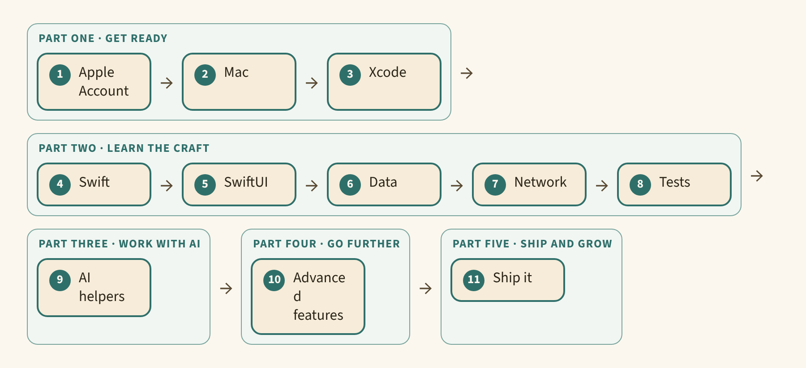{width=100%}

*Figure I.1 — The whole journey. Notice that the AI helpers arrive after you can already read and test code, not before.*

That ordering in the figure is on purpose. You'll use AI from the very first chapter, mostly to explain things. But the big helpers, the ones that write and change code for you, get their own part only after you can tell good code from bad.

## The projects ladder

People learn to build by building. So this book is organized around a ladder of projects, ten rungs numbered 0 to 9. Each rung is a small app, or a new piece of a bigger one, and each teaches a handful of new ideas.

The first three rungs are little practice apps you'll make and then set aside: a "Hello, you" app, a tip-and-split calculator and a quiz game. From rung 3 onward, you'll build one real app and keep growing it all the way to the App Store. I call it **Daybook**, a habit-and-weather journal. You pick a few daily habits, like a walk, a glass of water or ten pages of a book. Each day you log an entry with a note and a check mark, and Daybook saves that day's weather beside it. Later it gets a widget, a Siri shortcut and an on-device AI that can summarize your week.

Daybook is a working name. By the time you ship, I'll want you to rename it and give it a twist that's truly yours, for reasons Chapter 16 explains (the short version is that the App Store doesn't want a hundred identical journal apps, and neither do you).

Here's the ladder at a glance.

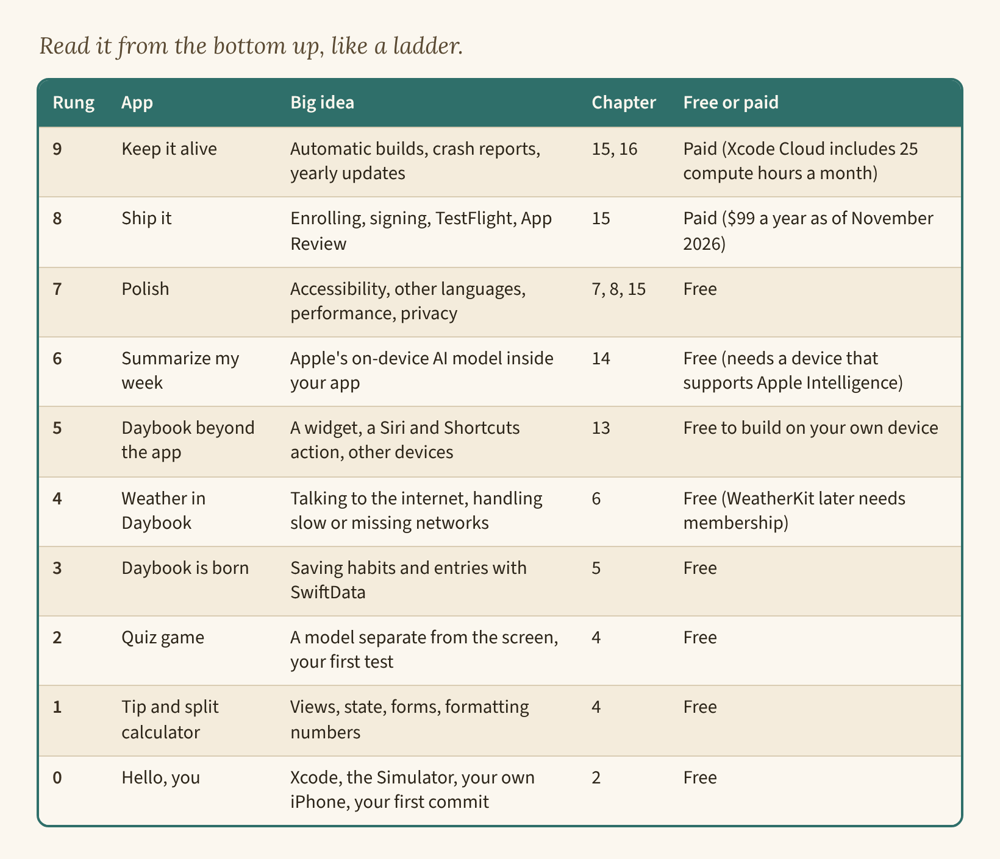{width=100%}

*Figure I.2 — The ladder at a glance. Look at the last column: everything up to rung 7 costs nothing.*

That last column is the second big correction this book makes to the popular story. You'll hear that iOS development costs $99 before you start. It doesn't. You can climb most of this ladder for free, on your own Mac and your own iPhone.^6 The money comes in at rung 8, when you're ready to put your app in other people's hands.

The ladder isn't Apple's, and it isn't any one teacher's. It's my own sequence, but each rung echoes projects from courses I trust: Apple's Develop in Swift tutorials, Paul Hudson's 100 Days of SwiftUI and Stanford's CS193p.^7 If you want a second explanation of any rung, those courses are where to look, and Chapter 16 pairs them up rung by rung.

## The boxes

Scattered through the chapters you'll find four kinds of short boxes. They look like this, and each has one job.

> **Try this.** A hands-on step. When you see one, stop reading and do it. Reading about code is like reading about swimming.

> **Ask your AI.** An example prompt, written for this book, that you can give to Xcode's coding assistant or another helper. It always comes with a "Verify by" line, telling you how to check the answer, because the answer might be wrong.

> **Done when.** The checklist at the end of each rung. If you can tick every box, move on. If you can't, that's useful information, not failure.

> **Versions move.** A short warning about what in that chapter is most likely to look different by the time you read it, and where to check.

There are also a few sidebars, marked as such, for side roads some readers will want and others can skip: a note on Android and cross-platform tools, a careful look at building iPhone apps from Linux, and a short introduction to UIKit, Apple's older way of building screens.

## The first "Versions move" box

Here's the first one, because it applies to the whole book.

> **Versions move.** I checked everything here on 20 November 2026 against Xcode 27.2, iOS 27 and Swift 6.4, on macOS Tahoe 26.6 or later. Apple updates its tools several times a year, so a menu name, a default or a screen can shift under you. If something doesn't match, check Apple's Releases page and the Xcode "SDKs and system requirements" page first, then trust what your Xcode shows you. For the record: the current release as I write is Xcode 27.2 (build 27B52, released October 29, 2026), and Xcode 27.3 beta 2 appeared on November 16, 2026.

Those two pages are your friends. The Releases page lists every version of Xcode and Apple's operating systems as it ships, with dates.^8 The "SDKs and system requirements" page tells you which version of macOS each Xcode needs and which versions of iOS it can build for.^9 Bookmark both. When something in this book doesn't match your screen, those pages will usually tell you why in under a minute.

A quick word on the numbers, because they confuse everybody. In 2025 Apple switched to year-style version numbers, jumping from iOS 18 to iOS 26 and from Xcode 16 to Xcode 26. In 2026 everything moved to 27. You didn't miss eight versions while you weren't looking. Chapter 1 has a little map.

## When you get stuck

You will. Here's the order I'd try things in.

First, reread the step. Most stuck moments are a skipped click or a typo, and the error message usually points at the line.

Second, check the glossary in Appendix D for any word that's gone fuzzy, and the checklists in Appendix A if the trouble is with setup.

Third, ask an AI helper, using the "Ask your AI" pattern from the boxes: describe what you did, paste the exact error, and ask for an explanation before a fix. Then verify the answer, because helpers can be confidently wrong.

Fourth, ask people. Apple runs the Apple Developer Forums, where Apple engineers and other developers answer questions, and the Swift project runs the Swift Forums for questions about the language itself.^10 Search first, because someone has very likely asked your question before. If you post, include what you tried, what you expected and what actually happened. Specific questions get answered.

And fifth, step away. I'm only half joking. A surprising number of problems solve themselves after a walk.

## How the notes work

Every fact in this book that you might want to check has a small number after it, like this.^11 The numbers lead to notes at the back of the book. Most notes point to a page on Apple's developer site or Swift.org, with the date I read it. A few point to courses, community writers or the documentation for AI tools, and I label those so you know what kind of source you're reading.

A typical note looks like this:

Apple Inc., "Enabling Developer Mode on a device," Apple Developer Documentation, 2026, https://developer.apple.com/documentation/xcode/enabling-developer-mode-on-a-device, accessed November 20, 2026.

Read it left to right: who wrote it, what it's called, where it lives, when it was published, the web address and the day I checked it. That "accessed" date matters more than usual in a book like this, because Apple's pages change. If you visit a link and it says something different, the page has probably been updated, and the page wins.

You don't have to read the notes. They're there so you never have to take my word for anything.

## What you'll need from yourself

Three things, and none of them cost money.

A little time, regularly. Short sessions most days beat one long weekend a month. I can't promise you how long the whole climb takes, because that depends on you, and anybody who gives you a number without knowing you is guessing.

A place to write things down. A notebook, a notes app, a text file. You'll want to record what worked, what broke and what fixed it. Later in the book I'll show you how AI helpers can keep a learning journal for you, but the habit starts with you.

A bit of stubbornness. You'll hit walls. Everyone does. The difference between people who learn this and people who don't is mostly whether they come back the next day.

First, though, let's look at what you'll need on the desk.


# Part One — Get Ready {.unnumbered .part}

# Chapter 1 — What You Need (and What You Don't)

{width=100%}


Before anybody builds anything, there's the question everyone asks quietly: what's this going to cost me? Money, gear, and the kind of nerve it takes to start something new. I'd rather answer that honestly on page one than have you find out on page two hundred.

The short answer is good news with one catch. The tools are free. The catch is the computer.

## Apple makes the tools, and they're free

Every iPhone app you've ever used was built in a program called Xcode. Xcode is Apple's workshop for making apps. It's where you write the code, design the screens, try the app out on a pretend iPhone on your screen, find the bugs and finally package the app up for the App Store. It runs on a Mac, and only on a Mac.

Xcode costs nothing. You download it from the Mac App Store or from Apple's developer website, the same as any other free app.

That's not where the free stuff ends, either. With nothing more than an Apple Account (the sign-in you already use for iCloud and the App Store), Apple gives you:

- Xcode itself, and the beta versions of the next Xcode when they appear
- all of Apple's developer documentation and sample code
- beta versions of iOS and Apple's other operating systems
- the Apple Developer Forums, where you can ask questions
- Feedback Assistant, for reporting bugs to Apple
- and, most usefully, the ability to install apps you've built onto *your own* iPhone^12

That last one surprises people. You don't need a paid membership to put your app on your phone and carry it around. Apple gives every Apple Account a free **Personal Team**. Think of a team as the name Apple signs your apps under. Xcode uses your Personal Team to sign the app so your phone will trust it and run it. It comes with limits, which we'll get to in a moment, but for learning they're generous.

So you can build real apps, run them on a real phone and learn this whole craft for a while without spending a cent on Apple's side.

Free doesn't mean any computer, though.

## The one real gate: an Apple silicon Mac

Here's the catch. To use the current Xcode, you need a Mac with Apple silicon.

"Apple silicon" is the name for the chips Apple designs itself, the ones with names like M1, M2, M3 and onward. Apple started putting them in Macs in late 2020. Before that, Macs used Intel chips. If you're not sure which you have, open the Apple menu in the top-left corner of your screen and choose About This Mac. If the line labeled "Chip" names an Apple M-series chip, you have Apple silicon. If it says "Processor" and names an Intel chip, you have an Intel Mac.^13

Why it matters: Xcode 27 is Apple silicon only. Apple put it plainly in the release notes: "Xcode 27 will only install and run on Apple silicon Macs."^14 Xcode 27 also needs macOS Tahoe 26.6 or later.^15 macOS is the operating system on your Mac, and Tahoe is the name of the version that arrived in 2025.

If you have an Intel Mac, you're not completely shut out, but you're on borrowed time. The newest Xcode an Intel Mac can run is Xcode 26.6, which needs macOS Tahoe 26.2 or later and comes with Swift 6.3, one version behind the one this book uses.^16 Here's the part that matters for shipping: as I write this in November 2026, the App Store accepts apps built with Xcode 26 or later. That rule took effect on April 28, 2026.^17 So an Intel Mac running Xcode 26.6 can still build an app the App Store will take today.

What Apple hasn't announced is when it will start requiring Xcode 27. I'm not going to guess. Apple's pattern has been to announce new requirements on its Upcoming Requirements page well ahead of time, so that's the page to watch.^18 But if you're buying a Mac to learn on, buy Apple silicon. An Intel Mac will work for a while, and then one spring it won't.

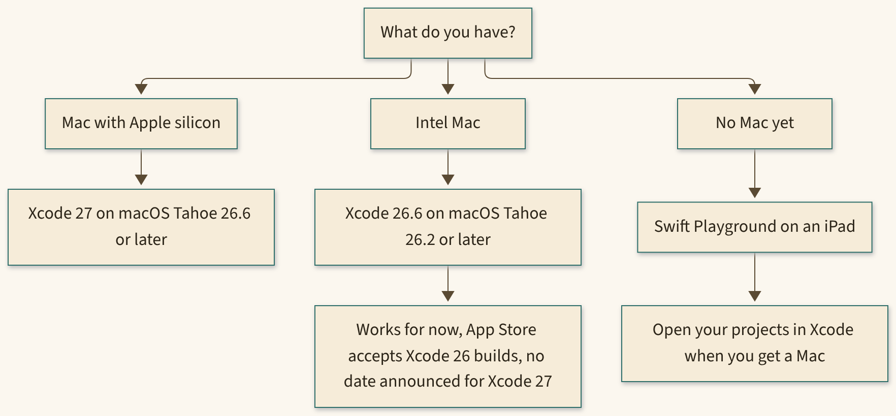{width=100%}

*Figure 1.1 — Which Mac can I use? Follow your own branch; the Intel branch works today but has no guaranteed future.*

### How much Mac do you need?

This is the question I get asked most, and I want to be careful with it. Apple doesn't publish a minimum amount of memory (RAM) or storage for Xcode 27. I looked. So anything I say here is advice, not Apple's rule.

My advice is this. More memory makes Xcode, the Simulator and an AI helper running side by side feel smoother, and storage fills up faster than you'd think, because Xcode downloads simulators for each version of iOS you test against. If you're choosing between two Macs, more memory and more storage will be the upgrade you notice. If you already own an Apple silicon Mac, start with it. Apple did make room for you: Xcode 27 is about 30 percent smaller than before, and it downloads extras like AI agents and documentation in the background, so they stay up to date.^19

## No Mac yet? Start on an iPad

If you don't have a Mac at all, you can still start today on an iPad.

Apple makes a free app called **Swift Playground**. (It used to be "Swift Playgrounds," plural. Apple has since dropped the "s," so if a friend calls it by the old name, they mean the same thing.) It runs on iPad and on Mac, and it was made for exactly this: learning to code from nothing.^20

Swift Playground has two sides. One is a set of interactive lessons that teach the basic ideas of programming: commands, loops, functions, variables and types. They're friendly, they're visual, and nobody is grading you. The other side is real app building. You can make SwiftUI apps right on the iPad, the same kind of app this book teaches, and run them there.

It gets better. When you do get a Mac later, your Swift Playground projects open in Xcode, so nothing you build is wasted. And Swift Playground can even send an app to App Store Connect, Apple's website for managing apps in the App Store. Apple's guide says that to do that you need an Apple Developer account (for App Store Connect, that means the paid program), and your app needs a custom icon.^21

I'll be honest about the limits. This book is written for Xcode on a Mac, and from Chapter 2 on, the screens and steps assume you're there. Some of the later things we'll do, like running a full test suite or profiling your app's speed, live in Xcode. But the first steps of Swift, the ideas in Chapter 3, work beautifully in Swift Playground, and plenty of people have started exactly that way.

> **Try this.** If you have an iPad and no Mac, install Swift Playground from the App Store and open the first lesson. Don't worry about finishing it. Just get a feel for typing a command and watching something happen.

## What $99 a year buys, and when you'll need it

Now, the famous fee. You've probably heard that it costs $99 a year to be an iPhone developer. That's true, but it's the price of *sharing* apps, not making them.

First, what the free Personal Team gives you, because the limits shape when you'll want to pay. With a Personal Team, Apple's overview lists these limits:

- up to 10 App IDs, and each one expires after 7 days (an App ID is the name tag Apple gives each of your apps)
- up to 3 devices, and those registrations expire after 7 days too
- up to 3 of your apps installed on any one device at a time
- the provisioning profile, which is the permission slip that lets your app run on your phone, expires 7 days after it's issued^22

That seven-day clock is the one you'll feel. A week after you install your app from Xcode, it stops opening on your phone. That's not a bug. You just plug in, run it from Xcode again, and you get another week. For learning, it's a small chore. For an app you depend on every day, it gets old, and that's one honest sign you're ready to pay.

The paid option is the **Apple Developer Program**, and as of November 2026 it costs 99 USD per membership year. Apple notes that local prices vary by country.^23 There's also an Enterprise Program at 299 USD a year. It's a separate program for organizations, and nothing in this book needs it.^24 Apple also offers fee waivers to nonprofit organizations, accredited educational institutions and government entities, so if you're teaching a class or running a nonprofit, look into that before you pay.^25

What does the $99 actually unlock? The big things:

- **App Store Connect**, Apple's website where you set up your app's App Store page, prices and releases
- **TestFlight**, Apple's way of handing a test version of your app to friends and testers before it's public
- **Xcode Cloud**, which builds and tests your app automatically on Apple's computers
- capabilities that need Apple's servers or special permission, such as iCloud, Apple Pay and Siri
- **WeatherKit**, Apple's weather service, which comes with 500,000 calls a month included^26

You'll notice that TestFlight is on the paid list. People sometimes assume the free Personal Team lets you send a test build to a friend. It doesn't. With the free tier, your app runs on devices you register yourself, through Xcode.

So here's my advice, and it's the same advice I'd give a friend: **enroll when you're ready to share, not before.** Climb the ladder on the free tier. When you reach the point where you want someone else to try your app, or you're tired of the seven-day rebuild, that's the time. For most of this book, that's Chapter 15.

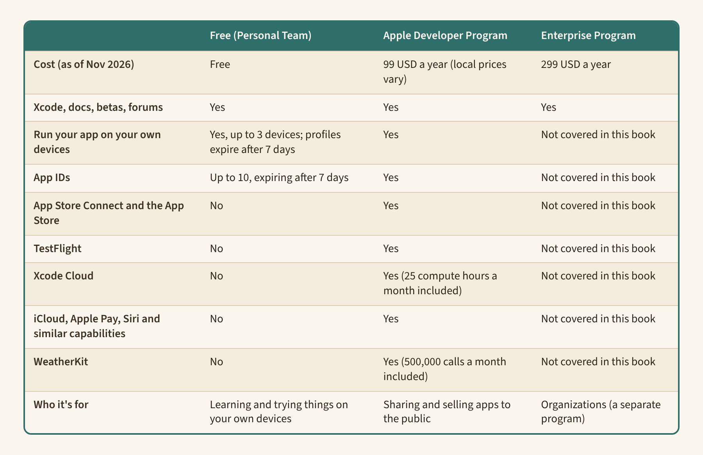{width=100%}

*Figure 1.2 — Free vs. Developer Program vs. Enterprise. Look down the free column: everything you need to learn is there.*

## Making sense of the version numbers

Here's something that trips up nearly everyone who comes to Apple development fresh: the version numbers.

For years they climbed one at a time. Then, in 2025, Apple switched to year-style numbers across the board. iOS, Xcode and Apple's other operating systems all jumped to 26. In 2026 they moved to 27. So if you remember an older iOS and wonder how it got to 27 so fast, you didn't miss eight versions. The numbering changed.^27

Here's what's current as I write this in November 2026:

- **Xcode 27.2** is the current release, build 27B52, released October 29, 2026. Xcode 27 itself shipped September 14, 2026, and 27.1 followed on October 15.^28
- **iOS 27** is the current iPhone operating system.
- **Swift 6.4** is the current version of the Swift language. It was released September 15, 2026, and Xcode 27 includes it.^29
- **macOS Tahoe 26.6 or later** is what your Mac needs to run Xcode 27.

macOS has moved to 27 as well, but Xcode 27 doesn't insist on it: macOS Tahoe 26.6 is enough. That's why you'll see 26.6 in my notes even though everything else says 27. Don't let it bother you.^30

There's also usually a beta, a test version of the next update, floating around. As I write, that's Xcode 27.3 beta 2, from November 16, 2026. I'd stay on the regular release while you learn. Betas are for people who need tomorrow's features today and don't mind a few surprises.

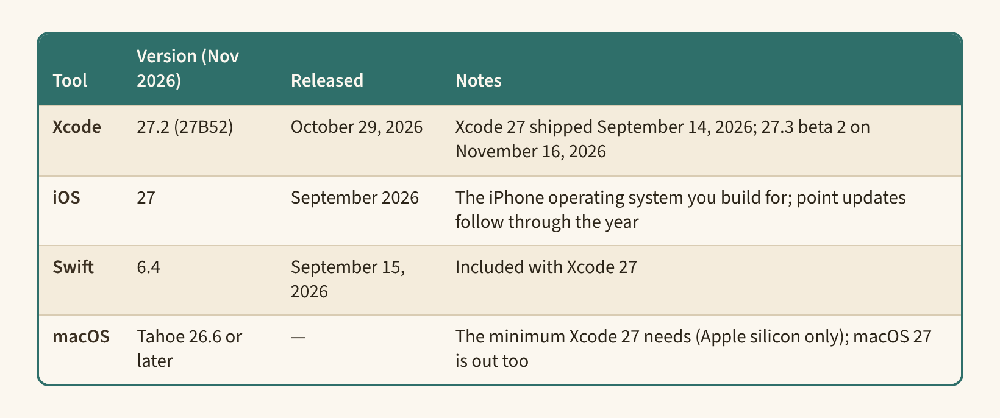{width=100%}

*Figure 1.3 — The version map, November 2026. Look at the macOS row: it shows the minimum Xcode 27 needs, not the newest macOS, and that's fine.*

> **Versions move.** I checked everything here on 20 November 2026 against Xcode 27.2, iOS 27 and Swift 6.4, on macOS Tahoe 26.6 or later. Apple updates its tools several times a year, so a menu name, a default or a screen can shift under you. If something doesn't match, check Apple's Releases page and the Xcode "SDKs and system requirements" page first, then trust what your Xcode shows you. In this chapter, the parts most likely to move are the prices, the Personal Team limits and which Xcode the App Store requires, so check Apple's membership page and Upcoming Requirements page before you buy anything.

To check the Releases page yourself, open developer.apple.com/news/releases in any web browser. You'll see a plain list, newest at the top: each version of Xcode, iOS, macOS and the rest, with the date it shipped. If the top Xcode entry says something newer than 27.2, a newer version is out, and the Mac App Store will offer it to you.

### Sidebar: Android, cross-platform tools, and why this book stays native

Sooner or later someone will ask you, "Why not build for iPhone and Android at the same time?" It's a fair question, so let's answer it once.

There are frameworks designed to do exactly that, letting you write one app that runs on both. You'll hear names like Flutter, React Native and Kotlin Multiplatform. People build real, successful apps with them. I'm not going to compare them or tell you which is faster or more popular, because I don't have sources I trust for that and it isn't what this book is about.

This book is about building native Apple apps: Swift, SwiftUI and Xcode, the tools Apple makes for its own platforms. That's the path where Apple's documentation, Apple's free courses and Xcode's built-in AI agents all line up behind you. When Apple adds a new feature, like a new kind of widget or a new on-device AI model, it shows up here first.

One interesting footnote. Swift itself isn't stuck on Apple devices. The Swift 6.4 release notes describe continued work on a Swift SDK for Android, built with a newer Android toolkit, so Swift code can run there too.^31 That's worth knowing, and it's a good sign for the language. It's a different book, though, so we'll leave it there.

### Sidebar: The Linux route, handled with care

Some of you reading this came here from *Run With It*, my book about Omarchy, and you're wondering whether you can build iPhone apps from your Linux machine. The honest answer is "sort of, as an experiment, and not as your main road."

There's a community project called **xtool**. It's open source under the MIT license, and it describes itself as a "Cross-platform Xcode replacement."^32 What it can do, according to its own README, is build a Swift package into an iOS app, sign it and install it onto your iPhone. That's genuinely impressive work.

Here's the fine print, and it matters.

First, xtool still needs Apple's tools underneath. Its Linux installation guide asks you to install a Swift 6.4 toolchain for your Linux distribution *and* to download `Xcode.xip`, the Xcode installer file, from Apple's website while signed in with your Apple Account. The guide notes you'll be asked to accept Apple's license agreement to download it.^33 That means you're using Apple's software development kit away from a Mac, and whether that fits Apple's license terms is something you need to read and decide for yourself. I'm not a lawyer, this isn't legal advice, and I'm not going to characterize the terms for you. Read the agreement Apple shows you before you click "agree."

Second, you give up a lot of what makes Xcode pleasant. You won't have Xcode's canvas or its Interface Builder, and you should plan on testing on a real iPhone rather than a simulator. Check xtool's own documentation for exactly which pieces it supports today, because the project is moving quickly.

Third, it's in flux. As I write, the project's README announces that xtool 2.0 is in beta.^34 Betas change.

So treat xtool as a fascinating experiment for advanced readers, not as a shipping pipeline, and not as something Apple supports. If you're on Linux and serious about shipping an iPhone app, the realistic path is still an Apple silicon Mac for the build and the App Store submission. Everything in the rest of this book assumes you have one.

## What about the iPhone?

You don't strictly need one to start. Xcode comes with the **Simulator**, a pretend iPhone that runs in a window on your Mac. You click where you'd tap, and your app behaves (mostly) as it would on a phone. For the first several rungs of the ladder, the Simulator is all you need.

Sooner or later, though, you'll want a real one. A simulator doesn't match a real device's speed, and it can't do everything a phone can. Apple's own documentation says to test on real devices before you ship.^35 There's also something about holding your own app in your hand that no simulator gives you.

If you do use an iPhone, it doesn't need to be the newest. Xcode 27 can debug apps on devices running iOS 17 or later.^36 Debugging means running your app from Xcode while Xcode watches it, so you can pause it and look inside when something goes wrong. If your phone is on iOS 27, you can even pair it with your Mac over Wi-Fi. Otherwise, a cable works fine.^37 Chapter 2 walks through it.

A few later features have their own requirements. The on-device AI model we'll use in Chapter 14 only works on devices that support Apple Intelligence, and I'll point you to Apple's list when we get there rather than copy it here, because it changes.

## What you don't need

Let me clear a few worries off the table while we're here, because people bring them to me all the time.

**You don't need to be "a math person."** Building apps is mostly about organizing ideas: this screen shows that list, this button saves this thing. If you can follow a recipe and notice when you skipped a step, you have the core skill. When a little arithmetic shows up, like splitting a restaurant bill in Chapter 4, it's the kind you already do on a napkin.

**You don't need to know Terminal.** Terminal is the Mac app where you type commands instead of clicking. A few optional extras in this book use it, and I'll give you every command word for word when they do. But you can build and ship an app without ever opening it.

**You don't need a paid AI subscription to start.** Xcode's coding assistant can use ChatGPT without an account at all, and you can sign in to a ChatGPT or Claude account later if you want more.^38 There are limits on the free use, and each company sets its own terms, so read them. But nothing in the early chapters requires you to pay for AI. Later, when we bring in agents and the wider crew of helpers in Part Three, some of them have paid plans, and I'll say so plainly when we get there.

**You don't need to pay Apple yet.** We covered that. Enroll when you're ready to share.

**You don't need a computer science degree, or a bootcamp, or permission.** Apple's own beginner course says students don't need prior coding experience.^39 The people who built the app you used this morning started where you are, staring at a blank editor and wondering if they'd broken it.

## Four early mistakes I'd like to save you from

None of these are disasters. They're just the stumbles I see most often in the first week, and each one is easy to avoid once you know it's there.

> **Common mistake: buying the wrong Mac.** A used Intel Mac can look like a bargain. It will run Xcode 26.6 today, but it can't run Xcode 27, and Apple hasn't said how long the App Store will keep accepting apps built with Xcode 26.^40 If you're buying, check the listing for an Apple M-series chip. If you're unsure about a Mac you already own, About This Mac will tell you: "Chip" means Apple silicon, "Processor" means Intel.^41

> **Common mistake: paying $99 on day one.** It's tempting to enroll right away so it feels official. But nothing in the first seven rungs of this book needs it, and the membership is a yearly fee, so the clock starts when you pay. Enroll when you have something to share.^42

> **Common mistake: expecting TestFlight on the free tier.** If your plan is "build it and send it to my sister to try," know that TestFlight needs the paid program. On the free tier, your app runs on devices you've registered yourself, through Xcode, up to three of them.^43

> **Common mistake: installing the beta because it's newer.** The Releases page usually lists a beta of the next Xcode alongside the current release. Betas are for testing what's coming, and they can have rough edges. While you're learning, stick with the release version, the one the Mac App Store gives you, so that when something breaks you know it's your code and not the tools.^44

What you'll notice in all four is the same theme: start small and free, and spend money only when you've hit the point where it buys you something specific.

## Putting the money together

Let me add it all up in one place, because the whole picture is friendlier than any single piece of it.

**To learn, and to run your own apps on your own iPhone:** an Apple silicon Mac you probably already have or were going to buy anyway, and nothing else. Xcode, Swift, SwiftUI, Swift Playground, Apple's documentation, Apple's Develop in Swift tutorials and the Personal Team are all free. That covers rungs 0 through 7 of this book's project ladder, which is most of it.^45

**To share your app with testers or the public:** the Apple Developer Program, 99 USD a year as of November 2026, or a fee waiver if you qualify.^46 That brings TestFlight, App Store Connect, Xcode Cloud's included hours and WeatherKit's included calls.

**Optional extras along the way:** some AI helpers have paid plans, and some courses do too. I'll flag each one when we meet it, and there's always a free path through this book.

**What I can't price for you:** your time. Nobody can tell you how many evenings this takes, because it depends on you, on what you already know, and on how often you come back to it. I'd rather you hear that from me than a made-up number from someone selling a bootcamp.

## Your starter kit

That's the whole shopping list. It's shorter than you feared, I hope.

> **Done when — Your starter kit.**
>
> - [ ] You have an Apple Account you can sign in with.
> - [ ] You have a Mac with Apple silicon running macOS Tahoe 26.6 or later (or you've decided to start on an iPad with Swift Playground for now).
> - [ ] You have an iPhone you can plug into your Mac, if you want to run apps on a real device. It's optional at first; the Simulator on your Mac works fine for the early rungs.
> - [ ] You've set aside an afternoon for the next chapter.
> - [ ] You've packed some patience. Downloads take a while, and the first error message is a rite of passage.

You don't need to pay Apple anything yet. You don't need a new computer if your Mac has Apple silicon. And you don't need to know how to code, because that's what the rest of this book is for.

Let's set it all up.


# Chapter 2 — Your Apple Account, Your Mac, and Xcode

{width=100%}


This is the afternoon where it gets real. By the end of this chapter you'll have Xcode installed, you'll have made your first app, and you'll have watched it run on your own iPhone. That's rung 0 of the ladder, and it's the one that makes all the others feel possible.

Make a cup of something. Some of these downloads take a while, and you'll want something to do with your hands.

## Your Apple Account, and the lock on the door

Everything starts with an **Apple Account**. That's the name Apple now uses for the sign-in you use for iCloud, the App Store and everything else Apple. For years it was called an Apple ID. You'll still see the old name in older tutorials, forum posts, and probably in a few corners of Apple's own pages. Same thing, new name.

You almost certainly have one already. If you don't, you can make one for free on any Apple device or on Apple's website.

Before we go further, I want you to check one setting: **two-factor authentication**. That's the feature where, when you sign in on a new device, Apple sends a code to a device you already trust, and you type it in. It means a stolen password alone isn't enough to get into your account. Most Apple Accounts have had it turned on for years, but it's worth confirming, because Apple requires it if you ever join the Developer Program.^47 Better to sort it out today than on the day you're excited to ship.

While you're looking at your account, check one more thing: your name. When you eventually enroll as a developer, Apple asks for your legal first and last name, and it says aliases and nicknames can delay approval.^48 If you enroll as an individual, that legal name is what the App Store shows as the seller of your app.^49 So if your account says "Mikey G" or "The Wizard," now is a fine time to change it to the name on your ID. Future you will be grateful.

One more account question people ask: should you use your everyday Apple Account, or make a new one just for development? For learning, your everyday account is fine, and it's simplest. If you think you'll one day publish apps as a business, or share development with other people, you may prefer a separate account later, and Chapter 15 covers the choice between enrolling as an individual or as an organization. Either way, use an account that's yours alone. Sharing one with a partner or a child gets confusing quickly when security codes start arriving on someone else's phone.

That's it for the account. You don't need to pay anything, enroll in anything, or sign any agreements yet.

## Installing Xcode

Xcode is free, and there are two places to get it: the Mac App Store, or Apple's developer website at developer.apple.com.^50 For most people the Mac App Store is simplest. Search for Xcode, click Get, and let it go. It's a large download, so this is a good moment to refill that cup.

Here's some good news that's new this year. Xcode used to arrive as one enormous lump with everything included. Xcode 27 is about 30 percent smaller to download, because many of its pieces, including the AI agents and the documentation, now download separately in the background, so they stay up to date.^51

When you open Xcode for the first time, it asks which platforms you want to build for. A platform here means a kind of Apple device: iOS for iPhone, plus iPadOS, macOS, watchOS, tvOS and visionOS. For this book, iOS is the one that matters. Pick it, and add others only if you're curious. Each one you add takes up storage, and you can always add more later.

Behind the scenes, picking iOS downloads something called a **simulator runtime**. That's the software that lets your Mac pretend to be an iPhone running a particular version of iOS. It's what the Simulator runs on.

You can manage all of these pieces any time from one place. In Xcode, choose **Xcode > Settings**, then click **Components** in the sidebar. You'll see what's installed, how much space each piece takes up, and a Get button next to anything you can add.^52 If storage gets tight later, this is also where you remove the simulators you no longer need.

There's one more way to download the iOS platform, and I mention it only because you'll see it in other guides. Apple documents a command you can type into Terminal:

```bash
xcodebuild -downloadPlatform iOS
```

It does the same job as the Get button, just from the command line. You don't need it. If you've never opened Terminal, skip it with a clear conscience.^53

> **Try this.** Open **Xcode > Settings > Components** and look around. Find the iOS platform and see how much space it uses. Don't change anything yet. Just get used to where things live.

## A friendly tour of the Xcode window

The first time you open a project, the Xcode window can look like the cockpit of a small plane. Lots of panels, lots of buttons. Don't panic. You'll use about five of them for the first month, and they each have one job.

Here they are, from left to right.

The **navigator** sits on the left. It's your table of contents. The main view, the Project navigator, lists every file in your project. Click a file and it opens in the middle.^54 There are other navigators in the same spot, behind small icons along the top, for searching, for errors and warnings, and for your project's history. We'll meet them as we need them.

The **editor** fills the middle. This is where you read and write code. Most of your time goes here.

The **canvas** sits beside the editor when you're working on a screen. It shows a live preview of what your code draws, and it updates as you type. This is one of the nicest things about building apps with SwiftUI. You change a word in your code, and a second later you see the change in the preview without running anything. Chapter 4 makes a lot of use of it.

The **inspector** is on the right. It shows details about whatever you've selected, such as a file's settings. You can hide it with a button in the top-right corner of the window when you want more room for the editor.^55

The **coding assistant** is Xcode's built-in AI helper. In Xcode 27, Apple moved it into the editor area, so your conversation with it sits right beside your code instead of off in its own corner.^56 We'll set it up properly in Chapter 9. For now, just know where it lives.

Across the top is the **toolbar**. The two controls you'll touch most are the Run button, which looks like a play triangle, and the **run destination** menu beside it. The run destination is where your app will run when you press Run: a particular simulated iPhone, your real iPhone, or another device.^57

And when your app is running, a **debug area** can open along the bottom, showing messages from your app and controls for pausing it. Chapter 8 is all about that.

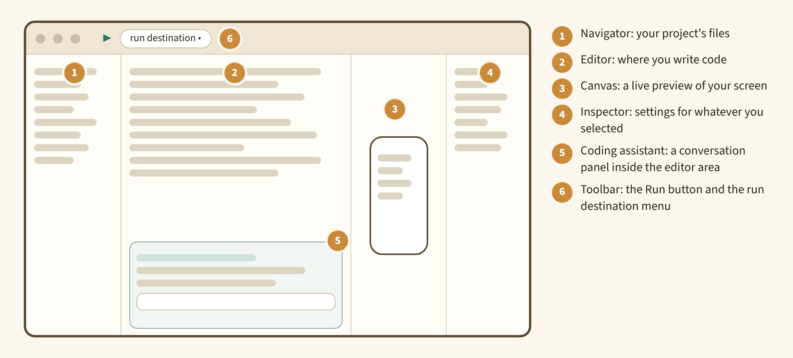{width=100%}

*Figure 2.1 — The Xcode window, labeled. Find the run destination menu at the top; it decides where your app runs.*

If the window ever gets cluttered and you lose a panel, don't worry. Hiding a panel never deletes anything, and the same buttons that hid it will bring it back.

## Your first project: "Hello, you"

Time to make something. Here's the whole of rung 0, step by step.

When Xcode starts, it shows a Welcome window. From there, choose **Choose Template** from the **New Project** pop-up menu, or at any time choose **File > New > Project** and click **Choose Template**.^58 (If you pick plain **App** instead, Xcode makes an untitled project straight away, with none of the questions below. That's fine for a quick experiment, but for this one we want the questions.) Xcode offers you templates, which are ready-made starting points for different kinds of apps. Choose **iOS** at the top, then the **App** template under Application, and click Next.

Now Xcode asks for a few details. Here's what each one means, in plain words:

- **Product Name** is your app's name. Type `HelloYou`. (No space is easiest for now.) It's the name that appears under the icon on your phone, and you can change it later.
- **Team** is the account Xcode uses to sign your app, which is how your iPhone knows to trust it. If you've signed in already, pick your Personal Team. If not, you can leave it for now and set it up later in this chapter.
- **Organization Identifier** is a reversed web-address-style name that makes your app's ID unique, something like `com.yourname`. You don't need to own a website. Xcode glues this to the product name to make your app's **bundle ID**, a unique name tag such as `com.yourname.HelloYou`, that identifies your app everywhere on Apple's systems.^59
- **Interface** should be **SwiftUI**, and **Language** should be **Swift**. Those are what this book teaches.

Click Next. On the last sheet, Xcode asks where to save the project. Before you click Create, look for a checkbox labeled **Create Git repository on my Mac**, and make sure it's ticked. We'll talk about Git properly in a few pages, but ticking it now means Xcode will save a first snapshot of your project for you, automatically.^60

Click Create, and there it is. Your project.

### What's in the box

Before you touch anything, have a look at the navigator on the left. A brand-new project is small, and it's worth knowing what each piece is for, because every app in this book starts this way.

- **HelloYouApp.swift** is your app's front door. It holds a short structure marked with `@main`, which tells the system "start here." An app can have exactly one of these.^61
- **ContentView.swift** holds the first screen your app shows. It's where you'll spend today.
- **Assets** (the file is really called `Assets.xcassets`) is an **asset catalog**, a tidy drawer for images, colors and your app's icon. A new project's catalog comes with two empty slots already in it: one for the app icon and one for an accent color.^62

If you open `HelloYouApp.swift`, you'll see something very close to this:

*HelloYouApp.swift*

```swift
import SwiftUI

@main
struct HelloYouApp: App {
    var body: some Scene {
        WindowGroup {
            ContentView()
        }
    }
}
```

What you'll see and what it means: `@main` marks the starting point. `HelloYouApp` is the name Xcode made from your product name. The `body` describes the app's **scenes**, and each scene holds the view at the top of a screen's worth of content. Here there's one, and it shows `ContentView`.^63 That's the whole chain: the app opens, the scene appears, and the scene shows your content view. You'll rarely need to change this file in the early rungs. When we start Daybook in Chapter 5, it's where we'll tell the app to set up its storage.

If you ticked a box for tests when you made the project, you'll also see one or two folders with "Tests" in their names. Leave them alone for now. They'll come in handy in Chapter 4.

Now let's look at the screen itself.

In the navigator on the left, click the file called `ContentView.swift`. You'll see something like this in the editor (the exact starter code can vary a little between Xcode versions):

*ContentView.swift*

```swift
import SwiftUI

struct ContentView: View {
    var body: some View {
        VStack {
            Image(systemName: "globe")
                .imageScale(.large)
                .foregroundStyle(.tint)
            Text("Hello, world!")
        }
        .padding()
    }
}

#Preview {
    ContentView()
}
```

You don't need to understand all of this yet. Chapters 3 and 4 will take it apart line by line. For now, here's the gist. This code describes one screen. On it there's a vertical stack (`VStack`) holding two things: a little picture of a globe and a line of text that says "Hello, world!" The bit at the bottom, `#Preview`, tells Xcode to show this screen in the canvas next to your code.

Now, make it yours. Change the text inside the quotation marks:

```swift
Text("Hello, you!")
```

And while you're at it, change the picture. The name `"globe"` refers to one of Apple's **SF Symbols**, a big free library of icons designed to sit nicely beside text.^64 Try a waving hand:

```swift
Image(systemName: "hand.wave")
```

Watch the canvas as you type. The preview should update almost immediately.

Now let's run it for real. In the run destination menu at the top of the window, pick any iPhone simulator. Then press the Run button (or choose **Product > Run**).^65 Xcode **builds** your app, which means it translates your Swift code into the instructions an iPhone actually runs. Then it launches the Simulator and opens your app inside it.

The first build is the slowest. After that, it gets quicker.

When it appears, take a second. That's your app, running.

> **Try this.** Change the text to greet someone by name, run it again, and send them a photo of the screen. It's a silly thing to do and you should do it anyway.

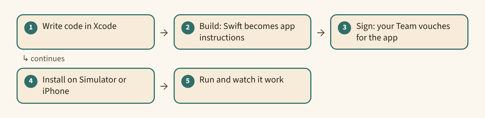{width=100%}

*Figure 2.2 — From code to phone. Notice the signing step: the Simulator doesn't care much about it, but a real iPhone does.*

That middle step in the figure, signing, is why the next few pages exist. The Simulator will run almost anything you build. A real iPhone is pickier, and for good reason: it only runs apps it has a reason to trust.

### What just happened when you pressed Run

It's worth slowing down once to see what Xcode did, because you'll press Run thousands of times.

First, Xcode looked at the **scheme**, the small menu just left of the run destination. A scheme is a bundle of settings that tells Xcode which part of your project to build and how to run it. For now you'll only ever have one, named after your app, and you can ignore it.^66

Then it built the app for the destination you chose. While it works, the activity area in the middle of the toolbar shows what it's doing and whether anything went wrong.

When the build succeeded, Xcode launched the app and started a **debugging session**, with the debug area along the bottom of the window. That's Xcode keeping one eye on your running app, ready to pause it or show you what it's printing. You'll learn to use it in Chapter 8. And because you picked a simulator, Device Hub opened a small window showing a device screen, with your app on it, which you can click like a touchscreen.^67

When you're done, click the Stop button in the toolbar to end the session.^68

## Your first error, on purpose

Before we go any further, I want you to break your app. Deliberately. It's the fastest way to stop being afraid of error messages.

In `ContentView.swift`, find the line with your text and delete the closing quotation mark, so it reads `Text("Hello, you!)`. Don't fix it. Press Run.

Xcode refuses to build. A red mark appears next to the line, and the toolbar's activity area shows that something failed. Click that indicator and Xcode opens the **Issue navigator**, a list of every error and warning, each one linked to the line it's about.^69

The message itself might say something about an unterminated string, or something that sounds stranger. That's normal. Compiler messages are written by precise people for precise readers, and they often describe where the compiler got confused rather than what you meant to do. The skill you're learning isn't memorizing messages. It's this: go to the line it points at, look just before and just after, and ask "what did I change?" Here, the answer is obvious. Put the quotation mark back and run again. All better.

Here's a small setting worth knowing. By default, Xcode may stop building at the first error it hits. If you'd rather see every error at once, there's an option called "Stop build on first error" under Issues in Xcode's General settings that you can turn off.^70

> **Common mistake: the error you can't see.** Three slips cause a large share of beginner build failures, and all three are hard to spot by eye.
>
> - **Capital letters.** Types in Swift have capitalized names, like `Text`, `String` and `Int`.^71 The view is called `Text` with a capital T, so `text("Hello")` with a small one fails, because Swift can't find anything by that name, even though it looks almost right.
> - **Curly quotes.** Swift strings sit between plain, straight double quotation marks (`"`). If you paste code from a word processor or a web page that "prettified" the quotes into curly ones, the compiler won't recognize them.^72
> - **A missing brace.** Every opening `{` needs a closing `}`. When one goes missing, the error often shows up far below the real mistake, sometimes at the very end of the file. If an error makes no sense where it points, look upward for an unclosed brace.
>
> When you're stuck on something that "looks right," retype the line by hand. It works surprisingly often.

I promise you'll see hundreds of these. Every developer does, every day. The red marks aren't a grade. They're the compiler catching a mistake on your Mac so that it never reaches somebody's phone.

## Simulators and Device Hub

Before we head to your real phone, let's look at the Simulator a bit more closely.

New in Xcode 27 is a tool called **Device Hub**. It brings all your devices together in one window: the simulated ones that live on your Mac and the real ones you've paired. You can add simulators for particular iPhone models and iOS versions, see the status of each device, and even resize a simulator to try your app at different sizes.^73

There are two ways to open it. Choose **Manage Devices…** from the run destination menu, or choose **Xcode > Open Developer Tool > Device Hub**. And when you run your app on a simulator, Device Hub opens a compact window showing your app on a device screen.^74

To add a simulator for a different iPhone, click the Add Device button (the plus sign) at the top of Device Hub's sidebar, choose a device under Simulators, pick the model and iOS version, and click Create.^75

Simulators are wonderful for everyday work. They start fast, they never run out of battery, and you can have several. But Apple is clear that they don't match a real device's performance or every feature. Some hardware features may not be available at all.^76 So the rule is: build and try on the Simulator all day long, and check on a real device before you trust it.

## Running on your own iPhone, for free

This is the part people assume costs money. It doesn't. Here's how to run "Hello, you" on your own phone using your free Personal Team.

**Step one: tell Xcode who you are.** Choose **Xcode > Settings**, click **Apple Accounts**, and sign in with your Apple Account.^77 Xcode creates your Personal Team the first time you do this.

**Step two: pick your team for this app.** In the navigator, click the very top item, the project icon named HelloYou. The project editor opens in the middle. Select your app's target (it has the same name), then click the **Signing & Capabilities** tab. Under Signing, choose your Personal Team from the Team menu. Leave **Automatically manage signing** turned on.^78

That checkbox is doing a lot of quiet work for you. With it on, Xcode registers your iPhone with Apple, creates the permission slip that lets your app run on it, and keeps everything up to date. There's a manual way to do all of this, and teams with complicated setups use it. You don't need it, and I'd leave the box ticked until you have a specific reason not to.

If Xcode complains that your bundle ID isn't unique, it means someone else already uses that exact name. Change your Organization Identifier to something more personal and try again.^79

**Step three: connect your iPhone.** Plug it into your Mac with a cable. Your iPhone will ask whether to **Trust This Computer**. Tap Trust, and enter your passcode if it asks.^80 (If your iPhone runs iOS 27, you can also pair it over Wi-Fi from Device Hub, using the plus button and **Pair Nearby Device…**. The cable is the simplest first time.^81)

**Step four: turn on Developer Mode.** For your safety, an iPhone won't run apps straight from Xcode until you switch on a setting called **Developer Mode**. It exists to protect people from accidentally installing software that hasn't come through the App Store or TestFlight.^82

On your iPhone, open **Settings > Privacy & Security** and scroll down to **Developer Mode**. Turn it on. Your phone will warn you that this reduces its security a little and ask to restart. Tap Restart. When it comes back, it asks once more to confirm: swipe up, tap **Enable**, and enter your passcode.^83

Here's a detail that confuses almost everyone: the Developer Mode switch doesn't appear in Settings until you've *started* pairing the phone with a Mac. So if you go looking for it before you plug in, you won't find it. Plug in first, trust the computer, and then look. Device Hub will also show a message telling you when Developer Mode needs turning on.^84

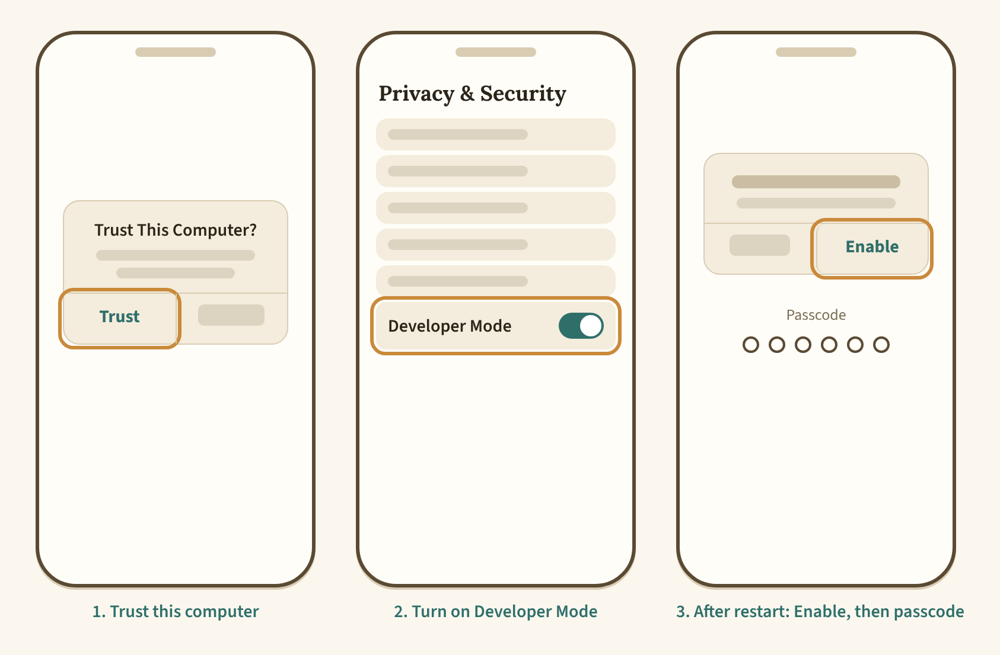{width=100%}

*Figure 2.3 — Developer Mode on iPhone, in three steps. The switch in the middle panel only appears after your phone has started pairing with your Mac.*

**Step five: run it.** Back in Xcode, open the run destination menu and choose your iPhone this time. Press Run. The first time, Xcode registers your device and creates a development **provisioning profile**, which is the permission slip I mentioned: a small file that says "this app, from this team, may run on this phone." If you see a Register button under Signing, click it.^85

Then watch your phone. "Hello, you!" appears on your own iPhone, with a waving hand.

Look at your Home Screen while you're there, and you'll find a new icon called HelloYou. It's probably plain, a blank or default-looking square. That's expected. Remember the asset catalog from earlier, with its empty slot for an app icon? Nobody has put anything in it yet.^86 Your app works perfectly well without an icon, and you won't need a real one until you share it. Chapter 15 comes back to icons when the time comes. For now, tap the plain square, and your app opens just like any other. You can close it, open it again, and show it to someone across the table. It'll stay on your phone, working, until the free profile's clock runs out, which is the next thing to know about.

That's rung 0. Take a moment with it.

### The seven-day clock

Remember the Personal Team's limits from Chapter 1? Here's where you'll meet one. The provisioning profile Xcode made for you expires seven days after it's issued.^87 After that, your app won't open on your phone. Nothing is broken. Plug in, press Run in Xcode again, and you've got another week.

It's a small chore, and a fair trade for free. The seven-day limits belong to the free Personal Team, so when you join the paid program later, this stops being a weekly ritual.

### When the phone won't cooperate

Getting a real iPhone to run your app is the step where most first afternoons stall. Here are the snags I'd check first, each one straight from Apple's documentation.

**You can't find Developer Mode in Settings.** It only appears after you've started pairing the phone with a Mac, or if it's been paired before. Plug in, tap Trust, then look again.^88

**You dismissed the Trust dialog by accident, or the phone doesn't appear after you tapped Trust.** Apple's advice is to restart the device and try again.^89

**It worked last month, and now it doesn't.** If you've updated your iPhone's operating system since you paired it, you'll need to pair it again.^90 And if it's been more than seven days since you last ran the app from Xcode, the free profile has expired. Run it again from Xcode.

**Xcode says your bundle ID isn't unique.** Someone, somewhere, already uses that exact ID. Change your Organization Identifier to something more personal, like `com.yourfirstnameyourlastname`, and try again.^91

**The run destination menu has no simulators, or shows a Get button.** The iOS platform support isn't installed yet. Click Get, or install it from **Xcode > Settings > Components**. You can open and edit a project while Xcode is downloading, but you can't build or run it until the download finishes.^92

**Xcode shows a Register button under Signing.** Click it. That adds your phone to your team's list of devices.^93

If none of those fit, read the message Xcode shows under Signing in the Signing & Capabilities tab. It's usually more specific than you'd expect, and it's the best clue you've got.

## Saving your work with Git

Now I want to give you a habit that will save you more grief than anything else in this book.

**Git** is a tool for keeping a history of your project. Every so often you take a snapshot of all your files, called a **commit**, with a short message describing what changed. Later you can look back through that history, compare any two snapshots, and, best of all, put your project back exactly the way it was at any earlier commit.^94

Think of it like a save point in a video game. You can explore, try something risky, make a mess, and if it all goes wrong, go back to the last save point and try again.

Xcode has Git built in, and if you ticked that **Create Git repository on my Mac** box earlier, you already have a **repository**, the folder of history that Git keeps for your project. Xcode even made your first commit for you when it created the project.^95

Before your first commit of your own, it's worth telling Xcode your name and email, so each commit records who made it. Choose **Xcode > Settings**, click **Source Control**, make sure source control is enabled, then click **Git settings** and fill in your author name and email.^96 If you'll ever push to a public host, you might use an email address you don't mind people seeing.

Now you've changed the text and the picture, so let's commit those changes. Choose **Integrate > Commit**. Xcode opens the Changes tab of the Source Control navigator, where you can see every change since the last commit. Click **Stage All** to include all of them, type a short message such as "Say hello to you instead of the world," and click Commit.^97

That's it. You've saved a point in history you can always return to.

A few other words you'll hear:

- A **branch** is a separate line of history, so you can try an idea without touching your main work. If the idea works, you **merge** it back in. If it doesn't, you abandon the branch, and your main work never knew.
- A **tag** is a label you stick on an important commit, like "version 1.0."
- A **remote** is a copy of your repository that lives somewhere else, usually on a Git hosting website. Pushing your commits to a remote gives you a backup and makes it easy to work from more than one Mac or with other people.^98

Xcode can do all of these, including resolving the conflicts that happen when two changes touch the same lines.^99 A remote host is optional. Plenty of people use one; plenty of learners keep everything on their Mac for months. Do what feels comfortable.

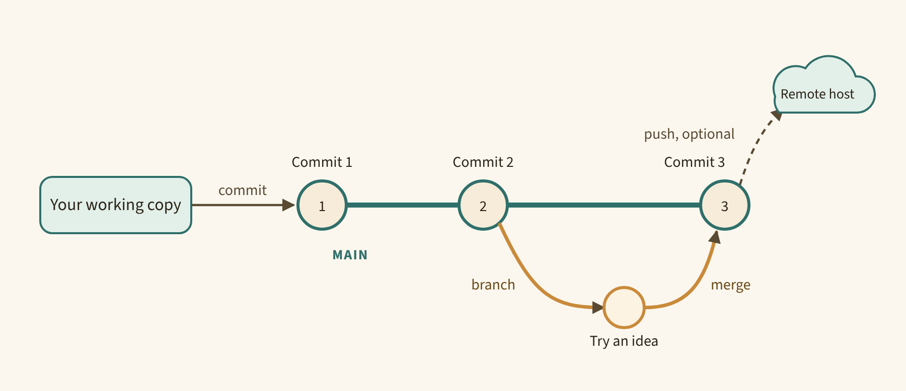{width=100%}

*Figure 2.4 — Git in one picture. Find the branch: it lets you try something without risking the main line.*

### Going back in time

Here's the part that makes Git worth the trouble. Suppose you change a dozen lines, or an AI helper does, and the app stops working, and you can't see why. You have a few ways back, and Xcode puts all of them within reach.

To throw away everything you've changed since your last commit, choose **Integrate > Discard All Changes**. Your files snap back to the last save point. If you'd rather set your changes aside without losing them, maybe to look at later, choose **Integrate > Stash All Changes** instead.^100

For smaller regrets, Xcode marks every changed line with a bar in the editor's left margin. Click that bar and you can discard just that one change.^101

And to go further back, open the Source Control navigator, find your branch, and you'll see every commit you've made. You can look at what each one changed and restore your project to the state of any of them.^102

You won't need these often. But the first time an experiment goes badly and you're back to a working app in ten seconds, you'll understand why I keep going on about committing.

Here's the habit, and the rest of the book depends on it: **commit before you let any AI change your code.**

Starting in Chapter 3 you'll be asking AI helpers to explain things, and from Part Three onward you'll let agents edit your project directly. They're good, and they're sometimes confidently wrong. If you've committed first, a bad AI edit costs you nothing. You look at what changed, decide you don't like it, and go back. If you haven't committed, you're picking through files trying to remember what they used to say. Commit first, every time. It takes ten seconds.

## Optional extras: Terminal and Homebrew

You can build every app in this book without opening Terminal. But you'll see Terminal in other guides, and a few later chapters offer optional command-line extras, so here's a gentle introduction.

**Terminal** is an app that comes with every Mac. It lets you type commands instead of clicking buttons. That's all it is. It looks intimidating because it's plain text on a blank window, but it's just another way to ask your Mac to do things.

One command you might meet installs Apple's command line tools on their own, for people who want Git and a few other tools without the full Xcode:

```bash
xcode-select --install
```

If you've already installed Xcode, you don't need it.

The other thing you'll see mentioned a lot is **Homebrew**, a free, popular tool for installing other command-line programs on a Mac. Let me be clear: Homebrew isn't required for iPhone development. Xcode doesn't need it, and nothing in this book's main path does. It's handy for extras.

If you want it, Homebrew's website gives one command to install it. Here it is, exactly as Homebrew publishes it:^103

```bash
/bin/bash -c "$(curl -fsSL https://raw.githubusercontent.com/Homebrew/install/HEAD/install.sh)"
```

Before running anything you copied from the internet, it's fair to ask what it does. This one downloads Homebrew's install script and runs it. Homebrew's site says the script explains what it will do and pauses before it does it, so you get a chance to read along and say no.^104 On an Apple silicon Mac, Homebrew installs itself into a folder at `/opt/homebrew`.

Homebrew's site says it supports macOS Sequoia 15 and newer, so any Mac that runs Xcode 27 qualifies.^105

One more Homebrew trick worth knowing about: `brew bundle`. You list the tools you want in a plain text file called a Brewfile, and `brew bundle` installs everything on the list. If you ever set up a second Mac, it turns an afternoon of remembering into a single step.^106

> **Versions move.** I checked everything here on 20 November 2026 against Xcode 27.2, iOS 27 and Swift 6.4, on macOS Tahoe 26.6 or later. Apple updates its tools several times a year, so a menu name, a default or a screen can shift under you. If something doesn't match, check Apple's Releases page and the Xcode "SDKs and system requirements" page first, then trust what your Xcode shows you. In this chapter, the menu paths are the likeliest to drift, especially Device Hub (new in Xcode 27) and the exact wording of the new-project sheets.

> **Done when — Rung 0.**
>
> - [ ] Two-factor authentication is on for your Apple Account, and your account uses your legal name.
> - [ ] Xcode is installed, with the iOS platform.
> - [ ] "Hello, you!" runs in the Simulator.
> - [ ] "Hello, you!" runs on your own iPhone, with Developer Mode on and your Personal Team signing it.
> - [ ] Your project has a Git repository and at least one commit you made yourself.

You've got the workshop set up and the tools on the bench. Now let's learn the language.


# Part Two — Learn the Craft {.unnumbered .part}

# Chapter 3 — Swift, Gently

{width=100%}


Every app you'll build in this book is written in Swift. Swift is a programming language, which is just a careful, precise way of writing down instructions so a computer can follow them. It looks strange at first, the way any written language does before you learn its alphabet. Then, one day, you'll glance at a line of Swift and simply read it.

This chapter gets you to that day sooner. It isn't a reference manual. It's a walk through the ideas you'll use every single time you write an app, with small experiments you can run as you go. Type them in. Change them. Break them. That's how this stuff sticks.

## Why Swift, and where it runs

Swift is Apple's language for building apps, and Apple describes it as designed to be approachable enough to be someone's first programming language, while still being used by professional developers to create apps on the App Store.^107

As I write this, the current version is Swift 6.4, released on September 15, 2026.^108 Each new version adds features and smooths rough edges. The basics in this chapter haven't changed in years, and they won't change soon.

Something people don't always realize: Swift isn't only for Apple devices. It's an open-source language, and Swift.org, the project's home, describes it running on Linux and Windows, on Android, and in web browsers through a technology called WebAssembly.^109 You'll mostly use it on a Mac to build iPhone apps, but what you learn here travels.

There's one resource I want you to know about before we start. Apple publishes a free book called *The Swift Programming Language*, which explains every part of the language clearly, with examples.^110 This chapter covers the parts you need first. When you want the full story on anything here, that book is where to go. It's also a good place to check an AI helper's explanation against, which we'll come back to at the end of the chapter.

## A place to try things

When you're learning, you want somewhere to type a line of code and see what it does right away, without building a whole app. Swift gives you two good options.

The first is **Swift Playground**, the app for iPad and Mac I mentioned in Chapter 1. Its lessons teach exactly the ideas in this chapter, with a friendly puzzle-game feel, and it's a great companion if you like to learn by doing.^111

The second lives inside Xcode. You can add a small **playground** right into any Swift file, using something called the `#Playground` macro. (A macro is a bit of code that writes more code for you behind the scenes. Don't worry about how it works.) Xcode runs whatever's inside it and shows the results in the canvas, line by line.^112

Here's how to set one up. In your HelloYou project, open `ContentView.swift`. At the very top, under `import SwiftUI`, add a second line, `import Playgrounds`. Then scroll to the very bottom, below the `#Preview` block, and type this:

```swift
#Playground {
    let greeting = "Hello"
    let name = "you"
    let message = greeting + ", " + name + "!"
}
```

If the canvas isn't showing, choose **Editor > Canvas**. Because this file now has both a preview and a playground, the canvas shows a tab for each at the top; playground tabs have a little beaker icon. Pick the playground tab and click the Resume button, and Xcode runs your playground. Under each line you'll see the value it produced. Click the little triangle under `message` and you'll see `"Hello, you!"`.^113

That's your scratch pad for the rest of this chapter. (When you're done experimenting, you can delete the playground block whenever you like.) Nearly every example from here on can go inside a `#Playground { }` block. (I'll tell you about the one exception when we get there.) When I show a snippet, paste it in, run it, and poke at it.

## Names for things: constants, variables and types

Most of programming is giving names to things and then doing stuff with them.

In Swift you make a name with either `let` or `var`:

```swift
let birthYear = 1990
var age = 35
age = 36
```

`let` makes a **constant**: once you've set it, it can't change. `var` makes a **variable**: you can change it as often as you like. In the example, `birthYear` stays put forever, and `age` goes up when there's a birthday.

Which should you use? Start with `let`. Switch to `var` only when you actually need to change the value. If you try to change a `let`, Swift stops you with an error, and that's a feature. It catches a whole category of "wait, who changed that?" bugs before they happen.^114

Every value in Swift has a **type**, which is the kind of thing it is. A few you'll use constantly:

- `String` for text, like `"Hello"`
- `Int` for whole numbers, like `42`
- `Double` for numbers with a decimal point, like `3.14` or `19.99`
- `Bool` for true-or-false values: `true` or `false`

You might notice I didn't write the types in the examples above. Swift figured them out. When you write `let age = 35`, Swift sees a whole number and decides `age` is an `Int`. That's called **type inference**, and it saves a lot of typing. You can write the type yourself when you want to be explicit:

```swift
let price: Double = 20
let isOpen: Bool = true
let city: String = "Boston"
```

Here, writing `Double` matters. Without it, Swift would see `20`, a whole number, and make `price` an `Int`. Telling it `Double` means `price` can hold cents later.

Types matter because Swift won't let you mix them carelessly. Try this:

```swift
let apples = 3
let price = 0.5
let total = apples * price   // error
```

Swift complains, because `apples` is an `Int` and `price` is a `Double`, and it won't guess which one you meant. You have to say so:

```swift
let total = Double(apples) * price   // 1.5
```

That feels fussy at first. It's actually Swift protecting you. A lot of real-world bugs come from a number quietly being rounded or converted in a way nobody noticed. Swift makes you notice.

### Strings, and putting values inside them

You'll build a lot of text in apps: labels, messages, totals. The friendliest way is **string interpolation**, which lets you drop any value into a string by wrapping it in `\( )`:

```swift
let name = "Sam"
let cups = 3
let note = "\(name) drank \(cups) cups of water today."
// "Sam drank 3 cups of water today."
```

Anything inside `\( )` gets worked out and turned into text. You can even do a little math in there: `"Next year you'll be \(age + 1)."`

Strings also come with handy abilities built in. `note.count` tells you how many characters it has. `note.isEmpty` tells you whether it's empty. `note.uppercased()` gives you a shouting version. You'll pick these up as you go.

> **Try this.** In your playground, make constants for your name, your favorite number and whether you like coffee (a `Bool`). Then build one sentence that uses all three with string interpolation. Change one of the constants to a `var` and change its value on the next line. Then try changing a `let` and read the error Swift gives you.

## Optionals: the box that might be empty

If there's one Swift idea that confuses newcomers more than any other, it's this one. So let's go slowly, because once it clicks, you'll wonder how other languages get by without it.

Sometimes a value might not exist. A person might not have a middle name. A search might not find anything. A text field might be empty when someone was supposed to type a number into it. Many languages handle this loosely, and programs crash when they try to use a value that isn't there.

Swift handles it with **optionals**. An optional is like a box that either holds a value or is empty. The empty box has a name: `nil`. You mark a type as optional with a question mark:

```swift
var middleName: String? = nil
middleName = "Rose"
```

`String?` means "a box that might contain a `String`, or might be empty." Right now `middleName` holds "Rose," but it's allowed to be `nil`.

Here's the important part. Swift won't let you use what's in the box without opening it first. That's annoying for about a week and then you come to love it, because it means you can never accidentally use a value that isn't there. Swift makes you check.^115

Let's see where optionals come from in real life. Say someone types a number into your app. It arrives as text, and you want an `Int`:

```swift
let typed = "42"
let number = Int(typed)   // number is an Int?, holding 42
```

Why an optional? Because the text might not be a number at all. `Int("pizza")` can't make a number out of that, so it hands you an empty box, `nil`. Swift is being honest: "I tried. Here's a box. Check it."

There are three everyday ways to open the box.

**`if let`** says "if there's something in the box, take it out and use it":

```swift
if let number = Int(typed) {
    print("You typed \(number).")
} else {
    print("That wasn't a number.")
}
```

Inside the first set of braces, `number` is a plain `Int`, no box. If the box was empty, Swift runs the `else` part instead.

**`guard let`** is the same check flipped around. It says "make sure there's something in the box, and if there isn't, leave now." You'll use it at the top of a function, to bail out early when something's missing:

```swift
func double(_ text: String) -> Int {
    guard let number = Int(text) else {
        return 0
    }
    return number * 2
}
```

After the `guard` line, `number` is unwrapped and ready to use for the rest of the function. (We'll cover functions properly in a minute.)

**The nil-coalescing operator**, `??`, says "use what's in the box, or this default if it's empty":

```swift
let count = Int(typed) ?? 0
```

If `typed` holds a number, `count` gets it. If not, `count` is `0`. This is the one you'll use most in SwiftUI apps, where you usually just want a sensible fallback.

You'll also see an exclamation mark used to force a box open: `Int(typed)!`. That says "I promise there's something in here." If you're wrong, your app crashes. Avoid it while you're learning. Nearly every time you're tempted to use it, `if let`, `guard let` or `??` is the better choice.

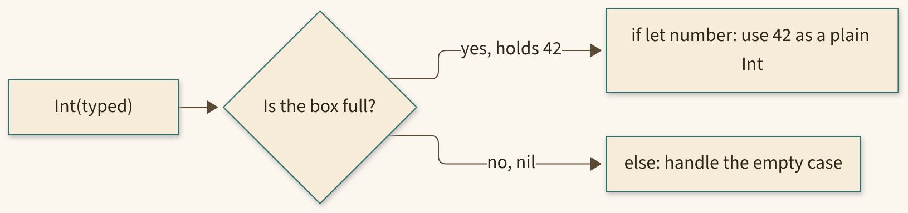{width=100%}

*Figure 3.1 — Optionals as boxes. Follow both arrows: Swift makes you plan for the empty box, not just the full one.*

## Making decisions and repeating work

Apps spend most of their time deciding things and doing things over and over. Swift has a small set of tools for both.

### Deciding with `if` and `switch`

`if` runs code only when something is true:

```swift
let temperature = 31
if temperature > 30 {
    print("Hot one today.")
} else if temperature < 5 {
    print("Bundle up.")
} else {
    print("Nice out.")
}
```

The comparisons you'll use most are `>` (greater than), `<` (less than), `>=` and `<=` (or equal to), `==` (equal to) and `!=` (not equal to). Notice that "equal to" is two equals signs. One equals sign means "put this value into that name." Mixing them up is a rite of passage.

You can combine conditions with `&&` (and) and `||` (or): `if isWeekend && isSunny { ... }`.

When you have lots of possible cases, `switch` is tidier:

```swift
let day = "Saturday"
switch day {
case "Saturday", "Sunday":
    print("Weekend!")
case "Friday":
    print("Almost there.")
default:
    print("Weekday.")
}
```

Swift insists a `switch` covers every possibility, which is why there's a `default` at the end to catch everything else. That might sound strict. It's another way Swift stops you from forgetting a case.^116

### Collections: arrays, dictionaries and sets

Most apps deal with lists of things. Swift has three main ways to hold a bunch of values.

An **array** is an ordered list. Items stay in the order you put them, and you can have duplicates:

```swift
var habits = ["Walk", "Read", "Water"]
habits.append("Stretch")
print(habits[0])        // "Walk" (counting starts at 0)
print(habits.count)     // 4
```

That "counting starts at 0" thing catches everyone. The first item is number 0, the second is number 1, and so on. If you ask for an item past the end of the array, your app crashes, so it's worth checking `count` first.

A **dictionary** stores pairs: a key you look things up by, and a value. Think of a real dictionary, where you look up a word to find its meaning:

```swift
var cupsByDay = ["Monday": 6, "Tuesday": 8]
cupsByDay["Wednesday"] = 7
let monday = cupsByDay["Monday"] ?? 0   // 6
```

Notice the `?? 0`. Looking something up in a dictionary gives you an optional, because the key might not be there. Swift is consistent like that.

A **set** is a bag of unique values with no particular order. It's useful when you only care whether something is in there:

```swift
var tags: Set = ["health", "morning"]
tags.insert("health")   // already there, nothing changes
print(tags.contains("morning"))  // true
```

### Repeating with loops

To do something for every item in a collection, use a `for`-`in` loop:

```swift
for habit in habits {
    print("Did you \(habit.lowercased()) today?")
}
```

To repeat something a certain number of times, loop over a range:

```swift
for day in 1...7 {
    print("Day \(day)")
}
```

`1...7` means "1 through 7, including 7." There's also `1..<7`, which means "1 up to but not including 7." That second one is handy with arrays, which start at 0.

There's also `while`, which keeps going as long as something stays true. You'll use it less often in apps, because SwiftUI does most of the repeating for you, as you'll see in Chapter 4.

### Enums: a fixed set of choices

Some values can only ever be one of a few things. A traffic light is red, yellow or green. A habit might be done, skipped or not yet logged. Swift has a type made for exactly that, the **enumeration**, or **enum**:

```swift
enum Mood {
    case great, okay, rough
}

let today = Mood.okay

switch today {
case .great:
    print("Love that.")
case .okay:
    print("Steady.")
case .rough:
    print("Tomorrow's a new day.")
}
```

Here the `switch` doesn't need a `default`, because Swift knows there are exactly three moods and you've handled all of them. If you later add a fourth mood, Swift will point to every `switch` that doesn't handle it yet. That's a lovely safety net when your app grows.^117

Enums can also hold a little extra information for each case, and they can have their own functions. We'll meet those abilities as we need them.

## Functions: little machines with names

A **function** is a named bundle of code you can run whenever you like. You give it some inputs, it does some work, and it often hands back a result. Think of a coffee machine: water and beans go in, the machine does its thing, and coffee comes out.

Here's a function that works out a tip:

```swift
func tip(on bill: Double, percent: Double) -> Double {
    return bill * percent / 100
}

let amount = tip(on: 50, percent: 20)   // 10.0
```

Let's read it piece by piece.

- `func` says "here comes a function."
- `tip` is its name.
- Inside the parentheses are its **parameters**, the inputs. Each has a name and a type. This one takes a `bill` and a `percent`, both `Double`s.
- `-> Double` says what comes out: a `Double`.
- Inside the braces is the work, ending with `return` and the result.

Notice the little word `on` in front of `bill`. Swift lets each parameter have two names: one used when you *call* the function (`on`) and one used *inside* it (`bill`). That's why the call reads almost like English: "tip on 50, percent 20." It's one of Swift's nicest habits, and Apple's own code uses it everywhere.^118 If you don't want a label at the call site, use an underscore, like the `double(_ text:)` function from the optionals section.

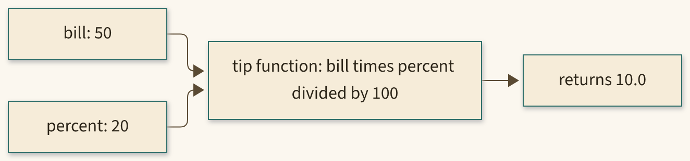{width=100%}

*Figure 3.2 — A function: inputs, work, output. Notice that the function doesn't care where its inputs came from; that's what makes it reusable.*

Functions don't have to return anything. A function that just does something, like printing a message, leaves off the arrow:

```swift
func cheer(_ name: String) {
    print("Nice work, \(name)!")
}
```

Parameters can also have default values, so callers can skip them:

```swift
func tip(on bill: Double, percent: Double = 18) -> Double {
    bill * percent / 100
}

tip(on: 40)             // uses 18 percent
tip(on: 40, percent: 25)
```

You might have spotted that the `return` keyword disappeared in that version. When a function's body is a single expression, Swift lets you leave out `return`. You'll see that all the time in SwiftUI.

### When things can go wrong: throwing functions

Some work can fail in ways you need to know about. Reading a file that isn't there. Talking to a server that's down. For those, Swift has **throwing functions**. A function marked `throws` can stop partway and "throw" an error instead of returning a value:

```swift
enum TipError: Error {
    case negativeBill
}

func safeTip(on bill: Double, percent: Double) throws -> Double {
    guard bill >= 0 else {
        throw TipError.negativeBill
    }
    return bill * percent / 100
}
```

To call it, you write `try`, and you wrap the call in a `do`-`catch` so you can handle the error if one comes:

```swift
do {
    let amount = try safeTip(on: -5, percent: 20)
    print(amount)
} catch {
    print("Couldn't work out the tip: \(error)")
}
```

That `try` is Swift asking you to acknowledge, out loud, "this might fail." You'll meet throwing functions a lot in Chapter 6, when your app talks to the internet, because the internet fails all the time.^119

### Closures: little functions you hand to someone

A **closure** is a function without a name that you can pass around like a value. The friendliest way to think of it: it's a little set of instructions you hand to someone else to use later. "When you're done loading, do this." "For each item, do this."

You'll use closures constantly with collections. Here's one that sorts an array of words by length:

```swift
let words = ["banana", "fig", "cherry"]
let byLength = words.sorted { first, second in
    first.count < second.count
}
// ["fig", "banana", "cherry"]
```

The part in braces is the closure. `sorted` calls it over and over, handing it two words at a time, and the closure answers one question: should `first` come before `second`? You wrote the rule; `sorted` does the work.

Two more you'll use all the time:

```swift
let numbers = [3, 8, 12, 5]
let doubled = numbers.map { $0 * 2 }        // [6, 16, 24, 10]
let big = numbers.filter { $0 > 6 }         // [8, 12]
```

`map` transforms every item. `filter` keeps only the items that pass a test. The `$0` is shorthand for "the first thing you were handed," which saves naming it when the closure is tiny.

Here's why closures matter for this book: SwiftUI is full of them. A button takes a closure that says what to do when it's tapped. A list takes a closure that says how to draw each row. Once you see closures as "instructions I hand over," SwiftUI code gets much easier to read.^120

## Structs, classes and protocols

So far we've used Swift's built-in types. Real apps need their own. A habit-tracking app needs a `Habit`. A quiz needs a `Question`. Swift gives you two main ways to make your own types: **structs** and **classes**. They look almost the same, and the difference between them is one of the most important ideas in Swift.

Here's a struct:

```swift
struct Habit {
    var name: String
    var daysDone: Int = 0

    mutating func markDone() {
        daysDone += 1
    }
}

var walk = Habit(name: "Walk")
walk.markDone()
print(walk.daysDone)   // 1
```

A struct bundles related values together (here, a name and a count), and it can have its own functions, called **methods**, like `markDone()`. The word `mutating` tells Swift this method changes the struct's own values. Swift also wrote an **initializer** for you, the `Habit(name:)` part, which is how you make a new one.

A class looks nearly identical:

```swift
class Counter {
    var count = 0

    func increment() {
        count += 1
    }
}
```

So what's the difference? It's all about what happens when you copy one.

A **struct is a value type**. When you hand one to someone, they get their own copy. Think of a photocopy of a recipe. If your friend scribbles notes on their copy, yours stays clean.

A **class is a reference type**. When you hand one to someone, you're both holding the same thing. Think of a shared document online. If your friend edits it, you see the edit, because there's only one document.

Watch it happen:

```swift
var a = Habit(name: "Read")
var b = a          // b is a copy
b.markDone()
print(a.daysDone)  // 0  (a is untouched)

let x = Counter()
let y = x          // y points at the same counter
y.increment()
print(x.count)     // 1  (x sees the change)
```

That surprise at the end, where changing `y` also changed `x`, is the source of a lot of bugs in other languages. Swift's habit is to reach for structs by default, because copies are easier to reason about, and to use classes when you genuinely want something shared.^121 You'll see that in SwiftUI: the screens you build are structs. When we get to data that the whole app shares in Chapter 5, you'll meet classes doing exactly the job they're good at.

Classes have one more ability structs don't: **inheritance**. One class can build on another, taking all its properties and methods and adding its own. You'll see this in older Apple code (UIKit, which Chapter 4 introduces briefly, is built on it), but modern SwiftUI code uses it much less.

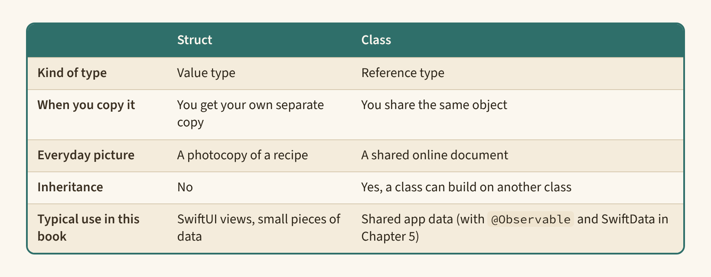{width=100%}

*Figure 3.3 — Struct vs. class at a glance. The "When you copy it" row is the one to remember.*

### Protocols: promises a type makes

A **protocol** is a list of requirements, a promise. When a type says it follows a protocol (Swift says it *conforms* to it), it promises to provide whatever the protocol asks for.

```swift
protocol Describable {
    var summary: String { get }
}

struct Book: Describable {
    var title: String
    var pages: Int

    var summary: String {
        "\(title), \(pages) pages"
    }
}
```

`Describable` asks for one thing: a `summary` you can read. `Book` promises to follow it, and keeps the promise. Any code that needs "something with a summary" can now accept a `Book`, or any other type that makes the same promise.

You've already met a protocol without knowing it. Look back at "Hello, you" from Chapter 2: `struct ContentView: View`. `View` is a protocol. It asks for one thing, a `body` that describes what to draw. Your `ContentView` promised to provide one. That's the whole contract between you and SwiftUI.^122

### Extensions: adding to a type later

An **extension** lets you add new abilities to a type, even one you didn't write. This is the exception I promised: an extension has to live at the top level of a file, so put this one outside the `#Playground { }` braces, above them:

```swift
extension Int {
    var isEven: Bool {
        self % 2 == 0
    }
}

print(4.isEven)   // true
```

Now every `Int` in your app has an `isEven` property. People use extensions to keep code tidy, grouping related abilities together, and to make a type conform to a protocol in its own neat block.

### A first look at `some`

One last thing you'll see in every SwiftUI file: the word `some`, as in `var body: some View`. It means "this returns *some* specific type that follows the `View` protocol. I'm not going to spell out exactly which one, but I promise it's always the same one." It lets SwiftUI build complicated screens without you writing out monstrously long type names. You don't need more than that for now.^123

## Putting it together: a tiny habit tally

Let's use nearly everything from this chapter in one small program. It's a preview of Daybook, the journal app we'll start in Chapter 5, but with no screens yet, just Swift. Type it inside a `#Playground { }` block, the same way as before, and run it.

```swift
struct HabitDay {
    let name: String
    var done: Bool
    var minutes: Int?
}

func summary(of days: [HabitDay]) -> String {
    let doneCount = days.filter { $0.done }.count
    return "\(doneCount) of \(days.count) done"
}

var today = [
    HabitDay(name: "Walk", done: true, minutes: 30),
    HabitDay(name: "Read", done: false, minutes: nil),
    HabitDay(name: "Drink water", done: true, minutes: nil)
]

today[1].done = true

for habit in today {
    var line = habit.done ? "Done: " : "Not yet: "
    line += habit.name
    if let minutes = habit.minutes {
        line += " (\(minutes) min)"
    }
    print(line)
}

print(summary(of: today))
```

Here's what it prints, line by line:

```text
Done: Walk (30 min)
Done: Read
Done: Drink water
3 of 3 done
```

And here's what each part is doing, in the order Swift meets it.

`HabitDay` is a struct with three properties. The name is a `let`, because a habit's name for the day won't change. `done` is a `var`, because it will. `minutes` is an optional `Int?`, because not every habit has a time attached.

`summary(of:)` is a function that takes an array and hands back a `String`. Inside, `filter` keeps only the habits whose `done` is `true`, and `count` counts them. That's a closure, written short with `$0`.

`today` is an array of three habits, made with a `var` so we can change it. The line `today[1].done = true` ticks off the second habit, "Read," because counting starts at 0. Try changing `var today` to `let today` and watch the error appear on that line. That's the "is a 'let' constant" error from earlier, caught on purpose.

The `for` loop visits each habit in turn. The line with the `?` and `:` is a compact `if`: if `habit.done` is true, use "Done: ", otherwise "Not yet: ". It's called the **ternary conditional operator**, and you'll see it a lot in SwiftUI code.^124 Then `if let` opens the `minutes` box only when there's something in it, so "Read" and "Drink water" print without a time.

> **Try this.** Add a fourth habit that isn't done, run it again, and check that the summary says "3 of 4 done." Then add a `streak: Int` property to `HabitDay` and see how many lines Swift asks you to fix. Every place that makes a `HabitDay` now has to say what its streak is. That's Swift keeping its promises, and it's a small taste of why changing a data model takes care.

## Notes to yourself, and seeing what's going on

Two small tools before we move on, because you'll use them every day.

**Comments** are notes in your code that Swift ignores. Anything after two slashes on a line is a comment:

```swift
let cups = 3   // glasses of water so far today
```

For longer notes, wrap them in `/*` and `*/`. Write comments to explain *why* you did something, not *what* the code does. The code already says what it does. "Round up so nobody underpays" is a useful comment. "Add one to count" usually isn't.^125

**`print`** writes a message to Xcode's console, the area at the bottom of the window where your running app can talk to you. You've seen it in this chapter's examples. When something isn't behaving, a well-placed `print("got here, count is \(count)")` is the oldest debugging trick there is, and it still works. Chapter 8 shows you more powerful tools, but you'll never fully stop using `print`.

## The first errors everyone meets

You're going to see red error messages while you work through this chapter. Here are the ones nearly everyone meets in their first week, in roughly the words Swift uses (exact wording shifts a little between versions), and what they usually mean. None of them are a sign you're doing it wrong. They're a sign you're doing it.

**"Cannot assign to value: 'x' is a 'let' constant."** You tried to change something you made with `let`. Either you meant `var`, or you didn't mean to change it. Swift is asking which.

**"Binary operator '*' cannot be applied to operands of type 'Int' and 'Double'."** You're mixing number types, like the apples and price example earlier. Convert one, with `Double(apples)` or `Int(price)`, so they match.

**"Value of optional type 'Int?' must be unwrapped to a value of type 'Int'."** You tried to use what's in an optional box without opening it. Reach for `if let`, `guard let` or `??`. Resist the exclamation mark.

**"Missing return in global function expected to return 'Double'."** (Inside a type, it says "instance method" instead.) Your function promised to hand something back with `->`, but there's a path through it that doesn't. Check every `if` and `else`.

**"Expected '}'"** or a cascade of errors that make no sense. Usually a brace or a quotation mark is missing somewhere *above* where the errors start. Look upward. Xcode's editor highlights matching braces when you click next to one, which helps you find the one that's lonely.

**A crash with "Index out of range."** You asked an array for an item past its end. Remember counting starts at 0, so an array with three items has positions 0, 1 and 2.

When an error makes no sense at all, select the line and ask Xcode's assistant to explain the error. That's a perfect job for it, and it's the next section's topic.

## Ask your AI to explain, then type it yourself

Here's the first AI habit of the book, and it's a gentle one.

Xcode's coding assistant can explain code to you. Once you've switched on a model in **Xcode > Settings > Intelligence** (Chapter 9 walks through the setup, and ChatGPT works there without an account), select a few lines of code you don't understand, Control-click them, and choose **Show Coding Tools**. In the small popover that appears, click **Explain**.^126 The explanation appears in the coding assistant's transcript.

I want to suggest a habit around that button. This is advice from experience, not a research finding, so take it as such.

First, try to read the code yourself. Say out loud what you think each line does. Then ask the assistant to explain it. Compare. Where you were wrong, that's exactly the spot you needed to learn. Then close the explanation and **type the code again yourself, without looking**. Not copy and paste. Type it.

It feels slow. It's meant to. Typing it yourself is where the understanding moves from the screen into your head. The assistant can explain faster than any book, and that's wonderful. But reading an explanation and being able to write the code are different skills, and only one of them ships apps.

> **Ask your AI.** When a snippet in this chapter doesn't make sense.
>
> *Example prompt (written for this book):* "Explain this Swift code line by line in plain English, for someone who started learning Swift this week. Then give me one small change I could make to test whether I understood it."
>
> *Verify by:* checking the explanation against the matching section of *The Swift Programming Language* on docs.swift.org, then making the suggested change in a playground and seeing whether the result matches what the AI predicted.

Assistants can be wrong, even about something as settled as Swift basics. The free Swift book is the referee, and your playground is the courtroom. If the AI says one thing and the code does another, the code wins.

You've now got the core of the language: names and types, optionals, decisions and loops, functions and closures, and your own types. That's more than enough to start building screens.

Now let's put Swift on a screen.


# Chapter 4 — SwiftUI and Your First Real App

{width=100%}


In the last chapter you learned to talk to the computer in Swift. Now you'll use Swift to draw on a screen. This is the chapter where your projects start to look like apps, the kind you'd recognize on a stranger's phone. By the end you'll have built two of them: a calculator that splits a restaurant bill, and a little quiz game with its first automated test.

## Describing a screen instead of drawing it

The tool for this is **SwiftUI**, Apple's framework for building the part of an app people see and touch. (A **framework** is a big, ready-made toolkit of code that you build on top of, so you don't have to start from nothing.)

The key idea in SwiftUI is in its style. You don't tell the iPhone *how* to draw things, step by step, pixel by pixel. You *describe* what the screen should contain, and SwiftUI works out how to draw it. It's the difference between giving a builder a list of instructions ("lay a brick here, then another here") and handing them a sketch of the finished house.

Every piece of a SwiftUI screen is a **view**. A line of text is a view. An image is a view. A button is a view. And views can contain other views, so a whole screen is just a view made of smaller views, made of smaller views still.^127

Let's look again at the code from "Hello, you":

```swift
struct ContentView: View {
    var body: some View {
        VStack {
            Image(systemName: "hand.wave")
                .imageScale(.large)
                .foregroundStyle(.tint)
            Text("Hello, you!")
        }
        .padding()
    }
}
```

You can read most of it now, thanks to Chapter 3. `ContentView` is a struct. It promises to follow the `View` protocol, and it keeps that promise by providing a `body`. The body describes the screen: a `VStack` (a vertical stack, things arranged top to bottom) containing an `Image` and a `Text`.

Those lines that start with a dot, like `.padding()` and `.imageScale(.large)`, are **modifiers**. A modifier takes a view and gives you back a changed version of it: bigger, colored, padded, rounded. You can chain as many as you like, and they apply in order, top to bottom. That order matters, as you'll find out the first time you add a background before padding instead of after.

There are three stacks you'll use all the time:

- `VStack` arranges views vertically, top to bottom.
- `HStack` arranges them horizontally, side by side.
- `ZStack` layers them on top of each other, front to back, which is handy for putting text over a picture.

Stacks can go inside stacks. Want a row with an icon and two lines of text next to it? That's an `HStack` containing an `Image` and a `VStack`:

```swift
HStack {
    Image(systemName: "figure.walk")
        .font(.largeTitle)
    VStack(alignment: .leading) {
        Text("Morning walk")
            .font(.headline)
        Text("20 minutes")
            .foregroundStyle(.secondary)
    }
}
```

The images come from **SF Symbols**, Apple's library of thousands of icons, all free to use in your apps and designed to line up nicely with text at any size.^128 Apple makes a free Mac app, also called SF Symbols, for browsing them. You find the one you want, copy its name, and use it in `Image(systemName:)`. That's how "hand.wave" and "figure.walk" got there.

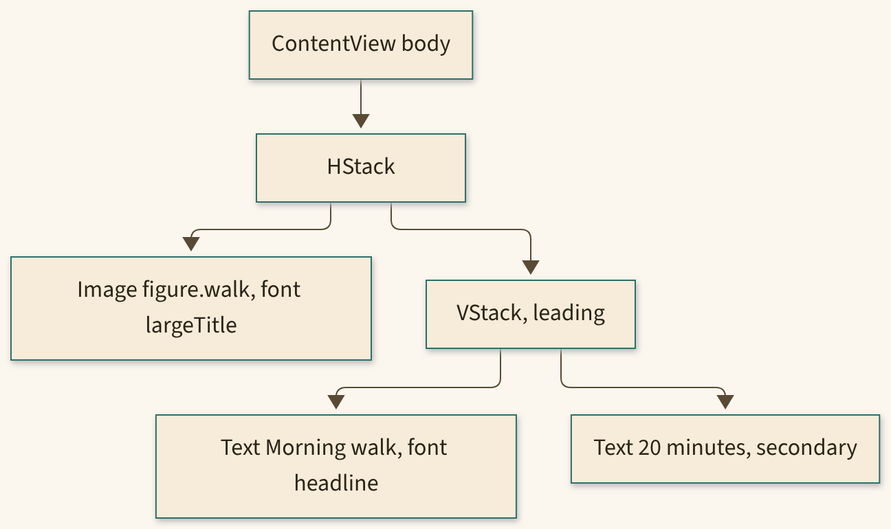{width=100%}

*Figure 4.1 — The SwiftUI view tree. Every screen is a tree like this; notice how the modifiers ride along on the view they change.*

### Spacing things out

Stacks put things next to each other. To push things apart, or give them room, you'll use a few more pieces.

A **`Spacer`** is an invisible view that takes up all the room it can. Put one between two views in an `HStack`, and they get pushed to opposite edges:

```swift
HStack {
    Text("Water")
    Spacer()
    Text("6 of 8")
        .foregroundStyle(.secondary)
}
```

That's the classic settings-row look: a label on the left, a value on the right.

Stacks also take a **`spacing`** value for the gap between their items, as in `VStack(spacing: 16)`, and an **alignment**, as in `VStack(alignment: .leading)`, which lines things up on the left edge instead of centering them. And `.padding()` adds breathing room around a view, on all sides by default.

You'll be tempted, at some point, to place things at exact positions on the screen. Resist it. iPhones come in many sizes, people turn on larger text, and your app might run on an iPad. Stacks, spacers and padding adapt to all of that. Fixed positions don't.^129

## Previews: see it as you type

In Chapter 2 you saw the canvas update as you typed. That's thanks to the `#Preview` block at the bottom of the file:

```swift
#Preview {
    ContentView()
}
```

A preview tells Xcode, "show me this view in the canvas while I work." You don't have to build and run the whole app to see a change. You type, and the preview catches up a moment later.^130

You can have more than one. Give each a name, and Xcode shows them as tabs at the top of the canvas:

```swift
#Preview("Light") {
    ContentView()
}

#Preview("Dark") {
    ContentView()
        .preferredColorScheme(.dark)
}

#Preview("Huge text") {
    ContentView()
        .environment(\.dynamicTypeSize, .accessibility3)
}
```

Now, with one click, you can see your screen in Dark Mode or with the very large text sizes some people rely on. Get in the habit early. Checking those two previews takes seconds, and it's the cheapest accessibility testing you'll ever do. Chapter 7 goes much deeper.^131

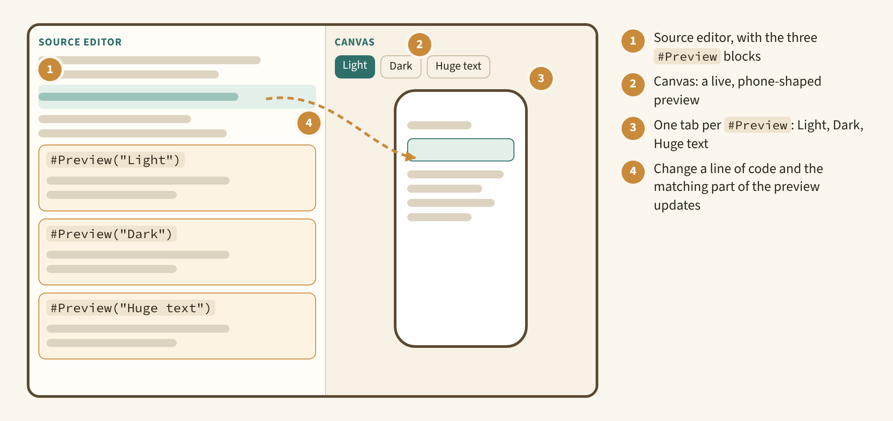{width=100%}

*Figure 4.2 — The canvas with a live preview next to the code. Notice the tabs along the top of the canvas: one per `#Preview`.*

## State: how a screen remembers

So far our screens just sit there. Real apps respond: you tap a button and a number changes, you type and a total updates. For that, a view needs to remember things. In SwiftUI that memory is called **state**.

Here's the smallest example I know:

```swift
struct CounterView: View {
    @State private var count = 0

    var body: some View {
        VStack(spacing: 16) {
            Text("Glasses of water: \(count)")
                .font(.title2)
            Button("Add one") {
                count += 1
            }
            .buttonStyle(.borderedProminent)
        }
    }
}
```

The interesting line is `@State private var count = 0`. The `@State` in front tells SwiftUI: "this value belongs to this view, keep it safe, and whenever it changes, redraw the screen."^132

So here's what happens when you tap the button:

1. The button runs its closure (remember closures from Chapter 3, "instructions you hand over") and `count` goes from 0 to 1.
2. SwiftUI notices that `count` changed.
3. SwiftUI asks the view for its `body` again.
4. The new body says "Glasses of water: 1," and the screen updates.

You never tell the text to change. You change the *state*, and the screen follows. That's the whole trick of SwiftUI, and it's why SwiftUI code tends to be shorter than the older ways of building screens. You describe what the screen should look like for any value of `count`, and SwiftUI keeps it in sync.

The `private` keyword just means "only this view uses this." It's good practice for `@State`, because state belongs to the view that owns it.

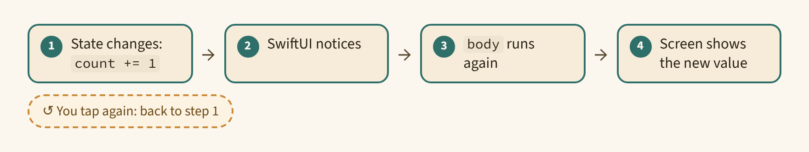{width=100%}

*Figure 4.3 — The state, body, screen loop. Look for what's missing: there's no step where you update the text by hand.*

### Bindings: sharing state with a control

Buttons change state with a closure. But some controls, like a text field or a toggle, need to both *read* a value and *write* it back as the user types or taps. For that, SwiftUI uses a **binding**, which is a two-way connection to a piece of state. You make one by putting a dollar sign in front of the state's name:

```swift
struct NameView: View {
    @State private var name = ""

    var body: some View {
        VStack {
            TextField("Your name", text: $name)
                .textFieldStyle(.roundedBorder)
            Text("Hello, \(name.isEmpty ? "you" : name)!")
        }
        .padding()
    }
}
```

`$name` hands the text field a binding: "here's where to read the name from, and here's where to put whatever gets typed." As you type, `name` changes, the loop runs, and the greeting updates letter by letter. Try it in the canvas. It's oddly satisfying.

The rule of thumb: plain `name` reads the value. `$name` hands over a two-way connection to it.

One thing that's new this year, mostly for your curiosity: in iOS 27, Apple turned `@State` into a macro behind the scenes. You write it exactly the same way. One practical effect Apple describes is that when you store an instance of a class in `@State`, it's now created lazily, once for the lifetime of the view, rather than every time the view is re-created.^133 You don't need to do anything about it. But if you read older advice warning about that problem, now you know why it may not apply.

## Rung 1: the tip and split calculator

Time to build something useful. Rung 1 is a calculator for the end of a meal: type in the bill, choose how many people are paying and how much you want to tip, and it tells you what each person owes.

If you've done Paul Hudson's 100 Days of SwiftUI, this will look familiar. His first project, WeSplit, is "a check-sharing app that calculates how to split a check based on the number of people and how much tip you want to leave."^134 It's a classic first app for good reason: it's small, it's genuinely handy, and it uses all the basics. Apple's Develop in Swift tutorials cover the same ground in their units on buttons, state and text fields.^135 What follows is my own version, built step by step. If you want a second explanation of any piece, those two courses are excellent.

Make a new project, just as in Chapter 2: choose **Choose Template** (from the Welcome window's **New Project** menu, or **File > New > Project**), then **iOS**, the **App** template, SwiftUI. Call it `TipSplit`. Tick the Git box. Then replace everything in `ContentView.swift` with this:

*ContentView.swift*

```swift
import SwiftUI

struct ContentView: View {
    @State private var billAmount = 0.0
    @State private var numberOfPeople = 2
    @State private var tipPercent = 20

    private let tipChoices = [10, 15, 18, 20, 25]

    private var currencyCode: String {
        Locale.current.currency?.identifier ?? "USD"
    }

    private var totalPerPerson: Double {
        let tip = billAmount * Double(tipPercent) / 100
        return (billAmount + tip) / Double(numberOfPeople)
    }

    var body: some View {
        NavigationStack {
            Form {
                Section("Bill") {
                    TextField("Amount", value: $billAmount,
                              format: .currency(code: currencyCode))
                        .keyboardType(.decimalPad)

                    Picker("People", selection: $numberOfPeople) {
                        ForEach(1..<21, id: \.self) { count in
                            Text(count == 1 ? "1 person" : "\(count) people")
                        }
                    }
                }

                Section("Tip") {
                    Picker("Tip", selection: $tipPercent) {
                        ForEach(tipChoices, id: \.self) { percent in
                            Text(percent, format: .percent)
                        }
                    }
                    .pickerStyle(.segmented)
                }

                Section("Each person pays") {
                    Text(totalPerPerson,
                         format: .currency(code: currencyCode))
                        .font(.title2)
                }
            }
            .navigationTitle("Tip & Split")
        }
    }
}

#Preview {
    ContentView()
}
```

That's the whole app. Let's walk through it, because every piece is something you'll use again.

**The three `@State` properties** are the app's memory: the bill, the number of people and the tip percentage. Every control on the screen reads from and writes to one of these.

**`tipChoices`** is a plain array of the tip options. It's a `let`, because the choices never change while the app runs.

**`currencyCode`** asks the phone which currency its owner uses, through `Locale.current`. If it can't tell, it falls back to US dollars with `??`, the nil-coalescing operator from Chapter 3. This is what makes the app show pounds in London and yen in Tokyo without you lifting a finger.

**`totalPerPerson`** is a **computed property**. It doesn't store anything. Every time something asks for it, it works out the answer fresh from the current state. That's exactly what we want: whenever the bill, people or tip changes, the screen redraws, asks for `totalPerPerson`, and gets the up-to-date number. Notice the `Double(...)` conversions. Swift won't multiply a `Double` by an `Int` without being told, as you saw in Chapter 3.

**`NavigationStack`** gives the screen a navigation bar at the top, which is where the title "Tip & Split" lives. Later, in Chapter 5, you'll use it to move from one screen to the next.

**`Form`** is a container that makes a list of controls look like a settings screen, the grouped, tidy style you see all over iPhone apps. Inside it, each **`Section`** is a group with its own small heading.

**`TextField`** is where the bill goes. This version is clever: you hand it a binding to a `Double` (`$billAmount`) and a **format**, and it handles turning what you type into a number and showing it back as money. `.keyboardType(.decimalPad)` brings up a number keyboard with a decimal point instead of the full keyboard.

**`Picker`** lets someone choose one value from a list. The first picker loops over the numbers 1 through 20 with `ForEach` (SwiftUI's way of making a view for each item in a collection) and shows a row for each. Whatever the person picks goes into `numberOfPeople` through the binding. The second picker does the same for tips, and `.pickerStyle(.segmented)` shows it as a row of buttons instead of a menu.

**`Text(totalPerPerson, format: .currency(...))`** shows the answer, formatted as money in the local currency. You never write code to round to two decimal places or add a currency sign. The format handles it.

Run it in the Simulator. Tap the amount, type a bill, choose a tip, change the number of people. Watch the total update the instant anything changes. That's the state loop from a few pages ago, doing exactly what it promised.

### What you'll see, and a small fix

Here's something you'll probably notice in your first minute with the app. You type a bill, and the total *doesn't* change as you type. Then you tap somewhere else, and it jumps to the right answer. And the number keyboard won't go away, because it has no Return key.

Nothing's broken. It's how a text field behaves when it's bound to a number. Apple's documentation explains it: if a text field's value is a string, it updates continuously as you type, but for other types, like our `Double`, it updates the value when you commit your edits, such as by pressing Return.^136 The decimal pad has no Return key, so the field waits until you move on.

The fix is to give people a way to say "I'm done." SwiftUI tracks which control has the keyboard's attention, called **focus**, with a property wrapper named `@FocusState`. When focus leaves a field, the property goes back to `false`, and if you set it to `false` yourself, focus leaves the field and the keyboard goes away.^137 Three small changes to `ContentView.swift` do it.

Add a new property under the other three:

```swift
@FocusState private var amountIsFocused: Bool
```

Tie the text field to it, by adding one modifier under `.keyboardType(.decimalPad)`:

```swift
.focused($amountIsFocused)
```

And add a Done button to the navigation bar, right under `.navigationTitle("Tip & Split")`:

```swift
.toolbar {
    if amountIsFocused {
        Button("Done") {
            amountIsFocused = false
        }
    }
}
```

Run it again. Tap the amount and a Done button appears in the navigation bar. Type a bill, tap Done, and the keyboard slides away and the total updates. Notice the dollar sign again in `$amountIsFocused`. The text field needs to both read and change whether it's focused, so it gets a binding, just like the text field's value does.

> **Common mistake: forgetting the dollar sign.** If you write `TextField("Amount", value: billAmount, ...)` without the `$`, Xcode refuses to build, with a message that mentions converting a `Double` to a `Binding<Double>`. That's Swift telling you the control needs a two-way connection, not just a value. Add the `$`. The opposite slip happens too: `Text($billAmount, ...)` fails because `Text` only needs to *read* the value. Read with the plain name, hand over a connection with `$`.

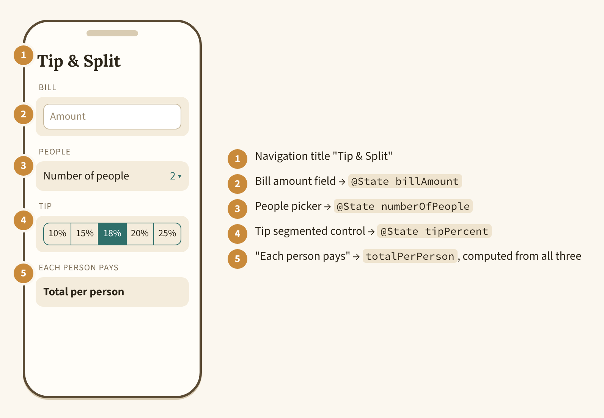{width=100%}

*Figure 4.4 — The tip calculator, labeled. Follow the arrows: each control is tied to one piece of state, and the total reads all three.*

> **Ask your AI.** Once the calculator runs, before you move on.
>
> *Example prompt (written for this book):* "Explain each line of this ContentView.swift in plain English. For each @State property, tell me which controls read it and which change it."
>
> *Verify by:* changing one thing the explanation mentions (for example, add 30 to `tipChoices`) and checking that the app behaves the way the explanation predicts. Then retype the file from memory in a fresh project.

> **Done when — Rung 1.**
>
> - [ ] Typing a bill, choosing people and choosing a tip gives the right per-person total. (Check one by hand: a 100 bill, 20 percent tip, 4 people should give 30 each.)
> - [ ] The total updates as soon as you change the people or the tip, and as soon as you tap Done after typing a bill.
> - [ ] You can explain what every `@State` property does, and why `$` appears in front of some of them.
> - [ ] You've retyped the app yourself at least once, and committed it.

If you want to stretch yourself before moving on, here are some ideas to try on your own. They're only ideas, not steps from any course, and each one uses something you already know:

- Add a "round up" toggle that rounds each person's share up to a whole number. (Look up how to round a `Double` in Swift; `rounded(.up)` is a good search term.)
- Show the total bill including tip, as well as the per-person amount, in its own section.
- Let people type a custom tip percentage instead of picking from the list.
- Check the "Huge text" preview and make sure nothing gets cut off.

A word of honesty before we go on. This calculator is a lovely learning app. It isn't something to submit to the App Store as it stands. Apple's review guidelines expect apps to offer more than a minimal, repackaged version of something already common, and Chapter 16 explains how to turn practice apps into something truly yours. For now, enjoy it. It works.

## Rung 2: a quiz game

Rung 2 is a small quiz game. It shows a question and a few answers, you tap one, it tells you whether you were right, keeps score, and starts over when you've answered everything. Simple. But it teaches the most important design habit in this whole book: **keeping the app's logic separate from its screen**.

This is a well-trodden path for a second app. Hacking with Swift's second project, Guess the Flag, is a guessing game with randomness and alerts.^138 Kodeco's beginner course builds a game called Bull's Eye.^139 And Stanford's CS193p course builds a game called CodeBreaker across its lectures, with a big emphasis on separating the game's *model* from its *user interface*.^140 Different games, same lesson.

Here's the idea. The *rules* of the quiz (what the questions are, whether an answer is right, what the score is) have nothing to do with buttons or colors. So we put the rules in their own type, the **model**, and keep the view as thin as possible. The view's only job is to show the model and pass along taps.

Make a new project called `QuizTime`, again through **Choose Template** so you get the options sheet. On that sheet, look for the **Testing System** menu and choose **Swift Testing with XCTest UI Tests**. That sets up a place for tests, which we'll use in a few minutes.^141

Now add a new Swift file for the model. (In the navigator, Control-click the `QuizTime` folder and choose New File, or use the File menu; pick a plain Swift file and call it `QuizGame`.) Here's the model:

*QuizGame.swift*

```swift
import Foundation

struct Question {
    let prompt: String
    let choices: [String]
    let answer: String
}

struct QuizGame {
    private(set) var questions: [Question]
    private(set) var currentIndex = 0
    private(set) var score = 0

    init(questions: [Question]) {
        self.questions = questions.shuffled()
    }

    var current: Question? {
        currentIndex < questions.count ? questions[currentIndex] : nil
    }

    var isFinished: Bool {
        current == nil
    }

    mutating func answer(_ choice: String) -> Bool {
        guard let question = current else { return false }
        let isCorrect = choice == question.answer
        if isCorrect {
            score += 1
        }
        currentIndex += 1
        return isCorrect
    }
}

extension Question {
    static let samples = [
        Question(prompt: "Which keyword makes a constant in Swift?",
                 choices: ["var", "let", "func"], answer: "let"),
        Question(prompt: "What does an empty optional hold?",
                 choices: ["0", "nil", "\"\""], answer: "nil"),
        Question(prompt: "Which stack arranges views side by side?",
                 choices: ["VStack", "HStack", "ZStack"], answer: "HStack"),
    ]
}
```

Almost everything here is from Chapter 3. A few new touches:

- `private(set)` means "anyone can *read* this, but only `QuizGame` itself can *change* it." The view can show the score, but it can't cheat and set the score to 100.
- `questions.shuffled()` returns the questions in a random order, so every game is a little different. That's the randomness.
- `current` is an optional. When you've run out of questions there's no current question, so it's `nil`. You saw this coming in Chapter 3.
- `answer(_:)` is `mutating` because it changes the score and the position. It returns a `Bool` so the screen can tell you whether you were right.
- The `extension` at the bottom adds some sample questions. I made them about Swift itself, so playing the game doubles as revision.

A quick word on randomness, since games love it. Swift gives you a few easy tools. `shuffled()` returns a collection in random order, which is what `QuizGame` uses. `randomElement()` picks one item at random from an array, and returns an optional, because the array might be empty. And `Int.random(in: 1...6)` rolls a die. You'll find similar tools on `Double` and `Bool`. That's genuinely all most apps need.^142

Now the view. Replace `ContentView.swift` with this:

*ContentView.swift*

```swift
import SwiftUI

struct ContentView: View {
    @State private var game = QuizGame(questions: Question.samples)
    @State private var showingResult = false
    @State private var resultTitle = ""

    var body: some View {
        VStack(spacing: 20) {
            if let question = game.current {
                Text(question.prompt)
                    .font(.title2)
                    .multilineTextAlignment(.center)

                ForEach(question.choices, id: \.self) { choice in
                    Button(choice) {
                        let correct = game.answer(choice)
                        resultTitle = correct ? "Correct!" : "Not quite"
                        showingResult = true
                    }
                    .buttonStyle(.borderedProminent)
                }
            } else {
                Text("You scored \(game.score) out of \(game.questions.count)")
                    .font(.title2)
                Button("Play again") {
                    game = QuizGame(questions: Question.samples)
                }
            }

            Text("Score: \(game.score)")
                .foregroundStyle(.secondary)
        }
        .padding()
        .alert(resultTitle, isPresented: $showingResult) {
            Button("OK") { }
        }
    }
}

#Preview {
    ContentView()
}
```

Look at how little the view does. It asks the model for the current question and shows it. When you tap an answer, it tells the model and shows an **alert**, the little pop-up box iPhone apps use for short messages. The alert appears whenever `showingResult` becomes `true`, and SwiftUI sets it back to `false` when you tap OK. There's no scoring logic in the view at all.

Why go to this trouble for a tiny game? Three reasons, and you'll see each of them pay off as the book goes on.

First, **you can test the rules without the screen.** That's next.

Second, **you can change the screen without breaking the rules.** Want a completely different look? Rewrite the view. The model doesn't care.

Third, **AI helpers do better work on code organized this way.** When you ask an assistant to "make the quiz harder" or "add a timer," a small, separate model is much easier for it to change correctly, and much easier for you to check.

## Your first test

A **test** is a little piece of code that checks your other code does what you think. You write it once, and then you can run it any time, in a second, forever. It's like having a friend who double-checks your arithmetic every time you change something, and never gets bored.

Apple's modern tool for this is **Swift Testing**. It's built into Xcode, and it's designed to be short and readable.^143 Because you chose the Swift Testing option when you made the project, Xcode created a test target, a separate part of the project just for tests, with a name ending in "Tests."^144 Open the Swift file inside the `QuizTimeTests` folder and replace its contents with this:

*QuizTimeTests.swift*

```swift
import Testing
@testable import QuizTime

@Test func correctAnswerAddsAPoint() {
    let question = Question(prompt: "Which keyword makes a constant?",
                            choices: ["var", "let"], answer: "let")
    var game = QuizGame(questions: [question])

    let wasCorrect = game.answer("let")

    #expect(wasCorrect)
    #expect(game.score == 1)
    #expect(game.isFinished)
}
```

Read it like a sentence. `@Test` marks a function as a test. Inside, we set up a game with one question, give the right answer, and then make three claims with `#expect`: the answer was correct, the score is 1, and the game is over. If any claim is false, the test fails and Xcode tells you which one and why.

The `@testable import QuizTime` line lets the test see inside your app's code.

To run it, choose **Product > Test**, or hover over the small diamond next to the test function in the editor's gutter and click the play button that appears.^145 A green check means your rules work. A red X means they don't, and Xcode shows you exactly which `#expect` failed.

Try breaking it on purpose. In `QuizGame.swift`, change `score += 1` to `score += 2`. Run the test again. Red. Change it back. Green. That little round trip is the whole point. From now on, if you or an AI helper changes the scoring logic and gets it wrong, this test will catch it before you ever open the app.

Chapter 8 goes much deeper into testing: more kinds of tests, tests for screens, and how tests become the leash you keep on your AI helpers. For now, one test is a great start.

## Asking for test ideas, not tests

Rung 2's AI practice is a specific one, and it's the start of a habit that carries all the way through this book: **let the AI suggest what to test, and write the tests yourself.**

Why not just ask for the tests? Because a test is a promise about how your app should behave, and you're the one who knows that. If an assistant writes both the code and the tests, it can write tests that match whatever the code happens to do, including its mistakes. A list of ideas, on the other hand, is pure help. It catches the cases you didn't think of, and you still decide what "right" means.

> **Ask your AI.** Once `correctAnswerAddsAPoint` passes.
>
> *Example prompt (written for this book):* "Here is my QuizGame struct. Don't write any code. List five situations a test should check, in plain English, including any edge cases you think a beginner would miss. For each one, say what the score, currentIndex and isFinished should be afterwards."
>
> *Verify by:* reading each idea against `QuizGame.swift` and deciding, yourself, whether the expected values are right. Then write one test for each idea you agree with, run them, and watch each fail once on purpose by changing the model.

Here's the kind of list to expect, so you know what good looks like. These are my own examples from reading the model above, not output I'm quoting:

- A wrong answer leaves the score at 0 but still moves to the next question.
- After every question is answered, `current` is `nil` and `isFinished` is `true`.
- Calling `answer(_:)` after the game is finished returns `false` and changes nothing. (Look at the `guard` in the model. That's the line this test protects.)
- A game made with an empty list of questions starts out finished.
- Shuffling never loses or duplicates a question: a new game has the same number of questions you gave it.

The empty-list one is a nice example of an edge case. You'd never play a quiz with no questions, but code doesn't know that, and the model handles it correctly only because `current` checks `currentIndex < questions.count` first. A test makes sure it stays that way.

If an assistant suggests a test you think is wrong, that's not a failure. That's the exercise working. Decide who's right by reading the code, and if you're still unsure, write the test and let Xcode be the referee.

> **Done when — Rung 2.**
>
> - [ ] The quiz plays a full round, keeps score, and offers "Play again" at the end.
> - [ ] The questions come out in a different order on a new game.
> - [ ] Your `correctAnswerAddsAPoint` test passes, and you've watched it fail once on purpose.
> - [ ] You can point to where the rules live (the model) and where the screen lives (the view).
> - [ ] It's committed.

> **Try this.** Write a second test called `wrongAnswerScoresNothing` that answers incorrectly and expects the score to stay at 0. Write it yourself before you ask anyone, human or AI, for help.

## Designing like you mean it

You've been making screens for a chapter now, so let's talk about making them *good*.

Apple publishes the **Human Interface Guidelines**, usually called the HIG. It's a big, free, beautifully illustrated guide to designing apps for Apple devices: how navigation should work, how big buttons should be, how to use color, type, icons and motion, and a great deal more.^146 Don't try to read it cover to cover. Treat it like a friendly reference. When you're about to add something, like a tab bar or a list or a settings screen, read the HIG's page on it first. Ten minutes there saves you hours of rework, and your app will feel at home on an iPhone instead of slightly foreign.

A few HIG ideas worth adopting from day one:

**Use the system's building blocks.** SwiftUI's standard controls, like `Form`, `List`, `NavigationStack` and buttons with standard styles, already follow the guidelines, and they adapt automatically to Dark Mode, larger text and other settings. When you build everything custom, you take on all of that work yourself.

**Use SF Symbols for icons.** They match the system font, scale with text size and come in thousands of varieties. You've already used three.

**Use tab bars for the main sections of an app.** If your app has a few top-level areas, a tab bar along the bottom is the familiar iPhone way to move between them. SwiftUI's `TabView` makes one. Daybook will get tabs later on.

**Check Dark Mode early.** Many people run their phones in Dark Mode all the time. If you use the system's colors, like `.primary`, `.secondary` and `.tint`, rather than fixed ones, your app switches gracefully. That "Dark" preview from earlier in the chapter is your quick check.^147

Apple's Develop in Swift tutorials include a whole unit on app design, covering prototypes, testing your ideas with people and iterating, alongside SF Symbols, tab bars, Dark Mode and Dynamic Type.^148 If design interests you, it's a lovely next step.

### Sidebar: You'll meet UIKit

Sooner or later you'll search for help with something and find an answer full of words like `UIViewController`, `UILabel` and `viewDidLoad`. That's **UIKit**, Apple's older framework for building iPhone screens. It came long before SwiftUI, and an enormous number of apps, including many you use every day, are built on it. It's still very much alive, and SwiftUI and UIKit can work together in the same app.

You don't need to learn UIKit to follow this book or to build great apps today. But you'll *meet* it, in older tutorials, in forum answers and in code that AI helpers hand you, so it helps to recognize it. UIKit code tends to tell the screen what to do step by step ("create a label, set its text, add it to the view") rather than describing it the way SwiftUI does.

If you ever need a UIKit view inside a SwiftUI screen, perhaps because the feature you want only exists in UIKit, SwiftUI has a bridge called `UIViewRepresentable` that wraps a UIKit view so it can sit in a SwiftUI layout.^149 That's an advanced move. Know the name, and look it up when you need it.

If you want to learn UIKit properly, Apple's "Develop apps for Apple platforms" tutorials, which build an app called Scrumdinger, teach Xcode and SwiftUI and also include UIKit basics.^150 One more thing you'll trip over when you search: Apple's older "Introducing SwiftUI" tutorial, the one with the Landmarks app, is now marked as no longer current, and Apple points learners to Develop in Swift instead.^151 If a search sends you there, that's why it looks a bit dated.

When an AI helper gives you UIKit code and you asked for SwiftUI, that's a hint the helper reached for an older pattern. Chapter 11 has a whole section on spotting that.

Our apps so far have one big flaw: close them and they forget everything. Your quiz score, your tip settings, all gone. Let's fix that.


# Chapter 5 — Data That Sticks: Observation and SwiftData

{width=100%}


Every app you've built so far has amnesia. Close it, open it again, and it's forgotten everything. The tip calculator forgets your bill. The quiz forgets your score. That's fine for practice, but no one wants a journal that forgets what you wrote.

This chapter fixes that. You'll learn how SwiftUI apps keep track of data that changes, and how to save that data so it survives a restart. And you'll put both to work by starting the app you'll grow for the rest of this book: **Daybook**, our habit-and-weather journal. This is rung 3.

## Models: the part of your app that isn't the screen

You met this idea with the quiz game. The rules lived in `QuizGame`, a **model**, and the screen just showed it. Let's give it a proper name and a bit more weight, because from here on everything is built this way.

A model is the part of your app that represents the *things* your app is about, and the rules for changing them. In a journal app, the things are habits and entries. In a recipe app, they'd be recipes and ingredients. A model doesn't know about buttons, fonts or colors. It just knows about its things.

Stanford's CS193p course hammers this point from its earliest lectures: separate the model from the user interface, and let the interface reflect whatever the model says.^152 There are good reasons:

- **You can test it.** You saw this with the quiz. A model with no screen in it is easy to check with a few lines of Swift Testing.
- **You can change one without breaking the other.** Redesign the screen, keep the model. Change the rules, keep the screen.
- **Your AI helpers do better work.** When you ask an assistant to change a rule, a small, separate model gives it less to get wrong, and gives you less to check.

The quiz model was a struct, and that worked because only one screen used it. Bigger apps have data that many screens share, and that changes over time. For that, SwiftUI has a better tool.

## Observation and `@Observable`

Imagine your app has some settings that several screens care about: the hour you want a daily reminder, and whether to show the weather. One screen changes them; others need to update when they do.

Here's how you'd write that model today:

```swift
import Observation

@Observable
class JournalSettings {
    var reminderHour = 8
    var showsWeather = true
}
```

That's it. The `@Observable` in front is a macro, like `#Preview` and `#Playground`. It quietly adds the code SwiftUI needs to *observe* this class: to notice when a property changes and update any screen that uses it.^153

Notice it's a `class`, not a struct. Remember the difference from Chapter 3? A struct is a photocopy; a class is a shared document. Shared data is exactly what we want here. When one screen changes `reminderHour`, every other screen holding the same `JournalSettings` sees the new value, because there's only one.

Here's the clever part, and Apple's documentation spells it out. SwiftUI updates a view only when a property that the view's `body` actually *reads* changes.^154 If a screen shows `showsWeather` but never looks at `reminderHour`, changing the reminder hour doesn't redraw that screen. Less redrawing means a smoother app, and you didn't have to do anything to get it. Swift 6.4 sharpened this further, with finer-grained change notifications for `@Observable` types.^155

Now, how do screens get hold of the shared model? There are three everyday patterns.

**One view owns it.** The view that creates the model keeps it in `@State`, just like a number or a string:

```swift
struct SettingsScreen: View {
    @State private var settings = JournalSettings()
    // ...
}
```

**Share it with everything below.** Put it in the **environment**, SwiftUI's way of making something available to every view inside another view, without passing it hand to hand:

```swift
@main
struct DaybookApp: App {
    @State private var settings = JournalSettings()

    var body: some Scene {
        WindowGroup {
            ContentView()
                .environment(settings)
        }
    }
}
```

Then any view inside can pick it up:

```swift
struct WeatherToggleRow: View {
    @Environment(JournalSettings.self) private var settings

    var body: some View {
        Text(settings.showsWeather ? "Weather on" : "Weather off")
    }
}
```

**Hand a binding to a control.** If a view needs to *change* the model through a control like a toggle, mark it `@Bindable`, and the `$` bindings you met in Chapter 4 work again:

```swift
struct WeatherSettingRow: View {
    @Bindable var settings: JournalSettings

    var body: some View {
        Toggle("Show weather", isOn: $settings.showsWeather)
    }
}
```

`@State` to own it, `.environment` to share it, `@Environment(Type.self)` to pick it up, and `@Bindable` to bind to it. Those four, plus `@Observable` itself, are the modern toolkit for data in SwiftUI.

## Old code you'll see everywhere, and its modern twin

Now for something that will save you a lot of confusion, because you're about to run into it constantly.

`@Observable` arrived with iOS 17. Before that, SwiftUI apps did the same job with a different set of tools: a protocol called `ObservableObject`, a property wrapper called `@Published`, and cousins named `@StateObject`, `@ObservedObject` and `@EnvironmentObject`.^156 (A **property wrapper** is a label with an `@` that adds behavior to a property. `@State` is one too.)

There are years of tutorials, forum answers and sample code written the old way. And, importantly for this book, AI helpers learned from all that old code. Ask one for a SwiftUI model, and there's a good chance you'll get `ObservableObject` and `@Published`. It will usually work. It's just the older way.

Apple publishes a migration guide that shows the two side by side. Here's its example of an app setting up a shared `Library` object. The old way:^157

```swift
// BEFORE
@main
struct BookReaderApp: App {
    @StateObject private var library = Library()

    var body: some Scene {
        WindowGroup {
            LibraryView()
                .environmentObject(library)
        }
    }
}
```

And the new way:

```swift
// AFTER
@main
struct BookReaderApp: App {
    @State private var library = Library()

    var body: some Scene {
        WindowGroup {
            LibraryView()
                .environment(library)
        }
    }
}
```

Spot the differences: `@StateObject` became `@State`, and `.environmentObject` became `.environment`. And on the model itself, `class Library: ObservableObject` with `@Published` in front of each property becomes `@Observable class Library` with no `@Published` at all.

Here's the full translation table. Keep it handy.

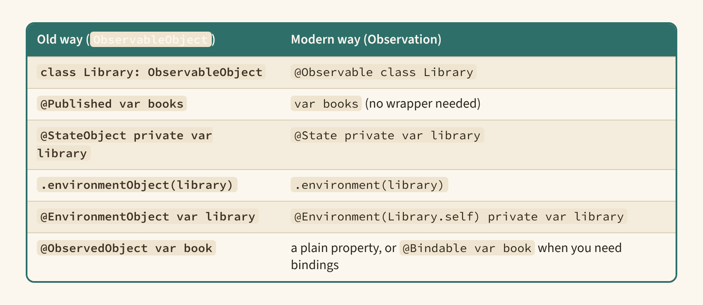{width=100%}

*Figure 5.1 — Old and new data-flow tools, side by side. When an AI hands you something from the left column, this is your map to the right one.*

Two things to keep in mind, both from Apple's guide.

First, **the old way isn't wrong**. `ObservableObject` still works, and Apple says you can migrate one piece at a time. An app can even mix both systems while you move over.^158 So if you inherit old code, you don't have to rewrite it all on a Saturday.

Second, the behavior differs slightly. With `ObservableObject`, a view updates when *any* published property changes, even ones it doesn't read. With `@Observable`, it updates only when a property it reads changes.^159 That's usually better, but it explains the occasional "why didn't my screen update?" when you mix the two.

For new code in this book, we use the modern way, everywhere. When an AI hands you the old way, you'll recognize it, and Chapter 11 shows you how to ask for the modern version and check you got it.

## SwiftData: saving things for real

`@Observable` keeps screens in sync while the app runs. But it still forgets everything when the app closes. To remember things across launches, you need **persistence**, meaning your data is saved to the phone's storage and loaded again next time.

Apple's modern tool for this is **SwiftData**. Apple describes it as combining the proven persistence technology of Core Data, its older and much-used storage framework, with Swift's modern features, so you can add saving to your app "quickly, with minimal code and no external dependencies."^160 For a beginner, it's remarkably gentle. Here are its pieces, one at a time.

**`@Model` turns a class into something SwiftData can save.** Put it in front of a class, and every stored property gets saved automatically:

```swift
import SwiftData

@Model
final class Habit {
    var name: String
    var createdAt: Date

    init(name: String, createdAt: Date = .now) {
        self.name = name
        self.createdAt = createdAt
    }
}
```

A `@Model` class is also observable, so screens update when it changes, exactly like `@Observable`. (The `final` just means no other class can build on this one, which is a sensible default for models.)

**A model container is the storage itself.** You set it up once, at the top of your app, by telling SwiftUI which model types to store:

```swift
WindowGroup {
    ContentView()
}
.modelContainer(for: Habit.self)
```

That one modifier creates the database on the phone, loads what's there and makes it available to every view in the app.^161

**A model context is your workspace.** It's where you insert new things, delete old ones and make changes. Any view can get it from the environment:

```swift
@Environment(\.modelContext) private var modelContext
```

Then inserting and deleting are one line each:

```swift
modelContext.insert(Habit(name: "Walk"))
modelContext.delete(someHabit)
```

You don't even have to remember to save. When you attach a container to your app the way we just did, Apple says the context SwiftUI gives you is set up to save changes for you implicitly. And there's no "update" method at all, because the context automatically keeps track of every change you make to the models it knows about.^162

**`@Query` fetches and watches.** In a view, `@Query` asks SwiftData for all the saved items of a type, keeps the list up to date as things change and can sort it for you:

```swift
@Query(sort: \Habit.createdAt) private var habits: [Habit]
```

That `\Habit.createdAt` is a **key path**, a way of naming a property without reading it. It tells `@Query` "sort by creation date." Add a habit anywhere in the app, and every `@Query` that includes habits updates on its own.^163

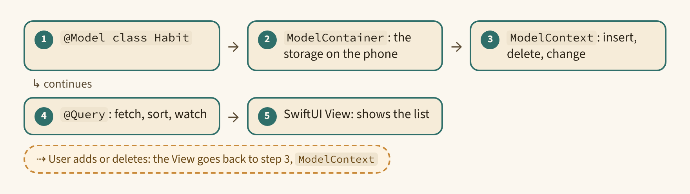{width=100%}

*Figure 5.2 — The SwiftData stack. Follow the loop at the end: the view changes data through the context, and the query brings the change back to the view.*

That's the whole stack: a `@Model` describes your things, a container stores them, a context changes them, and a query shows them. Apple's Develop in Swift tutorials teach exactly these pieces in a unit that builds a birthdays list, and Stanford's CS193p covers them too.^164 Now let's use them for real.

## Rung 3: Daybook is born

Here's the plan for Daybook's first version. You keep a short list of **habits**, things like a walk, ten pages of a book, or a glass of water before coffee. For each habit, you log **entries**: one per day, each with a date, a done check and an optional note. You can add, edit and delete both, and everything is still there when you come back tomorrow.

If you've worked through Apple's Develop in Swift tutorials, this will feel familiar. Their app development unit builds a habit tracker, and their data unit builds a list saved with SwiftData.^165 Hacking with Swift's Bookworm project covers similar ground.^166 Daybook is my own design, but it stands on their shoulders.

### Make the project

Make a new project through **Choose Template**, as in Chapter 2: **iOS**, the **App** template, SwiftUI, Swift. Call it `Daybook`. Choose Swift Testing in the Testing System menu, and tick the Git box. Xcode can also start you from a template for a SwiftUI app that already uses SwiftData, but for Daybook we'll add SwiftData ourselves, so you see every piece go in.^167

### The model

Add a new Swift file called `Models.swift`, and put this in it. These two types, `Habit` and `Entry`, are the heart of Daybook, and we'll keep their names for the rest of the book.

*Models.swift*

```swift
import Foundation
import SwiftData

@Model
final class Habit {
    var name: String
    var symbolName: String
    var createdAt: Date
    @Relationship(deleteRule: .cascade, inverse: \Entry.habit)
    var entries: [Entry] = []

    init(name: String, symbolName: String = "checkmark.circle",
         createdAt: Date = .now) {
        self.name = name
        self.symbolName = symbolName
        self.createdAt = createdAt
    }
}

@Model
final class Entry {
    var date: Date
    var note: String
    var isDone: Bool
    var habit: Habit?

    init(date: Date = .now, note: String = "", isDone: Bool = false,
         habit: Habit? = nil) {
        self.date = date
        self.note = note
        self.isDone = isDone
        self.habit = habit
    }
}
```

Most of this is plain Swift. `symbolName` holds the name of an SF Symbol, so each habit gets its own little icon.

The one new piece is the line starting with `@Relationship`. It says that a `Habit` has many `Entry` objects, and that each `Entry` points back to its habit through its `habit` property. That back-pointer is the **inverse**. Telling SwiftData about it means the two sides stay in sync: set an entry's `habit`, and that entry shows up in the habit's `entries` list on its own. The `deleteRule: .cascade` part means that if you delete a habit, its entries go with it, rather than being left behind as orphans.^168 We'll look at relationships a bit more after the build.

### The app

Open `DaybookApp.swift` (Xcode named it after your project) and make it look like this:

*DaybookApp.swift*

```swift
import SwiftUI
import SwiftData

@main
struct DaybookApp: App {
    var body: some Scene {
        WindowGroup {
            HabitListView()
        }
        .modelContainer(for: [Habit.self, Entry.self])
    }
}
```

That one `.modelContainer` line sets up storage for both types. You can delete `ContentView.swift` now, or leave it; we won't use it.

### The habit list

Add a file called `HabitListView.swift`:

*HabitListView.swift*

```swift
import SwiftUI
import SwiftData

struct HabitListView: View {
    @Environment(\.modelContext) private var modelContext
    @Query(sort: \Habit.createdAt) private var habits: [Habit]
    @State private var showingAddHabit = false

    var body: some View {
        NavigationStack {
            List {
                ForEach(habits) { habit in
                    NavigationLink(value: habit) {
                        Label(habit.name, systemImage: habit.symbolName)
                    }
                }
                .onDelete(perform: deleteHabits)
            }
            .navigationTitle("Daybook")
            .navigationDestination(for: Habit.self) { habit in
                HabitDetailView(habit: habit)
            }
            .toolbar {
                Button("Add Habit", systemImage: "plus") {
                    showingAddHabit = true
                }
            }
            .sheet(isPresented: $showingAddHabit) {
                AddHabitView()
            }
            .overlay {
                if habits.isEmpty {
                    ContentUnavailableView("No habits yet",
                        systemImage: "checklist",
                        description: Text("Tap + to add your first habit."))
                }
            }
        }
    }

    private func deleteHabits(at offsets: IndexSet) {
        for index in offsets {
            modelContext.delete(habits[index])
        }
    }
}

#Preview {
    HabitListView()
        .modelContainer(for: [Habit.self, Entry.self], inMemory: true)
}
```

There's a lot here, but you've met most of it. Let's take the new parts in order.

**`List`** shows rows in the familiar scrolling iPhone style. **`ForEach(habits)`** makes one row per habit. It doesn't need an `id:` this time, because SwiftData models already know how to identify themselves.

**`NavigationLink(value: habit)`** makes each row tappable. Tap it, and `NavigationStack` looks for a matching **`.navigationDestination`**, which says "when someone picks a `Habit`, show a `HabitDetailView` for it." That's how you move from a list to a detail screen and back, with the standard back button and slide animation for free.

**`Label`** shows an icon and a title together, the way iPhone lists usually do.

**`.onDelete`** adds swipe-to-delete. Swipe a row left, tap Delete, and SwiftUI calls `deleteHabits` with the positions of the rows to remove. We look them up in `habits` and ask the model context to delete them. The list updates on its own, because `@Query` is watching.

**`.toolbar`** puts a plus button in the navigation bar. Tapping it flips `showingAddHabit` to `true`, and **`.sheet`** responds by sliding up the add-habit screen from the bottom. When that screen closes, SwiftUI sets `showingAddHabit` back to `false`.

**`.overlay`** with **`ContentUnavailableView`** shows a friendly message when there are no habits yet, instead of an empty white screen. Small touch, big difference to someone opening your app for the first time.

The preview at the bottom uses `inMemory: true`, which gives the canvas its own temporary storage, so you can add and delete things while you design without touching real data.

### Adding a habit

Add `AddHabitView.swift`:

*AddHabitView.swift*

```swift
import SwiftUI
import SwiftData

struct AddHabitView: View {
    @Environment(\.modelContext) private var modelContext
    @Environment(\.dismiss) private var dismiss
    @State private var name = ""
    @State private var symbolName = "checkmark.circle"

    private let symbols = ["checkmark.circle", "figure.walk", "book",
                           "drop", "bed.double", "leaf"]

    var body: some View {
        NavigationStack {
            Form {
                TextField("Habit name", text: $name)
                Picker("Icon", selection: $symbolName) {
                    ForEach(symbols, id: \.self) { symbol in
                        Image(systemName: symbol)
                    }
                }
            }
            .navigationTitle("New Habit")
            .toolbar {
                ToolbarItem(placement: .cancellationAction) {
                    Button("Cancel") { dismiss() }
                }
                ToolbarItem(placement: .confirmationAction) {
                    Button("Save") {
                        let habit = Habit(name: name, symbolName: symbolName)
                        modelContext.insert(habit)
                        dismiss()
                    }
                    .disabled(name.trimmingCharacters(in: .whitespaces).isEmpty)
                }
            }
        }
    }
}
```

Two new things. **`@Environment(\.dismiss)`** gives the sheet a way to close itself; calling `dismiss()` slides it away. And the Save button is **disabled** while the name is empty or just spaces, so nobody can save a habit called nothing. That's one line of code preventing a whole category of confusing bugs.

### The detail screen and the entries

Add `HabitDetailView.swift`:

*HabitDetailView.swift*

```swift
import SwiftUI
import SwiftData

struct HabitDetailView: View {
    @Environment(\.modelContext) private var modelContext
    let habit: Habit
    @State private var entryToEdit: Entry?

    private var sortedEntries: [Entry] {
        habit.entries.sorted { $0.date > $1.date }
    }

    var body: some View {
        List {
            ForEach(sortedEntries) { entry in
                Button {
                    entryToEdit = entry
                } label: {
                    HStack {
                        Image(systemName: entry.isDone
                              ? "checkmark.circle.fill" : "circle")
                        VStack(alignment: .leading) {
                            Text(entry.date,
                                 format: .dateTime.weekday().month().day())
                            if !entry.note.isEmpty {
                                Text(entry.note)
                                    .font(.caption)
                                    .foregroundStyle(.secondary)
                            }
                        }
                    }
                }
            }
            .onDelete { offsets in
                for index in offsets {
                    modelContext.delete(sortedEntries[index])
                }
            }
        }
        .navigationTitle(habit.name)
        .toolbar {
            Button("Log Today", systemImage: "plus") {
                let entry = Entry()
                modelContext.insert(entry)
                entry.habit = habit
                entryToEdit = entry
            }
        }
        .sheet(item: $entryToEdit) { entry in
            EntryEditView(entry: entry)
        }
    }
}
```

The plus button here makes a new `Entry` for today, inserts it, connects it to this habit and opens it for editing straight away. Thanks to the inverse relationship, setting `entry.habit` is enough: the entry appears in `habit.entries` and the list updates.

**`sortedEntries`** is a computed property again, newest first, using a closure with `sorted`, just like the word-sorting example in Chapter 3.

**`.sheet(item:)`** is a cousin of the sheet you used for adding habits. Instead of a true-or-false switch, it watches an optional. When `entryToEdit` holds an entry, the sheet opens for that entry. When it goes back to `nil`, the sheet closes. Optionals, earning their keep.

Finally, the edit screen. Add `EntryEditView.swift`:

*EntryEditView.swift*

```swift
import SwiftUI
import SwiftData

struct EntryEditView: View {
    @Environment(\.dismiss) private var dismiss
    @Bindable var entry: Entry

    var body: some View {
        NavigationStack {
            Form {
                DatePicker("Date", selection: $entry.date,
                           displayedComponents: .date)
                Toggle("Done", isOn: $entry.isDone)
                TextField("Note", text: $entry.note, axis: .vertical)
            }
            .navigationTitle("Entry")
            .toolbar {
                Button("Done") { dismiss() }
            }
        }
    }
}
```

Look at **`@Bindable var entry: Entry`**. That's the `@Bindable` from earlier in this chapter, doing its job with a SwiftData model. It lets you hand `$entry.date`, `$entry.isDone` and `$entry.note` straight to the controls. As someone types a note, the entry changes, and SwiftData keeps the change. There's no Save button, because there's nothing extra to save.

### Try it

Run Daybook in the Simulator. Add a couple of habits. Open one and log today. Tick it done and write a note. Go back, add another habit, delete one with a swipe.

Now the real test. Stop the app in Xcode. Run it again.

Your habits are still there. Your notes are still there. Daybook remembers.

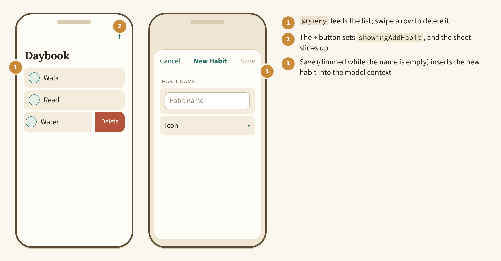{width=100%}

*Figure 5.3 — Daybook's habit list with its add-habit sheet. Follow the callouts from the + button to the sheet and from Save back to the list.*

> **Done when — Rung 3.**
>
> - [ ] You can add, open and delete habits, each with its own icon.
> - [ ] You can log an entry for a habit, mark it done, write a note and delete it with a swipe.
> - [ ] Everything is still there after you stop and relaunch the app.
> - [ ] The empty list shows a friendly message instead of a blank screen.
> - [ ] You can say, in your own words, what `@Model`, the model container, the model context and `@Query` each do.
> - [ ] It's committed.

## Relationships and queries, gently

Daybook already uses one relationship and two kinds of fetching. Let's name what you did, and peek at what's next, without going too deep. You'll use more of this in later chapters as Daybook grows.

### Relationships

A **relationship** connects one kind of model to another. In Daybook, each habit has many entries, and each entry belongs to one habit. That's called a one-to-many relationship, and it's the most common kind.

You described it with `@Relationship` on the habit's side and a plain optional `habit` property on the entry's side. The `inverse:` part tied them together so SwiftData keeps both ends in agreement. The delete rule decided what happens to entries when their habit goes away: `.cascade` deletes them too.^169 Other rules exist, for cases where you'd rather keep the children around. For a journal, cascade is right. Nobody wants a hundred notes belonging to a habit that no longer exists.

Stanford's CS193p covers the same tools, `@Model`, `@Relationship` and the model container, in its SwiftData lectures, and Apple's Develop in Swift has a whole unit on relationships, built around friends and their favorite movies.^170 If relationships still feel fuzzy, either one will give you a second angle.

### Filtering with `#Predicate`

So far, `@Query` has fetched *everything* of a type. Often you want only some things. For that, SwiftData uses a **predicate**: a test that each item either passes or fails. You write one with the `#Predicate` macro, which looks like a small closure:

```swift
@Query(filter: #Predicate<Habit> { habit in
    habit.name.contains("Walk")
}) private var walkingHabits: [Habit]
```

That fetches only the habits whose names include "Walk." The predicate is checked by the storage itself, so you aren't loading everything and throwing most of it away.^171

### Fetching in code with `FetchDescriptor`

`@Query` lives in views. Sometimes you need to fetch data from regular code, like a function that counts how many habits you finished today. For that, you describe what you want with a **`FetchDescriptor`** and ask the model context to fetch it:

```swift
func doneTodayCount(in context: ModelContext) throws -> Int {
    let startOfToday = Calendar.current.startOfDay(for: .now)
    let descriptor = FetchDescriptor<Entry>(
        predicate: #Predicate { entry in
            entry.date >= startOfToday && entry.isDone
        }
    )
    return try context.fetch(descriptor).count
}
```

Read it top to bottom. Work out when today started. Describe a fetch: entries dated today or later that are done. Ask the context to fetch them, and count the results. The `try` is there because fetching can fail, which you'll remember from throwing functions in Chapter 3.

A `FetchDescriptor` can also sort and limit results. You'll use one again when Daybook gets a widget in Chapter 13 and a weekly summary in Chapter 14, both of which need to fetch entries from outside a normal screen.^172

That's preview depth, and it's enough for now. When you need more, Apple's SwiftData documentation is the place to go, and it's one of the friendlier corners of Apple's docs.

## A test for Daybook's model

Remember the quiz test from Chapter 4? Daybook deserves one too, and testing SwiftData code turns out to be pleasantly simple, thanks to one trick: you can make a model container that lives only in memory. It behaves like the real thing, but it vanishes when the test ends, so tests never touch your real data and never trip over each other.

First, put the `doneTodayCount(in:)` function from the last section into `Models.swift`, below the two models, so the app and the tests can both use it. Then open the Swift file in your `DaybookTests` folder and replace its contents with this:

*DaybookTests.swift*

```swift
import Foundation
import SwiftData
import Testing
@testable import Daybook

@MainActor
@Test func doneTodayCountsOnlyFinishedEntries() throws {
    let container = try ModelContainer(
        for: Habit.self, Entry.self,
        configurations: ModelConfiguration(isStoredInMemoryOnly: true)
    )
    let context = container.mainContext

    let walk = Habit(name: "Walk")
    context.insert(walk)

    let finished = Entry(isDone: true)
    let unfinished = Entry(isDone: false)
    context.insert(finished)
    context.insert(unfinished)
    finished.habit = walk
    unfinished.habit = walk

    #expect(try doneTodayCount(in: context) == 1)
    #expect(walk.entries.count == 2)
}
```

Let's read it. `ModelConfiguration(isStoredInMemoryOnly: true)` asks for that temporary, in-memory storage. `container.mainContext` hands us the container's main model context, the same kind of workspace your views get from the environment. The `@MainActor` line says this test runs in the app's main lane of work, which is where that main context lives. Don't worry about what that means yet; Chapter 6 introduces the main actor and Chapter 12 explains it properly.^173

Then we set up a tiny world: one habit, one finished entry and one unfinished one, both from today. And we make two claims. Only one entry counts as done today. And thanks to the inverse relationship, the habit now has both entries in its list, without our ever touching `walk.entries` directly.

Run it with **Product > Test**. Green means your model, your relationship and your fetch all behave. Then do the thing I'll keep asking you to do: break it on purpose. Change `&& entry.isDone` to `|| entry.isDone` in the predicate, run the test, watch it fail, and change it back. A test you've never seen fail is a test you haven't really met.

This test matters more than it looks. In the next chapter, Daybook starts fetching weather and saving it into entries. In Part Three, agents will start editing your code. Each time, this test runs in a second and tells you whether the foundation is still level.

## A preview with something in it

The in-memory trick from the test has a second use that you'll enjoy every day: previews with real-looking data.

Right now, `HabitListView`'s preview starts empty, so the canvas only ever shows "No habits yet." That's useful for checking the empty screen, but you'll want to see rows too, especially when you start styling them. Add a second preview at the bottom of `HabitListView.swift`, under the first one:

*HabitListView.swift*

```swift
#Preview("With habits") {
    let container = try! ModelContainer(
        for: Habit.self, Entry.self,
        configurations: ModelConfiguration(isStoredInMemoryOnly: true)
    )
    let walk = Habit(name: "Walk", symbolName: "figure.walk")
    container.mainContext.insert(walk)
    container.mainContext.insert(Habit(name: "Read", symbolName: "book"))

    let entry = Entry(note: "Round the park", isDone: true)
    container.mainContext.insert(entry)
    entry.habit = walk

    return HabitListView()
        .modelContainer(container)
}
```

What you'll see: the canvas now shows a tab for each preview at the top, "With habits" being the new one. Pick it and you get two rows, Walk and Read, each with its icon. Tap Walk in the live preview and the detail screen shows the entry with its note.

What it means: this is the same in-memory container as the test, made by hand and filled with a few sample objects before the view appears. `.modelContainer(container)` hands that particular container to the view, instead of making a new empty one.^174 Nothing here touches your real Daybook data.

One honest note about `try!`. The exclamation mark means "if this throws an error, crash." In app code I'd steer you away from it, for the same reason I steered you away from force-unwrapping in Chapter 3. In a preview, where a crash just means the canvas shows an error and nobody's data is at stake, it's a common and reasonable shortcut.

## One more small step: log from the list

Here's a small worked step to finish the rung, and it comes with a lesson about reading documentation.

Opening a habit just to say "done today" is a lot of taps. Let's add a swipe from the left edge of a row that logs a finished entry for today. In `HabitListView.swift`, add this function next to `deleteHabits`:

```swift
private func logDone(for habit: Habit) {
    let entry = Entry(isDone: true)
    modelContext.insert(entry)
    entry.habit = habit
}
```

It's the same three steps as the Log Today button in the detail screen: make an entry, insert it, connect it to the habit. Then, inside the `ForEach`, add a modifier under the `NavigationLink`'s closing brace:

```swift
.swipeActions(edge: .leading) {
    Button("Done Today", systemImage: "checkmark") {
        logDone(for: habit)
    }
    .tint(.green)
}
```

Run it and swipe a row to the right. A green Done Today button appears. Tap it, open the habit, and today's entry is there, already ticked.

Now try swiping a row to the left to delete it. It doesn't work any more.

That's not a bug in your code. It's in Apple's documentation for `swipeActions`: when you add swipe actions to a row, SwiftUI no longer makes the Delete action that `.onDelete` would otherwise give you, and you become responsible for creating one.^175 So add a second swipe action, for the trailing edge, right under the first:

```swift
.swipeActions(edge: .trailing) {
    Button("Delete", systemImage: "trash", role: .destructive) {
        modelContext.delete(habit)
    }
}
```

The `.destructive` role makes the button red, the color people expect for delete. Now remove the `.onDelete(perform: deleteHabits)` line and the `deleteHabits` function, since the new button does that job. Run it again and you can swipe both ways.

> **Common mistake: trusting "it worked before."** Adding one feature quietly removed another, and nothing turned red. That happens a lot in real projects, and it's why I keep asking you to try the whole app after every change, not just the new part. When something you didn't touch stops working, check the documentation for the thing you *did* touch. The answer is often sitting right there.

## Commit, and a first AI review

You've just built the foundation of a real app. Before anything else touches it, commit. **Integrate > Commit**, Stage All, and a message like "Daybook rung 3: habits and entries with SwiftData." That's your save point.

Now let's try the next AI habit. In Chapter 3, you asked an assistant to *explain* code. This time, ask it to *review* code. That's a different job: not "what does this do?" but "what might be wrong with it?"

Open `Models.swift`, start a conversation with Xcode's coding assistant, and ask it to look over your model for problems. It may come back with suggestions: maybe that a habit name could be blank, or that you might want an index for faster sorting, or something about how relationships behave. Some suggestions will be good. Some won't apply to an app this size. Some may be flat wrong.

Here's the rule for every review you'll ever get, from an AI or a person: **a suggestion isn't a fact until you've checked it.** For each one, ask: does Apple's documentation say this? Does my test still pass if I make the change? Does the app still do what I want? If the assistant says a SwiftData feature works a certain way, find it in Apple's SwiftData documentation before you believe it. If you can't find it, be suspicious.^176

> **Ask your AI.** After you've committed rung 3.
>
> *Example prompt (written for this book):* "Review Models.swift for a beginner's habit-tracking app built with SwiftData. List up to five possible problems, most important first. For each one, tell me which Apple documentation page explains the issue, and don't change any code yet."
>
> *Verify by:* opening each documentation page it names and checking that the page exists and actually says what the assistant claims. Make only the changes you understand, one at a time, running the app after each, and commit after each one that works.

Notice the last line of that prompt: "don't change any code yet." You're in charge of what changes. The assistant is advising, and you decide. That's a small taste of how we'll work with agents in Part Three, where they can edit your project directly and the stakes are higher.

## Where Daybook stands

Here's what you've got, and what the next chapter builds on. Daybook has two models, `Habit` and `Entry`, saved with SwiftData:

- A `Habit` has a `name`, a `symbolName` for its icon, a `createdAt` date and a list of `entries`.
- An `Entry` has a `date`, a `note`, an `isDone` flag and the `habit` it belongs to.

Habits own their entries, and deleting a habit deletes its entries. There's a list of habits, a sheet for adding them, a detail screen of entries for each habit and an edit sheet for each entry.

What Daybook doesn't have yet is the second half of its name. It knows what you did today. It has no idea what the sky was doing. To find out, your app needs to talk to the internet, which means waiting for answers without freezing up, making sense of what comes back and coping gracefully when nothing comes back at all.

That's next.


# Chapter 6 — Talking to the Internet

{width=100%}


At the end of the last chapter, Daybook could remember things. You could add a habit, log an entry, quit the app, open it again, and everything was still there. That's a real app. It's also a lonely one. It only knows what you tell it.

Now Daybook learns to ask the outside world a question and wait politely for the answer. The question is a simple one: what's the weather like today, where I am? The answer will come from a free weather service on the internet, and Daybook will save it beside each day's entry so that, months from now, you can look back and see that you skipped your walk on a day it poured. Fair enough.

To get there you'll meet three ideas that show up in nearly every app you'll ever build. The first is waiting without freezing, which Swift handles with two small words, `async` and `await`. The second is fetching data and turning it into Swift types you can use, with Apple's `URLSession` and Swift's `Codable`. The third is being kind to the person holding the phone when the network is slow, missing or just plain wrong. That last one is the difference between an app that feels finished and one that feels like a school project.

This is rung 4 of the projects ladder. It's still free. You don't need the paid Apple Developer Program for anything here.

## Waiting without freezing

Here's a thing that's easy to forget when you're new: your app's screen is drawn by one very busy worker. Every scroll, every tap, every little animation goes through it. If you ask that worker to go fetch something from a server on the other side of the world and stand there until it comes back, the whole app stops. Buttons don't respond. Scrolling locks up. To the person holding the phone, your app has frozen.

Swift's answer is a pair of keywords. A function marked `async` is one that might need to pause partway through, usually because it's waiting on something slow. When you call it, you write `await` in front of the call. I read `await` as a little note to the system: "I'll wait here. Go do other things, and come back to me when the answer's ready."^177

That's the whole trick. While your code is parked at an `await`, the busy worker is free to keep drawing the screen and answering taps. When the data arrives, Swift picks your code back up on the very next line, as if nothing happened.

```swift
func loadTodaysWeather() async throws -> DayWeather {
    // This line pauses here until the network answers.
    // The app keeps running smoothly in the meantime.
    let weather = try await weatherService.todaysWeather(
        latitude: 40.71, longitude: -74.01
    )
    return weather
}
```

You'll notice `throws` and `try` riding along. They mean "this can fail," and with networking, it can. The Wi-Fi drops. The server has a bad day. We'll come back to failure properly in a bit.

Two more words you'll hear. A **task** is a unit of asynchronous work, a little job Swift keeps track of. In SwiftUI the easiest way to start one is the `.task` modifier, which starts some async code just before a view appears and cancels it automatically if the view goes away first.^178 That automatic cancel is lovely. If someone opens a screen and closes it a second later, you don't want a forgotten network request still chugging along.

The other word is the **main actor**. That's Swift's name for the busy worker I described, the one that owns the screen. Anything that updates what people see has to happen there. Swift's concurrency rules are built to help you keep it straight, and the compiler will tell you when you've mixed things up.^179 I'm keeping this light on purpose. Chapter 12 gives concurrency the full, unhurried treatment, with a kitchen analogy and everything. For now, the rule of thumb is: start your work from the view with `.task`, `await` the slow part, and update your state when the answer lands.

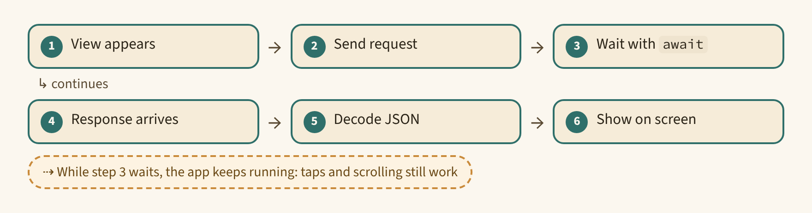{width=100%}

*Figure 6.1 — Request, wait, response, decode, show. Look at the dotted line: while your code waits, the rest of the app keeps working.*

## Fetching data and making sense of it

Most web services that apps talk to answer in **JSON**, short for JavaScript Object Notation. Don't let the name put you off. It's just text arranged in a predictable way, with names and values, lists in square brackets, and groups in curly braces. Here's a trimmed-down version of what the weather service we'll use sends back when you ask about today:

```json
{
  "latitude": 40.71,
  "longitude": -73.99,
  "timezone": "America/New_York",
  "daily": {
    "time": ["2026-11-20"],
    "weather_code": [3],
    "temperature_2m_max": [20.9]
  }
}
```

Read it out loud and it almost makes sense on its own. There's a location, a time zone, and a "daily" group holding three lists: the dates, a weather code for each date, and the day's highest temperature at two meters above the ground, in degrees Celsius. We asked for one day, so each list has one item.^180

Getting that text onto your phone is the job of **URLSession**, Apple's built-in way to talk to web servers. It has been around for years and it's the standard tool.^181 The modern way to use it is a single `await`:

```swift
let (data, response) = try await URLSession.shared.data(from: url)
```

That gives you two things back. `data` is the raw bytes of the answer. `response` tells you how the conversation went, including the HTTP status code. You've seen status codes even if you didn't know it: 404 means "not found." Anything in the 200s means "here you go." It's worth checking, because a server can answer with an error page that's perfectly valid text and perfectly useless to you.

Now the nice part. Raw bytes aren't much use in Swift, but Swift has a protocol called **Codable** that turns JSON into your own types and back again.^182 You describe the shape you expect as a struct, mark it `Codable`, and Swift's `JSONDecoder` does the matching.

There's one small wrinkle. The weather service names things with underscores, like `temperature_2m_max`, and Swift style prefers names like `temperature2mMax`. You bridge the two with a `CodingKeys` enum, a little translation table that says "this Swift name matches that JSON name."

Here's the whole thing. Make a new Swift file in Daybook called `WeatherService.swift`:

*WeatherService.swift*

```swift
import Foundation

/// The parts of Open-Meteo's answer that Daybook cares about.
struct ForecastResponse: Codable {
    let daily: Daily

    struct Daily: Codable {
        let time: [String]
        let weatherCode: [Int]
        let temperature2mMax: [Double]

        enum CodingKeys: String, CodingKey {
            case time
            case weatherCode = "weather_code"
            case temperature2mMax = "temperature_2m_max"
        }
    }
}

/// One day's weather, ready to save on an Entry.
struct DayWeather: Equatable {
    let temperatureC: Double
    let weatherCode: Int
}

enum WeatherError: Error {
    case badResponse
    case noData
}

struct WeatherService {
    func todaysWeather(latitude: Double,
                       longitude: Double) async throws -> DayWeather {
        var components = URLComponents(
            string: "https://api.open-meteo.com/v1/forecast"
        )!
        components.queryItems = [
            URLQueryItem(name: "latitude", value: String(latitude)),
            URLQueryItem(name: "longitude", value: String(longitude)),
            URLQueryItem(name: "daily",
                         value: "weather_code,temperature_2m_max"),
            URLQueryItem(name: "timezone", value: "auto"),
            URLQueryItem(name: "forecast_days", value: "1")
        ]

        let (data, response) = try await URLSession.shared.data(
            from: components.url!
        )

        guard let http = response as? HTTPURLResponse,
              (200..<300).contains(http.statusCode) else {
            throw WeatherError.badResponse
        }

        let forecast = try JSONDecoder().decode(ForecastResponse.self,
                                                from: data)

        guard let code = forecast.daily.weatherCode.first,
              let high = forecast.daily.temperature2mMax.first else {
            throw WeatherError.noData
        }
        return DayWeather(temperatureC: high, weatherCode: code)
    }
}
```

Let's walk through it the way you'd explain it to a friend.

`ForecastResponse` is a mirror of the JSON. It only lists the fields we need. Codable is happy to ignore anything in the JSON you didn't ask for, which keeps your types small. `DayWeather` is Daybook's own tidy version: one temperature, one code. It's what the rest of the app will use, so the rest of the app never has to know what Open-Meteo's JSON looks like. That separation pays off later when you test it, and again if you ever switch weather providers.

`URLComponents` builds the web address piece by piece, so you never have to glue strings together and worry about stray spaces or symbols. The query items are the questions we're asking: where, which daily values, which time zone, and how many days. Setting the time zone to `auto` asks the service to work out the local day from the coordinates, which matters for a journal. You want "today" to mean your today.^183

The `!` after `URLComponents(string:)` and `components.url` deserves a word. It means "I'm sure this isn't empty." Normally I'd tell you to be wary of `!`, and I'll tell you again in Chapter 11, because AI helpers love to scatter it around. Here it's acceptable because the address is a fixed string we wrote ourselves and know is valid. If that ever changes, revisit it.

The `guard` lines are the bouncers at the door. If the status code isn't in the 200s, we stop and throw `badResponse`. If the lists come back empty, we throw `noData`. Only a good, complete answer makes it through to the `return`.

I chose the day's high temperature for Daybook. It's a single, memorable number, and it's the one most people mean when they ask "how warm was it?" You could just as easily ask for the low, or the current temperature. If you do, change the field name in both the query and the `CodingKeys`, and keep them matching.

This pattern, fetch then check then decode into a struct, is the same one Paul Hudson teaches in the Cupcake Corner project of his free *100 Days of SwiftUI* course, if you'd like to see it a second way.^184

## Picking a weather source

You may be wondering why we're using a service called Open-Meteo and not Apple's own weather service. Good question. It comes down to money and timing.

**Open-Meteo** is a free, open weather service. You don't need to sign up or get a key to try it. As I write this in November 2026, its free tier is for non-commercial use, and it allows fewer than 10,000 calls a day. The data comes under the Creative Commons Attribution 4.0 licence, usually written CC BY 4.0, which means you're allowed to use it as long as you give credit. If you build something commercial, Open-Meteo wants you on one of its paid plans.^185

That makes it perfect for learning. A journal that checks the weather once a day for one person makes one call a day. You'd have to try very hard to bump into 10,000.

**WeatherKit** is Apple's weather service. It's excellent, and it's built for apps on Apple's platforms. The catch is that it requires a membership in the Apple Developer Program. As of November 2026, membership includes up to 500,000 WeatherKit calls a month.^186 Back in Chapter 1 we talked about how starting iOS development is free and the $99 a year is for distribution. WeatherKit is one of the extras that comes with that membership.

So here's the plan. Daybook starts on Open-Meteo while you're learning on your free Personal Team. When you enroll in the Developer Program, which you'll do in Chapter 15 if you decide to ship, you can switch Daybook to WeatherKit. Because we tucked all the weather code inside `WeatherService` and gave the rest of the app a simple `DayWeather`, that switch only touches one file. That's not luck. That's the reason we did it that way.

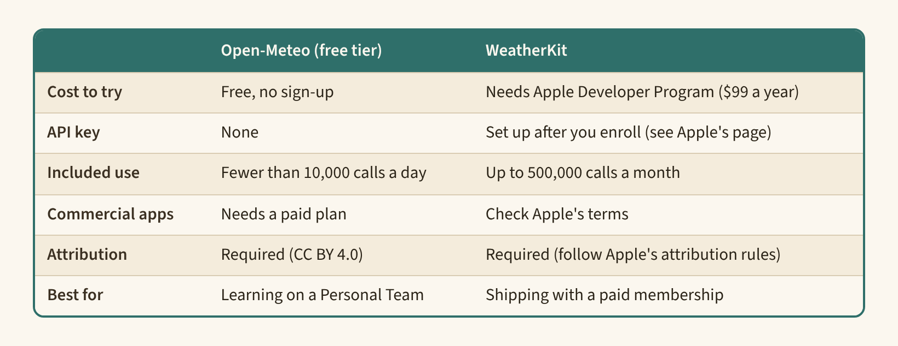{width=100%}

*Figure 6.2 — Open-Meteo versus WeatherKit, as of November 2026. Notice the trade: Open-Meteo is free to start, WeatherKit comes with the membership.*

Two honest caveats about that table. I'm only telling you what each provider's own page says. For Open-Meteo, if your app is commercial, read its terms and pricing yourself before you ship. For WeatherKit, I'm only quoting what's included with membership, not what happens beyond it, because that's what Apple's page covers. Prices and limits change. Check both pages when you get there.

And about attribution: "give credit" isn't optional decoration. When Daybook shows weather from Open-Meteo, put a small, readable line somewhere sensible, like the bottom of the settings screen or under the weather itself, saying the data comes from Open-Meteo. It's the right thing to do and it's part of the licence.

## Rung 4: weather in Daybook

Time to plug it in. There are four jobs: give `Entry` somewhere to keep the weather, find out where the phone is, ask for the forecast, and save it.

### Give each entry a place for the weather

Open `Models.swift` from Chapter 5 and add two new properties to `Entry`:

```swift
@Model
final class Entry {
    var date: Date
    var note: String
    var isDone: Bool
    var habit: Habit?

    // New in rung 4: the day's weather, if we have it.
    var temperatureC: Double?
    var weatherCode: Int?

    init(date: Date = .now, note: String = "", isDone: Bool = false,
         habit: Habit? = nil) {
        self.date = date
        self.note = note
        self.isDone = isDone
        self.habit = habit
    }
}
```

Both new properties are optionals, the "box that might be empty" from Chapter 3. That's deliberate. Entries you made before today don't have any weather, and some entries in the future won't either, because the phone was offline or you said no to location. An optional lets Daybook say "no weather for this one" honestly instead of pretending it was zero degrees and sunny.

A word of caution, since you're changing a model that already has saved data. SwiftData has rules about how it handles changes to your models over time, and I'm not going to promise you how every kind of change behaves. Adding optional properties like these is the gentlest kind of change you can make. Even so, while you're learning, it's fine to delete Daybook from the Simulator and run it fresh if anything looks odd. When your app has real users with real data, read Apple's SwiftData documentation on changing models before you ship a change like this.^187

### Find out where the phone is

To ask for the local weather, Daybook needs a rough idea of where you are. That's location data, and on an iPhone, location is personal. The system won't hand it over unless the person says yes.

Two pieces make that work. The first is a **purpose string**, a short sentence that iOS shows when it asks permission. Apple requires it. Without it, your app can't ask at all. For location while the app is open, the key is called `NSLocationWhenInUseUsageDescription`.^188 You add it in your app target's **Info** settings in Xcode. Xcode usually shows it with a friendlier name that begins "Privacy - Location When In Use."

Write the purpose string the way you'd explain it to a friend, not a lawyer. Something like: "Daybook uses your location once a day to save the local weather with your journal entry." Short, true, and it tells people exactly what they get. People say yes to clear requests far more readily than vague ones, and they should be able to say no without anything breaking.

The second piece is the code that asks. Apple's Core Location framework handles this. Make a new file called `LocationProvider.swift`:

*LocationProvider.swift*

```swift
import CoreLocation

enum LocationError: Error {
    case denied
    case unavailable
}

@MainActor
final class LocationProvider {
    private let manager = CLLocationManager()

    /// Asks permission if needed, then returns one location fix.
    func currentCoordinate() async throws -> CLLocationCoordinate2D {
        manager.requestWhenInUseAuthorization()

        for try await update in CLLocationUpdate.liveUpdates() {
            if update.authorizationDenied {
                throw LocationError.denied
            }
            if let location = update.location {
                return location.coordinate
            }
        }
        throw LocationError.unavailable
    }
}
```

Here's what's going on. `requestWhenInUseAuthorization()` asks for permission to use location while the app is open. The first time, iOS shows its permission alert with your purpose string. After that, it remembers the answer, and calling it again does nothing visible.^189

`CLLocationUpdate.liveUpdates()` is a stream of location updates you can loop through with `for try await`. It's the same `await` idea from earlier, just repeated: "wait for the next update, then the next." We don't want a stream, though. We want one good location. So the moment an update carries a location, we return it, and returning ends the loop. If an update says permission was denied, we stop and throw an error so the app can carry on without weather.^190

The `@MainActor` at the top keeps this class on the main actor, which is the simplest safe choice while you're learning. Chapter 12 explains when and why you'd do otherwise.

Core Location has changed over the years, and you'll find older examples online that use a "delegate" pattern with several callback methods. That older style still works. The one above is the newer, shorter style, and `authorizationDenied` needs iOS 18 or later, which is fine for Daybook. If your project needs to support older versions, check Apple's Core Location documentation for the right approach for your target.

### Ask, save, done

Now let's tie it together. Daybook should fetch the weather when you open today's entry, and save it on that entry. In Chapter 5 you built `EntryEditView`, the form where you edit an entry's date, done check and note. Here it is again with the weather added. The new parts are the `weatherState` property, the Weather section, the `.task` modifier and the `loadWeatherIfNeeded()` function:

*EntryEditView.swift*

```swift
import SwiftUI
import SwiftData

struct EntryEditView: View {
    @Environment(\.dismiss) private var dismiss
    @Bindable var entry: Entry
    @State private var weatherState: WeatherState = .idle

    private let weather = WeatherService()
    private let location = LocationProvider()

    var body: some View {
        NavigationStack {
            Form {
                DatePicker("Date", selection: $entry.date,
                           displayedComponents: .date)
                Toggle("Done", isOn: $entry.isDone)
                TextField("Note", text: $entry.note, axis: .vertical)

                Section("Weather") {
                    WeatherRow(state: weatherState,
                               temperatureC: entry.temperatureC,
                               weatherCode: entry.weatherCode)
                }
            }
            .navigationTitle("Entry")
            .toolbar {
                Button("Done") { dismiss() }
            }
            .task {
                await loadWeatherIfNeeded()
            }
        }
    }

    private func loadWeatherIfNeeded() async {
        // Only fetch for today's entry, and only once.
        guard Calendar.current.isDateInToday(entry.date),
              entry.temperatureC == nil else {
            weatherState = .loaded
            return
        }
        weatherState = .loading
        do {
            let spot = try await location.currentCoordinate()
            let today = try await weather.todaysWeather(
                latitude: spot.latitude, longitude: spot.longitude
            )
            entry.temperatureC = today.temperatureC
            entry.weatherCode = today.weatherCode
            weatherState = .loaded
        } catch {
            weatherState = .failed
        }
    }
}
```

`@Bindable` is the modern way, from Chapter 5, to let a view edit a model object directly. Because `entry` is a SwiftData model, setting `entry.temperatureC` is all it takes. SwiftData notices the change and saves it with the rest of your data.^191

`.task` kicks off the work just before the screen appears, and cancels it if you leave early.^192 The `guard` at the top makes sure we only fetch for today's entry, and only once. Opening last Tuesday's entry shouldn't stamp it with today's weather, and opening today's entry a second time shouldn't fetch it again. For older entries without weather, the row will simply say so.

> **Try this.** The Simulator doesn't have a real GPS, but it can pretend to be somewhere. Look for the option to simulate a location where your simulated iPhone runs (in Xcode 27 that's Device Hub, from Chapter 2), pick a city, then open today's entry and watch the permission alert appear with your purpose string. Tap "Allow While Using App" once, and "Don't Allow" on a fresh install, so you see both paths.

You'll notice `WeatherState` and `WeatherRow`. I haven't shown you those yet, and that's on purpose. They're the subject of the next section, because what you show while you wait, and when things go wrong, deserves its own conversation.

### Turning a code into a picture

Open-Meteo describes the sky with a number from a World Meteorological Organization table: 0 is a clear sky, 1 to 3 run from mainly clear to overcast, 45 and 48 are fog, the 50s are drizzle, the 60s are rain, the 70s are snow, the 80s are showers, and 95 to 99 are thunderstorms.^193 A number is great for storing and terrible for reading, so here's a small function that turns it into an SF Symbols name for display:

```swift
func symbolName(forWeatherCode code: Int) -> String {
    switch code {
    case 0: return "sun.max"
    case 1, 2: return "cloud.sun"
    case 3: return "cloud"
    case 45, 48: return "cloud.fog"
    case 51...57: return "cloud.drizzle"
    case 61...67, 80...82: return "cloud.rain"
    case 71...77, 85, 86: return "cloud.snow"
    case 95...99: return "cloud.bolt.rain"
    default: return "questionmark.circle"
    }
}
```

Look the symbol names up in Apple's free SF Symbols app before you rely on them. It's the source of truth for what exists and what each one looks like.^194 And because this is a plain function with no screen involved, it's an easy one to test. We'll do exactly that in Chapter 8.

> **Done when — Rung 4.**
>
> - [ ] Opening today's entry fetches the weather and saves the day's high temperature and weather code on it.
> - [ ] Daybook asks for location with a clear, friendly purpose string, and still works if you say no.
> - [ ] Old entries without weather still open and look fine.
> - [ ] With Wi-Fi off, Daybook shows a kind message instead of spinning forever (next section).
> - [ ] Open-Meteo is credited somewhere a person can see it.
> - [ ] You've committed your work, with a message that says what changed.

## Loading, empty and error states

Here's a test I'd like you to try, because it teaches more than any paragraph I could write. Run Daybook in the Simulator, then turn off your Mac's Wi-Fi, and open today's entry.

If you'd built the weather row the quick way, with no thought for failure, one of two things happens. Either a spinner spins forever, or the weather section just sits there blank, and the person holding the phone has no idea whether to wait, give up, or blame themselves. Neither is kind.

Every screen that waits on the network can be in one of a handful of situations, and it helps to name them out loud:

- **Idle.** Nothing has happened yet.
- **Loading.** We've asked and we're waiting.
- **Loaded.** We have an answer and we're showing it.
- **Empty.** We asked, and the honest answer is "nothing to show." For Daybook, that's an entry with no weather saved.
- **Failed.** Something went wrong: no connection, the server said no, or the location permission was denied.

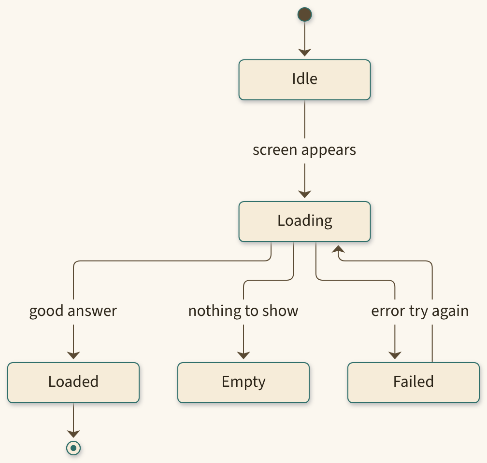{width=100%}

*Figure 6.3 — The five states of a screen that waits. Follow the arrow from Failed back to Loading: a good app always offers a way to try again.*

The neat thing about Swift is that you can turn that list straight into code with an **enum**, which you met in Chapter 3. An enum says "it's exactly one of these, never two at once, never something else." That's precisely what a loading state is.

```swift
enum WeatherState {
    case idle
    case loading
    case loaded
    case failed
}
```

I've folded "empty" into what the row shows when the state is loaded but the entry has no weather. You could just as well give it its own case. Then the view simply switches over the state and shows the right thing for each:

```swift
struct WeatherRow: View {
    let state: WeatherState
    var temperatureC: Double?
    var weatherCode: Int?

    var body: some View {
        switch state {
        case .idle:
            EmptyView()
        case .loading:
            ProgressView("Checking the weather…")
        case .loaded:
            if let temperatureC, let weatherCode {
                Label(
                    temperatureC.formatted(.number.precision(
                        .fractionLength(0))) + "°C",
                    systemImage: symbolName(forWeatherCode: weatherCode)
                )
            } else {
                Text("No weather saved for this day.")
                    .foregroundStyle(.secondary)
            }
        case .failed:
            Text("Couldn't get the weather right now. Your entry is saved.")
                .foregroundStyle(.secondary)
        }
    }
}
```

That's why `EntryEditView` passes the entry's temperature and weather code along to the row.

Notice the wording of the failure message. It says what happened in plain words, and then it says the thing the person is actually worried about: your entry is saved. The weather is a nice extra. Their journal is the point. A good error message answers the question the user is really asking.

A few habits that will serve you on every app:

- **Never spin forever.** If you show a spinner, something must eventually replace it, whether that's a result or a message.
- **Keep what you have.** If the network fails, don't wipe out the weather you already saved. Daybook's "fetch once" rule handles that for us.
- **Offer a way forward.** For a screen where the network is the whole point, add a "Try again" button that sets the state back to loading. SwiftUI's `.refreshable` modifier gives you pull-to-refresh on lists for the same purpose.^195 For a screen with nothing to show at all, Apple's `ContentUnavailableView` gives you a ready-made, nicely designed empty state.^196
- **Don't blame the user.** "Something went wrong" beats "Invalid request." "You're offline" beats both, when you know it's true.

Now turn your Wi-Fi back on and try it again. You'll see the little progress spinner, then the weather. That's the whole loop working.

## Let your AI draft the structs, then check its homework

Writing `Codable` structs by hand is a little tedious. You look at the JSON, you type a matching property for each field, you get the types right, you fix the names that have underscores. It's exactly the kind of careful, boring work that AI helpers are good at. It's also exactly the kind of work where a confident mistake can hide.

So this is your first proper rep of a habit the rest of the book keeps coming back to: let the AI type, and you stay the author.

Here's how I'd do it. First, get a real response. Not a description of one, not what you imagine it looks like, the actual text. You can paste the full Open-Meteo address with your query into a web browser and it will show you the JSON right there. Copy it.

Then hand it to whichever assistant you're using. Xcode's coding assistant is the obvious choice since it's right there next to your code, and you can select code and ask it to explain or change things.^197 We'll set it up properly in Chapter 9, but if you've already turned it on, go ahead.

> **Ask your AI.** Use this when you have a real JSON response and want Swift types for it.
>
> *Example prompt (written for this book):* "Here is a real JSON response from the Open-Meteo forecast API. Write Swift `Codable` structs that decode only the `daily` section's `time`, `weather_code` and `temperature_2m_max` fields. Use Swift-style property names and a `CodingKeys` enum for the JSON names. Don't add fields I didn't ask for. [paste the JSON]"
>
> *Verify by:* comparing every property against the provider's own documentation, field by field, then decoding the saved sample in a test (Chapter 8).

When the answer comes back, don't just paste it in. Check it the way an editor checks a draft:

1. **Is every field real?** Find each one in Open-Meteo's documentation. An assistant can invent a perfectly reasonable-sounding field that doesn't exist, or misspell one by a single letter. JSON decoding is strict. One wrong key and the whole decode fails.
2. **Are the types right?** Is the temperature a `Double`? Is the weather code an `Int`? Are the daily values lists, in square brackets, rather than single values? That last one catches people. Open-Meteo's daily values come back as lists even when you ask for one day.
3. **Did it add things you didn't ask for?** Extra fields aren't harmful by themselves, but every field you decode is a field that can fail to decode. Smaller is safer.
4. **Does it compile, and does it actually decode?** Build the project. Then, and this is the real test, decode the sample JSON you saved. If it works on the real text, you're in good shape. In Chapter 8 we'll turn that check into an automatic test that runs every time.

This might feel like a lot of fuss for three fields. It is, a little. But you're building a reflex, and the reflex is what matters when the response has forty fields and the stakes are higher. Chapter 11 is all about why this checking matters and where AI help tends to go wrong.

## Keeping keys out of your code

Open-Meteo doesn't need a key, which is one of the reasons I picked it. Most other web services do. An **API key** is a long, secret string that identifies your app to a service, a bit like a password. It's how the service knows who's calling and, often, who to bill.

That last part is why keys matter. If someone gets your key, they can make calls as you, and if the service charges by the call, the bill comes to you.

So here's the rule, and I'd like you to treat it as unbreakable: **never put a secret in your source code, and never commit one to Git.** Not even "just for now." Git remembers everything. If you commit a key and delete it in the next commit, it's still sitting in your history for anyone with a copy of your repository to find.

The first line of defense is a file called `.gitignore`. It's a plain text file at the top of your project that lists files Git should pretend don't exist. Put your secrets in a separate file, list that file in `.gitignore`, and Git will never pick it up.^198 Before every commit, glance at the list of changed files Xcode shows you. If you see anything that looks like a secret, stop.

I'll be honest with you about the limits. A key that ships inside your app can, with effort, be dug back out of the app by someone determined. Keeping it out of Git protects you from the most common mistake, which is publishing it by accident. It doesn't make a shipped key truly private. For keys that really matter, the safer pattern is to keep them on a server you control, or to store user-specific secrets in the iPhone's **Keychain**, Apple's secure storage for small bits of private data like passwords and tokens.^199 Chapter 11 goes into all of that, including what happens to your code when you share it with an AI helper.

For now, Daybook has no secrets, which is a fine way to start.

Your app talks to the internet now. It waits without freezing, decodes what comes back, saves the weather beside each day, and stays polite when things go wrong. It works.

The next question is a better one. It works for you. Does it work for everyone?


# Chapter 7 — Built for Everyone: Accessibility, Design, and Languages

{width=100%}


Daybook works. You can track habits, write a note, and see the weather beside each day. If you've been testing it on your own iPhone, it probably feels pretty good in your hand.

Here's the thing, though. You've been testing it as you. With your eyes, your hands, your text size, your language. Plenty of the people who might use your app don't hold a phone the way you do. Some can't see the screen at all and listen to it instead. Some have the text cranked up so large that half your layout falls off the edge. Some see red and green as the same color. Some read Spanish, or Japanese, or Arabic, before they read English.

None of them are edge cases. They're people. And the wonderful news is that Apple has done an enormous amount of the hard work for you. If you build with SwiftUI's standard pieces and make a few thoughtful choices, Daybook can work well for far more people than you'd guess, without a rewrite.

On the projects ladder, this kind of polish officially belongs to rung 7. I'm bringing it forward on purpose. It's much easier to build an app that's accessible from the start than to bolt it on at the end, and Daybook is still small enough that this pass takes an afternoon, not a month.

## Why accessibility is just good craft

**Accessibility** means making sure people can use your app regardless of their abilities or how they use their devices. Apple's Human Interface Guidelines, the HIG for short, put it simply. An accessible interface, they say, is intuitive, perceivable and adaptable.^200

Let me translate those three words.

*Intuitive* means familiar and consistent. Buttons look like buttons. Things that work the same way behave the same way. That's good for everybody, and it's essential for someone using a screen reader, who can't glance around to work out what's going on.

*Perceivable* means your app doesn't rely on one single way to get information across. If something only shows up as a color, a person who can't distinguish that color misses it. If something only makes a sound, a person who can't hear misses it. Give people more than one way in.

*Adaptable* means your app respects the settings people have chosen on their device: bigger text, Dark Mode, reduced motion, a different language. People set those for a reason, and a good app goes along with them instead of fighting them.

Apple treats it the same way in its own teaching. The habit-tracking app in Apple's free Develop in Swift Tutorials, which is a close cousin of Daybook, covers accessibility and localization right alongside SwiftData and debugging, not as an optional extra at the end.^201 That ordering is a hint worth taking.

I like to think of accessibility as craft, the same way a carpenter thinks about sanding the edges of a table. Nobody writes a five-star review because the edges were smooth. But everybody notices a splinter. And here's the bit that surprises people: almost everything you do for accessibility makes the app better for everyone. Clear labels help a tired person at midnight. Large-text support helps someone without their reading glasses. Not relying on color alone helps someone using their phone in bright sunshine.

Apple also offers a tool called Accessibility Inspector for auditing your interface and seeing how your app describes itself to accessibility features. The HIG recommends you use it as you design.^202 We'll lean mostly on VoiceOver and previews in this chapter, because they're the most direct way to feel what your users feel, but the Inspector is worth knowing about.

## VoiceOver: labels, values, hints

**VoiceOver** is the screen reader built into every iPhone. It reads aloud what's on the screen and lets people move around and act using gestures, without needing to see the display.^203 Blind and low-vision people use it every day to do everything you do on your phone.

When VoiceOver lands on a control, it reads out a few pieces of information, in order. It helps to know the names:

- **Label**: what the thing *is*. "Add habit." "Morning walk."
- **Value**: what state it's in right now. "Done." "Not done." "18 degrees."
- **Hint**: what will happen if you act on it, when that isn't obvious. "Double-tap to mark as done."
- **Trait**: what kind of thing it is. "Button." "Heading." "Selected."

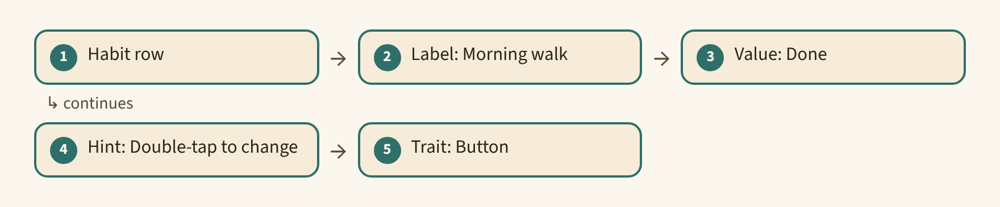{width=100%}

*Figure 7.1 — How VoiceOver reads a control: label, value, hint, trait. Read it left to right, the same order VoiceOver speaks.*

The good news is that SwiftUI fills in a lot of this for you. A `Button("Add habit")` already has the label "Add habit" and the trait "button." A `Toggle("Done today", isOn: $entry.isDone)` already has a label and announces whether it's on or off. Standard controls with real text are mostly accessible out of the box.

The trouble starts with things that don't have words. The most common culprit, by far, is an icon-only button:

```swift
// VoiceOver can only guess what this does.
Button {
    showingAddSheet = true
} label: {
    Image(systemName: "plus")
}
```

VoiceOver might read that as "Add" or might read the symbol's name, depending on the symbol. Either way, you're leaving it to chance. Fix it by giving it a real label. The nicest way is to use a `Label`, which carries both words and an icon, and shows just the icon when you want it to:

```swift
Button {
    showingAddSheet = true
} label: {
    Label("Add habit", systemImage: "plus")
}
```

In a toolbar, that shows the plus icon, and VoiceOver says "Add habit, button." Lovely. The Add Habit button you built in Chapter 5, `Button("Add Habit", systemImage: "plus")`, already works this way, because it carries a title as well as an icon. Keep that habit for every icon you add from now on.

There's one spot in Daybook that needs exactly this fix, and it's a good example of how easy these are to miss. In Chapter 5, the add-habit sheet has a picker for choosing an icon, and each choice is just an image:

```swift
Picker("Icon", selection: $symbolName) {
    ForEach(symbols, id: \.self) { symbol in
        Image(systemName: symbol)
    }
}
```

It looks fine. To a sighted person, a little walking figure obviously means walking. But VoiceOver has no words to go on, so the best it can do is guess from the symbol's name, which might come out as something like "figure walk," or worse. The fix is to give each choice a human label:

```swift
Picker("Icon", selection: $symbolName) {
    ForEach(symbols, id: \.self) { symbol in
        Image(systemName: symbol)
            .accessibilityLabel(iconName(for: symbol))
    }
}
```

Here `iconName(for:)` is a small function you write that turns "figure.walk" into "Walking," "book" into "Reading," "drop" into "Water," and so on. Five minutes of work, and the picker makes sense with your eyes closed. That's the whole craft in miniature: notice where meaning lives only in a picture, and give it words.

When you can't use a `Label`, SwiftUI's accessibility modifiers let you set each piece yourself.^204 Here's Daybook's weather icon, which on its own means nothing to someone who can't see it:

```swift
Image(systemName: symbolName(forWeatherCode: code))
    .accessibilityLabel("Weather")
    .accessibilityValue("Rain")
```

For a habit row that shows a name, a checkmark and a streak, VoiceOver would normally stop on each piece separately, which is tedious. You can combine them into one element that reads naturally:

```swift
HStack {
    Image(systemName: habit.symbolName)
        .accessibilityHidden(true) // decorative here
    Text(habit.name)
    Spacer()
    Image(systemName: isDoneToday ? "checkmark.circle.fill" : "circle")
}
.accessibilityElement(children: .combine)
.accessibilityValue(isDoneToday ? "Done today" : "Not done today")
```

`accessibilityElement(children: .combine)` tells VoiceOver to treat the row as one thing and read its parts together.^205 `accessibilityHidden(true)` hides a purely decorative image. The HIG is clear on this: describe meaningful images, and skip the decorative ones, which shows respect for people's time.^206

Two more VoiceOver habits from the HIG are worth building in early. First, use titles and headings. When someone arrives on a screen, the title is the first thing VoiceOver tells them, and headings help them jump around a long screen without listening to every line. Give each screen a clear navigation title, and mark section headings as headings:^207

```swift
Text("This week")
    .font(.headline)
    .accessibilityAddTraits(.isHeader)
```

Second, think about order and grouping. VoiceOver reads in the same order people read in their language, which in English is top to bottom, left to right. If two things belong together visually, like a weather icon and its temperature, make sure VoiceOver hears them together too. That's exactly what `.combine` does.

Hints are optional. Use them only when the action isn't obvious from the label. "Add habit, button" doesn't need a hint. A row where a long press does something special might.

> **Try this.** Turn on VoiceOver on your iPhone (you'll find it under Accessibility in the Settings app), open Daybook, and close your eyes. Try to add a habit and mark it done. Swipe right to move to the next item, and double-tap to activate. Note every place you got lost or heard something unhelpful, like a symbol name or nothing at all. That list is your to-do list. Turn VoiceOver off the same way when you're done. It feels strange at first; give it five minutes.

## Big text, dark rooms

**Dynamic Type** is the iPhone setting that lets people choose how big text should be across every app. Some people turn it down to fit more on the screen. Many more turn it up, sometimes a long way up. The HIG suggests that, ideally, people should be able to enlarge text by at least 200 percent.^208

If you use SwiftUI's built-in text styles, like `.font(.body)`, `.font(.headline)` and `.font(.title)`, rather than fixed point sizes, your text follows the person's setting automatically. That's the single most important thing you can do. Fixed sizes like `.font(.system(size: 14))` ignore the setting completely, and that's a splinter.

Bigger text is the easy part. The hard part is layout. A row that looks tidy at the default size can wrap, overlap, or get cut off at the largest size. The way to find out is to look, and previews make that quick. You met `#Preview` in Chapter 4. You can preview the same screen at the biggest accessibility size like this:^209

```swift
#Preview("Largest text") {
    HabitListView()
        .dynamicTypeSize(.accessibility5)
        .modelContainer(for: [Habit.self, Entry.self], inMemory: true)
}
```

`.accessibility5` is the largest size there is. If your screen still makes sense there, it'll make sense everywhere in between.

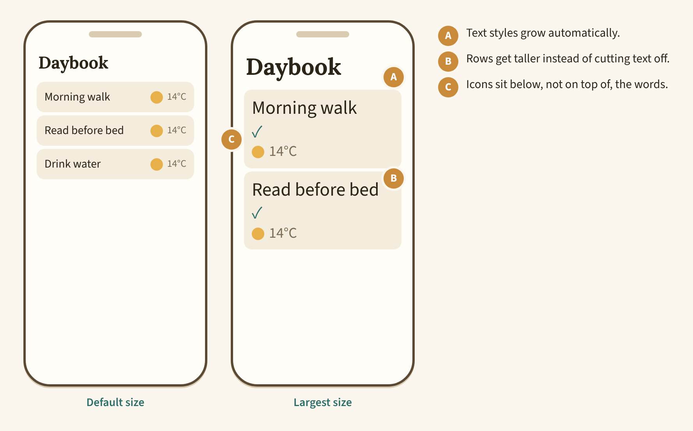{width=100%}

*Figure 7.2 — The same Daybook screen at the default size and at the largest Dynamic Type size. Look at how the rows grow taller rather than chopping off words.*

When things break at large sizes, a few fixes cover most cases. Let text wrap rather than truncating it, which SwiftUI's `Text` does by default unless you've told it otherwise with a line limit. Avoid fixed heights on rows. And when a horizontal row just can't fit, it's fine to stack things vertically at big sizes. SwiftUI gives you a `dynamicTypeSize` value you can read from the environment to make that choice.^210

**Dark Mode** is the other setting almost everyone touches. People switch it on at night, or all the time because they like it. The HIG's advice is to prefer system-defined colors, because they have accessible variants that adapt automatically to light and dark appearances and to settings like Increase Contrast.^211

In SwiftUI that means using colors like `.primary`, `.secondary` and `Color(.systemBackground)` instead of hard-coded white and black. If you write `.foregroundStyle(.black)` you'll get black text on a black background the first time someone opens Daybook at night. Use `.foregroundStyle(.primary)` and it'll be black in light mode and white in dark mode, without any extra work.

Preview Dark Mode the same way you previewed big text:

```swift
#Preview("Dark") {
    HabitListView()
        .preferredColorScheme(.dark)
        .modelContainer(for: [Habit.self, Entry.self], inMemory: true)
}
```

Keep a couple of these previews around permanently. They're cheap, and they catch problems the moment you introduce them rather than the day a user emails you.

## Color, contrast and motion

Three quick habits, all straight from the HIG, that round out the visual side.

**Don't let color carry the message alone.** Some people have trouble telling certain colors apart. Red and green is the classic pairing, and blue and orange is another. If Daybook showed "done" as a green dot and "not done" as a red dot, a lot of people would see two identical dots. The HIG's advice is to add a second signal, like a distinct shape or icon, alongside color.^212 That's why Daybook uses a filled checkmark for done and an empty circle for not done. The color is a bonus. The shape is the message.

**Give text enough contrast.** Light gray text on a white background looks elegant in a design mockup and is miserable to read on a bus. The HIG points to the WCAG Level AA contrast guidance that Accessibility Inspector uses: at least 4.5 to 1 for text up to 17 points, and 3 to 1 for larger or bold text.^213 You don't need to calculate ratios by hand for most of Daybook, because system colors like `.primary` and `.secondary` are designed to meet these needs. Where you pick your own colors, check them in both light and dark mode.

**Go easy on motion.** Fast-moving, blinking or bouncing animations can be distracting, and for some people they cause dizziness or worse. People who are sensitive to motion can turn on a setting called Reduce Motion, and the HIG asks apps to respond by cutting back on automatic and repetitive animations, swapping sliding transitions for fades, for example.^214 In SwiftUI you can read that setting from the environment and pick a gentler animation when it's on:

```swift
@Environment(\.accessibilityReduceMotion) private var reduceMotion

// ...
.animation(reduceMotion ? nil : .spring, value: isDoneToday)
```

If Daybook has a little celebratory bounce when you finish a habit, this keeps the celebration and drops the bounce for people who'd rather not have it.

Here's a bonus from the HIG worth stealing: controls should be big enough to hit comfortably. On iPhone the recommended default size for a tappable control is 44 by 44 points, with 28 by 28 as the minimum.^215 Tiny icon buttons are a common splinter.

## Speaking more languages with String Catalogs

Now for the other half of "everyone": people who don't read English, or would simply rather read their own language.

Making your app work in more than one language is called **localization**. Apple's tool for it is the **String Catalog**, a file with the extension `.xcstrings` that holds every piece of user-facing text in your app, along with its translations, all in one place, with a visual editor in Xcode.^216

The lovely surprise is how much of the work Xcode does on its own. Most text you put inside SwiftUI views, like `Text("Done today")` or `Button("Add habit")`, is automatically treated as localizable. You don't have to wrap it in anything special. Here's the flow, using Apple's own steps:^217

1. **Add a catalog.** Choose **File > New > File from Template**, type "string" in the filter field, choose String Catalog, and accept the default name, `Localizable`.
2. **Build.** Choose **Product > Build**. Xcode scans your app, finds the user-facing text, and fills the catalog for you. Every time you build after that, it keeps the catalog up to date.
3. **Add a language.** In the catalog editor, click the Add button (+) at the bottom of the sidebar and pick a language, say Spanish.
4. **Translate.** Fill in each string for the new language. Xcode marks new strings as needing translation and shows a percentage for each language, turning into a green checkmark when everything is done.

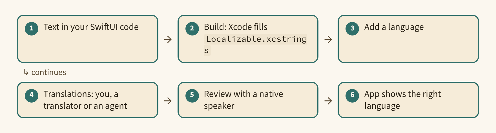{width=100%}

*Figure 7.3 — The String Catalog flow. The step people skip is the second-to-last one, so look for it.*

One small feature is worth turning on while you're here. Translators, human or otherwise, do much better work when they know where a string appears. "Done" on a button and "Done" as a status can need different words in another language. Xcode can generate a short comment for each string describing where it's used: Control-click a key in the catalog editor and choose **Generate Comment**, or turn on automatic comments for all projects in **Xcode > Settings > Editing**.^218 You can also write your own comments. Either way, they travel with the strings to whoever translates them.

### Plurals, the sneaky part

Here's something that trips up nearly everyone who's never localized an app. Daybook will want to say things like "1 day streak" and "5 day streak." Or, more naturally, "1 day" and "5 days." In English that's two forms: one, and everything else. Other languages have different rules. Some have three or four forms depending on the number. You can't solve that with an `if` statement in your code, and you shouldn't try.

String Catalogs handle it for you. Write the text with the number interpolated, the way you normally would:

```swift
Text("\(streak) days")
```

Then, in the catalog editor, Control-click that key and choose **Vary by Plural**. Xcode adds the right plural forms for each language: One and Other for English, and more forms for languages that need them, like One, Few, Many and Other for Russian. You fill in each one.^219 Your code never changes. The catalog chooses the right form at run time based on the number and the language.

### Letting Xcode's agents translate

Xcode 27 adds something new here. Its agents can work with String Catalogs directly, using tools Apple built for reading, planning and editing translations. Apple says agents in Xcode 27 can add languages, update catalogs and translate strings, and that Xcode gives the agents context about your app and language-specific style guidelines as they translate.^220

That's genuinely helpful. It gets you a complete first draft in a new language in minutes rather than days. It is also only a first draft.

Machine translation, whether from an AI agent or anywhere else, can be fluent and wrong at the same time. It can pick a word that's technically correct and socially odd, miss a cultural meaning, or translate a button label into something three times longer that no longer fits. I'm not going to make any claims about how good these translations are, because I don't have a source that measures that. What I can tell you is the rule I'd follow: **before you ship a language, have a native speaker read every screen.** A friend, a family member, a paid translator, someone in your community. If you can't find anyone, think hard about whether to ship that language yet.

### Numbers, dates and temperatures

Words aren't the only thing that changes between languages and regions. Dates, numbers and units do too. An American reads 3/4 as March 4. Most of Europe reads it as the 3rd of April. A decimal point in one country is a comma in another. And Daybook stores temperatures in Celsius, while plenty of people in the United States think in Fahrenheit.

The fix is to never build these strings by hand. Let Apple's formatters do it, and they'll follow the person's region settings automatically. Apple's localization documentation points you to formatters for exactly this reason.^221 For Daybook's dates, `entry.date.formatted(date: .abbreviated, time: .omitted)` gives each person the format they expect. For the temperature, wrap the number in a `Measurement` and let the system choose the unit:

```swift
let temperature = Measurement(value: temperatureC,
                              unit: UnitTemperature.celsius)
Text(temperature.formatted(.measurement(width: .abbreviated)))
```

Store in Celsius, show in whatever the person prefers. That one change makes Daybook feel local in a way that translating the words alone never could. If you do it, go back to the `WeatherRow` from Chapter 6 and swap out the hand-built "°C" string.

Then test it yourself. Xcode lets you run your app in a different language without changing your whole Mac or phone, and you can preview a view in another locale too. Look at every screen. Long German words and right-to-left Arabic layouts are where cracks tend to show.

## Testing it the way your users do

VoiceOver is the big one, but your iPhone has a whole set of accessibility settings, and each one is a quick, free test. Spend ten minutes with Daybook and a few of them switched on, one at a time. Make the text much larger. Turn on Bold Text. Turn on Increase Contrast, which the HIG specifically mentions: if your colors don't meet contrast guidance by default, they should at least improve when this setting is on.^222 Turn on Reduce Motion and watch your animations. Switch to Dark Mode at night and actually use the app.

None of these needs special tools. They're all in the Settings app on your iPhone, under Accessibility, and they're exactly what your users have turned on.

On your Mac, Apple's Accessibility Inspector is the more technical companion. The HIG describes it as a way to highlight accessibility issues and understand how your app represents itself to people using accessibility features, and it's the tool the HIG's contrast guidance is built around.^223 Open it once, point it at Daybook running in the Simulator, and look at what it reports for a few of your controls. It's a good way to see the label, value and traits from Figure 7.1 for yourself.

There's one more reason to care, and it's a practical one. The HIG notes that you can tell people how accessible your app is on the App Store using Accessibility Nutrition Labels, which you fill in through App Store Connect.^224 When you get to shipping in Chapter 15, it's worth filling them in, and it's a much nicer job when the honest answer is "quite a lot."

## Letting Xcode's specialists help

You'll meet Xcode's AI helpers properly in Chapter 9. I want to give you a preview here, because accessibility and localization are two places where they're already unusually useful.

Xcode 27 ships with what Apple calls Apple-built **specialists**: helpers tuned for particular jobs. Apple's release notes name localization, UIKit resizing and accessibility among them.^225 Think of a specialist as a colleague who has read the relevant guidelines very closely and is happy to go through your screens one by one.

Apple's own beginner course backs this up. The Agentic Coding unit in Apple's free Develop in Swift Tutorials lists accessibility audits alongside automated tests and String Catalog translation as things you can do with coding agents in Xcode.^226 So asking an agent to look over Daybook for accessibility problems isn't a hack. It's part of how Apple now teaches the craft.

> **Ask your AI.** Use this once your screens are built, to get a second pair of eyes on accessibility.
>
> *Example prompt (written for this book):* "Audit the views in this project for accessibility. Look for icon-only buttons without labels, images that should be hidden from VoiceOver, fixed font sizes that ignore Dynamic Type, hard-coded colors that break in Dark Mode, and information shown by color alone. List each problem with the file and line, explain why it matters in one sentence, and propose a fix. Don't change any code yet."
>
> *Verify by:* turning on VoiceOver and walking through every screen yourself, and checking each proposed fix in a Largest-text preview and a Dark preview.

Notice "Don't change any code yet." I'd ask for the list first, read it, and then decide which fixes to accept. Some suggestions will be spot on. Some will be technically valid and wrong for your app, like adding a hint to every single button, which makes VoiceOver chattier without making it clearer. You're the author. You choose.

And here's the part that matters most: an audit is not the same as a test with real assistive technology. An agent can read your code and spot a missing label. It can't tell you what it feels like to navigate Daybook with your eyes closed. Only VoiceOver can do that, so the agent's list is where your pass starts, not where it ends.

One more caution. Accessibility has legal dimensions in some places and for some kinds of apps. Nothing in this chapter, and nothing an AI audit tells you, is a guarantee that your app meets any particular law or standard. If that matters for your app, get proper advice.

## Daybook's accessibility pass

Let's put it all together into a checklist you can run on Daybook now, and on every app you ever build. Do it with VoiceOver on and off, in light and dark, and at the default and largest text sizes.

> **Done when — Accessibility pass (part of rung 7).**
>
> - [ ] Every button, including icon-only ones, has a clear label. VoiceOver never reads a raw symbol name.
> - [ ] Decorative images are hidden from VoiceOver; meaningful ones have a label.
> - [ ] Each habit row reads as one element: name, then "Done today" or "Not done today."
> - [ ] The weather reads as words, like "Weather, Rain, 12 degrees," not just an icon.
> - [ ] All text uses text styles, and every screen still makes sense at the largest Dynamic Type size.
> - [ ] Every screen looks right in Dark Mode, with no hard-coded black or white text.
> - [ ] "Done" and "not done" differ by shape, not just color.
> - [ ] Animations calm down when Reduce Motion is on.
> - [ ] Tappable controls are comfortably sized.
> - [ ] Daybook has a String Catalog, and at least one second language has been read by a native speaker.
> - [ ] You've committed the pass.

> **Versions move.** I checked everything here on 20 November 2026 against Xcode 27.2, iOS 27 and Swift 6.4, on macOS Tahoe 26.6 or later. Apple updates its tools several times a year, so a menu name, a default or a screen can shift under you. If something doesn't match, check Apple's Releases page and the Xcode "SDKs and system requirements" page first, then trust what your Xcode shows you. In this chapter, the String Catalog menus and the way Xcode's agents and specialists handle translations and audits are the parts most likely to change.

That's a real accessibility pass. Daybook now works for people who listen to their phones, people who need big text, people who see color differently, and people who read another language. That's a lot of people.

You've changed a lot of code over the last two chapters, though. Weather, location, labels, previews, catalogs. How do you know you didn't break something along the way? And how will you know next week, after you, or an AI helper, change something else?

The answer is tests.


# Chapter 8 — Proving It Works: Testing, Debugging, and Instruments

{width=100%}


Here's a moment every app developer knows. You change one small thing, run the app, and something completely unrelated breaks. You fixed the weather row and now the streak count is wrong. You tidied up a date and now yesterday's entry shows up as today's. You didn't touch those parts. Or you didn't think you did.

The way out of that trap is a set of habits that sound dull and turn out to be freeing: tests, which check your code for you every time you change it; debugging, which lets you stop your app mid-step and look inside; and profiling, which tells you where your app is slow instead of leaving you to guess.

These habits mattered before AI helpers came along. They matter more now. When an AI writes or changes code for you, tests are how you find out, in seconds, whether it kept every promise your app was already keeping. They're your safety net. They're also, if you'll forgive the image, your AI's leash.

## Why tests matter more when AI writes code

A **test** is a small piece of code that runs a bit of your app's code and checks the result. "If I give the streak function these five dates, it should say 3." If it says 3, the test passes. If it says anything else, the test fails and tells you so.

I think of a test as a promise your code has to keep. Every test you write is one more promise. When you, or an AI helper, change the code later, Xcode can check every promise in a few seconds. If one breaks, you know right away, and you know exactly which one.

That's the part that matters with AI. An AI helper can change ten files in the time it takes you to read one. It can be right about nine of them and subtly wrong about the tenth. Reading every line of every change is important, and Chapter 11 is about doing it well. But tests catch the things your eyes slide past.

Apple has built Xcode 27 around the same idea. Agents in Xcode can now write and run tests to check their own work, along with rendering previews and using the Simulator.^227 Apple's announcement at WWDC26 described agents validating their own work this way.^228 That's a big deal. It means that when you ask an agent to add a feature, it can prove, to itself and to you, that the old features still work. But it can only check the promises that exist. If you have no tests, the agent has nothing to keep it honest except its own confidence. And as we'll see in Chapter 11, confidence is the one thing AI helpers never run short of.

One honest caution before we start. Tests don't prove your code is correct. They prove it does what your tests check, and nothing more. A test suite with gaps has gaps. What tests give you is confidence that grows with every one you add, and a fast alarm when something you cared about breaks.

## Swift Testing basics

Apple gives you two testing frameworks. The newer one, and the one I'd start with, is called **Swift Testing**. It came with Xcode 16 and Swift 6, and Apple recommends it for new unit tests.^229 The older one, XCTest, is still around and still useful, and we'll meet it in a moment.

If you created Daybook with tests included, you already have a test target, a separate bundle of code that exists only to test your app. If not, Apple's guide to adding tests to your Xcode project walks you through adding one.^230

A Swift Testing test is just a function with `@Test` in front of it. Inside, you use `#expect` to say what should be true:

```swift
import Testing

@Test func addingWorks() {
    #expect(2 + 2 == 4)
}
```

That's a complete test. Run it with the diamond-shaped button next to it in Xcode's editor, or run all your tests with **Product > Test**. A green checkmark means it passed. A red cross means it failed, and Xcode shows you exactly what the values were on each side of the `==`, which is often enough to see what went wrong without any further digging.

A few more pieces, each one small:

- **Suites.** Related tests can live together inside a struct, which Swift Testing treats as a suite. Add `@Suite("A name")` if you want a friendlier display name.
- **`#require`.** Like `#expect`, but if it fails, the test stops right there. Use it for things the rest of the test depends on, like "this JSON must decode before I check what's inside."
- **Parameterized tests.** One test function, run many times with different inputs. Instead of writing five nearly identical tests, you write one and hand it a list.
- **Tags.** Labels you attach to tests, like "weather" or "dates," so you can run or filter related tests together.
- **Parallel by default.** Swift Testing runs tests at the same time where it can, which makes your suite fast. It also means each test should stand on its own and not rely on another test running first.^231

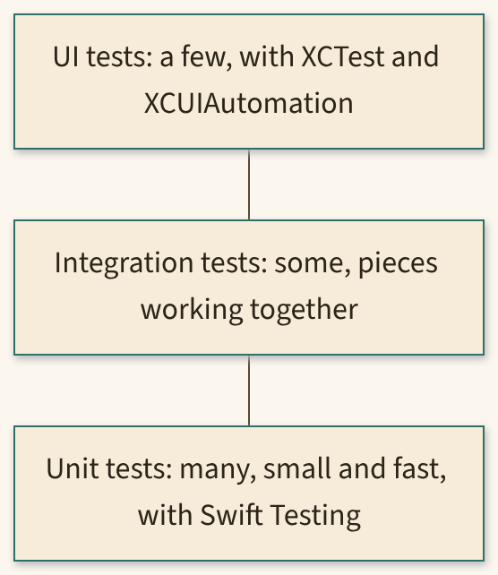{width=100%}

*Figure 8.1 — The test pyramid, iOS edition. Read it from the bottom: lots of small, fast unit tests, fewer bigger ones, and only a handful that drive the whole screen.*

The pyramid in Figure 8.1 is a rule of thumb, not a law. Small tests of small pieces are fast, reliable and easy to understand when they fail, so you want lots of them. Tests that tap through your whole app are slower and more fragile, so you want a few that cover the things that really matter.

## XCTest, UI tests, and mixing the two

Before Swift Testing, there was **XCTest**, and it has been testing apps on Apple's platforms for a long time. You'll see it everywhere: in older projects, in tutorials, and in code AI helpers hand you, because there's simply more of it in the world. An XCTest test looks like this:

```swift
import XCTest

final class OldStyleTests: XCTestCase {
    func testAddingWorks() {
        XCTAssertEqual(2 + 2, 4)
    }
}
```

The shape is different: a class that inherits from `XCTestCase`, test methods whose names start with `test`, and a family of `XCTAssert` functions instead of `#expect`. It still works, and Apple still supports it.

Apple's XCTest documentation is clear about where each framework fits. It suggests Swift Testing for new unit tests, and it says to keep using XCTest for user interface tests and performance tests. One test target can hold tests written in both frameworks.^232

**UI tests** are the ones at the top of the pyramid. Instead of calling your functions directly, they launch your whole app and drive it like a person would: tapping buttons, typing into fields, checking that the right text appears. Apple's docs describe using XCTest together with a framework called XCUIAutomation to interact with your app's interface and check that user flows behave as intended.^233 For Daybook, one good UI test might be "add a habit called Walk, and check it appears in the list." That single test protects the most important thing the app does. You don't need fifty.

Swift 6.4 added something that helps when old and new meet. It brought interoperability between the two frameworks, so `XCTAssert` checks work inside Swift Testing tests, and `#expect` works inside XCTest tests.^234 That's mostly useful when you're moving an older project over gradually, or when you have shared helper functions written for one framework that you'd like to use from the other. For tests you write fresh, I'd still keep each test in one style. Apple's XCTest page advises against mixing the two frameworks' APIs in the same test, and the interop is best treated as a bridge for migration, not a reason to blend them.^235

### A first UI test for Daybook

Here's what that one UI test might look like. When you add a UI testing target to your project, Xcode gives you a file to start from. A test that adds a habit looks something like this:

```swift
import XCTest

final class DaybookUITests: XCTestCase {
    func testAddingAHabitShowsItInTheList() {
        let app = XCUIApplication()
        app.launch()

        app.buttons["Add Habit"].tap()

        let nameField = app.textFields["Habit name"]
        nameField.tap()
        nameField.typeText("Walk")

        app.buttons["Save"].tap()

        XCTAssertTrue(app.staticTexts["Walk"].exists)
    }
}
```

Read it like a little script. Launch the app. Tap the button labeled "Add Habit." Find the text field labeled "Habit name," tap it, type "Walk." Tap Save. Check that "Walk" now appears on screen.

Notice something lovely: the test finds things by their *labels*, the same labels VoiceOver reads out. The accessibility work you did in Chapter 7 is what makes UI tests like this possible. An icon-only button with no label is hard for VoiceOver users *and* hard for UI tests. Good accessibility and good testability turn out to be the same habit.

Two honest notes. First, UI tests can be finicky. If a query doesn't find the element you expect, the labels in your app may differ slightly from what you typed in the test. Apple's documentation describes recording UI interactions to help you write these tests, which is a good way to see how Xcode itself names things.^236 Second, a test that runs your real app uses your real data store, so the habit "Walk" will really be saved. For anything more than a first experiment, you'll want your app to use a fresh, temporary store when it's being tested. That's a slightly more advanced setup, and Apple's testing documentation is the place to read up on it when you get there.

## Testing Daybook

Let's write some real tests. The best things to test first are the parts of your app that are pure logic, with no screen involved: give them inputs, check the outputs. Daybook has three good candidates: the streak count, the date handling inside it, and decoding the weather.

### The streak

Daybook doesn't count streaks yet, so let's add the logic now, as a plain function you can test. A **streak** here means how many days in a row, ending today, you've marked a habit done. With one kindness: if you haven't done today's habit *yet*, your streak from yesterday is still alive. Nobody wants to wake up to a zero.

Make a new file in the app called `Streak.swift`:

*Streak.swift*

```swift
import Foundation

/// How many days in a row a habit has been done, counting back
/// from today. If today isn't done yet, counting starts at yesterday.
func currentStreak(doneDates: [Date],
                   today: Date = .now,
                   calendar: Calendar = .current) -> Int {
    let doneDays = Set(doneDates.map { calendar.startOfDay(for: $0) })
    var day = calendar.startOfDay(for: today)

    if !doneDays.contains(day) {
        guard let yesterday = calendar.date(byAdding: .day,
                                            value: -1, to: day) else {
            return 0
        }
        day = yesterday
    }

    var streak = 0
    while doneDays.contains(day) {
        streak += 1
        guard let previous = calendar.date(byAdding: .day,
                                           value: -1, to: day) else {
            break
        }
        day = previous
    }
    return streak
}
```

Notice the two parameters with default values, `today` and `calendar`. In the app you'll never pass them; you'll just call `currentStreak(doneDates:)`. But in a test, you can pass a fixed "today" and a fixed calendar, so the test gives the same answer whether you run it on a Tuesday in November or a Sunday in June. Dates are one of the most common sources of bugs that "only happen sometimes." Pinning them down in tests is how you stop that.

Now the tests. In your test target, make a file called `StreakTests.swift`:

*StreakTests.swift*

```swift
import Foundation
import Testing
@testable import Daybook

@Suite("Streaks")
struct StreakTests {
    let calendar: Calendar = {
        var calendar = Calendar(identifier: .gregorian)
        calendar.timeZone = TimeZone(identifier: "UTC")!
        return calendar
    }()

    var today: Date {
        calendar.date(from: DateComponents(year: 2026, month: 11,
                                           day: 20, hour: 12))!
    }

    func daysAgo(_ count: Int) -> Date {
        calendar.date(byAdding: .day, value: -count, to: today)!
    }

    @Test func noEntriesMeansNoStreak() {
        #expect(currentStreak(doneDates: [], today: today,
                              calendar: calendar) == 0)
    }

    @Test func threeDaysInARowEndingToday() {
        let dates = [today, daysAgo(1), daysAgo(2)]
        #expect(currentStreak(doneDates: dates, today: today,
                              calendar: calendar) == 3)
    }

    @Test func notDoneYetTodayKeepsYesterdaysStreak() {
        let dates = [daysAgo(1), daysAgo(2)]
        #expect(currentStreak(doneDates: dates, today: today,
                              calendar: calendar) == 2)
    }

    @Test func aGapBreaksTheStreak() {
        let dates = [today, daysAgo(2), daysAgo(3)]
        #expect(currentStreak(doneDates: dates, today: today,
                              calendar: calendar) == 1)
    }

    @Test func twoEntriesOnOneDayCountOnce() {
        let morning = calendar.date(byAdding: .hour, value: -3, to: today)!
        let dates = [today, morning]
        #expect(currentStreak(doneDates: dates, today: today,
                              calendar: calendar) == 1)
    }
}
```

`@testable import Daybook` lets the tests see your app's code. Each test has a name that reads like a sentence, which pays off the day one fails: "aGapBreaksTheStreak failed" tells you what broke before you've read a single line.

Look at what those five tests cover: nothing, the normal case, the kindness rule, a gap, and a duplicate. That's a decent habit for any function. Test the empty case, the happy case, and the edges where you made a decision.

### The weather code

The `symbolName(forWeatherCode:)` function from Chapter 6 is a perfect fit for a parameterized test. One function, many inputs:

```swift
import Testing
@testable import Daybook

extension Tag {
    @Tag static var weather: Self
}

@Test(.tags(.weather), arguments: zip(
    [0, 3, 45, 61, 71, 95, 1234],
    ["sun.max", "cloud", "cloud.fog", "cloud.rain",
     "cloud.snow", "cloud.bolt.rain", "questionmark.circle"]
))
func weatherCodeMapsToSymbol(code: Int, expected: String) {
    #expect(symbolName(forWeatherCode: code) == expected)
}
```

`zip` pairs up the two lists, so the test runs seven times: 0 with "sun.max," 3 with "cloud," and so on. The made-up 1234 at the end checks that unknown codes fall back gracefully. Xcode shows each case separately, so if only the fog case fails, you'll see exactly that.^237

### Decoding the weather

Remember the "verify by" step in Chapter 6, where you checked your `Codable` structs against a real response? Here's where that check becomes automatic. Save a real Open-Meteo response, trimmed down, right inside the test:

```swift
import Foundation
import Testing
@testable import Daybook

@Test(.tags(.weather))
func decodesARealOpenMeteoResponse() throws {
    let sample = Data("""
    {
      "latitude": 40.71,
      "longitude": -73.99,
      "daily": {
        "time": ["2026-11-20"],
        "weather_code": [3],
        "temperature_2m_max": [20.9]
      }
    }
    """.utf8)

    let forecast = try JSONDecoder().decode(ForecastResponse.self,
                                            from: sample)

    #expect(forecast.daily.weatherCode == [3])
    #expect(forecast.daily.temperature2mMax == [20.9])
}
```

The `throws` on the test means that if decoding fails, the test fails with the decoding error, which usually names the exact field that didn't match. This test never touches the network, so it's fast and it works on a plane. And if you ever change `ForecastResponse`, or an AI helper "tidies it up," this test will tell you within seconds if the structs no longer match what Open-Meteo actually sends.

### Testing code that waits

You might wonder how to test `async` code, like the weather service from Chapter 6. Swift Testing is built to work with Swift's concurrency, so a test function can simply be marked `async`, and you can `await` inside it, the same way you would anywhere else.^238

```swift
@Test func weatherServiceReturnsAValue() async throws {
    let weather = try await WeatherService().todaysWeather(
        latitude: 40.71, longitude: -74.01
    )
    #expect(weather.temperatureC > -90)
}
```

That test works, but notice what it does: it calls the real Open-Meteo service over the real internet. That makes it slow, it fails on a plane, and it uses up some of your daily calls. It breaks the "same answer every time" rule from a moment ago, because the weather service could be down. Tests like this have their place, as an occasional check that the real service still answers, but they shouldn't be the backbone of your suite. That's why the decoding test above, which uses saved JSON, does most of the work. In Chapter 12 you'll see how to structure Daybook so the rest of your code can be tested without touching the network at all.

### When a test fails

A red test isn't a disaster. It's information. Read the failure like a short story. Which test failed? Its name tells you the behavior that broke. What did it expect, and what did it get? Swift Testing shows both sides of the `#expect`. What changed since it last passed? Usually that's the last thing you, or a helper, touched.

Then ask the honest question: is the code wrong, or is the test wrong? Most of the time it's the code. Sometimes the test was checking the wrong thing, or the behavior genuinely should change. If you change a test to make it pass, be sure you're changing it because the *expectation* was wrong, not because the code is inconvenient. Changing tests to match broken code is how bugs get a permanent home.

> **Ask your AI.** Use this when you have a pure function and want to find the edge cases you missed.
>
> *Example prompt (written for this book):* "Here is my `currentStreak(doneDates:today:calendar:)` function and its Swift Testing tests. List edge cases my tests don't cover yet, such as time zones, daylight saving changes or dates in the future. For each one, say what you'd expect the function to return and why. Don't write the tests; I'll write them."
>
> *Verify by:* writing each test yourself, running it, and deciding for each failure whether the function or the expectation is wrong.

That last line matters. When a new test fails, it's not automatically the code's fault. Sometimes the AI's expectation was wrong. Sometimes yours was. Deciding which is the author's job.

## What makes a good test

You've now written a handful of tests. Before we move on, here are a few qualities worth aiming for every time. None of them is a strict rule. Together, they're the difference between a test suite you trust and one you learn to ignore.

**One idea per test.** Each test should check one behavior. "A gap breaks the streak" is one idea. A test that checks gaps, duplicates and empty input all at once is three tests pretending to be one, and when it fails, you won't know which part broke.

**Same answer every time.** A test that passes on Monday and fails on Tuesday, with no code change in between, is worse than no test, because it teaches you to shrug at red. The usual culprits are the current date, the network and leftover data from another test. You've already dodged all three: the streak tests pass in a fixed "today," the decoding test uses saved JSON instead of the network, and each test builds its own data from scratch. Swift Testing running tests in parallel makes this even more important, because tests can't count on running in any particular order.

**Fast.** Unit tests should run in a blink. If running your suite takes long enough to make coffee, you'll stop running it. Keep slow things, like UI tests, few and focused.

**Names that read like sentences.** `aGapBreaksTheStreak` tells you what broke the moment it fails. `test3` tells you nothing.

**Easy to read.** A test is also documentation. Six months from now, the streak tests will tell you exactly how the streak is supposed to behave, more reliably than any comment. Write them so a newcomer, or an AI helper, could understand the intended behavior just by reading them.

**Fails for the right reason.** Here's a sneaky one. A test that can never fail is useless, and it's surprisingly easy to write one by accident, especially when an AI writes it for you. The fix is simple: when you add a test, break the code on purpose once and watch the test go red. If it doesn't, the test isn't testing what you think. You'll practice exactly that at the end of this chapter.

## Debugging: breakpoints, stepping, the console

Tests tell you *that* something's wrong. Debugging is how you find out *why*.

The most useful debugging tool is also the simplest: a **breakpoint**. It's a marker you put on a line of code that tells Xcode, "when the app gets here, pause." Click the line number in the editor's gutter and a little blue tag appears. Run the app, and when it reaches that line, everything freezes, mid-step, so you can look around.

When the app pauses, Xcode shows you a few things at once: the line it stopped on, a bar of buttons for moving through the code, a list of the variables that exist right now and their values, and the console, where messages and errors appear.^239 From there you've got a handful of moves, and Apple's debugging guide names them plainly:

- **Continue** runs normally until the next breakpoint.
- **Step Over** runs the current line and stops at the next one in the same function.
- **Step Into** follows a function call inside, so you can watch it work.
- **Step Out** finishes the current function and returns you to whoever called it.

While you're paused, hover over any variable in your code to see its value. That's the magic moment. You thought `doneDates` had three entries. It has four, and one of them is from 1970. Now you know where to look.

Apple's advice for where to put that first breakpoint is good: start at a point where your app is still in a known good state, just before you think the bug happens.^240 Then step forward slowly and watch for the moment a value goes wrong.

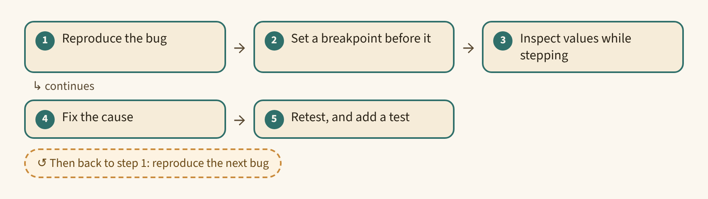{width=100%}

*Figure 8.2 — The debug loop. Look at the last step: once you've found a bug, a test that catches it means it can never sneak back.*

That last step in Figure 8.2 is the one people skip. When you find a bug, write a test that fails because of it, then fix the bug and watch the test pass. Now that bug can't quietly come back next month. Swift Testing even lets you associate a bug with the test that checks its fix.^241

### Read the error out loud

Here's a habit that sounds silly and works. When Xcode shows you an error message, read it out loud, slowly, word by word. Compiler errors are written by careful people who are trying to help you, but they're dense, and our eyes skim dense text. Reading aloud forces you to notice every word. "Cannot convert value of type 'String' to expected argument type 'Int'" is telling you precisely what's wrong and where, if you let it.

If you read it twice and it still doesn't make sense, that's a perfect moment for an AI helper. Paste the error, along with the code around it, and ask what it means. Xcode's coding assistant can explain code and errors right where you're working.^242 Ask it to explain the error first, before you ask it to fix anything. A fix you don't understand is a bug you'll meet again. An explanation you understand is something you'll never need to ask about twice.

And now and then, the old-fashioned way still earns its place. A quick `print("doneDates:", doneDates)` dropped into your code shows up in the console when that line runs. It's crude, it's fast, and every developer does it. Just take them out again when you're done.

## Instruments: profile, identify, fix, verify

Sooner or later, an app feels slow. A list stutters when you scroll. A screen takes a beat too long to appear. The tempting move is to guess why and start changing things. Don't. Guessing about performance is wrong more often than it's right, and every "fix" you make on a guess is a change that could break something else.

Instead, measure. Apple's tool for that is **Instruments**, a separate app that comes with Xcode. It watches your app while it runs and records what it's doing: where the time goes, what's using the processor, what's waiting on what.

Apple's WWDC26 guide to Xcode describes the main tools in Instruments for Xcode 27 like this:^243

- **Time Profiler** is the go-to tool for finding CPU bottlenecks: which functions are eating your processor time.
- **The Swift Concurrency instrument** shows how async tasks are being scheduled, where actors are contending with each other, and how threads are being used. It's for spotting where concurrency is working against you. You'll want it after Chapter 12.
- **System Trace** gives a deeper, system-level view of how your app interacts with the operating system, threads and hardware.
- **Top functions** surface the heaviest code paths in your trace, and **run comparisons** let you put two recordings side by side to see whether a change actually helped.

Apple sums up the whole approach as a cycle: profile, identify, fix, and verify.^244 I like that a lot, because it's the same honesty we've been building all chapter. You don't fix what you think is slow. You fix what you've measured as slow, and then you measure again to prove the fix worked.

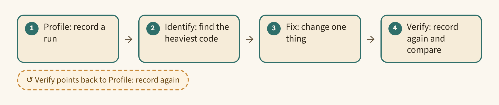{width=100%}

*Figure 8.3 — The Instruments cycle: profile, identify, fix, verify. Notice that "verify" means measuring again, not just feeling faster.*

To start, choose **Product > Profile** in Xcode, pick a template like Time Profiler, and press record. Use your app the way a person would, especially the part that feels slow. Stop recording, and look for the tallest bars and the functions at the top of the list.

A couple of honest tips. Profile on a real device when you can. Apple's performance guide says plainly that you get higher-fidelity measurements on a device than in the Simulator.^245 And change one thing at a time between recordings, or you won't know which change helped. For Daybook today, you may well find nothing worth fixing. That's a perfectly good result. It means you can stop worrying and get back to building.

## Crash and performance insights

Everything so far happens on your Mac, with your phone plugged in. Once real people are using your app, crashes and slowdowns happen on *their* phones, where you can't set a breakpoint. So how do you find out?

Apple collects that information for you, once you distribute your app through TestFlight or the App Store. Xcode's Organizer window shows crash and diagnostic reports that Apple generates, along with feedback from your beta testers, and, for App Store apps, metrics about things like launch time, responsiveness and energy use.^246 You'll set that up in Chapter 15. I mention it now so you know the safety net extends past your desk.

Xcode 27 adds a twist that ties this chapter to the next three. Apple's release notes say agents in Xcode now have access to insights about your projects, such as crashes, disk writes, energy, hangs and launch issues.^247 In practice, that means you'll be able to ask an agent to look at a crash report and explain what probably went wrong, with the real data in front of it rather than a guess. That's a powerful helper. It's still a helper. The verify loop applies: the agent explains, you check, a test proves the fix.

> **Try this.** Break Daybook on purpose. In `currentStreak`, change `value: -1` to `value: -2` in the loop, and run your tests with **Product > Test**. Watch which tests go red and read what Xcode says about each one. Then set a breakpoint inside the loop, run the failing test, and step through it, watching `day` and `streak` change. Put the code back, run the tests again, and enjoy the green.

That exercise is worth five minutes, because it shows you the whole chapter in miniature. A change goes in. A test catches it. The debugger shows you why. The fix goes in. The test proves it.

> **Done when — Testing Daybook (part of rung 4).**
>
> - [ ] Daybook has a test target, and **Product > Test** runs everything.
> - [ ] The streak function has tests for no entries, a normal streak, the "not done yet today" rule, a gap, and two entries on one day.
> - [ ] A parameterized test covers the weather-code symbols, including an unknown code.
> - [ ] A test decodes a saved, real Open-Meteo response without touching the network.
> - [ ] You've broken the code on purpose, watched a test catch it, and stepped through it with a breakpoint.
> - [ ] You've committed your tests along with your code.

> **Versions move.** I checked everything here on 20 November 2026 against Xcode 27.2, iOS 27 and Swift 6.4, on macOS Tahoe 26.6 or later. Apple updates its tools several times a year, so a menu name, a default or a screen can shift under you. If something doesn't match, check Apple's Releases page and the Xcode "SDKs and system requirements" page first, then trust what your Xcode shows you. In this chapter, Instruments' templates and the agent insights in Xcode 27 are the parts most likely to look different by the time you read this.

You've now got a safety net under Daybook: tests that check its promises, a debugger for when something slips through, and a way to measure instead of guess.

You've also been using AI a little along the way. Explaining an error here, suggesting edge cases there, drafting some structs. It's been helpful, in small doses, with you checking its work.

It's time to use it well. That's the next part of the book.


# Part Three — Work with AI {.unnumbered .part}

# Chapter 9 — Your AI Pair Inside Xcode

{width=100%}


For eight chapters, AI has been a side character. It explained an error here, drafted a few structs there, suggested some test cases. Always small, always checked.

That was on purpose. You needed to know what good Swift looks like before you could tell whether an AI had written some. You needed tests before an AI's changes could be checked by anything other than hope. You needed to have built Daybook with your own hands so that, when a helper offers to change it, you know what it's changing.

Now you're ready. This chapter is about the AI that lives inside Xcode itself: what it is, how it got there, how to turn it on, and, most of all, how to work with it so that it speeds you up without quietly taking over. The line I'll keep coming back to, here and for the rest of the book, is simple: let the AI type. You stay the author.

Here's the good news up front. Apple seems to agree. The way Xcode's agents are designed, with plans you approve, tests they run, screenshots they take to prove their work, and a security layer you can switch on, assumes there's a human in charge who reads, checks and decides. That's you.

## How we got here

It's worth a quick look at how fast this has moved, partly because it explains why so much advice online is already out of date, and partly because it'll keep moving after you read this.

**Xcode 26**, released in September 2025, brought a built-in **coding assistant**: a chat panel inside Xcode where you could ask questions about your code and ask for changes. It worked with ChatGPT, which you could use without even having an account, with Anthropic's Claude models if you signed in, and with other providers that support a common format called the Chat Completions API, including models running locally on your own Mac.^248

**Xcode 26.3**, released as a candidate in February 2026, was the big jump. Apple called it agentic coding. It brought two **agents** into Xcode: Anthropic's Claude Agent and OpenAI's Codex. Apple's announcement described agents that could search documentation, explore your project's files, update project settings, capture Xcode Previews, and build and fix their way through a task. It also exposed Xcode's own abilities through something called the **Model Context Protocol**, or **MCP**, an open standard for letting AI tools use other software's features.^249

At **WWDC26** in June 2026, Apple's yearly developer conference, an update to Xcode 26 added Google's Gemini and support for the **Agent Client Protocol**, or **ACP**, another open standard, this one for plugging different agents into an editor.^250

**Xcode 27** shipped on September 14, 2026. It made planning first class, let agents check their own work in the Simulator and in previews, added Apple-built specialists and plugins, and introduced a security layer for agents. As I write this in November 2026, the current release is Xcode 27.2.^251

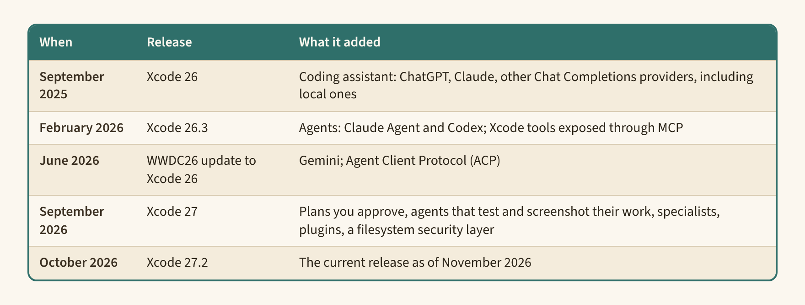{width=100%}

*Figure 9.1 — Xcode's AI features, September 2025 to October 2026. Look at how much happened in a single year: that's the reason to check what your own Xcode shows.*

Two things are worth taking from that table. First, the speed. Any tutorial about AI in Xcode that's more than a few months old is probably describing something that has changed. Second, the direction. Every step has added more ways for the AI to *check* its work and more ways for you to *control* it. Hold on to that. It's the shape of everything that follows.

## Chat versus agents

Xcode's AI comes in two flavors, and it helps a lot to know which one you're using.

**Chat** is a conversation. You ask a question, it answers. You ask for a change, it proposes or makes that change. "What does this function do?" "Why is this line an error?" "Rename this variable everywhere in this file." It does what you ask, roughly one step at a time, and then waits for you. If you've used ChatGPT or Claude in a web browser, it feels like that, except it can see your code.

An **agent** is more like a junior colleague you hand a task to. You describe what you want, and it works out the steps: which files to read, what to change, then builds the app to see if it compiles, runs the tests to see if they pass, looks at a preview or the Simulator to see if the screen looks right, and goes round again if something's off. Apple's documentation describes Xcode iterating on a response, building your app to verify the code, and fixing build warnings and errors on its own.^252 It may stop and ask you a question, or ask permission to use a command-line tool, before carrying on.

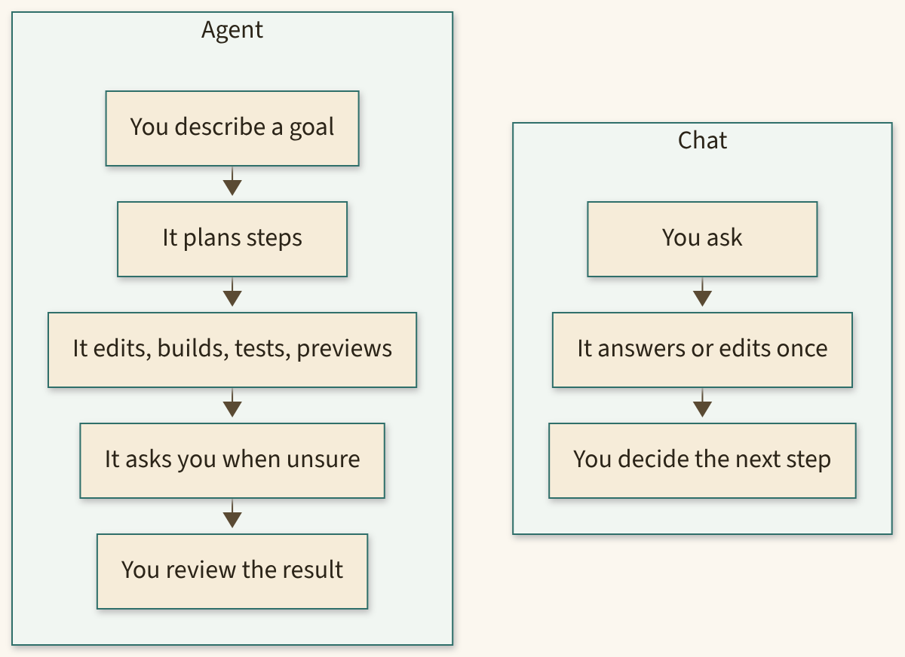{width=100%}

*Figure 9.2 — Chat versus agent. Notice who decides the next step: in chat, you do after every answer; with an agent, you do at the start and at the end, and wherever it asks.*

Neither one is "better." They're for different jobs. Chat is perfect for understanding: explaining, teaching, answering. Agents are for doing: multi-step changes across several files where the build-and-test loop matters. When you're learning, you'll probably use chat far more, and that's healthy. When you know what you want and you've got tests to catch mistakes, an agent can save you real time.

## Turning it on

Here's how to switch things on, following Apple's setup guide step by step.^253 I'll give you the menu names exactly as Apple's documentation does, as of Xcode 27.2.

Start by opening the settings. Choose **Xcode > Settings** and select **Intelligence** in the sidebar. You can also get there by clicking "Get Started with Agents" in the coding assistant's sidebar.

**To turn on an agent** (Claude Agent or Codex, for example):

1. In Intelligence settings, under **Agents**, click **Get** next to the agent you want.
2. In the dialog that appears, click **Install**. Xcode downloads it and keeps it updated for you.
3. If you have an account with that company, sign in: click the More button (…) in the **Account** row and follow the steps, which may open your web browser.

**To turn on ChatGPT in Xcode** (chat, with or without an account):

1. Under **Chat**, click **Turn On** in the ChatGPT in Xcode row.
2. Click **Next**, then **Turn On ChatGPT**.
3. Optionally, sign in to a free ChatGPT account, or a paid one with higher limits.

**To use Claude Sonnet & Opus** (chat):

1. Under **Chat**, click **Claude Sonnet & Opus**.
2. In the Claude row, click **Sign In** and follow the steps in your browser.

A note on Claude: Anthropic's own help page says using Claude in Xcode needs one of its paid plans, Pro, Max or Ultra, or a premium seat on a Team or Enterprise plan, and that usage counts against the same limits as your other Claude use.^254 I'm not going to quote prices, because they change. Check Anthropic's page.

**To add another chat provider**, click **Add a Chat Provider** under Chat. You can choose a provider hosted on the internet, by entering its address, or one running locally on your Mac, by entering a port. Either way, it needs to support the Chat Completions API.^255 That's how people run open models on their own machine and use them inside Xcode.

And Gemini, briefly, since it's there: Apple's Xcode 27 release notes say "Google Gemini is now available in the coding assistant."^256

**If you're on a work Mac**, you may find some of this switched off. Organizations that manage their Macs can turn off the coding assistant with a management setting.^257 That's their call. If it's off and you think it shouldn't be, talk to whoever looks after your computer, rather than trying to work around it.

Once something is on, open the coding assistant with the Coding Assistant button above the navigation area, or press Command-0, and start a new conversation.^258

> **Versions move.** I checked everything here on 20 November 2026 against Xcode 27.2, iOS 27 and Swift 6.4, on macOS Tahoe 26.6 or later. Apple updates its tools several times a year, so a menu name, a default or a screen can shift under you. If something doesn't match, check Apple's Releases page and the Xcode "SDKs and system requirements" page first, then trust what your Xcode shows you. In this chapter, the Intelligence settings, the list of available agents and models, and the vendors' plan requirements are the parts most likely to change.

## Talking to it well

Once the assistant is open, you type into the message field at the bottom of the conversation and press Return. That's it. But a few small habits make a big difference to what comes back, and Apple's own guide hints at most of them.^259

**Point at things.** Xcode gathers context automatically, based on your prompt and the conversation so far, but you can be explicit. Type the `@` character and pick a file or a symbol, like `@Streak.swift` or `@currentStreak`, and the assistant knows exactly what you mean. You can also attach files from inside or outside your project using the Attachments menu in the lower-left corner of the message field. Pointing beats describing. "Fix the bug in `@WeatherService`" is clearer than "fix the weather thing."

**Break big asks into small ones.** Apple's advice, if you're not getting the results you expect, is to break your question down or add more detail. That's good advice for people too. "Build me a habit tracker" is a wish. "Add a line under the note in `@EntryEditView` showing how many days in a row this habit has been done" is a task.

**Pick the model on purpose.** You can switch the model an agent uses from the Model menu in the lower-left corner of the message field. Some models also let you choose a reasoning level from a Reasoning menu, which trades speed for more careful thinking.^260 I'm not going to tell you which model is best for Swift. Nobody has a trustworthy answer to that, and the lineup changes every few months. Try a couple on the same small task and see which explanations you find clearest.

**Keep conversations focused.** Each conversation keeps its own history. When you switch to a different task, start a new conversation with the New Conversation button, rather than piling everything into one long thread. You can run several conversations at once and switch between them in the sidebar. A focused conversation gives the assistant cleaner context, and gives you a cleaner history to roll back if you need to.

**Give it standing instructions.** If there are things you want every agent conversation to know, like "this project uses Swift Testing, not XCTest" or "never change the data model without asking," you don't have to retype them forever. Xcode reads agent-specific configuration files from folders in `~/Library/Developer/Xcode/CodingAssistant`, with separate subfolders for Claude Agent, Codex and Gemini, and these settings only affect agents launched inside Xcode. Apple's examples are setting a default model, adding MCP servers and creating your own skills, and a skill of your own is a natural home for reminders like these.^261 For a beginner, this is optional. Just know it exists, because once you find yourself typing the same reminder for the fifth time, it's the fix.

### Chat as a tutor

The most valuable thing the assistant can do for you while you're learning is explain. Select a few lines of code you don't fully understand, ask what they do, and read the answer slowly. Then close the explanation and try to retype the code from memory. If you can't, you didn't understand it yet. Ask again, differently.

This is advice, not research. I don't have a study showing that retyping makes you a better Swift developer. But it's how people have learned crafts for a very long time: watch, then do it yourself. The assistant makes the "watch" part endlessly patient. It'll explain the same line ten ways at 2 a.m. and never sigh. The "do it yourself" part is still yours.

## Plans first: approve before it builds

If you remember one thing from this chapter, make it this: **ask for a plan before you let an agent change anything.**

Xcode 27 makes that easy. Apple's release notes put it plainly: planning with agents is now first class in Xcode. Plans appear as editable Markdown documents, which Apple calls artifacts, next to the conversation, and you can review them, annotate them, discuss changes, and approve them before the agent goes ahead.^262

Here's how it works in practice, using the steps from Apple's guide.^263 Type `/plan` at the start of your prompt to enter **plan mode**. Instead of changing your code, the agent proposes changes in the artifacts pane, which sits beside or below the conversation. You read the plan. If something's wrong or missing, hover over the file in the plan, click the `@` symbol that appears, and type a note right there, like "don't touch the weather code" or "use the existing `currentStreak` function." Submit, and the agent revises the plan. When you're happy, click **Yes** in the "Implement the plan?" dialog at the bottom of the conversation, and only then does it start changing code. To leave plan mode without implementing anything, type `/exit-plan`.

Xcode is also smart about noticing when you're asking for a plan. Apple's guide says that when your prompt asks to plan, Xcode enters plan mode automatically.^264

Why does this matter so much? Because a plan is cheap to change and code is expensive to change. If the agent has misunderstood what you want, you'd much rather find out from a one-page plan than from a twelve-file diff. Reading a plan also forces you to think about the change before it happens, which is exactly the thinking you'd do if you were writing it yourself. You stay the author even when someone else is typing.

Apple teaches it this way too. The new Agentic Coding unit in Apple's free Develop in Swift Tutorials starts with a prompt describing an app idea and has learners use coding agents in Xcode to create a detailed implementation plan. It covers plan mode with `/plan`, PLAN.md files that hold a plan you can keep and revisit, permissions for agents, skills, and reverting changes.^265 If you'd like a guided, Apple-written walk through all of this, that unit is the place to go after this chapter.

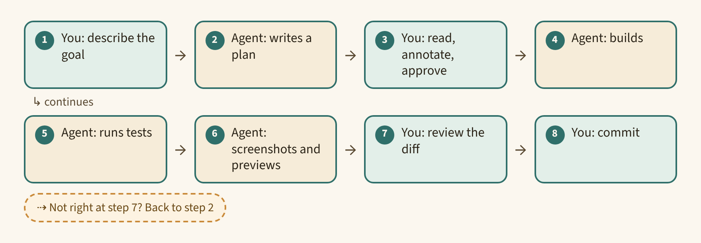{width=100%}

*Figure 9.3 — Plan, approve, build, test, screenshot, review, commit. Look at where "You" appears: at the start, at the approval, and at the end. Those are the steps you never hand over.*

A good plan, by the way, isn't long. It should say which files will change, what each change does, what new tests will be added, and how you'll know it worked. If an agent hands you a plan you can't follow, that's a plan problem, not a you problem. Ask it to make it simpler.

## Letting the agent check its own work

This is the part of Xcode 27 I find most encouraging, because it's built around proof rather than promises.

Apple's release notes say agents can now boot simulators, install and launch apps, synthesize touch events, which means pretending to tap and swipe, and capture screenshots to verify how the interface behaves.^266 In plain words: the agent can run Daybook in the Simulator, tap the "Add habit" button, type a name, and take a picture of the result to check that the new habit really appears.

There's also a **preview snapshot** tool. It renders your SwiftUI previews in different variants, including light and dark appearance, different orientations, different text sizes, and for later chapters, widget timelines and Live Activity states.^267 Remember the "largest text" and "dark" previews from Chapter 7? An agent can render those for you and look at them, which means it can notice when its own change has broken your large-text layout.

And agents can use Xcode's debugging tools through MCP: checking whether the app is running, reading the debugger console, switching schemes and run destinations, and inspecting or changing build settings, entitlements and the app's Info.plist settings.^268 Apple's WWDC26 announcement summed it up as agents being able to validate their own work by writing and running tests, using previews, and using the Simulator.^269

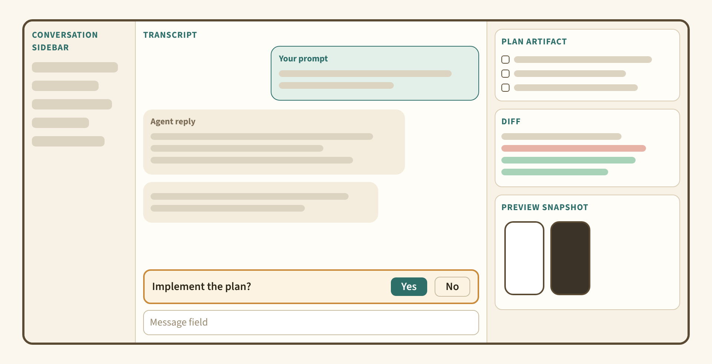{width=100%}

*Figure 9.4 — Xcode's coding assistant with a plan, a diff and a preview snapshot side by side. Look on the right: that column is the agent's evidence, and it's what you review before you say yes.*

Here's why this matters for you, the author. An agent that says "Done! The streak badge now appears on each habit" is making a claim. An agent that shows you a passing test run and a screenshot of the badge in light and dark mode is offering evidence. Evidence is much easier to check. You still check it. You look at the screenshot yourself, you read the test it wrote to make sure it actually tests something, and you run the app. But you're checking evidence, not taking someone's word.

There's an important catch, and it's the same one from Chapter 8: an agent can only verify against the tests and previews that exist. If your tests are thin, its verification is thin. Every test you wrote in Chapter 8 is now doing double duty, protecting Daybook from your mistakes and from the agent's.

## Skills, specialists and plugins

Three more words you'll see in Xcode 27's AI features. They sound similar, so let's separate them.

A **skill** is a packaged set of know-how that guides an agent through a particular kind of task. Apple says Xcode includes built-in expertise that steers agents toward the right APIs and workflows, and uses it automatically based on your prompt. Ask to translate part of your app and Xcode follows localization steps; ask for a plan and it enters plan mode. You can also call a skill directly with a slash command, like `/plan`. Type a slash in the message field to see the full list.^270 Xcode 27 also ships agent skills for SwiftUI conventions, so agents lean toward current SwiftUI patterns.^271

A **specialist** is an Apple-built helper for a targeted job. The release notes name localization, UIKit resizing and accessibility.^272 Apple's WWDC26 materials also describe specialists for SwiftUI, sizing, testing and performance.^273 You met the accessibility and localization ones in Chapter 7.

A **plugin** is a bundle you can install to add more abilities. According to Apple, plugins can contain skills, which you run as slash commands, MCP servers, which give agents access to other tools, and ACP agent configurations, which let you plug in other agents.^274 You manage them in Intelligence settings, in the **Plug-ins** row under Agents in Xcode.^275

My advice for now: use the built-in skills and specialists freely, because Apple built them for exactly this. Be choosier about plugins. A plugin can give an agent new powers, including access to other tools, and anything that gives an agent new powers deserves the same care you'd give to installing any other software. Install them from sources you trust, for a reason you can name.

## When the agent gets stuck

Sooner or later, an agent will go round in circles. It changes something, the build fails, it changes something else, the build fails differently, and it keeps going, each "fix" a little further from where you started. It's one of the most recognizable patterns in working with agents, and it's worth knowing what to do about it.

**Stop it.** You don't have to wait for it to finish. Apple's guide says you can stop Xcode from responding to a prompt with the Stop button in the lower-right corner of the message field.^276 If you've watched three attempts at the same error and the diff keeps growing, press it.

**Roll back.** Use the conversation's History slider, or your last commit, to get back to the clean state before the agent started. Don't try to untangle a pile of half-fixes. Start again from solid ground.

**Shrink the task.** Agents struggle most with tasks that are big, vague, or both. "Add weather to Daybook" is a lot of decisions at once. "Add two optional properties, `temperatureC` and `weatherCode`, to `Entry`" is one. If an agent got stuck on a big task, break it into smaller ones and hand them over one at a time, committing between each.

**Give it what it's missing.** Often an agent is stuck because it doesn't know something you know. Maybe it's using an API that was renamed, or it doesn't realize your project targets a particular iOS version. Tell it. "This project targets iOS 18 and later and uses Swift Testing." "The model is in `@Models.swift`; don't create a new one." A sentence of context can end a loop that ten more attempts wouldn't.

**Look it up yourself.** If the agent keeps fighting the same compiler error, read the error out loud, the way you learned in Chapter 8, and look up the API in Apple's documentation. Sometimes the fastest path is for you to fix the one line that's confusing it, then hand the rest back.

**Start a fresh conversation.** A long conversation full of failed attempts can confuse an agent about what's current. A new conversation with a clear, short prompt is often all it takes.

None of this means the agent is useless. It means it's a tool, with strengths and weak spots, and part of being the author is knowing when to step in.

## What agents are good at, and where to be careful

I want to be careful here, because there's no trustworthy research I can point you to that measures how well Xcode's agents do on different kinds of iOS work, and I'm not going to make up numbers. What follows is practical advice drawn from how these tools are designed and documented, not a scientific ranking.

Agents tend to shine on work that is **well-defined and checkable**. Adding a small feature to an existing screen, with tests. Writing tests for a pure function. Renaming something across a project. Moving code into a new file. Fixing a compiler error whose meaning is clear. Updating code from an old pattern to a new one, like the `ObservableObject` migration from Chapter 5. In all of these, there's a clear goal, and the build and tests can tell everyone whether it worked. That's exactly the loop Xcode 27's agents are built around.

Be more careful with work that is **vague, taste-driven or hard to check**. "Make it look nicer" has no test. "Improve performance" without measurements invites guessing, which Chapter 8 warned you about. Big architectural changes touch so much that reviewing the diff becomes its own project. Anything involving money, privacy or security, like in-app purchases, sending data to servers or handling secrets, deserves your slowest, closest reading. And for anything brand new from Apple this year, remember that the model may simply not know about it yet, even if the agent can search the docs.

Here's the shortcut I use: **if you couldn't write a test for it, be extra careful handing it to an agent.** The test is what turns "the agent says it's done" into "I can see it's done."

And one more thing, maybe the most important. When you're learning, the goal isn't just to get Daybook built. It's to become someone who *can* build Daybook. An agent that does everything for you gets the app built and leaves you exactly where you started. An agent that explains, plans with you, and checks your work makes you better every week. Apple's own course puts agentic coding inside a curriculum that still teaches Swift, testing and accessibility, which tells you how Apple thinks about the balance.^277 Use agents to go faster at things you understand, and to understand things you don't. Be wary of using them to skip understanding altogether.

## Guardrails: the security layer, reverting, permissions

An agent that can build your app, run commands and edit files is powerful. Powerful things deserve guardrails. Xcode gives you several, and I'd use all of them.

### Turn on the security layer

Xcode 27 added something I'd switch on the day you start. In Apple's words: "Coding Intelligence now includes a new security layer that monitors and controls filesystem access by coding agents and any processes they spawn. This can be enabled in Coding Intelligence settings."^278

Let me translate. An agent working on your project needs to read and write the files in that project. It doesn't need to wander around the rest of your Mac, reading your documents or your downloads. Neither do any programs it starts along the way. The security layer watches and controls what files agents and their helper processes can reach. It's opt-in, which means it's off until you turn it on. Turn it on. You'll find it in the Coding Intelligence part of Xcode's Intelligence settings.

### Know what you're sharing

When you use an agent, it may read your project files and other information to do its job. Apple says so in its setup guide, and points you to a note called "About Intelligence in Xcode & Privacy…" under Coding Intelligence in the Intelligence settings.^279 Read it once. It takes two minutes, and it'll tell you what's shared and with whom. The agents themselves come from other companies, and each has its own privacy policy and terms of use, which Xcode links to under the Account section for each agent.^280 Chapter 11 goes deeper into what you should and shouldn't share.

### Control what it can run

Agents sometimes need to run command-line tools to get a task done. Xcode asks you first, right in the conversation. Anything you allow there is remembered, and you can review it later. In Intelligence settings, the **Permissions** row under Agents in Xcode shows the commands and tools you've granted, and lets you add or remove them.^281 Every so often, have a look at that list and remove anything you don't recognize or don't need anymore. Apple's Develop in Swift course teaches agent permissions as a core skill, right alongside planning, which tells you how seriously Apple takes it.^282

### Commit before every agent task

This one's a habit, not a setting, and it's the most important guardrail of all. **Before you hand an agent a task, commit your work.**

You learned Git back in Chapter 2. A commit is a snapshot of your project that you can always return to. If you commit before the agent starts, then no matter what it does, whether it's brilliant, slightly off, or a total mess, you're one step away from where you started. Without that commit, untangling a bad change across many files can eat your afternoon.

Xcode helps here too. It keeps a history of every change an agent makes in a conversation. Choose **History** from the Adjust Editor Options menu and you get a list of your prompts with a slider. Drag the slider up to unwind changes one prompt at a time, and click **Restore** to put your files back to that point. This feature needs your project to have a Git repository, which Daybook does.^283 You can also simply discard changes using source control.

Between the conversation history and your own commits, you've got two separate ways back. That's what makes it safe to let an agent try something ambitious. The worst case is a few minutes lost.

## A worked session: adding a streak badge

Let's put it all together with a real task on Daybook. This is a preview of rung 5, and it's the kind of small, well-defined feature that agents handle well. The goal: show a little badge on each habit row with the current streak, like a flame icon and "5 days."

You already have most of the pieces. The `currentStreak` function and its tests are from Chapter 8. The plural-aware "days" string is from Chapter 7. What's missing is the badge itself and wiring it into the list.

I'm going to describe the steps, not invent a transcript. Your agent's exact words will differ, and they should. What matters is what *you* do at each step.

**Step 1: Commit.** Make sure everything is committed. Clean slate.

**Step 2: Ask for a plan.** Open the coding assistant, start a new conversation with the agent you've set up, and ask for a plan. Use the `@` character to point it at the right files, so it doesn't have to guess.

> **Ask your AI.** Use this to start any agent task with a plan instead of code.
>
> *Example prompt (written for this book):* "/plan Add a streak badge to each habit row in @HabitListView. Use the existing `currentStreak(doneDates:today:calendar:)` function from @Streak.swift, based on the habit's entries where `isDone` is true. Show an SF Symbol and the number of days, using a plural-aware string. Hide the badge when the streak is zero. Make it readable by VoiceOver as one phrase. Add Swift Testing tests for any new logic. Don't change the weather code or the data model."
>
> *Verify by:* reading the plan line by line before approving, then checking the tests, previews and diff yourself before you commit.

Notice how much of that prompt is guardrails. "Use the existing function." "Don't change the weather code or the data model." "Add tests." You're not just saying what to build. You're saying what not to touch, and how you'll know it's done.

**Step 3: Read the plan.** Does it touch only the files you expected? Does it reuse `currentStreak` rather than writing a second version? Does it mention tests? Does it handle the zero case? If anything's off, annotate it with `@` and send it back. This is where your judgment does its best work.

**Step 4: Approve.** When the plan makes sense, click **Yes** to implement it.

**Step 5: Let it work.** The agent edits, builds, and runs tests. It may render previews or launch the Simulator to check. If it stops to ask permission to run a command, read what it's asking for before you say yes.

**Step 6: Review the evidence.** Look at the artifacts. Read the diff, every line. Can you explain each change in your own words? Look at the tests it added. Do they actually check the badge logic, or do they just check that `true` is `true`? Look at the preview snapshots, especially at large text sizes and in dark mode. Then run Daybook yourself and turn VoiceOver on.

**Step 7: Commit or roll back.** If it's good, commit with a message that says what changed. If it's not, roll back with the conversation history or your commit, and try again with a better prompt. Either outcome is fine.

That seven-step rhythm, commit, plan, read, approve, work, review, commit, is the whole craft of working with an agent. It'll feel slow the first few times. Then it becomes second nature, and you'll find you're moving faster than you could alone, and with more confidence, because every change has been planned, tested and read.

> **Try this.** Run the streak badge session above on your own copy of Daybook. Then do something sneaky: before approving the plan, add an annotation asking the agent to also "clean up" the weather code. Watch what the plan does with that. Then reject it, roll back, and ask again without the extra request. Seeing how a tiny extra instruction can widen a change is one of the most useful lessons in this whole chapter.

Xcode's own agents are only part of the story, though. Plenty of capable AI helpers live outside Xcode, in Terminal, in the cloud, or running quietly on your Mac. Some of them can even reach into Xcode and use its tools. It's time to meet the rest of the crew.


# Chapter 10 — The Wider Crew: Claude, ChatGPT, Grok Bot, Hermes, and OpenClaw

{width=100%}


Xcode's built-in agents are good, and for a lot of people they'll be enough. But they're not the only AI helpers you can bring to iOS development, and some of the others do jobs Xcode's agents don't try to do at all.

Some live in Terminal on your Mac and can reach into Xcode to build and test. One lives in the cloud on its own computer and is very good at research, planning, reviewing and running routines on a schedule. Two are open-source agents you can run yourself, with long memories and a knack for keeping a learning journal.

This chapter gives each of them an honest job description: what it's good at, what it can't do, and how to connect it safely. I'll stick to what each tool's own documentation says it does. Where something hasn't been documented, I'll say "try it and check," and I mean it. And by the end, I'll show you one way the whole crew can work together without tripping over each other.

A quick word on fairness before we start. I'm not going to rank these tools or tell you which is "best." There's no trustworthy benchmark for that, the tools change every few months, and the honest answer depends on what you're doing and what you enjoy using. What I can do is tell you what each one is *for*.

## Two doors into Xcode

There are two ways an AI agent can work on your Xcode project.

The first door is the one you walked through in Chapter 9: the agent runs *inside* Xcode, in the coding assistant. Claude Agent, Codex and Gemini work this way.

The second door is newer and, I think, more interesting. An agent running *outside* Xcode, in Terminal for example, can still use Xcode's tools. It does that through Xcode's **MCP server**. Remember MCP, the Model Context Protocol, from the last chapter? It's an open standard for letting AI tools use other software's features. Xcode offers its abilities, like building your app, running tests and reading build results, as an MCP server, and an outside agent that speaks MCP can connect to it.^284

Apple documents this step by step.^285 There are three parts.

**First, allow it in Xcode.** Choose **Xcode > Settings**, select **Intelligence**, and under **Model Context Protocol**, set the "Allow External Agents to Use Xcode Tools" menu to either **Always** or **While Xcode is Open**. I'd pick While Xcode is Open. It means an outside agent can only use Xcode's tools when you've got Xcode running, which is when you're paying attention. To turn it off again, choose **Never**.

**Second, tell the agent about Xcode.** You do this in Terminal, using a command called `xcrun mcpbridge`, which is the bridge between an outside agent and Xcode's MCP server. The exact command depends on the agent, and we'll see the two that Apple documents in a moment.

**Third, open your project in Xcode first.** Apple is clear about this: before you prompt an outside agent, open your project in Xcode. Xcode will let you know when an outside agent connects and when it's active, so you're never in the dark about who's doing what.

Optionally, you can give an outside agent hints about your project in a configuration file it reads, such as `AGENTS.md` or `CLAUDE.md`, in the location that agent uses.^286 That's a plain text file where you write things like "this project uses SwiftUI and SwiftData, tests use Swift Testing, never change the data model without asking." It's the same idea as the standing instructions from Chapter 9, for agents that live outside Xcode.

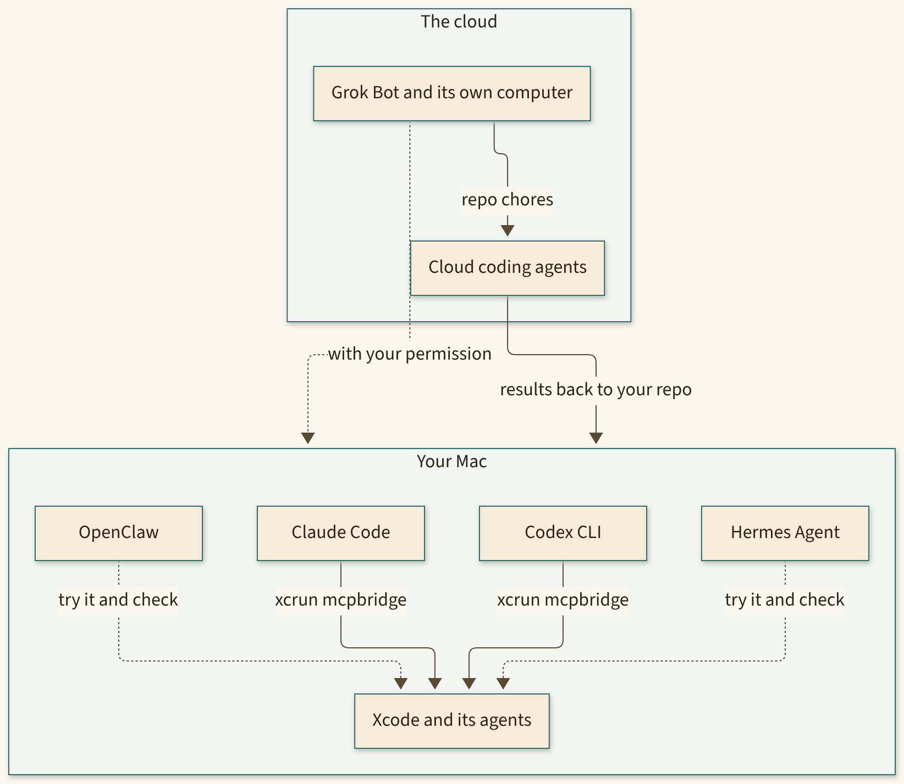{width=100%}

*Figure 10.1 — The crew map. Look at the dashed lines: they mark connections that need your permission or that aren't documented yet, and they're the ones to treat with the most care.*

Everything in the solid boxes on your Mac can, in principle, reach Xcode. Only the two with solid arrows, Claude Code and Codex CLI, are documented by Apple. Keep that picture in your head as we go.

## Claude Code in Terminal

**Claude Code** is Anthropic's coding agent that runs in Terminal, among other places. Anthropic's documentation describes installing it on macOS with a single command:^287

```bash
curl -fsSL https://claude.ai/install.sh | bash
```

Or, if you use Homebrew, the package manager you met in Chapter 2:

```bash
brew install --cask claude-code
```

One detail from Anthropic's docs worth knowing: the Homebrew version doesn't update itself automatically, so you'll need to update it through Homebrew from time to time. The other install method keeps itself up to date.

Before you run any `curl … | bash` command, a quick word of caution that applies to every tool in this chapter. That pattern downloads a script from the internet and runs it immediately. It's common and convenient, and it's only as trustworthy as the website you're downloading from. Type the address carefully, or copy it from the company's official documentation, never from a random forum post.

Once Claude Code is installed and you've signed in, connect it to Xcode with the command Apple gives in its documentation, exactly as written:^288

```bash
claude mcp add --transport stdio xcode -- xcrun mcpbridge
```

Then check it worked:

```bash
claude mcp list
```

You should see an entry called `xcode`. Now, with your Daybook project open in Xcode, you can start Claude Code in Terminal from your project's folder and ask it to do things that use Xcode's tools.

What's it good for? Anthropic positions it for working across a codebase. For an iOS learner, the jobs where an outside agent like this really earns its keep are the bigger, multi-file ones: refactoring something that touches several files, writing a batch of tests for code that doesn't have any, or explaining how an unfamiliar project fits together. Anthropic also offers Claude Code in a desktop app, with a Code tab and cloud sessions.^289

Everything from Chapter 9 still applies. Commit first. Ask for a plan before changes. Read the diff. Run the tests yourself. The fact that it's in Terminal instead of Xcode doesn't change who the author is.

## Codex CLI and ChatGPT

OpenAI's equivalent is the **Codex CLI**, a coding agent for Terminal. OpenAI's documentation gives this install command for macOS, among other options:^290

```bash
curl -fsSL https://chatgpt.com/codex/install.sh | sh
```

Connect it to Xcode, again using Apple's exact command:^291

```bash
codex mcp add xcode -- xcrun mcpbridge
```

And check:

```bash
codex mcp list
```

From there it works much like Claude Code: open your project in Xcode, start Codex from your project folder, and give it tasks that can use Xcode's build and test tools. The same jobs suit it, and the same habits keep you safe.

OpenAI's **ChatGPT** shows up in two other places worth knowing about. Inside Xcode, as you saw in Chapter 9, ChatGPT is available in the coding assistant, and you can use it without an account at all, which makes it the lowest-friction way to try AI help in Xcode.^292 And of course ChatGPT the app, on your phone or in a web browser, is a perfectly good place to ask conceptual questions while you're away from your Mac. "Explain the difference between a struct and a class like I'm twelve" works anywhere.

OpenAI also offers Codex in the cloud, which runs tasks in cloud environments connected to your code repositories. I want to be careful here. Those cloud environments are not your Mac, and OpenAI's documentation doesn't describe them as Macs with Xcode installed. So don't expect to build and run an iOS app there. They can still be handy for work on plain Swift code, documentation and the like, but check OpenAI's current docs for what they support before you rely on them for anything iOS-specific.

## Which door should you use?

If Claude Agent and Codex already work inside Xcode, why bother with Claude Code and Codex CLI in Terminal? It's a fair question, and for many people the answer is: don't, at least not at first.

Here's how I think about it. The inside door is the gentlest. Everything happens in one window. Plans, diffs and preview snapshots appear right next to your code. The conversation history lets you roll back by sliding a slider. If you're new, start there and stay there until you feel a specific limit.

The outside door makes sense when you're already comfortable in Terminal, or when you want the same agent to work across more than just your Xcode project, like editing documentation, scripts or a website that lives next to your app. Terminal agents also tend to have their own ecosystems of settings, project files and extensions that some people love. They can still build and test through Xcode, because of `xcrun mcpbridge`, so you don't lose the most important thing.

There's one honest cost to the outside door. You lose some of the in-Xcode niceties, like the artifacts pane and the History slider. That makes your own habits matter more: commit before each task, read every diff in your Git tool, and run the tests yourself before you believe them.

> **Try this.** Connect one outside agent, Claude Code or Codex CLI, to Xcode using Apple's command above, then run the matching `mcp list` command to see the `xcode` entry. Open Daybook in Xcode, commit, and from Terminal ask the agent a harmless question that needs Xcode, like "build the project and tell me whether there are any warnings." Watch for Xcode's notice that an external agent has connected. Don't let it change anything yet. You're just checking the door opens.

## Grok Bot: planner, researcher, reviewer, routine-runner

**Grok Bot** is a different kind of helper, and it's worth being precise about what it is and isn't, because the difference matters for iOS work.

Grok Bot is a desktop assistant with its own computer. That computer lives in the cloud. Its documentation describes each user's work running in a dedicated Firecracker microVM, a small, isolated virtual machine.^293 It's a Linux machine. And that's the first thing to understand: **Xcode doesn't run on Linux, so Grok Bot can't build or run your iOS app on its own computer.** If anyone tells you Grok Bot "builds iOS apps," that's not right. What it can do is a long list of the other things that go into making an app, and it does them well.

### Reaching your Mac, with your permission

Grok Bot can work on the Mac in front of you, but only if you let it, and you decide how much. Its documentation describes the setting precisely: in **Settings → Computer → Your computer**, under **Execution on this computer**, you choose **Ask every time**, **Always allow** or **Never allow**. The default is Ask every time.^294

I'd leave it on **Ask every time**. That way, if Grok Bot wants to run something on your Mac, like a `git` command or a build, you see exactly what it wants to do and approve or decline it each time. It's a little slower. It's also the setting where you always know what's happening on your own machine. The documentation itself suggests Never allow unless a bot has a specific reason to work on your local computer, which is a sensible default if you don't need it at all.

### Handing off repo chores to cloud coding agents

Grok Bot can also delegate coding tasks to separate computers, which its documentation calls Cloud Agents.^295 I'll call them **cloud coding agents**. You can ask Grok Bot to hand a well-defined task on your code repository to one of them, and the results come back to you as files and results you can review.^296

Here's the honest limit. Grok Bot's documentation doesn't describe those computers as Macs with Xcode installed, so don't treat them as the place for anything that needs Xcode, the Simulator or SwiftUI previews. Where they can help is with code that doesn't depend on Apple's app frameworks: plain Swift logic you've pulled into a Swift package, documentation, test ideas for non-UI code, and tidying up your repository. Swift itself runs on Linux, so in principle plain Swift code can be built and tested there. Whether a Swift toolchain is actually available in a given cloud environment is something to check before you count on it.

We'll come back to the idea of pulling logic into a package in Chapter 12.

### Routines: help that shows up on its own

The part of Grok Bot I find most useful for iOS work is **routines**. A routine tells a bot when to run a piece of work: on a schedule, or when something happens, such as an event from your Git host, an email arriving, or a webhook call.^297 Pair that with a **skill**, which is a saved set of instructions for how to do a task, and you have help that turns up without being asked.

Here's an example that fits this book perfectly. Apple publishes two pages that every iOS developer should keep an eye on: the **Releases** page, which lists new versions of Xcode, iOS and the rest, and the **Upcoming Requirements** page, which tells you what Apple will soon require for apps you upload.^298 Checking them by hand is easy to forget. A Grok Bot routine can check them every week and write you a short digest, as a Page you can read: what's new, what changed, and anything that affects Daybook. That way, when Apple raises the minimum Xcode version for uploads, you hear about it from your own assistant rather than from a rejected upload.

### What working on your Mac looks like

It helps to picture what "Ask every time" actually means in practice. Say you're stuck on why a build fails, and you ask Grok Bot to look. With your permission setting on Ask every time, Grok Bot can propose running something on your Mac, like checking the state of your Git repository, and you'll be asked to approve that specific action before it happens. You see what it wants to run. You say yes or no. If you say no, it doesn't happen, and Grok Bot carries on without it.

That's a good model for every helper in this chapter, not just Grok Bot. An assistant proposing an action and a person approving it is a very different thing from an assistant acting on its own. The first keeps you in the loop by design.

There's another option that's often better still: don't give it access at all, and just paste what it needs. Copy the error from Xcode, paste it into Grok Bot, and ask what it means. You've shared exactly what you chose to share, nothing more. For a lot of iOS work, that's all you need.

### The jobs it's good at

Put all that together and you get a clear job description. Grok Bot is a strong:

- **Planner.** Talk through a feature before you build it. What screens, what data, what could go wrong. Then take the plan to Xcode.
- **Researcher.** Read Apple's documentation, release notes and guidelines, and summarize what matters for your app, with links you can check.
- **Reviewer.** Paste a diff, or point it at a commit, and ask what could go wrong. A second opinion from a different AI is a good way to catch what the first one missed.
- **Error explainer.** Paste a confusing compiler error or crash log and ask what it means in plain words.
- **Writer.** Draft your App Store description, your release notes, or the purpose string for a permission. You edit; it drafts.
- **Feedback sorter.** When TestFlight testers start sending feedback, in Chapter 15, have it group the comments into themes so you can see what matters most.
- **Routine-runner.** Watch Apple's pages, remind you of renewals, and keep you current on a schedule.

If you'd like a full, beginner-friendly guide to setting Grok Bot up, skills, routines and all, that's what my earlier book *Hand It Off* is for. I won't repeat it here.

> **Ask your AI.** Use this to set up a weekly "what changed at Apple" digest as a Grok Bot routine.
>
> *Example prompt (written for this book):* "Every Monday morning, read Apple's developer Releases page and Upcoming Requirements page. Write me a short Page that lists any new Xcode, iOS or Swift releases from the past week, any new or changed upload requirements with their dates, and one line on whether any of it affects a SwiftUI app that targets iOS 18 or later. Link every item to its source. If nothing changed, say so in one line."
>
> *Verify by:* clicking through to the linked Apple pages the first few weeks to make sure the digest matches what Apple actually says.

## Hermes Agent: a study partner that remembers

**Hermes Agent**, from Nous Research, is an open-source agent you run yourself. As of November 2026, the current version is v0.23.3, released on November 19, 2026.^299 If you read my book *Grow With It*, you already know Hermes well. Here I'll focus on what it can do for someone learning iOS.

You can install Hermes on your Mac in two ways. The first is Hermes Desktop, a regular Mac app you download from the Hermes website. Its documentation is clear that the macOS installer is for Apple silicon Macs only, which, since you need an Apple silicon Mac for Xcode 27 anyway, shouldn't be a problem.^300 The second is a command-line-only install, which the docs give as:

```bash
curl -fsSL https://hermes-agent.nousresearch.com/install.sh | bash
```

### Why Hermes, for iOS learning

The thing Hermes does that most of the other helpers don't is *remember*, in an organized way, over a long time. It has memory, skills and scheduled jobs, and you can have it keep a wiki of what you've learned. That makes it a natural **study partner**. After a session on Daybook, you tell Hermes what you figured out, like how `@Bindable` works, why the weather decode failed, or what the security layer does, and it files that into a growing, searchable set of notes in your own words. Three months later, when you've forgotten how you solved the location permission, it's there.

It can also run **scheduled tasks**. On your own Mac, that means you can have it do something on a timetable, like reminding you to review the week's notes or running a check on your project and reporting back. Anything that touches your project or runs commands on your Mac deserves the same care as any other agent: start small, watch what it does, and give it only the permissions it needs.

And it's a capable **researcher**, able to read documentation and come back with a summary, the same way you'd use any other AI helper for that.

### Hermes and Xcode: try it and check

Here's where I have to be careful. Hermes supports MCP, and its documentation says MCP support ships with the standard install. You add MCP servers in a configuration file at `~/.hermes/config.yaml`, under a section called `mcp_servers`, and Hermes supports both local servers that it starts as a command (called stdio servers) and remote servers over HTTP.^301

Xcode's `xcrun mcpbridge` is exactly that kind of local command. So in principle, Hermes should be able to connect to Xcode's MCP server the same way Claude Code and Codex do.

But neither Apple nor Nous Research documents that connection. Apple's page only gives instructions for Claude Code and Codex. So I can't tell you it's supported, and I won't. What I can tell you is how I'd try it, safely.

Following the shape of the example in Hermes's own MCP documentation, an entry for Xcode would look something like this:

```yaml
# Untested sketch, based on the documented mcp_servers format.
mcp_servers:
  xcode:
    command: "xcrun"
    args: ["mcpbridge"]
```

If you try it: allow external agents in Xcode's Intelligence settings as described at the start of this chapter, open your project in Xcode, commit your work, start Hermes, and ask it for something harmless first, like listing what Xcode tools it can see. If it works, great. If it doesn't, you've lost nothing, and Hermes is still a fine study partner without it. Either way, check Hermes's and Apple's docs again, because this is exactly the kind of thing that may become documented after I've written this.

## OpenClaw: your own self-hosted crew

**OpenClaw** is an open-source, self-hosted agent platform. That means you run it on your own machine, under your own control. As of November 2026, the current version is v2026.11.6, released on November 19, 2026.^302 My book *Make It Yours* covers OpenClaw in depth. Here's what matters for iOS.

OpenClaw has a Mac app with its own onboarding path, which walks you through setup.^303 Once it's running, three of its features are especially useful for an iOS learner.

### It can drive your other coding agents

OpenClaw comes with a bundled skill called `coding-agent`. It's off by default, and you turn it on in OpenClaw's configuration by setting `skills.entries.coding-agent.enabled` to `true`. Once it's on, it drives a coding agent you've already installed and signed in to, such as `claude` (Claude Code), `codex` (Codex CLI), `opencode`, or another supported command-line tool.^304

Think of OpenClaw here as a coordinator rather than a coder. It can hand a coding task to Claude Code or Codex, which you've already connected to Xcode with `xcrun mcpbridge`, and fit that into its other work. The coding agent still does the coding, through Apple's documented route. OpenClaw just organizes when and why.

### It can keep a learning journal

OpenClaw has a bundled plugin called **memory-wiki**. Its documentation describes it as compiling durable knowledge into a navigable wiki, with pages, structured claims with evidence, and a record of where each piece came from.^305 For a learner, that's a learning journal that keeps track of its sources. You can enable it following the plugin's documentation, then feed it what you learn as you go.

### OpenClaw and Xcode: try it and check

Like Hermes, OpenClaw can connect to MCP servers. Its documentation says you add one in the Control UI under **Settings → MCP**: under Configured servers, choose Add server, give it a name, and pick a transport, which can be Streamable HTTP, SSE, or Stdio. For Stdio, you enter the command followed by its arguments.^306

So you could, in principle, add a server named `xcode` with the Stdio transport and the command `xcrun mcpbridge`. But again, neither Apple nor OpenClaw documents this pairing, so I can't call it supported.

If you try it, use the same careful steps as for Hermes: allow external agents in Xcode, open your project, commit, and test with something harmless first. And remember the simpler, documented route: let OpenClaw's `coding-agent` skill drive Claude Code or Codex, which Apple's documentation already covers.

## Costs, limits and accounts

Every helper in this chapter has its own account, its own limits and, often, its own bill. I'm not going to quote prices, because they change constantly and I'd rather you didn't plan around a number that's already wrong. But here's what to know, from each tool's own documentation, so nothing surprises you.

**ChatGPT in Xcode** is the cheapest way to start: Apple's setup guide says you can turn it on with or without an account, and sign in to a free ChatGPT account, or a paid one with higher limits.^307

**Claude in Xcode** needs a paid Anthropic plan, according to Anthropic's help page, and your use in Xcode counts against the same limits as the rest of your Claude use.^308 That shared limit is worth remembering. If you use Claude in Xcode all afternoon, you may find you've used up your allowance for Claude elsewhere too.

**Claude Code and Codex CLI** sign in with your Anthropic or OpenAI account, and each company's documentation describes how usage is counted. Check before you hand either one a long task.

**Grok Bot** runs on its own computer in the cloud, under its own plan. Check its documentation for what your plan includes, especially for routines that run on a schedule and for cloud coding agents.

**Hermes Agent and OpenClaw** are open-source and free to download and run, but "free" has an asterisk. They're harnesses: they need an AI model to think with, and that model usually comes from a provider you sign up with separately, or runs locally on your own hardware. The bill, if there is one, comes from wherever the model lives.

And one rule that applies everywhere: an agent that runs on a schedule, or keeps working while you're away, keeps using your allowance while you're away. Start routines small, check what they cost after the first week, and turn off anything you're not reading.

## Choosing your first helpers

If all of this feels like a lot, here's the short version. You don't need a crew to start. You need one good helper and good habits.

**If you're brand new:** use Xcode's coding assistant and nothing else for a while. Turn on ChatGPT in Xcode, which needs no account, or an agent if you have the right account. Use it mostly as a tutor: explain, review, suggest tests. Learn the plan, approve, review, commit rhythm from Chapter 9 until it's automatic.

**When you want help outside Xcode:** add one more. If you live in Terminal, try Claude Code or Codex CLI with `xcrun mcpbridge`. If you'd like help with planning, research and keeping up with Apple's changes, try Grok Bot and set up the weekly digest routine. Pick based on the gap you actually feel, not on which one sounds most impressive.

**When you want a memory:** add Hermes or OpenClaw as a study partner and learning journal. They're the most work to set up, and they reward patience. If you've read *Grow With It* or *Make It Yours*, you'll already know which suits you.

**Whatever you choose:** give each helper one job, start every one on "ask," commit before every task, and run the verify loop from Chapter 11 on everything they produce.

### The chat apps, too

It's easy to forget the simplest helpers of all: ChatGPT and Claude in their own apps, on your phone or in a browser. They can't see your project or touch Xcode, and that's sometimes exactly what you want. They're good for thinking about concepts away from your desk: "Explain optionals like I'm twelve." "What's the difference between a model container and a model context?" "Quiz me on Swift structs." Because they can't see your code, you can't accidentally share it, and because they can't change anything, you can't accidentally break anything. Just remember the rule from Chapter 11 about what you paste: nothing private, nothing secret.

## Setting them up safely

Before we put the crew to work, here's a short checklist I'd run for every helper in this chapter. None of it is complicated. All of it matters more than which helper you pick.

- **Install from the official source.** Copy install commands from the company's or project's own documentation, as I've cited them here. Never from a forum, a video description or a message someone sent you.
- **Allow Xcode access only while Xcode is open.** In **Xcode > Settings > Intelligence**, the "While Xcode is Open" choice means outside agents can't use Xcode's tools when you're not around.
- **Start every agent on "ask."** Whatever approval or permission setting a helper has, start with the one that asks you before acting.
- **Commit before every task.** Every helper, every time. It's your undo button for the whole project.
- **Write a short project file.** A few lines in `AGENTS.md` or `CLAUDE.md` saying what the project is, what not to touch, and how tests are run, saves you repeating yourself and keeps agents inside the lines.
- **Keep secrets out.** No API keys, passwords or private data in your project or your prompts. Chapter 11 goes into this properly.
- **Know how to turn it off.** For Xcode, set the external-agents menu back to **Never**. For each tool, find its off switch before you need it.

> **Versions move.** I checked everything here on 20 November 2026 against Xcode 27.2, iOS 27 and Swift 6.4, on macOS Tahoe 26.6 or later. Apple updates its tools several times a year, so a menu name, a default or a screen can shift under you. If something doesn't match, check Apple's Releases page and the Xcode "SDKs and system requirements" page first, then trust what your Xcode shows you. In this chapter, the outside tools move even faster than Xcode: Claude Code, Codex CLI, Grok Bot, Hermes Agent and OpenClaw all ship updates often, so check each one's install and settings pages before you follow my steps.

## How the crew works together

Seven helpers is a lot. The risk, once you've got them all set up, is handing the same task to three of them and then spending your evening reconciling three different answers. That's not help. That's homework.

The fix is simple: **one job per helper.** Decide what each one is for, and stick to it. Here's how their documented abilities line up.

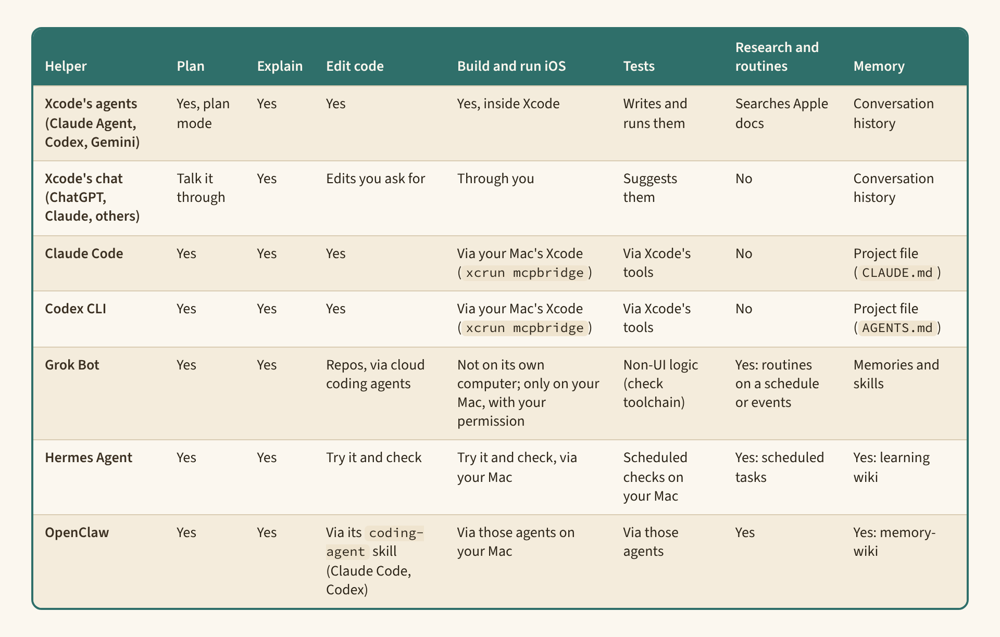{width=100%}

*Figure 10.2 — Who's good at what, as each tool's own documentation describes it in November 2026. Look down the "Build and run iOS" column: every route goes through Xcode on your Mac.*

That column is the most important thing in the table. However many helpers you have, there's one place iOS apps get built: Xcode, on your Mac. Everything else either feeds into that or works around it.

Here's one way to arrange a week with the whole crew. It's not the only way, and it's not my personal routine. It's a sensible starting shape you can adjust:

1. **Monday: Grok Bot's digest.** Your weekly routine drops a Page summarizing what changed at Apple. Two minutes over coffee. If Apple has announced a new requirement, it goes on your list.
2. **Planning: you, in Xcode.** Decide the week's feature. Ask Xcode's agent for a plan with `/plan`, read it, annotate it, and approve it.
3. **Building: Xcode's agent.** The agent builds, tests and takes screenshots. You review the diff and the evidence, and commit.
4. **The big refactor: Claude Code or Codex CLI.** If a job touches many files, like moving the weather code into its own package, hand it to one of the Terminal agents connected through `xcrun mcpbridge`. Plan, review, commit.
5. **Review: a second opinion.** Paste the week's main diff into Grok Bot, or whichever helper didn't write it, and ask what could go wrong.
6. **Friday: the journal.** Tell Hermes or OpenClaw what you learned this week, in your own words. It files it away.

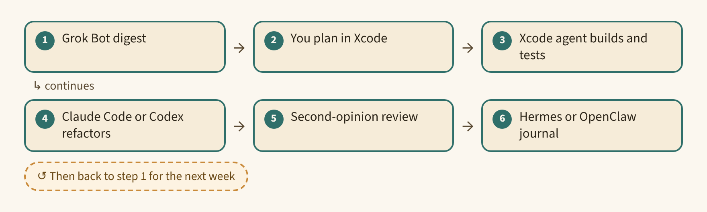{width=100%}

*Figure 10.3 — One weekly rhythm. Follow the loop and notice that every helper has exactly one job, and you appear at every handoff.*

A couple of habits make this work. Let each helper finish its job before the next one starts, so two agents are never editing the same files at once. Commit between every step, so you always know which helper changed what. And if one helper's job starts to creep, if you find yourself asking Grok Bot to write Swift and Xcode's agent to research App Store rules, pause and ask whether you've got the right tool for the job.

You don't need all seven, by the way. Plenty of people will do beautifully with just Xcode's built-in agent and one other helper. Start with Xcode, add one more when you feel a specific gap, and grow from there.

## How much freedom to give them

Every helper in this chapter can be given more or less freedom: to run commands without asking, to edit files without approval, to keep working while you're away. It's tempting to turn everything up so they stop interrupting you.

Apple has something to say about that. In a preview it described in the Xcode 27 release notes, there's an option to approve all permissions upfront for unattended environments, meaning machines where nobody's watching. Apple's own comment on it is blunt: "This is not a recommended configuration for at-desk use."^309

I'd take that seriously, and apply it everywhere. When you're at your desk, there's no good reason to let agents act without asking. Start with **Ask every time** in every tool that offers it: Grok Bot's Execution on this computer setting, Xcode's command permissions, and the approval settings in any Terminal agent. Loosen things one step at a time, only for specific, repeated actions you've watched it do correctly many times, and only when you can name the reason.

The interruptions are the point. Each one is a moment where you, the author, get to say yes or no. In the next chapter, we'll look at exactly what can go wrong when you stop saying no, and the habits that catch it.


# Chapter 11 — Trust, but Verify

{width=100%}


By now you've got a whole crew of AI helpers. They can explain your code, plan features, write tests, build and run your app, and keep a journal of what you've learned. They're fast, tireless and, most of the time, right.

This chapter is about the rest of the time.

I want to be clear about the spirit of it. This isn't a chapter about why you shouldn't use AI. I've spent the last two chapters showing you how to use it well, and I meant every word. It's a chapter about how AI help goes wrong, in specific and predictable ways, and the small habits that catch those mistakes before they reach your app, your users or your bank account. A good carpenter trusts a sharp saw. A good carpenter also keeps their fingers out of the way.

## Confident and wrong

The first thing to understand about AI coding helpers is the most important: they sound exactly as confident when they're wrong as when they're right.

That's not a flaw you can prompt away. It comes from how these tools work. A language model writes the response that seems most likely, based on everything it learned from in training. Most of the time, the most likely answer is also the correct one. But "most likely" and "correct" aren't the same thing, and the model can't always tell the difference. When it doesn't know, it doesn't say "I don't know." It writes something that looks like what a right answer would look like.

For iOS development, two things make this worse.

The first is time. Models learn from code that existed when they were trained, and there's a lot more old Swift in the world than new Swift. Years of tutorials, answers and open-source projects were written for older versions of iOS, older versions of Swift and older ways of doing things. So when a model reaches for "the most likely code," it often reaches for something a few years out of date.

The second is that Apple changes things every year. Every June at WWDC, Apple announces new frameworks, new patterns and new requirements, and every September it ships them. You saw it in Chapter 9: in a single year, Xcode's AI features changed almost completely. An API that was the recommended way last year might be the old way this year. A model trained before the change has no way of knowing.

Put those together and you get code that compiles, looks professional, comes with a confident explanation, and is quietly wrong for today. The rest of this chapter is about catching it.

### "It compiles" isn't the finish line

One more flavor of confident-and-wrong deserves a mention before we get specific, because it's the hardest to spot: code that builds, runs, and does the wrong thing.

Take Daybook's streak. Imagine you'd asked an AI helper to write `currentStreak` instead of writing it yourself in Chapter 8. It might hand you something that compiles perfectly, looks tidy, and counts the streak starting from today even when today isn't done yet, so everyone wakes up to a zero. Or it compares raw dates instead of calendar days, so two entries on the same day count twice. Or it uses the phone's calendar in one place and a fixed time zone in another, so the streak goes wrong for anyone who travels. None of those is a compiler error. All of them are bugs your users would notice within a week.

The compiler checks that your code is valid Swift. It has no idea what your app is *supposed* to do. Only two things know that: your tests, and you. That's why the tests you wrote in Chapter 8 matter so much here. Each one encodes a decision about how Daybook should behave, like "not done yet today keeps yesterday's streak," that no AI could have guessed on its own. When an AI's code passes those tests, you know it agrees with your decisions, not just with the compiler.

So when you read AI code, read it for *meaning*, not just for syntax. Ask: what would this do on the first day? On a day with two entries? When the phone changes time zone? If you can't answer, write a test that asks for you.

Researchers have measured one version of this problem very concretely, so let's start there.

## Made-up packages and APIs

A **package** is a bundle of someone else's code that you add to your project, so you don't have to write everything yourself. In Swift, you add packages using **Swift Package Manager**, usually by pasting in the web address of the package's repository. A package your app relies on is called a **dependency**.

Here's the problem. When you ask an AI helper for a way to do something, it sometimes recommends a package that doesn't exist. Not an old one. Not a broken one. One that was never there at all, with a perfectly plausible name.

In 2024, a team of researchers led by Joseph Spracklen published a large study of exactly this, which they called package hallucination. They tested 16 different AI models, generating 576,000 code samples. On average, at least 5.2 percent of the packages recommended by commercial models didn't exist, and for open-source models the figure was 21.7 percent. Across all their tests, the models invented 205,474 unique fake package names.^310

Now, a very important caveat, and I want to put it in bold so nobody misses it: **those numbers are for Python and JavaScript, not Swift.** The study looked at those two languages' package ecosystems. Nobody I know of has measured the same thing for Swift, and I'm not going to guess what the Swift number would be. It could be higher, lower, or about the same. We don't know.

What the study does show is that the problem is real, common, and not a rare glitch. And there's a nasty twist. If AI models keep inventing the same fake name, someone with bad intentions can register a real package under that name and fill it with harmful code. Then the next person who trusts the AI's suggestion installs it. The researchers flag that risk directly.

So here's the habit, and it's simple: **before you add any Swift package, check that it's real, and that it's the right one.** Open the package's web address yourself, in a browser. Is there a real project there? Does it have documentation, a history of changes, and an author or organization you can identify? Does its name match exactly what you expected, letter for letter? Is it the well-known package everyone uses, or a lookalike with a similar name? If anything feels off, don't add it.

The same thing happens with APIs, the functions and types that Apple's frameworks provide. An AI helper can invent a modifier that doesn't exist, add a parameter that was never there, or use a type from a framework you haven't imported. The good news is that the compiler catches most of these immediately. If it doesn't exist, it won't build. That's one reason I keep saying the compiler is your first fact-checker. The bad news is that the AI may then "fix" the build error by inventing something else. If you see an agent going round in circles on an error, stop it, and look the API up in Apple's documentation yourself.

## Yesterday's code

The most common way AI help goes wrong in iOS isn't invention. It's nostalgia. The code works, or nearly works, but it's written the way people wrote it a few years ago. Here are the four you're most likely to meet.

### The old way to share data

You met this one in Chapter 5, and I promised then we'd come back to it. For years, the standard way to make a SwiftUI view update when your data changed was a protocol called `ObservableObject`, with `@Published` on each property and wrappers like `@StateObject`, `@ObservedObject` and `@EnvironmentObject` in your views. There are mountains of code written that way, so AI helpers produce it constantly.

The modern way is the `@Observable` macro, with plain `@State`, `@Environment` and `@Bindable` in your views. Apple has a whole article showing the old code and the new code side by side.^311

Here's the important nuance: the old way isn't broken. Apple doesn't call it wrong, and it still works. Apple's guidance is that you can migrate incrementally, one piece at a time. So if an AI hands you `ObservableObject` code, it's not a disaster. But it's a sign. If the helper reached for the old pattern there, it may have reached for old patterns elsewhere too. Ask it to rewrite the code using `@Observable`, and use that moment to read the rest of its answer more carefully.

### Completion handlers

Before `async` and `await` arrived, Swift code that waited for something slow, like a network request, used **completion handlers**: you passed in a closure, a little chunk of code, that would run later when the answer came back. You'll see code like this in older examples:

```swift
// The older completion-handler style.
URLSession.shared.dataTask(with: url) { data, response, error in
    // Runs later, on a background queue.
}.resume()
```

It still works. But compare it to the one-line `await` version from Chapter 6, which reads top to bottom like ordinary code, makes errors easier to handle with `try`, and plays nicely with Swift's concurrency checking. Apple's article on updating an app to Swift concurrency walks through moving from one to the other.^312 If an AI helper hands you completion handlers for new code, ask for the async version.

### The app that won't launch

This one is more serious, because it isn't just old-fashioned. It breaks.

Long before SwiftUI, iOS apps were built with a framework called UIKit, and for years the starting point of a UIKit app was a single object called the app delegate. Later, Apple introduced scenes, which manage each window of your app separately. Many old examples, and many AI answers, still set up a UIKit app with only an app delegate and no scenes.

Here's the catch. Apple's iOS 27 release notes say that apps built with the latest SDK must adopt the scene-based life cycle or they fail to launch.^313 Not "might have problems." Fail to launch. If you build such an app with Xcode 27, it won't open.

SwiftUI apps like Daybook, which start with `@main struct DaybookApp: App`, don't have this problem. But if you ever ask an AI helper for UIKit code, or paste in an old UIKit example, and it builds a lifecycle around an app delegate alone, that code is a trap. Apple's release notes link to its guide on moving to the scene-based life cycle.

### The missing launch screen

A related one. The same iOS 27 release notes say apps built with the iOS 27 SDK or later are required to include a launch screen, the screen people see for a moment while your app opens, and that the app's Info.plist must contain one of a small set of launch-screen keys. Apple says apps without a launch screen will be rejected once the App Store starts accepting apps built with the iOS 27 SDK.^314 New projects made from Xcode's templates handle this for you. Old projects, and projects an AI helper set up by hand, might not. It's a quiet one, and it only bites at upload time, which is the worst time to discover it. Chapter 15 covers launch screens properly.

The lesson from all four is the same. Whenever an AI helper gives you code, ask yourself, or ask it: is this the current way? Apple's documentation is the referee. If the docs show a newer approach, use the newer approach.

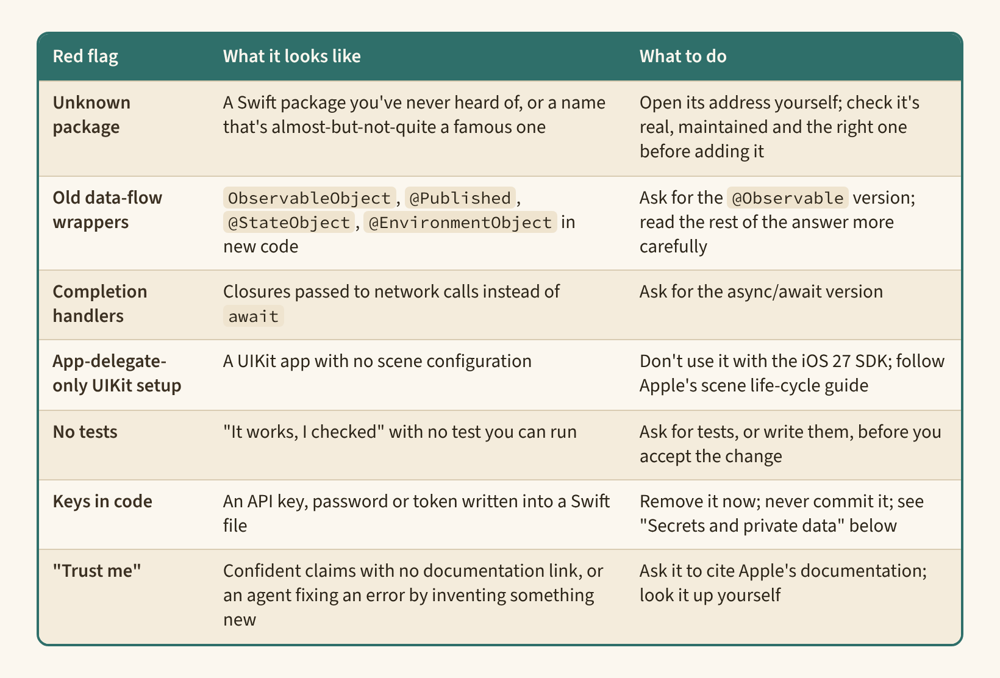{width=100%}

*Figure 11.1 — A red-flags checklist. Keep it near your desk, and notice that most rows end in the same move: look it up yourself.*

## Wrong versions, wrong menus

There's a gentler cousin of yesterday's code that wastes more beginner hours than any of the above: instructions written for a different version of the tools.

You ask an AI helper how to do something in Xcode, and it tells you, with total confidence, to open a menu that isn't there. Or to click a button that's been renamed. Or to change a setting that moved two versions ago. You hunt around, can't find it, and start to wonder whether you're doing something wrong. You're not. The instructions are out of date.

Here's a real example from this very year. For a long time, Xcode had a window called Devices and Simulators, where you managed your iPhone and your simulated devices. Xcode 27 brought them together in a new place called Device Hub.^315 Lots of older documentation and tutorials still mention the old window, so AI helpers will too. Another small one: Apple's learning app for iPad and Mac, which many people still call Swift Playgrounds, is now called Swift Playground, singular.^316 Neither of those will break your app. Both will cost you ten confused minutes if you trust an out-of-date answer.

The fix is a habit you already have from the "Versions move" boxes in this book. When an AI helper describes a menu, a button or a setting, and you can't find it, don't keep hunting. Check three things, in order. First, what version of Xcode are you running? Second, what do Apple's current documentation and release notes say? Third, what does your own Xcode actually show? Trust them in that order, and trust the AI's description last. Telling the AI which version you're on, right in your prompt, helps too: "I'm using Xcode 27.2" at the top of a question saves a surprising amount of grief.

## The verify loop

So how do you catch all this without reading every line with a magnifying glass? You build a habit, the same one every time, so that checking becomes automatic rather than something you remember to do when you're feeling suspicious.

I call it the verify loop. It has five steps:

1. **Read.** Read the change. All of it. If it's a plan, read the plan. If it's a diff, read the diff. You're looking for anything you don't understand, anything that touches parts of the app you didn't expect, and any of the red flags above.
2. **Compile.** Build the project. The compiler is your first and fastest fact-checker. Invented APIs, wrong types and missing imports mostly die here.
3. **Test.** Run your tests. All of them, not just the new ones. This is where you find out whether the change broke a promise your app was already keeping. If the change added tests, read them too. A test that checks nothing proves nothing.
4. **Check the docs.** For anything new to you, an API you haven't seen, a pattern that looks different, a setting you didn't know about, look it up in Apple's documentation. Is it real? Is it current? Is it used the way the AI used it?
5. **Commit.** Only once all four of those pass. And write a commit message in your own words that says what changed and why.

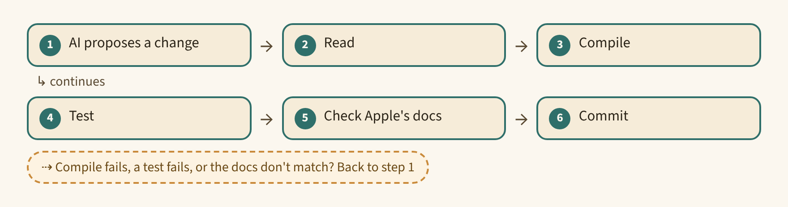{width=100%}

*Figure 11.2 — The verify loop: read, compile, test, check the docs, commit. Follow the dotted lines: any failed step sends the change back, not forward.*

Two tricks make step 4 much easier.

First, **ask the AI to cite its sources.** When an agent recommends an API or a pattern, ask it to point you to the Apple documentation page that describes it. If it gives you a link, click it and check that the page really says what the agent claimed. If it can't give you one, that's a useful signal in itself.

Second, **let the agent do the searching, then you do the reading.** Apple's announcement of agentic coding in Xcode 26.3 described agents that can search Apple's documentation as part of their work.^317 That's genuinely helpful, because it means the agent can check the current docs rather than relying only on what it remembers from training. But the search is the agent's job. Reading the result and deciding whether it applies is yours.

The whole loop, done properly, takes a couple of minutes for a small change. That's not nothing. But compare it to the cost of shipping an app that crashes on launch, or adding a fake package with malicious code, or spending a weekend hunting a bug that a two-minute read would have caught. It's a bargain.

> **Ask your AI.** Use this whenever an AI helper hands you code that uses something you haven't seen before.
>
> *Example prompt (written for this book):* "For each Apple API, modifier or type you used in this change, give me the link to its page in Apple's developer documentation, and tell me the earliest iOS version the page lists. Flag anything you're not certain exists in the iOS 27 SDK."
>
> *Verify by:* opening every link yourself, checking the page really describes what the code does, and building with your project's actual deployment target.

## Secrets and private data

Back in Chapter 6, I gave you the unbreakable rule: never put a secret in your source code, and never commit one to Git. Now that AI helpers can read your whole project, that rule matters even more. Let's go further.

### Where secrets live

A **secret** is anything that would let someone else act as you or your app: an API key for a paid service, a password, an access token. Here's where they should and shouldn't live.

**Not in your source code.** Not in a Swift file, not in a comment, not "just for testing." Source code gets committed, shared, pasted into AI helpers, and uploaded to Git hosts.

**Not in your Git repository.** Keep secrets in a separate configuration file that never gets committed. List that file in `.gitignore`, as you did in Chapter 6, so Git ignores it. Before every commit, look at the list of changed files.

**On the device, in the Keychain.** If your app needs to store a secret on the user's iPhone, like a token they got by signing in, use the Keychain, Apple's secure storage for small pieces of private data.^318 Not `UserDefaults`, not a plain file.

**Better still, on a server.** For keys that really matter, like a paid AI service's key, the safest pattern is not to put the key in your app at all. Your app talks to a small server you control, and the server holds the key and talks to the paid service. That way, nobody can dig the key out of your app, because it was never there.

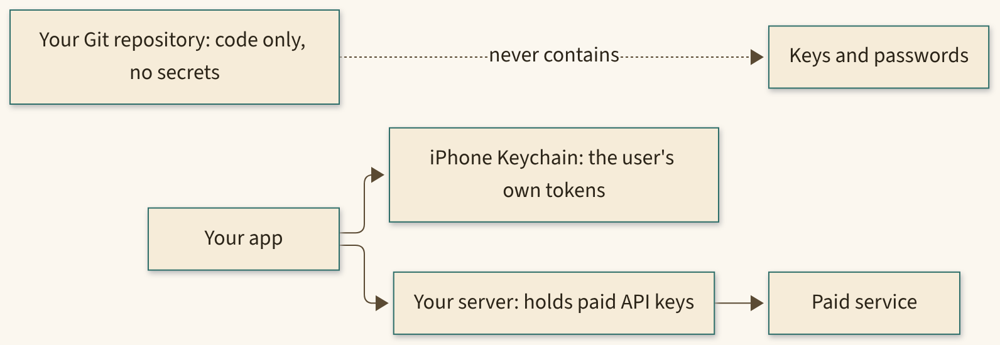{width=100%}

*Figure 11.3 — Where secrets live, and where they don't. Look at the paid service on the right: your app never talks to it directly, so its key never ships inside your app.*

Daybook doesn't need any of this yet, because Open-Meteo doesn't use a key. But the day you add a service that does, you'll know where it goes.

### What you share with AI services

Here's the part that's easy to overlook. When you use an AI helper, you're sending it information: your prompts, the code you paste, and, for agents, often your project files.

Apple says so plainly. Its setup guide explains that when you use an agent in Xcode, it may access your project files and other information while processing your requests, and it points you to the "About Intelligence in Xcode & Privacy…" note in Xcode's Intelligence settings for details.^319 Apple's announcement of agentic coding also notes that Anthropic's and OpenAI's terms of service may apply when you use their agents.^320 The same goes for every helper in Chapter 10: each has its own privacy policy and terms.

So, a few habits:

- **Read the privacy note once.** Xcode's, and the terms for each helper you use. It's ten minutes, and you'll know what you're agreeing to.
- **Don't paste what you wouldn't email.** Real users' data, passwords, keys and anything confidential stay out of prompts. If you need to show an AI some data to debug a problem, make up realistic fake data instead.
- **Keep secrets out of the project folder entirely**, if an agent can read the whole folder. A secrets file that Git ignores is still a file an agent might read.
- **Turn on Xcode's security layer.** The filesystem security layer from Chapter 9, which monitors and controls what files agents and the processes they start can reach, is your backstop here.^321 Switch it on in Coding Intelligence settings.
- **On a work project, follow the rules.** If you're building an app for an employer or client, they may have rules about which AI services can see their code. Ask before you assume.

## When your app sends data to AI

So far we've talked about you sending your code to AI helpers. There's a second situation coming up, and it has rules of its own: your *app* sending your *users'* data to an AI service.

In Chapter 14, you'll add an AI feature to Daybook: "Summarize my week." There are different ways to build a feature like that. Some run entirely on the user's iPhone, and the data never leaves the device. Others send data to a model running on someone else's servers. The difference matters a great deal, to your users and to Apple.

Apple's App Review Guidelines, the rules every App Store app has to follow, cover this directly. Guideline 5.1.2(i) says: "You must clearly disclose where personal data will be shared with third parties, including with third-party AI, and obtain explicit permission before doing so."^322

Notice the two parts. *Clearly disclose*: tell people, in plain words, before it happens, that their data will go to an AI service run by someone else. *Explicit permission*: they have to actually agree, not just fail to object. A line buried in a privacy policy isn't enough on its own. A clear, honest screen that explains what's sent and why, with a real choice, is the spirit of the rule.

For Daybook, think about what's in a journal. Habits, private notes, where you were each day. That's exactly the kind of data people care about. If "Summarize my week" sends any of it to a third-party AI, people deserve to know and to choose. We'll design for that properly in Chapter 14, including the on-device option that avoids the question altogether. For now, just plant the flag: when your app sends personal data to AI, you disclose and you ask first.

## Staying the author

Everything in this chapter comes back to one idea, the one I promised at the start of the book: let the AI type. You stay the author.

What does that mean, day to day? Here are the habits I'd suggest. I want to be upfront that these are advice, not research. I don't have a study showing that these habits make Swift learners better developers. They're what experienced people in many crafts do when they work with a powerful assistant, and they're what the rest of this book assumes.

**Type the first version yourself.** When you're learning something new, write it yourself first, even badly. Then ask an AI to review it, or to show you another way. You learn far more from comparing your attempt to a better one than from reading the better one alone.

**Explain every diff in your own words before you commit.** If an agent changed something and you can't explain the change, in a sentence, to an imaginary friend, don't commit it yet. Ask the agent to explain it, read the docs, or roll it back. Your commit messages are a good place to practice: write them yourself, describing what changed and why.

**Keep a "what I learned" note.** A simple running file, or a Hermes or OpenClaw wiki if you set one up in Chapter 10. After each session, write one or two things you understood that you didn't before. It's the opposite of letting the AI do your thinking. It's you making the learning stick.

**Say no sometimes.** Reject a plan that's more complicated than it needs to be. Roll back a change you don't like, even if it works. Turn down a suggested package you don't need. Every "no" is a small reminder that the app is yours.

**Notice when you've stopped noticing.** The real risk isn't one bad suggestion. It's the slow slide into accepting everything because the last fifty suggestions were fine. If you catch yourself approving without reading, slow down for a day. Do a few changes entirely by hand. Then go back to working with your helpers, with your eyes open.

> **Done when — A verify habit you can keep.**
>
> - [ ] You've checked every Swift package in Daybook by opening its address yourself.
> - [ ] Daybook has no `ObservableObject`, completion-handler networking, or app-delegate-only setup in new code.
> - [ ] You've run the verify loop, read, compile, test, check the docs, commit, on at least one AI-made change, and sent at least one change back.
> - [ ] Your project has a `.gitignore`, and no secret has ever been committed.
> - [ ] You've read Xcode's "About Intelligence in Xcode & Privacy…" note and turned on the security layer.
> - [ ] You keep a "what I learned" note, in your own words.

That's the end of Part Three. You know how to work with Xcode's agents, how to bring in the wider crew, and how to check their work so that every change in Daybook is one you understand and chose.

Daybook is in good shape. It saves your days, fetches the weather, works for people with all kinds of needs, has tests that keep it honest, and has a crew of helpers working for you, not instead of you.

Ready for the deep end?


# Part Four — Go Further {.unnumbered .part}

# Chapter 12 — Concurrency Without Fear, Architecture Without Fuss

{width=100%}


There's a word that makes perfectly calm people close their laptops and go for a walk. The word is *concurrency*.

I understand why. For years, the advice about doing more than one thing at a time in an app sounded like a warning label. Don't touch the screen from the wrong place. Don't let two pieces of code change the same value at once. Don't forget which "thread" you're on, whatever a thread is. And when something went wrong, it didn't go wrong politely. It went wrong once every few hundred launches, on someone else's phone, in a way you couldn't reproduce.

Here's the good news, and it's real news, not a pep talk. Swift has spent the last few releases making this part of the craft much friendlier. The compiler now catches most of these mistakes before your app ever runs. And since Swift 6.2, the starting point for app code can be simple: everything runs in one place, one step at a time, unless you deliberately say otherwise.^323

So this chapter is about two kinds of calm. The first is calm about concurrency: what it is, why your app mostly doesn't need to think about it, and what to do on the day it does. The second is calm about *architecture*, which is just a fancy word for "where does each piece of code live?" Daybook, our habit-and-weather journal, has grown a lot since Chapter 5. It has models, a weather service, tests, and an accessibility pass. Before we add widgets and on-device intelligence in the next two chapters, it's worth tidying the house.

## One cook or many

Let's start in a kitchen, because kitchens explain this better than any diagram of threads ever has.

Picture a small restaurant with one cook at the counter. Every order comes to that cook. The cook plates every dish, and is the only person allowed to touch the pass, which is the counter where finished plates go out to the dining room. Because there's only one cook at the pass, nothing ever collides there. Nobody puts two plates in the same spot. Nobody grabs a half-finished dish. It's orderly, and it's predictable.

In your app, the pass is the screen. And the cook at the counter is called the **main actor**.

An **actor**, in Swift, is a piece of your program that protects its own stuff. Only one task at a time is allowed to work inside it, so its data can't get scrambled by two hands reaching in at once. The **main actor** is the special one that owns the user interface. Every change to what's on screen has to happen there, the same way every plate has to go across that one counter.^324

Now, some kitchen jobs take a long time. Slow-roasting something for four hours. Kneading bread. If the cook at the counter did those jobs personally, the whole restaurant would stop. Nobody else gets served while the cook stands there kneading.

So good kitchens have helpers in the back. The cook writes an order ticket, hands it to a helper, and goes right back to the counter. When the helper is finished, the result comes back to the cook, who plates it and sends it out.

That ticket is the `await` you met in Chapter 6. When your code says `await`, it's saying, "I've handed this off. I'll pick it up when it's ready. Meanwhile, the counter stays open." The screen keeps scrolling. Buttons keep responding. Nobody is left staring at a frozen app.

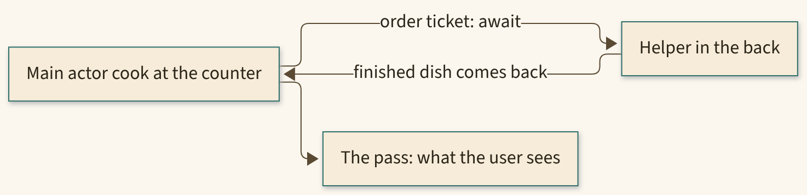{width=100%}

*Figure 12.1 — The kitchen. Notice that only the cook at the counter ever touches the pass, and the order ticket is how work leaves and comes back.*

Look at the arrows in Figure 12.1. Work goes out to the back on a ticket, and it comes back to the counter before anyone sees it. That round trip is most of what you need to understand about Swift concurrency as an app developer.

Two kinds of trouble live in this kitchen. The first is the **frozen counter**: the cook does slow work personally, and the app stops responding. The second is the **collision**: two people reach for the same plate at the same moment. Programmers call that one a **data race**, which means two pieces of code touching the same piece of memory at the same time, with at least one of them changing it. Data races are the bugs that show up once in a few hundred runs and vanish when you look for them.

Modern Swift is built to stop both. The compiler can now prove, before your app runs, that your code is free of data races, as long as you let it check.^325 And the newer defaults keep most of your code at the counter, where collisions can't happen in the first place.

## Main actor by default

For a long time, Swift's starting assumption was the opposite of the kitchen I just described. Unless you said otherwise, code could run anywhere. You had to sprinkle a label called `@MainActor` on the things that touched the screen, and if you forgot one, the compiler complained. Beginners spent a lot of their first concurrency week adding labels they didn't understand to silence errors they understood even less.

Swift 6.2 flipped that. The Swift team called the change "Approachable Concurrency," and their release post describes the headline in four words: "Single-threaded by default." In their words, you can "run your code on the main thread without explicit @MainActor annotations using the new option to isolate code to the main actor by default." They add that the option is "ideal for scripts, UI code, and other executable targets."^326

Translated into kitchen language: everyone works at the counter unless you send them to the back on purpose.

That's a much better starting point for an app. Most of what Daybook does is small and quick. It shows a list of habits. It marks an entry done. It saves a note. None of that needs a helper in the back, and all of it touches the screen. Keeping it on the main actor means the compiler has very little to worry about, and so do you.

The same release offered a second, quieter change. Before Swift 6.2, an `async` function that wasn't tied to an actor always hopped off to a shared pool of background threads, even if you didn't want it to. That surprised people, and it caused a lot of confusing errors. Under the new behavior, which is an upcoming feature you opt into, async functions run where they were called from, unless you say otherwise.^327 So, with that feature on, when your SwiftUI view calls an async function, that function starts out at the counter too.

Apple leans into this. In the WWDC25 session "Embracing Swift concurrency," Apple's engineers explain that new app projects created in Xcode 26 run code on the main actor by default, and they recommend the Approachable Concurrency settings for projects generally.^328 The idea is to start simple and introduce concurrency only when you actually need it.

Where does this setting live? In your project's build settings, there's one called **Default Actor Isolation**. It has two values. **MainActor** means "everything is at the counter unless I say otherwise." **nonisolated** is the older behavior, where code has no home by default.^329 Next to it you'll usually see a setting for Approachable Concurrency itself, which turns on the related language changes together.

You don't have to change either one to follow this book. If Daybook started life as a new Xcode project, it very likely has MainActor as its default already. But it's worth knowing where to look, because one day an AI helper will hand you code that assumes the opposite, and the errors will make a lot more sense once you know which world your project lives in.

> **Versions move.** I checked everything here on 20 November 2026 against Xcode 27.2, iOS 27 and Swift 6.4, on macOS Tahoe 26.6 or later. Apple updates its tools several times a year, so a menu name, a default or a screen can shift under you. If something doesn't match, check Apple's Releases page and the Xcode "SDKs and system requirements" page first, then trust what your Xcode shows you. In this chapter, the thing most likely to differ is the starting value of **Default Actor Isolation** in a brand-new Xcode 27 project: Apple has documented the Xcode 26 default, so open your project's build settings and see what yours says.

> **Try this.** Open Daybook, click the project at the top of the navigator, pick the Daybook target, and choose the **Build Settings** tab. Type "isolation" into the search field. Find **Default Actor Isolation** and note its value. Then search for "concurrency" and see what else is there. Don't change anything yet. Just get to know the neighborhood.

What does "main actor by default" look like in code? Mostly, it looks like nothing. That's the point. Here's a small piece of Daybook's model layer, a type that works out a habit's current streak from its entries:

```swift
import Foundation

@Observable
final class StreakModel {
    var currentStreak = 0

    func refresh(for habit: Habit) {
        let doneDays = habit.entries
            .filter { $0.isDone }
            .map { Calendar.current.startOfDay(for: $0.date) }
        currentStreak = StreakCalculator.streak(endingToday: Set(doneDays))
    }
}
```

There's no `@MainActor` written anywhere, and in a project with MainActor default isolation there doesn't need to be. The class lives at the counter. A SwiftUI view can read `currentStreak` and call `refresh(for:)` without any ceremony. (`StreakCalculator` is Chapter 8's streak logic in a new home. We'll build that home later in this chapter, somewhere it can be tested on its own.)

In a project set to `nonisolated`, the same class would need an explicit `@MainActor` in front of it before SwiftUI could safely use it. That's the whole difference, and it's the reason AI-generated code sometimes arrives covered in `@MainActor` labels. Neither version is wrong. They're written for different defaults.

## Going to the background on purpose

So when *do* you send work to the back?

My rule of thumb is short: only when Instruments tells you to. Not when it feels slow in your head. Not because a tutorial from three years ago moved everything to a background queue. When you've profiled the app, as we did in Chapter 8, and you can see a specific piece of work holding the counter long enough that a person would notice.

Xcode 27's Instruments even has a tool for exactly this. Apple's WWDC26 guide to Xcode describes a Swift Concurrency instrument that shows your tasks, where actors are waiting on each other, and which threads are busy.^330 If you suspect the counter is jammed, that's the place to look before you change any code.

When you do find something slow, Swift 6.2 gave us a clear way to say "this goes to the back." It's an attribute called `@concurrent`. The Swift team describes it as the way to "introduce code that runs concurrently," and to make it clear "when you want code to remain serialized on actor, and when code may run in parallel."^331 In other words, it's the order ticket, written down where everyone can see it.

Here's a hypothetical Daybook feature: exporting a whole year of entries as plain text you can paste somewhere else. For one week of entries this is instant. For a few years of entries, maybe not. If Instruments showed the export holding up the screen, this is how I'd move it:

```swift
import Foundation

// A plain value we can safely hand to a helper in the back.
struct ExportRow: Sendable {
    let date: Date
    let habitName: String
    let isDone: Bool
    let note: String
}

enum Exporter {
    @concurrent
    static func makeText(from rows: [ExportRow]) async -> String {
        rows.map { row in
            let day = row.date.formatted(date: .abbreviated, time: .omitted)
            let mark = row.isDone ? "done" : "not done"
            return "\(day) · \(row.habitName) · \(mark) · \(row.note)"
        }
        .joined(separator: "\n")
    }
}
```

Two things are worth noticing. First, the function is marked `@concurrent`, so it runs away from the main actor even though the rest of the project defaults to it. Second, it takes `ExportRow` values, not Daybook's SwiftData models. `ExportRow` is marked `Sendable`, which is Swift's word for "safe to hand to someone else." A `Sendable` type is one the compiler can prove won't cause a collision if two places hold it at once. Plain structs made of plain values, like this one, are the easy case. Your SwiftData models belong to the screen side of the kitchen, so the habit is to copy out exactly what the helper needs and send that.

Calling it from a view looks like this:

```swift
let rows = entries.map {
    ExportRow(date: $0.date,
              habitName: $0.habit?.name ?? "",
              isDone: $0.isDone,
              note: $0.note)
}
exportText = await Exporter.makeText(from: rows)
```

The `await` is the ticket going to the back. When the text comes back, we're at the counter again, so it's safe to put it on screen.

### Tasks, and letting go

A **task** is Swift's name for a unit of async work that's in progress. You've already been using them without much fuss. SwiftUI's `.task` modifier, which you met in Chapter 6 for loading weather, starts a task just before a view appears. The task is tied to the view, so if the view goes away before the work finishes, SwiftUI cancels it, and a half-finished weather request doesn't keep running for a screen nobody is looking at.^332

**Cancellation** in Swift is polite, not forceful. When a task is cancelled, Swift doesn't yank the work out from under it. It raises a flag, and well-behaved code checks the flag and stops. Apple's own frameworks, like `URLSession`, already check it for you. In your own long-running loops, you can check it yourself with `Task.isCancelled`, or call `try Task.checkCancellation()`, which throws an error if the flag is up.^333

That politeness creates a puzzle, though. What if cleanup has to happen no matter what? You opened a file, and it must be closed. You started a sync, and the server should be told you've stopped.

Swift 6.4, released in September 2026, added two small tools for exactly that. You can now call async functions inside a `defer` block, and Swift waits for them to finish before leaving the function (the proposal is SE-0493). And there's a new function, `withTaskCancellationShield`, that runs a piece of code shielded from the surrounding task's cancellation, so cleanup isn't cut short (SE-0504).^334 Here's the shape, adapted from the example in Swift's own release post:

```swift
func finishSync(using handle: FileHandle) async throws {
    defer {
        await withTaskCancellationShield {
            await markSyncStopped()
            try? handle.close()
        }
    }
    try await uploadPendingEntries(from: handle)
}
```

(`uploadPendingEntries` and `markSyncStopped` are stand-ins for your own functions. Daybook doesn't sync anywhere yet.)

You won't need this in Daybook's first version. I'm showing it because it's new as of Swift 6.4 and because AI helpers trained on older code won't know about it yet. If you ever ask for "make sure this cleanup always runs, even if the task is cancelled," and the answer involves elaborate flags and workarounds, it's worth asking whether an async `defer` would be simpler. Then check the answer against the Swift.org post.

## Swift 6 language mode, and moving into it

There's one more dial to know about, and it's the one people mean when they say "Swift 6 broke my project."

Swift has **language modes**. A language mode is a promise about which rules the compiler enforces. The compiler itself is Swift 6.4 no matter what, but it can check your code by older rules if you ask it to, so that old projects keep building. As of November 2026, Xcode 27 supports four language modes: Swift 6, Swift 5, Swift 4.2 and Swift 4.^335 You'll mostly care about the first two.

The big difference between them is concurrency. Swift.org's migration guide puts it plainly: "With the Swift 6 language mode, the compiler can now guarantee that concurrent programs are free of data races. When enabled, compiler safety checks that were previously optional become required."^336 In Swift 5 mode, those same checks can exist as warnings you opt into. In Swift 6 mode, they're errors, and your app won't build until they're fixed.

That sounds scary, and it's why a lot of older projects stayed in Swift 5 mode for a while. But for a new app written with main-actor-by-default, it's a lot less dramatic than the stories suggest. Most of Daybook lives at the counter, and code at the counter can't collide with itself. The errors tend to appear exactly where you send something to the back, which is exactly where you want the compiler paying attention.

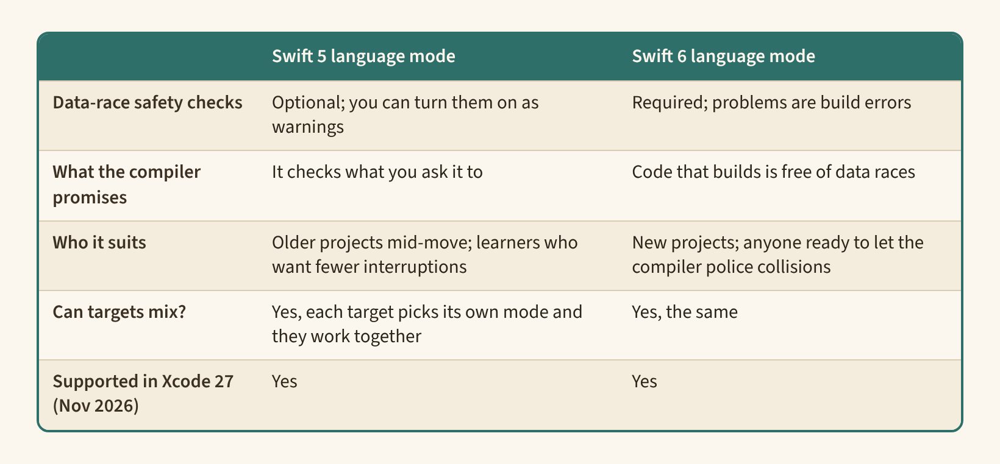{width=100%}

*Figure 12.2 — Swift 5 vs Swift 6 language mode. Look at the second row: Swift 6 mode turns "please check" into "must pass."*

The last-but-one row in Figure 12.2 matters more than it looks. The migration guide is clear that "adopting the Swift 6 language mode is entirely under your control on a per-target basis," and that targets in different modes can work together.^337 A **target**, if you haven't met the word yet, is one thing Xcode builds: your app is a target, your tests are a target, and next chapter your widget will be a target too. So you could move Daybook's tests to Swift 6 mode first, then the app, then the widget, one at a time.

Which mode should you learn in? Honestly, either. If you're a beginner and your project is in Swift 6 mode, you'll occasionally meet an error that asks you to think about where a value lives. That's a lesson, not a punishment. If you're working through an older course or sample project in Swift 5 mode, that's fine too. The habits in this chapter, staying on the main actor and moving work out deliberately, will serve you in both.

To see which mode a target uses, look in its build settings for the Swift language version. To move an existing project forward, don't flip the switch and stare at two hundred errors. Swift.org's migration guide suggests a gentler path: stay in Swift 5 mode, turn on the stricter checks so problems show up as warnings while your build keeps working, fix them a module at a time, then switch modes.^338 The guide's strategy page also has two words, right near the top, I'd happily put on a poster above every developer's desk: "Don't panic." The guide also has a page called "Common Compiler Errors" that's worth bookmarking now. It walks through the handful of root causes behind most concurrency errors, and it says something I find very reassuring: most of the warnings and errors in a big project "can be tracked down to a much smaller set of root causes."^339

## Architecture that stays simple

Now for the second kind of calm.

If you spend any time in iOS forums or video comments, you'll hit a wall of acronyms. MVC. MVVM. VIPER. TCA. Clean Architecture. Each comes with diagrams, strong opinions and at least one person explaining that all the others are wrong.

Here's what I want you to know first: Apple doesn't require any of them. There's no Apple rule that says your app must use MVVM, or any named pattern at all. What Apple's own documentation and sample code show, again and again, is something plainer. SwiftUI views describe the screen. Your data lives in model types, increasingly marked `@Observable`, and SwiftData stores what needs to stick around. Apple's article "Managing model data in your app" is built on exactly that split.^340

The patterns with names are community options. MVVM, which stands for Model-View-ViewModel, adds a "view model" object between each screen and the data. The Composable Architecture, or TCA, is a popular open-source framework from a company called Point-Free, with its own rules for how data flows. Plenty of good apps use them, and plenty of good apps don't. They're opinions, some of them very well-argued, not requirements.

So what should Daybook do? I'd keep it to four layers, and I'd add each one only when it earns its place.

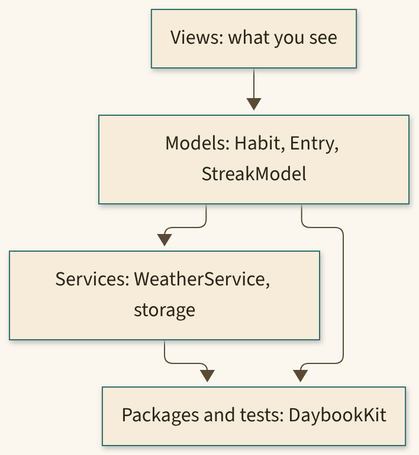{width=100%}

*Figure 12.3 — Daybook's layers. Notice the arrows only point down: a view can use a model, but a model never reaches up to grab a view.*

**Views** are your SwiftUI screens. Their job is to show things and pass along what the person tapped. A good view is a little boring. If you find yourself doing date math or building web addresses inside a view's `body`, that code wants to live somewhere else.

**Models** are your data and the rules about it: `Habit`, `Entry`, and small `@Observable` helpers like the `StreakModel` from earlier in this chapter. Models know nothing about buttons, colors or layout.

**Services** are the parts that talk to the outside world. In Daybook, that's the `WeatherService` from Chapter 6, which knows how to ask Open-Meteo for today's weather and turn the answer into Swift values. Storage is a service too, though SwiftData does most of that work for us. A service's job is to hide the messy details, like web addresses, JSON and error codes, behind a few clear functions.

**Packages and tests** are the foundation: code that doesn't depend on the screen at all, plus the tests that prove it works. We'll build that layer in a moment.

The rule that holds it together is simple: arrows point down. A view can use a model. A model can use a service. Nothing reaches upward. If your `WeatherService` ever needs to know which screen is showing, something has gone sideways.

Stanford's CS193p course makes the same point in its own way. Its running project spends real time on separating the model from the user interface, because that separation is what lets you change one without breaking the other.^341 You don't need the course to follow this chapter. I mention it because it's nice to know the idea isn't mine. It's one of the oldest good ideas in app building.

### Tidying Daybook

If you've been following along, Daybook probably has a few places where the layers blur. That's normal. Code grows where it's needed, and tidying comes after. Here's the order I'd go in:

1. **Find logic inside views.** Look through each view's `body` and helper functions. Anything that calculates, like streaks, date ranges or totals, is a candidate to move into a model.
2. **Give the weather code one home.** Everything about Open-Meteo, the web address, the decoding, the error handling, should live inside `WeatherService`. Views should only ever ask it for weather and show the result or a friendly error.
3. **Move pure logic down.** Anything that doesn't touch SwiftUI or SwiftData, like the streak calculation, can go into a package. That's the next section.
4. **Run the tests after every move.** This is where the tests from Chapter 8 pay for themselves. A refactor, which means changing how code is organized without changing what it does, is only safe if something tells you the behavior didn't change.

Take it slowly, and commit after each step. If you use an AI helper for this, ask it to propose the moves first and make them one at a time, so you can see each change. A single enormous "I refactored everything" diff is very hard to review, whoever wrote it.

> **Ask your AI.** Use this when you suspect a view is doing too much.
>
> *Example prompt (written for this book):* "Here is my SwiftUI view. List any code in it that calculates or transforms data rather than displaying it. For each one, suggest whether it belongs in a model, a service, or a separate package, and explain why in one sentence. Don't change any code yet."
>
> *Verify by:* checking each suggestion against the arrows-point-down rule, then moving one piece at a time and running your tests after each move.

## Swift packages for your own code

A **Swift package** is a bundle of Swift code with a small description file, called `Package.swift`, that says what's inside and what it depends on. You've used packages other people wrote, through Swift Package Manager. You can make your own, too, and keep it right inside your project. That's called a local package.

Why bother? Three reasons.

First, it enforces the layers. Code inside a package can't accidentally reach up into your SwiftUI views, because the package doesn't know they exist.

Second, it's fast to test. Package tests don't need to launch your app in a simulator, so they run quickly.

Third, and this is the one people tend to overlook, plain Swift code in a package can be built and tested anywhere Swift runs. Swift.org supports macOS, Linux and Windows,^342 so a package with no Apple-only frameworks in it isn't tied to your Mac.

For Daybook, I'd make a package called `DaybookKit` and move the streak math into it. Here's its description file:

*Package.swift*

```swift
// swift-tools-version: 6.0
import PackageDescription

let package = Package(
    name: "DaybookKit",
    products: [
        .library(name: "DaybookKit", targets: ["DaybookKit"])
    ],
    targets: [
        .target(name: "DaybookKit"),
        .testTarget(name: "DaybookKitTests", dependencies: ["DaybookKit"])
    ]
)
```

And here's the streak calculator, now living in the package:

*StreakCalculator.swift*

```swift
import Foundation

public enum StreakCalculator {
    /// Counts how many days in a row appear in `doneDays`, counting back
    /// from today. If today isn't done yet, counting starts at yesterday.
    /// Each date in `doneDays` should already be the start of its day.
    public static func streak(
        endingToday doneDays: Set<Date>,
        today: Date = .now,
        calendar: Calendar = .current
    ) -> Int {
        var day = calendar.startOfDay(for: today)
        if !doneDays.contains(day) {
            guard let yesterday = calendar.date(byAdding: .day, value: -1,
                                                to: day)
            else { return 0 }
            day = yesterday
        }
        var count = 0
        while doneDays.contains(day) {
            count += 1
            guard let previous = calendar.date(byAdding: .day, value: -1,
                                               to: day)
            else { break }
            day = previous
        }
        return count
    }
}
```

This is the same rule as Chapter 8's `currentStreak`, including its kindness about today; it just takes days that are already trimmed to the start of each day. Once it works from the package, point Chapter 8's tests and Chapter 9's streak badge at it and retire the old `Streak.swift`, so the rule lives in one place.

The word `public` is new. Inside a package, things are hidden from the outside by default. `public` says, "the app is allowed to use this." Notice too that `today` and `calendar` are parameters with sensible defaults. In the app you'll never pass them. In tests, you can pass a fixed date and calendar, so the test gives the same answer whatever day you run it.

And a test, using Swift Testing from Chapter 8:

*StreakCalculatorTests.swift*

```swift
import Foundation
import Testing
@testable import DaybookKit

struct StreakCalculatorTests {
    let calendar = Calendar(identifier: .gregorian)

    func day(_ offset: Int, from today: Date) -> Date {
        let start = calendar.startOfDay(for: today)
        return calendar.date(byAdding: .day, value: offset, to: start)!
    }

    @Test func aGapEndsTheStreak() {
        let today = Date.now
        let done: Set<Date> = [day(0, from: today), day(-2, from: today)]
        let result = StreakCalculator.streak(endingToday: done,
                                             today: today,
                                             calendar: calendar)
        #expect(result == 1)
    }
}
```

To add the package to Daybook, you create it alongside your project, then add it to the app target as a local package. Xcode can create a new package for you from its New menu; the exact menu wording has moved around between versions, so check what yours shows. Then `StreakModel` in the app imports `DaybookKit` and calls `StreakCalculator.streak(endingToday:)` exactly as before.

Here's where it gets interesting for AI helpers. Grok Bot's own computer, and the cloud coding agents it can hand work to, run Linux. They can't run Xcode, the Simulator or SwiftUI previews; we covered that honestly in Chapter 10. But a package like `DaybookKit` doesn't need any of those. As of November 2026, the Swift 6.4 toolchain from Swift.org installs on Grok Bot's Linux computer, and a package's Swift Testing tests build and pass there. It was checked for this book on November 20, 2026, using exactly the package above.^343 So "write three more tests for the streak calculator and make sure they pass" is a job a Linux-based helper can genuinely do and verify, not just guess at.

The line to remember: the moment your package imports SwiftUI, SwiftData or another Apple-only framework, that Linux trick stops working. Keep the package plain, and it stays portable.

## Using AI on concurrency errors

Sooner or later you'll meet a concurrency error you don't understand. Something about a value "crossing an isolation boundary," or a type that "does not conform to the Sendable protocol." This is a place where an AI helper can be genuinely useful, and also a place where it can quietly make things worse.

Here's the useful part. Concurrency errors are wordy, precise and full of jargon. An AI helper is good at translating jargon into plain English, and at connecting an error to the general pattern behind it. Swift.org's "Common Compiler Errors" page exists because most of these errors come from a short list of root causes.^344 Helping you see which root cause you've hit is a great job for an assistant.

Here's the risky part. Swift has a few escape hatches that make concurrency errors disappear without fixing anything. Two you'll see often in AI suggestions:

- **`@unchecked Sendable`** tells the compiler, "Trust me, this type is safe to share," and turns off its checking for that type.
- **`nonisolated(unsafe)`** tells the compiler, "Don't check who touches this variable."

Both are real, legitimate parts of the language. Both exist for cases where you've protected the data some other way the compiler can't see, like a lock. The migration guide is blunt about the second one: only use it when you are carefully guarding every access to the variable yourself.^345 Used to silence an error you don't understand, they're the equivalent of taking the batteries out of a smoke alarm because it keeps beeping. The beeping stops. The fire doesn't.

So when an AI helper's fix includes either of those, treat it as a question, not an answer. Ask it why. Ask what's protecting the data. If neither of you can name the protection, it isn't there.

Here's the loop I'd use, every time:

1. **Copy the exact error.** Not your summary of it. The whole message, from Xcode's issue navigator or the build log, plus the few lines of code it points at.
2. **Ask for an explanation first, and options second.** "What is this error telling me, in plain English? What are two or three ways to fix it, and what does each one trade away?"
3. **Prefer the boring fix.** Often the honest answer is "this should run on the main actor," or "pass a plain copy of the data instead of the model object." The migration guide's advice is to "express what is true now," not to rebuild your code around the error.^346
4. **Check against the guide.** Find the matching section in Swift.org's migration guide and see whether it agrees.
5. **Build and test.** The compiler is the final fact-checker here. If it builds in Swift 6 mode without escape hatches and your tests pass, you're done.

> **Ask your AI.** Use this when a concurrency error has you stuck.
>
> *Example prompt (written for this book):* "Here is a Swift 6 compiler error and the code it points to. My project uses MainActor default isolation. Explain what the error means in plain English, then give me two or three ways to fix it, ranked from simplest to most involved. If any option uses @unchecked Sendable or nonisolated(unsafe), say exactly what would have to be true for that to be safe."
>
> *Verify by:* reading the matching page of Swift.org's migration guide, building in Swift 6 mode, and running your tests. If a fix only works by turning checks off, go back to step 2.

The habit underneath all of this is the one the whole book keeps coming back to. Let the AI type. You stay the author. Concurrency is the place where that line earns its keep, because the bugs it prevents are the ones you'd never catch by just running the app and looking at it.

Daybook is tidy now. Its logic lives in clear layers, its streak math sits in a package that can be tested almost anywhere, and you know what to do on the day something needs to leave the counter. Next, let's take it beyond the app itself: onto the Home Screen, into Siri and Shortcuts, and onto other Apple devices.


# Chapter 13 — Beyond the App: Widgets, App Intents, Live Activities, and Other Devices

{width=100%}


Here's a small truth about habit apps: the best ones are the ones you barely have to open.

If logging a walk means unlocking your phone, finding the app, waiting for it to load, tapping the right habit and tapping "done," you'll do it for about a week. If the answer is sitting on your Home Screen, or you can say a sentence to Siri while you're taking your shoes off, you might do it for a year.

That's what this chapter is about. Daybook, our habit-and-weather journal, is going to leave its own window. It's going to put today's habit and weather on the Home Screen as a **widget**. It's going to offer a "Log today's habit" action to Siri, Shortcuts and Spotlight through **App Intents**. If you want, it'll show a timed habit on the Lock Screen as a **Live Activity**. And we'll take a short, honest tour of what happens when the same SwiftUI code goes to an iPad, an Apple Watch or Apple Vision Pro.

This is rung 5 of the ladder. It's also the first time Daybook becomes more than one program, so we need to start with how Xcode thinks about that.

## Targets and extensions

You met the word **target** in the last chapter: one thing Xcode builds. So far Daybook has had an app target and a test target or two.

A widget isn't part of your app's main program. It's an **app extension**: a separate, smaller program that ships inside your app, and that the system runs on its own schedule. When someone looks at their Home Screen, iOS doesn't launch Daybook. It asks Daybook's widget extension what to show, and the extension answers. Each extension is its own target, with its own little bundle of code, settings and permissions.^347

That raises a practical question right away. Daybook's habits and entries live in a SwiftData store inside the app's private storage. The widget extension is a separate program. How does it see the same data?

The answer is an **App Group**. Apple's documentation describes app groups as a way for apps and extensions "produced by a single development team to access shared containers." The members of a group share a container, which is a folder they can all read and write.^348 You give the group an identifier that starts with `group.`, like `group.com.example.daybook`, turn on the **App Groups** capability for both the app target and the widget target, and add the same group to each. Apple's page says exactly that: "enable the App Groups capability in Xcode, and add the groups your app belongs to."^349

Then you tell SwiftData to keep its store in that shared container. SwiftData's `ModelConfiguration` has a `groupContainer` option for exactly this.^350 Here's a small file both targets will share:

*SharedStore.swift*

```swift
import SwiftData

enum SharedStore {
    // Use your own group identifier, and add it to both targets.
    static let groupID = "group.com.example.daybook"

    static func makeContainer() throws -> ModelContainer {
        let configuration = ModelConfiguration(
            groupContainer: .identifier(groupID)
        )
        return try ModelContainer(
            for: Habit.self, Entry.self,
            configurations: configuration
        )
    }
}
```

The app then uses this container instead of the simpler one from Chapter 5:

```swift
@main
struct DaybookApp: App {
    let container: ModelContainer

    init() {
        do {
            container = try SharedStore.makeContainer()
        } catch {
            fatalError("Couldn't open Daybook's store: \(error)")
        }
    }

    var body: some Scene {
        WindowGroup {
            ContentView()
        }
        .modelContainer(container)
    }
}
```

(A `fatalError` crashes the app on purpose. It's acceptable here because Daybook is useless without its store, but it's the kind of line worth revisiting before you ship.)

For the widget to understand `Habit` and `Entry`, the files that define them need to belong to the widget target as well as the app. Xcode calls this a file's **target membership**, and you can set it for each file; make sure both targets are ticked. Moving existing data into the new shared location is its own topic; if you've been logging real habits in a development build, expect to start fresh. (If you moved pure logic into the `DaybookKit` package in Chapter 12, add the package to the widget target too.)

One honest note about cost. Capabilities aren't all free, and some need the paid Apple Developer Program. App Groups isn't one of them: Apple's table of supported iOS capabilities marks App groups as available to free accounts, not just to paying members.^351 So a Personal Team should be able to add it. If Xcode still refuses, keep the widget showing sample data until you enroll in Chapter 15, and check that table for the current list rather than trusting my memory or an AI helper's.

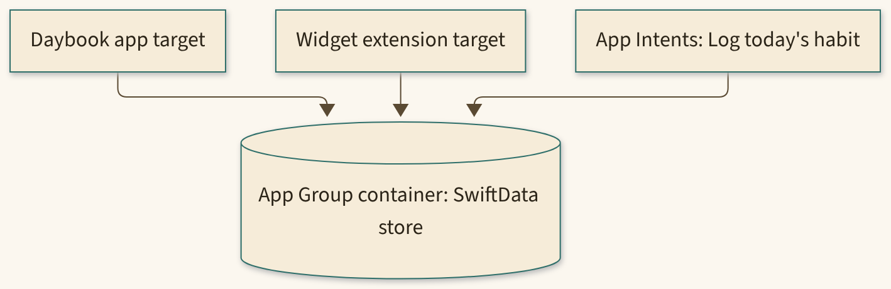{width=100%}

*Figure 13.1 — App, extension and intents sharing one store. Notice that the widget never talks to the app directly; they meet at the shared store.*

That last point in Figure 13.1 trips people up. The widget and the app aren't chatting with each other. They're both reading and writing the same shelf. When the app changes something, it has to tell the system "my widget's information is out of date," and we'll see how in a moment.

## A widget for today's habit and weather

A widget is a small, glanceable view of your app that lives on the Home Screen, the Lock Screen, or in other places the system chooses. It isn't a tiny app. You can't scroll it, and it doesn't run all the time. Instead, it works a bit like a flip calendar.

Your widget extension hands the system a **timeline**: a list of entries, each with a date and the information to show at that moment. The system flips to each entry when its time comes. When it reaches the end of the list, or a date you chose, it asks your extension for a fresh timeline. Apple's WidgetKit documentation describes a timeline as "an array of objects conforming to `TimelineEntry`," where "each timeline entry has a date."^352

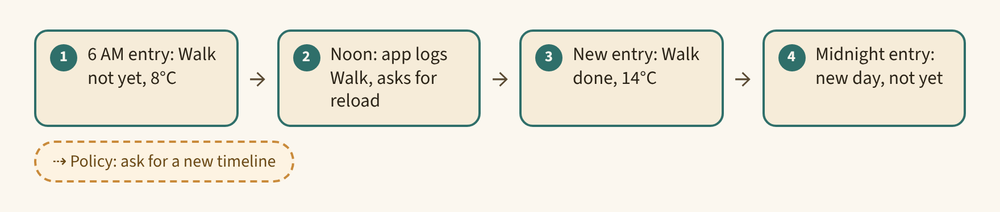{width=100%}

*Figure 13.2 — A widget's timeline across one day. Look at the middle: when the app changes something, it asks the system to reload the timeline instead of waiting.*

### Adding the widget extension

In Xcode, you add a new target to the project and choose the **Widget Extension** template. Apple describes it as "a starting point for creating your widget" that "creates an extension target that contains a single widget."^353 When Xcode asks, you can leave Live Activities out for now; we'll come back to them. Call the target something like `DaybookWidget`.

The template gives you working code with placeholder content. We'll replace it with three pieces: an entry, a provider and the widget itself.

### The entry

The entry is the information for one moment on the timeline. For Daybook, that's today's first habit, whether it's done and the day's temperature:

```swift
import WidgetKit

struct TodayEntry: TimelineEntry {
    let date: Date
    let habitName: String
    let isDone: Bool
    let temperatureC: Double?
}
```

`TimelineEntry` only requires the `date`. Everything else is ours.

### The provider

The **provider** is the part WidgetKit calls when it needs something to show. It has three jobs. It gives a **placeholder**, a generic version for when real data isn't ready. It gives a **snapshot**, a quick example for the widget gallery, where people browse widgets before adding them. And it gives the **timeline** itself.^354

```swift
import WidgetKit
import SwiftData

struct TodayProvider: TimelineProvider {
    func placeholder(in context: Context) -> TodayEntry {
        TodayEntry(date: .now, habitName: "Walk",
                   isDone: false, temperatureC: nil)
    }

    func getSnapshot(in context: Context,
                     completion: @escaping (TodayEntry) -> Void) {
        completion(placeholder(in: context))
    }

    func getTimeline(in context: Context,
                     completion: @escaping (Timeline<TodayEntry>) -> Void) {
        let entry = loadToday()
        let tomorrow = Calendar.current.date(
            byAdding: .day, value: 1,
            to: Calendar.current.startOfDay(for: .now))!
        completion(Timeline(entries: [entry], policy: .after(tomorrow)))
    }

    private func loadToday() -> TodayEntry {
        let start = Calendar.current.startOfDay(for: .now)
        guard let container = try? SharedStore.makeContainer() else {
            return TodayEntry(date: .now, habitName: "Daybook",
                              isDone: false, temperatureC: nil)
        }
        let context = ModelContext(container)
        let descriptor = FetchDescriptor<Entry>(
            predicate: #Predicate { $0.date >= start },
            sortBy: [SortDescriptor(\.date)]
        )
        let today = (try? context.fetch(descriptor))?.first
        return TodayEntry(date: .now,
                          habitName: today?.habit?.name ?? "No habit yet",
                          isDone: today?.isDone ?? false,
                          temperatureC: today?.temperatureC)
    }
}
```

Read `loadToday()` slowly. We open the shared store (or fall back to a plain entry if we can't), ask SwiftData for today's entries in date order, and turn the first one into a `TodayEntry`. The timeline has one entry, and its **reload policy** is `.after(tomorrow)`, which means "ask me again after midnight." Apple's own example uses the same `.after` policy with a date fifteen minutes away; ours just waits for the new day.^355 WidgetKit treats your requested time as a guide, not a promise, and it budgets how often widgets refresh, so don't build anything that depends on the second.^356

The `temperatureC` property came from Chapter 6, where it was added to `Entry` as an optional. That's why the widget can show weather without making its own network request. It just reads what the app already saved. Apple has guidance on making network requests from a widget extension if you ever need to, but reading the shared store is simpler and kinder to the battery.

### The widget itself

Finally, the widget ties the provider to a SwiftUI view:

```swift
import WidgetKit
import SwiftUI

struct TodayView: View {
    let entry: TodayEntry

    var body: some View {
        VStack(alignment: .leading, spacing: 4) {
            Text(entry.habitName)
                .font(.headline)
            Label(entry.isDone ? "Done" : "Not yet",
                  systemImage: entry.isDone ? "checkmark.circle.fill"
                                            : "circle")
            if let temperature = entry.temperatureC {
                Text(temperature.formatted(.number.precision(
                    .fractionLength(0))) + "°C")
                    .font(.caption)
            }
        }
    }
}

@main
struct DaybookWidget: Widget {
    var body: some WidgetConfiguration {
        StaticConfiguration(kind: "DaybookToday",
                            provider: TodayProvider()) { entry in
            TodayView(entry: entry)
        }
        .configurationDisplayName("Today in Daybook")
        .description("Today's habit and weather.")
        .supportedFamilies([.systemSmall, .systemMedium])
    }
}
```

`StaticConfiguration` means the widget has no settings for the person to change. The `kind` string is the widget's name inside your app. The `supportedFamilies` line says which sizes you support; **families** are WidgetKit's word for widget sizes and shapes.^357 Small and medium are plenty to start.

Depending on how your widget target is set up, the template may also want a container background modifier on the view; if Xcode warns about it, follow the fix it offers and check the WidgetKit documentation for the current wording.

### Telling the widget something changed

When someone marks a habit done inside Daybook, the widget's timeline is suddenly wrong. The app fixes that with one line, right after it saves:

```swift
import WidgetKit

WidgetCenter.shared.reloadTimelines(ofKind: "DaybookToday")
```

`WidgetCenter` is WidgetKit's object for "reloading widget timelines." You can reload one kind of widget, as here, or all of them with `reloadAllTimelines()`.^358

### Seeing it

You don't need to keep adding the widget to a Home Screen to see your changes. Xcode previews work for widgets too. Apple's example looks like this:^359

```swift
#Preview(as: .systemSmall) {
    DaybookWidget()
} timeline: {
    TodayEntry(date: .now, habitName: "Walk",
               isDone: false, temperatureC: 8)
    TodayEntry(date: .now, habitName: "Walk",
               isDone: true, temperatureC: 14)
}
```

Each entry in the `timeline:` list becomes a frame you can step through in the canvas. And in Xcode 27, agents can use a preview-snapshot tool that renders widget timelines, along with light and dark appearance, orientations and text sizes.^360 That matters for the "Done when" at the end of this chapter.

One more thing from Apple's documentation that saves a lot of head-scratching: for a widget to appear in the widget gallery, a person "must launch the app that contains the widget at least once after the app is installed."^361 If your widget isn't showing up on your test phone, open Daybook once and look again.

## App Intents: Siri, Shortcuts and Spotlight

A widget lets Daybook *show* something outside the app. An **App Intent** lets Daybook *do* something outside the app.

Apple describes an app intent as an action "your app performs" that you make available "to the system and other apps," a bridge "between your app's features and Apple Intelligence" that enables "Siri, widgets, the Shortcuts app, and more."^362 Once Daybook has a "Log today's habit" intent, a person can run it from the Shortcuts app, build it into their own automations, find it in Spotlight and ask Siri for it, all without opening Daybook.

The lovely thing about App Intents is how little code they take. An intent is a struct that follows the `AppIntent` protocol. It has a title, an optional description, any **parameters** it needs (the blanks the person or Siri fills in) and a `perform()` method that does the work.^363 Here's Daybook's:

*LogHabitIntent.swift*

```swift
import AppIntents
import SwiftData
import WidgetKit

struct LogHabitIntent: AppIntent {
    static var title: LocalizedStringResource { "Log Today's Habit" }
    static var description: IntentDescription? {
        IntentDescription("Marks a habit as done for today in Daybook.")
    }

    @Parameter(title: "Habit")
    var habitName: String

    func perform() async throws -> some IntentResult & ProvidesDialog {
        let container = try SharedStore.makeContainer()
        let context = ModelContext(container)

        let name = habitName
        let habits = try context.fetch(FetchDescriptor<Habit>(
            predicate: #Predicate { $0.name == name }))
        guard let habit = habits.first else {
            return .result(dialog: "I couldn't find a habit called \(name).")
        }

        context.insert(Entry(date: .now, isDone: true, habit: habit))
        try context.save()
        WidgetCenter.shared.reloadTimelines(ofKind: "DaybookToday")

        return .result(dialog: "Logged \(habit.name) for today.")
    }
}
```

Let's walk through it.

The `title` and `description` are what people see in the Shortcuts app. Keep them short and plain.

`@Parameter` marks `habitName` as a blank to fill in. Before calling `perform()`, the system makes sure every required parameter has a value. Apple's docs say it infers values when it can and asks the person when it can't, so if someone just says the shortcut's name, Siri can ask which habit.^364

`perform()` is the action. It opens the same shared store the widget uses, finds the habit by name, inserts a done `Entry` for today and saves. Then it asks WidgetKit to reload Daybook's widget, so the Home Screen catches up straight away.

The return type, `some IntentResult & ProvidesDialog`, says "this intent finishes with something to say." `ProvidesDialog` is the App Intents protocol for a result that "delivers a dialog back to the initiator of the action," which is how Siri gets the sentence it reads aloud.^365

Two small things I did on purpose. The predicate compares against a local copy, `name`, instead of reaching into `habitName` directly; SwiftData's `#Predicate` is happiest with plain local values. And the intent reports "I couldn't find a habit" instead of throwing an error, because a friendly sentence is more useful to someone talking to Siri than an error code.

You'll notice `description` is written as a computed property, with braces, rather than a stored `static var`. Apple's own sample stores it, but in Swift 6 language mode a stored static `var` can draw a "not concurrency-safe" complaint, and the computed form sidesteps it.^366 It's also typed `IntentDescription?`, with a question mark, because that's exactly how Apple declares the requirement.^367 If the compiler raises any other isolation complaint about your intent, that's Chapter 12's loop: read the exact error, then fix the cause rather than silencing it.

A string parameter is the simplest place to start, and it's honest about its weakness: if someone types "walk" and the habit is called "Walk," it won't match. The grown-up version is an **app entity**, a way of describing your own types, like `Habit`, to the system so Siri and Shortcuts can offer a list of real habits to choose from. Apple's App Intents documentation has a whole section on app entities.^368 It's a great next step once the simple version works.

### Making it a ready-made shortcut

An intent on its own shows up in the Shortcuts app as an action people can drag into their own shortcuts. To make it a ready-made **App Shortcut**, with spoken phrases that work as soon as Daybook is installed, you add one more small type. Apple explains that App Shortcuts combine your intent "with other data, such as a title, image, and spoken phrases," and that they're "available as soon as someone installs your app," without registering anything yourself.^369

```swift
import AppIntents

struct DaybookShortcuts: AppShortcutsProvider {
    static var appShortcuts: [AppShortcut] {
        AppShortcut(
            intent: LogHabitIntent(),
            phrases: ["Log a habit in \(.applicationName)"],
            shortTitle: "Log Habit",
            systemImageName: "checkmark.circle"
        )
    }
}
```

The `\(.applicationName)` part is filled in with your app's name, so the phrase still works after you rename Daybook into something that's truly yours in Chapter 16. The `systemImageName` is an SF Symbols name, the same kind you've been using for habit icons since Chapter 5.

> **Try this.** Build and run Daybook on your iPhone. Open the Shortcuts app, tap to add a new shortcut, and search for "Log Today's Habit." Run it, type the exact name of one of your habits, and then look at your Daybook widget. It should flip to "Done" without you opening the app. If it doesn't, check that the intent and the widget are using the same App Group.

### Testing your intents

Apple's App Intents documentation includes pages on verifying and testing your intents, along with a testing library for them.^370 At minimum, I'd test the part that doesn't need Siri: given a store with a habit called "Walk," running the intent's logic creates one done entry for today. If you've been following Chapter 12's layers, you'll notice the cleanest version moves that logic into a small function the intent calls, which is far easier to test than the intent itself.

## Live Activities, if a habit has a clock

Some habits have a clock attached. Ten minutes of stretching. Twenty minutes of reading. A forty-minute walk. For those, there's a third way out of the app: a **Live Activity**.

A Live Activity shows current, changing information in prominent places. Apple lists the Lock Screen, the Dynamic Island on iPhones that have one, a paired Apple Watch, CarPlay and the Mac menu bar among them.^371 Think of a delivery tracker, or a sports score that updates while the phone is locked. For Daybook, it could be "Stretching: 6 minutes left," counting down on the Lock Screen while your phone sits on the floor next to you.

I've marked this section optional, and I mean it. A Live Activity makes sense when something is happening *right now* and has an end. Most habits don't. "Drink water" doesn't need a countdown on your Lock Screen. My rule: if you wouldn't want to glance at it every few minutes, it isn't a Live Activity. If none of your habits are timed, skip ahead with a clear conscience.

If you do build one, it lives in the same widget extension. Apple's documentation says Live Activities "use WidgetKit functionality and SwiftUI for their user interface," and that ActivityKit handles the life cycle: you use it "to request, schedule, update, and end" each one.^372 When you add a widget extension, Xcode offers an "Include Live Activities" option that sets up the pieces for you.^373

The heart of it is a type that describes what the Live Activity shows. ActivityKit splits that into two parts: things that don't change while it runs, and a `ContentState` for things that do.^374

```swift
import ActivityKit
import Foundation

struct TimedHabitAttributes: ActivityAttributes {
    public struct ContentState: Codable, Hashable {
        var endsAt: Date
    }

    var habitName: String
}
```

The habit's name won't change during a session, so it's a plain property. The end time could change, if someone adds five more minutes, so it lives in `ContentState`. From there, your app starts the activity with ActivityKit's `Activity.request(attributes:content:pushType:)` family of methods, updates it, and ends it when the timer finishes or the person stops early.^375 Your app also needs the `NSSupportsLiveActivities` key in its Info.plist; Apple lists it in the ActivityKit documentation.^376

Two limits worth knowing before you design anything. A Live Activity can be active for up to eight hours, after which the system ends it, and it may stay on the Lock Screen for up to four more hours before it's removed.^377 That's plenty for a timed habit, and a reminder that Live Activities are for events, not for permanent status.

As with widgets, Xcode 27's preview-snapshot tool can render Live Activity states, so you and your agents can check how "6 minutes left" and "Done!" both look without standing over a phone.^378

## One codebase, more devices

So far, Daybook has been an iPhone app. But you've been writing SwiftUI, and SwiftUI was built to run across Apple's platforms. The same views you wrote for iPhone can, with care, show up on iPad, Mac, Apple Watch and Apple Vision Pro.

"With care" is doing a lot of work in that sentence, so let me be specific about what carries over and what doesn't.

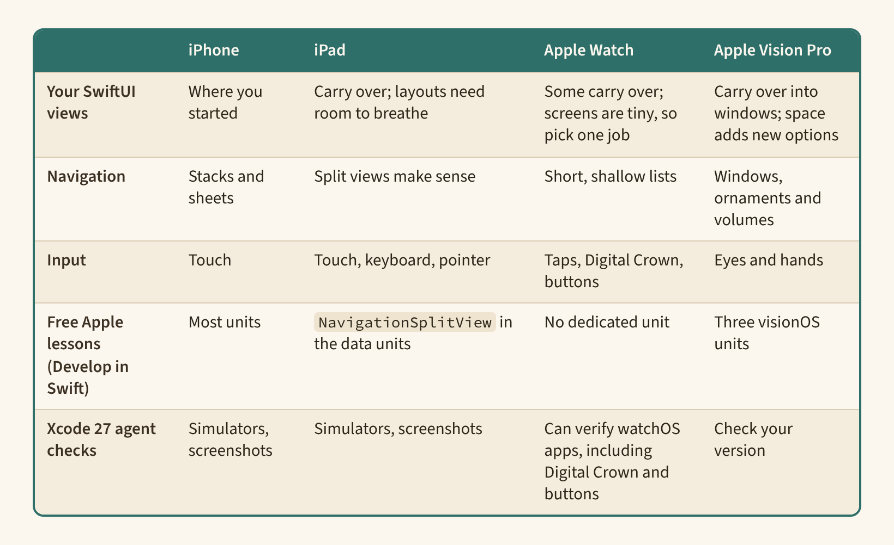{width=100%}

*Figure 13.3 — One SwiftUI codebase across four devices. Notice that the top row says "carry over" almost everywhere, while the rows below it are all different.*

The pattern in Figure 13.3 is the honest one. Your *code* travels well. Your *design* doesn't travel at all without thought. A list of five habits with notes is lovely on an iPad, cramped on an iPhone and absurd on a watch. On Apple Watch, Daybook probably shouldn't be a journal at all. It should be one button: "Did you do it today?"

A few facts to anchor the tour.

**iPad.** An iPhone app built with SwiftUI usually runs on iPad with modest changes. The big lesson is navigation: iPad has room for a sidebar and a detail view side by side. Develop in Swift teaches `NavigationSplitView` in its data-modeling units for exactly this.^379

**Apple Watch.** Apple's watchOS page is the place to start.^380 The Xcode 27 release notes add something useful for our AI workflow: agents can now verify watchOS apps, including the Digital Crown and buttons.^381 That means "add a watch app that shows today's habit and lets me mark it done, and prove it works in the simulator" is a request an agent in Xcode can check for itself, and that you should then check too.

**Apple Vision Pro.** Apple's visionOS page is the front door.^382 Develop in Swift has three units on spatial computing, covering windows, ornaments and volumes, which is the friendliest introduction I know.^383 One practical note: building for visionOS requires a Mac with Apple silicon, which, if you're using Xcode 27, you already have.^384

**Availability across platforms.** When code should only run on newer systems, Swift uses **availability** checks: little annotations that say "this needs at least version such-and-such." Writing those for five platforms used to mean listing each one. Apple's WWDC26 Swift guide notes that Swift 6.4 adds "simplified availability syntax with anyAppleOS."^385 The details are in the Swift 6.4 materials; the short version is less repetition when the same code targets every Apple platform. Check the current documentation for exact spelling before you rely on it.

One more piece of good news: you don't have to do any of this to finish the ladder. Rung 5 is the widget and the intent. Other devices are a stretch goal, not a requirement.

## Done when: rung 5

Here's where we draw the line for this rung. You've done a lot in one chapter: a second target, a shared store, a widget, an intent, maybe a Live Activity. Before moving on, make sure it all actually works together, on a real phone, not just in previews.

> **Done when — Rung 5.**
>
> - [ ] Daybook and its widget extension share one SwiftData store through an App Group (or, if Xcode won't add the capability for your team yet, the widget shows clearly labeled sample data and you've noted the gap).
> - [ ] The widget shows today's habit, whether it's done and the saved temperature, in both small and medium sizes.
> - [ ] Marking a habit done in the app updates the widget without you touching the Home Screen.
> - [ ] "Log Today's Habit" appears in the Shortcuts app and logs a habit when you run it.
> - [ ] Running the intent updates the widget too.
> - [ ] Your previews include at least one "done" entry and one "not yet" entry.
> - [ ] Everything is committed, with a message that says what changed.

That middle pair is the real test. It's easy to build a widget and an intent that each work alone. The rung is done when they work *through* the shared store, so a change made anywhere shows up everywhere.

### The AI practice for this rung

Every rung of the ladder pairs with one way of working with AI, and this one is a good fit for Xcode's agents. Widgets come in several sizes, appearances and text sizes, and checking all of them by hand is tedious. As of Xcode 27, agents can use a preview-snapshot tool that renders widget timelines in light and dark appearance, at different orientations and text sizes.^386 So ask for that, and then do the part that's yours: look.

> **Ask your AI.** Use this once your widget builds and its preview works.
>
> *Example prompt (written for this book):* "Render the DaybookToday widget in every family it supports, in light and dark appearance, at the default text size and the largest accessibility text size. Show me the snapshots side by side. Don't change any code. List anything that looks clipped, truncated or unreadable."
>
> *Verify by:* looking at every snapshot yourself, then adding the widget to a real Home Screen at a large text size. The agent's list is a starting point, not a verdict.

Why insist on looking yourself when the agent can render the pictures? Because "is this readable?" and "does this make sense at a glance?" are judgment calls, and the whole point of a widget is the glance. An agent can tell you a label is truncated. It can't tell you whether "Walk: Not yet" at 7 a.m. feels encouraging or naggy. That one's yours.

And if you used Chapter 7's accessibility habits, try the widget with VoiceOver too. Apple's ActivityKit and WidgetKit documentation includes guidance on adding accessible descriptions to widgets and Live Activities, which is worth a read before you call the rung done.^387

### What's next

Daybook now lives in three places: inside its own window, on your Home Screen and inside Siri and Shortcuts. It knows your habits and it knows the weather. What it can't do yet is *think* about any of it. "How did my week go?" is a question you'd answer by scrolling and squinting.

Next chapter, we'll give it a way to answer that question itself, on your device, with Apple's Foundation Models, and we'll be careful about how.


# Chapter 14 — Intelligence Inside Your App: Foundation Models

{width=100%}


For most of this book, AI has been something that helps you *build* the app. It's been Xcode's agents, Claude, ChatGPT, Grok Bot and the rest, sitting beside you while you write code.

This chapter flips that around. Now the AI goes *inside* the app, and it works for the person using Daybook.

The feature is small and, I think, genuinely useful. You've been logging habits and weather for a while. On Sunday evening, you tap "Summarize my week," and Daybook tells you, in a couple of warm sentences, how it went: which habits held up, which slipped, maybe that you walked more on the dry days. Then it offers one small suggestion for next week.

You could write that with a pile of `if` statements. But it would read like a pile of `if` statements. A language model can write it like a person would, and Apple has made it possible to run one on the phone itself, with no server, no account and no API key. That's rung 6 of the ladder.

It's also the chapter where "you stay the author" takes on a second meaning. You're not only the author of your code. You're responsible for what your app says to people, and for where their data goes. We'll take both seriously.

## What the Foundation Models framework is

Apple describes the Foundation Models framework as "a native Swift API for integrating any large language model into your app — including direct access to the Apple Foundation Models on-device and in Private Cloud Compute."^388 Let's unpack that one phrase at a time.

A **large language model**, or LLM, is the kind of AI behind chat assistants: a program trained on huge amounts of text that predicts what words should come next, and does it well enough to summarize, answer questions and write. Apple's own models are called the **Apple Foundation Models**, and they power Apple Intelligence.^389

**On-device** means the model runs on the iPhone itself. Apple's documentation describes the on-device models as good at "a diverse range of text generation tasks, like summarization, entity extraction, text and image understanding, refinement," and more.^390 Summarizing a week of habit notes is right in that sweet spot.

**Private Cloud Compute** is Apple's server-side option for bigger jobs, run on Apple's own servers with strong privacy protections. We'll come back to it, and to who can use it for free, later in this chapter.

And "**any** large language model" is the newer part. Apple introduced the framework in 2025, focused on its on-device model. At WWDC26, in June 2026, Apple expanded it so the same Swift API can also talk to server models from other companies, and to open models you run yourself.^391 One API, several possible brains behind it.

The framework's big ideas, which we'll meet in turn, are these. You open a **session** and send it **prompts**. You can ask for a plain-text answer, or use **guided generation** to ask for a filled-in Swift type. You can give the model **tools**, small functions it may call to look things up. It can understand **images** as well as text. And with **Dynamic Profiles**, one conversation can switch models and settings partway through.^392

If you'd like a gentle, guided version of all this before building Daybook's feature, Apple's free Develop in Swift tutorials include a unit called "Intelligent features with Foundation Models," built around a quiz app. It covers `LanguageModelSession`, `@Generable`, `@Guide` and streaming partial results.^393 It's an excellent companion to this chapter.

## Checking the model is available

Here's the first thing to get right, and it's not about AI at all. It's about being kind to people whose phones can't run it.

The on-device model only works on devices that support Apple Intelligence, in regions where it's offered, with Apple Intelligence turned on (from iOS 27 it's on by default and can't be turned off), and after the model has finished downloading.^394 Apple's documentation is clear: "Model availability depends on whether the device and region supports Apple Intelligence."^395 Apple keeps the list of supported devices on its own site. I won't copy it here, because it changes, and a list in a book goes stale faster than milk. Link to Apple's page instead.

So before Daybook shows a "Summarize my week" button, it asks. The model is `SystemLanguageModel.default`, and it has an `availability` property you can switch over.^396 Apple's documentation lists the reasons it might be unavailable: the device isn't eligible, Apple Intelligence isn't enabled (which can only happen on systems before iOS 27), or the model isn't ready yet, usually because it's still downloading.^397

*WeekSummaryButton.swift*

```swift
import SwiftUI
import FoundationModels

struct WeekSummaryButton: View {
    private let model = SystemLanguageModel.default
    let action: () -> Void

    var body: some View {
        switch model.availability {
        case .available:
            Button("Summarize my week", systemImage: "sparkles",
                   action: action)
        case .unavailable(.appleIntelligenceNotEnabled):
            Text("Turn on Apple Intelligence in Settings to get a weekly summary.")
                .font(.footnote)
        case .unavailable(.modelNotReady):
            Text("Weekly summaries will be ready soon.")
                .font(.footnote)
        case .unavailable(.deviceNotEligible):
            EmptyView()
        @unknown default:
            EmptyView()
        }
    }
}
```

Notice what each case does. If the device simply can't run the model, Daybook shows nothing at all. There's no point advertising a feature someone can't have, and the rest of the app works exactly as before. If Apple Intelligence is just switched off, Daybook says so, plainly, once. If the model is still downloading, it says "soon." And the `@unknown default` at the end catches any reason Apple adds in a future version, which is how Apple's own example handles it.^398

Apple's own sample code labels this branch "Show an alternative UI," and it isn't an afterthought. Apple's design guidance for generative AI says to "ensure a great experience even when generative features aren't available or people opt not to use them."^399 Daybook's core job is logging habits. The summary is a bonus. Nobody should feel their app is broken because their phone is a few years old.

> **Try this.** Run Daybook in a simulator or on a device where the model isn't available, and check that the rest of the app is completely unaffected. Then, if you have a device on iOS 26 that supports Apple Intelligence, turn Apple Intelligence off in Settings and see your "turn it on" message. (On iOS 27 you can't turn it off, so that message only shows on older systems.) Both paths are features. Test them like features.

## Guided generation: asking for a struct, not a paragraph

Now for the part that, to me, makes this framework feel like it was designed by people who've actually shipped apps.

Most AI chat tools give you back text. That's fine for a chat window. It's awkward in an app. If you ask a model to "summarize my week and suggest one thing for next week," you get a paragraph, and then you're stuck pulling the suggestion out of it, hoping the model put it in the same place it did last time. It usually doesn't.

Foundation Models offers something better, called **guided generation**. Instead of asking for text, you ask for a Swift type, and the framework makes sure the model fills it in. Apple puts it strongly: with the `@Generable` macro, "you can define custom data structures and the framework provides strong guarantees that the model generates instances of your type."^400 No string parsing. No hoping.

Here's Daybook's summary type. (A **macro**, if you haven't met the word, is a label like `@Generable` that tells the compiler to write some extra code for you behind the scenes.)

*WeekSummary.swift*

```swift
import FoundationModels

@Generable
struct WeekSummary {
    @Guide(description: "One warm, plain sentence summing up the week.")
    var headline: String

    @Guide(description: "Names of habits that were done on most days.")
    var steadyHabits: [String]

    @Guide(description: "Names of habits that were mostly missed.")
    var slippingHabits: [String]

    @Guide(description: "One small, specific suggestion for next week.")
    var suggestion: String
}
```

`@Generable` marks the whole struct as something the model can produce. Each `@Guide` gives the model a natural-language hint about one property. Apple notes that if your property names are clear, you may not need guides at all; every guide also uses up a little of the model's limited working space, which we'll get to in a moment, so use them where they help.^401

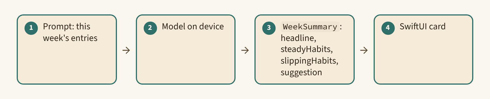{width=100%}

*Figure 14.1 — Guided generation. Look at the middle box: the model's output arrives as a filled-in Swift type, not a paragraph you have to pick apart.*

### Building the prompt from real data

The model knows nothing about your habits. It only knows what you tell it in the prompt. So the first job is to turn a week of `Entry` values into a few plain lines of text:

```swift
func weekPrompt(from entries: [Entry]) -> String {
    let lines = entries.map { entry in
        let day = entry.date.formatted(.dateTime.weekday(.wide))
        let habit = entry.habit?.name ?? "Unknown habit"
        let status = entry.isDone ? "done" : "missed"
        let weather = entry.temperatureC.map {
            ", \($0.formatted(.number.precision(.fractionLength(0))))°C"
        } ?? ""
        return "\(day): \(habit) \(status)\(weather)"
    }
    return "Here are my habit entries for the past week:\n"
        + lines.joined(separator: "\n")
}
```

Notice this is just ordinary Swift. It's also the part you can test without any AI at all, which we'll do later in the chapter.

### Asking the model

A **session** is one conversation with the model. Apple's docs describe it as "a single context that you use to generate content with," which keeps state between requests.^402 You can give a session **instructions**, which are your standing orders for the model. Apple notes that the model obeys prompts "at a lower priority than the instructions you provide," which is exactly what you want: your rules beat whatever ends up in the prompt.^403

```swift
import FoundationModels

func summarizeWeek(_ entries: [Entry]) async throws -> WeekSummary {
    let session = LanguageModelSession(instructions: """
        You summarize a person's habit journal for one week. \
        Be warm, brief and specific. Use only the facts provided. \
        Never give medical advice.
        """)
    let response = try await session.respond(
        to: weekPrompt(from: entries),
        generating: WeekSummary.self
    )
    return response.content
}
```

That's the whole call. `respond(to:generating:)` sends the prompt, waits for the model and hands back a `Response` whose `content` is a real `WeekSummary`.^404 You can put `summary.headline` straight into a `Text` view.

Two practical limits from Apple's documentation are worth knowing now. First, a session handles one request at a time, and calling it again before the last request finishes causes an error; check its `isResponding` property, or simply disable the button while it works.^405 Second, the on-device model has a limited **context window**, which is the total amount of text, instructions, prompt and answer together, that it can consider at once. One of Apple's guides gives the system model's limit as 4,096 tokens, where a token is roughly three or four characters of English, and says the framework throws an error if you go over.^406 Apple's newer model table lists 4K to 8K tokens, depending on which on-device model a phone has, and says the exact number can vary, so check the model's `contextSize` property rather than hard-coding a number.^407 A week of short habit lines fits easily. A year of long journal entries wouldn't, which is a good reason to keep this feature to "my week."

### Streaming, so it doesn't feel slow

A model can take a few seconds to answer. Staring at a spinner for that long feels broken. So the framework can **stream** the answer, handing you a partly filled-in `WeekSummary` as it's being written. Apple calls each piece a **snapshot** of "partially generated content."^408

```swift
@State private var partial: WeekSummary.PartiallyGenerated?

// ...

let stream = session.streamResponse(
    to: weekPrompt(from: entries),
    generating: WeekSummary.self
)
for try await snapshot in stream {
    partial = snapshot.content
}
```

`WeekSummary.PartiallyGenerated` is a version of your type, written for you by the macro, where every property is optional, because it might not have arrived yet. Your view shows whatever's there: first the headline appears, then the habit lists fill in, then the suggestion. It feels like someone writing to you, which is honestly how it should feel.

Apple's design guidance adds a nice touch here: give "specific, reassuring feedback during generation." Instead of "Processing…," say what's happening.^409 For Daybook, "Reading your week…" is all it takes.

## Putting it on screen, and when the model says no

Here's a compact version of the card that shows the summary. It works with the streamed, partly filled-in version, so it can draw itself while the model is still writing:

```swift
import SwiftUI
import FoundationModels

struct WeekSummaryCard: View {
    let summary: WeekSummary.PartiallyGenerated
    let onDismiss: () -> Void

    var body: some View {
        VStack(alignment: .leading, spacing: 8) {
            if let headline = summary.headline {
                Text(headline).font(.headline)
            }
            if let steady = summary.steadyHabits, !steady.isEmpty {
                Label(steady.joined(separator: ", "),
                      systemImage: "checkmark.seal")
            }
            if let slipping = summary.slippingHabits, !slipping.isEmpty {
                Label(slipping.joined(separator: ", "),
                      systemImage: "arrow.uturn.backward")
            }
            if let suggestion = summary.suggestion {
                Text(suggestion).italic()
            }
            HStack {
                Text("Written by Apple Intelligence on this iPhone.")
                    .font(.caption)
                    .foregroundStyle(.secondary)
                Spacer()
                Button("Dismiss", action: onDismiss)
            }
        }
        .padding()
    }
}
```

Every `if let` is there because, mid-stream, any piece might still be missing. The small caption at the bottom matters more than it looks; we'll come back to why in the last section of this chapter.

Now, the part tutorials tend to skip: sometimes the model won't answer.

Apple's on-device models come with **guardrails**, which are safety checks on both the prompt going in and the answer coming out. If either one trips a guardrail, the session throws an error instead of answering. A model can also simply decline. Apple's documentation says plainly that "a model can freely refuse to respond to an input," and that when you're using guided generation, a refusal arrives as an error rather than as a polite sentence in your struct.^410 The framework has a list of other things that can go wrong too, like the context window being exceeded or too many requests at once.^411

For Daybook, I don't need to tell those cases apart. I need one honest, friendly fallback:

```swift
do {
    summary = try await summarizeWeek(entries)
} catch {
    message = "I couldn't write a summary this time. Your entries are all still here."
}
```

That's not lazy error handling. It's the right level for this feature. The summary is a bonus, and the person's data is untouched no matter what the model does. Apple's safety guide makes the deeper point well: the built-in guardrails are a base layer, and "some harms might bypass both built-in framework safety layers," so it's your job to decide what's acceptable for your app and your audience.^412 For a habit journal, that mostly means keeping the instructions narrow and the tone kind, which we've done.

> **Try this.** Add a habit with a slightly odd name and a long, rambling note, then ask for a summary. Read it closely. Does the summary stick to what you actually logged? Then turn on Airplane Mode and try again. The on-device model doesn't need the network, so it should work exactly the same.

## Tools, images and Dynamic Profiles

Guided generation is the feature Daybook needs today. Three more features are worth knowing about, because they're where this framework goes next.

### Tools

A **tool** is a small function you write that the model is allowed to call while it's working on an answer. Apple's documentation describes tool calling as giving "the model the ability to call your code to incorporate up-to-date information like recent events and data from your app."^413 You give each tool a name and a description; the framework puts those in front of the model; the model decides whether and when to call it.

For Daybook, a tool could let the model look up the note you wrote on a particular day, instead of you stuffing every note into the prompt up front:

```swift
import FoundationModels

struct DayNoteTool: Tool {
    let name = "lookUpDayNote"
    let description = "Looks up the journal note for one day of the week."

    let notesByWeekday: [String: String]

    @Generable
    struct Arguments {
        @Guide(description: "A weekday name, like Monday")
        let weekday: String
    }

    func call(arguments: Arguments) async throws -> String {
        notesByWeekday[arguments.weekday] ?? "No note that day."
    }
}
```

You'd pass it in when you create the session, with `LanguageModelSession(tools: [DayNoteTool(notesByWeekday: notes)], instructions: ...)`, which follows the session initializer Apple lists as `init(model:tools:instructions:)`, leaving the model at its default.^414 Apple notes that tools must be `Sendable`, so the framework can run them concurrently; a struct holding a dictionary of strings, like this one, is the easy case from Chapter 12.^415

Tools are powerful, and that's exactly why they deserve care. A tool runs *your* code because the model asked. A lookup tool that reads notes is harmless. A tool that deletes entries is not something I'd ever hand to a model without asking the person first, and Apple's design guidance agrees: "Avoid automating destructive actions."^416

### Images

The framework can also understand images. Apple says multimodal prompts "let you pass images alongside text," and that the Vision framework is built in, giving the model "purpose-built tools like OCR for precise text extraction and barcode readers for quick code scanning — all on-device."^417 **OCR**, optical character recognition, just means reading text out of a picture.

Daybook doesn't need this yet. But you can probably imagine a stretch idea: snap a photo of a handwritten habit tracker from your notebook and let the app read it in. If you try it, start with Apple's article on analyzing images with multimodal prompting in the Foundation Models documentation.^418

### Dynamic Profiles

The last one is new as of WWDC26, and it's aimed at more ambitious apps. **Dynamic Profiles** let you define several configurations, "each with its own model, temperature, reasoning level, and toolset," and switch between them "within a single continuous session."^419 **Temperature** is a setting that controls how adventurous a model's word choices are: low for steady and predictable, higher for more variety.

Apple pitches Dynamic Profiles as building blocks for agents and skills. For a first app, you won't need them. I mention them so the term isn't a mystery when you see it in Apple's sample code, and because they show where the framework is heading: one conversation, many possible models, chosen on the fly.

## Choosing a model: on device, Private Cloud Compute, or a server model

Here's a decision you'll make for every AI feature you build: *which* model?

As of November 2026, the Foundation Models framework gives you three broad paths, all through the same Swift API.

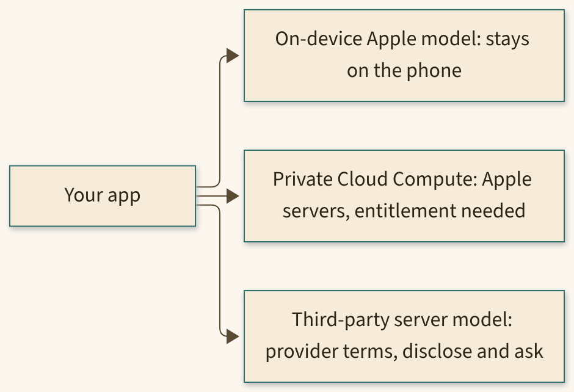{width=100%}

*Figure 14.2 — Three paths for one prompt. Follow each arrow and ask the same question: where does the person's data go?*

**On-device.** The Apple model on the phone. Apple's design guidance sums up its strengths: on-device models "keep people's information on their device, respond quickly, and work offline."^420 For Daybook, this is the obvious choice. A habit journal is personal, and the summary task is small.

**Private Cloud Compute.** When a task needs a bigger model or more context than the phone can manage, Apple offers its larger Foundation Models running on its own Private Cloud Compute servers. Apple describes these servers as built so that "your users' data is not stored or accessible to Apple or anyone else."^421 Using them requires a specific entitlement in your app.^422 And there's a cost detail worth reading carefully, because it's easy to overstate. Apple says developers "who are enrolled in the App Store Small Business Program and have fewer than two million first-time App Store downloads" can use Private Cloud Compute "with no cloud API cost."^423 That's not "free for everyone." It's free for small developers who've enrolled in the program, which we'll meet in Chapter 15. Apple's fine print also says apps using Private Cloud Compute are subject to daily usage limits, and that expanded access "will be available for a fee in the future."^424

**Third-party server models.** This is the WWDC26 addition. Apple says the framework "now extends to server models — like Claude, Gemini, and more — all through the same Swift API," and that "any model provider can create a Swift package conforming to the Language Model protocol."^425 Apple's page lists Core AI language models, MLX language models and Claude among the options, and Apple's documentation includes an article on "running a Core AI model in a Foundation Models session," for open models you export and run on the device yourself.^426 **Core AI** is Apple's framework, new in iOS 27, for running AI models in your app on Apple silicon; running a Core AI language model in a session needs iOS 27, macOS 27 and Xcode 27 or later.^427 The appeal is real: your `@Generable` types, tools and session code keep working even if you swap the model behind them. The costs and terms, though, are the provider's, and your user's data leaves their phone and goes to that company. That changes your obligations, as we'll see in the last section.

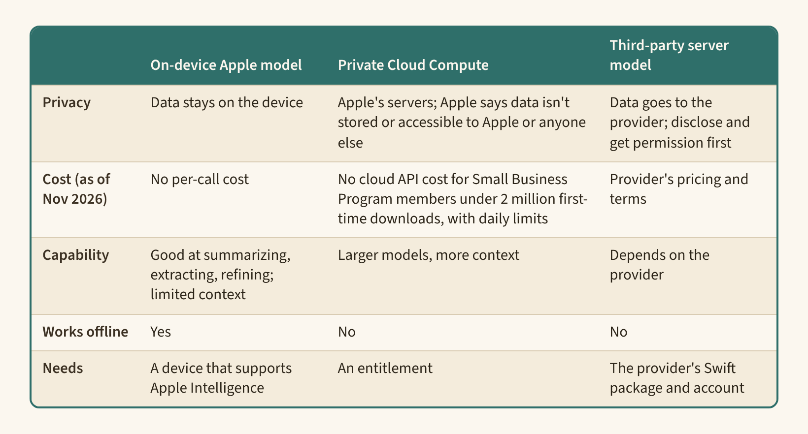{width=100%}

*Figure 14.3 — Choosing a model. Read across the "Privacy" row first; for a personal journal, it usually decides the rest.*

For Daybook, my choice is the first column, and I'd only revisit it if a real feature truly needed more. That's not because the other paths are bad. It's because a habit journal is exactly the kind of personal data people expect to stay on their phone, and the on-device model is good enough for the job.

## Testing AI features

Testing AI features is different from testing a streak calculator, and it's worth being honest about why.

`StreakCalculator.streak` gives the same answer every time. A language model doesn't. Ask it to summarize the same week twice and you may get two different headlines, both fine. So a test that says "the headline must equal *this exact sentence*" will fail for no good reason.

What you *can* test splits into three layers.

**The code around the model.** `weekPrompt(from:)` is ordinary Swift. Test it with Swift Testing, exactly as in Chapter 8: given three entries, the prompt has three lines, with the right weekday, habit and status. Test your availability view with each case. Test that the button disappears while a request is running. None of that needs a model, and all of it can break.

**The shape of the answer.** Guided generation already guarantees you get a `WeekSummary` back. You can still check things you care about: the `suggestion` isn't empty, and every name in `steadyHabits` is a habit that actually exists in the week you sent. If the model ever lists a habit you never logged, that's a hallucination, and you want to know.

**The quality of the answer.** This is the hard one: is the summary warm, accurate and useful? Apple's answer, announced at WWDC26, is the **Evaluations framework**, which lets you "test your prompts and validate that your intelligence-powered features work correctly across dynamic conditions, going beyond what unit tests alone can catch."^428 Think of it as a way to run your prompt against many sample weeks and score the results, so you can tell whether a change to your instructions made things better or worse across the board, instead of judging by one lucky example.

Apple also shipped two helpers for trying ideas quickly. macOS 27 includes a new `fm` command-line tool for prototyping and scripting model workflows "without writing a line of app code."^429 I'm only naming it here, not showing commands, because its options are new and best learned from Apple's own session. And there's an open-source Foundation Models framework utilities package, with experimental extras such as "custom skills, context management helpers, and a Chat Completions client," plus a Foundation Models SDK for Python for people who like to evaluate in Python.^430 All of these are aimed at developers further along; for rung 6, Swift Testing on your own code plus careful reading of real outputs is plenty.

> **Ask your AI.** Use this once "Summarize my week" works.
>
> *Example prompt (written for this book):* "Here is my weekPrompt function and my WeekSummary type. Write five Swift Testing tests for weekPrompt using small sample weeks, including an empty week and a week with no weather. Then list five sample weeks I should try by hand to check the model's summaries, including at least one week where everything was missed."
>
> *Verify by:* running the tests, reading every test to make sure it checks something real, and trying the hand-picked weeks yourself on a device. Look especially for summaries that mention habits or weather that weren't in the data.

## Doing it responsibly

I want to slow down here, because this is the section that separates a clever feature from a trustworthy one.

Apple publishes design guidance specifically for generative AI in its Human Interface Guidelines, and it's one of the most useful pages in the whole HIG.^431 A few of its principles map straight onto Daybook.

**Keep people in control.** The HIG asks you to "respect people's agency and ensure they remain in charge." For Daybook, the summary is something people ask for, never something that appears uninvited, and it's easy to dismiss.

**Communicate where your app uses AI.** "Letting people know when and where your app uses AI sets expectations," and you should never trick someone into thinking AI-written text came from a human. A small "Written by Apple Intelligence on this iPhone" line under the summary does the job, and it also tells people where their data went: nowhere.

**Raise awareness of hallucinations.** The HIG warns that a model unsure how to respond "may produce content that seems plausible but is made up." Daybook's instructions say "use only the facts provided," and our tests check for invented habits. That reduces the risk. It doesn't remove it. Make the summary feel like a friendly note, not an official report.

**Don't let it pretend to be a doctor.** Habit apps drift toward health topics fast: sleep, exercise, water, medication. Our instructions tell the model never to give medical advice. Keep it that way, and keep the suggestion small and practical.

Apple also has **Acceptable Use Requirements** for the Foundation Models framework, which set out prohibited uses of Apple's models.^432 Read them before you ship. They're short, and "I didn't know" is not a plan.

And then there's App Review. If you ever move Daybook's summary to a third-party server model, one rule becomes central. Guideline 5.1.2(i) says: "You must clearly disclose where personal data will be shared with third parties, including with third-party AI, and obtain explicit permission before doing so."^433 Note the word *explicit*. A sentence buried in a privacy policy isn't it. It means a clear question, asked before the first week of journal entries leaves the phone, with a real "no" option that leaves the rest of the app working.

The simplest way to stay on the right side of all of this is the one we've already chosen: keep the feature on device. Daybook's summary never leaves the phone. That's not just a privacy policy. It's an architecture decision, and it's the kind I'd make again.

> **Done when — Rung 6.**
>
> - [ ] "Summarize my week" returns a typed `WeekSummary` and shows it in a card.
> - [ ] The summary streams in, with a specific "Reading your week…" message while it works.
> - [ ] On a device without the model, the button is hidden or explained, and the rest of Daybook works normally.
> - [ ] The summary is labeled as AI-written, and it's easy to dismiss.
> - [ ] Swift Testing covers `weekPrompt(from:)` and your availability handling.
> - [ ] You've read ten real summaries yourself, and none invented a habit or gave health advice.
> - [ ] No journal data leaves the device. (If you chose a server model, you disclose it and ask first, per Guideline 5.1.2(i).)

The AI practice for this rung is a pairing. Let an agent draft the `@Generable` type and the first version of the prompt; that's quick, mechanical work it does well. Then you test the unavailable states and read the outputs, because that's judgment work, and it's yours.

Daybook is now a genuinely good little app. It tracks habits, remembers the weather, lives on your Home Screen, talks to Siri and gently tells you how your week went. The next step is the big one: getting it off your phone and into the hands of other people.


# Part Five — Ship and Grow {.unnumbered .part}

# Chapter 15 — Shipping: From Archive to App Store

{width=100%}


There's a moment every app developer remembers. It isn't writing the first line of code. It's the first time a stranger downloads something you made.

This chapter is about getting to that moment. It's also, I'll be honest, the most administrative chapter in the book. Shipping involves accounts, legal names, certificates, forms and a review by people at Apple you'll never meet. None of it is hard, exactly. It's just a lot of small steps, in a particular order, and most of the stress people feel about shipping comes from not knowing what the next step is.

So that's what we'll do: walk the steps, in order, with no mystery. Rung 7 is polish, getting Daybook ready to be seen. Rung 8 is shipping it, all the way to the point where Apple says "Ready for Distribution."

One thing before we start. Daybook is our working name for a learning project, and it's yours to change. Before you ship, I'd like you to give it your own name and your own twist, for reasons that will become very clear when we get to App Review. Chapter 16 goes deeper on that. For now, whenever you see "Daybook" in this chapter, read it as "your app."

> **Versions move.** I checked everything here on 20 November 2026 against Xcode 27.2, iOS 27 and Swift 6.4, on macOS Tahoe 26.6 or later. Apple updates its tools several times a year, so a menu name, a default or a screen can shift under you. If something doesn't match, check Apple's Releases page and the Xcode "SDKs and system requirements" page first, then trust what your Xcode shows you. In this chapter, the things most likely to move are prices, App Store Connect screens and Apple's upload requirements, so check the Upcoming Requirements page before you submit anything.

## Enrolling: individual or organization

Everything so far has been free. You've built, run and tested on your own iPhone with a Personal Team. To put an app in other people's hands, through TestFlight or the App Store, you need to join the **Apple Developer Program**.

As of November 2026, membership costs 99 USD a year, with local prices varying by country.^434 That's the fee most people mean when they say "iOS costs $99." It's not the price of learning, which you've now seen is free. It's the price of distribution. Apple also offers fee waivers for some nonprofits, accredited educational institutions and government entities, so if you're building for one of those, check before you pay.^435 (There's also a separate Enterprise Program at 299 USD a year, for organizations distributing private apps to their own employees. That's not what you want for an App Store app.)^436

The first real decision is whether you enroll as an **individual** or as an **organization**. It matters more than it looks, because it decides whose name appears on the App Store.

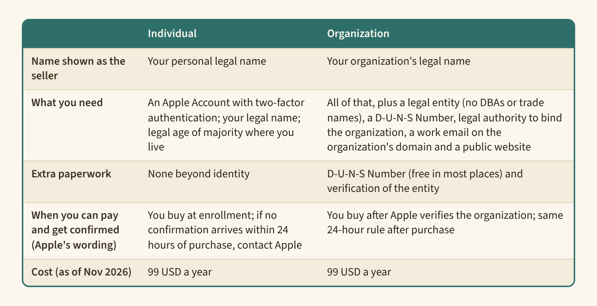{width=100%}

*Figure 15.1 — Enrolling as an individual vs an organization. Look at the first row before anything else: it's the one people most often wish they'd thought about.*

**As an individual**, you need an Apple Account with two-factor authentication turned on, which you set up back in Chapter 2. You must use your legal first and last name; Apple warns that aliases, nicknames and the like delay approval. And your legal name appears as the seller on the App Store.^437 For a hobby app, that's usually fine. If you'd rather your personal name not sit on a public store page, that's a real reason to think about the next option.

**As an organization**, the App Store shows your company's name instead. But you need a few more things. Apple lists them: your organization must be a legal entity, and it can't be a DBA ("doing business as"), fictitious business name, trade name or branch. You need a **D-U-N-S Number**, a nine-digit identifier from Dun & Bradstreet that Apple uses to confirm your organization exists; Apple says it's free in most jurisdictions. You need the legal authority to sign agreements for the organization, a work email address on the organization's own domain, and a public website for it.^438 If you don't already have a company, setting one up is a decision about taxes and law, well beyond this book, and worth a conversation with someone qualified where you live.

There are two ways to enroll. You can do it on Apple's developer website, or in the **Apple Developer app** on iPhone, iPad or Mac. Apple's support page explains that enrolling in the app sets up an auto-renewing subscription and verifies your identity with a photo of a government-issued ID.^439

And then you wait, a little. Individuals can buy the membership as part of enrolling. Organizations buy it only after Apple has verified their details and emailed the next steps. Either way, Apple says that if you haven't received a membership confirmation within 24 hours of your purchase, you should contact them.^440 I won't guess at how long the organization check takes; Apple doesn't say, and it varies.

Before you pay anything, open the Apple Developer app or the enrollment page and read the requirements screen for the path you're considering. Have your legal name exactly as it appears on your ID, and if you're going the organization route, look up whether you already have a D-U-N-S Number. Ten minutes of reading here can save days of back-and-forth later.

Once you're in, a few things change straight away. Your team in Xcode is no longer a Personal Team, so the Personal Team limits from Chapter 1, like ten App IDs, three devices and profiles that expire after seven days, stop being your ceiling. Capabilities the free account doesn't offer, such as push notifications, become available. You get access to **App Store Connect**, Apple's website for managing your apps, testers, prices and submissions. And WeatherKit, Apple's own weather service, comes with 500,000 calls a month included, which matters for Daybook in a moment.^441

## Signing, explained like a permission slip

Before an app can run on anyone's iPhone, it has to be **signed**. Signing is how an iPhone knows who made an app and whether it's allowed to run. It's also one of the most dreaded topics in iOS development, mostly because it used to involve a lot of manual fiddling, and the error messages read like tax law.

Here's the whole idea in one picture.

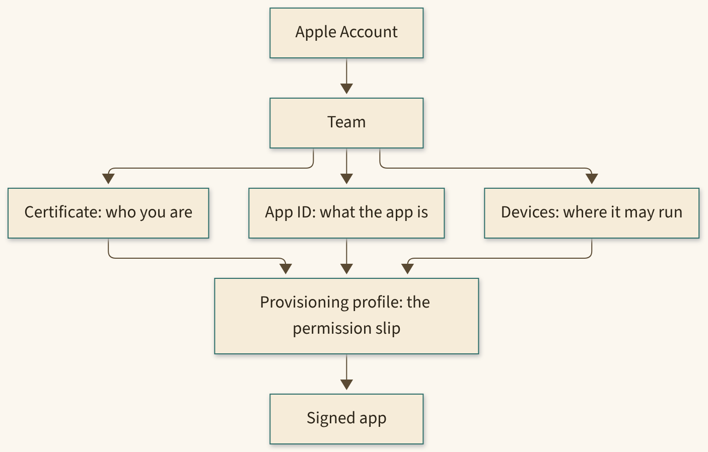{width=100%}

*Figure 15.2 — Signing as a permission slip. Follow the three middle boxes: each answers one question, and the profile staples the answers together.*

**The certificate** says *who you are*. It's a digital identity tied to your team, a bit like a signature only you can produce.

**The App ID**, built from your **bundle ID**, says *what the app is*. The bundle ID is the reverse-domain name you chose when you created the project, something like `com.yourname.daybook`. It has to be unique across the whole App Store. The App ID also records which capabilities the app uses, like App Groups.

**Devices** say *where it may run*, for development builds. For the App Store, the "where" becomes "anyone who downloads it."

**The provisioning profile** is the permission slip. It staples the other three together: *this* developer may run *this* app on *these* devices, with *these* capabilities. When an iPhone installs your app, it checks the slip.

Now the good news. You almost never have to touch any of this yourself. Apple's distribution documentation describes Xcode using **cloud-managed certificates** and "Automatically manage signing," and that's the setting I'd leave on.^442 With it on, Xcode creates and renews certificates, registers devices and makes profiles for you, quietly, every time. Manual signing exists for larger teams with special needs. For one person shipping Daybook, it's a way to spend a weekend creating problems you didn't have.

If you do hit a signing error, the honest first step is almost always the same: open your target's Signing & Capabilities settings, which you've used since Chapter 2, and make sure the right team is selected and automatic signing is on. Most "signing" errors are really "wrong team" errors.

## Polish before you ship (rung 7)

A shipped app is a promise to strangers. Rung 7 is where you make sure Daybook can keep it.

Most of this rung is work you've already learned to do in earlier chapters. The difference now is that you do all of it, on purpose, as a checklist, before anyone else sees the app.

**Your own name and icon.** Rename the app to the name you've chosen, and give it an app icon. Apple's Develop in Swift tutorials include a distribution unit that walks through the bundle ID, the app icon, and version and build numbers, which is a good companion here.^443

**A launch screen.** This one is new and it's strict. Apple's iOS 27 release notes say apps "built with the 27.0 SDK or later are required to include a launch screen," and that your app's Info.plist "must contain one of the following keys": `UILaunchStoryboardName`, `UILaunchStoryboards`, `UILaunchScreen` or `UILaunchScreens`. Apps without one are rejected.^444 The **Info.plist** is your app's settings file, the place where it tells iOS basic facts about itself. Open your target's Info settings and confirm a launch screen entry is there. If you started from a recent SwiftUI template, check rather than assume.

**A privacy manifest.** A **privacy manifest** is a small file that tells Apple, in a structured way, what data your app collects and which sensitive system features it uses. You add one in Xcode with **File > New File**, then choose **App Privacy File** in the Resource section; Xcode names it `PrivacyInfo.xcprivacy`, which is the name it has to have. Apple's documentation lists its four main keys: `NSPrivacyTracking` (does your app track people?), `NSPrivacyTrackingDomains` (if so, which domains?), `NSPrivacyCollectedDataTypes` (what data do you collect?) and `NSPrivacyAccessedAPITypes` (which "required reason" APIs do you use, and why?).^445

That last one needs a word. Apple maintains a list of **required-reason APIs**: system features that could be misused to identify people, where you must declare an approved reason for using them. Apple has required those declarations since May 1, 2024.^446 Don't guess which ones Daybook touches. Open Apple's privacy manifest documentation, go down the list and check your code, including any packages you've added.

**Be honest about the weather.** Here's something easy to miss. Daybook sends your approximate location to Open-Meteo to get the weather. That's data leaving the phone, going to a third party. You'll need to describe it accurately in App Store Connect's app privacy section, and in your manifest where it applies.^447 Read Apple's definitions carefully and answer what's true. And there's a second weather question: Open-Meteo is free for non-commercial use.^448 If your app will be sold or is part of a business, read Open-Meteo's terms and either take a subscription or switch to WeatherKit, which, as Chapter 6 promised, only touches one file. Your Developer Program membership includes WeatherKit's 500,000 calls a month.^449

**Accessibility and languages.** Run the accessibility checks from Chapter 7: VoiceOver on every screen, the largest Dynamic Type size, Dark Mode. Make sure your second language from Chapter 7's String Catalog actually works end to end, including the widget.

**An Instruments pass.** Profile the app once more, as in Chapter 8, with special attention to launch time and scrolling a long list of entries. If you used `@concurrent` anywhere from Chapter 12, check that the Swift Concurrency instrument agrees it's helping.

**Version and build numbers.** Every upload needs a **version** (what people see, like 1.0) and a **build number** (your own counter, which must go up with every upload of the same version). Start at 1.0 and build 1.

> **Done when — Rung 7.**
>
> - [ ] The app has its new name, its own icon and a bundle ID you'll keep.
> - [ ] A launch screen key is present, and the app launches cleanly on a real device built with the iOS 27 SDK.
> - [ ] `PrivacyInfo.xcprivacy` is in the project, with any required-reason APIs declared.
> - [ ] You've written down, in plain words, what data leaves the device (location to your weather provider) and where.
> - [ ] The Chapter 7 accessibility checklist passes, and a second language works.
> - [ ] An Instruments pass shows no obvious hangs on launch or scrolling.
> - [ ] Version 1.0, build 1, committed.

## Archive, validate, upload

Now we turn Daybook into something Apple can receive.

An **archive** is a finished, release-ready build of your app, packaged with everything needed to distribute it. It's different from the builds you've been running all along, which are debug builds, made for development, with extra information for the debugger and settings tuned for quick rebuilding.

Before your first upload, the app needs a home in **App Store Connect**: an app record, with its name, bundle ID, primary language and a few other basics. You can create it yourself in App Store Connect, and Apple's documentation notes that Xcode can create it for you during distribution if it doesn't exist yet.^450

Then the path, as Apple's documentation describes it, goes like this.^451

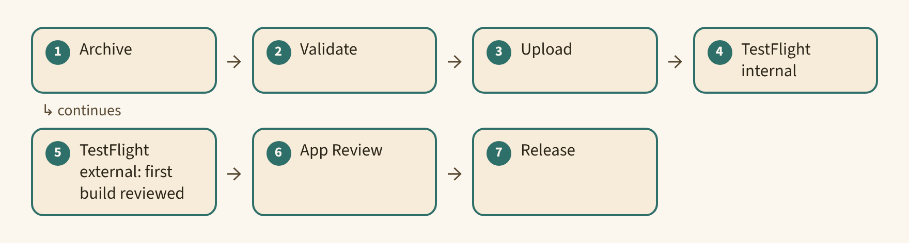{width=100%}

*Figure 15.3 — The ship pipeline. Notice where the line between your Mac and App Store Connect falls: after Upload, everything happens on Apple's side.*

1. **Pick a destination.** At the top of Xcode, choose your scheme and a run destination. Apple's documentation says that since Xcode 15, even a simulator destination produces an archive with everything needed to run on that class of real device, so you don't need your iPhone plugged in. Choosing a real device or Xcode's generic iOS device option works too.
2. **Archive.** Choose **Product > Archive**. Xcode builds a release version and, when it's done, opens the **Organizer** window, which you can also find under **Window > Organizer**.
3. **Validate.** In the Organizer, select your archive and click **Validate App**. Validation runs automated checks on your archive before anything is sent. It's like a spell-check before you send an important email. If it complains, fix it now; it's much faster than waiting for a rejection.
4. **Distribute.** Click **Distribute App** and choose **TestFlight & App Store**. Apple's list of options also includes internal-only TestFlight, release testing and a few others; for Daybook, "TestFlight & App Store" is the one you want.^452 Leave automatic signing on, and let Xcode upload.

After a short wait, your build appears in App Store Connect, under your app, ready for testing.

Xcode isn't the only way in. Apple's App Store Connect help lists Xcode, Swift Playground, Transporter (a free Mac app for uploading) and a command-line tool among the ways to upload a build.^453 Swift Playground is the interesting one for readers who started on an iPad back in Chapter 1: Apple says it can build SwiftUI apps and submit them to App Store Connect.^454 You still need Developer Program membership to distribute, whichever tool you use.

One requirement to keep an eye on. As of November 2026, Apple's Upcoming Requirements page says uploads must be built with Xcode 26 or later, using the iOS 26 SDK or later, a rule in force since April 28, 2026.^455 You're on Xcode 27, so you're well clear. But Apple raises this floor regularly, and the page is where the next change will appear. I won't guess the date; Apple hadn't announced one when I checked.

## TestFlight

**TestFlight** is Apple's beta-testing service. A **beta** is a test version of your app, shared with real people before the public release. It's the single best thing you can do for a first app, because the people who use it will do things you never imagined, on phones you don't own.

Here's what Apple's TestFlight page says you get, as of November 2026.^456

- **Internal testers.** Up to 100 members of your App Store Connect team who hold the Account Holder, Admin, App Manager, Developer or Marketing role. If you're a team of one, you're the Account Holder, so that's you. Internal testers can get new builds automatically.
- **External testers.** Up to 10,000 people outside your team. You put them in a group, add a build, and invite them by email or with a **public link** you can share anywhere. Apple notes public links are handy because "you don't need to have anyone's contact information to invite them."
- **Review for the first external build.** Before external testers can install, your first build must be approved by App Review for TestFlight. Builds added to a group are sent for that review automatically.
- **Plenty of room.** You can share up to 100 builds, and testers can install on up to 30 devices.
- **Feedback built in.** Testers can take a screenshot inside your app, mark it up and send it to you. If the app crashes, you get a crash report, and testers can add a note about what they were doing.

One rule to know: TestFlight is for testing, not selling. App Review Guideline 2.2 says apps using TestFlight "cannot be distributed to testers in exchange for compensation of any kind, including as a reward for crowd-sourced funding."^457 So no "back my campaign and get the beta."

How many testers should Daybook have? For a first app, I'd start small. Five to ten people you trust, who'll actually use a habit journal for two weeks, are worth more than five hundred who install it and forget. Ask them to use it the way they'd really use it, then ask two questions at the end: what confused you, and what would make you keep using it?

### Letting AI help with feedback, but not decide

Feedback piles up fast, and it's messy. One tester writes three paragraphs. Another sends a screenshot with a circle and no words. A third reports the same bug as two others in different language.

This is a lovely job for Grok Bot or any of the AI helpers from Chapter 10. Export or copy the feedback, and ask your helper to group it by theme, merge duplicates, separate bugs from feature requests and quote the original words next to each group so nothing gets paraphrased into something it wasn't. It's fast, tedious work that AI does well.

What it shouldn't do is decide. Whether "add a dark green theme" matters more than "the widget is slow on my old phone" is a judgment about your app and the people using it. That's yours.

> **Ask your AI.** Use this after your first week of TestFlight feedback.
>
> *Example prompt (written for this book):* "Here is all the TestFlight feedback for my habit journal app, with tester names removed. Group it into themes. For each theme, say whether it's a bug, a confusion or a feature request, count how many testers mentioned it and quote one or two original comments word for word. Don't suggest priorities or fixes."
>
> *Verify by:* reading the raw feedback yourself before you trust the summary, and checking that every quote appears word for word in the original. Then make the priority list on your own.

Before you paste feedback into any AI tool, take out testers' names and email addresses. Chapter 11's rules about secrets and private data apply to other people's words, too.

## Your App Store page

While testers are poking at your build, there's writing to do. Every app on the App Store has a **product page**: the name, a short description, screenshots, a privacy section, an age rating and more. You fill all of it in through App Store Connect, and Apple's App Store Connect help has a page for nearly every part, from setting an age rating and managing app privacy to localizing your app information into other languages.^458

A few parts deserve real thought.

**The words.** Your description should say plainly what the app does and who it's for. "Daybook-turned-yours helps you keep three or four daily habits, saves the day's weather beside each entry, and gives you a short weekly summary written on your iPhone." That's better than any amount of "revolutionary" and "seamless." Guideline 2.3 asks for accurate metadata, and it's also just good manners.^459

**The privacy answers.** App Store Connect asks what data your app collects and how it's used. This is where your rung 7 note, "location goes to the weather provider, nothing else leaves the device," pays off. Answer from that note, not from memory. You'll also need a **privacy policy**: Guideline 5.1.1(i) says every app must link to one in App Store Connect and inside the app, and it must say what data the app collects, how, and what it's used for.^460 Your rung 7 note is the honest first draft of that, too.

**The age rating.** You'll answer a questionnaire about your app's content, and App Store Connect sets the rating from your answers. Answer honestly; a habit journal with no user-generated sharing is usually straightforward.

**Accessibility Nutrition Labels.** This one is newer, and it rewards the work you did in Chapter 7. App Store Connect lets you indicate which accessibility features your app supports, like VoiceOver or Larger Text, and those labels appear on your product page. Apple's rule is strict and fair: to indicate support for a feature, people "must be able to complete all of the common tasks of your app using that feature." Apple also notes that people can search with those features in mind, so an honest "works with VoiceOver" can help the right people find you.^461 Make a list of Daybook's common tasks, add a habit, log today, read the weekly summary, use the widget, plus the first launch and settings, which Apple counts as common tasks for every app, and test each with each feature before you tick a box.

This is a good place for an AI helper, with the same rule as everywhere else. Let Grok Bot, Claude or ChatGPT draft three versions of your description and a few possible subtitles from a plain list of what the app actually does. Then you pick, cut and rewrite, and you check every claim against the real app. An AI helper will happily describe features you haven't built. App Review reads your description too.

## App Review without tears

Every app on the App Store is reviewed by Apple before it's published. For a first-timer, **App Review** can feel like an exam with a hidden marking scheme. It isn't hidden, though. It's written down, in Apple's App Review Guidelines, and the best thing you can do for your first submission is read them.

As of November 2026, the guidelines were last updated on October 16, 2026, and they're arranged into "five clear sections: Safety, Performance, Business, Design, and Legal."^462 They're long, but they're written in fairly plain English, and you don't need all of it for a habit journal. Here are the parts that matter most for Daybook.

**2.1, App Completeness.** Apple asks for final versions with "all necessary metadata and fully functional URLs," and says "placeholder text, empty websites, and other temporary content should be scrubbed before submission." It also asks you to make sure your app "has been tested on-device for bugs and stability," and to include demo account details if your app has a login.^463 Daybook has no login, which makes life simpler. But search your project for "Lorem ipsum," "TODO" and "Test habit" before you submit. It happens to everyone.

**4.2, Minimum Functionality.** Apple wants apps with "features, content, and UI that elevate it beyond a repackaged website," and says that if your app "is not particularly useful, unique, or 'app-like,' it doesn't belong on the App Store."^464 Daybook clears this comfortably as long as it's genuinely useful: daily logging, weather, a widget, a Siri action, a weekly summary.

**4.3(b), Spam.** This is the one that catches learners. Apple says: "Don't submit apps that are indistinguishable from what's already widely available." It goes on to name categories that are "well established on the App Store," including "dating, flashlight, sound effects, wallpaper, simple timers, and fortune telling," and says it "will not accept new submissions unless they offer a meaningfully different or improved experience."^465

Read that list again. Simple timers are on it. So the tip calculator from rung 1, the quiz from rung 2, a plain to-do list or a basic habit tracker are all learning projects, not products, unless you make them meaningfully different. That's why I've asked you to rename Daybook and make it your own. Chapter 16 has a whole section on how to do that honestly.

**5.1.2(i), Data use and sharing.** You met this in Chapter 14. "You must clearly disclose where personal data will be shared with third parties, including with third-party AI, and obtain explicit permission before doing so."^466 With an on-device summary, Daybook's AI feature shares nothing. Its weather lookup does share approximate location with your weather provider, which is why your privacy answers in App Store Connect need to be accurate.

{width=100%}

*Figure 15.4 — A pre-submission checklist mapped to the rules. Read down the middle column: every row points to a rule you can look up yourself.*

A few practical habits make review smoother.

**Write good review notes.** App Store Connect lets you leave notes for the reviewer. Use them. Explain anything that isn't obvious: "The weekly summary only appears on devices that support Apple Intelligence. On other devices, the button is hidden by design." Tell them where the widget and the Siri action are. A reviewer who understands your app quickly is a reviewer who doesn't have to guess.

**Expect questions, and possibly a rejection.** A rejection isn't a verdict on you as a developer. It's a message saying which guideline Apple believes your app doesn't meet, and usually what to change. Read it calmly, fix what's fair, reply in App Store Connect and resubmit.

**Know about appeals.** If you genuinely disagree with a decision, the guidelines say: "If you disagree with the outcome of your review, please submit an appeal."^467 Use it when you have a real case, explained politely and specifically.

**Know about bug-fix submissions.** For apps already on the store, Apple says "bug fixes will not be delayed over guideline violations except for those related to legal or safety issues," with a process you request through App Store Connect.^468 You won't need this for version 1.0, but it's reassuring to know it exists for later.

And how long does review take? You'll see numbers quoted online, some of them confidently. Here's the one Apple itself gives, as of November 2026: App Review "works around the clock, typically reviewing at least 50% of submissions in less than 24 hours and 90% in less than 48 hours." Apple adds that incomplete submissions can take longer.^469 *Typically* is doing real work in that sentence. Plan for some waiting, don't schedule a launch party for the afternoon you submit, and check Apple's App Review page for what it says when you're ready.

Before you submit, open the App Review Guidelines and read sections 2.1, 4.2, 4.3 and 5.1 in full. It takes about twenty minutes. Then go through Figure 15.4 line by line with your app open on your phone. Most first-time rejections are things you can catch yourself in that twenty minutes.

## Making money (if you want to)

You don't have to charge for your app. Plenty of good apps are free, and a first app is a fine thing to give away. But if you'd like to charge, here's the honest shape of it.

There are two basic ways to earn from an app on the App Store: charge for the download, or offer **In-App Purchases**, which are things people buy inside the app, like a one-time "Pro" unlock or a subscription. Both go through Apple's **StoreKit** framework, which handles products, purchases and receipts.^470 Apple's Upcoming Requirements page recommends using the `AppTransaction` and `Transaction` APIs to verify purchases.^471 If you add a "Daybook Pro" unlock someday, those are the names to look up, along with Apple's StoreKit documentation and sample code. I'm deliberately not writing a full purchase flow here; StoreKit deserves careful reading, and a half-understood payment flow is the worst kind of bug.

Apple takes a commission on paid apps and In-App Purchases. I'm going to be careful here. For small developers, Apple's **App Store Small Business Program** offers "a reduced commission rate of 15% on paid apps and Apple In-App Purchases." It's for developers who earned up to 1 million USD in proceeds in the prior calendar year, and for developers new to the App Store. If you go over 1 million USD in a year, "the standard commission rate will apply to future sales."^472 And note this: you have to **enroll** in the Small Business Program. It isn't automatic. If you're going to charge for anything, enroll.

What's "the standard commission rate"? I'm not going to quote a number. The program page doesn't state it, and I couldn't confirm it on an Apple page I could cite, so check Apple's current pricing and business pages yourself.^473 Different terms can also apply in some regions; in the European Union, for example, Apple offers alternative business terms with their own rates and conditions.^474

The Small Business Program has a bonus that ties back to Chapter 14. If you're enrolled and have fewer than two million first-time App Store downloads, Apple says you can use its Foundation Models on Private Cloud Compute with no cloud API cost, within Apple's usage limits.^475

And one last word on money: I can't tell you what Daybook will earn, and neither can anyone else. Ship it because it's useful and because shipping teaches you things nothing else does. If it earns something, lovely.

## Xcode Cloud

The final piece of rung 8 points ahead to rung 9: keeping the app alive.

**Xcode Cloud** is Apple's **continuous integration and delivery** service. That's a long name for a simple idea: every time you push a change to your Git repository, a computer somewhere builds your app, runs your tests and, if you want, sends the build to TestFlight, without you doing anything by hand. Apple describes it as "built into Xcode and designed expressly for Apple developers," with tests run "in parallel" and builds delivered straight to TestFlight testers.^476

{width=100%}

*Figure 15.5 — An Xcode Cloud workflow. Follow the "fail" arrow: the most valuable thing Xcode Cloud does is tell you quickly when something broke.*

As of November 2026, Developer Program membership includes 25 compute hours a month of Xcode Cloud. If you need more, Apple offers monthly add-ons: 100 hours for $49.99, 250 hours for $99.99, 1,000 hours for $399.99 and 10,000 hours for $3,999.99.^477 For one person shipping a habit journal, 25 hours is very likely plenty; a build-and-test run of a small app is measured in minutes. At WWDC26, Apple also said Xcode Cloud builds would be up to twice as fast, with easier setup.^478

Setting it up happens inside Xcode, connected to your App Store Connect account and your Git host. Apple's Xcode Cloud documentation walks through creating your first **workflow**, which is Xcode Cloud's name for a recipe: when *this* happens (say, a push to your main branch), do *these* things (build, test, send to TestFlight).^479 Start with one workflow that builds and runs your tests on every push. That alone is worth having. It means that months from now, when you change one small thing, something will check everything else for you.

This is also where the AI habits from Part Three come full circle. When an agent in Xcode changes code for you, the change goes through the same pipeline as yours: build, test, report. Xcode Cloud doesn't care who typed the code. It only cares whether it works.

> **Done when — Rung 8.**
>
> - [ ] You're enrolled in the Apple Developer Program, as an individual or an organization, by choice.
> - [ ] Your app has its own name, an App Store Connect record and a bundle ID you'll keep.
> - [ ] You've archived, validated and uploaded a build.
> - [ ] At least a few real people are testing it through TestFlight, and you've read their feedback yourself.
> - [ ] You've read the App Review Guidelines sections in Figure 15.4 and checked every row.
> - [ ] Your app reaches "Ready for Distribution" in App Store Connect, or is live in TestFlight with real testers while you finish it.

Either ending counts. Some apps are ready for the world after one round of testing. Some need three. The rung is done when real people outside your own head are using something you made.

You shipped. Now let's look at the whole ladder, and how to keep going.


# Chapter 16 — The Projects Ladder and a Practice That Lasts

{width=100%}


You've shipped something. Or you're close, with real testers using a build that started, many chapters ago, as two words on a screen: "Hello, you."

This last chapter steps back. I want to lay the whole ladder out in one place, so you can see the shape of what you climbed, or plan the climb if you skipped ahead to see where it goes. Then I want to talk about the part no single book can do for you: keeping going. Apple's tools change every year. Your skills need to keep pace, and you'll want people to learn alongside. And at some point, your practice app needs to become something that's genuinely yours.

## The ladder, rung by rung

Here's the whole thing, in one table. It's the same ladder you saw at the start of the book, with two more columns: the AI practice for each rung, and the "done when" that tells you you're ready to move up.

{width=100%}

*Figure 16.1 — The ladder table. Read the "Free or paid" column top to bottom: everything up to rung 7 costs nothing but time.*

A few things about this ladder are worth saying out loud.

**It's this book's ladder, not anyone else's.** I built it by reading what good courses teach and in what order, then arranging it around one app you can actually finish. Apple's Develop in Swift tutorials, Paul Hudson's 100 Days of SwiftUI and Stanford's CS193p all influenced it, and you'll see echoes of their projects in rungs 1 through 4.^480 But none of them would claim this exact sequence, and you shouldn't treat it as official.

**Rungs 0 to 2 are separate small apps on purpose.** A tip calculator and a quiz are where you make your first mistakes cheaply. Nothing important breaks.

**Rungs 3 to 9 are one app on purpose, too.** Daybook grows the way real apps grow: a data model first, then networking, then tests, then features beyond the app, then intelligence, then polish, then shipping. By the time you reach rung 8, you're shipping something with history. You know why every file exists, because you were there when it was created.

**The AI practice changes as you climb.** At the bottom, AI explains and you type. In the middle, AI drafts and you verify. Near the top, agents build and check their own work, and you review, decide and own the result. It's the same line all the way up: let the AI type, you stay the author. What changes is how much typing it does.

**Rung 9 never really ends.** "Keep it alive" means an Xcode Cloud workflow that tests every change, crash reports you actually read in Xcode's Organizer, and at least one update a year when Apple ships a new iOS.^481 The first time you ship an update, you'll notice something: it's much less scary than version 1.0. That's how you know the ladder worked.

If you want each rung as a one-page card, with goals, files touched and stretch ideas, Appendix B has them.

### What a yearly update looks like

Since rung 9 is the one that never ends, here's what it looks like in practice, once a year, after Apple's September release. None of it is dramatic. That's the point.

1. **Read first.** Skim the new Xcode and iOS release notes for anything that mentions frameworks you use: SwiftUI, SwiftData, WidgetKit, App Intents, Foundation Models. The iOS 27 release notes, for example, added the launch-screen requirement from Chapter 15.^482
2. **Open the project in the new Xcode and build.** Fix errors first, then read the new warnings. Warnings are next year's errors, written politely.
3. **Run every test.** Your Swift Testing suite and your `DaybookKit` package tests are exactly what lets you change things without fear.
4. **Run on the new iOS, on a real device.** Look at the widget, the Siri action and the weekly summary in particular; features that live outside your app are the ones most likely to change.
5. **Check Upcoming Requirements.** Is there a new upload rule, and does it have a date?
6. **Make one improvement.** Fix the thing testers mentioned most, or adopt one new feature from WWDC that genuinely helps your users. One is enough.
7. **Bump the version, push, let Xcode Cloud build and test, and send it to TestFlight.**
8. **Write honest release notes.** App Review Guideline 2.3.12 says your "What's New" text must clearly describe new features and product changes; "simple bug fixes, security updates, and performance improvements may rely on a generic description," but bigger changes must be listed.^483

The first time you do this, it'll take a while. The third time, it'll feel like routine maintenance, the way changing the batteries in a smoke alarm does. That's what a practice that lasts feels like from the inside.

## Pairing courses with rungs

No single book teaches everything, and this one hasn't tried. These are the courses I'd pair with it, with honest labels about what each one is.

{width=100%}

*Figure 16.2 — Course comparison. Look at the "Era" column before you start any course: it tells you how much translation you'll be doing.*

**Apple's Develop in Swift Tutorials** are the backbone. They're free, they start from the very beginning with a tour of Xcode, and the current edition is up to date with Xcode's agents and Device Hub.^484 The units run from meeting Xcode and app design through SwiftUI, data modeling with Swift Testing and SwiftData, a full habit-tracking app, AI and machine learning (including a Foundation Models quiz app), visionOS and app distribution. And there's a newer **Agentic Coding** unit, placed early in the course, that teaches plan mode, plan files, agent permissions and reverting changes.^485 If you only take one course alongside this book, take that one. It's Apple teaching you the same tools you're using.

**100 Days of SwiftUI**, by Paul Hudson on his site Hacking with Swift, is a free community course with two rules: an hour a day, and post your progress publicly. It's built around a long series of small apps, from WeSplit, a check-splitting calculator, through projects like Guess the Flag, iExpense, Bookworm and Bucket List, to SnowSeeker at the end, with consolidation days that make you review before moving on.^486 It's wonderful for building the habit of daily practice. Pair its early days with rungs 1 and 2, and its data and networking projects with rungs 3 and 4.

**Stanford's CS193p**, "Developing Applications for iOS using SwiftUI," is a free university course with recorded lectures. The current videos are from Spring 2025. The course page is candid that they were recorded before iOS 26, that the code "seems to be mostly compatible," and that no support is offered.^487 Its lectures build one running project, a game called CodeBreaker, and they're especially good on separating your model from your interface and on SwiftData. Take it for depth, not for current menus.

**Kodeco** is a paid vendor with iOS learning paths, videos and books. Its beginner course builds a game called Bull's Eye from a blank project.^488 If a paid, structured path suits you, it's an option. I'm labeling it as vendor content because it is one; judge it by a free sample before you subscribe.

One more thing about courses: none of them, including this book, guarantees a job or a successful app. What they guarantee is practice. The practice is what you're actually buying with your time.

## From practice app to a real app

Here's a conversation I'd like you to have with yourself before you ship.

Back in Chapter 15, we read App Review Guideline 4.3(b). It says Apple won't accept apps "indistinguishable from what's already widely available," and it names crowded categories, including "simple timers," that won't be accepted "unless they offer a meaningfully different or improved experience." Guideline 4.2 adds that an app that "is not particularly useful, unique, or 'app-like'" doesn't belong on the store.^489

Now look at the ladder. A tip calculator. A quiz. A to-do list. A habit tracker. Every one of them is a classic learning project *because* it's been built a million times. That's what makes them good for learning: the problem is well understood, so you can focus on the code. It's also what makes them hard to ship as they are.

Apple's guidelines even say this gently in their introduction: if you've built an app you "just want to show to family and friends, the App Store isn't the best way to do that." Installing it free from Xcode, or using Ad Hoc distribution as a program member, is.^490 There's no shame in that. Most of the apps I'd recommend you build in your first year are apps for you.

But if you want Daybook, or whatever you've renamed it, on the App Store, it needs to become meaningfully *yours*. Here's how I'd go about that, honestly.

**Start from a real person with a real problem.** Not "people who want to build habits." Someone specific. Maybe it's you. Maybe it's a friend training for a race who keeps skipping runs when it's cold, or a parent trying to get a kid to practice piano. What do they actually need that a generic habit tracker doesn't do?

**Find the twist that comes from that person.** Daybook already has an unusual feature: it records weather beside each habit. For the runner, that might become the whole point: an app that shows how weather affects their training and plans around the forecast. For the piano parent, weather is irrelevant, and the twist might be something else entirely. The twist should come from the person, not from a list of features.

**Cut as much as you add.** Making an app meaningfully different often means removing things. A runner's app might drop the generic habit list entirely and focus on one activity done brilliantly.

**Make the name match the twist.** "Daybook" is a working name for a learning project. Your shipped app deserves a name that says what it's for.

### A brainstorm routine with AI

AI helpers are genuinely useful here, but in a specific role. They're good at helping you *check* ideas: is this already crowded, what would a skeptic say, what's the smallest version worth shipping? They're not good at being the source of your idea. An idea that came from a model's average of the internet is, almost by definition, the idea that's already widely available.

So here's the routine I'd suggest. You bring the ideas. The AI pushes back.

1. **Write your own list first.** Three to five people you could build for, and what each one struggles with. No AI yet.
2. **Ask for pushback, not ideas.** Paste your list and ask your helper to argue against each one: what's already out there, what could go wrong, what's vague.
3. **Pick one, and shrink it.** Ask, "What's the smallest version of this that would still genuinely help this person?" Then cut further yourself.
4. **Check the crowding claim yourself.** If your helper says "there are lots of apps like this," search the App Store with your own eyes. If it says "nothing like this exists," be even more suspicious and search harder.
5. **Talk to the person.** The real one. No AI can do this step.

> **Ask your AI.** Use this once you have your own short list of app ideas.
>
> *Example prompt (written for this book):* "Here are three app ideas I'm considering, each built for a specific person. Don't add new ideas. For each one, give me the strongest argument against building it, what similar apps probably already exist and what I'd need to learn to find out. Then ask me two questions about the person I'm building for."
>
> *Verify by:* searching the App Store yourself for every "similar app" it mentions, and treating its answers about what exists as guesses until you've looked.

## The yearly Apple rhythm

Apple works on a yearly cycle, and once you know its shape, the year stops feeling like a series of surprises.

{width=100%}

*Figure 16.3 — The yearly Apple cycle. Notice that the upload requirement arrives months after the release, not with it.*

**June: WWDC.** Apple's Worldwide Developers Conference is where the year's new tools are announced. In 2026, Apple announced WWDC26 news on June 8, including Xcode 27's agent features and the expanded Foundation Models framework.^491 The sessions are free to watch online, and Apple publishes topic guides, like its WWDC26 guides to Xcode and Swift, that are a good way to see what's new without watching everything.^492

**Summer: betas.** New betas of Xcode and iOS appear over the summer. This is when you open your app in the beta, see what breaks and read the new documentation. You don't ship with betas; you prepare with them.

**September: release.** The new Xcode and iOS ship. In 2026, Xcode 27 and iOS 27 came out on September 14. Point releases follow: Xcode 27.1 on October 15 and Xcode 27.2 on October 29, with Xcode 27.3 in beta by mid-November.^493 Swift follows a similar pattern; Swift 6.4 was released on September 15, 2026.^494

**Later: requirements.** Some months after a release, Apple usually raises the bar for what it accepts in App Store uploads. The pattern so far: Apple required uploads built with Xcode 26 and the iOS 26 SDK starting April 28, 2026.^495 When will Xcode 27 become required? As I write this, Apple hasn't said, and I'm not going to guess. The page to watch is Apple's **Upcoming Requirements** page. The other page to watch is Apple's **Releases** page, which lists every new version of Xcode and the operating systems as they ship.^496

Put those two pages somewhere you'll see them. Better yet, have something watch them for you. We'll get to that in a moment.

> **Try this.** Open Apple's Releases page and its Upcoming Requirements page. Find the current Xcode release and check it against the one on your Mac. Then read the newest item on Upcoming Requirements and ask yourself one question: does this affect my app, and by when?

## Where developers talk

Learning alone is slow. Learning near other people is faster, and a lot more fun. Here's where iOS developers gather, starting with the official places.

**Apple Developer Forums.** Apple's own forums, where developers ask questions and Apple engineers sometimes answer. When you hit a problem with an Apple framework that nobody seems to have written about, search here first. Apple's WWDC guides link straight to forum topics for each area, like Xcode and Swift.^497

**Swift Forums.** The community home of the Swift language itself, at forums.swift.org. It's where people discuss the language, the standard library, Swift on servers and Linux, and where new language features are debated.^498

**Swift Evolution.** Every change to the Swift language goes through a public proposal process called Swift Evolution. Each proposal has a number, like SE-0493 (async calls in `defer`) and SE-0504 (cancellation shields), which you met in Chapter 12. You don't need to read proposals to build apps. But when a new Swift feature confuses you, its proposal usually explains *why* it exists, in more detail than anywhere else. Swift.org's release posts link to the full list for each version.^499

**Feedback Assistant.** When you find a bug in Apple's tools or frameworks, Feedback Assistant is how you report it to Apple. It's free with any Apple Account registered as a developer.^500 A clear bug report with a small sample project is one of the most useful things a developer can give back.

Then there are community writers, people who write about iOS development on their own sites. A few that this book's research drew on, all clearly *community* sources, not Apple:

- **Paul Hudson's Hacking with Swift**, home of 100 Days of SwiftUI and a large library of free articles and examples.^501
- **Donny Wals**, whose articles on Swift concurrency include a clear walk-through of the default-actor-isolation setting from Chapter 12.^502
- **Antoine van der Lee's SwiftLee**, another clear source on concurrency and Xcode features.^503

Community writers are often faster than official documentation, and sometimes clearer. They're also individuals, writing at a point in time, about a version that may have moved on. Check the date on every article, and when it disagrees with Apple's documentation for your version, Apple wins.

A word on asking questions well, because it's a skill. Say what you're trying to do, what you expected, and what happened instead. Include your Xcode version. Paste the exact error. Share the smallest bit of code that shows the problem. Doing that will often solve the problem before you post. And when someone helps you, say thank you, and say what fixed it, so the next person who finds your question gets the answer too.

## Your helpers as a learning system

All through this book, AI helpers have been tools for building. They can also be tools for *learning*, and for keeping up with a field that changes every year. Here's how I'd arrange them, described generally, so you can adapt it to whichever helpers you use.

**A watcher for Apple's news.** Grok Bot can run **routines**, which its documentation describes as telling a bot "when to run a workflow: on a schedule, or when" an event happens, and they run in the cloud "while your laptop is closed."^504 That makes it a natural fit for rung 9's AI practice. A weekly routine can check Apple's Releases page and Upcoming Requirements page, compare them with last week, and send you a short digest: new Xcode or iOS versions, any new App Store requirement and its date, and links to the pages so you can read the originals. You decide what matters for your app. The routine just makes sure you never miss the news.

> **Ask your AI.** Use this to set up a weekly watcher, in Grok Bot or any helper that can run on a schedule.
>
> *Example prompt (written for this book):* "Every Monday at 8 AM, check Apple's Developer Releases page and Upcoming Requirements page. Compare them with what you found last week. Send me a short digest: any new Xcode, iOS or Swift versions, any new or changed App Store requirement with its date, and a link to each page. Quote dates exactly as Apple writes them. If nothing changed, say so in one line."
>
> *Verify by:* opening both pages yourself the first two or three times the digest arrives, and checking every version and date against the originals. Once it's been right for a few weeks, spot-check it monthly.

**A notebook that remembers what you learned.** Hermes Agent and OpenClaw, which you met in Chapter 10, are both built around memory that persists between conversations. OpenClaw, for example, has a memory-wiki plugin that its documentation describes as compiling "durable knowledge into a navigable wiki," with pages built from saved data and evidence.^505 Pointed at your own learning, that's a personal iOS wiki: the fix for the signing error you hit in March, the concurrency pattern you finally understood, the App Review note that got your app approved. Writing those down, or having a helper keep them, means you only have to learn each lesson once. As in Chapter 10, connecting either tool to Xcode itself is "try it and check," not an officially supported setup.^506

**Agents for the build.** Xcode's agents, or Claude Code and Codex CLI connected through `xcrun mcpbridge`, as Chapter 10 showed, do the hands-on work inside your project: building, testing, rendering previews and checking their own results.

**And you, in the middle.** This is the part that matters. The watcher tells you what changed. The notebook remembers what you learned. The agents do the typing. You decide what to build next, read what the agents did, and write down what you learned in your own words. That's what turns a set of tools into a learning system instead of a crutch.

A gentle warning: a learning system can quietly become a doing-everything system. If you notice you haven't written a line of Swift yourself in a month, or you can't explain how a feature in your app works, slow down. Pick a small feature and build it by hand, the way you did at rung 1. You'll be surprised how much you've learned, and how much better you'll be at directing your helpers afterward.

## Where to climb next

Once Daybook-turned-yours is shipped and updated, you'll want something new to build. The ladder doesn't stop at rung 9; it branches. A few directions, each one connected to something you've already done, and each labeled as an idea, not a curriculum:

- **Go deeper on one device.** Chapter 13's tour of Apple Watch and Apple Vision Pro was deliberately short. Building a real watch companion, or a visionOS version with windows and volumes, is a project in itself, and Apple's Develop in Swift visionOS units are a good start.^507
- **Go deeper on intelligence.** Tool calling, image understanding and the Evaluations framework from Chapter 14 can carry an entire app. A good next project uses one of them for something that genuinely needs it.
- **Make a Mac app.** Much of your SwiftUI carries over to the Mac, and building for a big screen with a keyboard and pointer will stretch your design sense in new directions.
- **Contribute to something.** Swift packages, documentation fixes, a carefully written bug report through Feedback Assistant. Giving back is also one of the fastest ways to learn how experienced developers think.
- **Build the app only you would build.** Some of the best apps start as one person scratching their own itch. You now have every skill you need to do that.

> **Try this.** Write down three apps you'd like to exist, each for a specific person, without opening any AI tool. Put the list somewhere you'll see it in a month. When you come back, the one you still care about is probably your next project.

## What mastery looks like

I'm not going to give you a list of milestones for "mastery." I don't have a source for one, and anyone who sells you "iOS mastery in 90 days" doesn't either.

What I can give you is a description of habits. These are the ones I'd look for in an iOS developer I trusted, whether they'd been at it for two years or twenty.

**They read Apple's documentation first.** Not exclusively, and not instead of asking for help. But when a question is about how an Apple framework works, their first stop is Apple's page for their version, and they notice when a blog post or an AI answer disagrees with it.

**They write tests by reflex.** Not for everything, but for the logic that matters: the streak math, the parsing, the code that handles money or data. And especially for code an AI helper wrote.

**They ship small updates.** Not one giant release a year, but steady, small improvements, each tested and each easy to undo.

**They use AI as an amplifier, not an author.** They let agents do the typing, the boilerplate, the first drafts, the tedious checks. And they stay responsible for what ships, because they read it, test it and understand it.

**They keep learning on purpose.** They watch the yearly cycle, read the release notes, try the betas, and keep some record of what they learned so they don't have to learn it twice.

You may notice that none of those habits is "knows every API." Nobody does. Mastery isn't knowing everything. It's knowing how to find out, how to check, and how to keep your judgment in charge while the tools get faster.

Which brings us to the last few pages.


# Coda — You Stay the Author

There's a line I've come back to all through this book, and I want to say it one more time, now that you've earned it: let the AI type. You stay the author.

When you first read it, back at the start, it was probably just a nice-sounding sentence. Now it should feel more like a description of how you work. You've had Xcode's coding assistant explain code you didn't understand, and then you retyped it until you did. You've had an agent draft a `Codable` struct from a real weather response, and then you checked it field by field. You've watched an agent render your widget in every size, and you've still looked at each one yourself. You've let an AI write the first pass of your App Store description, and then you cut the sentence that promised something your app doesn't do.

In every one of those moments, something typed for you. And in every one of them, you decided what stayed.

Think about how far that's taken you. You started with a project called "Hello, you" and a single line of text on your own iPhone. Then a calculator that had to get the money right. A quiz game with its first real test. Then Daybook, our habit-and-weather journal, which grew a database, learned to fetch the weather, survived being offline, showed up on your Home Screen as a widget, answered Siri, and learned to summarize your week with a model that runs on your phone. Then you renamed it, made it yours, gave it an icon and a privacy manifest, checked it with VoiceOver, signed it, archived it, handed it to testers and sent it to people who review apps for a living.

None of those steps was magic. Each one was a small thing you understood, stacked on the small things you understood before it. That's all the ladder ever was.

That's what being the author means. It doesn't mean you wrote every character. Authors of books don't set their own type either. It means you can explain why each part is there, you know what it's supposed to do, you've checked that it does it, and you're the one whose name is on it when it reaches someone's phone. The compiler, your tests, Apple's documentation and your own judgment got the last word. The AI got a lot of words, many of them good. But not the last one.

I'd love to end there, with everything tied up. I can't, honestly, because the ground under that sentence is moving while you read it. So instead I'll leave you with three questions I don't know the answers to. I think you should carry them with you, the way you'd carry a compass rather than a map.

### How far will agents go as they learn to check their own work?

Not long ago, the big difference between an AI helper and a developer was that the developer ran the code and looked. The helper suggested; you verified.

That line has already moved. Apple's Xcode 27 release notes say that "agents can now boot simulators, install and launch apps, synthesize touch events, and capture screenshots to verify UI behavior."^508 The same notes describe agents that can see insights about crashes, hangs and launch issues in your project.^509 In other words, the agent in Xcode doesn't only write the code anymore. It can run the app, tap through it, look at the result and tell you whether it worked.

That's genuinely useful. It's also exactly the kind of checking I've been asking *you* to do for sixteen chapters.

So here's the question I can't settle: when the tool runs the tests, looks at the screenshots and reports that everything passes, what's left for the author to verify? My best answer right now is "the things the agent wasn't asked to check": whether the app does what a real person needs, whether the summary sounds kind or cold, whether a habit with a strange name breaks the layout, whether the feature should exist at all. But I hold that answer loosely. Each year, the list of things the tools can check gets longer, and I don't know where it stops. Neither, I suspect, does anyone else.

There's a practical side to this, too. An agent that checks its own work is still checking against the goal you gave it. If the goal was vague, the checks will be vague. If you never told it that the widget must still make sense in a large text size, it may never look. So the more the tools verify, the more your job shifts toward saying precisely what "right" looks like before the work starts. That's harder than it sounds. It's also, I suspect, a skill worth building on purpose.

What I'm fairly sure of is that "the agent said it passed" will never be quite the same as "I know it works." Somebody still has to decide what "works" means. For now, that somebody is you.

### What does learning to code mean when the tools test themselves?

This is the question I think about most, because it's about you.

Apple's own free course, Develop in Swift, now includes a unit on agentic coding, and puts it near the start: planning with an agent, reviewing its plan, setting its permissions, and reverting its changes when they go wrong.^510 That's a remarkable thing for a beginner's course to include, and it's the right call. It would be strange to teach people to build apps in 2026 and pretend the agents aren't there.

But it raises an awkward possibility. If the agent can write the code, run it and test it, does a beginner still need to learn what a binding is, or why the main actor matters, or how a `@Query` knows when to update?

I've bet this whole book on "yes." My reasoning is simple. You can't judge work you don't understand. Every "Verify by" line in every box of this book assumed you'd know enough to tell a right answer from a confident wrong one. The rungs of the ladder were built so that each skill would hold your weight before you put the next one on top of it. I still believe that's the right way to learn.

I'll admit, though, that I don't know what the right *amount* of hand-built understanding is. Maybe in a few years, the core of learning to code will look less like writing loops and more like writing clear specifications, reading diffs and designing tests. Maybe it'll look a lot like what you've already been doing in the "Ask your AI" boxes, only more of it. Maybe some fundamentals will turn out to matter even more than we think, precisely because the tools hide them so well. I can tell you which way I lean. I can't tell you I'm right.

### Will the free on-ramp stay free?

Almost everything you did through rung 7 cost nothing. Xcode is free. A free Apple Account with a Personal Team let you run your apps on your own iPhone.^511 Apple's Develop in Swift tutorials, Swift Playground and the Swift language itself are free. The model inside Foundation Models runs on the device, with no per-request bill. Even the community courses I've pointed you to, like *100 Days of SwiftUI*, are free to read.

That's an unusually generous on-ramp, and I don't take it for granted. Things like that can change. Prices go up, free tiers get narrower, new features land behind paywalls. I've seen no announcement that any of this is changing; I simply have no way of knowing whether the path you just climbed will look the same for the next person who climbs it.

What I'd ask is this: if you benefited from the free path, help keep the path walkable. Answer a beginner's question on a forum. File a careful bug report. Share what you learned. Communities stay generous partly because people who were helped decide to help.

### So, now what?

I don't want to end on a forecast. Forecasts about technology have a short shelf life, and I've spent this whole book asking you to check claims rather than trust them, so it would be a bit rich of me to finish with a prediction you can't verify.

I'd rather end with something you can do.

Ship something small.

Not the big idea. Not the app that will change everything. Something you could finish in a few weekends, for a few real people, that does one thing well. A tracker for the one thing your family always forgets. A log for a hobby you love. A little tool for the people you work alongside. Take it up the ladder: build it, test it, make it accessible, put it in TestFlight, listen to what your testers say, and send it to App Review. Then, next September, open it in the new Xcode and keep it alive.

Use every helper you like along the way. Let Xcode's agents build and test. Let Claude or ChatGPT explain the error that makes no sense. Let Grok Bot watch Apple's pages while you sleep and tell you on Monday what changed. Let them type.

You stay the author.

And when your app reaches someone's phone and does exactly what you meant it to do, you'll know something no tool can know for you: that you built it, and you understand why it works.

That's the whole book, really. Go ship it.


# Appendix A — Setup Checklists

These are the setup steps from the book, boiled down to checklists you can work through with a pen. Each list points back to the chapter that explains it, so if a step doesn't make sense, that's where to look. Everything here was checked on November 20, 2026, against Xcode 27.2, iOS 27 and Swift 6.4. If your screen doesn't match, check Apple's Releases page first; a newer version has probably moved something.^512

Tick as you go. Come back to them when you set up a second Mac, or help a friend set up their first.

## 1. Your Apple Account (Chapter 2)

- [ ] You can sign in to your Apple Account (formerly called Apple ID) on your Mac.
- [ ] Two-factor authentication is turned on. It's required to enroll in the Apple Developer Program later.^513
- [ ] The name on the account is your legal first and last name. Aliases and nicknames can delay enrollment, and individuals' legal names appear as the seller on the App Store.^514
- [ ] You know your account's password and have a trusted device nearby for codes.

## 2. Your Mac (Chapter 1)

- [ ] Your Mac has Apple silicon. Check in About This Mac (from the Apple menu): Apple silicon Macs show an item labeled "Chip"; Intel Macs show "Processor."^515
- [ ] It's running macOS Tahoe 26.6 or later, which Xcode 27 requires.^516
- [ ] You have room to spare on its storage. Apple publishes no minimum for Xcode 27, so this is advice: simulators for each iOS version add up.
- [ ] If you have an Intel Mac: you know the newest Xcode it can run is 26.6 (on macOS Tahoe 26.2 or later), and you've checked Apple's Upcoming Requirements page for any change to which Xcode the App Store accepts.^517
- [ ] If you have no Mac yet: Swift Playground is installed on your iPad, and you've started a lesson (Chapter 1).^518

## 3. Xcode and its components (Chapter 2)

- [ ] Xcode is installed from the Mac App Store or developer.apple.com.^519
- [ ] On first launch, you chose iOS as a platform.
- [ ] You've visited **Xcode > Settings > Components** and found the iOS platform and its simulator runtime.^520
- [ ] (Optional, Terminal) You know the documented command for downloading the iOS platform, `xcodebuild -downloadPlatform iOS`, and that you don't need it if the Get button worked.^521
- [ ] You've made a test project from the iOS App template with SwiftUI and Swift, and it runs in a simulator.^522

## 4. Device Hub and pairing your iPhone (Chapter 2)

- [ ] You can open Device Hub: choose **Manage Devices…** from the run destination menu, or **Xcode > Open Developer Tool > Device Hub**.^523
- [ ] (Optional) You've added a simulator for a second iPhone model with the Add Device (+) button.
- [ ] Your iPhone is connected by cable, and you tapped **Trust** on the Trust This Computer alert. (If it runs iOS 27 or later, wireless pairing through **Pair Nearby Device…** is also an option.)^524
- [ ] Your Apple Account is added in **Xcode > Settings > Apple Accounts**.^525
- [ ] In your project's **Signing & Capabilities** tab, your Personal Team is chosen and **Automatically manage signing** is on.^526
- [ ] If Xcode showed a Register button under Signing, you clicked it.
- [ ] You remember the free tier's clock: provisioning profiles expire after 7 days, so you'll run the app from Xcode again each week.^527

## 5. Developer Mode on your iPhone (Chapter 2)

- [ ] You started pairing first. (The Developer Mode switch doesn't appear in Settings until pairing has begun, or the phone has been paired before.)^528
- [ ] On the iPhone: **Settings > Privacy & Security > Developer Mode**, switched on.
- [ ] You tapped Restart in the alert.
- [ ] After the restart, you swiped up, tapped **Enable** and entered your passcode.^529
- [ ] Your app runs on your iPhone from Xcode.

## 6. Git (Chapter 2)

- [ ] (Recommended) Your author name and email are set: **Xcode > Settings**, Source Control, then Git settings.^530
- [ ] New projects get **Create Git repository on my Mac** ticked on the last sheet, so Xcode makes a first commit for you.^531
- [ ] You've made a commit yourself with **Integrate > Commit**, Stage All, and a short message.^532
- [ ] You know what a branch, a tag and a remote are, and that a remote host is optional.^533
- [ ] The habit is in place: **commit before you let any AI change your code.**

## 7. Optional: Homebrew (Chapter 2)

Skip this whole list if you don't want command-line extras. Nothing in the book's main path needs Homebrew.

- [ ] You've read what the install command does before running it.
- [ ] You ran the install line exactly as brew.sh publishes it:^534

```bash
/bin/bash -c "$(curl -fsSL https://raw.githubusercontent.com/Homebrew/install/HEAD/install.sh)"
```

- [ ] You read the script's explanation when it paused, before letting it continue.
- [ ] On Apple silicon, Homebrew lives in `/opt/homebrew`.
- [ ] (Optional) You've listed your tools in a Brewfile so `brew bundle` can reinstall them on another Mac.^535

## 8. Enrolling in the Apple Developer Program (Chapter 15)

Do this when you're ready to share your app, not before.

- [ ] You've decided between enrolling as an **individual** or an **organization**. As an individual, your legal name is shown as the seller.^536
- [ ] If you're enrolling as an organization: you have a legal entity (not a DBA or trade name), a **D-U-N-S Number** (free in most places, from Dun & Bradstreet), the legal authority to bind the organization, a work email on your organization's domain, and a public website.^537
- [ ] You've checked for a fee waiver if you're a nonprofit, an accredited educational institution or a government entity.^538
- [ ] You know the fee: 99 USD per membership year as of November 2026, with local prices varying.^539
- [ ] You've chosen where to enroll: the Apple Developer app on iPhone, iPad or Mac (an auto-renewing subscription, with identity verification using a photo of a government ID), or the website.^540
- [ ] You know what to expect next: Apple says individuals usually get confirmation within 24 hours of purchase, while organizations wait for verification.^541

## 9. App Store Connect, first steps (Chapter 15)

- [ ] You can sign in to App Store Connect with the Apple Account you enrolled with.
- [ ] Your app has a unique bundle ID that you're happy to keep.
- [ ] You know Xcode can create the App Store Connect app record for you when you first distribute, or you can create it yourself.^542
- [ ] You know the path you'll take in Xcode: **Product > Archive**, then the Organizer, **Validate App**, then **Distribute App**.^543
- [ ] You've bookmarked App Store Connect Help for uploading builds.^544
- [ ] Your app has a renamed, original identity that clears Guideline 4.3, not "Daybook" as-is (Chapter 16).

## 10. Every new project (Chapters 2, 4 and 5)

The same few choices come up each time you start an app. Getting them right at the start saves fiddly fixes later.

- [ ] **File > New > Project**, **Choose Template**, **iOS**, the **App** template.^545
- [ ] Product Name typed the way you want it to appear under the icon. (You can change the displayed name later in the project editor's General pane.)^546
- [ ] Team set to your Personal Team, or left for later.
- [ ] Organization Identifier set to something personal, like `com.yourname`, so the bundle ID is unique.^547
- [ ] Interface **SwiftUI**, Language **Swift**.
- [ ] **Testing System** set to **Swift Testing with XCTest UI Tests** if the app has any rules worth testing (Chapter 4). In my experience it's easier to choose this now than to add tests later.^548
- [ ] For an app that saves data, either start from Xcode's template for a SwiftUI app that uses SwiftData, or, as in Chapter 5, add SwiftData by hand with `.modelContainer`.^549
- [ ] **Create Git repository on my Mac** ticked on the save sheet.
- [ ] It runs in a simulator before you change a single line.
- [ ] Your first change is followed by your first commit.

## 11. Turning on an AI helper in Xcode (Chapter 9)

All of this lives in **Xcode > Settings > Intelligence**, and Chapter 9 walks through each step. Menu names are as of Xcode 27.2.^550

- [ ] **Chat with ChatGPT:** under Chat, **Turn On** in the ChatGPT in Xcode row, then **Next** and **Turn On ChatGPT**. An account is optional and raises your limits.
- [ ] **Chat with Claude:** under Chat, click **Claude Sonnet & Opus**, then **Sign In**. Anthropic says this needs one of its paid plans.^551
- [ ] **An agent** (Claude Agent or Codex, for example): under Agents, **Get**, then **Install**, then sign in from the Account row if you have an account.
- [ ] **A provider on your own Mac or elsewhere:** under Chat, **Add a Chat Provider**. It must support the Chat Completions API.^552
- [ ] You've read "About Intelligence in Xcode & Privacy…" under Coding Intelligence, once.^553
- [ ] On a work Mac, if it's switched off, you've asked whoever manages the Mac rather than working around it.^554
- [ ] You can open the coding assistant with the Coding Assistant button above the navigation area, or Command-0.^555

## 12. Before every agent task (Chapters 2, 9 and 10)

This is the shortest list in the appendix and the one I'd most like you to use.

- [ ] Your work is committed. (Integrate > Commit.)
- [ ] Your tests pass right now, so you'll know if the agent breaks them.
- [ ] The task is small, specific and written down, including what the agent must *not* touch.
- [ ] You know where to look afterwards: the changed files in source control, and the conversation's **History**, which can unwind an agent's changes prompt by prompt in a Git project.^556
- [ ] You've glanced at the **Permissions** row under Agents recently, and removed any command you don't recognize.^557
- [ ] When it's done, you read every changed line before you commit it.

## 13. Your upkeep calendar

A few things come round on a schedule. Put them in your calendar once and forget about them.

- [ ] **Weekly, on the free tier:** run your app from Xcode again before its provisioning profile's 7 days run out.^558
- [ ] **After every iOS update on your iPhone:** pair the phone with Xcode again if it stops appearing as a run destination.^559
- [ ] **A few times a year:** check Apple's Releases page for new versions of Xcode and iOS, and the Upcoming Requirements page for changes to what the App Store accepts.^560
- [ ] **Yearly, on the paid program:** the fee is per membership year, and if you enrolled in the Apple Developer app it's an auto-renewing subscription, so note the renewal date and decide each year whether you still need it.^561


# Appendix B — Project Cards

These are the ten rungs of the projects ladder, one card each, so you can see a whole project at a glance before you start it or while you're in the middle of it. Each card has the same parts:

- **Goal:** what you're building, in a sentence or two.
- **Skills:** the big ideas the rung teaches.
- **Files touched:** the main files you'll create or change, using the names from the chapters. Your project may have a few more; Xcode adds some on its own.
- **Free or paid:** what it costs, as of November 20, 2026.
- **AI practice:** how to use your helpers on this rung, and how you stay in charge.
- **Done when:** the finish line, word for word as it appears in the ladder. If you can't tick it honestly, you're not done yet, and that's fine.
- **Stretch ideas:** optional extras if you want more. These are *ideas*, not instructions; nobody's checked them for you, so treat each one as a small research project of your own.

The cards follow the order of the book. You can skip around later, but the first time through, climb them in order. Each rung assumes the ones below it are holding your weight.

---

### Rung 0 · Hello, you

**Chapter:** 2.

**Goal:** Make your first app, run it in Simulator and on your own iPhone, and save it with Git.

**Skills:** Installing Xcode; the Xcode window; creating a project; Simulator; Device Hub; Developer Mode; running on your iPhone with a free Personal Team; your first error, on purpose; your first commit.

**Files touched:** `ContentView.swift` in the `HelloYou` project.

**Free or paid:** Free. A free Apple Account gives you a Personal Team, which is enough to run your own apps on your own iPhone, with limits that Chapter 2 explains (including how long an installed build lasts before you need to run it again from Xcode).^562

**AI practice:** None yet. Just commit. This rung is about you and the tools, with nothing in between, so the first time something works, you know you did it.

**Done when:** "Hello, you" runs on your iPhone and the project has its first commit.

**Stretch ideas:**

- Change the greeting, the font and the color, and commit after each change, so you get used to small commits.
- Break the app three different ways on purpose and read each error message slowly before fixing it.
- Try the same app in a few different Simulator devices and notice what changes.

---

### Rung 1 · Tip and split calculator

**Chapter:** 4.

**Goal:** A small, genuinely useful app for the end of a meal: type the bill, pick how many people and how much tip, and see what each person owes.

**Skills:** SwiftUI views and modifiers; `@State`; bindings; `Form`; number formatting; Previews.

**Files touched:** `ContentView.swift` in the `TipSplit` project.

**Free or paid:** Free.

**AI practice:** Ask Xcode's coding assistant to explain each line of your finished `ContentView.swift`. Then close the explanation and retype the trickiest part from memory. If you can't, read it again and try once more.

**Done when:** Typing an amount and choosing people and tip gives the right per-person total, and you can explain every line.

**Stretch ideas:**

- Show the total for the whole table as well as the per-person amount.
- Let people pick a custom tip percentage, not just the presets.
- Check the app with the largest text size and fix anything that gets cut off.

---

### Rung 2 · Quiz game

**Chapter:** 4.

**Goal:** A quiz that shows a question and a few answers, keeps score, and starts over when the round ends.

**Skills:** Arrays; randomness with `shuffled()`; alerts; keeping the app's logic (a model) separate from its screen (a view); your first Swift Testing test.

**Files touched:** `QuizGame.swift`, `ContentView.swift` and `QuizTimeTests.swift` in the `QuizTime` project.

**Free or paid:** Free.

**AI practice:** Ask your assistant for ideas about *what* to test in `QuizGame`. Then write the test yourself. Break the scoring code on purpose, and watch your test catch it.

**Done when:** The game plays a full round, and one `@Test` on the scoring logic passes.

**Stretch ideas:**

- Add a second test for the "start over" logic.
- Write your own questions about something you know well, and share the build with a friend in person.
- Add a simple high score that lasts until you close the app, and think about what it would take to keep it after a relaunch. (Rung 3 answers that.)

---

### Rung 3 · Daybook is born

**Chapter:** 5.

**Goal:** Start Daybook, our habit-and-weather journal: a list of habits, each with daily entries, saved on the device so it's still there tomorrow.

**Skills:** Models; `@Observable`; SwiftData with `@Model` and `@Query`; the model container and model context; lists; sheets; navigation; relationships; your first test of app data.

**Files touched:** `Models.swift`, `DaybookApp.swift`, `HabitListView.swift`, `AddHabitView.swift`, `HabitDetailView.swift`, `EntryEditView.swift` and `DaybookTests.swift`.

**Free or paid:** Free.

**AI practice:** Ask your assistant to review your `Habit` and `Entry` models: Are the relationships right? Is anything missing? Then check each suggestion against Apple's SwiftData documentation before you change a line. A review is a list of opinions, not a list of orders.

**Done when:** You can add, edit and delete habits and entries, and they're still there after you quit and relaunch.

**Stretch ideas:**

- Let people reorder habits, or sort them by name or by date created.
- Add an empty state for a brand-new install, so the first screen says something kind instead of nothing.
- Try a filtered list with `#Predicate`, such as only habits with an entry today.

---

### Rung 4 · Weather in Daybook

**Chapters:** 6, with polish and tests in 7 and 8.

**Goal:** When you save today's entry, Daybook records today's weather where you are, and it behaves kindly when there's no connection.

**Skills:** async/await; `URLSession`; `Codable` and JSON; asking for location permission; loading, empty and error states; keeping keys out of your code; a free weather source first (Open-Meteo), with WeatherKit as a later option.

**Files touched:** `WeatherService.swift`, `LocationProvider.swift`, `EntryEditView.swift`, `Models.swift` (the two new weather properties on `Entry`) and `Info.plist` (the location permission message).

**Free or paid:** Free to build with Open-Meteo for non-commercial use, under its terms. WeatherKit needs a paid Apple Developer Program membership, and it includes a monthly allowance of calls; Chapter 6 gives the details and the sources.^563

**AI practice:** Paste a real response from the weather service and ask your AI to draft the `Codable` structs. Then check them field by field against the actual JSON and the provider's documentation. Every name, every type, every optional.

**Done when:** Today's entry saves the day's weather, and the app behaves kindly offline.

**Stretch ideas:**

- Show a small weather symbol next to each past entry in the list.
- Add a manual "refresh weather" option for today's entry.
- Write a test that decodes a saved sample response, so a change in your structs can't silently break decoding.

---

### Rung 5 · Daybook beyond the app

**Chapter:** 13.

**Goal:** Daybook leaves its own window: a Home Screen widget shows today's habit and weather, and an App Intent lets you log a habit from Shortcuts or Siri without opening the app. A Live Activity is optional.

**Skills:** App Groups and a shared SwiftData store; WidgetKit timelines; App Intents and App Shortcuts; optional ActivityKit; a first look at other Apple devices.

**Files touched:** `SharedStore.swift`, `DaybookApp.swift` (to use the shared container), the widget extension's files, and `LogHabitIntent.swift` (with your App Shortcuts provider). If you try the optional Live Activity, its attributes type and the `NSSupportsLiveActivities` entry in `Info.plist`.

**Free or paid:** Free to build and run on your own device; check the capability rules in Chapter 13, because some capabilities behave differently with a free Personal Team.

**AI practice:** Ask an agent in Xcode to render your widget in every size it supports, and in light and dark appearance. Then look at every one of those renders yourself. The agent can produce the pictures; only you can decide whether they're right.

**Done when:** The widget shows today's habit and weather, and the intent logs a habit from Shortcuts.

**Stretch ideas:**

- Add a second widget size that shows the whole week at a glance.
- Add a parameter to the intent so you can choose which habit to log by voice.
- Explore what a small Apple Watch companion would need, using Apple's watchOS pages as your starting point.

---

### Rung 6 · Summarize my week

**Chapter:** 14.

**Goal:** A "Summarize my week" button that asks the on-device model to read your last seven days of entries and return a short, typed summary, while the app keeps working fine on devices where the model isn't available.

**Skills:** The Foundation Models framework; checking availability; guided generation with `@Generable` and `@Guide`; sessions and instructions; streaming; a simple tool; handling errors and refusals; responsible design for generated text.

**Files touched:** `WeekSummary.swift`, `WeekSummaryButton.swift`, and the habit list or detail screen where the button lives.

**Free or paid:** Free. It needs a device that supports Apple Intelligence, with Apple Intelligence turned on (from iOS 27 it's on by default and can't be turned off); Apple keeps the list of supported devices.^564

**AI practice:** Ask an agent to draft your `@Generable` type from a plain description of what the summary should contain. Then you test the unavailable states yourself: a device that isn't eligible, Apple Intelligence turned off (possible only before iOS 27), and the model not ready yet.

**Done when:** "Summarize my week" returns a typed summary, and the app still works where the model isn't available.

**Stretch ideas:**

- Let people choose a tone for the summary, such as brief or encouraging, through the session's instructions.
- Save each week's summary, so people can look back over a month.
- Write a few sample weeks by hand and compare the summaries they produce, to get a feel for where the model does well and where it struggles.

---

### Rung 7 · Polish

**Chapters:** 7, 8 and 15.

**Goal:** Make the app feel finished and fair to everyone: usable with VoiceOver and big text, working in a second language, quick and steady, with an icon, a launch screen and a privacy manifest.

**Skills:** VoiceOver labels, values and hints; Dynamic Type; color and contrast; String Catalogs and plurals; debugging and Instruments; the app icon; the launch screen requirement in the iOS 27 SDK; the privacy manifest.

**Files touched:** Your views (accessibility modifiers), `Localizable.xcstrings`, the asset catalog (for the icon), `Info.plist` (the launch screen) and `PrivacyInfo.xcprivacy`.

**Free or paid:** Free.

**AI practice:** Use Xcode's Apple-built specialists for accessibility and localization to find problems and draft fixes. Then verify with VoiceOver on a real device, and have a native speaker read your second language.^565

**Done when:** The accessibility checklist passes, a second language works, and the privacy manifest is in place.

**Stretch ideas:**

- Add a third language, ideally one that reads right to left.
- Record an Instruments trace before and after one performance fix and compare them.
- Draft your app's Accessibility Nutrition Labels answers now, so they're ready when you reach App Store Connect.

---

### Rung 8 · Ship it

**Chapter:** 15.

**Goal:** Rename Daybook and make it yours, join the Apple Developer Program, sign and archive your app, test it with real people in TestFlight, and send it to App Review.

**Skills:** Enrollment; bundle IDs, certificates, provisioning profiles and capabilities; archiving and uploading; TestFlight internal and external testing; the App Store product page; privacy details; App Review and the guidelines; pricing and the Small Business Program.

**Files touched:** Mostly settings rather than code: your target's signing settings, bundle ID and version, plus your app record in App Store Connect. You'll also touch any code that still says "Daybook" on screen.

**Free or paid:** Paid. The Apple Developer Program costs $99 a year, as of November 2026.^566

**AI practice:** Let an AI draft your App Store description, keywords and "What to Test" notes, and help sort TestFlight feedback into groups. Then you decide what's true, what ships and what waits. Never let a draft promise a feature your app doesn't have.

**Done when:** Your app (renamed and made yours) reaches "Ready for Distribution," or is live in TestFlight with real testers.

**Stretch ideas:**

- Run a public TestFlight link for a week and see what strangers notice that friends didn't.
- Write a short support page for your app with real answers to the three questions testers asked most.
- Read the App Review Guidelines' sections on design and privacy once more, now that you've shipped, and note anything you'd do differently next time.

---

### Rung 9 · Keep it alive

**Chapters:** 15 and 16.

**Goal:** Set up Xcode Cloud so every push builds and tests your app, watch for crashes, and ship at least one update.

**Skills:** Xcode Cloud workflows; crash reports and the Organizer; reading release notes and Upcoming Requirements; the yearly update rhythm; writing honest release notes.

**Files touched:** Your Xcode Cloud workflow (set up from Xcode), your version and build numbers, and whatever the update changes.

**Free or paid:** Paid. Xcode Cloud includes 25 compute hours a month with the Apple Developer Program, as of November 2026, with paid add-ons beyond that.^567

**AI practice:** Set up a Grok Bot routine that watches Apple's Releases and Upcoming Requirements pages and sends you a short digest, with links. For the first few weeks, check its digest against the pages yourself.

**Done when:** A push builds and tests in Xcode Cloud, and you've shipped one update.

**Stretch ideas:**

- Add a second Xcode Cloud workflow that runs only when you open a pull request.
- Keep a simple changelog file in your repository and use it to write each update's "What's New" text.
- When the next major Xcode arrives, follow the yearly update checklist in Chapter 16 from top to bottom, and time yourself, so next year you know how long to set aside.

---

### Your own card

When you've ticked rung 9, start a new card for your next app. Here's a blank one to copy:

```
Rung: (your number, or a name)
Chapter(s) to reread:
Goal: (one or two sentences, for one specific person)
Skills: (what's new to you here)
Files touched:
Free or paid: (and the date you checked)
AI practice: (what the AI does, and how you check it)
Done when: (one sentence you can tick honestly)
Stretch ideas: (labeled as ideas)
```

Two tips for filling it in. First, write the "Done when" line before anything else. If you can't say what finished looks like, the project isn't ready to start, and no helper can fix that for you. Second, keep the "AI practice" line honest about the checking half. "The agent writes the tests" is only half a sentence. "The agent writes the tests, and I break the code on purpose to make sure they fail" is a whole one.

You can also ask your AI to help you shape a card. Describe the app, paste in the blank card, and ask it to fill in a first draft and to point out anything too big for a single rung. Then cut it down to something you could finish in a few weekends. The second time up the ladder is faster. That's the point.


# Appendix C — Prompt Patterns for Each Helper

This appendix collects the prompt patterns from the book in one place, plus a few more, grouped by the job you're asking for. Every prompt here was written for this book. None of them is a quote from Apple, Anthropic, OpenAI, Nous Research, the OpenClaw Foundation or anyone else, and none of them is a magic formula. They're starting points. Change the words to fit your project and the way you talk.

Each pattern has three parts: when to use it, an example prompt, and a "verify by" line. The verify line is the part that matters most. A prompt gets you an answer. The verify line is how you find out whether the answer is any good.

A few habits make every prompt here work better:

- **Say which versions you're using.** Start with something like "I'm using Xcode 27.2, iOS 27 and Swift 6.4." It nudges the helper away from out-of-date answers (Chapter 11).
- **Point at real things.** In Xcode's coding assistant, type `@` to reference a file or symbol. Outside Xcode, paste the exact code or error. Pointing beats describing (Chapter 9).
- **Say what not to touch.** "Don't change the data model." "Don't add packages." Guardrails in the prompt keep changes small.
- **Ask for a plan before changes.** In Xcode, start with `/plan`.^568 Elsewhere, ask for "a plan only, no code yet."
- **Commit first.** Every time, before any helper changes anything.

Square brackets, like [paste the error], mark the places where you fill in your own material.

## Explain

### Explain code you're reading

*When to use it:* you've got code in front of you, from a tutorial, an AI or your own past self, and you don't fully understand it.

*Example prompt (written for this book):* "I'm learning Swift. Explain what each line of @WeatherService.swift does, in plain English, as if I've never programmed before. For any Swift keyword or Apple API, say in one sentence what it's for. Don't suggest changes."

*Verify by:* closing the explanation and retyping the code from memory. Look up any API you didn't recognize in Apple's documentation.

*Best helpers:* Xcode's coding assistant, right next to the code. Any chat helper works if you paste the code.

### Explain an error

*When to use it:* Xcode shows an error you've read out loud twice and still don't understand (Chapter 8).

*Example prompt (written for this book):* "Here's a Swift compiler error and the code around it. Explain what the error means in plain words, and why it's happening in this code. Explain first; don't fix it yet. [paste the error] [paste the code]"

*Verify by:* making the fix yourself based on the explanation, building, and running your tests.

*Best helpers:* Xcode's coding assistant; Grok Bot or any chat helper when you paste the error.

### Explain a concept

*When to use it:* you want the idea, not the code. Optionals, actors, bindings, signing.

*Example prompt (written for this book):* "Explain the difference between a struct and a class in Swift using an everyday analogy. Then show the smallest possible code example of each, and tell me which one SwiftUI views usually are and why."

*Verify by:* checking the explanation against *The Swift Programming Language* book on Swift.org, which is free and written by the people who make Swift.^569

*Best helpers:* any of them. ChatGPT and Claude in their own apps are handy when you're away from your Mac.

## Plan

### Plan a feature before building it

*When to use it:* any change bigger than a few lines (Chapter 9).

*Example prompt (written for this book):* "/plan Add [feature] to @[file]. Reuse [existing function or type] rather than writing a new one. Add Swift Testing tests for any new logic. Make it work with VoiceOver and the largest Dynamic Type size. Don't change [the data model / the weather code / anything else you want left alone]. List every file you'll change and how I'll know it worked."

*Verify by:* reading the plan line by line before approving it. Annotate anything unclear and send it back. Approve only when you could explain the plan to a friend.

*Best helpers:* Xcode's agents in plan mode; Claude Code or Codex CLI for multi-file work outside Xcode; Grok Bot for talking a feature through before you open Xcode.

### Talk through an app idea

*When to use it:* before you start a project, or before a big new section of one.

*Example prompt (written for this book):* "I want to build an iPhone app that [one-sentence idea]. Ask me five questions that would help you understand what it really needs. Then suggest the smallest first version I could build in a weekend, listing the screens and the data it would store."

*Verify by:* checking the "smallest first version" against Apple's Human Interface Guidelines for the kinds of screens it suggests, and against App Review Guideline 4.2 if you plan to ship it.

*Best helpers:* Grok Bot or any chat helper.

## Review

### Review a diff

*When to use it:* before you commit any change, especially one an AI made. A different helper from the one that wrote the code makes a good second opinion (Chapter 10).

*Example prompt (written for this book):* "Review this diff from my SwiftUI app. Look for bugs, crashes, old patterns like `ObservableObject` or completion handlers, missing tests, accessibility problems, and anything that might break existing behavior. List each issue with the file and line, how serious it is, and why. Don't rewrite the code. [paste the diff]"

*Verify by:* checking each issue yourself. Some will be real, some won't. Fix the real ones, run the tests, and commit.

*Best helpers:* Grok Bot, Claude Code, Codex CLI, or whichever helper didn't write the change.

### Review a data model

*When to use it:* after you design or change your SwiftData models (Chapter 5).

*Example prompt (written for this book):* "Review the SwiftData models in @Models.swift for problems: relationships without a sensible delete rule, properties that should be optional, and anything likely to cause trouble when I add features later. Explain each point and link to the Apple documentation that supports it."

*Verify by:* opening every link and checking it says what the helper claimed. Don't change a model with saved data until you've read Apple's SwiftData documentation on model changes.

*Best helpers:* Xcode's coding assistant.

### Audit accessibility

*When to use it:* once your screens are built (Chapter 7).

*Example prompt (written for this book):* "Audit the views in this project for accessibility. Look for icon-only buttons without labels, images that should be hidden from VoiceOver, fixed font sizes, hard-coded colors that break in Dark Mode, and information shown by color alone. List each problem with the file and line and a proposed fix. Don't change any code yet."

*Verify by:* turning on VoiceOver and walking through every screen yourself, and checking every screen in a largest-text preview and a Dark Mode preview.

*Best helpers:* Xcode's agents, which include an Apple-built accessibility specialist in Xcode 27.

## Write tests

### Find the edge cases

*When to use it:* you've got a pure function and some tests, and you suspect you've missed something (Chapter 8).

*Example prompt (written for this book):* "Here is my function and its Swift Testing tests. List edge cases my tests don't cover, such as empty input, time zones, daylight saving changes or dates in the future. For each one, say what you'd expect the function to return and why. Don't write the tests."

*Verify by:* writing each test yourself and deciding, for each failure, whether the function or the expectation is wrong.

*Best helpers:* any helper. Grok Bot's cloud coding agents can help with tests for plain Swift logic that doesn't need Xcode, if a Swift toolchain is available there.

### Write tests for existing code

*When to use it:* you've got code with no tests, and you want a safety net before changing it.

*Example prompt (written for this book):* "Write Swift Testing tests for @[file]. Use `@Test` and `#expect`, group them in a suite, and give each test a name that reads like a sentence. Cover the normal case, the empty case and at least two edge cases. Don't change the code under test. Run the tests and show me the results."

*Verify by:* reading every test to make sure it checks something real, then breaking the code on purpose and confirming at least one test fails.

*Best helpers:* Xcode's agents, which can run the tests themselves; Claude Code or Codex CLI through `xcrun mcpbridge`.

### Turn a real response into a decoding test

*When to use it:* your app decodes JSON from a web service (Chapters 6 and 8).

*Example prompt (written for this book):* "Here is a real JSON response from [service]. Write Swift `Codable` structs for only these fields: [list]. Use Swift-style names and a `CodingKeys` enum. Then write a Swift Testing test that decodes this exact sample and checks each field. [paste the JSON]"

*Verify by:* checking every field name and type against the service's own documentation, and running the test.

*Best helpers:* Xcode's coding assistant.

## Migrate old code

### Modernize data flow

*When to use it:* you've been handed code with `ObservableObject`, `@Published`, `@StateObject` or `@EnvironmentObject` (Chapters 5 and 11).

*Example prompt (written for this book):* "Rewrite this code to use the `@Observable` macro, following Apple's article on migrating from the Observable Object protocol. Replace `@StateObject` with `@State`, `@EnvironmentObject` with `@Environment`, and `@ObservedObject` with a plain property or `@Bindable` as appropriate. Change only what's needed, and explain each change. [paste the code]"

*Verify by:* comparing the result with the before-and-after examples in Apple's migration article,^570 building, and running your tests and previews.

*Best helpers:* Xcode's agents.

### Replace completion handlers

*When to use it:* networking or other slow work written with closures instead of `async` and `await` (Chapter 11).

*Example prompt (written for this book):* "Rewrite this completion-handler code to use async/await with `URLSession`'s async methods. Keep the same behavior, including error handling, and check the HTTP status code. Show the old and new versions side by side. [paste the code]"

*Verify by:* building, running your tests, and testing the screen with Wi-Fi on and off.

*Best helpers:* Xcode's agents; Claude Code or Codex CLI for changes across many files.

### Check a project for iOS 27 problems

*When to use it:* you're bringing an older project up to date.

*Example prompt (written for this book):* "Check this project for things that could break when building with the iOS 27 SDK. In particular, look for a UIKit app delegate without the scene-based life cycle, and a missing launch screen key in Info.plist. Cite the iOS 27 release notes for each problem you find. Don't change anything yet."

*Verify by:* reading Apple's iOS & iPadOS 27 release notes yourself,^571 and building with Xcode 27.

*Best helpers:* Xcode's agents.

## Draft App Store text

### Write a product page description

*When to use it:* you're getting ready to ship (Chapter 15).

*Example prompt (written for this book):* "Draft an App Store description for my app. Here's what it does: [three plain sentences]. Write a short opening line, then three short paragraphs. Use plain, friendly language. Don't make claims I can't back up, don't mention other companies' products, and don't promise features the app doesn't have."

*Verify by:* checking every sentence against what your app actually does today, and against the App Review Guidelines on accurate metadata (Guideline 2.3).^572 Rewrite it in your own voice.

*Best helpers:* Grok Bot or any chat helper.

### Write a permission purpose string

*When to use it:* your app asks for location, photos, the camera or anything else that needs permission (Chapter 6).

*Example prompt (written for this book):* "Write three options for a purpose string explaining why my journal app needs location while it's open. It uses location once a day to save the local weather with the day's entry. Make each one short, friendly and specific, and don't overstate what the app does."

*Verify by:* picking one, checking it's true, and reading it on the actual permission alert in the Simulator.

*Best helpers:* any of them.

### Sort TestFlight feedback

*When to use it:* beta testers have started sending comments (Chapter 15).

*Example prompt (written for this book):* "Here's feedback from my TestFlight testers. Group it into themes, count how many testers mentioned each, and list the three themes that seem most important to fix first, with one quote from the feedback for each. Remove anything that looks like personal information before summarizing. [paste the feedback]"

*Verify by:* reading the original feedback yourself. Summaries can drop a single important comment.

*Best helpers:* Grok Bot.

## Keep up

### A weekly digest of Apple changes

*When to use it:* any time you have an app you care about, from rung 9 onward (Chapters 10 and 16).

*Example prompt (written for this book):* "Every Monday morning, read Apple's developer Releases page and Upcoming Requirements page. Write me a short Page listing any new Xcode, iOS or Swift releases from the past week, any new or changed upload requirements with their dates, and one line on whether any of it affects a SwiftUI app that targets iOS 18 or later. Link every item to its source. If nothing changed, say so in one line."

*Verify by:* clicking through to Apple's pages for the first few weeks to confirm the digest matches.

*Best helpers:* a Grok Bot routine.

### File what you learned

*When to use it:* at the end of a session or a week.

*Example prompt (written for this book):* "Add this to my iOS learning wiki under today's date. In my own words: [two or three things you learned]. Link it to any earlier notes on the same topics, and keep my wording."

*Verify by:* reading the entry back next week and checking it still makes sense to you.

*Best helpers:* Hermes Agent's wiki, or OpenClaw's memory-wiki plugin.


# Appendix D — Plain-English Glossary

Here are the book's words, explained across a kitchen table. The chapter in brackets has the fuller story; Apple's documentation has the final word.^573

**ACP (Agent Client Protocol).** A shared standard that lets agents from different makers plug into tools like Xcode. See *MCP*. [Ch. 9]

**Actor.** A Swift type that lets one piece of work at a time touch its data, so tasks can't scramble it. [Ch. 12]

**Agent.** An AI helper that acts, not just chats: it plans, edits, builds, runs tests and checks its work. In Xcode 27 it shows you a plan to approve first. [Ch. 9]

**API (application programming interface).** The functions and types one piece of software offers others. A web API serves data over the internet. [Ch. 6]

**API key.** A secret code some web services require so they know who's asking. Never commit one to Git. [Ch. 6, Ch. 11]

**App Group.** A way for your app and its extensions, such as a widget, to share data. [Ch. 13]

**App ID.** Apple's record for each app, tied to its bundle ID. A Personal Team gets up to 10, each expiring after 7 days. [Ch. 1]

**App Intent.** An action your app offers the system, so Siri, Shortcuts and Spotlight can run it, like "Log today's habit." [Ch. 13]

**App Review.** Apple's check of every app and update against the App Review Guidelines before it reaches the App Store. [Ch. 15]

**App Store Connect.** Apple's website for app records, builds, TestFlight, pricing and App Store pages. Requires the paid program. [Ch. 1, Ch. 15]

**Apple Account.** Your Apple sign-in, for iCloud, the App Store and the developer tools. Formerly Apple ID. [Ch. 2]

**Apple Developer Program.** Apple's paid membership for distributing apps: 99 USD a year as of November 2026 (local prices vary). [Ch. 1, Ch. 15]

**Apple silicon.** Apple's own Mac chips (M-series). Xcode 27 runs only on these Macs. [Ch. 1]

**Archive.** A packaged build ready to validate and upload, made with **Product > Archive**. [Ch. 15]

**Asset catalog.** Xcode's drawer (`Assets.xcassets`) for images, colors and your app icon. New projects start with empty icon and accent-color slots. [Ch. 2]

**async/await.** Swift's way of waiting for something slow, like a network request, without freezing the app. `await` marks where your code pauses. [Ch. 6]

**Binding.** A two-way connection to a piece of state, made with `$`, so a control can read and change it. [Ch. 4]

**Branch.** A separate line of Git history for trying an idea without disturbing your main work. [Ch. 2]

**Breakpoint.** A marker on a line of code that pauses your running app there so you can look around. [Ch. 8]

**Build.** Turning your code into an app a device can run; also the result, as in "upload a build." [Ch. 2]

**Bundle ID.** Your app's unique name tag, in reverse-domain style: `com.yourname.Daybook`. [Ch. 2]

**Canvas.** The area beside Xcode's editor showing live previews and playground results. [Ch. 2, Ch. 4]

**Capability.** A feature your app asks to use, such as iCloud or push notifications, switched on in **Signing & Capabilities**. Some need the paid program. [Ch. 1]

**Certificate.** Digital proof of *who* signed an app. Automatic signing manages them. [Ch. 15]

**Class.** A custom type that's shared, not copied: everyone holding one holds the same object. See *Struct*. [Ch. 3]

**Closure.** A small, unnamed function you hand over to run later: "when this button is tapped, do this." [Ch. 3]

**Codable.** A Swift protocol that turns a type into and out of formats like JSON. [Ch. 6]

**Coding assistant.** Xcode's built-in AI helper, where you chat with a model or agent beside your code. [Ch. 2, Ch. 9]

**Commit.** A saved snapshot of your project in Git, with a short message. Your save point. [Ch. 2]

**Computed property.** A property that works its value out each time it's asked instead of storing it. [Ch. 4]

**Constant.** A named value that can't change after it's set, made with `let`. [Ch. 3]

**Data race.** Two pieces of code touching the same memory at once, at least one changing it. [Ch. 12]

**Debugging.** Finding and fixing what's wrong, often by pausing your running app in Xcode to inspect it. [Ch. 8]

**Default actor isolation.** A build setting for where code runs unless you say otherwise: `MainActor` or `nonisolated`. [Ch. 12]

**Dependency.** Someone else's code your project uses, usually a Swift package. Check it's real and the one you meant. [Ch. 11]

**Developer Mode.** An iPhone setting, in **Settings > Privacy & Security** once pairing begins, that lets it run apps from Xcode. [Ch. 2]

**Device Hub.** Xcode 27's window for simulated and real devices: add simulators, pair phones, view screens. [Ch. 2]

**Dynamic Type.** The iPhone setting that lets people choose larger or smaller text everywhere. [Ch. 4, Ch. 7]

**Entitlement.** A permission in your signed app that grants a capability, like iCloud or an App Group. [Ch. 13, Ch. 15]

**Enum (enumeration).** A type with a fixed set of possible values, like `great`, `okay` and `rough`. [Ch. 3]

**Environment.** SwiftUI's way of making a value available to every view inside another, without passing it by hand. [Ch. 5]

**Extension.** Code that adds new abilities to an existing type, even one you didn't write. [Ch. 3]

**Focus (`@FocusState`).** Which control has the keyboard's attention. `@FocusState` lets your code read and change it, say to put the keyboard away. [Ch. 4]

**Foundation Models.** Apple's framework for using large language models inside your app, including Apple's on-device model. [Ch. 14]

**Framework.** A big, ready-made toolkit of code you build on, like SwiftUI or SwiftData. [Ch. 4]

**Function.** A named bundle of code that takes inputs, does work and often returns a result. [Ch. 3]

**Git.** A tool that keeps your project's history as commits, so you can look back and restore. Built into Xcode. [Ch. 2]

**Guided generation.** Asking Foundation Models to fill in a Swift type you define instead of plain text. [Ch. 14]

**HIG (Human Interface Guidelines).** Apple's free guide to designing apps that feel at home on its devices. [Ch. 4]

**Homebrew.** An optional tool for installing command-line programs on a Mac. Not needed for iPhone apps. [Ch. 2]

**Info.plist.** Your app's settings file, telling iOS basic facts about it, including permission messages. [Ch. 6, Ch. 15]

**Initializer.** The code, written `init`, that creates a new instance and sets its starting values. [Ch. 3]

**Inspector.** The panel on the right of Xcode's window that shows details about whatever's selected. [Ch. 2]

**Instruments.** Xcode's companion tool for measuring time, memory and energy use, to find what's slow. [Ch. 8]

**JSON.** A plain-text format for structured data, used by most web services: labeled values, lists and braces. [Ch. 6]

**Key path.** A way of naming a property without reading it, written with a backslash: `\Habit.createdAt`. [Ch. 5]

**Keychain.** The iPhone's secure storage for small private items like passwords and tokens. [Ch. 6, Ch. 11]

**Large language model (LLM).** The AI behind chat assistants: a program trained on huge amounts of text to predict what comes next. [Ch. 14]

**Live Activity.** A glanceable, updating view of something happening now, like a habit timer on the Lock Screen. [Ch. 13]

**Localization.** Making your app work in more than one language. [Ch. 7]

**Macro.** Code that writes more code for you at build time, marked with `@` or `#`: `@Observable`, `@Model`, `#Preview`. [Ch. 3, Ch. 5]

**Main actor.** The one lane where all work that touches the screen must happen. [Ch. 6, Ch. 12]

**MCP (Model Context Protocol).** A shared standard that lets AI tools use other software. Xcode offers its tools to outside agents through `xcrun mcpbridge`. [Ch. 9, Ch. 10]

**Merge.** Bringing the changes from one Git branch into another. [Ch. 2]

**Model.** The part of your app that holds its things and their rules, apart from the screen; in SwiftData, a `@Model` class. [Ch. 4, Ch. 5]

**Model container.** SwiftData's storage for your models on the device, set up with `.modelContainer(for:)`. [Ch. 5]

**Model context.** SwiftData's workspace for inserting, deleting and changing models, available from the environment. [Ch. 5]

**Modifier.** A method, written with a leading dot, that returns a changed version of a view: `.padding()`, `.font(.title)`. [Ch. 4]

**Navigator.** The left panel of Xcode's window: files, search results, issues and more. [Ch. 2]

**Observation (`@Observable`).** The modern way to make a class whose changes SwiftUI notices, updating screens that read it. [Ch. 5]

**Optional.** A value that might be missing, like a box that's full or empty (`nil`). Written with `?`, as in `String?`. [Ch. 3]

**Organizer.** Xcode's window (**Window > Organizer**) for your archives, where you validate and distribute builds. [Ch. 15]

**Personal Team.** The free signing team every Apple Account gets, for your own devices, with 7-day limits. [Ch. 1, Ch. 2]

**Playground.** A place to run bits of Swift and see results at once: the Swift Playground app or a `#Playground` block. [Ch. 3]

**Predicate.** A yes-or-no test used to filter data, written in SwiftData with the `#Predicate` macro. [Ch. 5]

**Preview.** A live rendering of a SwiftUI view in Xcode's canvas, set up with `#Preview`. [Ch. 4]

**Privacy manifest.** A file, `PrivacyInfo.xcprivacy`, declaring what data your app and its code collect and why. [Ch. 15]

**Private Cloud Compute.** Apple's privacy-focused cloud for Apple Intelligence, which Foundation Models can use alongside the on-device model. [Ch. 14]

**Property wrapper.** A label with `@` that adds behavior to a property, such as `@State` or `@Environment`. [Ch. 5]

**Protocol.** A list of requirements a type promises to meet. `View` is one: it asks for a `body`. [Ch. 3]

**Provisioning profile.** A permission slip tying who signed an app to which app it is and where it may run. Automatic signing makes them. [Ch. 2, Ch. 15]

**Purpose string.** The sentence iOS shows when your app asks permission, such as for location. No string, no asking. [Ch. 6]

**Query (`@Query`).** SwiftData's tool for fetching saved models into a view, sorted and filtered, and keeping the list current. [Ch. 5]

**Remote.** An optional copy of your Git repository kept elsewhere, usually a Git host, for backup and sharing. [Ch. 2]

**Repository.** The folder of history Git keeps for your project. [Ch. 2]

**Run destination.** Where your app runs when you press Run: a simulator, your iPhone or another device. [Ch. 2]

**SF Symbols.** Apple's free library of thousands of icons designed to match its system font. [Ch. 2, Ch. 4]

**Simulator.** A pretend device on your Mac. Great for daily work, but it doesn't match real hardware or every feature. [Ch. 2]

**Skill.** A packaged set of know-how that guides an agent through a particular kind of task. [Ch. 9]

**Specialist.** An Apple-built helper in Xcode for one targeted job, such as localization or accessibility. [Ch. 9]

**State (`@State`).** A value a view owns and remembers; when it changes, SwiftUI redraws the view. [Ch. 4]

**String Catalog.** Xcode's file (`.xcstrings`) holding all your app's text and translations in one place. [Ch. 7]

**Struct.** A custom type that's copied when you hand it on. SwiftUI views are structs. See *Class*. [Ch. 3]

**Swift.** Apple's open-source programming language; Swift 6.4 is current as of November 2026. [Ch. 3]

**Swift Package Manager (SwiftPM).** Swift's built-in tool for adding and sharing packages of code. [Ch. 12]

**Swift Playground.** Apple's free iPad and Mac app for learning Swift and building SwiftUI apps. (Formerly "Swift Playgrounds.") [Ch. 1]

**Swift Testing.** Apple's modern testing tool, using `@Test` to mark tests and `#expect` to check results. [Ch. 4, Ch. 8]

**SwiftData.** Apple's framework for saving data on the device: `@Model`, a model container, a model context and `@Query`. [Ch. 5]

**SwiftUI.** Apple's framework for building app screens by describing what they should show. [Ch. 4]

**Swipe actions.** Buttons revealed by sliding a list row sideways, added with `.swipeActions`. They replace the automatic Delete swipe from `.onDelete`. [Ch. 5]

**Target.** One thing your project builds: the app, its tests or a widget extension. [Ch. 4, Ch. 13]

**Task.** A unit of async work Swift tracks. SwiftUI's `.task` modifier starts one with a view and cancels it if the view goes away. [Ch. 6, Ch. 12]

**Terminal.** The Mac app for typing commands instead of clicking. Optional for this book. [Ch. 2]

**Ternary conditional operator.** A compact if-else that picks one of two values: `condition ? this : that`. [Ch. 3]

**TestFlight.** Apple's service for sending test versions to testers before release. Requires the paid program. [Ch. 1, Ch. 15]

**Timeline.** The dated entries a widget hands the system, saying what to show and when. [Ch. 13]

**Two-factor authentication.** Sign-in protection asking for a code from a trusted device as well as your password. Required to enroll. [Ch. 2]

**Type.** The kind of thing a value is: `String`, `Int`, `Double`, `Bool`, or one you define. [Ch. 3]

**UI test.** A test that launches your whole app and drives it like a person, tapping and typing. [Ch. 8]

**UIKit.** Apple's older framework for building iPhone screens, still widely used. SwiftUI can work alongside it. [Ch. 4]

**URLSession.** Apple's built-in tool for talking to web servers. [Ch. 6]

**Variable.** A named value that can change, made with `var`. [Ch. 3]

**View.** Any piece of a SwiftUI screen, from a line of text to the whole screen. [Ch. 4]

**VoiceOver.** The iPhone's built-in screen reader, which speaks what's on screen for people who are blind or have low vision. [Ch. 7]

**WeatherKit.** Apple's weather service. It needs the paid program, which includes 500,000 calls a month as of November 2026. [Ch. 6]

**Widget.** A small, glanceable view of your app's information on the Home Screen or Lock Screen. [Ch. 13]

**Widget extension.** The separate target in your project that holds your app's widgets. [Ch. 13]

**Xcode.** Apple's free Mac app for building apps, from editing to distribution. Current release as of November 2026: Xcode 27.2. [Ch. 1, Ch. 2]

**Xcode Cloud.** Apple's service that builds and tests your app in the cloud; the paid program includes 25 compute hours a month as of November 2026. [Ch. 15]

**XCTest.** Apple's older testing framework. It can sit alongside Swift Testing in the same project. [Ch. 8]


# Appendix E — Where to Keep Learning

This list was checked on November 20, 2026. Links move and courses get updated, so if one of these has changed by the time you read it, search for its title on the site it came from. Official sources come first, because they're the ones that define what's true for Apple's tools. Community sources come next, each one labeled, because they're often the clearest explanations. Treat them as good teachers, not as the final word.

### Official: Apple

- **Develop in Swift Tutorials.** Apple's free, current course, from your first Xcode project and working with agents to distributing an app. If you only follow one course alongside this book, make it this one. Its Educator Guide lists every unit and project.^574
- **Swift Playground.** Apple's app for learning Swift on iPad and Mac, and a gentle place to experiment.^575
- **Apple Developer Documentation.** The reference for every framework in this book: SwiftUI, SwiftData, WidgetKit, App Intents, ActivityKit, Foundation Models and the rest. When an AI helper and the docs disagree, the docs win.^576
- **Human Interface Guidelines.** Apple's design guidance, including accessibility and generative AI. Read the section for whatever you're building before you build it.^577
- **WWDC session videos and guides.** Every June, Apple publishes sessions on what's new. The WWDC26 Xcode and Swift guides are good starting points for this year's changes.^578
- **Releases and Upcoming Requirements.** The two pages to watch for new Xcode, iOS and Swift versions, and for the dates when App Store upload rules change.^579
- **App Review Guidelines.** Read them before you submit, and again whenever Apple updates them. The version I checked was last updated October 16, 2026.^580
- **App Store Connect Help and TestFlight.** How uploading, testing and publishing actually work, step by step.^581
- **Apple Developer Forums.** Questions and answers about Apple's frameworks and tools, organized by topic.^582

A note on older Apple tutorials: Apple marks some earlier tutorial series as no longer current. They can still teach you something, but when one of them disagrees with Develop in Swift or the current documentation, follow the current material.^583

### Official: Swift

- **The Swift Programming Language.** The official book about the language itself, free online. Dense, but it's the reference.^584
- **Swift.org.** Getting started guides, the Swift blog (where each release, like Swift 6.4, is announced) and the Swift 6 migration guide from Chapter 12.^585
- **Swift Forums.** Where the language is discussed and designed in the open, including Swift Evolution proposals.^586

### Courses

- **100 Days of SwiftUI** by Paul Hudson, Hacking with Swift. *Community.* A free, structured course with a daily rhythm and lots of small projects. Hacking with Swift also has a large library of articles and answers.^587
- **CS193p: Developing Applications for iOS using SwiftUI**, Stanford University. *University course.* Free lectures recorded in Spring 2025, before iOS 26 and Xcode 26. The course page says the code "seems to be mostly compatible" with later releases and that no support is offered. Excellent for depth; expect some details to differ from what you see in Xcode 27.^588
- **Kodeco iOS learning paths.** *Paid vendor.* Structured paths with books and videos. Check what's included and what it costs on the site before you subscribe.^589

### Community writers

- **SwiftLee** by Antoine van der Lee. *Community.* Clear articles on Swift, concurrency and Xcode.^590
- **Donny Wals.** *Community.* Especially good on Swift concurrency.^591

Community writers are human. They can be out of date or occasionally wrong, just like any of us. Check the date on an article, and when it covers a recent change, compare it with Apple's documentation.

### Your helpers' own documentation

When you're unsure what a helper can do, read its own docs rather than asking the helper about itself:

- **Xcode's coding intelligence and external agents:** Apple's pages on setting up coding intelligence and on giving external agents like Claude Code and Codex CLI access to Xcode.^592
- **Claude Code** and **Codex CLI:** each vendor's own documentation.^593
- **Grok Bot:** its documentation on approvals and security, and on skills and routines.^594
- **Hermes Agent** and **OpenClaw:** their own documentation, including their MCP pages. Neither documents a connection to Xcode, so if you try one, treat it as an experiment and check everything it does.^595

### One habit to keep

Pick two sources from this list, one official and one community, and visit them on a rhythm you'll actually keep, like once a week with your coffee. A little, often, beats a lot, once. And when you learn something useful, write it down in your own words, somewhere you'll find it again.


# A Note on Sources

Every quotation, number, version and command in this book comes from a page I opened, and the notes say which page. I read all of them on November 20, 2026. A few gaps in the record are worth naming plainly, so you know exactly what you're holding.

Most documentation doesn't carry a date. That's true of nearly all of Apple's developer pages, and of the documentation for Claude Code, Codex, Grok Bot, Hermes Agent, OpenClaw and xtool. I've cited those pages with the date I read them, and I've tied the fast-moving facts to versions instead: Xcode 27.2, iOS 27, Swift 6.4, Hermes Agent v0.23.3 and OpenClaw v2026.11.6, all as of November 2026. The App Review Guidelines are the welcome exception, last updated October 16, 2026. A few pages have moved since they were first written about. Apple's old pages on running your app and pairing devices now forward to newer ones, and I cite the newer ones. The Codex command-line page now forwards to a new address, and the bibliography keeps the original.

Where a page names itself two ways, I picked one and stuck with it. The Grok Bot pages are cited by their headings. Open-source projects and services like Homebrew, Git, xtool and Open-Meteo are listed under the project's name, because their pages don't present a single author. The one research paper, by Joseph Spracklen and colleagues, is cited from arXiv. Its listing says it's headed for a 2025 security conference, but I didn't check the proceedings, so I haven't named a venue.

Some things I couldn't confirm without sitting at a Mac running Xcode 27, so I wrote them as checks rather than claims. That covers the exact names and places of a handful of settings and menus: the location permission entry in the Info tab and the way to simulate a location (Chapter 6), the Profile menu path (Chapter 8), the security-layer toggle in Xcode's intelligence settings (Chapter 9), and the language-mode setting (Chapter 12). It also covers the wording for adding a new Swift file (Chapter 4), and the Testing System label, which may carry a typo on Apple's own page. I also couldn't confirm the default actor isolation for brand-new Xcode 27 projects (Chapter 12), whether widgets now require a container background (Chapter 13), or whether Xcode's app template already sets a launch-screen key (Chapter 15). Where you see "check on your Mac," that's why.

A few more are open on purpose. Connecting Hermes Agent or OpenClaw to Xcode through `xcrun mcpbridge` follows each project's documented setup, but neither project documents that pairing and I didn't test it, so Chapter 10 says to try it and check. The same chapter says Swift is worth checking before you count on it in a cloud agent: I installed Swift on Grok Bot's computer and the book's non-screen tests passed there, but no cloud coding agent documents a preinstalled toolchain. A few Swift 6 details in Chapter 13's App Intents code passed stand-in tests on Linux but weren't compiled against Apple's own SDK. Apple's capabilities table says a free account can add App Groups, but I didn't try it on a Mac. Whether xtool supports Simulator and Previews isn't stated in its docs, so Chapter 1 tells you to plan on a real iPhone. I don't quote Apple's standard App Store commission rate, because I couldn't find it stated on an Apple page that day. I give the reduced Small Business Program rate, which Apple does state. And I link to Apple's list of devices that support Apple Intelligence rather than copying it, because that list changes.

Eight sources in the bibliography are marked as consulted rather than cited. I read them while researching, and two of them, the WWDC26 Foundation Models sessions, I only partly watched. Pages I never opened, pages that only redirect, and a couple of blogs I used for nothing but a second look are left out.

Finally, the pictures. There are no screenshots in this book. The screen figures are drawn schematics with labeled parts, made to show you where to look rather than to copy Apple's interface, so your screen will look a little different. The cover and the chapter still lifes are illustrations.

# Notes

## Preface — Why I Wrote This

1. Apple Inc., "Developer account overview," Apple Developer Support, 2026, https://developer.apple.com/support/compare-memberships/, accessed November 20, 2026. The free account includes Xcode, documentation, sample code, beta software, the Developer Forums, Feedback Assistant and on-device testing through a Personal Team.

2. Apple Inc., "Xcode 26.3 Unlocks the Power of Agentic Coding," Apple Newsroom, February 2026, https://www.apple.com/newsroom/2026/02/xcode-26-point-3-unlocks-the-power-of-agentic-coding/, accessed November 20, 2026.

3. Apple Inc., "Xcode 27 Release Notes," Apple Developer Documentation, 2026, https://developer.apple.com/documentation/xcode-release-notes/xcode-27-release-notes, accessed November 20, 2026 (Coding Intelligence section: plans as editable Markdown artifacts you review and approve; agents that boot simulators, install and launch apps, synthesize touch events and capture screenshots). For the release date, Apple Inc., "Releases," Apple Developer News, 2026, https://developer.apple.com/news/releases/, accessed November 20, 2026.

4. Apple Inc., *Develop in Swift Tutorials Educator Guide*, 2026, https://atlc.apple.com/downloads/Develop_in_Swift_Tutorials_Educator_Guide.pdf, accessed November 20, 2026; Apple Inc., "Develop in Swift Tutorials," Apple Developer, 2026, https://developer.apple.com/tutorials/develop-in-swift, accessed November 20, 2026.

5. Apple, "Releases"; Apple Inc., "SDKs and system requirements," Xcode Support, 2026, https://developer.apple.com/support/xcode/, accessed November 20, 2026. Xcode 27.2 (build 27B52) was released October 29, 2026. Swift 6.4 was released September 15, 2026: Joe Heck and Holly Borla, "Swift 6.4 Released," Swift.org, September 15, 2026, https://www.swift.org/blog/swift-6.4-released/, accessed November 20, 2026.

## Introduction — How to Use This Book

6. Apple Inc., "Developer account overview," Apple Developer Support, 2026, https://developer.apple.com/support/compare-memberships/, accessed November 20, 2026; Apple Inc., "Become a member," Apple Developer Program, 2026, https://developer.apple.com/programs/enroll/, accessed November 20, 2026 (99 USD per membership year; local prices vary). Xcode Cloud's included hours: Apple Inc., "Xcode Cloud," Apple Developer, 2026, https://developer.apple.com/xcode-cloud/, accessed November 20, 2026.

7. Apple Inc., "Develop in Swift Tutorials," Apple Developer, 2026, https://developer.apple.com/tutorials/develop-in-swift, accessed November 20, 2026; Paul Hudson, "100 Days of SwiftUI," Hacking with Swift, 2026, https://www.hackingwithswift.com/100/swiftui, accessed November 20, 2026 (community course); Stanford University, "CS193p: Developing Apps for iOS" (Spring 2025), https://cs193p.stanford.edu, accessed November 20, 2026.

8. Apple Inc., "Releases," Apple Developer News, 2026, https://developer.apple.com/news/releases/, accessed November 20, 2026.

9. Apple Inc., "SDKs and system requirements," Xcode Support, 2026, https://developer.apple.com/support/xcode/, accessed November 20, 2026.

10. Apple Inc., "Apple Developer Forums," 2026, https://developer.apple.com/forums/, accessed November 20, 2026; Swift.org, "Swift Forums," 2026, https://forums.swift.org, accessed November 20, 2026.

11. Notes look like this one. The first time I cite a page, I give the author, the title, the site, a link and the date I read it. After that I shorten it, like this: Apple, "Releases."

## Chapter 1 — What You Need (and What You Don't)

12. Apple Inc., "Developer account overview," Apple Developer Support, 2026, https://developer.apple.com/support/compare-memberships/, accessed November 20, 2026.

13. Apple Inc., "Mac computers with Apple silicon," Apple Support, published May 12, 2026, https://support.apple.com/en-us/116943, accessed November 20, 2026. (New source added at drafting; not in the outline's Source Key.)

14. Apple Inc., "Xcode 27 Release Notes," Apple Developer Documentation, 2026, https://developer.apple.com/documentation/xcode-release-notes/xcode-27-release-notes, accessed November 20, 2026, Deprecations section.

15. Apple Inc., "SDKs and system requirements," Xcode Support, 2026, https://developer.apple.com/support/xcode/, accessed November 20, 2026.

16. Apple, "SDKs and system requirements." The same table lists Xcode 26.6 as requiring macOS Tahoe 26.2 or later and including Swift 6.3.

17. Apple Inc., "Upcoming Requirements," Apple Developer News, 2026, https://developer.apple.com/news/upcoming-requirements/, accessed November 20, 2026 (entry dated April 28, 2026: apps uploaded to App Store Connect must be built with Xcode 26 or later using an SDK for iOS 26 or later).

18. Apple, "Upcoming Requirements." As of November 20, 2026, no date had been announced for requiring Xcode 27.

19. Apple Inc., "Apple Aids App Development with New Intelligence Frameworks and Advanced Tools," Apple Newsroom, June 8, 2026, https://www.apple.com/newsroom/2026/06/apple-aids-app-development-with-new-intelligence-frameworks-and-advanced-tools/, accessed November 20, 2026; Apple Inc., "Platforms State of the Union," WWDC26 session 102, 2026, https://developer.apple.com/videos/play/wwdc2026/102/, accessed November 20, 2026.

20. Apple Inc., "Learn to Code with Swift Playground," Apple Developer, 2026, https://developer.apple.com/swift-playground/, accessed November 20, 2026.

21. Apple Inc., "Share a playground" and "Submit an app to App Store Connect," *Swift Playground User Guide*, Apple Support, 2026, https://support.apple.com/guide/playgrounds/share-a-playground-itc65b2d9a15/mac, accessed November 20, 2026. App Store Connect access comes with Program membership: Apple, "Developer account overview."

22. Apple, "Developer account overview."

23. Apple Inc., "Become a member," Apple Developer Program, 2026, https://developer.apple.com/programs/enroll/, accessed November 20, 2026.

24. Apple, "Become a member."

25. Apple Inc., "Program enrollment," Apple Developer Account Help, 2026, https://developer.apple.com/help/account/membership/program-enrollment/, accessed November 20, 2026.

26. Apple, "Developer account overview"; Apple Inc., "WeatherKit," Apple Developer, 2026, https://developer.apple.com/weatherkit/, accessed November 20, 2026.

27. Apple Inc., "Releases," Apple Developer News, 2026, https://developer.apple.com/news/releases/, accessed November 20, 2026.

28. Apple, "Releases."

29. Joe Heck and Holly Borla, "Swift 6.4 Released," Swift.org, September 15, 2026, https://www.swift.org/blog/swift-6.4-released/, accessed November 20, 2026; Apple, "Xcode 27 Release Notes."

30. Apple, "SDKs and system requirements."

31. Heck and Borla, "Swift 6.4 Released," Android section.

32. xtool project, "xtool," README, GitHub, 2026, https://github.com/xtool-org/xtool, accessed November 20, 2026 (community project, MIT license).

33. xtool project, "Installation (Linux/Windows)," xtool documentation, 2026, https://xtool.sh/documentation/xtooldocs/installation-linux, accessed November 20, 2026 (community project). The guide's Xcode download step names Xcode 27.1 as of the access date.

34. xtool project, "xtool," README.

35. Apple Inc., "Running your app on simulated or physical devices," Apple Developer Documentation, 2026, https://developer.apple.com/documentation/xcode/running-your-app-on-simulated-or-physical-devices, accessed November 20, 2026.

36. Apple, "SDKs and system requirements."

37. Apple Inc., "Managing your simulated and physical devices in Device Hub," Apple Developer Documentation, 2026, https://developer.apple.com/documentation/xcode/managing-your-simulated-and-physical-devices-in-device-hub, accessed November 20, 2026 ("Upgrade your iPhone or iPad to iOS or iPadOS 27 or later to wirelessly pair it; otherwise, use a cable").

38. Apple Inc., "Setting up coding intelligence," Apple Developer Documentation, 2026, https://developer.apple.com/documentation/xcode/setting-up-coding-intelligence, accessed November 20, 2026.

39. Apple Inc., "Develop in Swift Tutorials," Apple Developer, 2026, https://developer.apple.com/tutorials/develop-in-swift, accessed November 20, 2026; Apple Inc., "Higher Education: App Development," Apple, 2026, https://www.apple.com/education/higher-education/app-development/, accessed November 20, 2026.

40. Apple, "SDKs and system requirements"; Apple, "Upcoming Requirements."

41. Apple, "Mac computers with Apple silicon."

42. Apple, "Become a member" (99 USD per membership year).

43. Apple, "Developer account overview."

44. Apple, "Releases."

45. Apple, "Developer account overview"; Apple, "Learn to Code with Swift Playground"; Apple, "Develop in Swift Tutorials."

46. Apple, "Become a member"; Apple, "Program enrollment."

## Chapter 2 — Your Apple Account, Your Mac, and Xcode

47. Apple Inc., "Program enrollment," Apple Developer Account Help, 2026, https://developer.apple.com/help/account/membership/program-enrollment/, accessed November 20, 2026.

48. Apple, "Program enrollment."

49. Apple Inc., "Become a member," Apple Developer Program, 2026, https://developer.apple.com/programs/enroll/, accessed November 20, 2026.

50. Apple Inc., "Downloading and installing additional Xcode components," Apple Developer Documentation, 2026, https://developer.apple.com/documentation/xcode/downloading-and-installing-additional-xcode-components, accessed November 20, 2026.

51. Apple Inc., "Apple Aids App Development with New Intelligence Frameworks and Advanced Tools," Apple Newsroom, June 8, 2026, https://www.apple.com/newsroom/2026/06/apple-aids-app-development-with-new-intelligence-frameworks-and-advanced-tools/, accessed November 20, 2026; Apple Inc., "Platforms State of the Union," WWDC26 session 102, 2026, https://developer.apple.com/videos/play/wwdc2026/102/, accessed November 20, 2026.

52. Apple, "Downloading and installing additional Xcode components."

53. Apple, "Downloading and installing additional Xcode components." Apple documents further options for this command; I've shown only the basic form.

54. Apple Inc., "Creating an Xcode project for an app," Apple Developer Documentation, 2026, https://developer.apple.com/documentation/xcode/creating-an-xcode-project-for-an-app, accessed November 20, 2026.

55. Apple, "Creating an Xcode project for an app."

56. Apple Inc., "Xcode 27 Release Notes," Apple Developer Documentation, 2026, https://developer.apple.com/documentation/xcode-release-notes/xcode-27-release-notes, accessed November 20, 2026.

57. Apple Inc., "Running your app on simulated or physical devices," Apple Developer Documentation, 2026, https://developer.apple.com/documentation/xcode/running-your-app-on-simulated-or-physical-devices, accessed November 20, 2026.

58. Apple, "Creating an Xcode project for an app." The same steps appear in Apple's beginner course: Apple Inc., "Develop in Swift Tutorials" ("Explore Xcode"), Apple Developer, 2026, https://developer.apple.com/tutorials/develop-in-swift, accessed November 20, 2026.

59. Apple, "Creating an Xcode project for an app."

60. Apple Inc., "Configuring your Xcode project to use source control," Apple Developer Documentation, 2026, https://developer.apple.com/documentation/xcode/configuring-your-xcode-project-to-use-source-control, accessed November 20, 2026 (part of Apple's "Source control management" documentation, https://developer.apple.com/documentation/xcode/source-control-management).

61. Apple Inc., "App," SwiftUI, Apple Developer Documentation, 2026, https://developer.apple.com/documentation/swiftui/app, accessed November 20, 2026.

62. Apple Inc., "Managing assets with asset catalogs," Xcode, Apple Developer Documentation, 2026, https://developer.apple.com/documentation/xcode/managing-assets-with-asset-catalogs, accessed November 20, 2026.

63. Apple, "App."

64. Apple Inc., "SF Symbols," Apple Developer, 2026, https://developer.apple.com/sf-symbols/, accessed November 20, 2026.

65. Apple, "Running your app on simulated or physical devices."

66. Apple, "Running your app on simulated or physical devices."

67. Apple, "Running your app on simulated or physical devices."

68. Apple, "Running your app on simulated or physical devices."

69. Apple, "Running your app on simulated or physical devices."

70. Apple, "Running your app on simulated or physical devices."

71. Swift Project, *The Swift Programming Language*, "The Basics," 2026, https://docs.swift.org/swift-book/documentation/the-swift-programming-language/thebasics/, accessed November 20, 2026.

72. Swift Project, *The Swift Programming Language*, "Strings and Characters," 2026, https://docs.swift.org/swift-book/documentation/the-swift-programming-language/stringsandcharacters/, accessed November 20, 2026.

73. Apple Inc., "Managing your simulated and physical devices in Device Hub," Apple Developer Documentation, 2026, https://developer.apple.com/documentation/xcode/managing-your-simulated-and-physical-devices-in-device-hub, accessed November 20, 2026; Apple, "Apple Aids App Development."

74. Apple, "Managing your simulated and physical devices in Device Hub."

75. Apple, "Managing your simulated and physical devices in Device Hub."

76. Apple, "Running your app on simulated or physical devices."

77. Apple, "Running your app on simulated or physical devices."

78. Apple, "Running your app on simulated or physical devices"; Apple, "Managing your simulated and physical devices in Device Hub."

79. Apple, "Running your app on simulated or physical devices."

80. Apple, "Managing your simulated and physical devices in Device Hub."

81. Apple, "Managing your simulated and physical devices in Device Hub."

82. Apple Inc., "Enabling Developer Mode on a device," Apple Developer Documentation, 2026, https://developer.apple.com/documentation/xcode/enabling-developer-mode-on-a-device, accessed November 20, 2026.

83. Apple, "Enabling Developer Mode on a device."

84. Apple, "Enabling Developer Mode on a device."

85. Apple, "Running your app on simulated or physical devices."

86. Apple, "Managing assets with asset catalogs."

87. Apple Inc., "Developer account overview," Apple Developer Support, 2026, https://developer.apple.com/support/compare-memberships/, accessed November 20, 2026.

88. Apple, "Enabling Developer Mode on a device."

89. Apple, "Managing your simulated and physical devices in Device Hub."

90. Apple, "Managing your simulated and physical devices in Device Hub."

91. Apple, "Running your app on simulated or physical devices."

92. Apple, "Running your app on simulated or physical devices"; Apple, "Downloading and installing additional Xcode components."

93. Apple, "Running your app on simulated or physical devices."

94. Apple Inc., "Tracking code changes in a source control repository," Apple Developer Documentation, 2026, https://developer.apple.com/documentation/xcode/tracking-code-changes-in-a-source-control-repository, accessed November 20, 2026.

95. Apple, "Configuring your Xcode project to use source control."

96. Apple, "Configuring your Xcode project to use source control."

97. Apple, "Tracking code changes in a source control repository."

98. Apple Inc., "Source control management," Apple Developer Documentation, 2026, https://developer.apple.com/documentation/xcode/source-control-management, accessed November 20, 2026; Apple, "Configuring your Xcode project to use source control."

99. Apple, "Source control management."

100. Apple, "Tracking code changes in a source control repository" ("Restore your project to a previous state").

101. Apple, "Tracking code changes in a source control repository."

102. Apple, "Tracking code changes in a source control repository."

103. Homebrew project, "Homebrew: The Package Manager for Everywhere," 2026, https://brew.sh, accessed November 20, 2026.

104. Homebrew project, "Homebrew."

105. Homebrew project, "Homebrew."

106. Homebrew project, "Homebrew."

## Chapter 3 — Swift, Gently

107. Apple Inc., "Learn to Code with Swift Playground," Apple Developer, 2026, https://developer.apple.com/swift-playground/, accessed November 20, 2026.

108. Joe Heck and Holly Borla, "Swift 6.4 Released," Swift.org, September 15, 2026, https://www.swift.org/blog/swift-6.4-released/, accessed November 20, 2026.

109. Swift.org, "Getting Started with Swift," 2026, https://www.swift.org/getting-started/, accessed November 20, 2026; Heck and Borla, "Swift 6.4 Released."

110. Swift Project, *The Swift Programming Language*, 2026, https://docs.swift.org/swift-book/documentation/the-swift-programming-language/, accessed November 20, 2026.

111. Apple, "Learn to Code with Swift Playground"; Apple Inc., "Develop in Swift Tutorials," Apple Developer, 2026, https://developer.apple.com/tutorials/develop-in-swift, accessed November 20, 2026.

112. Apple Inc., "Running code snippets using the playground macro," Apple Developer Documentation, 2026, https://developer.apple.com/documentation/xcode/running-code-snippets-using-the-playground-macro, accessed November 20, 2026. (New source added at drafting; not in the outline's Source Key.)

113. Apple, "Running code snippets using the playground macro."

114. Swift Project, *The Swift Programming Language*, "The Basics."

115. Swift Project, *The Swift Programming Language*, "The Basics" (optionals, optional binding, nil-coalescing).

116. Swift Project, *The Swift Programming Language*, "Control Flow."

117. Swift Project, *The Swift Programming Language*, "Enumerations." The order of ideas in this section runs parallel to the first days of Paul Hudson, "100 Days of SwiftUI," Hacking with Swift, 2026, https://www.hackingwithswift.com/100/swiftui, accessed November 20, 2026 (community course).

118. Swift Project, *The Swift Programming Language*, "Functions."

119. Swift Project, *The Swift Programming Language*, "Error Handling."

120. Swift Project, *The Swift Programming Language*, "Closures."

121. Swift Project, *The Swift Programming Language*, "Structures and Classes."

122. Swift Project, *The Swift Programming Language*, "Protocols" and "Extensions."

123. Swift Project, *The Swift Programming Language*, "Opaque and Boxed Protocol Types." A small Swift 6.4 change touches this syntax: you can now write an optional opaque type as `some Rocket?` instead of `(some Rocket)?` (SE-0521). See Heck and Borla, "Swift 6.4 Released."

124. Swift Project, *The Swift Programming Language*, "Basic Operators" (ternary conditional operator), 2026, https://docs.swift.org/swift-book/documentation/the-swift-programming-language/basicoperators/, accessed November 20, 2026.

125. Swift Project, *The Swift Programming Language*, "The Basics" (comments).

126. Apple Inc., "Using coding intelligence in the source editor," Apple Developer Documentation, 2026, https://developer.apple.com/documentation/xcode/using-coding-intelligence-in-the-source-editor, accessed November 20, 2026; Apple Inc., "Setting up coding intelligence," Apple Developer Documentation, 2026, https://developer.apple.com/documentation/xcode/setting-up-coding-intelligence, accessed November 20, 2026.

## Chapter 4 — SwiftUI and Your First Real App

127. Apple Inc., "Develop in Swift Tutorials," Apple Developer, 2026, https://developer.apple.com/tutorials/develop-in-swift, accessed November 20, 2026 (SwiftUI units: "Views, structures, and properties"; "Layout and style").

128. Apple Inc., "SF Symbols," Apple Developer, 2026, https://developer.apple.com/sf-symbols/, accessed November 20, 2026.

129. Apple, "Develop in Swift Tutorials" ("Layout and style"); Apple Inc., "Human Interface Guidelines," Apple Developer, 2026, https://developer.apple.com/design/human-interface-guidelines, accessed November 20, 2026.

130. Apple Inc., "Previews in Xcode," Apple Developer Documentation, 2026, https://developer.apple.com/documentation/swiftui/previews-in-xcode, accessed November 20, 2026.

131. Apple, "Previews in Xcode." Xcode 27.1 added options for overriding display settings in previews; see Apple Inc., "Xcode 27.1 Release Notes," Apple Developer Documentation, 2026, https://developer.apple.com/documentation/xcode-release-notes/xcode-27_1-release-notes, accessed November 20, 2026.

132. Apple, "Develop in Swift Tutorials" ("Buttons and state").

133. Apple Inc., "What's new in SwiftUI," Apple Developer, 2026, https://developer.apple.com/swiftui/whats-new/, accessed November 20, 2026.

134. Paul Hudson, "100 Days of SwiftUI – Day 16 (WeSplit)," Hacking with Swift, 2026, https://www.hackingwithswift.com/100/swiftui/16, accessed November 20, 2026 (community course).

135. Apple, "Develop in Swift Tutorials" ("Buttons and state"; "Lists and text fields").

136. Apple Inc., "TextField," SwiftUI, Apple Developer Documentation, 2026, https://developer.apple.com/documentation/swiftui/textfield, accessed November 20, 2026.

137. Apple Inc., "FocusState," SwiftUI, Apple Developer Documentation, 2026, https://developer.apple.com/documentation/swiftui/focusstate, accessed November 20, 2026.

138. Paul Hudson, "100 Days of SwiftUI," Hacking with Swift, 2026, https://www.hackingwithswift.com/100/swiftui, accessed November 20, 2026 (community course; project 2, Guess the Flag).

139. Kodeco, "Your First iOS App: An App From Scratch," 2026, https://www.kodeco.com/ios/paths/first-ios-app-from-scratch, accessed November 20, 2026 (paid vendor course).

140. Stanford University, "CS193p: Developing Apps for iOS" (Spring 2025), https://cs193p.stanford.edu, accessed November 20, 2026. The lectures were recorded before iOS 26 and Xcode 26; the course site says the code seems to be mostly compatible, and no support is offered.

141. Apple Inc., "Adding tests to your Xcode project," Apple Developer Documentation, 2026, https://developer.apple.com/documentation/xcode/adding-tests-to-your-xcode-project, accessed November 20, 2026. (This URL replaces the "Adding unit tests to your existing project" link in the Source Key, which did not resolve at drafting.)

142. Swift Project, *The Swift Programming Language*, 2026, https://docs.swift.org/swift-book/documentation/the-swift-programming-language/, accessed November 20, 2026; for the game pattern, Hudson, "100 Days of SwiftUI" (project 2, Guess the Flag).

143. Apple Inc., "Swift Testing," Apple Developer, 2026, https://developer.apple.com/xcode/swift-testing/, accessed November 20, 2026.

144. Apple, "Adding tests to your Xcode project."

145. Apple, "Adding tests to your Xcode project."

146. Apple, "Human Interface Guidelines."

147. Apple, "Human Interface Guidelines."

148. Apple Inc., *Develop in Swift Tutorials Educator Guide*, 2026, https://atlc.apple.com/downloads/Develop_in_Swift_Tutorials_Educator_Guide.pdf, accessed November 20, 2026 (App design unit).

149. Apple Inc., "UIViewRepresentable," Apple Developer Documentation, 2026, https://developer.apple.com/documentation/swiftui/uiviewrepresentable, accessed November 20, 2026. (New source added at drafting; verified November 20, 2026.)

150. Apple Inc., "Develop Apps for Apple Platforms" (App Dev Training), Apple Developer, 2026, https://developer.apple.com/tutorials/app-dev-training, accessed November 20, 2026.

151. Apple Inc., "Introducing SwiftUI," Apple Developer, 2026, https://developer.apple.com/tutorials/swiftui, accessed November 20, 2026 (marked as no longer current; points to Develop in Swift).

## Chapter 5 — Data That Sticks: Observation and SwiftData

152. Stanford University, "CS193p: Developing Apps for iOS" (Spring 2025), https://cs193p.stanford.edu, accessed November 20, 2026. The lectures predate iOS 26 and Xcode 26; the course site says the code seems to be mostly compatible, and no support is offered.

153. Apple Inc., "Migrating from the Observable Object Protocol to the Observable Macro," Apple Developer Documentation, 2026, https://developer.apple.com/documentation/swiftui/migrating-from-the-observable-object-protocol-to-the-observable-macro, accessed November 20, 2026.

154. Apple, "Migrating from the Observable Object Protocol to the Observable Macro"; Apple Inc., "Managing model data in your app," Apple Developer Documentation, 2026, https://developer.apple.com/documentation/swiftui/managing-model-data-in-your-app, accessed November 20, 2026.

155. Joe Heck and Holly Borla, "Swift 6.4 Released," Swift.org, September 15, 2026, https://www.swift.org/blog/swift-6.4-released/, accessed November 20, 2026 (SE-0506).

156. Apple, "Migrating from the Observable Object Protocol to the Observable Macro." Observation support in SwiftUI starts with iOS 17, iPadOS 17, macOS 14, tvOS 17 and watchOS 10.

157. Apple, "Migrating from the Observable Object Protocol to the Observable Macro." Code reproduced from Apple's before-and-after example.

158. Apple, "Migrating from the Observable Object Protocol to the Observable Macro" ("Migrate incrementally").

159. Apple, "Migrating from the Observable Object Protocol to the Observable Macro."

160. Apple Inc., "SwiftData," Apple Developer Documentation, 2026, https://developer.apple.com/documentation/swiftdata, accessed November 20, 2026.

161. Apple, "SwiftData."

162. Apple Inc., "ModelContext," Apple Developer Documentation, 2026, https://developer.apple.com/documentation/swiftdata/modelcontext, accessed November 20, 2026 (part of the SwiftData documentation; the context SwiftUI provides "is bound to the main actor and the framework configures the context to implicitly save future model changes").

163. Apple, "SwiftData."

164. Apple Inc., "Develop in Swift Tutorials," Apple Developer, 2026, https://developer.apple.com/tutorials/develop-in-swift, accessed November 20, 2026 ("Models and persistence," the birthdays list); Stanford, "CS193p" (SwiftData lectures).

165. Apple Inc., *Develop in Swift Tutorials Educator Guide*, 2026, https://atlc.apple.com/downloads/Develop_in_Swift_Tutorials_Educator_Guide.pdf, accessed November 20, 2026 (App development unit, habit-tracking app; Data modeling unit, SwiftData birthdays list).

166. Paul Hudson, "100 Days of SwiftUI – Day 53 (Bookworm)," Hacking with Swift, 2026, https://www.hackingwithswift.com/100/swiftui/53, accessed November 20, 2026 (community course).

167. Apple Inc., "Creating an Xcode project for an app," Apple Developer Documentation, 2026, https://developer.apple.com/documentation/xcode/creating-an-xcode-project-for-an-app, accessed November 20, 2026.

168. Apple, "SwiftData" (the `Relationship` macro and its delete rule and inverse parameters).

169. Apple, "SwiftData."

170. Stanford, "CS193p"; Apple, *Develop in Swift Tutorials Educator Guide* ("Navigation, editing, and relationships").

171. Apple, "SwiftData."

172. Apple, "SwiftData"; Stanford, "CS193p" (FetchDescriptor and #Predicate).

173. Apple Inc., "ModelContainer" and "ModelConfiguration," Apple Developer Documentation, 2026, https://developer.apple.com/documentation/swiftdata, accessed November 20, 2026; Apple, "ModelContext" (the main context is bound to the main actor); Apple Inc., "Swift Testing," Apple Developer, 2026, https://developer.apple.com/xcode/swift-testing/, accessed November 20, 2026.

174. Apple, "ModelContainer" and "ModelConfiguration"; Apple Inc., "modelContainer(_:)," SwiftUI, Apple Developer Documentation, 2026, https://developer.apple.com/documentation/swiftui/view/modelcontainer(_:), accessed November 20, 2026.

175. Apple Inc., "swipeActions(edge:allowsFullSwipe:content:)," SwiftUI, Apple Developer Documentation, 2026, https://developer.apple.com/documentation/swiftui/view/swipeactions(edge:allowsfullswipe:content:), accessed November 20, 2026.

176. Apple Inc., "Writing code with intelligence in Xcode," Apple Developer Documentation, 2026, https://developer.apple.com/documentation/xcode/writing-code-with-intelligence-in-xcode, accessed November 20, 2026. This is advice from practice, not a research finding.

## Chapter 6 — Talking to the Internet

177. Apple Inc., "Concurrency," Apple Developer Documentation, 2026, https://developer.apple.com/documentation/swift/concurrency, accessed November 20, 2026.

178. Apple Inc., "task(name:priority:file:line:_:)," SwiftUI, Apple Developer Documentation, https://developer.apple.com/documentation/swiftui/view/task(name:priority:file:line:_:), accessed November 20, 2026. Apple says the task runs "before this view appears" and that "if the task doesn't finish before SwiftUI removes the view or the view changes identity, SwiftUI cancels the task."

179. Apple Inc., "Updating an App to Use Swift Concurrency," Apple Developer Documentation, 2026, https://developer.apple.com/documentation/swift/updating-an-app-to-use-swift-concurrency, accessed November 20, 2026. Concurrency is treated fully in Chapter 12.

180. Open-Meteo, "Weather Forecast API," Open-Meteo documentation, 2026, https://open-meteo.com/en/docs, accessed November 20, 2026. The sample in the text is a trimmed live response to the query shown in `WeatherService`, fetched on the access date; values change daily.

181. Apple Inc., "URLSession," Apple Developer Documentation, 2026, https://developer.apple.com/documentation/foundation/urlsession, accessed November 20, 2026.

182. Apple Inc., "Codable," Apple Developer Documentation, 2026, https://developer.apple.com/documentation/swift/codable, accessed November 20, 2026; Apple Inc., "JSONDecoder," Apple Developer Documentation, 2026, https://developer.apple.com/documentation/foundation/jsondecoder, accessed November 20, 2026.

183. Open-Meteo, "Weather Forecast API." The `timezone=auto` option and the `daily` variables `weather_code` and `temperature_2m_max` are described on this page.

184. Paul Hudson, "100 Days of SwiftUI – Day 49," Hacking with Swift, 2026, https://www.hackingwithswift.com/100/swiftui/49, accessed November 20, 2026 (community course; Day 49 opens the Cupcake Corner project, "Codable data with URLSession and SwiftUI").

185. Open-Meteo, "Free Open-Source Weather API | Open-Meteo.com," 2026, https://open-meteo.com/, accessed November 20, 2026; Open-Meteo, "Terms & Privacy," Open-Meteo, 2026, https://open-meteo.com/en/terms, accessed November 20, 2026. The terms page states the free non-commercial tier as "less than 10'000 API calls per day" and requires acceptance of the CC BY 4.0 licence.

186. Apple Inc., "WeatherKit," Apple Developer, 2026, https://developer.apple.com/weatherkit/, accessed November 20, 2026. Only the included allowance is stated here; check the page for anything beyond it. The same page sets attribution requirements for apps that display Apple's weather data.

187. Apple Inc., "SwiftData," Apple Developer Documentation, 2026, https://developer.apple.com/documentation/swiftdata, accessed November 20, 2026. Model-change (migration) behavior is not characterized in this book's sources; check the current documentation before shipping a model change to real users.

188. Apple Inc., "NSLocationWhenInUseUsageDescription," Apple Developer Documentation, 2026, https://developer.apple.com/documentation/bundleresources/information-property-list/nslocationwheninuseusagedescription, accessed November 20, 2026.

189. Apple Inc., "Requesting Authorization to Use Location Services," Apple Developer Documentation, 2026, https://developer.apple.com/documentation/corelocation/requesting-authorization-to-use-location-services, accessed November 20, 2026; Apple Inc., "requestWhenInUseAuthorization()," Apple Developer Documentation, 2026, https://developer.apple.com/documentation/corelocation/cllocationmanager/requestwheninuseauthorization(), accessed November 20, 2026.

190. Apple Inc., "liveUpdates(_:)," Apple Developer Documentation, 2026, https://developer.apple.com/documentation/corelocation/cllocationupdate/liveupdates(_:), accessed November 20, 2026; Apple Inc., "authorizationDenied," Apple Developer Documentation, 2026, https://developer.apple.com/documentation/corelocation/cllocationupdate/authorizationdenied, accessed November 20, 2026. Apple lists `liveUpdates(_:)` from iOS 17 and `authorizationDenied` from iOS 18.

191. Apple Inc., "Managing model data in your app," Apple Developer Documentation, 2026, https://developer.apple.com/documentation/swiftui/managing-model-data-in-your-app, accessed November 20, 2026; Apple, "SwiftData."

192. Apple, "task(name:priority:file:line:_:)."

193. Open-Meteo, "Weather Forecast API," section "WMO Weather interpretation codes (WW)."

194. Apple Inc., "SF Symbols," Apple Developer, 2026, https://developer.apple.com/sf-symbols/, accessed November 20, 2026. Symbol names in the text should be confirmed in the SF Symbols app.

195. Apple Inc., "refreshable(action:)," Apple Developer Documentation, 2026, https://developer.apple.com/documentation/swiftui/view/refreshable(action:), accessed November 20, 2026.

196. Apple Inc., "ContentUnavailableView," Apple Developer Documentation, 2026, https://developer.apple.com/documentation/swiftui/contentunavailableview, accessed November 20, 2026.

197. Apple Inc., "Writing code with intelligence in Xcode," Apple Developer Documentation, 2026, https://developer.apple.com/documentation/xcode/writing-code-with-intelligence-in-xcode, accessed November 20, 2026.

198. Git project, "gitignore Documentation," Git, 2026, https://git-scm.com/docs/gitignore, accessed November 20, 2026; Apple Inc., "Source control management," Apple Developer Documentation, 2026, https://developer.apple.com/documentation/xcode/source-control-management, accessed November 20, 2026.

199. Apple Inc., "Keychain Services," Apple Developer Documentation, 2026, https://developer.apple.com/documentation/security/keychain-services, accessed November 20, 2026.

## Chapter 7 — Built for Everyone: Accessibility, Design, and Languages

200. Apple Inc., "Accessibility," Human Interface Guidelines, 2026, https://developer.apple.com/design/human-interface-guidelines/accessibility, accessed November 20, 2026.

201. Apple Inc., *Develop in Swift Tutorials Educator Guide* (Apple Inc., 2026), https://atlc.apple.com/downloads/Develop_in_Swift_Tutorials_Educator_Guide.pdf, accessed November 20, 2026, App development unit (habit-tracking app).

202. Apple, "Accessibility," Human Interface Guidelines. See also Apple Inc., "Accessibility," Apple Developer, 2026, https://developer.apple.com/accessibility/, accessed November 20, 2026.

203. Apple Inc., "VoiceOver," Human Interface Guidelines, 2026, https://developer.apple.com/design/human-interface-guidelines/voiceover, accessed November 20, 2026.

204. Apple Inc., "accessibilityLabel(_:)," Apple Developer Documentation, 2026, https://developer.apple.com/documentation/swiftui/view/accessibilitylabel(_:)-1d7jv, accessed November 20, 2026.

205. Apple Inc., "accessibilityElement(children:)," Apple Developer Documentation, 2026, https://developer.apple.com/documentation/swiftui/view/accessibilityelement(children:), accessed November 20, 2026.

206. Apple, "VoiceOver," Human Interface Guidelines, under "Descriptions."

207. Apple, "VoiceOver," Human Interface Guidelines, under "Navigation"; Apple Inc., "accessibilityAddTraits(_:)," Apple Developer Documentation, 2026, https://developer.apple.com/documentation/swiftui/view/accessibilityaddtraits(_:), accessed November 20, 2026.

208. Apple, "Accessibility," Human Interface Guidelines, under "Vision": "Ideally, give people the option to enlarge text by at least 200 percent."

209. Apple Inc., "Previews in Xcode," Apple Developer Documentation, 2026, https://developer.apple.com/documentation/swiftui/previews-in-xcode, accessed November 20, 2026; Apple Inc., "dynamicTypeSize(_:)," Apple Developer Documentation, 2026, https://developer.apple.com/documentation/swiftui/view/dynamictypesize(_:)-1m2tf, accessed November 20, 2026.

210. Apple Inc., "dynamicTypeSize," EnvironmentValues, Apple Developer Documentation, 2026, https://developer.apple.com/documentation/swiftui/environmentvalues/dynamictypesize, accessed November 20, 2026.

211. Apple, "Accessibility," Human Interface Guidelines, under "Prefer system-defined colors."

212. Apple, "Accessibility," Human Interface Guidelines, under "Convey information with more than color alone."

213. Apple, "Accessibility," Human Interface Guidelines, contrast table. The HIG presents these WCAG Level AA values as the guidance Accessibility Inspector uses; this book makes no claim about legal compliance.

214. Apple, "Accessibility," Human Interface Guidelines, under "Be cautious with fast-moving and blinking animations."

215. Apple, "Accessibility," Human Interface Guidelines, under "Mobility," control-size table.

216. Apple Inc., "Localizing and Varying Text with a String Catalog," Apple Developer Documentation, 2026, https://developer.apple.com/documentation/xcode/localizing-and-varying-text-with-a-string-catalog, accessed November 20, 2026.

217. Apple, "Localizing and Varying Text with a String Catalog," sections "Add a string catalog to your project," "Add your localizable text to the string catalog," "Add localizations to your project" and "Add translations to the string catalog." Menu names as of Xcode 27.2.

218. Apple, "Localizing and Varying Text with a String Catalog," section "Generate comments automatically."

219. Apple, "Localizing and Varying Text with a String Catalog," section "Add variants for strings that contain plurals."

220. Apple Inc., "WWDC26 Xcode Guide," Apple Developer, 2026, https://developer.apple.com/wwdc26/guides/xcode/, accessed November 20, 2026; Apple Inc., "Xcode 27 Release Notes," Apple Developer Documentation, 2026, https://developer.apple.com/documentation/xcode-release-notes/xcode-27-release-notes, accessed November 20, 2026.

221. Apple, "Localizing and Varying Text with a String Catalog," which points to Apple's guidance on preparing dates and numbers with formatters.

222. Apple, "Accessibility," Human Interface Guidelines, under "Strive to meet color contrast minimum standards."

223. Apple, "Accessibility," Human Interface Guidelines, introduction and contrast guidance.

224. Apple, "Accessibility," Human Interface Guidelines, introduction (Accessibility Nutrition Labels in App Store Connect).

225. Apple, "Xcode 27 Release Notes," Coding Intelligence: "Xcode now ships with Apple-built specialists for targeted tasks, like localization, UIKit resizing and accessibility."

226. Apple, *Develop in Swift Tutorials Educator Guide*, Agentic Coding unit; Apple Inc., "Develop in Swift Tutorials," Apple Developer, 2026, https://developer.apple.com/tutorials/develop-in-swift, accessed November 20, 2026.

## Chapter 8 — Proving It Works: Testing, Debugging, and Instruments

227. Apple Inc., "Xcode 27 Release Notes," Apple Developer Documentation, 2026, https://developer.apple.com/documentation/xcode-release-notes/xcode-27-release-notes, accessed November 20, 2026.

228. Apple Newsroom, "Apple Aids App Development with New Intelligence Frameworks and Advanced Tools," Apple Inc., June 2026, https://www.apple.com/newsroom/2026/06/apple-aids-app-development-with-new-intelligence-frameworks-and-advanced-tools/, accessed November 20, 2026.

229. Apple Inc., "Swift Testing," Apple Developer, 2026, https://developer.apple.com/xcode/swift-testing/, accessed November 20, 2026 (this address now redirects to the Swift Testing documentation in note 5); Apple Inc., "XCTest," Apple Developer Documentation, 2026, https://developer.apple.com/documentation/xctest, accessed November 20, 2026, which notes that Xcode 16 and later include Swift Testing and suggests it for new unit test development.

230. Apple Inc., "Adding tests to your Xcode project," Apple Developer Documentation, 2026, https://developer.apple.com/documentation/xcode/adding-tests-to-your-xcode-project, accessed November 20, 2026 (replaces the Source Key's "Adding unit tests to your existing project" URL, which no longer resolves); Apple Inc., "Running Tests and Interpreting Results," Apple Developer Documentation, 2026, https://developer.apple.com/documentation/xcode/running-tests-and-interpreting-results, accessed November 20, 2026 (Product > Test; the diamond run button in the gutter).

231. Apple Inc., "Swift Testing," Apple Developer Documentation, 2026, https://developer.apple.com/documentation/testing, accessed November 20, 2026. The overview lists test functions defined with a single attribute, suites built from Swift types, parameterized tests, tags, in-process parallelization, and associating bugs with tests.

232. Apple, "XCTest": "A test target can contain tests using both Swift Testing and XCTest… Continue to use XCTest for user interface tests and performance tests."

233. Apple, "XCTest"; Apple Inc., "XCUIAutomation," Apple Developer Documentation, 2026, https://developer.apple.com/documentation/xcuiautomation, accessed November 20, 2026.

234. Joe Heck and Holly Borla, "Swift 6.4 Released," Swift.org, September 15, 2026, https://www.swift.org/blog/swift-6.4-released/, accessed November 20, 2026 (Swift Testing and XCTest interoperability, ST-0021).

235. Apple, "XCTest": "don't mix API from the two frameworks in the same test." Both pages were re-read on the access date: the Swift 6.4 post (ST-0021) makes cross-framework assertions safe, while this page still advises keeping each test to one framework's API. The book treats interop as a migration bridge.

236. Apple, "Adding tests to your Xcode project," section "Write a UI test" (the Record UI Test feature); Apple, "XCTest."

237. Apple, "Running Tests and Interpreting Results," on running and viewing individual parameterized test cases.

238. Apple, "Swift Testing" (documentation), overview ("Integrate seamlessly with Swift concurrency").

239. Apple Inc., "Stepping Through Code and Inspecting Variables to Isolate Bugs," Apple Developer Documentation, 2026, https://developer.apple.com/documentation/xcode/stepping-through-code-and-inspecting-variables-to-isolate-bugs, accessed November 20, 2026.

240. Apple, "Stepping Through Code and Inspecting Variables to Isolate Bugs": "Start your investigation at a breakpoint when your app is in a known good state before the bug occurs."

241. Apple, "Swift Testing" (documentation), overview.

242. Apple Inc., "Writing code with intelligence in Xcode," Apple Developer Documentation, 2026, https://developer.apple.com/documentation/xcode/writing-code-with-intelligence-in-xcode, accessed November 20, 2026.

243. Apple Inc., "WWDC26 Xcode Guide," Apple Developer, 2026, https://developer.apple.com/wwdc26/guides/xcode/, accessed November 20, 2026, section "Instruments."

244. Apple, "WWDC26 Xcode Guide": "Together, these tools form a clear, repeatable cycle: profile, identify, fix, and verify."

245. Apple Inc., "Improving Your App's Performance," Apple Developer Documentation, 2026, https://developer.apple.com/documentation/xcode/improving-your-app-s-performance, accessed November 20, 2026: "You get higher-fidelity measurements by profiling on a device instead of the simulator."

246. Apple Inc., "Distributing your app for beta testing and releases," Apple Developer Documentation, 2026, https://developer.apple.com/documentation/xcode/distributing-your-app-for-beta-testing-and-releases, accessed November 20, 2026, section "Review crash, diagnostic, and metrics reports."

247. Apple, "Xcode 27 Release Notes," Coding Intelligence: "Agents in Xcode now have access to insights about your projects, such as crashes, disk writes, energy, hangs and launch issues impacting your app."

## Chapter 9 — Your AI Pair Inside Xcode

248. Apple Inc., "Setting up coding intelligence," Apple Developer Documentation, 2026, https://developer.apple.com/documentation/xcode/setting-up-coding-intelligence, accessed November 20, 2026. The Xcode 26 starting point (ChatGPT with or without an account, Claude sign-in, other Chat Completions providers including locally hosted ones) is summarized from this page.

249. Apple Newsroom, "Xcode 26.3 Unlocks the Power of Agentic Coding," Apple Inc., February 2026, https://www.apple.com/newsroom/2026/02/xcode-26-point-3-unlocks-the-power-of-agentic-coding/, accessed November 20, 2026; Anthropic, "Apple's Xcode Now Supports the Claude Agent SDK," Anthropic, 2026, https://www.anthropic.com/news/apple-xcode-claude-agent-sdk, accessed November 20, 2026 (vendor announcement).

250. Apple Newsroom, "Apple Aids App Development with New Intelligence Frameworks and Advanced Tools," Apple Inc., June 2026, https://www.apple.com/newsroom/2026/06/apple-aids-app-development-with-new-intelligence-frameworks-and-advanced-tools/, accessed November 20, 2026; Apple Inc., "Platforms State of the Union," WWDC26 session 102, 2026, https://developer.apple.com/videos/play/wwdc2026/102/, accessed November 20, 2026.

251. Apple Inc., "Xcode 27 Release Notes," Apple Developer Documentation, 2026, https://developer.apple.com/documentation/xcode-release-notes/xcode-27-release-notes, accessed November 20, 2026; Apple Inc., "Releases," Apple Developer News, 2026, https://developer.apple.com/news/releases/, accessed November 20, 2026 (Xcode 27.2, build 27B52, October 29, 2026).

252. Apple Inc., "Writing code with intelligence in Xcode," Apple Developer Documentation, 2026, https://developer.apple.com/documentation/xcode/writing-code-with-intelligence-in-xcode, accessed November 20, 2026, section "Review responses in the transcript."

253. Apple, "Setting up coding intelligence," sections "Enable agents," "Enable ChatGPT in Xcode" and "Enable Claude Sonnet & Opus." Steps and button names as of Xcode 27.2.

254. Anthropic, "Use Claude in Xcode," Claude Help Center, 2026, https://support.claude.com/en/articles/12293051-use-claude-in-xcode, accessed November 20, 2026 (vendor documentation). Plan names and limits are Anthropic's and may change; no prices are given here.

255. Apple, "Setting up coding intelligence," section "Use another chat provider," which lists the expected endpoints `/v1/models` and `/v1/chat/completions`.

256. Apple, "Xcode 27 Release Notes," Coding Intelligence.

257. Apple, "Setting up coding intelligence," section "Configure managed devices" (the `CodingAssistantAllowExternalIntegrations` MDM key).

258. Apple, "Writing code with intelligence in Xcode," section "Start conversations with an agent."

259. Apple, "Writing code with intelligence in Xcode," section "Enter prompts in the message text field."

260. Apple, "Writing code with intelligence in Xcode" (Model pop-up menu); Apple, "Setting up coding intelligence" (Reasoning pop-up menu, for some models).

261. Apple Inc., "Extending and customizing agents," Apple Developer Documentation, 2026, https://developer.apple.com/documentation/xcode/extending-and-customizing-agents, accessed November 20, 2026, section "Customize agent environments."

262. Apple, "Xcode 27 Release Notes": "Planning with agents is now first class in Xcode. Plans appear as editable Markdown artifacts next to the conversation…"

263. Apple, "Writing code with intelligence in Xcode," section "Apply changes to your code when you're ready" (`/plan`, the "Implement the plan?" dialog, `/exit-plan`).

264. Apple, "Extending and customizing agents," section "Discover agent skills and abilities."

265. Apple Inc., *Develop in Swift Tutorials Educator Guide* (Apple Inc., 2026), https://atlc.apple.com/downloads/Develop_in_Swift_Tutorials_Educator_Guide.pdf, accessed November 20, 2026, Agentic Coding unit; Apple Inc., "Develop in Swift Tutorials," Apple Developer, 2026, https://developer.apple.com/tutorials/develop-in-swift, accessed November 20, 2026.

266. Apple, "Xcode 27 Release Notes": "Agents can now boot simulators, install and launch apps, synthesize touch events, and capture screenshots to verify UI behavior."

267. Apple, "Xcode 27 Release Notes" (Preview Snapshot MCP tool); Apple Inc., "WWDC26 Xcode Guide," Apple Developer, 2026, https://developer.apple.com/wwdc26/guides/xcode/, accessed November 20, 2026.

268. Apple, "Xcode 27 Release Notes" (Xcode MCP server tools for run state, debugger console, schemes and destinations, build settings, entitlements and Info.plist).

269. Apple Newsroom, "Apple Aids App Development."

270. Apple, "Extending and customizing agents," section "Discover agent skills and abilities."

271. Apple Inc., "What's new in SwiftUI," Apple Developer, 2026, https://developer.apple.com/swiftui/whats-new/, accessed November 20, 2026.

272. Apple, "Xcode 27 Release Notes": "Xcode now ships with Apple-built specialists for targeted tasks, like localization, UIKit resizing and accessibility."

273. Apple Newsroom, "Apple Aids App Development"; Apple, "Platforms State of the Union."

274. Apple, "Xcode 27 Release Notes": "Agents in Xcode can now be extended with plugins that contain skills, MCP servers, and ACP agent configurations. Skills are invokable as slash commands with completion support."

275. Apple, "Extending and customizing agents," section "Install agentic coding plug-ins."

276. Apple, "Writing code with intelligence in Xcode," section "Enter prompts in the message text field" (the Stop button).

277. Apple, *Develop in Swift Tutorials Educator Guide*, which places the Agentic Coding unit alongside units on SwiftUI, data modeling with Swift Testing, app development with accessibility and debugging, and distribution.

278. Apple, "Xcode 27 Release Notes," Coding Intelligence.

279. Apple, "Setting up coding intelligence," overview ("About Intelligence in Xcode & Privacy…").

280. Apple, "Setting up coding intelligence," section "Enable agents" (privacy policy and terms of use links under Account).

281. Apple, "Extending and customizing agents," section "Control access to external commands and tools."

282. Apple, *Develop in Swift Tutorials Educator Guide*, Agentic Coding unit.

283. Apple, "Writing code with intelligence in Xcode," section "Roll back changes using the conversation history." The History feature requires a Git repository.

## Chapter 10 — The Wider Crew: Claude, ChatGPT, Grok Bot, Hermes, and OpenClaw

284. Apple Inc., "Giving External Agents Access to Xcode," Apple Developer Documentation, 2026, https://developer.apple.com/documentation/xcode/giving-external-agents-access-to-xcode, accessed November 20, 2026; Apple Newsroom, "Xcode 26.3 Unlocks the Power of Agentic Coding," Apple Inc., February 2026, https://www.apple.com/newsroom/2026/02/xcode-26-point-3-unlocks-the-power-of-agentic-coding/, accessed November 20, 2026.

285. Apple, "Giving External Agents Access to Xcode," sections "Update Intelligence settings to give external agents access to Xcode" and "Configure external agents to use the MCP server." Menu names as of Xcode 27.2.

286. Apple, "Giving External Agents Access to Xcode" (optional hints in `AGENTS.md` or `CLAUDE.md`).

287. Anthropic, "Claude Code Overview," Claude Code documentation, 2026, https://code.claude.com/docs/en/overview, accessed November 20, 2026 (vendor documentation). The page notes that Homebrew installations do not auto-update.

288. Apple, "Giving External Agents Access to Xcode." Command reproduced verbatim.

289. Anthropic, "Claude Code Overview."

290. OpenAI, "Codex CLI," OpenAI Developers, 2026, https://developers.openai.com/codex/cli, accessed November 20, 2026 (vendor documentation).

291. Apple, "Giving External Agents Access to Xcode." Command reproduced verbatim; verification with `claude mcp list` or `codex mcp list` is from the same page.

292. Apple Inc., "Setting up coding intelligence," Apple Developer Documentation, 2026, https://developer.apple.com/documentation/xcode/setting-up-coding-intelligence, accessed November 20, 2026, section "Enable ChatGPT in Xcode."

293. Grok Bot documentation, "Grok Bot for Teams and Enterprises," 2026, https://docs.x.ai/grok-bot/teams-and-enterprises, accessed November 20, 2026 ("Each user's work runs in a dedicated Firecracker microVM").

294. Grok Bot documentation, "Approvals, Security, and Privacy," 2026, https://docs.x.ai/grok-bot/approvals-security-and-privacy, accessed November 20, 2026, section on access to your local computer. Setting names as of November 2026.

295. Grok Bot documentation, "Grok Bot for Teams and Enterprises" ("Grok Bot can delegate coding tasks to separate computers under your existing Cloud Agent controls").

296. Grok Bot documentation, "Files and Results," 2026, https://docs.x.ai/grok-bot/files-and-results, accessed November 20, 2026.

297. Grok Bot documentation, "Skills and Routines," 2026, https://docs.x.ai/grok-bot/skills-routines-and-automations, accessed November 20, 2026.

298. Apple Inc., "Releases," Apple Developer News, 2026, https://developer.apple.com/news/releases/, accessed November 20, 2026; Apple Inc., "Upcoming Requirements," Apple Developer News, 2026, https://developer.apple.com/news/upcoming-requirements/, accessed November 20, 2026.

299. Nous Research, "Releases," hermes-agent repository, GitHub, 2026, https://github.com/NousResearch/hermes-agent/releases, accessed November 20, 2026. Release v0.23.3 was published November 20, 2026, 00:34 UTC, which is 7:34 p.m. on November 19 in US Eastern time.

300. Nous Research, "Installation," Hermes Agent documentation, 2026, https://hermes-agent.nousresearch.com/docs/getting-started/installation, accessed November 20, 2026 ("The macOS installer is Apple Silicon only").

301. Nous Research, "MCP (Model Context Protocol)," Hermes Agent documentation, 2026, https://hermes-agent.nousresearch.com/docs/user-guide/features/mcp, accessed November 20, 2026. The Xcode entry in the text follows this page's documented `mcp_servers` format; the pairing with `xcrun mcpbridge` is not documented by Nous Research or Apple and is untested here.

302. OpenClaw Foundation, "Releases," openclaw repository, GitHub, 2026, https://github.com/openclaw/openclaw/releases, accessed November 20, 2026. Release v2026.11.6 was published November 19, 2026, 17:26 UTC (12:26 p.m. US Eastern).

303. OpenClaw Foundation, "Install," OpenClaw documentation, 2026, https://docs.openclaw.ai/install, accessed November 20, 2026 (macOS app onboarding).

304. OpenClaw Foundation, "Skills," OpenClaw documentation, 2026, https://docs.openclaw.ai/tools/skills, accessed November 20, 2026 ("The coding-agent bundled skill is opt-in…"). Only the `claude`, `codex` and `opencode` options are named here.

305. OpenClaw Foundation, "Memory Wiki," OpenClaw documentation, 2026, https://docs.openclaw.ai/plugins/memory-wiki, accessed November 20, 2026.

306. OpenClaw Foundation, "Connect MCP Servers," OpenClaw documentation, 2026, https://docs.openclaw.ai/tools/mcp, accessed November 20, 2026, section "Add a server from Settings." The pairing with `xcrun mcpbridge` is not documented by OpenClaw or Apple.

307. Apple, "Setting up coding intelligence," section "Enable ChatGPT in Xcode."

308. Anthropic, "Use Claude in Xcode," Claude Help Center, 2026, https://support.claude.com/en/articles/12293051-use-claude-in-xcode, accessed November 20, 2026 (vendor documentation). Plan names and limits are Anthropic's and may change.

309. Apple Inc., "Xcode 27 Release Notes," Apple Developer Documentation, 2026, https://developer.apple.com/documentation/xcode-release-notes/xcode-27-release-notes, accessed November 20, 2026. The quoted sentence accompanies a beta-era preview of an MCP server experience; the preview's command names are not reproduced.

## Chapter 11 — Trust, but Verify

310. Joseph Spracklen et al., "We Have a Package for You! A Comprehensive Analysis of Package Hallucinations by Code Generating LLMs," arXiv preprint, 2024, https://arxiv.org/abs/2406.10279, accessed November 20, 2026. The study covers Python and JavaScript package ecosystems only; its rates are not Swift rates. The paper discusses the security risk of attackers registering hallucinated package names. Publication venue not confirmed here; the arXiv version is cited.

311. Apple Inc., "Migrating from the Observable Object Protocol to the Observable Macro," Apple Developer Documentation, 2026, https://developer.apple.com/documentation/swiftui/migrating-from-the-observable-object-protocol-to-the-observable-macro, accessed November 20, 2026.

312. Apple Inc., "Updating an App to Use Swift Concurrency," Apple Developer Documentation, 2026, https://developer.apple.com/documentation/swift/updating-an-app-to-use-swift-concurrency, accessed November 20, 2026.

313. Apple Inc., "iOS & iPadOS 27 Release Notes," Apple Developer Documentation, 2026, https://developer.apple.com/documentation/ios-ipados-release-notes/ios-ipados-27-release-notes, accessed November 20, 2026: "Apps built with the latest SDK must adopt the scene-based life cycle or they fail to launch."

314. Apple, "iOS & iPadOS 27 Release Notes": apps built with the 27.0 SDK or later must include a launch screen (`UILaunchStoryboardName`, `UILaunchStoryboards`, `UILaunchScreen` or `UILaunchScreens` in Info.plist), and apps without one "are rejected when the App Store begins accepting apps built with the 27.0 SDK."

315. Apple Inc., "Managing your simulated and physical devices in Device Hub," Apple Developer Documentation, 2026, https://developer.apple.com/documentation/xcode/managing-your-simulated-and-physical-devices-in-device-hub, accessed November 20, 2026; Apple Inc., "WWDC26 Xcode Guide," Apple Developer, 2026, https://developer.apple.com/wwdc26/guides/xcode/, accessed November 20, 2026.

316. Apple Inc., "Learn to Code with Swift Playground," Apple Developer, 2026, https://developer.apple.com/swift-playground/, accessed November 20, 2026.

317. Apple Newsroom, "Xcode 26.3 Unlocks the Power of Agentic Coding," Apple Inc., February 2026, https://www.apple.com/newsroom/2026/02/xcode-26-point-3-unlocks-the-power-of-agentic-coding/, accessed November 20, 2026.

318. Apple Inc., "Keychain Services," Apple Developer Documentation, 2026, https://developer.apple.com/documentation/security/keychain-services, accessed November 20, 2026.

319. Apple Inc., "Setting up coding intelligence," Apple Developer Documentation, 2026, https://developer.apple.com/documentation/xcode/setting-up-coding-intelligence, accessed November 20, 2026.

320. Apple Newsroom, "Xcode 26.3 Unlocks the Power of Agentic Coding" ("Anthropic and OpenAI's terms of service may apply").

321. Apple Inc., "Xcode 27 Release Notes," Apple Developer Documentation, 2026, https://developer.apple.com/documentation/xcode-release-notes/xcode-27-release-notes, accessed November 20, 2026, Coding Intelligence.

322. Apple Inc., "App Review Guidelines," Apple Developer, last updated October 16, 2026, https://developer.apple.com/app-store/review/guidelines/, accessed November 20, 2026, Guideline 5.1.2(i).

## Chapter 12 — Concurrency Without Fear, Architecture Without Fuss

323. Holly Borla, "Swift 6.2 Released," Swift.org, September 15, 2025, https://www.swift.org/blog/swift-6.2-released/, accessed November 20, 2026.

324. Apple Inc., "Concurrency," Apple Developer Documentation, https://developer.apple.com/documentation/swift/concurrency, accessed November 20, 2026; Apple Inc., "Embracing Swift Concurrency," WWDC25 session 268, video, 2025, https://developer.apple.com/videos/play/wwdc2025/268/, accessed November 20, 2026. The kitchen analogy is mine, not Apple's.

325. Swift.org, "Migrating to Swift 6," Swift 6 Concurrency Migration Guide, https://www.swift.org/migration/documentation/migrationguide/, accessed November 20, 2026.

326. Borla, "Swift 6.2 Released."

327. Borla, "Swift 6.2 Released." The post describes this as an upcoming feature you migrate to, under which async functions "run in the caller's execution context."

328. Apple, "Embracing Swift Concurrency." Apple documents the main-actor default for new projects created in Xcode 26. Whether a brand-new Xcode 27 project starts the same way was not confirmed on a Mac as of November 20, 2026; check your project's build settings.

329. Donny Wals, "Setting Default Actor Isolation in Xcode 26," donnywals.com, https://www.donnywals.com/setting-default-actor-isolation-in-xcode-26/, accessed November 20, 2026 (community); Antoine van der Lee, "Default Actor Isolation in Swift 6.2," SwiftLee, https://www.avanderlee.com/concurrency/default-actor-isolation-in-swift-6-2/, accessed November 20, 2026 (community). Build-setting names are from these community write-ups.

330. Apple Inc., "WWDC26 Xcode Guide," Apple Developer, 2026, https://developer.apple.com/wwdc26/guides/xcode/, accessed November 20, 2026.

331. Borla, "Swift 6.2 Released."

332. Apple Inc., "task(name:priority:file:line:_:)," SwiftUI, Apple Developer Documentation, https://developer.apple.com/documentation/swiftui/view/task(name:priority:file:line:_:), accessed November 20, 2026. Apple says the task runs "before this view appears" and that "if the task doesn't finish before SwiftUI removes the view or the view changes identity, SwiftUI cancels the task."

333. Apple Inc., "Task," Apple Developer Documentation, https://developer.apple.com/documentation/swift/task, accessed November 20, 2026. Apple's page notes that cancellation is "a purely Boolean state" and that code running in the task is responsible for checking it.

334. Joe Heck and Holly Borla, "Swift 6.4 Released," Swift.org, September 15, 2026, https://www.swift.org/blog/swift-6.4-released/, accessed November 20, 2026. The code in this section is adapted from the post's `processFile(at:)` example.

335. Apple Inc., "SDKs and system requirements," Xcode Support, https://developer.apple.com/support/xcode/, accessed November 20, 2026.

336. Swift.org, "Migrating to Swift 6."

337. Swift.org, "Migrating to Swift 6."

338. Swift.org, "Migration Strategy," Swift 6 Concurrency Migration Guide, https://www.swift.org/migration/documentation/swift-6-concurrency-migration-guide/migrationstrategy, accessed November 20, 2026.

339. Swift.org, "Common Compiler Errors," Swift 6 Concurrency Migration Guide, https://www.swift.org/migration/documentation/swift-6-concurrency-migration-guide/commonproblems, accessed November 20, 2026.

340. Apple Inc., "Managing model data in your app," Apple Developer Documentation, https://developer.apple.com/documentation/swiftui/managing-model-data-in-your-app, accessed November 20, 2026; Apple Inc., "Migrating from the Observable Object Protocol to the Observable Macro," Apple Developer Documentation, https://developer.apple.com/documentation/swiftui/migrating-from-the-observable-object-protocol-to-the-observable-macro, accessed November 20, 2026. Apple doesn't prescribe a named architecture; MVVM and TCA are community patterns.

341. Stanford University, "CS193p: Developing Apps for iOS," Spring 2025, https://cs193p.stanford.edu, accessed November 20, 2026 (university course; recorded before iOS 26, and the course page says the code "seems to be mostly compatible").

342. Swift.org, "Getting Started with Swift," https://www.swift.org/getting-started/, accessed November 20, 2026.

343. Checked for this book on November 20, 2026: the Swift 6.4 toolchain, installed from Swift.org with its swiftly installer, ran on Grok Bot's Linux (x86_64) computer, and the `DaybookKit` package above built and passed its Swift Testing tests there. It was rechecked the same day (Swift 6.4.3) after the streak logic was aligned with Chapter 8's. The Swift installer listed extra Linux system libraries that had to be installed first. Results on other Linux setups may differ. See Heck and Borla, "Swift 6.4 Released," for the release itself.

344. Swift.org, "Common Compiler Errors."

345. Swift.org, "Common Compiler Errors." The page says to use `nonisolated(unsafe)` "only" when you are "carefully guarding all access to the variable with an external synchronization mechanism such as a lock or dispatch queue."

346. Swift.org, "Migration Strategy."

## Chapter 13 — Beyond the App: Widgets, App Intents, Live Activities, and Other Devices

347. Apple Inc., "WidgetKit," Apple Developer Documentation, https://developer.apple.com/documentation/widgetkit, accessed November 20, 2026; Apple Inc., "Creating a Widget Extension," Apple Developer Documentation, https://developer.apple.com/documentation/widgetkit/creating-a-widget-extension, accessed November 20, 2026.

348. Apple Inc., "App Groups Entitlement," Apple Developer Documentation, https://developer.apple.com/documentation/bundleresources/entitlements/com.apple.security.application-groups, accessed November 20, 2026. This page was not in the outline's Source Key; it resolves the outline's open item on the App Group documentation name.

349. Apple, "App Groups Entitlement."

350. Apple Inc., "ModelConfiguration," SwiftData, Apple Developer Documentation, https://developer.apple.com/documentation/swiftdata/modelconfiguration, accessed November 20, 2026. The initializer takes a `groupContainer` argument, and `ModelConfiguration.GroupContainer` offers `automatic`, `identifier(_:)` and `none`.

351. Apple Inc., "Supported Capabilities (iOS)," Apple Developer Account Help, https://developer.apple.com/help/account/reference/supported-capabilities-ios/, accessed November 20, 2026. The table marks App groups as available under ADP, ADEP and "Apple Developer," the free tier, which Apple describes as accounts with "no cost" whose developers "can't distribute apps." See also Apple Inc., "Developer account overview," Apple Developer Account Help, https://developer.apple.com/support/compare-memberships/, accessed November 20, 2026. Adding the capability with a Personal Team in Xcode 27.2 wasn't tried on a Mac for this chapter.

352. Apple Inc., "TimelineProvider," WidgetKit, Apple Developer Documentation, https://developer.apple.com/documentation/widgetkit/timelineprovider, accessed November 20, 2026.

353. Apple, "Creating a Widget Extension."

354. Apple, "Creating a Widget Extension." The page covers the timeline, the widget-gallery snapshot and the placeholder view in turn.

355. Apple, "Creating a Widget Extension."

356. Apple Inc., "Keeping a Widget Up to Date," WidgetKit, Apple Developer Documentation, https://developer.apple.com/documentation/widgetkit/keeping-a-widget-up-to-date, accessed November 20, 2026. Apple says WidgetKit "uses a budget to distribute widget reloads over the course of the day."

357. Apple, "Creating a Widget Extension."

358. Apple Inc., "WidgetCenter," WidgetKit, Apple Developer Documentation, https://developer.apple.com/documentation/widgetkit/widgetcenter, accessed November 20, 2026.

359. Apple, "Creating a Widget Extension." Apple's example uses `#Preview(as: .systemMedium, widget: { … }, timeline: { … })`; the version here uses Swift's trailing-closure form of the same macro.

360. Apple Inc., "Xcode 27 Release Notes," Apple Developer Documentation, 2026, https://developer.apple.com/documentation/xcode-release-notes/xcode-27-release-notes, accessed November 20, 2026 (Coding Intelligence section: Preview Snapshot MCP tool).

361. Apple, "Creating a Widget Extension."

362. Apple Inc., "Creating Your First App Intent," App Intents, Apple Developer Documentation, https://developer.apple.com/documentation/appintents/creating-your-first-app-intent, accessed November 20, 2026.

363. Apple Inc., "AppIntent," App Intents, Apple Developer Documentation, https://developer.apple.com/documentation/appintents/appintent, accessed November 20, 2026. The intent's shape here follows Apple's `OrderAlbum` example on that page.

364. Apple, "AppIntent."

365. Apple Inc., "ProvidesDialog," App Intents, Apple Developer Documentation, https://developer.apple.com/documentation/appintents/providesdialog, accessed November 20, 2026.

366. Swift.org, "Common Compiler Errors," Swift 6 Concurrency Migration Guide, https://www.swift.org/migration/documentation/swift-6-concurrency-migration-guide/commonproblems, accessed November 20, 2026 (section "Unsafe Global and Static Variables"). A Swift 6.4.3 typecheck with a stand-in protocol (not Apple's SDK) gave the "not concurrency-safe" error for a stored static `var` under nonisolated default isolation and no error under MainActor default isolation. The exact diagnostic Xcode 27 shows for an `AppIntent` was not compile-checked against Apple's SDK.

367. Apple Inc., "description," AppIntent, App Intents, Apple Developer Documentation, https://developer.apple.com/documentation/appintents/appintent/description, accessed November 20, 2026. The declaration is `static var description: IntentDescription? { get }`. A Swift 6.4.3 typecheck with a stand-in protocol showed that a non-optional property doesn't satisfy an optional requirement that has a default; the default is used instead. Not compile-checked against Apple's SDK.

368. Apple Inc., "App Intents," Apple Developer Documentation, https://developer.apple.com/documentation/appintents, accessed November 20, 2026 (topic group "App-specific content," including app entities).

369. Apple Inc., "App Shortcuts," App Intents, Apple Developer Documentation, https://developer.apple.com/documentation/appintents/app-shortcuts, accessed November 20, 2026; Apple Inc., "AppShortcut," https://developer.apple.com/documentation/appintents/appshortcut, accessed November 20, 2026.

370. Apple, "App Intents" (topic group "Testing").

371. Apple Inc., "Displaying Live Data with Live Activities," ActivityKit, Apple Developer Documentation, https://developer.apple.com/documentation/activitykit/displaying-live-data-with-live-activities, accessed November 20, 2026.

372. Apple, "Displaying Live Data with Live Activities."

373. Apple, "Displaying Live Data with Live Activities."

374. Apple Inc., "ActivityAttributes," ActivityKit, Apple Developer Documentation, https://developer.apple.com/documentation/activitykit/activityattributes, accessed November 20, 2026.

375. Apple Inc., "Activity," ActivityKit, Apple Developer Documentation, https://developer.apple.com/documentation/activitykit/activity, accessed November 20, 2026.

376. Apple Inc., "ActivityKit," Apple Developer Documentation, https://developer.apple.com/documentation/activitykit, accessed November 20, 2026.

377. Apple, "Displaying Live Data with Live Activities."

378. Apple, "Xcode 27 Release Notes."

379. Apple Inc., "Develop in Swift Tutorials," Apple Developer, https://developer.apple.com/tutorials/develop-in-swift, accessed November 20, 2026; Apple Inc., *Develop in Swift Tutorials Educator Guide*, PDF, https://atlc.apple.com/downloads/Develop_in_Swift_Tutorials_Educator_Guide.pdf, accessed November 20, 2026.

380. Apple Inc., "watchOS," Apple Developer, https://developer.apple.com/watchos/, accessed November 20, 2026.

381. Apple, "Xcode 27 Release Notes."

382. Apple Inc., "visionOS," Apple Developer, https://developer.apple.com/visionos/, accessed November 20, 2026.

383. Apple, *Develop in Swift Tutorials Educator Guide*.

384. Apple, "visionOS"; Apple Inc., "SDKs and system requirements," Xcode Support, https://developer.apple.com/support/xcode/, accessed November 20, 2026. Xcode 27 itself runs only on Apple silicon Macs (Apple, "Xcode 27 Release Notes," Intel Deprecation section).

385. Apple Inc., "WWDC26 Swift Guide," Apple Developer, 2026, https://developer.apple.com/wwdc26/guides/swift/, accessed November 20, 2026.

386. Apple, "Xcode 27 Release Notes."

387. Apple, "ActivityKit" (topic "Adding accessible descriptions to widgets and Live Activities").

## Chapter 14 — Intelligence Inside Your App: Foundation Models

388. Apple Inc., "Foundation Models Framework," Apple Developer, 2026, https://developer.apple.com/foundation-models-framework/, accessed November 20, 2026.

389. Apple Inc., "Detecting Available Apple Foundation Models," Foundation Models, Apple Developer Documentation, https://developer.apple.com/documentation/foundationmodels/detecting-available-apple-foundation-models, accessed November 20, 2026.

390. Apple Inc., "Foundation Models," Apple Developer Documentation, https://developer.apple.com/documentation/foundationmodels, accessed November 20, 2026.

391. Apple, "Foundation Models Framework"; Apple Inc., "Apple Aids App Development with New Intelligence Frameworks and Advanced Tools," press release, Apple Newsroom, June 2026, https://www.apple.com/newsroom/2026/06/apple-aids-app-development-with-new-intelligence-frameworks-and-advanced-tools/, accessed November 20, 2026.

392. Apple, "Foundation Models Framework."

393. Apple Inc., *Develop in Swift Tutorials Educator Guide*, PDF, https://atlc.apple.com/downloads/Develop_in_Swift_Tutorials_Educator_Guide.pdf, accessed November 20, 2026. See also Apple Inc., "Develop in Swift Tutorials," https://developer.apple.com/tutorials/develop-in-swift, accessed November 20, 2026.

394. Apple, "Detecting Available Apple Foundation Models." Apple's note: "In iOS 27, iPadOS 27, macOS 27, and visionOS 27 or later, Apple Intelligence is on by default and can no longer be turned off."

395. Apple Inc., "SystemLanguageModel," Foundation Models, Apple Developer Documentation, https://developer.apple.com/documentation/foundationmodels/systemlanguagemodel, accessed November 20, 2026. Apple links to its own list of supported devices; this book deliberately doesn't reproduce it.

396. Apple, "SystemLanguageModel."

397. Apple, "Detecting Available Apple Foundation Models." The `UnavailableReason` cases listed there are `deviceNotEligible`, `appleIntelligenceNotEnabled` and `modelNotReady`.

398. Apple, "Detecting Available Apple Foundation Models." The `SystemLanguageModel` page uses a catch-all `.unavailable(let other)` case instead; either pattern handles reasons added later.

399. Apple Inc., "Generative AI," Human Interface Guidelines, Apple Developer, https://developer.apple.com/design/human-interface-guidelines/generative-ai, accessed November 20, 2026.

400. Apple, "Foundation Models."

401. Apple Inc., "Generable," Foundation Models, Apple Developer Documentation, https://developer.apple.com/documentation/foundationmodels/generable, accessed November 20, 2026. Apple notes that each `Generable` type is converted to a schema that "contributes to the available context window size."

402. Apple Inc., "LanguageModelSession," Foundation Models, Apple Developer Documentation, https://developer.apple.com/documentation/foundationmodels/languagemodelsession, accessed November 20, 2026.

403. Apple Inc., "Generating Content and Performing Tasks with Foundation Models," Foundation Models, Apple Developer Documentation, https://developer.apple.com/documentation/foundationmodels/generating-content-and-performing-tasks-with-foundation-models, accessed November 20, 2026.

404. Apple Inc., "Generating Swift Data Structures with Guided Generation," Foundation Models, Apple Developer Documentation, https://developer.apple.com/documentation/foundationmodels/generating-swift-data-structures-with-guided-generation, accessed November 20, 2026.

405. Apple, "Generating Content and Performing Tasks with Foundation Models."

406. Apple, "Generating Content and Performing Tasks with Foundation Models." The 4,096-token figure is stated for the system model on that page as of November 20, 2026; model versions change, so check the page.

407. Apple, "Detecting Available Apple Foundation Models." The table lists AFM Core at "4-8K tokens context" and AFM Core Advanced at "8K tokens context," and says context window size "can vary, even within the same model variant and version."

408. Apple Inc., "LanguageModelSession.ResponseStream," Foundation Models, Apple Developer Documentation, https://developer.apple.com/documentation/foundationmodels/languagemodelsession/responsestream, accessed November 20, 2026.

409. Apple, "Generative AI."

410. Apple Inc., "Improving the Safety of Generative Model Output," Foundation Models, Apple Developer Documentation, https://developer.apple.com/documentation/foundationmodels/improving-the-safety-of-generative-model-output, accessed November 20, 2026.

411. Apple Inc., "LanguageModelError," Foundation Models, Apple Developer Documentation, https://developer.apple.com/documentation/foundationmodels/languagemodelerror, accessed November 20, 2026; Apple Inc., "LanguageModelSession.Error," Foundation Models, Apple Developer Documentation, https://developer.apple.com/documentation/foundationmodels/languagemodelsession/error, accessed November 20, 2026. Both are new in iOS 27 (context-size, refusal and guardrail errors in the first; concurrent requests in the second). The older `LanguageModelSession.GenerationError` is deprecated in iOS 27 and still applies if your app also runs on iOS 26.

412. Apple, "Improving the Safety of Generative Model Output."

413. Apple Inc., "Tool," Foundation Models, Apple Developer Documentation, https://developer.apple.com/documentation/foundationmodels/tool, accessed November 20, 2026.

414. Apple, "LanguageModelSession."

415. Apple, "Tool."

416. Apple, "Generative AI."

417. Apple, "Foundation Models Framework."

418. Apple, "Foundation Models" (topic group "Prompt attachments," article "Analyzing images with multimodal prompting").

419. Apple, "Foundation Models Framework."

420. Apple, "Generative AI."

421. Apple, "Foundation Models Framework."

422. Apple, "Detecting Available Apple Foundation Models." The entitlement is `com.apple.developer.private-cloud-compute`.

423. Apple, "Foundation Models Framework"; Apple Inc., "App Store Small Business Program," Apple Developer, https://developer.apple.com/app-store/small-business-program/, accessed November 20, 2026.

424. Apple, "Foundation Models Framework" (footnote on server-side usage limits).

425. Apple, "Foundation Models Framework."

426. Apple, "Foundation Models Framework"; Apple Inc., "Running a Core AI Model in a Foundation Models Session," Foundation Models, Apple Developer Documentation, https://developer.apple.com/documentation/foundationmodels/running-a-core-ai-model-in-a-foundation-models-session, accessed November 20, 2026.

427. Apple Inc., "Core AI," Apple Developer Documentation, https://developer.apple.com/documentation/coreai, accessed November 20, 2026 ("Run AI models in your app on Apple silicon"); Apple, "Running a Core AI Model in a Foundation Models Session," which notes that running and integrating a Core AI model "requires macOS 27, iOS 27, and Xcode 27 or later."

428. Apple, "Foundation Models Framework."

429. Apple, "Foundation Models Framework." The `fm` tool is named only; no commands are reproduced here.

430. Apple, "Foundation Models Framework."

431. Apple, "Generative AI." Quotations in this section are from that page.

432. Apple, "Foundation Models Framework" (link to "Acceptable Use Requirements for the Foundation Models framework").

433. Apple Inc., "App Review Guidelines," Apple Developer, last updated October 16, 2026, https://developer.apple.com/app-store/review/guidelines/, accessed November 20, 2026.

## Chapter 15 — Shipping: From Archive to App Store

434. Apple Inc., "Become a member" (Enroll), Apple Developer Program, https://developer.apple.com/programs/enroll/, accessed November 20, 2026. The page says the program "is 99 USD per membership year" and that "prices may vary by region."

435. Apple, "Become a member"; Apple Inc., "Program enrollment," Apple Developer Account Help, https://developer.apple.com/help/account/membership/program-enrollment/, accessed November 20, 2026.

436. Apple, "Enrollment." Enterprise Program fee of 299 USD as of November 20, 2026.

437. Apple, "Become a member." Apple says using "an alias, nickname, or company name" as your first or last name "will cause a delay in the approval of your enrollment."

438. Apple, "Become a member"; Apple, "Program enrollment" (D-U-N-S Numbers are "free in most jurisdictions"). Apple notes the D-U-N-S requirement excludes government entities.

439. Apple Inc., "Enrolling, verifying, and renewing with the Apple Developer app," Apple Developer Account Help, https://developer.apple.com/support/app-account/, accessed November 20, 2026.

440. Apple, "Enrollment." Apple's wording: organizations "can review the license agreement and purchase a membership once Apple Developer Support verifies the enrollment information"; "If you haven't received a membership confirmation within 24 hours of your purchase, contact us."

441. Apple Inc., "Developer account overview," Apple Developer Account Help, https://developer.apple.com/support/compare-memberships/, accessed November 20, 2026; Apple Inc., "WeatherKit," Apple Developer, https://developer.apple.com/weatherkit/, accessed November 20, 2026. On capabilities: Apple Inc., "Supported Capabilities (iOS)," Apple Developer Account Help, https://developer.apple.com/help/account/reference/supported-capabilities-ios/, accessed November 20, 2026, which lists push notifications for Apple Developer Program and Enterprise members but not for the free Apple Developer account (App Groups, by contrast, is available to all three).

442. Apple Inc., "Distributing your app for beta testing and releases," Apple Developer Documentation, https://developer.apple.com/documentation/xcode/distributing-your-app-for-beta-testing-and-releases, accessed November 20, 2026.

443. Apple Inc., *Develop in Swift Tutorials Educator Guide*, PDF, https://atlc.apple.com/downloads/Develop_in_Swift_Tutorials_Educator_Guide.pdf, accessed November 20, 2026.

444. Apple Inc., "iOS & iPadOS 27 Release Notes," Apple Developer Documentation, 2026, https://developer.apple.com/documentation/ios-ipados-release-notes/ios-ipados-27-release-notes, accessed November 20, 2026. Apple's wording: "Apps that don't include a launch screen are rejected when the App Store begins accepting apps built with the 27.0 SDK." The same notes say UIKit apps built with the latest SDK "must adopt the scene-based life cycle or they fail to launch"; SwiftUI apps like Daybook use scenes already.

445. Apple Inc., "Privacy Manifest Files," Apple Developer Documentation, https://developer.apple.com/documentation/bundleresources/privacy-manifest-files, accessed November 20, 2026 (section "Create a privacy manifest").

446. Apple, "Privacy Manifest Files"; Apple Inc., "Upcoming Requirements," Apple Developer News, https://developer.apple.com/news/upcoming-requirements/, accessed November 20, 2026.

447. Apple Inc., "App Store Connect Help," Apple Developer, https://developer.apple.com/help/app-store-connect/, accessed November 20, 2026 (section "Manage app information," page "Manage app privacy"); Apple, "Privacy Manifest Files."

448. Open-Meteo, "Free Open-Source Weather API | Open-Meteo.com," https://open-meteo.com/, accessed November 20, 2026. Open-Meteo states free use is for non-commercial purposes (up to 10,000 daily API calls) and requires CC BY 4.0 attribution; commercial use needs a subscription.

449. Apple, "WeatherKit."

450. Apple, "Distributing your app for beta testing and releases."

451. Apple, "Distributing your app for beta testing and releases." On archiving: "In Xcode 15 and later, choosing to build an archive with a simulator as the run destination builds an archive with all the CPU architectures necessary to run on that class of device."

452. Apple, "Distributing your app for beta testing and releases." Options listed there include TestFlight & App Store, TestFlight Internal Only, Release Testing, Enterprise and Debugging.

453. Apple Inc., "Upload builds," App Store Connect Help, https://developer.apple.com/help/app-store-connect/manage-builds/upload-builds, accessed November 20, 2026. Apple lists "Xcode, Swift Playground, altool, or Transporter." This sub-page resolves the outline's open item on the exact upload URL.

454. Apple Inc., "Learn to Code with Swift Playground," Apple Developer, https://developer.apple.com/swift-playground/, accessed November 20, 2026.

455. Apple, "Upcoming Requirements."

456. Apple Inc., "TestFlight," Apple Developer, https://developer.apple.com/testflight/, accessed November 20, 2026. Internal testers: "up to 100 members of your development team who hold the Account Holder, Admin, App Manager, Developer, or Marketing role."

457. Apple Inc., "App Review Guidelines," Apple Developer, last updated October 16, 2026, https://developer.apple.com/app-store/review/guidelines/, accessed November 20, 2026 (Guideline 2.2, Beta Testing).

458. Apple, "App Store Connect Help" (sections "Create an app record," "Manage app information" and "Manage app accessibility").

459. Apple, "App Review Guidelines" (Guideline 2.3, Accurate Metadata).

460. Apple, "App Review Guidelines" (Guideline 5.1.1(i), Privacy Policies): "All apps must include a link to their privacy policy in the App Store Connect metadata field and within the app in an easily accessible manner."

461. Apple Inc., "Overview of Accessibility Nutrition Labels," App Store Connect Help, https://developer.apple.com/help/app-store-connect/manage-app-accessibility/overview-of-accessibility-nutrition-labels, accessed November 20, 2026. Apple's wording: "To indicate support for an accessibility feature in the Accessibility Nutrition Labels, users must be able to complete all of the common tasks of your app using that feature." Common tasks include "first launch experience, login, purchase, and settings." This page is a sub-page of the App Store Connect Help source and was not separately listed in the outline's Source Key.

462. Apple, "App Review Guidelines" (introduction).

463. Apple, "App Review Guidelines" (Guideline 2.1, App Completeness).

464. Apple, "App Review Guidelines" (Guideline 4.2, Minimum Functionality).

465. Apple, "App Review Guidelines" (Guideline 4.3, Spam).

466. Apple, "App Review Guidelines" (Guideline 5.1.2(i)).

467. Apple, "App Review Guidelines" ("After You Submit": Appeals).

468. Apple, "App Review Guidelines" ("After You Submit": Bug Fix Submissions).

469. Apple Inc., "App Review," Apple Developer, https://developer.apple.com/distribute/app-review/, accessed November 20, 2026 (section "Review status"). The older address, https://developer.apple.com/app-store/review/, now forwards here.

470. Apple Inc., "StoreKit," Apple Developer Documentation, https://developer.apple.com/documentation/storekit, accessed November 20, 2026; Apple Inc., "Apple In-App Purchase," https://developer.apple.com/documentation/storekit/in-app-purchase, accessed November 20, 2026.

471. Apple, "Upcoming Requirements."

472. Apple Inc., "App Store Small Business Program," Apple Developer, https://developer.apple.com/app-store/small-business-program/, accessed November 20, 2026.

473. Apple, "App Store Small Business Program." The standard commission rate is not stated on that page and was left unverified for this book. (Apple's "Auto-renewable Subscriptions" page, https://developer.apple.com/app-store/subscriptions/, accessed November 20, 2026, says developers receive 70% of a subscription's price in a subscriber's first year and 85% after one year of paid service; that covers subscriptions only.)

474. Apple, "App Store Small Business Program." EU alternative terms are mentioned only in passing here; read Apple's current EU pages before relying on them.

475. Apple Inc., "Foundation Models Framework," Apple Developer, https://developer.apple.com/foundation-models-framework/, accessed November 20, 2026; Apple, "App Store Small Business Program." The framework page says Private Cloud Compute use by developer apps is "subject to daily usage limits."

476. Apple Inc., "Xcode Cloud," Apple Developer, https://developer.apple.com/xcode-cloud/, accessed November 20, 2026.

477. Apple, "Xcode Cloud." Prices as listed on November 20, 2026.

478. Apple Inc., "Platforms State of the Union," WWDC26 session 102, video, 2026, https://developer.apple.com/videos/play/wwdc2026/102/, accessed November 20, 2026 (transcript: "Xcode Cloud builds are up to twice as fast"); Apple Inc., "WWDC26 Platforms State of the Union Recap," session 122, https://developer.apple.com/videos/play/wwdc2026/122/, accessed November 20, 2026 ("Xcode Cloud is easier than ever to set up").

479. Apple Inc., "Xcode Cloud," Apple Developer Documentation, https://developer.apple.com/documentation/xcode/xcode-cloud, accessed November 20, 2026.

## Chapter 16 — The Projects Ladder and a Practice That Lasts

480. Apple Inc., "Develop in Swift Tutorials," Apple Developer, https://developer.apple.com/tutorials/develop-in-swift, accessed November 20, 2026; Paul Hudson, "100 Days of SwiftUI," Hacking with Swift, https://www.hackingwithswift.com/100/swiftui, accessed November 20, 2026 (community course); Stanford University, "CS193p: Developing Apps for iOS," Spring 2025, https://cs193p.stanford.edu, accessed November 20, 2026 (university course). The ladder is this book's own synthesis.

481. Apple Inc., "Xcode Cloud," Apple Developer, https://developer.apple.com/xcode-cloud/, accessed November 20, 2026; Apple Inc., "Distributing your app for beta testing and releases," Apple Developer Documentation, https://developer.apple.com/documentation/xcode/distributing-your-app-for-beta-testing-and-releases, accessed November 20, 2026.

482. Apple Inc., "iOS & iPadOS 27 Release Notes," Apple Developer Documentation, 2026, https://developer.apple.com/documentation/ios-ipados-release-notes/ios-ipados-27-release-notes, accessed November 20, 2026.

483. Apple Inc., "App Review Guidelines," Apple Developer, last updated October 16, 2026, https://developer.apple.com/app-store/review/guidelines/, accessed November 20, 2026 (Guideline 2.3.12).

484. Apple, "Develop in Swift Tutorials"; Apple Inc., *Develop in Swift Tutorials Educator Guide*, PDF, https://atlc.apple.com/downloads/Develop_in_Swift_Tutorials_Educator_Guide.pdf, accessed November 20, 2026.

485. Apple, *Develop in Swift Tutorials Educator Guide*. On the tutorials page, "New: Agentic coding" is the third of nine units, after "Getting started" and "App design."

486. Hudson, "100 Days of SwiftUI." Project names as listed on the course's day pages on the access date.

487. Stanford, "CS193p." The course page says the Spring 2025 code "seems to be mostly compatible" with later releases and that no support is offered.

488. Kodeco, "iOS Learning Paths," https://www.kodeco.com/ios/paths, accessed November 20, 2026 (paid vendor). Course and project names as listed by the vendor.

489. Apple, "App Review Guidelines" (Guidelines 4.2 and 4.3(b)).

490. Apple, "App Review Guidelines" (introduction).

491. Apple Inc., "Apple Aids App Development with New Intelligence Frameworks and Advanced Tools," press release, Apple Newsroom, June 8, 2026, https://www.apple.com/newsroom/2026/06/apple-aids-app-development-with-new-intelligence-frameworks-and-advanced-tools/, accessed November 20, 2026.

492. Apple Inc., "WWDC26 Xcode Guide," Apple Developer, 2026, https://developer.apple.com/wwdc26/guides/xcode/, accessed November 20, 2026; Apple Inc., "WWDC26 Swift Guide," Apple Developer, 2026, https://developer.apple.com/wwdc26/guides/swift/, accessed November 20, 2026.

493. Apple Inc., "Releases," Apple Developer News, https://developer.apple.com/news/releases/, accessed November 20, 2026. Versions and dates as listed on the access date: Xcode 27 (September 14, 2026), 27.1 (October 15), 27.2 (27B52, October 29) and 27.3 beta 2 (November 16). The Releases page no longer lists iOS 27.0 itself (its earliest iOS 27 entry is 27.0.1, September 28); for the iOS 27 date, see Apple Inc., "Major Updates for Apple's Software Platforms Are Now Available," press release, Apple Newsroom, September 14, 2026, https://www.apple.com/newsroom/2026/09/major-updates-for-apples-software-platforms-are-now-available/, accessed November 20, 2026.

494. Joe Heck and Holly Borla, "Swift 6.4 Released," Swift.org, September 15, 2026, https://www.swift.org/blog/swift-6.4-released/, accessed November 20, 2026.

495. Apple Inc., "Upcoming Requirements," Apple Developer News, https://developer.apple.com/news/upcoming-requirements/, accessed November 20, 2026. No date for an Xcode 27 upload requirement had been announced on the access date.

496. Apple, "Releases"; Apple, "Upcoming Requirements."

497. Apple Inc., "Apple Developer Forums," https://developer.apple.com/forums/, accessed November 20, 2026; Apple, "WWDC26 Xcode Guide."

498. Swift.org, "Swift Forums," https://forums.swift.org, accessed November 20, 2026.

499. Heck and Borla, "Swift 6.4 Released." The post points to the Swift Evolution dashboard for the full list of proposals in each release.

500. Apple Inc., "Developer account overview," Apple Developer Account Help, https://developer.apple.com/support/compare-memberships/, accessed November 20, 2026.

501. Hudson, "100 Days of SwiftUI" (community).

502. Donny Wals, "Setting Default Actor Isolation in Xcode 26," donnywals.com, https://www.donnywals.com/setting-default-actor-isolation-in-xcode-26/, accessed November 20, 2026 (community).

503. Antoine van der Lee, "Default Actor Isolation in Swift 6.2," SwiftLee, https://www.avanderlee.com/concurrency/default-actor-isolation-in-swift-6-2/, accessed November 20, 2026 (community).

504. Grok Bot documentation, "Skills and Routines," https://docs.x.ai/grok-bot/skills-routines-and-automations, accessed November 20, 2026 (vendor documentation).

505. OpenClaw Foundation, "Memory Wiki," OpenClaw documentation, https://docs.openclaw.ai/plugins/memory-wiki, accessed November 20, 2026 (open-source project documentation). OpenClaw v2026.11.6 was the current release on the access date.

506. Apple Inc., "Giving External Agents Access to Xcode," Apple Developer Documentation, https://developer.apple.com/documentation/xcode/giving-external-agents-access-to-xcode, accessed November 20, 2026; Nous Research, "MCP (Model Context Protocol)," Hermes Agent documentation, https://hermes-agent.nousresearch.com/docs/user-guide/features/mcp, accessed November 20, 2026; OpenClaw Foundation, "Connect MCP Servers," OpenClaw documentation, https://docs.openclaw.ai/tools/mcp, accessed November 20, 2026. Apple documents `xcrun mcpbridge` for Claude Code and Codex; neither Hermes Agent nor OpenClaw documents an Xcode connection.

507. Apple, *Develop in Swift Tutorials Educator Guide*.

## Coda — You Stay the Author

508. Apple Inc., "Xcode 27 Release Notes," Apple Developer Documentation, 2026, https://developer.apple.com/documentation/xcode-release-notes/xcode-27-release-notes, accessed November 20, 2026 ("Coding Intelligence" section).

509. Apple, "Xcode 27 Release Notes." Apple's wording: "Agents in Xcode now have access to insights about your projects, such as crashes, disk writes, energy, hangs and launch issues."

510. Apple Inc., *Develop in Swift Tutorials Educator Guide*, PDF, https://atlc.apple.com/downloads/Develop_in_Swift_Tutorials_Educator_Guide.pdf, accessed November 20, 2026; Apple Inc., "Develop in Swift Tutorials," Apple Developer, https://developer.apple.com/tutorials/develop-in-swift, accessed November 20, 2026.

511. Apple Inc., "Developer account overview," Apple Developer Account Help, https://developer.apple.com/support/compare-memberships/, accessed November 20, 2026.

## Appendix A — Setup Checklists

512. Apple Inc., "Releases," Apple Developer News, 2026, https://developer.apple.com/news/releases/, accessed November 20, 2026.

513. Apple Inc., "Program enrollment," Apple Developer Account Help, 2026, https://developer.apple.com/help/account/membership/program-enrollment/, accessed November 20, 2026.

514. Apple, "Program enrollment"; Apple Inc., "Become a member," Apple Developer Program, 2026, https://developer.apple.com/programs/enroll/, accessed November 20, 2026.

515. Apple Inc., "Mac computers with Apple silicon," Apple Support, published May 12, 2026, https://support.apple.com/en-us/116943, accessed November 20, 2026.

516. Apple Inc., "SDKs and system requirements," Xcode Support, 2026, https://developer.apple.com/support/xcode/, accessed November 20, 2026.

517. Apple, "SDKs and system requirements"; Apple Inc., "Upcoming Requirements," Apple Developer News, 2026, https://developer.apple.com/news/upcoming-requirements/, accessed November 20, 2026.

518. Apple Inc., "Learn to Code with Swift Playground," Apple Developer, 2026, https://developer.apple.com/swift-playground/, accessed November 20, 2026.

519. Apple Inc., "Downloading and installing additional Xcode components," Apple Developer Documentation, 2026, https://developer.apple.com/documentation/xcode/downloading-and-installing-additional-xcode-components, accessed November 20, 2026.

520. Apple, "Downloading and installing additional Xcode components."

521. Apple, "Downloading and installing additional Xcode components."

522. Apple Inc., "Creating an Xcode project for an app," Apple Developer Documentation, 2026, https://developer.apple.com/documentation/xcode/creating-an-xcode-project-for-an-app, accessed November 20, 2026.

523. Apple Inc., "Managing your simulated and physical devices in Device Hub," Apple Developer Documentation, 2026, https://developer.apple.com/documentation/xcode/managing-your-simulated-and-physical-devices-in-device-hub, accessed November 20, 2026.

524. Apple, "Managing your simulated and physical devices in Device Hub."

525. Apple Inc., "Running your app on simulated or physical devices," Apple Developer Documentation, 2026, https://developer.apple.com/documentation/xcode/running-your-app-on-simulated-or-physical-devices, accessed November 20, 2026.

526. Apple, "Running your app on simulated or physical devices"; Apple, "Managing your simulated and physical devices in Device Hub."

527. Apple Inc., "Developer account overview," Apple Developer Support, 2026, https://developer.apple.com/support/compare-memberships/, accessed November 20, 2026.

528. Apple Inc., "Enabling Developer Mode on a device," Apple Developer Documentation, 2026, https://developer.apple.com/documentation/xcode/enabling-developer-mode-on-a-device, accessed November 20, 2026.

529. Apple, "Enabling Developer Mode on a device."

530. Apple Inc., "Configuring your Xcode project to use source control," Apple Developer Documentation, 2026, https://developer.apple.com/documentation/xcode/configuring-your-xcode-project-to-use-source-control, accessed November 20, 2026.

531. Apple, "Configuring your Xcode project to use source control."

532. Apple Inc., "Tracking code changes in a source control repository," Apple Developer Documentation, 2026, https://developer.apple.com/documentation/xcode/tracking-code-changes-in-a-source-control-repository, accessed November 20, 2026.

533. Apple Inc., "Source control management," Apple Developer Documentation, 2026, https://developer.apple.com/documentation/xcode/source-control-management, accessed November 20, 2026.

534. Homebrew project, "Homebrew: The Package Manager for Everywhere," 2026, https://brew.sh, accessed November 20, 2026.

535. Homebrew project, "Homebrew."

536. Apple, "Become a member."

537. Apple, "Become a member"; Apple, "Program enrollment."

538. Apple, "Program enrollment."

539. Apple, "Become a member."

540. Apple Inc., "Enrolling, verifying, and renewing with the Apple Developer app," Apple Developer Support, 2026, https://developer.apple.com/support/app-account/, accessed November 20, 2026.

541. Apple, "Program enrollment."

542. Apple Inc., "Distributing your app for beta testing and releases," Apple Developer Documentation, 2026, https://developer.apple.com/documentation/xcode/distributing-your-app-for-beta-testing-and-releases, accessed November 20, 2026.

543. Apple, "Distributing your app for beta testing and releases."

544. Apple Inc., "Upload builds," App Store Connect Help, 2026, https://developer.apple.com/help/app-store-connect/manage-builds/upload-builds, accessed November 20, 2026.

545. Apple, "Creating an Xcode project for an app."

546. Apple, "Creating an Xcode project for an app" (product name; changing the app name in the General pane).

547. Apple, "Creating an Xcode project for an app" (organization identifier and bundle identifier).

548. Apple Inc., "Adding tests to your Xcode project," Apple Developer Documentation, 2026, https://developer.apple.com/documentation/xcode/adding-tests-to-your-xcode-project, accessed November 20, 2026.

549. Apple, "Creating an Xcode project for an app" (templates, including a SwiftUI app that uses SwiftData); Apple Inc., "SwiftData," Apple Developer Documentation, 2026, https://developer.apple.com/documentation/swiftdata, accessed November 20, 2026.

550. Apple Inc., "Setting up coding intelligence," Apple Developer Documentation, 2026, https://developer.apple.com/documentation/xcode/setting-up-coding-intelligence, accessed November 20, 2026, sections "Enable agents," "Enable ChatGPT in Xcode" and "Enable Claude Sonnet & Opus."

551. Anthropic, "Use Claude in Xcode," Claude Help Center, 2026, https://support.claude.com/en/articles/12293051-use-claude-in-xcode, accessed November 20, 2026 (vendor documentation; plan names may change).

552. Apple, "Setting up coding intelligence," section "Use another chat provider."

553. Apple, "Setting up coding intelligence" (overview).

554. Apple, "Setting up coding intelligence," section "Configure managed devices."

555. Apple Inc., "Writing code with intelligence in Xcode," Apple Developer Documentation, 2026, https://developer.apple.com/documentation/xcode/writing-code-with-intelligence-in-xcode, accessed November 20, 2026.

556. Apple, "Writing code with intelligence in Xcode," section "Roll back changes using the conversation history."

557. Apple Inc., "Extending and customizing agents," Apple Developer Documentation, 2026, https://developer.apple.com/documentation/xcode/extending-and-customizing-agents, accessed November 20, 2026, section "Control access to external commands and tools."

558. Apple, "Developer account overview."

559. Apple, "Managing your simulated and physical devices in Device Hub."

560. Apple, "Releases"; Apple, "Upcoming Requirements."

561. Apple, "Become a member"; Apple, "Enrolling, verifying, and renewing with the Apple Developer app."

## Appendix B — Project Cards

562. Apple Inc., "Developer account overview," Apple Developer Account Help, https://developer.apple.com/support/compare-memberships/, accessed November 20, 2026.

563. Open-Meteo, "Free Open-Source Weather API | Open-Meteo.com," https://open-meteo.com/, accessed November 20, 2026; Apple Inc., "WeatherKit," Apple Developer, https://developer.apple.com/weatherkit/, accessed November 20, 2026.

564. Apple Inc., "Foundation Models Framework," Apple Developer, https://developer.apple.com/foundation-models-framework/, accessed November 20, 2026.; Apple Inc., "Detecting Available Apple Foundation Models," Foundation Models, Apple Developer Documentation, https://developer.apple.com/documentation/foundationmodels/detecting-available-apple-foundation-models, accessed November 20, 2026 ("In iOS 27, iPadOS 27, macOS 27, and visionOS 27 or later, Apple Intelligence is on by default and can no longer be turned off").

565. Apple Inc., "Xcode 27 Release Notes," Apple Developer Documentation, 2026, https://developer.apple.com/documentation/xcode-release-notes/xcode-27-release-notes, accessed November 20, 2026. Apple's wording: "Xcode now ships with Apple-built specialists for targeted tasks, like localization, UIKit resizing and accessibility."

566. Apple Inc., "Become a member" (Enroll), Apple Developer Program, https://developer.apple.com/programs/enroll/, accessed November 20, 2026. The page says the program "is 99 USD per membership year" and that "prices may vary by region."

567. Apple Inc., "Xcode Cloud," Apple Developer, https://developer.apple.com/xcode-cloud/, accessed November 20, 2026.

## Appendix C — Prompt Patterns for Each Helper

568. Apple Inc., "Writing code with intelligence in Xcode," Apple Developer Documentation, 2026, https://developer.apple.com/documentation/xcode/writing-code-with-intelligence-in-xcode, accessed November 20, 2026.

569. Swift Project, *The Swift Programming Language*, Swift.org, 2026, https://docs.swift.org/swift-book/documentation/the-swift-programming-language/, accessed November 20, 2026.

570. Apple Inc., "Migrating from the Observable Object Protocol to the Observable Macro," Apple Developer Documentation, 2026, https://developer.apple.com/documentation/swiftui/migrating-from-the-observable-object-protocol-to-the-observable-macro, accessed November 20, 2026.

571. Apple Inc., "iOS & iPadOS 27 Release Notes," Apple Developer Documentation, 2026, https://developer.apple.com/documentation/ios-ipados-release-notes/ios-ipados-27-release-notes, accessed November 20, 2026.

572. Apple Inc., "App Review Guidelines," Apple Developer, last updated October 16, 2026, https://developer.apple.com/app-store/review/guidelines/, accessed November 20, 2026.

## Appendix D — Plain-English Glossary

573. Apple Inc., "Apple Developer Documentation," 2026, https://developer.apple.com/documentation/, accessed November 20, 2026; Swift Project, *The Swift Programming Language*, 2026, https://docs.swift.org/swift-book/documentation/the-swift-programming-language/, accessed November 20, 2026. Versions, prices and included amounts: Apple Inc., "Releases," https://developer.apple.com/news/releases/; "Become a member," https://developer.apple.com/programs/enroll/; "Xcode Cloud," https://developer.apple.com/xcode-cloud/; "WeatherKit," https://developer.apple.com/weatherkit/; all accessed November 20, 2026.

## Appendix E — Where to Keep Learning

574. Apple Inc., "Develop in Swift Tutorials," Apple Developer, https://developer.apple.com/tutorials/develop-in-swift, accessed November 20, 2026; Apple Inc., *Develop in Swift Tutorials Educator Guide*, PDF, https://atlc.apple.com/downloads/Develop_in_Swift_Tutorials_Educator_Guide.pdf, accessed November 20, 2026.

575. Apple Inc., "Learn to Code with Swift Playground," Apple Developer, https://developer.apple.com/swift-playground/, accessed November 20, 2026.

576. Apple Inc., "Apple Developer Documentation," https://developer.apple.com/documentation/, accessed November 20, 2026.

577. Apple Inc., "Human Interface Guidelines," Apple Developer, https://developer.apple.com/design/human-interface-guidelines, accessed November 20, 2026; Apple Inc., "Generative AI," Human Interface Guidelines, https://developer.apple.com/design/human-interface-guidelines/generative-ai, accessed November 20, 2026.

578. Apple Inc., "WWDC26 Xcode Guide," Apple Developer, 2026, https://developer.apple.com/wwdc26/guides/xcode/, accessed November 20, 2026; Apple Inc., "WWDC26 Swift Guide," Apple Developer, 2026, https://developer.apple.com/wwdc26/guides/swift/, accessed November 20, 2026.

579. Apple Inc., "Releases," Apple Developer News, https://developer.apple.com/news/releases/, accessed November 20, 2026; Apple Inc., "Upcoming Requirements," Apple Developer News, https://developer.apple.com/news/upcoming-requirements/, accessed November 20, 2026.

580. Apple Inc., "App Review Guidelines," Apple Developer, last updated October 16, 2026, https://developer.apple.com/app-store/review/guidelines/, accessed November 20, 2026.

581. Apple Inc., "App Store Connect Help," https://developer.apple.com/help/app-store-connect/, accessed November 20, 2026; Apple Inc., "TestFlight," Apple Developer, https://developer.apple.com/testflight/, accessed November 20, 2026.

582. Apple Inc., "Apple Developer Forums," https://developer.apple.com/forums/, accessed November 20, 2026.

583. Apple Inc., "Introducing SwiftUI," Apple Developer, https://developer.apple.com/tutorials/swiftui, accessed November 20, 2026; Apple Inc., "Develop Apps for Apple Platforms" (App Dev Training), Apple Developer, https://developer.apple.com/tutorials/app-dev-training, accessed November 20, 2026. The "Introducing SwiftUI" page says it "no longer demonstrates current SwiftUI or Xcode practices."

584. Swift Project, *The Swift Programming Language*, Swift.org, https://docs.swift.org/swift-book/documentation/the-swift-programming-language/, accessed November 20, 2026.

585. Swift.org, "Getting Started with Swift," https://www.swift.org/getting-started/, accessed November 20, 2026; Joe Heck and Holly Borla, "Swift 6.4 Released," Swift.org, September 15, 2026, https://www.swift.org/blog/swift-6.4-released/, accessed November 20, 2026; Swift.org, "Migrating to Swift 6," https://www.swift.org/migration/documentation/migrationguide/, accessed November 20, 2026.

586. Swift.org, "Swift Forums," https://forums.swift.org, accessed November 20, 2026.

587. Paul Hudson, "100 Days of SwiftUI," Hacking with Swift, https://www.hackingwithswift.com/100/swiftui, accessed November 20, 2026 (community).

588. Stanford University, "CS193p: Developing Apps for iOS," Spring 2025, https://cs193p.stanford.edu, accessed November 20, 2026 (university course).

589. Kodeco, "iOS Learning Paths," https://www.kodeco.com/ios/paths, accessed November 20, 2026 (paid vendor).

590. Antoine van der Lee, "Default Actor Isolation in Swift 6.2," SwiftLee, https://www.avanderlee.com/concurrency/default-actor-isolation-in-swift-6-2/, accessed November 20, 2026 (community).

591. Donny Wals, "Setting Default Actor Isolation in Xcode 26," donnywals.com, https://www.donnywals.com/setting-default-actor-isolation-in-xcode-26/, accessed November 20, 2026 (community).

592. Apple Inc., "Setting up coding intelligence," Apple Developer Documentation, https://developer.apple.com/documentation/xcode/setting-up-coding-intelligence, accessed November 20, 2026; Apple Inc., "Giving External Agents Access to Xcode," Apple Developer Documentation, https://developer.apple.com/documentation/xcode/giving-external-agents-access-to-xcode, accessed November 20, 2026.

593. Anthropic, "Claude Code Overview," https://code.claude.com/docs/en/overview, accessed November 20, 2026 (vendor documentation); OpenAI, "Codex CLI," https://developers.openai.com/codex/cli, accessed November 20, 2026 (vendor documentation).

594. Grok Bot documentation, "Approvals, Security, and Privacy," https://docs.x.ai/grok-bot/approvals-security-and-privacy, accessed November 20, 2026; Grok Bot documentation, "Skills and Routines," https://docs.x.ai/grok-bot/skills-routines-and-automations, accessed November 20, 2026 (vendor documentation).

595. Nous Research, "MCP (Model Context Protocol)," Hermes Agent documentation, https://hermes-agent.nousresearch.com/docs/user-guide/features/mcp, accessed November 20, 2026; OpenClaw Foundation, "Connect MCP Servers," OpenClaw documentation, https://docs.openclaw.ai/tools/mcp, accessed November 20, 2026 (open-source project documentation).


# Bibliography

Chicago 17 notes-bibliography style. Every entry is tagged **[Cited]** (used in a note) or **[Consulted]** (read during research but not cited). All pages were accessed on November 20, 2026, the research day, unless the entry says otherwise. Entries are alphabetized within each group.

## Apple Official Documentation and Guidelines

*Apple's developer documentation, Human Interface Guidelines, App Review Guidelines, help pages, release notes, WWDC sessions and Newsroom posts.*

- Apple Inc. "Accessibility." Human Interface Guidelines, 2026. Accessed November 20, 2026. https://developer.apple.com/design/human-interface-guidelines/accessibility. [Cited]
- Apple Inc. "Accessibility." Apple Developer, 2026. Accessed November 20, 2026. https://developer.apple.com/accessibility/. [Cited]
- Apple Inc. "accessibilityAddTraits(_:)." Apple Developer Documentation, 2026. Accessed November 20, 2026. https://developer.apple.com/documentation/swiftui/view/accessibilityaddtraits(_:). [Cited]
- Apple Inc. "accessibilityElement(children:)." Apple Developer Documentation, 2026. Accessed November 20, 2026. https://developer.apple.com/documentation/swiftui/view/accessibilityelement(children:). [Cited]
- Apple Inc. "accessibilityLabel(_:)." Apple Developer Documentation, 2026. Accessed November 20, 2026. https://developer.apple.com/documentation/swiftui/view/accessibilitylabel(_:)-1d7jv. [Cited]
- Apple Inc. "Activity." ActivityKit, Apple Developer Documentation. Accessed November 20, 2026. https://developer.apple.com/documentation/activitykit/activity. [Cited]
- Apple Inc. "ActivityAttributes." ActivityKit, Apple Developer Documentation. Accessed November 20, 2026. https://developer.apple.com/documentation/activitykit/activityattributes. [Cited]
- Apple Inc. "ActivityKit." Apple Developer Documentation. Accessed November 20, 2026. https://developer.apple.com/documentation/activitykit. [Cited]
- Apple Inc. "Adding tests to your Xcode project." Apple Developer Documentation, 2026. Accessed November 20, 2026. https://developer.apple.com/documentation/xcode/adding-tests-to-your-xcode-project. [Cited]
- Apple Inc. "App." SwiftUI, Apple Developer Documentation, 2026. Accessed November 20, 2026. https://developer.apple.com/documentation/swiftui/app. [Cited]
- Apple Inc. "App Groups Entitlement." Apple Developer Documentation. Accessed November 20, 2026. https://developer.apple.com/documentation/bundleresources/entitlements/com.apple.security.application-groups. [Cited]
- Apple Inc. "App Intents." Apple Developer Documentation. Accessed November 20, 2026. https://developer.apple.com/documentation/appintents. [Cited]
- Apple Inc. "App Review." Apple Developer. Accessed November 20, 2026. https://developer.apple.com/distribute/app-review/. [Cited]
- Apple Inc. "App Review Guidelines." Apple Developer, last updated October 16, 2026. Accessed November 20, 2026. https://developer.apple.com/app-store/review/guidelines/. [Cited]
- Apple Inc. "App Shortcuts." App Intents, Apple Developer Documentation. Accessed November 20, 2026. https://developer.apple.com/documentation/appintents/app-shortcuts. [Cited]
- Apple Inc. "App Store Connect Help." Accessed November 20, 2026. https://developer.apple.com/help/app-store-connect/. [Cited]
- Apple Inc. "App Store Small Business Program." Apple Developer. Accessed November 20, 2026. https://developer.apple.com/app-store/small-business-program/. [Cited]
- Apple Inc. "AppIntent." App Intents, Apple Developer Documentation. Accessed November 20, 2026. https://developer.apple.com/documentation/appintents/appintent. [Cited]
- Apple Inc. "Apple Aids App Development with New Intelligence Frameworks and Advanced Tools." Apple Newsroom, June 8, 2026. Accessed November 20, 2026. https://www.apple.com/newsroom/2026/06/apple-aids-app-development-with-new-intelligence-frameworks-and-advanced-tools/. [Cited]
- Apple Inc. "Apple Developer Documentation." 2026. Accessed November 20, 2026. https://developer.apple.com/documentation/. [Cited]
- Apple Inc. "Apple Developer Forums." 2026. Accessed November 20, 2026. https://developer.apple.com/forums/. [Cited]
- Apple Inc. "Apple In-App Purchase." Accessed November 20, 2026. https://developer.apple.com/documentation/storekit/in-app-purchase. [Cited]
- Apple Inc. "AppShortcut." Accessed November 20, 2026. https://developer.apple.com/documentation/appintents/appshortcut. [Cited]
- Apple Inc. "authorizationDenied." Apple Developer Documentation, 2026. Accessed November 20, 2026. https://developer.apple.com/documentation/corelocation/cllocationupdate/authorizationdenied. [Cited]
- Apple Inc. "Auto-renewable Subscriptions." Apple Developer. Accessed November 20, 2026. https://developer.apple.com/app-store/subscriptions/. [Cited]
- Apple Inc. "Become a member." Apple Developer Program, 2026. Accessed November 20, 2026. https://developer.apple.com/programs/enroll/. [Cited]
- Apple Inc. "Build Agentic App Experiences with the Foundation Models Framework." WWDC26 session 242, 2026. Accessed November 20, 2026. https://developer.apple.com/videos/play/wwdc2026/242/. Partly watched. [Consulted]
- Apple Inc. "Codable." Apple Developer Documentation, 2026. Accessed November 20, 2026. https://developer.apple.com/documentation/swift/codable. [Cited]
- Apple Inc. "Concurrency." Apple Developer Documentation, 2026. Accessed November 20, 2026. https://developer.apple.com/documentation/swift/concurrency. [Cited]
- Apple Inc. "Configuring your Xcode project to use source control." Apple Developer Documentation, 2026. Accessed November 20, 2026. https://developer.apple.com/documentation/xcode/configuring-your-xcode-project-to-use-source-control. [Cited]
- Apple Inc. "ContentUnavailableView." Apple Developer Documentation, 2026. Accessed November 20, 2026. https://developer.apple.com/documentation/swiftui/contentunavailableview. [Cited]
- Apple Inc. "Core AI." Apple Developer Documentation. Accessed November 20, 2026. https://developer.apple.com/documentation/coreai. [Cited]
- Apple Inc. "Creating a Widget Extension." Apple Developer Documentation. Accessed November 20, 2026. https://developer.apple.com/documentation/widgetkit/creating-a-widget-extension. [Cited]
- Apple Inc. "Creating an Xcode project for an app." Apple Developer Documentation, 2026. Accessed November 20, 2026. https://developer.apple.com/documentation/xcode/creating-an-xcode-project-for-an-app. [Cited]
- Apple Inc. "Creating Your First App Intent." App Intents, Apple Developer Documentation. Accessed November 20, 2026. https://developer.apple.com/documentation/appintents/creating-your-first-app-intent. [Cited]
- Apple Inc. "description." AppIntent, App Intents, Apple Developer Documentation. Accessed November 20, 2026. https://developer.apple.com/documentation/appintents/appintent/description. [Cited]
- Apple Inc. "Detecting Available Apple Foundation Models." Foundation Models, Apple Developer Documentation. Accessed November 20, 2026. https://developer.apple.com/documentation/foundationmodels/detecting-available-apple-foundation-models. [Cited]
- Apple Inc. "Developer account overview." Apple Developer Support, 2026. Accessed November 20, 2026. https://developer.apple.com/support/compare-memberships/. [Cited]
- Apple Inc. "Displaying Live Data with Live Activities." ActivityKit, Apple Developer Documentation. Accessed November 20, 2026. https://developer.apple.com/documentation/activitykit/displaying-live-data-with-live-activities. [Cited]
- Apple Inc. "Distributing your app for beta testing and releases." Apple Developer Documentation, 2026. Accessed November 20, 2026. https://developer.apple.com/documentation/xcode/distributing-your-app-for-beta-testing-and-releases. [Cited]
- Apple Inc. "Downloading and installing additional Xcode components." Apple Developer Documentation, 2026. Accessed November 20, 2026. https://developer.apple.com/documentation/xcode/downloading-and-installing-additional-xcode-components. [Cited]
- Apple Inc. "dynamicTypeSize(_:)." Apple Developer Documentation, 2026. Accessed November 20, 2026. https://developer.apple.com/documentation/swiftui/view/dynamictypesize(_:)-1m2tf. [Cited]
- Apple Inc. "dynamicTypeSize." EnvironmentValues, Apple Developer Documentation, 2026. Accessed November 20, 2026. https://developer.apple.com/documentation/swiftui/environmentvalues/dynamictypesize. [Cited]
- Apple Inc. "Embracing Swift Concurrency." WWDC25 session 268, video, 2025. Accessed November 20, 2026. https://developer.apple.com/videos/play/wwdc2025/268/. [Cited]
- Apple Inc. "Enabling Developer Mode on a device." Apple Developer Documentation, 2026. Accessed November 20, 2026. https://developer.apple.com/documentation/xcode/enabling-developer-mode-on-a-device. [Cited]
- Apple Inc. "Enrolling, verifying, and renewing with the Apple Developer app." Apple Developer Support, 2026. Accessed November 20, 2026. https://developer.apple.com/support/app-account/. [Cited]
- Apple Inc. "Extending and customizing agents." Apple Developer Documentation, 2026. Accessed November 20, 2026. https://developer.apple.com/documentation/xcode/extending-and-customizing-agents. [Cited]
- Apple Inc. "FocusState." SwiftUI, Apple Developer Documentation, 2026. Accessed November 20, 2026. https://developer.apple.com/documentation/swiftui/focusstate. [Cited]
- Apple Inc. "Foundation Models." Apple Developer Documentation. Accessed November 20, 2026. https://developer.apple.com/documentation/foundationmodels. [Cited]
- Apple Inc. "Foundation Models Framework." Apple Developer. Accessed November 20, 2026. https://developer.apple.com/foundation-models-framework/. [Cited]
- Apple Inc. "Generable." Foundation Models, Apple Developer Documentation. Accessed November 20, 2026. https://developer.apple.com/documentation/foundationmodels/generable. [Cited]
- Apple Inc. "Generating Content and Performing Tasks with Foundation Models." Foundation Models, Apple Developer Documentation. Accessed November 20, 2026. https://developer.apple.com/documentation/foundationmodels/generating-content-and-performing-tasks-with-foundation-models. [Cited]
- Apple Inc. "Generating Swift Data Structures with Guided Generation." Foundation Models, Apple Developer Documentation. Accessed November 20, 2026. https://developer.apple.com/documentation/foundationmodels/generating-swift-data-structures-with-guided-generation. [Cited]
- Apple Inc. "Generative AI." Human Interface Guidelines. Accessed November 20, 2026. https://developer.apple.com/design/human-interface-guidelines/generative-ai. [Cited]
- Apple Inc. "Giving External Agents Access to Xcode." Apple Developer Documentation. Accessed November 20, 2026. https://developer.apple.com/documentation/xcode/giving-external-agents-access-to-xcode. [Cited]
- Apple Inc. "Higher Education: App Development." Apple, 2026. Accessed November 20, 2026. https://www.apple.com/education/higher-education/app-development/. [Cited]
- Apple Inc. "Human Interface Guidelines." Apple Developer. Accessed November 20, 2026. https://developer.apple.com/design/human-interface-guidelines. [Cited]
- Apple Inc. "Improving the Safety of Generative Model Output." Foundation Models, Apple Developer Documentation. Accessed November 20, 2026. https://developer.apple.com/documentation/foundationmodels/improving-the-safety-of-generative-model-output. [Cited]
- Apple Inc. "Improving Your App's Performance." Apple Developer Documentation, 2026. Accessed November 20, 2026. https://developer.apple.com/documentation/xcode/improving-your-app-s-performance. [Cited]
- Apple Inc. "iOS & iPadOS 27 Release Notes." Apple Developer Documentation, 2026. Accessed November 20, 2026. https://developer.apple.com/documentation/ios-ipados-release-notes/ios-ipados-27-release-notes. [Cited]
- Apple Inc. "JSONDecoder." Apple Developer Documentation, 2026. Accessed November 20, 2026. https://developer.apple.com/documentation/foundation/jsondecoder. [Cited]
- Apple Inc. "Keeping a Widget Up to Date." WidgetKit, Apple Developer Documentation. Accessed November 20, 2026. https://developer.apple.com/documentation/widgetkit/keeping-a-widget-up-to-date. [Cited]
- Apple Inc. "Keychain Services." Apple Developer Documentation, 2026. Accessed November 20, 2026. https://developer.apple.com/documentation/security/keychain-services. [Cited]
- Apple Inc. "LanguageModelError." Foundation Models, Apple Developer Documentation. Accessed November 20, 2026. https://developer.apple.com/documentation/foundationmodels/languagemodelerror. [Cited]
- Apple Inc. "LanguageModelSession." Foundation Models, Apple Developer Documentation. Accessed November 20, 2026. https://developer.apple.com/documentation/foundationmodels/languagemodelsession. [Cited]
- Apple Inc. "LanguageModelSession.Error." Foundation Models, Apple Developer Documentation. Accessed November 20, 2026. https://developer.apple.com/documentation/foundationmodels/languagemodelsession/error. [Cited]
- Apple Inc. "LanguageModelSession.ResponseStream." Foundation Models, Apple Developer Documentation. Accessed November 20, 2026. https://developer.apple.com/documentation/foundationmodels/languagemodelsession/responsestream. [Cited]
- Apple Inc. "liveUpdates(_:)." Apple Developer Documentation, 2026. Accessed November 20, 2026. https://developer.apple.com/documentation/corelocation/cllocationupdate/liveupdates(_:). [Cited]
- Apple Inc. "Localizing and Varying Text with a String Catalog." Apple Developer Documentation, 2026. Accessed November 20, 2026. https://developer.apple.com/documentation/xcode/localizing-and-varying-text-with-a-string-catalog. [Cited]
- Apple Inc. "Mac computers with Apple silicon." Apple Support, published May 12, 2026. Accessed November 20, 2026. https://support.apple.com/en-us/116943. [Cited]
- Apple Inc. "Major Updates for Apple's Software Platforms Are Now Available." Press release, Apple Newsroom, September 14, 2026. Accessed November 20, 2026. https://www.apple.com/newsroom/2026/09/major-updates-for-apples-software-platforms-are-now-available/. [Cited]
- Apple Inc. "Managing assets with asset catalogs." Xcode, Apple Developer Documentation, 2026. Accessed November 20, 2026. https://developer.apple.com/documentation/xcode/managing-assets-with-asset-catalogs. [Cited]
- Apple Inc. "Managing model data in your app." Apple Developer Documentation, 2026. Accessed November 20, 2026. https://developer.apple.com/documentation/swiftui/managing-model-data-in-your-app. [Cited]
- Apple Inc. "Managing your simulated and physical devices in Device Hub." Apple Developer Documentation, 2026. Accessed November 20, 2026. https://developer.apple.com/documentation/xcode/managing-your-simulated-and-physical-devices-in-device-hub. [Cited]
- Apple Inc. "Migrating from the Observable Object Protocol to the Observable Macro." Apple Developer Documentation, 2026. Accessed November 20, 2026. https://developer.apple.com/documentation/swiftui/migrating-from-the-observable-object-protocol-to-the-observable-macro. [Cited]
- Apple Inc. "ModelConfiguration." SwiftData, Apple Developer Documentation. Accessed November 20, 2026. https://developer.apple.com/documentation/swiftdata/modelconfiguration. [Cited]
- Apple Inc. "modelContainer(_:)." SwiftUI, Apple Developer Documentation, 2026. Accessed November 20, 2026. https://developer.apple.com/documentation/swiftui/view/modelcontainer(_:). [Cited]
- Apple Inc. "ModelContext." Apple Developer Documentation, 2026. Accessed November 20, 2026. https://developer.apple.com/documentation/swiftdata/modelcontext. [Cited]
- Apple Inc. "NSLocationWhenInUseUsageDescription." Apple Developer Documentation, 2026. Accessed November 20, 2026. https://developer.apple.com/documentation/bundleresources/information-property-list/nslocationwheninuseusagedescription. [Cited]
- Apple Inc. "Observation." Apple Developer Documentation, 2026. Accessed November 20, 2026. https://developer.apple.com/documentation/observation. [Consulted]
- Apple Inc. "Overview of Accessibility Nutrition Labels." App Store Connect Help. Accessed November 20, 2026. https://developer.apple.com/help/app-store-connect/manage-app-accessibility/overview-of-accessibility-nutrition-labels. [Cited]
- Apple Inc. "Platforms State of the Union." WWDC26 session 102, 2026. Accessed November 20, 2026. https://developer.apple.com/videos/play/wwdc2026/102/. [Cited]
- Apple Inc. "Previews in Xcode." Apple Developer Documentation, 2026. Accessed November 20, 2026. https://developer.apple.com/documentation/swiftui/previews-in-xcode. [Cited]
- Apple Inc. "Privacy Manifest Files." Apple Developer Documentation. Accessed November 20, 2026. https://developer.apple.com/documentation/bundleresources/privacy-manifest-files. [Cited]
- Apple Inc. "Program enrollment." Apple Developer Account Help, 2026. Accessed November 20, 2026. https://developer.apple.com/help/account/membership/program-enrollment/. [Cited]
- Apple Inc. "ProvidesDialog." App Intents, Apple Developer Documentation. Accessed November 20, 2026. https://developer.apple.com/documentation/appintents/providesdialog. [Cited]
- Apple Inc. "refreshable(action:)." Apple Developer Documentation, 2026. Accessed November 20, 2026. https://developer.apple.com/documentation/swiftui/view/refreshable(action:). [Cited]
- Apple Inc. "Releases." Apple Developer News, 2026. Accessed November 20, 2026. https://developer.apple.com/news/releases/. [Cited]
- Apple Inc. "Requesting Authorization to Use Location Services." Apple Developer Documentation, 2026. Accessed November 20, 2026. https://developer.apple.com/documentation/corelocation/requesting-authorization-to-use-location-services. [Cited]
- Apple Inc. "requestWhenInUseAuthorization()." Apple Developer Documentation, 2026. Accessed November 20, 2026. https://developer.apple.com/documentation/corelocation/cllocationmanager/requestwheninuseauthorization(). [Cited]
- Apple Inc. "Running a Core AI Model in a Foundation Models Session." Foundation Models, Apple Developer Documentation. Accessed November 20, 2026. https://developer.apple.com/documentation/foundationmodels/running-a-core-ai-model-in-a-foundation-models-session. [Cited]
- Apple Inc. "Running code snippets using the playground macro." Apple Developer Documentation, 2026. Accessed November 20, 2026. https://developer.apple.com/documentation/xcode/running-code-snippets-using-the-playground-macro. [Cited]
- Apple Inc. "Running Tests and Interpreting Results." Apple Developer Documentation, 2026. Accessed November 20, 2026. https://developer.apple.com/documentation/xcode/running-tests-and-interpreting-results. [Cited]
- Apple Inc. "Running your app on simulated or physical devices." Apple Developer Documentation, 2026. Accessed November 20, 2026. https://developer.apple.com/documentation/xcode/running-your-app-on-simulated-or-physical-devices. [Cited]
- Apple Inc. "SDKs and system requirements." Xcode Support, 2026. Accessed November 20, 2026. https://developer.apple.com/support/xcode/. [Cited]
- Apple Inc. "Setting up coding intelligence." Apple Developer Documentation, 2026. Accessed November 20, 2026. https://developer.apple.com/documentation/xcode/setting-up-coding-intelligence. [Cited]
- Apple Inc. "SF Symbols." Apple Developer, 2026. Accessed November 20, 2026. https://developer.apple.com/sf-symbols/. [Cited]
- Apple Inc. "Share a playground." and "Submit an app to App Store Connect," *Swift Playground User Guide*, Apple Support, 2026. Accessed November 20, 2026. https://support.apple.com/guide/playgrounds/share-a-playground-itc65b2d9a15/mac. [Cited]
- Apple Inc. "Source control management." Apple Developer Documentation, 2026. Accessed November 20, 2026. https://developer.apple.com/documentation/xcode/source-control-management. [Cited]
- Apple Inc. "Stepping Through Code and Inspecting Variables to Isolate Bugs." Apple Developer Documentation, 2026. Accessed November 20, 2026. https://developer.apple.com/documentation/xcode/stepping-through-code-and-inspecting-variables-to-isolate-bugs. [Cited]
- Apple Inc. "StoreKit." Apple Developer Documentation. Accessed November 20, 2026. https://developer.apple.com/documentation/storekit. [Cited]
- Apple Inc. "Supported Capabilities (iOS)." Apple Developer Account Help. Accessed November 20, 2026. https://developer.apple.com/help/account/reference/supported-capabilities-ios/. [Cited]
- Apple Inc. "Swift Testing." Apple Developer, 2026. Accessed November 20, 2026. https://developer.apple.com/xcode/swift-testing/. [Cited]
- Apple Inc. "Swift Testing." Apple Developer Documentation, 2026. Accessed November 20, 2026. https://developer.apple.com/documentation/testing. [Cited]
- Apple Inc. "SwiftData." Apple Developer Documentation, 2026. Accessed November 20, 2026. https://developer.apple.com/documentation/swiftdata. [Cited]
- Apple Inc. "swipeActions(edge:allowsFullSwipe:content:)." SwiftUI, Apple Developer Documentation, 2026. Accessed November 20, 2026. https://developer.apple.com/documentation/swiftui/view/swipeactions(edge:allowsfullswipe:content:). [Cited]
- Apple Inc. "SystemLanguageModel." Foundation Models, Apple Developer Documentation. Accessed November 20, 2026. https://developer.apple.com/documentation/foundationmodels/systemlanguagemodel. [Cited]
- Apple Inc. "Task." Apple Developer Documentation. Accessed November 20, 2026. https://developer.apple.com/documentation/swift/task. [Cited]
- Apple Inc. "task(name:priority:file:line:_:)." SwiftUI, Apple Developer Documentation. Accessed November 20, 2026. https://developer.apple.com/documentation/swiftui/view/task(name:priority:file:line:_:). [Cited]
- Apple Inc. "TestFlight." Apple Developer. Accessed November 20, 2026. https://developer.apple.com/testflight/. [Cited]
- Apple Inc. "TextField." SwiftUI, Apple Developer Documentation, 2026. Accessed November 20, 2026. https://developer.apple.com/documentation/swiftui/textfield. [Cited]
- Apple Inc. "TimelineProvider." WidgetKit, Apple Developer Documentation. Accessed November 20, 2026. https://developer.apple.com/documentation/widgetkit/timelineprovider. [Cited]
- Apple Inc. "Tool." Foundation Models, Apple Developer Documentation. Accessed November 20, 2026. https://developer.apple.com/documentation/foundationmodels/tool. [Cited]
- Apple Inc. "Tracking code changes in a source control repository." Apple Developer Documentation, 2026. Accessed November 20, 2026. https://developer.apple.com/documentation/xcode/tracking-code-changes-in-a-source-control-repository. [Cited]
- Apple Inc. "UIViewRepresentable." Apple Developer Documentation, 2026. Accessed November 20, 2026. https://developer.apple.com/documentation/swiftui/uiviewrepresentable. [Cited]
- Apple Inc. "Upcoming Requirements." Apple Developer News, 2026. Accessed November 20, 2026. https://developer.apple.com/news/upcoming-requirements/. [Cited]
- Apple Inc. "Updating an App to Use Swift Concurrency." Apple Developer Documentation, 2026. Accessed November 20, 2026. https://developer.apple.com/documentation/swift/updating-an-app-to-use-swift-concurrency. [Cited]
- Apple Inc. "Upload builds." App Store Connect Help, 2026. Accessed November 20, 2026. https://developer.apple.com/help/app-store-connect/manage-builds/upload-builds. [Cited]
- Apple Inc. "URLSession." Apple Developer Documentation, 2026. Accessed November 20, 2026. https://developer.apple.com/documentation/foundation/urlsession. [Cited]
- Apple Inc. "Using coding intelligence in the source editor." Apple Developer Documentation, 2026. Accessed November 20, 2026. https://developer.apple.com/documentation/xcode/using-coding-intelligence-in-the-source-editor. [Cited]
- Apple Inc. "visionOS." Apple Developer. Accessed November 20, 2026. https://developer.apple.com/visionos/. [Cited]
- Apple Inc. "VoiceOver." Human Interface Guidelines, 2026. Accessed November 20, 2026. https://developer.apple.com/design/human-interface-guidelines/voiceover. [Cited]
- Apple Inc. "watchOS." Apple Developer. Accessed November 20, 2026. https://developer.apple.com/watchos/. [Cited]
- Apple Inc. "WeatherKit." Apple Developer. Accessed November 20, 2026. https://developer.apple.com/weatherkit/. [Cited]
- Apple Inc. "What's new in SwiftUI." Apple Developer, 2026. Accessed November 20, 2026. https://developer.apple.com/swiftui/whats-new/. [Cited]
- Apple Inc. "What's New in the Foundation Models Framework." WWDC26 session 241, 2026. Accessed November 20, 2026. https://developer.apple.com/videos/play/wwdc2026/241/. Partly watched. [Consulted]
- Apple Inc. "WidgetCenter." WidgetKit, Apple Developer Documentation. Accessed November 20, 2026. https://developer.apple.com/documentation/widgetkit/widgetcenter. [Cited]
- Apple Inc. "WidgetKit." Apple Developer Documentation. Accessed November 20, 2026. https://developer.apple.com/documentation/widgetkit. [Cited]
- Apple Inc. "Writing code with intelligence in Xcode." Apple Developer Documentation, 2026. Accessed November 20, 2026. https://developer.apple.com/documentation/xcode/writing-code-with-intelligence-in-xcode. [Cited]
- Apple Inc. "WWDC26." Apple Developer, 2026. Accessed November 20, 2026. https://developer.apple.com/wwdc26/. [Consulted]
- Apple Inc. "WWDC26 Platforms State of the Union Recap." session 122. Accessed November 20, 2026. https://developer.apple.com/videos/play/wwdc2026/122/. [Cited]
- Apple Inc. "WWDC26 Swift Guide." Apple Developer, 2026. Accessed November 20, 2026. https://developer.apple.com/wwdc26/guides/swift/. [Cited]
- Apple Inc. "WWDC26 Xcode Guide." Apple Developer, 2026. Accessed November 20, 2026. https://developer.apple.com/wwdc26/guides/xcode/. [Cited]
- Apple Inc. "Xcode 26.3 Unlocks the Power of Agentic Coding." Apple Newsroom, February 2026. Accessed November 20, 2026. https://www.apple.com/newsroom/2026/02/xcode-26-point-3-unlocks-the-power-of-agentic-coding/. [Cited]
- Apple Inc. "Xcode 27 Release Notes." Apple Developer Documentation, 2026. Accessed November 20, 2026. https://developer.apple.com/documentation/xcode-release-notes/xcode-27-release-notes. [Cited]
- Apple Inc. "Xcode 27.1 Release Notes." Apple Developer Documentation, 2026. Accessed November 20, 2026. https://developer.apple.com/documentation/xcode-release-notes/xcode-27_1-release-notes. [Cited]
- Apple Inc. "Xcode Cloud." Apple Developer, 2026. Accessed November 20, 2026. https://developer.apple.com/xcode-cloud/. [Cited]
- Apple Inc. "Xcode Cloud." Apple Developer Documentation. Accessed November 20, 2026. https://developer.apple.com/documentation/xcode/xcode-cloud. [Cited]
- Apple Inc. "XCTest." Apple Developer Documentation, 2026. Accessed November 20, 2026. https://developer.apple.com/documentation/xctest. [Cited]
- Apple Inc. "XCUIAutomation." Apple Developer Documentation, 2026. Accessed November 20, 2026. https://developer.apple.com/documentation/xcuiautomation. [Cited]

## Swift.org and the Swift Language

*The Swift project: the language book, the blog, the migration guide and Swift Evolution.*

- Borla, Holly. "Swift 6.2 Released." Swift.org, September 15, 2025. Accessed November 20, 2026. https://www.swift.org/blog/swift-6.2-released/. [Cited]
- Heck, Joe, and Holly Borla. "Swift 6.4 Released." Swift.org, September 15, 2026. Accessed November 20, 2026. https://www.swift.org/blog/swift-6.4-released/. [Cited]
- Swift Project. *The Swift Programming Language*. Swift.org, 2026. Accessed November 20, 2026. https://docs.swift.org/swift-book/documentation/the-swift-programming-language/. [Cited]
- Swift Project. *The Swift Programming Language*. "The Basics," 2026. Accessed November 20, 2026. https://docs.swift.org/swift-book/documentation/the-swift-programming-language/thebasics/. [Cited]
- Swift Project. *The Swift Programming Language*. "Strings and Characters," 2026. Accessed November 20, 2026. https://docs.swift.org/swift-book/documentation/the-swift-programming-language/stringsandcharacters/. [Cited]
- Swift Project. *The Swift Programming Language*. "Basic Operators" (ternary conditional operator), 2026. Accessed November 20, 2026. https://docs.swift.org/swift-book/documentation/the-swift-programming-language/basicoperators/. [Cited]
- Swift.org. "Common Compiler Errors." Swift 6 Concurrency Migration Guide. Accessed November 20, 2026. https://www.swift.org/migration/documentation/swift-6-concurrency-migration-guide/commonproblems. [Cited]
- Swift.org. "Getting Started with Swift." Accessed November 20, 2026. https://www.swift.org/getting-started/. [Cited]
- Swift.org. "Migrating to Swift 6." Accessed November 20, 2026. https://www.swift.org/migration/documentation/migrationguide/. [Cited]
- Swift.org. "Migration Strategy." Swift 6 Concurrency Migration Guide. Accessed November 20, 2026. https://www.swift.org/migration/documentation/swift-6-concurrency-migration-guide/migrationstrategy. [Cited]
- Swift.org. "Swift Forums." 2026. Accessed November 20, 2026. https://forums.swift.org. [Cited]

## AI Tools and Agents

*Documentation from the makers of the AI helpers in this book. Product documentation is vendor documentation; it describes what a tool is meant to do.*

- Anthropic. "Apple's Xcode Now Supports the Claude Agent SDK." Anthropic, 2026. Accessed November 20, 2026. https://www.anthropic.com/news/apple-xcode-claude-agent-sdk. [Cited]
- Anthropic. "Claude Code Overview." Accessed November 20, 2026. https://code.claude.com/docs/en/overview. [Cited]
- Anthropic. "Use Claude in Xcode." Claude Help Center, 2026. Accessed November 20, 2026. https://support.claude.com/en/articles/12293051-use-claude-in-xcode. [Cited]
- Grok Bot documentation. "Approvals, Security, and Privacy." Accessed November 20, 2026. https://docs.x.ai/grok-bot/approvals-security-and-privacy. [Cited]
- Grok Bot documentation. "Files and Results." 2026. Accessed November 20, 2026. https://docs.x.ai/grok-bot/files-and-results. [Cited]
- Grok Bot documentation. "Grok Bot for Teams and Enterprises." 2026. Accessed November 20, 2026. https://docs.x.ai/grok-bot/teams-and-enterprises. [Cited]
- Grok Bot documentation. "Skills and Routines." Accessed November 20, 2026. https://docs.x.ai/grok-bot/skills-routines-and-automations. [Cited]
- Nous Research. "Installation." Hermes Agent documentation, 2026. Accessed November 20, 2026. https://hermes-agent.nousresearch.com/docs/getting-started/installation. [Cited]
- Nous Research. "MCP (Model Context Protocol)." Hermes Agent documentation. Accessed November 20, 2026. https://hermes-agent.nousresearch.com/docs/user-guide/features/mcp. [Cited]
- OpenAI. "Codex CLI." Accessed November 20, 2026. https://developers.openai.com/codex/cli. [Cited]
- OpenAI. "Codex Cloud." Codex documentation, 2026. Accessed November 20, 2026. https://developers.openai.com/codex/cloud. Partly read. [Consulted]
- OpenClaw Foundation. "Connect MCP Servers." OpenClaw documentation. Accessed November 20, 2026. https://docs.openclaw.ai/tools/mcp. [Cited]
- OpenClaw Foundation. "Install." OpenClaw documentation, 2026. Accessed November 20, 2026. https://docs.openclaw.ai/install. [Cited]
- OpenClaw Foundation. "Memory Wiki." OpenClaw documentation, 2026. Accessed November 20, 2026. https://docs.openclaw.ai/plugins/memory-wiki. [Cited]
- OpenClaw Foundation. "Releases." openclaw repository, GitHub, 2026. Accessed November 20, 2026. https://github.com/openclaw/openclaw/releases. [Cited]
- OpenClaw Foundation. "Skills." OpenClaw documentation, 2026. Accessed November 20, 2026. https://docs.openclaw.ai/tools/skills. [Cited]

## Courses and Learning

*Free and paid courses and tutorials, including Apple's own. Community courses are labeled in the notes.*

- Apple Inc. "Develop Apps for Apple Platforms." App Dev Training, Apple Developer. Accessed November 20, 2026. https://developer.apple.com/tutorials/app-dev-training. [Cited]
- Apple Inc. *Develop in Swift Curriculum Guide (Xcode 15)*. PDF, February 2024. Accessed November 20, 2026. https://atlc.apple.com/downloads/xcode15/Develop_in_Swift_Curriculum_Guide_Xcode_15_Feb2024.pdf. Superseded; read for history only. [Consulted]
- Apple Inc. "Develop in Swift Tutorials." Apple Developer, 2026. Accessed November 20, 2026. https://developer.apple.com/tutorials/develop-in-swift. [Cited]
- Apple Inc. *Develop in Swift Tutorials Educator Guide*. 2026. Accessed November 20, 2026. https://atlc.apple.com/downloads/Develop_in_Swift_Tutorials_Educator_Guide.pdf. [Cited]
- Apple Inc. "Introducing SwiftUI." Apple Developer. Accessed November 20, 2026. https://developer.apple.com/tutorials/swiftui. [Cited]
- Apple Inc. "Learn." Apple Developer, 2026. Accessed November 20, 2026. https://developer.apple.com/learn/. [Consulted]
- Apple Inc. "Learn to Code with Swift Playground." Apple Developer, 2026. Accessed November 20, 2026. https://developer.apple.com/swift-playground/. [Cited]
- Apple Inc. "Pathways." Apple Developer, 2026. Accessed November 20, 2026. https://developer.apple.com/pathways/. [Consulted]
- Hudson, Paul. "100 Days of SwiftUI." Hacking with Swift, 2026. Accessed November 20, 2026. https://www.hackingwithswift.com/100/swiftui. [Cited]
- Hudson, Paul. "100 Days of SwiftUI – Day 16 (WeSplit)." Hacking with Swift, 2026. Accessed November 20, 2026. https://www.hackingwithswift.com/100/swiftui/16. [Cited]
- Hudson, Paul. "100 Days of SwiftUI – Day 49." Hacking with Swift, 2026. Accessed November 20, 2026. https://www.hackingwithswift.com/100/swiftui/49. [Cited]
- Hudson, Paul. "100 Days of SwiftUI – Day 53 (Bookworm)." Hacking with Swift, 2026. Accessed November 20, 2026. https://www.hackingwithswift.com/100/swiftui/53. [Cited]
- Kodeco. "iOS Learning Paths." Accessed November 20, 2026. https://www.kodeco.com/ios/paths. [Cited]
- Kodeco. "Your First iOS App: An App From Scratch." 2026. Accessed November 20, 2026. https://www.kodeco.com/ios/paths/first-ios-app-from-scratch. [Cited]
- Stanford University. "CS193p: Developing Apps for iOS." Spring 2025. Accessed November 20, 2026. https://cs193p.stanford.edu. [Cited]

## Community, Research and Journalism

*Community blogs, open-source projects and services the book uses, research papers (preprints are labeled) and journalism.*

- Git project. "gitignore Documentation." Git, 2026. Accessed November 20, 2026. https://git-scm.com/docs/gitignore. [Cited]
- Homebrew project. "Homebrew: The Package Manager for Everywhere." 2026. Accessed November 20, 2026. https://brew.sh. [Cited]
- Nous Research. "Releases." hermes-agent repository, GitHub, 2026. Accessed November 20, 2026. https://github.com/NousResearch/hermes-agent/releases. [Cited]
- Open-Meteo. "Free Open-Source Weather API | Open-Meteo.com." Accessed November 20, 2026. https://open-meteo.com/. [Cited]
- Open-Meteo. "Terms & Privacy." Open-Meteo, 2026. Accessed November 20, 2026. https://open-meteo.com/en/terms. [Cited]
- Open-Meteo. "Weather Forecast API." Open-Meteo documentation, 2026. Accessed November 20, 2026. https://open-meteo.com/en/docs. [Cited]
- Spracklen, Joseph, Raveen Wijewickrama, A. H. M. Nazmus Sakib, Anindya Maiti, Bimal Viswanath, and Murtuza Jadliwala. "We Have a Package for You! A Comprehensive Analysis of Package Hallucinations by Code Generating LLMs." arXiv preprint, 2024. Accessed November 20, 2026. https://arxiv.org/abs/2406.10279. [Cited]
- van der Lee, Antoine. "Default Actor Isolation in Swift 6.2." SwiftLee. Accessed November 20, 2026. https://www.avanderlee.com/concurrency/default-actor-isolation-in-swift-6-2/. [Cited]
- Wals, Donny. "Setting Default Actor Isolation in Xcode 26." donnywals.com. Accessed November 20, 2026. https://www.donnywals.com/setting-default-actor-isolation-in-xcode-26/. [Cited]
- xtool project. "Installation (Linux/Windows)." xtool documentation, 2026. Accessed November 20, 2026. https://xtool.sh/documentation/xtooldocs/installation-linux. [Cited]
- xtool project. "xtool." README, GitHub, 2026. Accessed November 20, 2026. https://github.com/xtool-org/xtool. [Cited]
